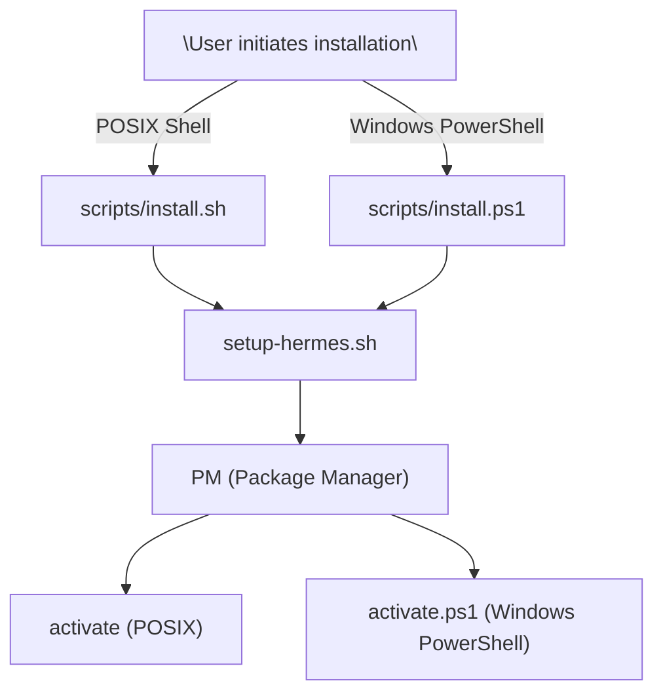
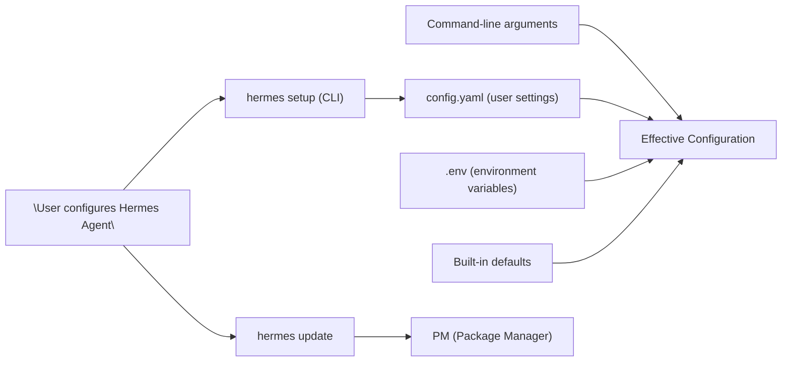

<!-- source: DeepWiki mcp.deepwiki.com · repo nousresearch/hermes-agent · page 2 Getting Started · fetched 2026-10-27 -->

# Getting Started

Relevant source files

The following files were used as context for generating this wiki page:

- [activate](activate)
- [activate.fish](activate.fish)
- [activate.ps1](activate.ps1)
- [hermes](hermes)
- [scripts/_activation.sh](scripts/_activation.sh)
- [scripts/install.ps1](scripts/install.ps1)
- [scripts/install.sh](scripts/install.sh)
- [setup-hermes.sh](setup-hermes.sh)
- [tests/acp_adapter/test_edit_approval.py](tests/acp_adapter/test_edit_approval.py)
- [tests/hermes_cli/test_launcher.py](tests/hermes_cli/test_launcher.py)
- [tests/hermes_cli/test_setup_pin_values.py](tests/hermes_cli/test_setup_pin_values.py)
- [tests/install/e2e-assets/source-build-env.ps1](tests/install/e2e-assets/source-build-env.ps1)
- [tests/pm/activation_support.py](tests/pm/activation_support.py)
- [tests/pm/test_activate_fish.py](tests/pm/test_activate_fish.py)
- [tests/pm/test_activate_scripts.py](tests/pm/test_activate_scripts.py)
- [tests/pm/test_activation_runtime.py](tests/pm/test_activation_runtime.py)
- [tests/pm/test_environment_script.py](tests/pm/test_environment_script.py)
- [tests/pm/test_setup_lock_format.py](tests/pm/test_setup_lock_format.py)
- [tests/scripts/install/test_install_sh_repository_stage.py](tests/scripts/install/test_install_sh_repository_stage.py)
- [tests/scripts/test_install_ps1_desktop_stage.py](tests/scripts/test_install_ps1_desktop_stage.py)
- [tests/scripts/test_install_sh_launch_handoff.py](tests/scripts/test_install_sh_launch_handoff.py)
- [tests/scripts/test_install_stage_frames.py](tests/scripts/test_install_stage_frames.py)
- [tests/scripts/test_mint_launchers.py](tests/scripts/test_mint_launchers.py)
- [website/docs/getting-started/installation.md](website/docs/getting-started/installation.md)
- [website/docs/getting-started/updating.md](website/docs/getting-started/updating.md)

This page provides a high-level introduction to setting up Hermes Agent, guiding users from initial installation through configuration, authentication, and model selection to starting their first conversation with the agent. It outlines the main steps and how the subsystems relate, linking to detailed child pages for comprehensive coverage.

---

## 2.1 Installation

Hermes Agent supports multiple platforms including Linux, macOS, WSL2, native Windows, and Android via Termux, providing flexible installation methods [website/docs/getting-started/installation.md:11-68]().

- **POSIX Platforms (Linux/macOS/WSL2):** Installation is typically done via the `scripts/install.sh` shell script, which clones the repository, bootstraps the `uv` binary, sets up Python, and delegates dependency management to PM (Package Manager). The script handles configuring the data directories and publishes a CLI wrapper for running Hermes [scripts/install.sh:1-146](), [website/docs/getting-started/installation.md:47-50]().

- **Windows:** Installation uses the PowerShell script `scripts/install.ps1` which performs a git checkout, sets up a virtual environment, and places a `hermes` command on the PATH. It integrates pinned binaries such as `uv` and `git-for-windows` for portability. The script supports flags to skip optional components like browser and computer-use tool installation, remembered for future updates [scripts/install.ps1:1-45](), [website/docs/getting-started/installation.md:52-57]().

- **Environment Activation:** After installation, an environment activation script (`activate` for POSIX or `activate.ps1` for PowerShell) syncs environment variables and shell functions. This provides seamless access to the installed `hermes` command within a managed Python virtual environment. The activation scripts include shell prompt customization to reflect the current Hermes source checkout [activate:1-23](), [activate.ps1:1-10]().

- **Other Platforms:** Android installation is supported via a Termux APT package [website/docs/getting-started/installation.md:64-68]().

Installation ensures heavy dependencies (browsers, Node.js, FFmpeg, etc.) are handled by Hermes’s package management (PM), allowing minimal bootstrap scripts to maintain smooth updates.

For detailed installation methods (including source scripts, manual install, Nix flake, Desktop bundles, and Tauri bootstrap), dependency provisioning, update commands, and platform-specific considerations, see [Installation](#2.1).

---

## 2.2 Configuration and Setup

Hermes Agent stores user data and configuration under a designated data directory, typically `~/.hermes/` on POSIX or `%LOCALAPPDATA%\hermes` on Windows. This includes profiles, sessions, secrets, and local caches [scripts/install.sh:26-27](), [scripts/install.ps1:23-24]().

Configuration follows a hierarchical precedence:

- CLI arguments override
- `config.yaml` values override
- `.env` environment variables override
- Built-in defaults

This layered approach ensures flexibility and sanity checks. Configuration changes can be interactively applied or migrated via dedicated commands.

The interactive setup wizard (`hermes setup`) guides users through creating profiles, selecting default providers and models, configuring gateways for messaging platforms, and enabling optional features. It supports automated flows such as “portal” logins that automatically configure providers and keys [website/docs/getting-started/installation.md:128-147]().

Users can also check for configuration drift, migrate obsolete keys, and inspect effective settings via CLI commands.

For full details on the configuration hierarchy, profile management, setup wizard usage, and configuration migrations, refer to [Configuration and Setup](#2.2).

---

## 2.3 Authentication and Providers

Hermes Agent integrates with a wide variety of LLM providers, supporting multiple credential management methods:

- API keys stored in `.env` or environment variables
- OAuth flows for supported providers
- Secret vault integration (e.g., Bitwarden, 1Password) for fetching keys securely

Provider resolution uses a chain of credential sources and fallback mechanisms, allowing automatic detection and transparent failover among providers. Credential Pools group credentials to balance usage and rate limits.

Providers are represented internally by `ProviderProfile` plugins and configured through the authentication subsystem. Auxiliary providers used for side-tasks like vision or compression are resolved through a similar system [website/docs/getting-started/installation.md:139-146]().

For a comprehensive listing of authentication methods, resolution logic, secret sources, and provider configuration, see [Authentication and Providers](#2.3).

---

## 2.4 Model Selection and Management

Selecting the appropriate LLM model is critical for cost control, response quality, and operational behavior. Hermes supports dynamic model cataloging:

- Discovers available LLM models through provider plugins
- Automatically validates model capabilities and context length limits
- Tracks pricing and usage metadata for cost estimation

Users can configure default and fallback models globally or per-profile. Model configuration is accessible via interactive CLI commands (`hermes model`) and exposed in configuration files [website/docs/getting-started/installation.md:130-136]().

Model catalogs abstract provider-specific details to present a unified interface for model selection and metadata.

For detailed explainers on the model catalog internals, validation processes, pricing metadata, and configuration options, see [Model Selection and Management](#2.4).

---

# Bridging Natural Language Concepts to Code Entities

To clarify the relationship between user-facing concepts and their implementation in the codebase, the following diagrams expose links between key natural language setup steps and corresponding scripts or classes.

### Diagram 1: Installation and Bootstrap Flow

This flow shows the initial user installation command triggering platform-appropriate install scripts, which in turn bootstrap minimal binaries like `uv` for Python installation. The package manager (PM) handles complex dependency installation and environment preparation. Finally, activation scripts configure the interactive shell environment for Hermes usage.

Sources: [scripts/install.sh:1-146](), [scripts/install.ps1:1-45](), [setup-hermes.sh:1-20](), [activate:1-23](), [activate.ps1:1-10]()

---

### Diagram 2: Configuration and Update Subsystem

This diagram depicts how multiple configuration sources compose the final effective settings during Hermes execution. Users employ the setup wizard to create initial configurations, which are saved into `config.yaml`. Updates trigger PM to refresh dependencies or code, and configuration changes flow through the hierarchy from CLI args down to defaults.

Sources: [website/docs/getting-started/installation.md:1-149](), [website/docs/getting-started/updating.md:1-119]()

---

For detailed operational information and advanced configuration, please consult the respective child pages linked above. This overview aims to orient new users and developers to the initial steps of using Hermes Agent.

---

