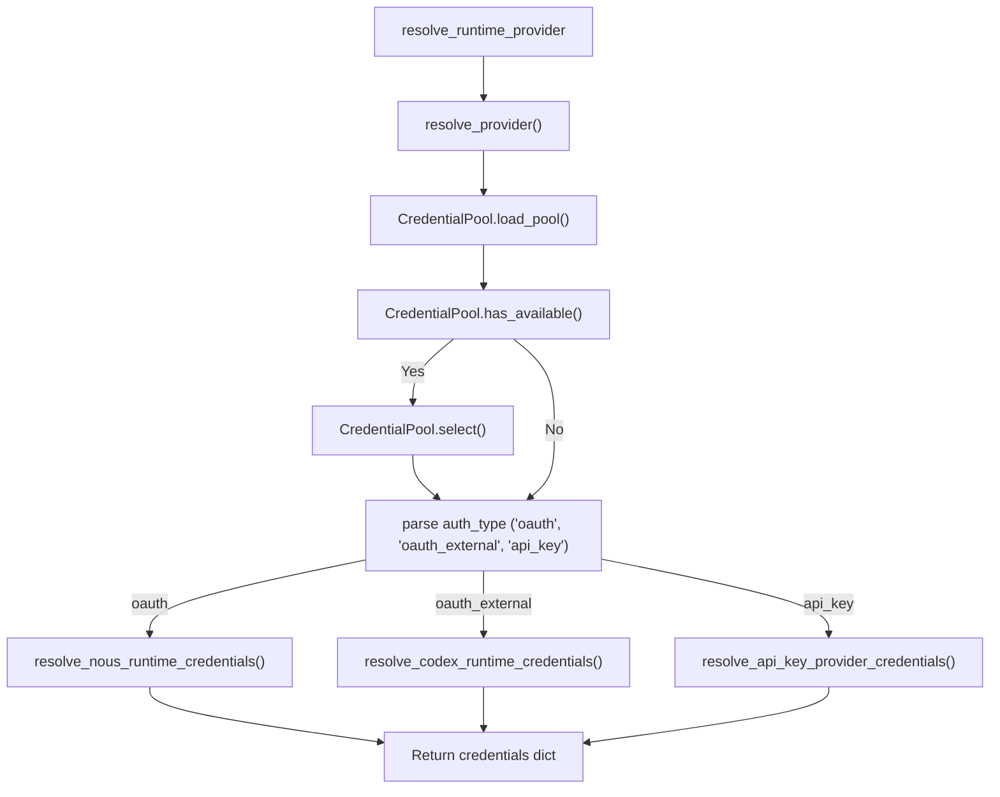
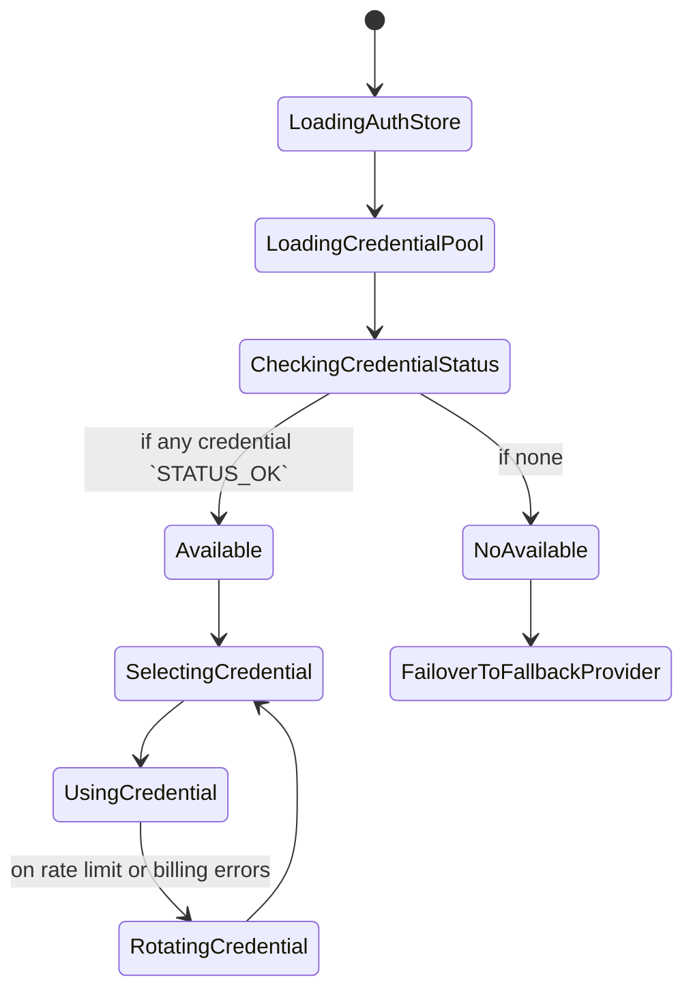
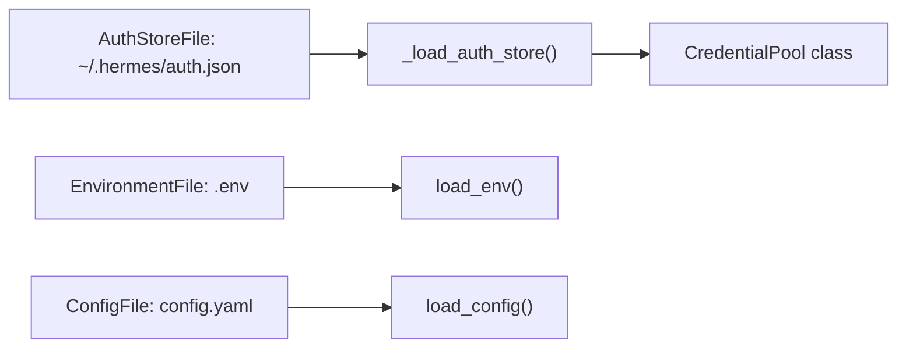
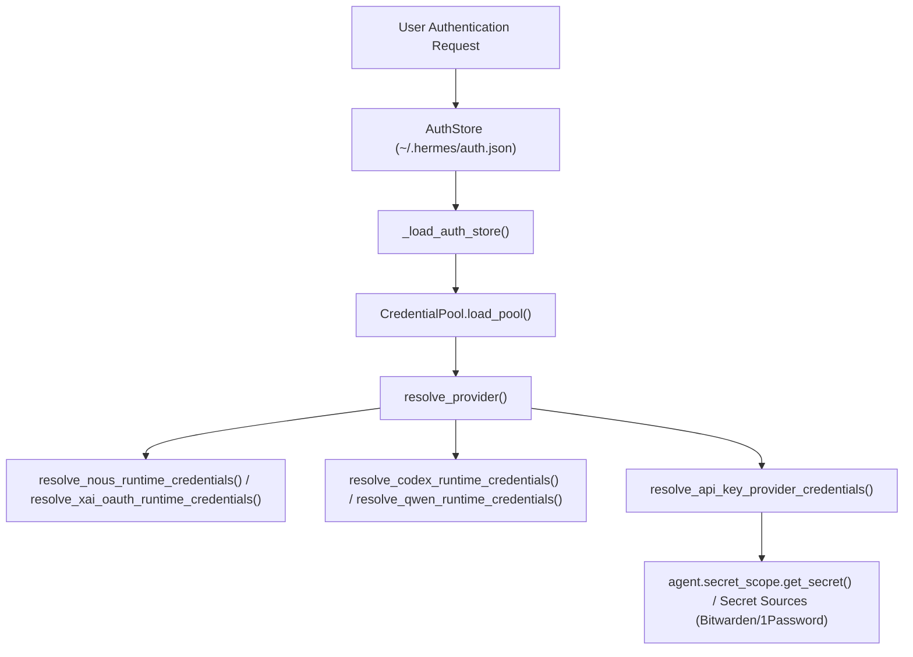

<!-- source: DeepWiki mcp.deepwiki.com · repo nousresearch/hermes-agent · page 2.3 Authentication and Providers · fetched 2026-10-27 -->

# Authentication and Providers

Relevant source files

The following files were used as context for generating this wiki page:

- [agent/credential_pool.py](agent/credential_pool.py)
- [agent/credential_pool_admin.py](agent/credential_pool_admin.py)
- [agent/credential_pool_model_cooldowns.py](agent/credential_pool_model_cooldowns.py)
- [agent/fallback_cooldown.py](agent/fallback_cooldown.py)
- [agent/secret_scope.py](agent/secret_scope.py)
- [agent/secret_sources/__init__.py](agent/secret_sources/__init__.py)
- [agent/secret_sources/_cache.py](agent/secret_sources/_cache.py)
- [agent/secret_sources/base.py](agent/secret_sources/base.py)
- [agent/secret_sources/bitwarden.py](agent/secret_sources/bitwarden.py)
- [agent/secret_sources/command.py](agent/secret_sources/command.py)
- [agent/secret_sources/onepassword.py](agent/secret_sources/onepassword.py)
- [agent/secret_sources/registry.py](agent/secret_sources/registry.py)
- [contributors/emails/kboxstar@gmail.com](contributors/emails/kboxstar@gmail.com)
- [cron/scheduler_script.py](cron/scheduler_script.py)
- [hermes_cli/auth.py](hermes_cli/auth.py)
- [hermes_cli/auth_codex.py](hermes_cli/auth_codex.py)
- [hermes_cli/auth_commands.py](hermes_cli/auth_commands.py)
- [hermes_cli/auth_constants.py](hermes_cli/auth_constants.py)
- [hermes_cli/auth_device_flow.py](hermes_cli/auth_device_flow.py)
- [hermes_cli/auth_error_copy.py](hermes_cli/auth_error_copy.py)
- [hermes_cli/auth_nous.py](hermes_cli/auth_nous.py)
- [hermes_cli/auth_oauth_grants.py](hermes_cli/auth_oauth_grants.py)
- [hermes_cli/auth_openrouter.py](hermes_cli/auth_openrouter.py)
- [hermes_cli/env_loader.py](hermes_cli/env_loader.py)
- [hermes_cli/observability/shared_metrics_disabled.py](hermes_cli/observability/shared_metrics_disabled.py)
- [hermes_cli/observability/shared_metrics_setup.py](hermes_cli/observability/shared_metrics_setup.py)
- [hermes_cli/observability/shared_metrics_signals.py](hermes_cli/observability/shared_metrics_signals.py)
- [hermes_cli/proxy/adapters/__init__.py](hermes_cli/proxy/adapters/__init__.py)
- [hermes_cli/proxy/adapters/base.py](hermes_cli/proxy/adapters/base.py)
- [hermes_cli/proxy/adapters/nous_portal.py](hermes_cli/proxy/adapters/nous_portal.py)
- [hermes_cli/proxy/adapters/xai.py](hermes_cli/proxy/adapters/xai.py)
- [hermes_cli/proxy/cli.py](hermes_cli/proxy/cli.py)
- [hermes_cli/proxy/server.py](hermes_cli/proxy/server.py)
- [hermes_cli/proxy/sse_done.py](hermes_cli/proxy/sse_done.py)
- [hermes_cli/proxy_cli.py](hermes_cli/proxy_cli.py)
- [hermes_cli/psutil_android.py](hermes_cli/psutil_android.py)
- [hermes_cli/relaunch.py](hermes_cli/relaunch.py)
- [hermes_cli/relay_plugin_cutover.py](hermes_cli/relay_plugin_cutover.py)
- [hermes_cli/resource_limits.py](hermes_cli/resource_limits.py)
- [tests/agent/test_codex_model_entitlement_rotation.py](tests/agent/test_codex_model_entitlement_rotation.py)
- [tests/agent/test_credential_pool.py](tests/agent/test_credential_pool.py)
- [tests/agent/test_credential_pool_profile_oauth_fork.py](tests/agent/test_credential_pool_profile_oauth_fork.py)
- [tests/agent/test_env_loader_secret_sources.py](tests/agent/test_env_loader_secret_sources.py)
- [tests/agent/test_onepassword_secrets.py](tests/agent/test_onepassword_secrets.py)
- [tests/agent/test_provider_reset_cooldown.py](tests/agent/test_provider_reset_cooldown.py)
- [tests/agent/test_secret_scope.py](tests/agent/test_secret_scope.py)
- [tests/agent/test_secret_scope_pinned_launch_home.py](tests/agent/test_secret_scope_pinned_launch_home.py)
- [tests/cron/test_cron_multiplex_desktop_ticker_scope.py](tests/cron/test_cron_multiplex_desktop_ticker_scope.py)
- [tests/cron/test_cron_no_agent.py](tests/cron/test_cron_no_agent.py)
- [tests/cron/test_cron_script.py](tests/cron/test_cron_script.py)
- [tests/cron/test_script_claim_heartbeat.py](tests/cron/test_script_claim_heartbeat.py)
- [tests/hermes_cli/test_auth_commands.py](tests/hermes_cli/test_auth_commands.py)
- [tests/hermes_cli/test_auth_nous_provider.py](tests/hermes_cli/test_auth_nous_provider.py)
- [tests/hermes_cli/test_auth_profile_fallback.py](tests/hermes_cli/test_auth_profile_fallback.py)
- [tests/hermes_cli/test_codex_token_writethrough.py](tests/hermes_cli/test_codex_token_writethrough.py)
- [tests/hermes_cli/test_desktop_cron_ticker_gateway_standdown.py](tests/hermes_cli/test_desktop_cron_ticker_gateway_standdown.py)
- [tests/hermes_cli/test_desktop_cron_ticker_profiles.py](tests/hermes_cli/test_desktop_cron_ticker_profiles.py)
- [tests/hermes_cli/test_device_poll_waf_backoff.py](tests/hermes_cli/test_device_poll_waf_backoff.py)
- [tests/hermes_cli/test_env_loader.py](tests/hermes_cli/test_env_loader.py)
- [tests/hermes_cli/test_env_sanitize_on_load.py](tests/hermes_cli/test_env_sanitize_on_load.py)
- [tests/hermes_cli/test_global_auth_store_memo.py](tests/hermes_cli/test_global_auth_store_memo.py)
- [tests/hermes_cli/test_launchd_plist_guard.py](tests/hermes_cli/test_launchd_plist_guard.py)
- [tests/hermes_cli/test_model_cache_swr.py](tests/hermes_cli/test_model_cache_swr.py)
- [tests/hermes_cli/test_nous_nonproduction_inference_host.py](tests/hermes_cli/test_nous_nonproduction_inference_host.py)
- [tests/hermes_cli/test_oauth_status_pool_observation.py](tests/hermes_cli/test_oauth_status_pool_observation.py)
- [tests/hermes_cli/test_profile_delete_service_name.py](tests/hermes_cli/test_profile_delete_service_name.py)
- [tests/hermes_cli/test_proxy.py](tests/hermes_cli/test_proxy.py)
- [tests/hermes_cli/test_relaunch.py](tests/hermes_cli/test_relaunch.py)
- [tests/hermes_cli/test_secret_source_bootstrap.py](tests/hermes_cli/test_secret_source_bootstrap.py)
- [tests/hermes_cli/test_shared_metrics_signals.py](tests/hermes_cli/test_shared_metrics_signals.py)
- [tests/hermes_cli/test_slash_confirm_windows.py](tests/hermes_cli/test_slash_confirm_windows.py)
- [tests/scripts/test_powershell_script_syntax.py](tests/scripts/test_powershell_script_syntax.py)
- [tests/secret_sources/test_profile_secrets.py](tests/secret_sources/test_profile_secrets.py)
- [website/docs/developer-guide/egress-internals.md](website/docs/developer-guide/egress-internals.md)
- [website/docs/developer-guide/secret-source-plugin.md](website/docs/developer-guide/secret-source-plugin.md)
- [website/docs/guides/cron-troubleshooting.md](website/docs/guides/cron-troubleshooting.md)
- [website/docs/user-guide/egress/iron-proxy.md](website/docs/user-guide/egress/iron-proxy.md)
- [website/docs/user-guide/features/credential-pools.md](website/docs/user-guide/features/credential-pools.md)
- [website/docs/user-guide/features/subscription-proxy.md](website/docs/user-guide/features/subscription-proxy.md)
- [website/docs/user-guide/secrets/index.md](website/docs/user-guide/secrets/index.md)
- [website/i18n/zh-Hans/docusaurus-plugin-content-docs/current/guides/cron-troubleshooting.md](website/i18n/zh-Hans/docusaurus-plugin-content-docs/current/guides/cron-troubleshooting.md)
- [website/i18n/zh-Hans/docusaurus-plugin-content-docs/current/user-guide/features/subscription-proxy.md](website/i18n/zh-Hans/docusaurus-plugin-content-docs/current/user-guide/features/subscription-proxy.md)

This page documents the authentication system that enables Hermes Agent to connect to Large Language Model (LLM) inference providers. It covers provider authentication methods (OAuth, API keys), the provider resolution chain, credential pools, automatic provider credential detection, and secret injection from external sources such as Bitwarden and 1Password.

**Scope**: This page focuses on authentication and the selection of the **primary inference provider** for conversation tasks. For auxiliary models used by tools (vision, compression, web extraction, etc.), see [Auxiliary Client (4.5)]().

Sources: [hermes_cli/auth.py:1-106](), [agent/credential_pool.py:1-51](), [agent/secret_scope.py:22-23]().

---

## Overview

Hermes Agent’s authentication system supports multiple LLM inference providers with uniform management for credential handling:

- **OAuth Device Code Flows**: Used by Nous Portal, xAI, MiniMax, and others. These flows manage device authorization, polling for token issuance and automatic refresh, implemented across submodules like `auth_nous`, `auth_xai`, `auth_minimax`, and coordinated in the main `hermes_cli.auth` [hermes_cli/auth.py:1-106]().

- **OAuth External Flows**: Providers such as OpenAI Codex and Qwen utilize OAuth login handled externally, e.g., via browser or CLI helpers. Hermes imports and manages the resulting tokens in its credential pools [hermes_cli/auth.py:77-90]().

- **API Key Authentication**: Traditional API key auth is supported directly for providers like OpenRouter, Anthropic, Google AI Studio, Z.AI/GLM, Kimi/Moonshot, MiniMax, Alibaba, DeepSeek, and xAI [hermes_cli/auth.py:36-44]().

- **Credential Pools**: Hermes supports multiple credentials per provider for failover and automatic rotation on quota limits, rate-limits, or token expiry. The `CredentialPool` class abstracts this with persistent storage and cooldown tracking [agent/credential_pool.py:1-168]().

- **Secret Injection from External Sources**: Credentials can be automatically injected from external secret managers (Bitwarden, 1Password) via the `agent.secret_scope` system. This allows dynamic environment hydration without polluting global envvars [agent/secret_scope.py:22-23]().

- **Provider Resolution Chain**: An ordered sequence to select the active provider and relevant credentials using explicit user input, config file settings, environment variables, or autodetection heuristics.

---

## Provider Registry and Profiles

Hermes manages a registry via the `PROVIDER_REGISTRY` dictionary and the `ProviderConfig` dataclass in `hermes_cli.auth`, describing each inference provider with authentication meta and runtime connection info:

- **Transport Protocol Identifiers:** Specify request/response handling types (`openai_chat`, `anthropic_messages`, `codex_responses`, etc.).
- **Auth Types:** Support for `api_key`, `oauth_device_code`, `oauth_external`, and others.
- **Inference Base URLs:** Provider API endpoints, overridable by environment or user config.
- **Aggregator Flags:** Mark meta-providers like MOA presets or OpenRouter aggregators.

### Example Providers and Schemes

| Provider Key    | Authentication Scheme   | Typical Env Vars / Credentials           | Notes                                |
|-----------------|-------------------------|------------------------------------------|-------------------------------------|
| `nous`          | OAuth Device Code       | Managed internally via device code flows | Nous Portal models                  |
| `openai-codex`  | OAuth External          | External CLI/browser helper tokens       | OpenAI-compatible OAuth             |
| `anthropic`     | API Key or OAuth        | `ANTHROPIC_API_KEY`, OAuth tokens        | Supports both key and OAuth modes   |
| `openrouter`    | API Key                 | `OPENROUTER_API_KEY`                      | Aggregator proxy for many LLMs      |
| `xai-oauth`     | OAuth Device Code       | Managed internally for xAI token flows   | xAI direct OAuth device code        |
| `minimax-oauth` | OAuth External          | Internal OAuth token storage              | MiniMax OAuth token fetch / refresh |

Sources: [hermes_cli/auth.py:1-106]().

---

## Provider Resolution Chain

The entrypoint `resolve_provider()` in `hermes_cli.auth` selects the active inference provider and credentials by following a clear priority chain: explicit CLI arguments, config file (`config.yaml`) entries, environment variables, and lastly auto-detection/fallback [hermes_cli/auth.py:7]().

This function coordinates:

- Loading credential pools for a provider from `~/.hermes/auth.json`.
- Checking credential availability status.
- Selecting the current usable credential based on priority and rotation strategy.
- Dispatching to provider-specific credential resolution functions depending on the `auth_type` enumerated.

### Key classes / functions involved

| Name                                   | Description                                          | Code Location                |
|---------------------------------------|------------------------------------------------------|------------------------------|
| `resolve_provider()`                  | Selects the active LLM provider and runtime creds   | [hermes_cli/auth.py:7]()     |
| `CredentialPool.load_pool()`          | Loads credential entries with rotation state         | [agent/credential_pool.py:1-51]() |
| `CredentialPool.select()`             | Picks the next ready credential entry                | [agent/credential_pool.py:1-168]() |
| `_load_auth_store()` / `_save_auth_store()` | Load/save credential JSON with Locking               | [hermes_cli/auth.py:4-6]()   |
| `resolve_nous_runtime_credentials()` | Resolves Nous Portal OAuth runtime credentials       | [hermes_cli/auth.py:64]()    |
| `resolve_codex_runtime_credentials()`| Resolves OpenAI Codex OAuth external flow credentials| [hermes_cli/auth.py:83]()    |

### Diagram: Provider Resolution Flow

Sources: [hermes_cli/auth.py:1-106](), [agent/credential_pool.py:1-168](), [hermes_cli/auth.py:7]().

---

## Credential Pool and Rotation

The credential pool, implemented as the `CredentialPool` class in `agent.credential_pool`, enables grouping multiple credentials for the same provider to support continuous failover and rate limit recovery.

- **Status Management:** Credentials track states such as:

  - `STATUS_OK` — credential is valid and usable,
  - `STATUS_EXHAUSTED` — temporarily unusable due to rate or quota limits,
  - `STATUS_DEAD` — permanently invalid (e.g., token revoked),

  allowing smooth rotation between available credentials [agent/credential_pool.py:82-89]().

- **Cooldown Periods:** Cooldown TTLs delay retry for exhausted credentials, tuned per HTTP response codes (e.g., 401 Unauthorized, 429 Rate Limit, 402 Billing) [agent/credential_pool.py:130-136]().

- **Rotation Strategies:**

  - `fill_first`: always pick the highest priority available credential first,
  - `round_robin`: cycle through credentials in order,
  - `random`: random credential selection,
  - `least_used`: pick the credential with the fewest recent usages,

  configurable per provider for flexible balancing [agent/credential_pool.py:119-123]().

- **Persistence and Safety:** Credential pools are stored in an encrypted (permission 0600) JSON file `~/.hermes/auth.json` with cross-process locking via `_auth_store_lock()` to serialize concurrent access safely [hermes_cli/auth.py:4-6]().

- **Billing and Token Expiry:** The pool supports specific heuristics for billing errors (e.g., exhaust all entries with the same key on 402 Billing errors), and automatic token refresh for OAuth credentials to ensure minimal disruption [agent/credential_pool.py:80-166]().

### Diagram: Credential Pool Internal Flow

Sources: [agent/credential_pool.py:1-168](), [hermes_cli/auth.py:4-6]().

---

## Authentication Implementation Details

### OAuth Device Code and External Flows

- **Device Code Login:** Providers like Nous, xAI, and MiniMax initiate OAuth via device code flows. This involves displaying a user code and URL for browser authentication and polling the token endpoint asynchronously until the access token is issued. The device code logic is handled in dedicated modules (`auth_nous`, `auth_xai`, `auth_minimax`) and integrated with the global auth store [hermes_cli/auth.py:50-90]().

- **External OAuth Flows:** Some providers (OpenAI Codex, Qwen) rely on external CLI or browser flows for OAuth authentication. Hermes imports these OAuth tokens into its own `auth.json` credential pool and manages token refreshes internally. This decouples Hermes from external tool token rotation, reducing interference [hermes_cli/auth.py:77-90]().

- **Single-Use Refresh Tokens:** To avoid token reuse problems with single-use refresh tokens (common in OAuth), `hermes_cli.auth_oauth_grants` manages token hygiene by stripping cloned grants, healing forked refresh tokens, and mapping token generations consistently across profiles [hermes_cli/auth_oauth_grants.py:1-156]().

### API Key Authentication and Secret Sources

- API keys can be provided explicitly in Hermes config files (`config.yaml`) or injected via environment variables scoped to specific profiles.

- **Secret Injection:** Hermes uses the `agent.secret_scope` system to dynamically source secrets from secret management backends without global env pollution. This supports:

  - **Bitwarden** — via `agent.secret_sources.bitwarden`,
  - **1Password** — via `agent.secret_sources.onepassword`.

  These secret sources inject credentials transparently into Hermes environments or child process environments as needed, keeping secret management secure and separate [agent/secret_scope.py:22]().

---

## Natural Language to Code Entity Mapping

The following diagrams clarify how user-level authentication concepts map to underlying Hermes Agent code entities.

### Diagram: Storage and Loader Components Mapping

Sources: [hermes_cli/auth.py:4-6](), [agent/credential_pool.py:21](), [agent/secret_scope.py:22]().

---

### Diagram: Runtime Resolution of Provider Credentials

Sources: [hermes_cli/auth.py:4-7](), [hermes_cli/auth.py:64](), [hermes_cli/auth.py:83](), [agent/credential_pool.py:22]().

---

# References

- Multi-provider authentication and OAuth flows: [hermes_cli/auth.py:1-106]()
- Credential Pool implementation and rotation: [agent/credential_pool.py:1-168]()
- Environment loading and secret injection from external sources: [agent/secret_scope.py:22-23]()
- Provider runtime credential resolution logic: [hermes_cli/auth.py:7]()

---

# End of 2.3 Authentication and Providers

---

