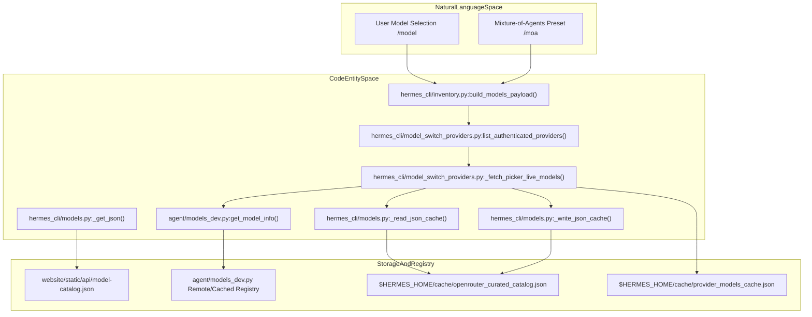
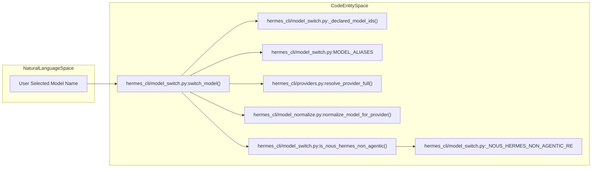

<!-- source: DeepWiki mcp.deepwiki.com · repo nousresearch/hermes-agent · page 2.4 Model Selection and Management · fetched 2026-10-27 -->

# Model Selection and Management

Relevant source files

The following files were used as context for generating this wiki page:

- [agent/image_routing.py](agent/image_routing.py)
- [agent/insights.py](agent/insights.py)
- [agent/moa_loop.py](agent/moa_loop.py)
- [agent/model_metadata.py](agent/model_metadata.py)
- [agent/models_dev.py](agent/models_dev.py)
- [agent/reasoning_effort.py](agent/reasoning_effort.py)
- [agent/reasoning_timeouts.py](agent/reasoning_timeouts.py)
- [agent/usage_pricing.py](agent/usage_pricing.py)
- [apps/desktop/src/app/settings/model-settings.test.tsx](apps/desktop/src/app/settings/model-settings.test.tsx)
- [apps/desktop/src/app/settings/model-settings.tsx](apps/desktop/src/app/settings/model-settings.tsx)
- [contributors/emails/elisam@nvidia.com](contributors/emails/elisam@nvidia.com)
- [contributors/emails/kevinbanjo@gmail.com](contributors/emails/kevinbanjo@gmail.com)
- [hermes_cli/codex_models.py](hermes_cli/codex_models.py)
- [hermes_cli/inventory.py](hermes_cli/inventory.py)
- [hermes_cli/local_runtime/capabilities.py](hermes_cli/local_runtime/capabilities.py)
- [hermes_cli/moa_cmd.py](hermes_cli/moa_cmd.py)
- [hermes_cli/moa_config.py](hermes_cli/moa_config.py)
- [hermes_cli/model_switch.py](hermes_cli/model_switch.py)
- [hermes_cli/model_switch_providers.py](hermes_cli/model_switch_providers.py)
- [hermes_cli/models.py](hermes_cli/models.py)
- [hermes_cli/models_catalog_static.py](hermes_cli/models_catalog_static.py)
- [hermes_cli/models_local.py](hermes_cli/models_local.py)
- [hermes_cli/models_pricing.py](hermes_cli/models_pricing.py)
- [hermes_cli/models_profile_cache.py](hermes_cli/models_profile_cache.py)
- [hermes_cli/models_reasoning_caps.py](hermes_cli/models_reasoning_caps.py)
- [hermes_cli/models_validate.py](hermes_cli/models_validate.py)
- [tests/agent/test_astra_baseline_runtime.py](tests/agent/test_astra_baseline_runtime.py)
- [tests/agent/test_cache_disabled_on_stubs.py](tests/agent/test_cache_disabled_on_stubs.py)
- [tests/agent/test_capability_probe_credentials.py](tests/agent/test_capability_probe_credentials.py)
- [tests/agent/test_image_routing.py](tests/agent/test_image_routing.py)
- [tests/agent/test_insights.py](tests/agent/test_insights.py)
- [tests/agent/test_model_metadata.py](tests/agent/test_model_metadata.py)
- [tests/agent/test_model_metadata_local_ctx.py](tests/agent/test_model_metadata_local_ctx.py)
- [tests/agent/test_models_dev.py](tests/agent/test_models_dev.py)
- [tests/agent/test_probe_cache_followups.py](tests/agent/test_probe_cache_followups.py)
- [tests/agent/test_reasoning_effort_module.py](tests/agent/test_reasoning_effort_module.py)
- [tests/agent/test_reasoning_stale_timeout_floor.py](tests/agent/test_reasoning_stale_timeout_floor.py)
- [tests/agent/test_usage_pricing.py](tests/agent/test_usage_pricing.py)
- [tests/gateway/test_model_command_async_offload.py](tests/gateway/test_model_command_async_offload.py)
- [tests/gateway/test_model_command_custom_providers.py](tests/gateway/test_model_command_custom_providers.py)
- [tests/hermes_cli/test_codex_cli_model_picker.py](tests/hermes_cli/test_codex_cli_model_picker.py)
- [tests/hermes_cli/test_codex_models.py](tests/hermes_cli/test_codex_models.py)
- [tests/hermes_cli/test_custom_provider_model_switch.py](tests/hermes_cli/test_custom_provider_model_switch.py)
- [tests/hermes_cli/test_inventory.py](tests/hermes_cli/test_inventory.py)
- [tests/hermes_cli/test_inventory_pricing.py](tests/hermes_cli/test_inventory_pricing.py)
- [tests/hermes_cli/test_list_picker_providers.py](tests/hermes_cli/test_list_picker_providers.py)
- [tests/hermes_cli/test_local_models_activate_rescan.py](tests/hermes_cli/test_local_models_activate_rescan.py)
- [tests/hermes_cli/test_managed_vision_capability.py](tests/hermes_cli/test_managed_vision_capability.py)
- [tests/hermes_cli/test_moa_config.py](tests/hermes_cli/test_moa_config.py)
- [tests/hermes_cli/test_model_switch_custom_providers.py](tests/hermes_cli/test_model_switch_custom_providers.py)
- [tests/hermes_cli/test_model_validation.py](tests/hermes_cli/test_model_validation.py)
- [tests/hermes_cli/test_model_validation_managed_local.py](tests/hermes_cli/test_model_validation_managed_local.py)
- [tests/hermes_cli/test_models.py](tests/hermes_cli/test_models.py)
- [tests/hermes_cli/test_multiplex_cli_cache_scope.py](tests/hermes_cli/test_multiplex_cli_cache_scope.py)
- [tests/hermes_cli/test_nous_picker_on_sale.py](tests/hermes_cli/test_nous_picker_on_sale.py)
- [tests/hermes_cli/test_nous_reasoning_metadata.py](tests/hermes_cli/test_nous_reasoning_metadata.py)
- [tests/hermes_cli/test_ollama_cloud_provider.py](tests/hermes_cli/test_ollama_cloud_provider.py)
- [tests/hermes_cli/test_reasoning_caps_disk_cache.py](tests/hermes_cli/test_reasoning_caps_disk_cache.py)
- [tests/hermes_cli/test_sale_pricing.py](tests/hermes_cli/test_sale_pricing.py)
- [tests/hermes_cli/test_setup_provider_catalog.py](tests/hermes_cli/test_setup_provider_catalog.py)
- [tests/hermes_cli/test_user_providers_model_switch.py](tests/hermes_cli/test_user_providers_model_switch.py)
- [tests/tui_gateway/test_session_create_model_provider_guard.py](tests/tui_gateway/test_session_create_model_provider_guard.py)
- [tui_gateway/methods_session_model_guard.py](tui_gateway/methods_session_model_guard.py)
- [website/docs/user-guide/features/mixture-of-agents.md](website/docs/user-guide/features/mixture-of-agents.md)
- [website/static/api/model-catalog.json](website/static/api/model-catalog.json)

This page details the implementation and data flow for model selection, validation, context length discovery, pricing/usage metadata, and the model catalog system within Hermes Agent. It explains how Hermes manages diverse LLM providers, normalizes model identifiers, pools credentials for provider failover, dynamically discovers model context lengths, uses curated and live model catalogs to present viable model options, and handles endpoint blackhole mitigation.

---

## Model Catalog System

Hermes employs a multi-tiered model catalog system combining curated snapshots, a community-maintained registry, live API discovery, inventory management, and user-defined providers to supply updated, validated, and context-aware model listings.

### The models.dev Registry and Static Catalogs

The central metadata source is the `models.dev` registry, managed and queried through `agent/models_dev.py` [agent/models_dev.py:31-97](). Each model is represented by the `ModelInfo` dataclass containing detailed metadata such as:

- Capabilities (reasoning levels, tool calling)
- Supported modal types (text, vision, code)
- Context/input and output token limits
- Pricing info and experimental status

Provider metadata is captured by `ProviderInfo` dataclasses describing environment variables, API endpoints, documentation links, and per-model counts [agent/models_dev.py:39-97]().

In addition to live data, Hermes ships and caches curated static catalogs for pickers and CLI defaults, such as the snapshot in `website/static/api/model-catalog.json` [website/static/api/model-catalog.json:1-252](). Internally, `hermes_cli/models.py` provides layered access to these curated registries, managing cache lifecycles and TTLs (`_openrouter_catalog_disk_ttl()`, `_openrouter_catalog_disk_path()`) [hermes_cli/models.py:156-160](). It proactively caches and merges catalogs from live sources like OpenRouter and Vercel AI Gateway, persisting results to disk under `$HERMES_HOME/cache/` [hermes_cli/models.py:109-117]().

Inventory payloads for UI components, the TUI RPC handlers, and dashboard endpoints are assembled via `hermes_cli/inventory.py:build_models_payload()` [hermes_cli/inventory.py:75-103](). This function integrates live credential authentication checks (`hermes_cli/model_switch.py:list_authenticated_providers()`), manages managed local runtimes (`_local_runtime_row()`), and injects Mixture-of-Agents (`moa`) provider rows [hermes_cli/inventory.py:92-125](). Live model discovery for custom and Ollama endpoints is handled by `hermes_cli/model_switch_providers.py:_fetch_picker_live_models()`, which supports native Ollama tags and persistent caching in `provider_models_cache.json` [tests/hermes_cli/test_model_switch_custom_providers.py:64-97]().

### Diagram: Catalog Resolution & Natural Language to Code Entity Space

**Sources:**  
[website/static/api/model-catalog.json:1-252](), [hermes_cli/models.py:85-96](), [hermes_cli/models.py:109-117](), [hermes_cli/models.py:156-160](), [agent/models_dev.py:39-97](), [hermes_cli/inventory.py:75-125](), [hermes_cli/model_switch_providers.py:92-144](), [tests/hermes_cli/test_model_switch_custom_providers.py:64-97]()

---

## Model Selection and Normalization

Hermes performs provider-aware model normalization to ensure compatibility with diverse transport APIs, naming conventions, and credential contexts. This process is critical because model identifiers often include provider prefixes, variant tags, or alias shorthands that must be translated into canonical internal forms.

### Provider-Aware Model Normalization

Normalization rules vary by provider type:

| Provider Type        | Normalization Logic                                                                                      | Code Reference                         |
|----------------------|--------------------------------------------------------------------------------------------------------|--------------------------------------|
| **Aggregators**       | Preserve vendor prefix as a routing hint (e.g., OpenRouter models like `anthropic/claude-opus-4.6`)     | `hermes_cli/model_switch.py:29-151` |
| **Ollama**            | Strips `local:` provider prefix if suffix is not an Ollama-specific version tag (e.g., `:latest`)     | `agent/model_metadata.py:47-61`      |
| **Custom Providers**  | Support stable keys with aliases resolving to canonical internal IDs, often requiring direct `base_url`| `hermes_cli/providers.py:28-92`      |

Aliases such as `"sonnet"`, `"opus"`, `"haiku"`, or `"gpt5"` are resolved dynamically against the live `models.dev` catalog via `MODEL_ALIASES`, mapping shorthand identifiers to vendor/family `ModelIdentity` tuples [hermes_cli/model_switch.py:140-151]().

### Model Switcher Pipeline

The core of model selection is implemented in `switch_model()` within `hermes_cli/model_switch.py`. It follows these steps:

1. **Parsing input:** Accepts string, list, or dictionary inputs to extract model IDs via `_declared_model_ids()` [hermes_cli/model_switch.py:30-50]().

2. **Alias resolution:** Replaces short names with canonical vendor-family prefixes [hermes_cli/model_switch.py:140-151]().

3. **Provider resolution:** Maps provider aliases and names to a complete `ProviderDef` dataclass including API mode, transport, and authentication types via `resolve_provider_full()` [hermes_cli/providers.py:97-107]().

4. **Model normalization:** Uses `normalize_model_for_provider()` to transform model names depending on provider transport and conventions [hermes_cli/model_normalize.py:15-32]().

5. **Agent warning checks:** Uses regular expressions (`_NOUS_HERMES_NON_AGENTIC_RE`) to detect non-agentic Nous Hermes base models and warns users that these lack tool-calling capabilities [hermes_cli/model_switch.py:110-135]().

### Diagram: Model Selection Execution Flow

**Sources:**  
[hermes_cli/model_switch.py:29-151](), [hermes_cli/model_switch.py:30-50](), [hermes_cli/model_switch.py:110-135](), [hermes_cli/providers.py:28-92](), [hermes_cli/providers.py:97-107](), [hermes_cli/model_normalize.py:15-32]()

---

## Context Length Discovery and Token Estimation

To avoid request errors caused by exceeding model context windows, Hermes dynamically discovers and caches context length limits per model.

### Context Length Resolution Priority

The key function `get_model_context_length()` in `agent/model_metadata.py` implements context-length discovery with a priority fallback strategy:

1. **Models.dev registry lookup:** Cached or live context length metadata keyed by vendor/family or full model ID is returned when available [agent/model_metadata.py:63-70]().

2. **Hardcoded fallback defaults:** For older or unsupported models, a heuristic default minimum context is applied to avoid zero or missing values [tests/agent/test_model_metadata.py:20-22]().

3. **Endpoint probes:** If the model is attached to a live HTTP endpoint supporting OpenAI-compatible `/models` metadata, this endpoint is asynchronously queried for up-to-date context lengths. To handle routable-but-dead endpoints (such as corporate LAN off-VPN), Hermes implements **TCP blackhole detection** (`_note_endpoint_blackholed()`, `_ENDPOINT_BLACKHOLE_TTL_SECONDS = 30.0`) [agent/model_metadata.py:82-132](), short-circuiting connection attempts after a timeout.

4. **Error parsing for token limit:** If prior requests fail due to context limit errors, Hermes parses error strings with `parse_context_limit_from_error()` to extract explicit context max tokens [tests/agent/test_model_metadata.py:28-30]().

Context length caches use TTLs (`_MODEL_CACHE_TTL = 3600`), and endpoint probe responses are stored with expiration windows and failure caching (`_ENDPOINT_PROBE_FAILURE_TTL_SECONDS = 300.0`) [agent/model_metadata.py:65-80]().

### Token Estimation Utilities

Hermes provides rough token estimators to aid context budgeting and prompt compression:

- `estimate_tokens_rough()`: Estimates token count from a text string by dividing character length by ~4 [tests/agent/test_model_metadata.py:54-56]().

- `estimate_messages_tokens_rough()`: Computes token counts for chat messages considering roles, tool calls, and multimodal content (images are weighted at a flat ~1500 token cost to approximate base64 transmission overhead) [tests/agent/test_model_metadata.py:62-113]().

- Handles `api_content` sidecar messages correctly by counting only the replaced content on the wire, preventing double counting [tests/agent/test_model_metadata.py:115-159]().

**Sources:**  
[agent/model_metadata.py:20-132](), [agent/model_metadata.py:65-80](), [tests/agent/test_model_metadata.py:20-22](), [tests/agent/test_model_metadata.py:28-30](), [tests/agent/test_model_metadata.py:54-56](), [tests/agent/test_model_metadata.py:62-113](), [tests/agent/test_model_metadata.py:115-159]()

---

## Pricing, Usage Metadata, and Auxiliary Resolution

Hermes tracks usage statistics and costs for each model request to provide detailed costing and budget management.

### Usage and Pricing Metadata Structures

The `CanonicalUsage` dataclass in `agent/usage_pricing.py` standardizes usage tracking:

- `input_tokens` and `output_tokens` consumed during completion requests
- `cache_read_tokens` and `cache_write_tokens` indicating tokens handled via context cache layers
- `reasoning_tokens` used internally for agent reasoning functionality
- `request_count` denoting the number of batched requests aggregated [agent/usage_pricing.py:66-74]()

Pricing details are encapsulated in the `PricingEntry` dataclass, representing per-million-token costs segmented by input, output, and cache reads/writes. Tiered pricing (e.g., Gemini Pro above 200k prompt tokens) is supported via `tier_threshold_tokens` and `*_above` rate fields [agent/usage_pricing.py:104-123](). Costs are formatted using `format_cost_label()`, which applies a sub-cent threshold (`_SUBCENT_THRESHOLD = Decimal("0.01")`) to render cheap model turns at 4 decimal places (e.g. `~$0.0046` instead of `$0.00`) [agent/usage_pricing.py:32-56]().

### Auxiliary Model Resolution Chain

Hermes uses an extensible auxiliary LLM client system (`agent/auxiliary_client.py`) to route side tasks (such as vision, text compression, and web extraction) to an alternate model/provider chain. The resolution strategy falls through:

- Main configured provider and model for the auxiliary task
- OpenRouter auxiliary keys (`:free` or unrestricted SKUs)
- Nous Portal keys with custom endpoints
- Native Anthropic backends
- Direct API key providers

Failures and 402 payment errors trigger fallbacks automatically, with lazy client instantiation and custom headers [agent/auxiliary_client.py:1-170]().

**Sources:**  
[agent/usage_pricing.py:1-163](), [agent/usage_pricing.py:32-56](), [agent/usage_pricing.py:66-74](), [agent/usage_pricing.py:104-123](), [agent/auxiliary_client.py:1-170]()

---

