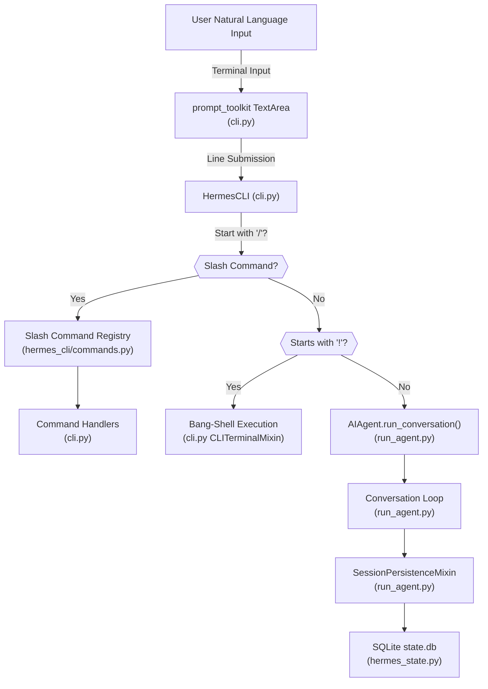
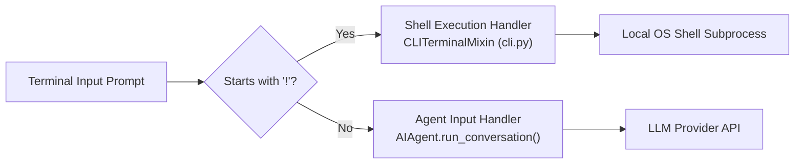
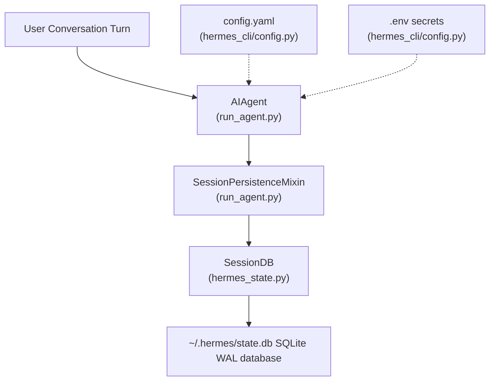

<!-- source: DeepWiki mcp.deepwiki.com · repo nousresearch/hermes-agent · page 3.1 Interactive Chat · fetched 2026-10-27 -->

# Interactive Chat

Relevant source files

The following files were used as context for generating this wiki page:

- [agent/auxiliary_client.py](agent/auxiliary_client.py)
- [cli-config.yaml.example](cli-config.yaml.example)
- [cli.py](cli.py)
- [contributors/emails/byjaps@users.noreply.github.com](contributors/emails/byjaps@users.noreply.github.com)
- [gateway/run.py](gateway/run.py)
- [gateway/session.py](gateway/session.py)
- [gateway/slash_commands.py](gateway/slash_commands.py)
- [gateway/slash_commands_session.py](gateway/slash_commands_session.py)
- [hermes_cli/cli_commands_mixin.py](hermes_cli/cli_commands_mixin.py)
- [hermes_cli/cli_info_mixin.py](hermes_cli/cli_info_mixin.py)
- [hermes_cli/cli_init_mixin.py](hermes_cli/cli_init_mixin.py)
- [hermes_cli/cli_loops_mixin.py](hermes_cli/cli_loops_mixin.py)
- [hermes_cli/cli_session_mixin.py](hermes_cli/cli_session_mixin.py)
- [hermes_cli/cli_tui_runtime_mixin.py](hermes_cli/cli_tui_runtime_mixin.py)
- [hermes_cli/commands.py](hermes_cli/commands.py)
- [hermes_cli/config.py](hermes_cli/config.py)
- [hermes_cli/config_defaults.py](hermes_cli/config_defaults.py)
- [hermes_cli/config_migrations.py](hermes_cli/config_migrations.py)
- [hermes_cli/config_version_stamp.py](hermes_cli/config_version_stamp.py)
- [hermes_cli/gateway_agent.py](hermes_cli/gateway_agent.py)
- [hermes_cli/gateway_automation.py](hermes_cli/gateway_automation.py)
- [hermes_cli/gateway_connection.py](hermes_cli/gateway_connection.py)
- [hermes_cli/gateway_session_store.py](hermes_cli/gateway_session_store.py)
- [hermes_cli/gateway_side.py](hermes_cli/gateway_side.py)
- [hermes_cli/main.py](hermes_cli/main.py)
- [hermes_cli/projects_cmd.py](hermes_cli/projects_cmd.py)
- [hermes_cli/projects_db.py](hermes_cli/projects_db.py)
- [hermes_cli/session_export.py](hermes_cli/session_export.py)
- [hermes_cli/session_export_html.py](hermes_cli/session_export_html.py)
- [hermes_cli/session_export_md.py](hermes_cli/session_export_md.py)
- [hermes_cli/session_filters.py](hermes_cli/session_filters.py)
- [hermes_cli/session_listing.py](hermes_cli/session_listing.py)
- [hermes_cli/setup.py](hermes_cli/setup.py)
- [hermes_cli/sqlite_util.py](hermes_cli/sqlite_util.py)
- [hermes_state.py](hermes_state.py)
- [run_agent.py](run_agent.py)
- [scripts/docker_config_migrate.py](scripts/docker_config_migrate.py)
- [tests/agent/test_auxiliary_client.py](tests/agent/test_auxiliary_client.py)
- [tests/gateway/test_local_viewer_clarify_batch.py](tests/gateway/test_local_viewer_clarify_batch.py)
- [tests/gateway/test_resume_command.py](tests/gateway/test_resume_command.py)
- [tests/gateway/test_session.py](tests/gateway/test_session.py)
- [tests/hermes_cli/test_cli_init.py](tests/hermes_cli/test_cli_init.py)
- [tests/hermes_cli/test_commands.py](tests/hermes_cli/test_commands.py)
- [tests/hermes_cli/test_config.py](tests/hermes_cli/test_config.py)
- [tests/hermes_cli/test_config_migration_nested_guards.py](tests/hermes_cli/test_config_migration_nested_guards.py)
- [tests/hermes_cli/test_config_unversioned_migration.py](tests/hermes_cli/test_config_unversioned_migration.py)
- [tests/hermes_cli/test_gateway_agent.py](tests/hermes_cli/test_gateway_agent.py)
- [tests/hermes_cli/test_gateway_automation.py](tests/hermes_cli/test_gateway_automation.py)
- [tests/hermes_cli/test_gateway_session_store.py](tests/hermes_cli/test_gateway_session_store.py)
- [tests/hermes_cli/test_gateway_side.py](tests/hermes_cli/test_gateway_side.py)
- [tests/hermes_cli/test_projects_cli.py](tests/hermes_cli/test_projects_cli.py)
- [tests/hermes_cli/test_projects_db.py](tests/hermes_cli/test_projects_db.py)
- [tests/hermes_cli/test_save_transcript_history.py](tests/hermes_cli/test_save_transcript_history.py)
- [tests/hermes_cli/test_session_export.py](tests/hermes_cli/test_session_export.py)
- [tests/hermes_cli/test_session_export_html.py](tests/hermes_cli/test_session_export_html.py)
- [tests/hermes_cli/test_session_export_html_escape.py](tests/hermes_cli/test_session_export_html_escape.py)
- [tests/hermes_cli/test_session_export_md.py](tests/hermes_cli/test_session_export_md.py)
- [tests/hermes_cli/test_session_filters.py](tests/hermes_cli/test_session_filters.py)
- [tests/hermes_cli/test_session_listing.py](tests/hermes_cli/test_session_listing.py)
- [tests/hermes_cli/test_sessions_export_md_cli.py](tests/hermes_cli/test_sessions_export_md_cli.py)
- [tests/hermes_state/test_session_md_export.py](tests/hermes_state/test_session_md_export.py)
- [tests/tools/test_docker_config_migrate.py](tests/tools/test_docker_config_migrate.py)
- [ui-tui/src/__tests__/details.test.ts](ui-tui/src/__tests__/details.test.ts)
- [ui-tui/src/domain/details.ts](ui-tui/src/domain/details.ts)
- [website/docs/getting-started/quickstart.md](website/docs/getting-started/quickstart.md)
- [website/docs/integrations/providers.md](website/docs/integrations/providers.md)
- [website/docs/reference/cli-commands.md](website/docs/reference/cli-commands.md)
- [website/docs/reference/environment-variables.md](website/docs/reference/environment-variables.md)
- [website/docs/reference/slash-commands.md](website/docs/reference/slash-commands.md)
- [website/docs/user-guide/cli.md](website/docs/user-guide/cli.md)
- [website/docs/user-guide/configuration.md](website/docs/user-guide/configuration.md)
- [website/docs/user-guide/features/fallback-providers.md](website/docs/user-guide/features/fallback-providers.md)
- [website/docs/user-guide/messaging/index.md](website/docs/user-guide/messaging/index.md)
- [website/docs/user-guide/tui.md](website/docs/user-guide/tui.md)

## Purpose and Scope

This page documents the Hermes Agent's interactive terminal chat subsystem, the default user interface for conversational agent interaction via the CLI. It details the interactive REPL mode, implementing text input with contextual multi-line support, slash command parsing and execution, bang-shell mode for inline shell command execution, session lifecycle management with persistence, and conversation control features including context compression, model switching, and interrupt handling.

The goal is to provide a comprehensive understanding of how user inputs are processed, routed, and managed within the Hermes Agent CLI, including the integration points with core agent components and persistent storage.

Sources: [cli.py:1-209](), [run_agent.py:1-162]()

---

## Component Architecture and REPL Loop

The interactive chat system is implemented chiefly in `cli.py`, which integrates a command-line frontend with the core `AIAgent` class in `run_agent.py` that manages conversation orchestration and tool-calling.

### Architectural Layers

1. **Terminal Input Layer:**  
   Utilizes `prompt_toolkit` based `TextArea` for flexible multi-line input editing. This layer handles reading user typing, displaying previous responses, and managing text history. It provides keybindings for command submission, line continuation, and paste sanitation [cli.py:20-195]().

2. **Slash Command System:**  
   Inputs beginning with `/` are parsed as slash commands. The slash command registry defined elsewhere (`hermes_cli/commands.py`) provides metadata and handlers for each command. Commands can control sessions, configuration, help, etc. Parsing and dispatch happen in the CLI code [cli.py:1-209]().

3. **Bang-Shell Mode:**  
   Input lines starting with `!` are interpreted as shell commands to execute locally. This execution is offloaded to terminal tool lifecycle handlers integrated as a CLI mixin [cli.py:30-45]().

4. **Agent Conversation Core:**  
   Text inputs not recognized as commands are forwarded to the `AIAgent` instance which runs the conversation loop—sending messages to the LLM, managing tool calls, retries, and streaming responses [run_agent.py:1-162]().

5. **Session Persistence Layer:**  
   Conversation history and session metadata are durably stored in a SQLite WAL database managed by `hermes_state.py`. This supports session resumption, search, and export [hermes_state.py:1-1718]().

### REPL Input Processing Diagram: "Natural Language Space" to "Code Entity Space"

Sources: [cli.py:1-209](), [run_agent.py:1-162](), [hermes_state.py:1-1718]()

---

## Slash Commands

Slash commands are a pivotal mechanism for controlling the interactive chat session, exposing internal APIs for session, configuration, and interaction management in a uniform text prefix `/`.

### Common Slash Commands

| Command    | Alias       | Description                                   | Category       |
|------------|-------------|-----------------------------------------------|----------------|
| `/new`     | `/reset`    | Start a new conversation session with fresh context | Session Reset  |
| `/model`   |             | Switch the active LLM model or provider      | Configuration  |
| `/config`  |             | View or modify configuration settings        | Configuration  |
| `/undo`    |             | Undo last N conversation turns                | Session Edit   |
| `/compress`| `/compact`  | Manually trigger context compression          | Session Compression |
| `/exit`    | `/quit`     | Exit the interactive chat session              | Control        |
| `/help`    | `/commands` | Show available slash commands                   | Info           |

### Slash Command Processing

- Slash commands are recognized by the CLI before agent invocation.
- Dispatch uses a registry mapping command names to handler functions, implemented as CLI mixins.
- These handlers execute synchronous logic or asynchronously modify the session state.
- Critical handlers involve session teardown cleanup, environment resets, and reloading configurations.
- Most slash commands either interact with session persistence or agent orchestration layers.

Sources: [cli.py:1-209](), [run_agent.py:1-162](), [hermes_cli/config.py:1-145]()

---

## Bang-Shell Mode and Terminal Execution

Bang-shell mode enables running arbitrary shell commands inline by prefixing input lines with `!`. This feature supports quick diagnostics or local environment queries without leaving the CLI.

### Execution Flow

- User inputs a line starting with `!`.
- The CLI detects this prefix.
- The command string (stripped of `!`) is passed to the terminal shell execution handler in `CLITerminalMixin` [cli.py].
- A subprocess is spawned in the user's environment context, with live stdout/stderr streaming back to CLI output.
- After completion, control returns to the standard CLI prompt.

### Diagram: Command Input Routing

Sources: [cli.py:30-45](), [run_agent.py:1-162]()

---

## Session Management and Persistence

### Configuration Layer

Hermes enforces a layered configuration hierarchy for session and agent settings:

| Layer               | Source                       | Role                                   |
|---------------------|------------------------------|---------------------------------------|
| CLI Arguments       | Command-line flags            | Per-invocation overrides              |
| `config.yaml`       | `~/.hermes/config.yaml`       | Primary persistent non-secret config  |
| `.env`              | `~/.hermes/.env`              | Secrets: API keys, tokens              |
| Built-in Defaults   | `hermes_cli/config_defaults.py` | Baseline safe defaults                |

Settings relevant to sessions include terminal behavior, agent model/provider selections, session limits, concurrency, and attachment storage.

### Session Persistence

Hermes persists sessions and their message histories in a SQLite-based `state.db` file with WAL journaling:

- Sessions are indexed by unique IDs with lineage management for parent-child session chains.
- Messages are timestamped and source-tagged (CLI, gateway platforms).
- Message history limits (`max_resume_messages`) are enforceable to maintain performance and prevent overloading [hermes_state.py].
- Session persistence integrates with the `SessionPersistenceMixin` in `run_agent.py`, abstracting database transactions from core agent logic.

### Diagram: Session Data Flow

Sources: [run_agent.py:39-120](), [hermes_state.py:1-1718](), [hermes_cli/config.py:1-145](), [website/docs/user-guide/configuration.md:15-70]()

---

## Conversation Controls and Context Management

### Context Compression (Compaction)

Hermes automatically triggers context compression when the conversation context nears the model's token limit. It invokes auxiliary LLM calls to summarize and prune older conversation turns, maintaining context relevance and reducing token count. Status messages such as `COMPACTION_STATUS` are emitted internally and suppressed from user-facing logs but usable for diagnostics [gateway/run.py:35-107]().

### Model Switching

The `/model` slash command allows seamless switching of the LLM model or provider mid-session. This dynamically rebinding model endpoints preserves history while adjusting conversational capabilities or pricing tiers.

### Interrupt Handling

Users can interrupt ongoing request or tool call streams with Ctrl+C, triggering `request_hard_interrupt()` to abort upstream API calls cleanly. Interrupts are classified to avoid loss of session integrity and are managed to safely stop or pause conversation turns [gateway/run.py:41](), [run_agent.py:105-115]().

---

# Summary

The Hermes Agent Interactive Chat subsystem implements an advanced terminal REPL environment combining:

- Rich multi-line prompt input via `prompt_toolkit`
- Slash commands for configuration, session control, and diagnostics
- Bang-shell mode for inline shell command execution
- Robust session persistence backed by SQLite WAL DB
- Conversation controls including dynamic model switching, context compression, and graceful interrupt handling

These capabilities provide users with a powerful, extensible CLI experience that integrates closely with the agent core and tooling for flexible AI interactions.

Sources: [cli.py:1-209](), [run_agent.py:1-162](), [hermes_state.py:1-1718](), [gateway/run.py:35-107]()

---

