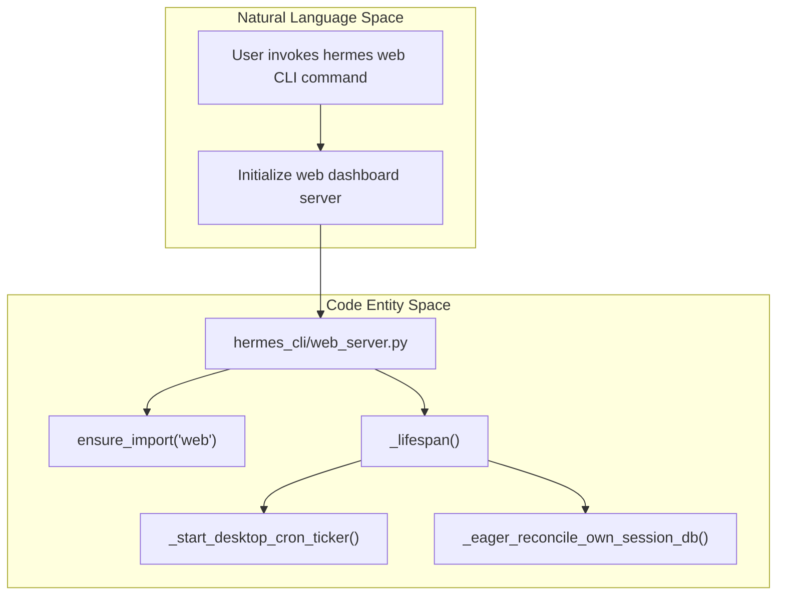
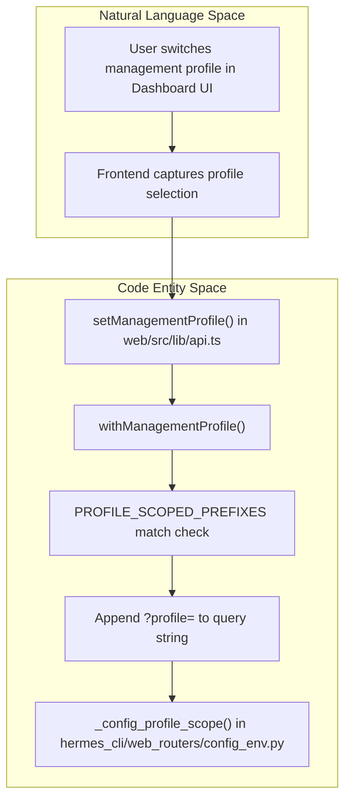
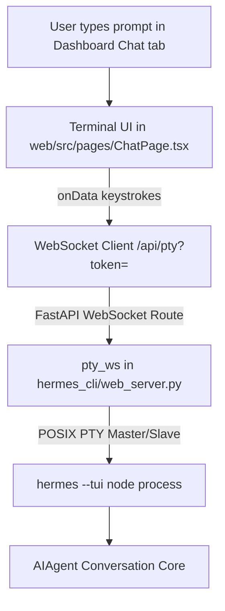

<!-- source: DeepWiki mcp.deepwiki.com · repo nousresearch/hermes-agent · page 3.4 Web UI Dashboard · fetched 2026-10-27 -->

# Web UI Dashboard

Relevant source files

The following files were used as context for generating this wiki page:

- [apps/desktop/src/api/plugins.ts](apps/desktop/src/api/plugins.ts)
- [apps/desktop/src/app/settings/fallback-models-field.test.tsx](apps/desktop/src/app/settings/fallback-models-field.test.tsx)
- [apps/desktop/src/app/settings/fallback-models-field.tsx](apps/desktop/src/app/settings/fallback-models-field.tsx)
- [apps/desktop/src/hermes.ts](apps/desktop/src/hermes.ts)
- [apps/desktop/src/types/hermes.ts](apps/desktop/src/types/hermes.ts)
- [apps/shared/src/reconnect-backoff.test.ts](apps/shared/src/reconnect-backoff.test.ts)
- [apps/shared/src/reconnect-backoff.ts](apps/shared/src/reconnect-backoff.ts)
- [hermes_cli/web_routers/_common.py](hermes_cli/web_routers/_common.py)
- [hermes_cli/web_routers/actions.py](hermes_cli/web_routers/actions.py)
- [hermes_cli/web_routers/analytics.py](hermes_cli/web_routers/analytics.py)
- [hermes_cli/web_routers/audio.py](hermes_cli/web_routers/audio.py)
- [hermes_cli/web_routers/config_env.py](hermes_cli/web_routers/config_env.py)
- [hermes_cli/web_routers/dashboard_ui.py](hermes_cli/web_routers/dashboard_ui.py)
- [hermes_cli/web_routers/memory_providers.py](hermes_cli/web_routers/memory_providers.py)
- [hermes_cli/web_routers/messaging.py](hermes_cli/web_routers/messaging.py)
- [hermes_cli/web_routers/models.py](hermes_cli/web_routers/models.py)
- [hermes_cli/web_routers/oauth.py](hermes_cli/web_routers/oauth.py)
- [hermes_cli/web_routers/ops.py](hermes_cli/web_routers/ops.py)
- [hermes_cli/web_routers/profiles.py](hermes_cli/web_routers/profiles.py)
- [hermes_cli/web_routers/status.py](hermes_cli/web_routers/status.py)
- [hermes_cli/web_server.py](hermes_cli/web_server.py)
- [hermes_cli/web_server_profiles.py](hermes_cli/web_server_profiles.py)
- [tests/acp_adapter/test_gateway_tool_projection.py](tests/acp_adapter/test_gateway_tool_projection.py)
- [tests/gateway/test_matrix_plugin_setup.py](tests/gateway/test_matrix_plugin_setup.py)
- [tests/hermes_cli/test_auth_codex_bounded_body.py](tests/hermes_cli/test_auth_codex_bounded_body.py)
- [tests/hermes_cli/test_dashboard_admin_endpoints.py](tests/hermes_cli/test_dashboard_admin_endpoints.py)
- [tests/hermes_cli/test_dashboard_initial_profile_bootstrap.py](tests/hermes_cli/test_dashboard_initial_profile_bootstrap.py)
- [tests/hermes_cli/test_gateway_unnamed_default_home_verbs.py](tests/hermes_cli/test_gateway_unnamed_default_home_verbs.py)
- [tests/hermes_cli/test_moa_preset_config_warnings.py](tests/hermes_cli/test_moa_preset_config_warnings.py)
- [tests/hermes_cli/test_moa_preset_deletion.py](tests/hermes_cli/test_moa_preset_deletion.py)
- [tests/hermes_cli/test_moa_set_models_preserves_extra_keys.py](tests/hermes_cli/test_moa_set_models_preserves_extra_keys.py)
- [tests/hermes_cli/test_models_analytics_dedup.py](tests/hermes_cli/test_models_analytics_dedup.py)
- [tests/hermes_cli/test_pooled_served_profile_backend_unscoped.py](tests/hermes_cli/test_pooled_served_profile_backend_unscoped.py)
- [tests/hermes_cli/test_profiles_sidebar_cache.py](tests/hermes_cli/test_profiles_sidebar_cache.py)
- [tests/hermes_cli/test_profiles_sidebar_scope.py](tests/hermes_cli/test_profiles_sidebar_scope.py)
- [tests/hermes_cli/test_served_profile_mirror_platforms.py](tests/hermes_cli/test_served_profile_mirror_platforms.py)
- [tests/hermes_cli/test_update_receipt_endpoint.py](tests/hermes_cli/test_update_receipt_endpoint.py)
- [tests/hermes_cli/test_web_analytics_corrupt_store.py](tests/hermes_cli/test_web_analytics_corrupt_store.py)
- [tests/hermes_cli/test_web_oauth_dispatch.py](tests/hermes_cli/test_web_oauth_dispatch.py)
- [tests/hermes_cli/test_web_routers_destructive_profile_scope.py](tests/hermes_cli/test_web_routers_destructive_profile_scope.py)
- [tests/hermes_cli/test_web_server.py](tests/hermes_cli/test_web_server.py)
- [tests/hermes_cli/test_web_server_gateway_topology.py](tests/hermes_cli/test_web_server_gateway_topology.py)
- [tests/hermes_cli/test_web_server_messaging_profiles.py](tests/hermes_cli/test_web_server_messaging_profiles.py)
- [tests/hermes_cli/test_web_server_skills_profiles.py](tests/hermes_cli/test_web_server_skills_profiles.py)
- [tests/hermes_cli/test_web_server_speak_stream.py](tests/hermes_cli/test_web_server_speak_stream.py)
- [tests/hermes_cli/test_web_server_update_status.py](tests/hermes_cli/test_web_server_update_status.py)
- [tests/tools/test_delegate_liveness_timeout.py](tests/tools/test_delegate_liveness_timeout.py)
- [web/eslint.config.js](web/eslint.config.js)
- [web/src/App.tsx](web/src/App.tsx)
- [web/src/components/AuthWidget.test.tsx](web/src/components/AuthWidget.test.tsx)
- [web/src/components/AuthWidget.tsx](web/src/components/AuthWidget.tsx)
- [web/src/components/ChatSidebar.test.tsx](web/src/components/ChatSidebar.test.tsx)
- [web/src/components/ChatSidebar.tsx](web/src/components/ChatSidebar.tsx)
- [web/src/components/OAuthLoginModal.tsx](web/src/components/OAuthLoginModal.tsx)
- [web/src/components/OAuthProvidersCard.tsx](web/src/components/OAuthProvidersCard.tsx)
- [web/src/components/auth-widget-visibility.ts](web/src/components/auth-widget-visibility.ts)
- [web/src/contexts/ProfileProvider.test.tsx](web/src/contexts/ProfileProvider.test.tsx)
- [web/src/contexts/ProfileProvider.tsx](web/src/contexts/ProfileProvider.tsx)
- [web/src/i18n/en.ts](web/src/i18n/en.ts)
- [web/src/i18n/types.ts](web/src/i18n/types.ts)
- [web/src/i18n/zh.ts](web/src/i18n/zh.ts)
- [web/src/lib/api.test.ts](web/src/lib/api.test.ts)
- [web/src/lib/api.ts](web/src/lib/api.ts)
- [web/src/lib/chat-channel-id.test.ts](web/src/lib/chat-channel-id.test.ts)
- [web/src/lib/chat-channel-id.ts](web/src/lib/chat-channel-id.ts)
- [web/src/lib/chat-copy-last.ts](web/src/lib/chat-copy-last.ts)
- [web/src/lib/chat-image-drop.ts](web/src/lib/chat-image-drop.ts)
- [web/src/lib/events-reconnect.test.ts](web/src/lib/events-reconnect.test.ts)
- [web/src/lib/events-reconnect.ts](web/src/lib/events-reconnect.ts)
- [web/src/lib/eventsFeedClient.ts](web/src/lib/eventsFeedClient.ts)
- [web/src/lib/gatewayClient.ts](web/src/lib/gatewayClient.ts)
- [web/src/lib/mcp-server-create.test.ts](web/src/lib/mcp-server-create.test.ts)
- [web/src/lib/mcp-server-create.ts](web/src/lib/mcp-server-create.ts)
- [web/src/lib/profile-bootstrap.test.ts](web/src/lib/profile-bootstrap.test.ts)
- [web/src/lib/profile-bootstrap.ts](web/src/lib/profile-bootstrap.ts)
- [web/src/lib/pty-composition.test.ts](web/src/lib/pty-composition.test.ts)
- [web/src/lib/pty-composition.ts](web/src/lib/pty-composition.ts)
- [web/src/lib/pty-mobile-input.test.ts](web/src/lib/pty-mobile-input.test.ts)
- [web/src/lib/pty-mobile-input.ts](web/src/lib/pty-mobile-input.ts)
- [web/src/lib/pty-mouse-report.ts](web/src/lib/pty-mouse-report.ts)
- [web/src/lib/pty-reconnect.test.ts](web/src/lib/pty-reconnect.test.ts)
- [web/src/lib/pty-reconnect.ts](web/src/lib/pty-reconnect.ts)
- [web/src/lib/pty-resume-sanitizer.test.ts](web/src/lib/pty-resume-sanitizer.test.ts)
- [web/src/lib/pty-resume-sanitizer.ts](web/src/lib/pty-resume-sanitizer.ts)
- [web/src/lib/xterm-webgl-gating.test.ts](web/src/lib/xterm-webgl-gating.test.ts)
- [web/src/lib/xterm-webgl-gating.ts](web/src/lib/xterm-webgl-gating.ts)
- [web/src/lib/xterm-webgl-release.test.ts](web/src/lib/xterm-webgl-release.test.ts)
- [web/src/lib/xterm-webgl-release.ts](web/src/lib/xterm-webgl-release.ts)
- [web/src/pages/AnalyticsPage.tsx](web/src/pages/AnalyticsPage.tsx)
- [web/src/pages/ChannelsPage.tsx](web/src/pages/ChannelsPage.tsx)
- [web/src/pages/ChatPage.test.tsx](web/src/pages/ChatPage.test.tsx)
- [web/src/pages/ChatPage.tsx](web/src/pages/ChatPage.tsx)
- [web/src/pages/ConfigPage.tsx](web/src/pages/ConfigPage.tsx)
- [web/src/pages/CronPage.tsx](web/src/pages/CronPage.tsx)
- [web/src/pages/EnvPage.tsx](web/src/pages/EnvPage.tsx)
- [web/src/pages/LogsPage.tsx](web/src/pages/LogsPage.tsx)
- [web/src/pages/McpPage.tsx](web/src/pages/McpPage.tsx)
- [web/src/pages/PairingPage.tsx](web/src/pages/PairingPage.tsx)
- [web/src/pages/PluginsPage.tsx](web/src/pages/PluginsPage.tsx)
- [web/src/pages/ProfileBuilderPage.tsx](web/src/pages/ProfileBuilderPage.tsx)
- [web/src/pages/SessionsPage.tsx](web/src/pages/SessionsPage.tsx)
- [web/src/pages/SkillsPage.tsx](web/src/pages/SkillsPage.tsx)
- [web/src/pages/SystemPage.tsx](web/src/pages/SystemPage.tsx)
- [web/src/pages/WebhooksPage.tsx](web/src/pages/WebhooksPage.tsx)

The Hermes Web UI Dashboard provides a browser-based management interface for local and remote Hermes Agent instances [hermes_cli/web_server.py:1-7](). It exposes a React single-page application (SPA) backed by a FastAPI server implemented in `hermes_cli/web_server.py`, enabling administrators and users to configure agent settings, manage multi-profile scopes, inspect agent sessions, handle cron jobs, browse skills, view analytics, and interact with an embedded terminal chat interface [hermes_cli/web_server.py:1-7](), [web/src/lib/api.ts:10-40](), [web/src/pages/ChatPage.tsx:1-17]().

---

## FastAPI Backend Architecture (`hermes_cli/web_server.py`)

The backend entry point `hermes_cli/web_server.py` assembles the FastAPI application, manages background tickers, and coordinates lazy dependency installation [hermes_cli/web_server.py:1-60](). If required dependencies such as `fastapi` or `uvicorn` are missing, the module invokes `pm.ensure_import("web")` to provision dashboard extras dynamically [hermes_cli/web_server.py:43-59]().

Title: FastAPI Server Initialization and Lifespan Execution

Sources:
[hermes_cli/web_server.py:1-77]()

### Server Lifespan and Cron Ticker

The application lifespan is managed via `_lifespan()` in `hermes_cli/web_server.py` [hermes_cli/web_server.py:9-30](). It initializes state variables, ensures database reconciliation via `_eager_reconcile_own_session_db()`, and warms the gateway module cache [hermes_cli/web_server.py:65-77](). When running inside the desktop dashboard wrapper rather than a standalone gateway, `_start_desktop_cron_ticker()` ticks per-profile cron stores concurrently [hermes_cli/web_server.py:80-125](). It leverages `resolve_cron_scheduler()` and applies multi-profile gating (`profile_gate`) to prevent lock contention with running gateways [hermes_cli/web_server.py:106-124]().

Sources:
[hermes_cli/web_server.py:65-154]()

---

## Modular Sub-Routers (`hermes_cli/web_routers/`)

Domain logic is cleanly separated into modular routers under `hermes_cli/web_routers/` and imported by the main server module [hermes_cli/web_server.py:1-7](), [tests/hermes_cli/test_web_server.py:24-33]():

- **`profiles.py`**: Manages profile creation, renaming, active updates, session pruning scans, and profile-scoped model assignments [hermes_cli/web_routers/profiles.py:1-50]().
- **`sessions.py`**: Handles session listing, searching, stream-safe imports, and bulk pruning via `_prune_sessions()` [hermes_cli/web_routers/sessions.py:1-121]().
- **`config_env.py`**: Exposes `/api/config`, schema discovery with dynamic provider options, environment variable updates, and configuration serialization via `update_config()` [hermes_cli/web_routers/config_env.py:1-142]().
- **`messaging.py`**: Manages platform onboarding (WhatsApp, Telegram) and messaging configuration fallbacks (`_MESSAGING_ENV_FALLBACKS`) [hermes_cli/web_routers/messaging.py:1-100]().
- **`status.py`**: Provides system health checks, `/api/health`, active session garnish counts, and host identity verification [hermes_cli/web_routers/status.py:1-144]().

Sources:
[hermes_cli/web_routers/profiles.py:1-50](), [hermes_cli/web_routers/sessions.py:1-121](), [hermes_cli/web_routers/config_env.py:1-142](), [hermes_cli/web_routers/messaging.py:1-100](), [hermes_cli/web_routers/status.py:1-144]()

---

## Management Profile Scoping and API Client (`web/src/lib/api.ts`)

The dashboard functions as a machine-level management plane capable of controlling multiple isolated profile homes. The frontend API client in `web/src/lib/api.ts` maintains a global `_managementProfile` state via `setManagementProfile()` [web/src/lib/api.ts:70-74](). 

Title: Management Profile Scope Resolution and Routing

Sources:
[web/src/lib/api.ts:70-159](), [hermes_cli/web_routers/config_env.py:117-123]()

`withManagementProfile()` inspects outgoing request URLs against `PROFILE_SCOPED_PREFIXES` (covering config, status, analytics, sessions, and credentials) and transparently appends `?profile=<name>` [web/src/lib/api.ts:94-159](). On the backend, routers ingest this query parameter and execute operations within `_config_profile_scope()` or `_profile_scope()` blocks [hermes_cli/web_routers/config_env.py:117-123](), [hermes_cli/web_routers/profiles.py:47-49]().

Sources:
[web/src/lib/api.ts:94-159](), [hermes_cli/web_routers/config_env.py:117-123](), [hermes_cli/web_routers/profiles.py:47-49]()

---

## React Frontend Dashboard (`web/`)

### Application Shell and Lazy Routing (`web/src/App.tsx`)

The React SPA utilizes React Router to render administrative views, leveraging `lazy()` and `Suspense` for code-splitting heavy modules such as `ConfigPage`, `SessionsPage`, `AnalyticsPage`, `ModelsPage`, `CronPage`, and `SkillsPage` [web/src/App.tsx:78-176](). 

The embedded terminal chat page (`ChatPage.tsx`) is mounted persistently outside the main router switch when enabled, ensuring that the underlying WebSocket connection and xterm.js instance remain active across tab transitions [web/src/App.tsx:138-155](), [web/src/pages/ChatPage.tsx:1-17]().

Sources:
[web/src/App.tsx:78-155](), [web/src/pages/ChatPage.tsx:1-17]()

### Embedded Terminal Chat Implementation (`web/src/pages/ChatPage.tsx`)

`ChatPage.tsx` embeds an `@xterm/xterm` terminal emulator enhanced with Fit, Unicode11, WebLinks, and WebGL addons [web/src/pages/ChatPage.tsx:19-24]().

Title: Terminal Chat WebSocket and PTY Dataflow

Sources:
[web/src/pages/ChatPage.tsx:1-24](), [web/src/pages/ChatPage.tsx:132-152]()

The terminal forwards keystrokes over WebSocket connections to the `/api/pty` endpoint managed by the FastAPI backend [web/src/pages/ChatPage.tsx:8-17](). The backend spawns a POSIX PTY running `hermes --tui`, bridging browser-based user input directly to the agent runtime terminal interface [web/src/pages/ChatPage.tsx:12-17](). Per-tab session tokens stored in browser memory allow independent tab recovery and secure reattachment [web/src/pages/ChatPage.tsx:95-125]().

Sources:
[web/src/pages/ChatPage.tsx:8-17](), [web/src/pages/ChatPage.tsx:95-125]()

---

## Sources

- [hermes_cli/web_server.py:1-160]()
- [tests/hermes_cli/test_web_server.py:24-36]()
- [web/src/lib/api.ts:10-175]()
- [web/src/pages/ChatPage.tsx:1-152]()
- [web/src/App.tsx:78-176]()
- [hermes_cli/web_routers/profiles.py:1-50]()
- [hermes_cli/web_routers/sessions.py:1-121]()
- [hermes_cli/web_routers/config_env.py:1-142]()
- [hermes_cli/web_routers/messaging.py:1-100]()
- [hermes_cli/web_routers/status.py:1-144]()
- [tests/hermes_cli/test_dashboard_admin_endpoints.py:1-187]()

---

