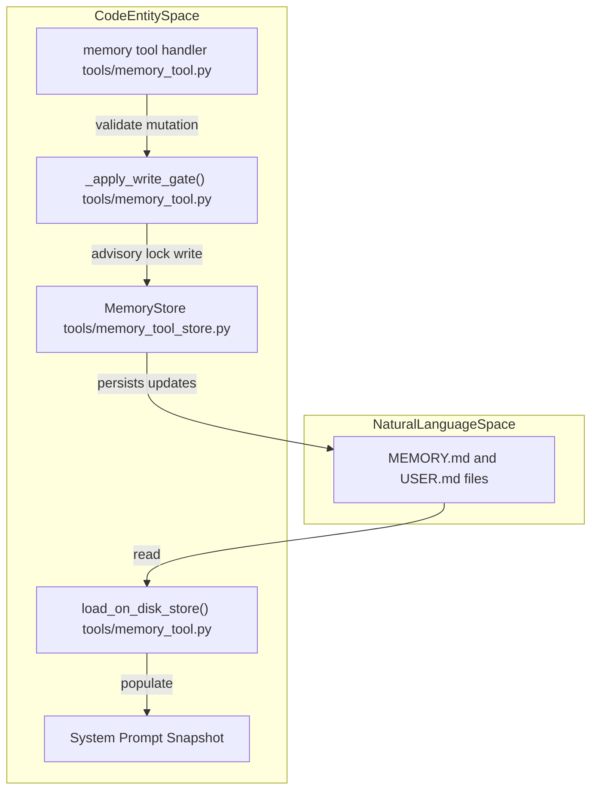
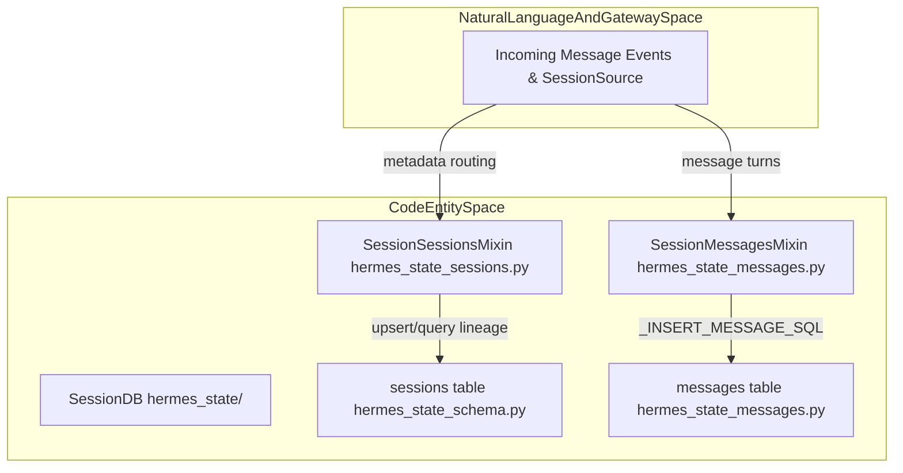
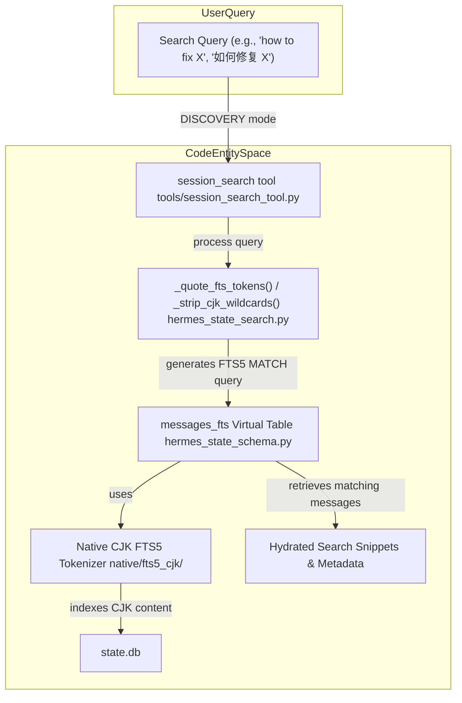

<!-- source: DeepWiki mcp.deepwiki.com · repo nousresearch/hermes-agent · page 4.3 Memory and Sessions · fetched 2026-10-27 -->

# Memory and Sessions

Relevant source files

The following files were used as context for generating this wiki page:

- [agent/background_review.py](agent/background_review.py)
- [agent/message_metadata.py](agent/message_metadata.py)
- [agent/session_persistence.py](agent/session_persistence.py)
- [agent/transcript_repair.py](agent/transcript_repair.py)
- [hermes_cli/sessions_cmd.py](hermes_cli/sessions_cmd.py)
- [hermes_cli/write_approval_commands.py](hermes_cli/write_approval_commands.py)
- [hermes_state_common.py](hermes_state_common.py)
- [hermes_state_compression.py](hermes_state_compression.py)
- [hermes_state_gateway.py](hermes_state_gateway.py)
- [hermes_state_maintenance.py](hermes_state_maintenance.py)
- [hermes_state_messages.py](hermes_state_messages.py)
- [hermes_state_portability.py](hermes_state_portability.py)
- [hermes_state_schema.py](hermes_state_schema.py)
- [hermes_state_search.py](hermes_state_search.py)
- [hermes_state_sessions.py](hermes_state_sessions.py)
- [hermes_state_telegram.py](hermes_state_telegram.py)
- [hermes_state_titles.py](hermes_state_titles.py)
- [hermes_state_usage.py](hermes_state_usage.py)
- [tests/agent/test_builtin_memory_disabled_surface.py](tests/agent/test_builtin_memory_disabled_surface.py)
- [tests/agent/test_context_engine_message_uid.py](tests/agent/test_context_engine_message_uid.py)
- [tests/agent/test_tool_call_incremental_persistence.py](tests/agent/test_tool_call_incremental_persistence.py)
- [tests/gateway/test_profile_identity_purge.py](tests/gateway/test_profile_identity_purge.py)
- [tests/gateway/test_rekey_profile_routing.py](tests/gateway/test_rekey_profile_routing.py)
- [tests/hermes_cli/test_profile_identity_purge_cmd.py](tests/hermes_cli/test_profile_identity_purge_cmd.py)
- [tests/hermes_cli/test_sessions_delete.py](tests/hermes_cli/test_sessions_delete.py)
- [tests/hermes_state/test_canonical_title_guard.py](tests/hermes_state/test_canonical_title_guard.py)
- [tests/hermes_state/test_delete_session_write_guards.py](tests/hermes_state/test_delete_session_write_guards.py)
- [tests/hermes_state/test_fts_rebuild_corruption_class.py](tests/hermes_state/test_fts_rebuild_corruption_class.py)
- [tests/hermes_state/test_hermes_state.py](tests/hermes_state/test_hermes_state.py)
- [tests/hermes_state/test_isolation_marker_env.py](tests/hermes_state/test_isolation_marker_env.py)
- [tests/hermes_state/test_live_db_guard_ancestry.py](tests/hermes_state/test_live_db_guard_ancestry.py)
- [tests/hermes_state/test_message_uid.py](tests/hermes_state/test_message_uid.py)
- [tests/hermes_state/test_never_active_keyed_prune.py](tests/hermes_state/test_never_active_keyed_prune.py)
- [tests/hermes_state/test_orphan_gateway_session_repair.py](tests/hermes_state/test_orphan_gateway_session_repair.py)
- [tests/hermes_state/test_pinned_lineage.py](tests/hermes_state/test_pinned_lineage.py)
- [tests/hermes_state/test_purge_profile_state.py](tests/hermes_state/test_purge_profile_state.py)
- [tests/hermes_state/test_rekey_profile_state.py](tests/hermes_state/test_rekey_profile_state.py)
- [tests/hermes_state/test_search_or_relaxed_fallback.py](tests/hermes_state/test_search_or_relaxed_fallback.py)
- [tests/hermes_state/test_session_import_keep_flags.py](tests/hermes_state/test_session_import_keep_flags.py)
- [tests/hermes_state/test_session_list_index_choice.py](tests/hermes_state/test_session_list_index_choice.py)
- [tests/hermes_state/test_telegram_topic_selfheal.py](tests/hermes_state/test_telegram_topic_selfheal.py)
- [tests/hermes_state/test_unaddressed_rewrite_identity.py](tests/hermes_state/test_unaddressed_rewrite_identity.py)
- [tests/test_utils_atomic_writers_deleted_profile.py](tests/test_utils_atomic_writers_deleted_profile.py)
- [tests/tools/test_memory_patch_action.py](tests/tools/test_memory_patch_action.py)
- [tests/tools/test_memory_target_contract.py](tests/tools/test_memory_target_contract.py)
- [tests/tools/test_memory_tool.py](tests/tools/test_memory_tool.py)
- [tests/tools/test_session_search.py](tests/tools/test_session_search.py)
- [tests/tools/test_session_search_readonly.py](tests/tools/test_session_search_readonly.py)
- [tests/tools/test_threat_patterns.py](tests/tools/test_threat_patterns.py)
- [tests/tools/test_translate_execute_context.py](tests/tools/test_translate_execute_context.py)
- [tests/tools/test_write_approval.py](tests/tools/test_write_approval.py)
- [tests/tui_gateway/test_stranded_session_adoption.py](tests/tui_gateway/test_stranded_session_adoption.py)
- [tools/memory_tool.py](tools/memory_tool.py)
- [tools/memory_tool_store.py](tools/memory_tool_store.py)
- [tools/session_search_tool.py](tools/session_search_tool.py)
- [tools/threat_patterns.py](tools/threat_patterns.py)
- [website/docs/developer-guide/context-engine-plugin.md](website/docs/developer-guide/context-engine-plugin.md)
- [website/docs/developer-guide/session-storage.md](website/docs/developer-guide/session-storage.md)
- [website/docs/user-guide/features/memory.md](website/docs/user-guide/features/memory.md)
- [website/docs/user-guide/sessions.md](website/docs/user-guide/sessions.md)
- [website/i18n/zh-Hans/docusaurus-plugin-content-docs/current/guides/tips.md](website/i18n/zh-Hans/docusaurus-plugin-content-docs/current/guides/tips.md)
- [website/i18n/zh-Hans/docusaurus-plugin-content-docs/current/user-guide/messaging/index.md](website/i18n/zh-Hans/docusaurus-plugin-content-docs/current/user-guide/messaging/index.md)
- [website/i18n/zh-Hans/docusaurus-plugin-content-docs/current/user-guide/sessions.md](website/i18n/zh-Hans/docusaurus-plugin-content-docs/current/user-guide/sessions.md)

## Purpose and Scope
This page covers the core subsystems responsible for persistent memory management and session lifecycle persistence in Hermes Agent. It details the file-based curated memory store (`MEMORY.md` and `USER.md`), the SQLite-backed `SessionDB` storage and transaction architecture (`SessionMessagesMixin`, `SessionSessionsMixin`, `SessionPortabilityMixin`), background review daemons, conversational transcript persistence, advanced full-text session search with the native CJK FTS5 extension, and offline recovery workflows.

---

## Memory Management (`MEMORY.md` & `USER.md`)

The agent memory system maintains persistent, curated knowledge across sessions using two markdown files located in the profile's memories directory (`~/.hermes/memories/`): `MEMORY.md` (the agent's internal notes, operational heuristics, and environment facts) and `USER.md` (user preferences, profile configuration, and communication guidelines) [tools/memory_tool.py:38-42]().

| File | Purpose | Character Limit | Supported Tool Actions |
|---|---|---|---|
| `MEMORY.md` | Agent's internal notes & heuristics | 2,200 chars | `add`, `replace`, `remove`, `patch` |
| `USER.md` | User profile & preferences | 1,375 chars | `add`, `replace`, `remove`, `patch` |

### `MemoryStore` and Frozen Snapshot Pattern

The `MemoryStore` class manages file I/O, character limit validations, and structural integrity [tools/memory_tool.py:43-61](). It uses a **frozen snapshot pattern**:
- **Initialization**: At startup, `load_from_disk()` parses the markdown files, validates structural integrity against prompt injection attacks, and builds a static system prompt snapshot that remains immutable for the duration of the session [tools/memory_tool.py:47-61]().
- **Atomic Operations**: Mid-session mutations invoked via the `memory` tool are safeguarded by advisory file locking (`fcntl` on Unix systems, `msvcrt` on Windows) to prevent race conditions during concurrent multi-process access [tools/memory_tool.py:18-29]().
- **Write Gating**: The function `_apply_write_gate()` intercepts write operations, evaluating them against configured write approval rules before writing updates to disk [tools/memory_tool.py:131-138]().

### Memory Persistence Data Flow

Sources: [tools/memory_tool.py:38-138](), [tools/memory_tool_store.py:1-45]()

---

## Background Review System

After conversation turns complete, Hermes can optionally spawn a background review daemon. This daemon forks the `AIAgent` instance and replays conversation snapshots asynchronously in a background thread to evaluate whether new skills or memory updates should be persisted, without blocking the foreground interactive session [agent/background_review.py:1-14](). 

- **`_BackgroundReviewRun`**: Manages per-review cancellation flags, request-completion handshakes, and reference tracking [agent/background_review.py:28-36]().
- **Lifecycle Functions**: `prepare_background_review_run()` installs the run token on the parent agent [agent/background_review.py:75-89](), while `finish_background_review_run()` publishes request exit state [agent/background_review.py:92-100]().
- **Preemption**: `cancel_background_review_for_live_turn()` ensures that background self-improvement work never blocks user-facing interactive turns or session teardowns [agent/background_review.py:129-150]().

Sources: [agent/background_review.py:1-158]()

---

## Session Architecture and SQLite Persistence (`SessionDB`)

Conversational histories, system prompts, routing metadata, and token usage statistics are durably stored in a SQLite database (`~/.hermes/state.db`) managed by the `SessionDB` class [website/docs/user-guide/sessions.md:17-28](). Write-Ahead Logging (WAL) mode is enabled to support multiple concurrent readers alongside a single active writer.

### Core Mixins and Tables
- **`SessionMessagesMixin`**: Implements transcript persistence via `_INSERT_MESSAGE_SQL`, handling message appends, replacements, rewinds, and resume assembly [hermes_state_messages.py:1-37](). It manages message UIDs, tool call UIDs, and display metadata [hermes_state_messages.py:18-20]().
- **`SessionSessionsMixin`**: Manages session lifecycle operations such as row upserts, lifecycle flags (`archived`, `pinned`, `hidden`), model configuration updates, listing/counting queries, and auto-archive sweeps [hermes_state_sessions.py:1-12](). It uses `_session_filter_where()` to filter sessions across criteria like source platform, working directory (`cwd`), and message count [hermes_state_sessions.py:112-149]().
- **`SessionPortabilityMixin`**: Handles rich session listing (`list_sessions_rich`), database export routines, structured import verification, and timing analytics (`_export_timings`) [hermes_state_portability.py:1-131]().
- **Lineage Tracking**: Uses a recursive Common Table Expression (`_LINEAGE_CTE_SQL`) traversing `parent_session_id` fields to connect compression-split child sessions and delegation branches [hermes_state_sessions.py:48-72]().
- **Transcript Persistence Guardrails**: `agent/session_persistence.py` filters out internal ephemeral recovery scaffolding via `_EPHEMERAL_SCAFFOLDING_FLAGS` (e.g., `_empty_recovery_synthetic`, `_dropped_toolcall_nudge`) so synthetic turns do not reach the durable database [agent/session_persistence.py:34-54](). It also computes `durable_user_row_content` for transcript writes [agent/session_persistence.py:94-104]().

### Session State Storage Flow

Sources: [hermes_state_messages.py:1-37](), [hermes_state_sessions.py:1-149](), [hermes_state_schema.py:76-96](), [agent/session_persistence.py:34-104](), [hermes_state_portability.py:1-131]()

---

## Session Search, Recall, and Native CJK FTS5 Extension

Hermes provides conversational history recall through the `session_search` tool without requiring LLM generation calls [tools/session_search_tool.py:1-10]().

### Search Modes

| Mode | Trigger Arguments | Description |
|---|---|---|
| **DISCOVERY** | `query` | Full-text search across all sessions with lineage deduplication and adaptive context windows [tools/session_search_tool.py:4-7](). It scans up to `_DISCOVER_SCAN_LIMIT` FTS rows before deduping by lineage [tools/session_search_tool.py:43-44](). |
| **SCROLL** | `session_id` + `around_message_id` | Retrieves a bounded window of messages around a target anchor message [tools/session_search_tool.py:4-7](). The `_CONTEXT_WINDOW_SQL` query is used to fetch neighbor messages efficiently [hermes_state_search.py:60-72](). |
| **READ** | `session_id` | Returns the full transcript or an optimized head/tail truncation of a session [tools/session_search_tool.py:4-7](). Message content is bounded by `_READ_MAX_CONTENT` characters [tools/session_search_tool.py:38-41](). |
| **BROWSE** | None | Lists recent sessions chronologically with preview metadata [tools/session_search_tool.py:4-7](). |

### Native CJK FTS5 Tokenizer
Standard whitespace-based tokenizers fail to parse unspaced Chinese, Japanese, or Korean scripts. Hermes integrates a native CJK tokenizer extension (`native/fts5_cjk/`) into SQLite FTS5 virtual table schemas (`messages_fts`), enabling accurate ngram and codepoint-based full-text indexing over multilingual conversation histories [hermes_state_schema.py:1-28](). 
- **Character Classification**: `_is_cjk()` evaluates code points against defined CJK Unicode ranges [hermes_state_search.py:90-92]().
- **Query Sanitization**: `_strip_cjk_wildcards()` strips trailing wildcard search artifacts that FTS5 cannot honor, preventing query aborts [hermes_state_search.py:110-131]().

Sources: [tools/session_search_tool.py:1-44](), [hermes_state_search.py:60-131](), [hermes_state_schema.py:1-28]()

---

## Lifecycle, Maintenance, and Recovery

Session lifecycles are governed by metadata flags in SQLite supporting automatic archiving, manual pinning, and recovery after abrupt termination [website/docs/user-guide/sessions.md:128]().

### Database Repair and Offline Recovery CLI
When database corruption or schema drift occurs, recovery utilities can be invoked via the CLI:
- **`hermes sessions repair`**: Evaluates database schema integrity and executes safe in-place repairs accompanied by automated backups via `repair_state_db_schema` [hermes_cli/sessions_cmd.py:102-143]().
- **`hermes sessions recover`**: Performs offline recovery by operating on a temporary isolated copy of the database, rebuilding clean canonical tables (`sessions`, `messages`) and indexing trees into a fresh SQLite output file without touching live operational data [hermes_cli/sessions_cmd.py:145-165](). This command utilizes `inspect_session_database` and `recover_session_database` [hermes_cli/sessions_cmd.py:148-150]().

Sources: [hermes_cli/sessions_cmd.py:102-165](), [website/docs/user-guide/sessions.md:128]()

---

