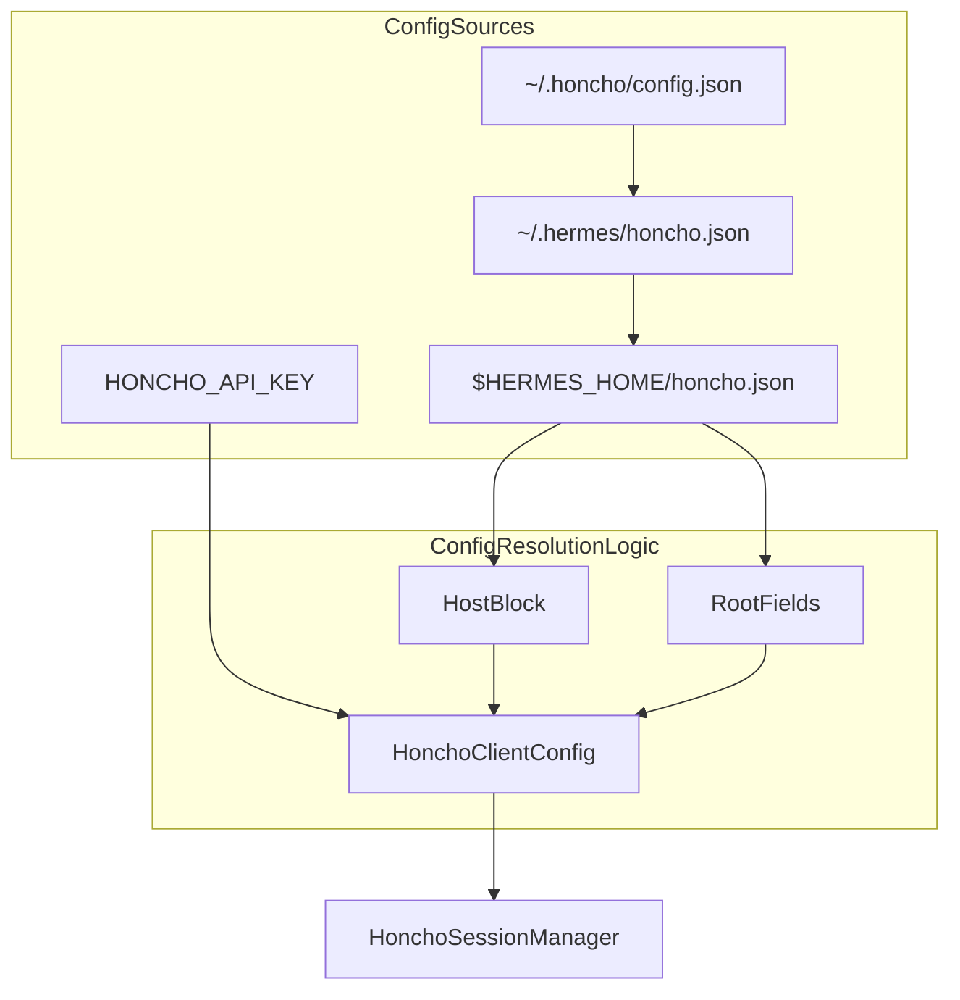
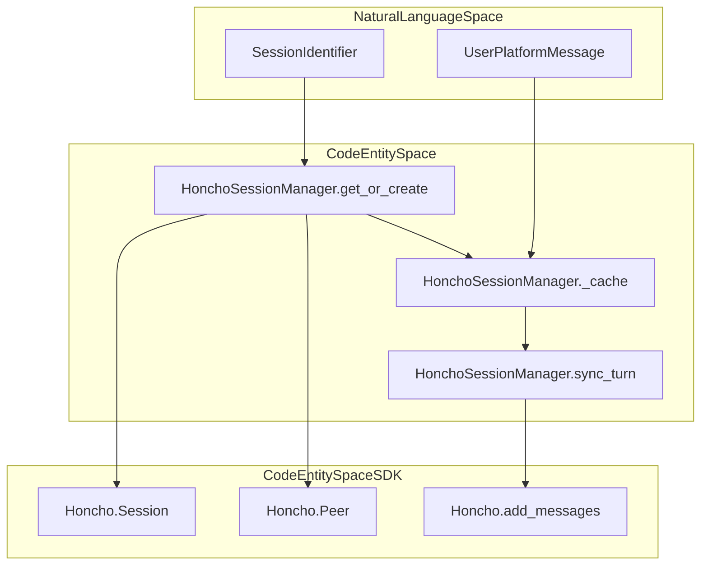
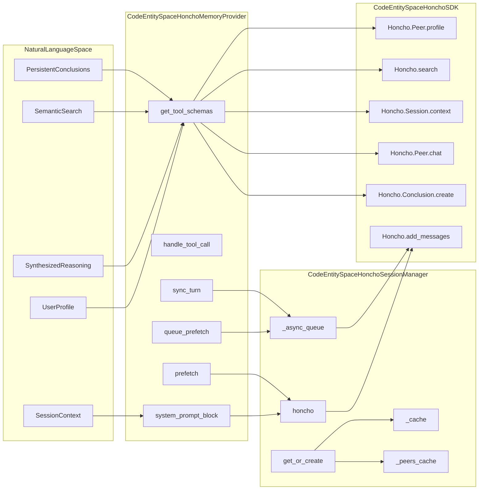

<!-- source: DeepWiki mcp.deepwiki.com · repo nousresearch/hermes-agent · page 4.4 Honcho Integration · fetched 2026-10-27 -->

# Honcho Integration

Relevant source files

The following files were used as context for generating this wiki page:

- [agent/memory_manager.py](agent/memory_manager.py)
- [agent/memory_provider.py](agent/memory_provider.py)
- [contributors/emails/erosika@users.noreply.github.com](contributors/emails/erosika@users.noreply.github.com)
- [plugins/memory/__init__.py](plugins/memory/__init__.py)
- [tests/_fixtures/live_system_guard.py](tests/_fixtures/live_system_guard.py)
- [tests/agent/test_memory_context_dedupe.py](tests/agent/test_memory_context_dedupe.py)
- [tests/agent/test_memory_provider.py](tests/agent/test_memory_provider.py)
- [tests/agent/test_memory_write_bridge.py](tests/agent/test_memory_write_bridge.py)
- [tests/agent/test_moa_quiet_reference_output.py](tests/agent/test_moa_quiet_reference_output.py)
- [tests/agent/test_pre_compress_checkpoint_contract.py](tests/agent/test_pre_compress_checkpoint_contract.py)
- [tests/gateway/test_clarify_progress_leak.py](tests/gateway/test_clarify_progress_leak.py)
- [tests/gateway/test_control_socket_windows_live.py](tests/gateway/test_control_socket_windows_live.py)
- [tests/gateway/test_delivery_ledger_single_connection.py](tests/gateway/test_delivery_ledger_single_connection.py)
- [tests/gateway/test_gateway_command_line_matcher.py](tests/gateway/test_gateway_command_line_matcher.py)
- [tests/hermes_cli/test_desktop_lifecycle_windows_live.py](tests/hermes_cli/test_desktop_lifecycle_windows_live.py)
- [tests/hermes_cli/test_gateway_proc_fallback.py](tests/hermes_cli/test_gateway_proc_fallback.py)
- [tests/hermes_cli/test_plan_reconciliation_windows_live.py](tests/hermes_cli/test_plan_reconciliation_windows_live.py)
- [tests/hermes_cli/test_windows_relaunch_verify_budget.py](tests/hermes_cli/test_windows_relaunch_verify_budget.py)
- [tests/plugins/memory/test_discovery_sources.py](tests/plugins/memory/test_discovery_sources.py)
- [tests/plugins/test_plugin_loader_unreadable.py](tests/plugins/test_plugin_loader_unreadable.py)
- [tests/tools/test_capability_fingerprint_skill_scope.py](tests/tools/test_capability_fingerprint_skill_scope.py)
- [website/docs/developer-guide/memory-provider-plugin.md](website/docs/developer-guide/memory-provider-plugin.md)

## Purpose and Scope

This page documents the Honcho AI-native memory integration within Hermes Agent. Honcho serves as a pluggable memory provider (hosted under `plugins/memory/` and managed via `MemoryManager` and the `MemoryProvider` abstract base class) [agent/memory_provider.py:1-6](). It provides persistent, cross-session user modeling, rich semantic search, dialectic reasoning, peer cards, and context summaries [website/docs/developer-guide/memory-provider-plugin.md:9-12]().

---

## Configuration System

Honcho configuration is resolved through a prioritized hierarchy supporting isolated Hermes profiles, default paths, legacy global configurations, and environment variables [website/docs/developer-guide/memory-provider-plugin.md:100-114]().

### Configuration Resolution Chain

- **Profile-local config**: `$HERMES_HOME/honcho.json` [plugins/memory/__init__.py:31-34]()
- **Default profile config**: `~/.hermes/honcho.json` [website/docs/developer-guide/memory-provider-plugin.md:22]()
- **Legacy global config**: `~/.honcho/config.json`
- **Environment variables**: `HONCHO_API_KEY`, `HONCHO_ENVIRONMENT`, `HONCHO_BASE_URL`, etc.

The active host key is derived from the active Hermes profile name [website/docs/developer-guide/memory-provider-plugin.md:131]().

### Configuration Resolution Diagram

Sources: [plugins/memory/__init__.py:31-34](), [website/docs/developer-guide/memory-provider-plugin.md:22-131]()

### Key Configuration Fields

| Key | Default | Description |
|-----|---------|-------------|
| `apiKey` | -- | API key from app.honcho.dev |
| `baseUrl` | -- | Base URL for self-hosted Honcho |
| `peerName` | -- | User peer identity |
| `aiPeer` | host key | AI peer identity (one per profile) |
| `workspace` | host key | Shared workspace ID |
| `contextTokens` | `null` | Token budget for auto-injected context per turn |
| `contextCadence` | `1` | Minimum turns between context API calls |
| `dialecticCadence` | `2` | Minimum turns between peer.chat() LLM calls |
| `dialecticDepth` | `1` | Number of chat passes per dialectic invocation |
| `recallMode` | `'hybrid'` | hybrid, context, or tools mode |
| `writeFrequency` | `'async'` | async, turn, session, or integer N |

Sources: [website/docs/developer-guide/memory-provider-plugin.md:100-131]()

---

## HonchoSessionManager and Session Storage

The `HonchoSessionManager` class orchestrates conversation sessions backed by Honcho AI-native memory. It manages thread-safe local caches mirroring remote Honcho sessions, allowing low-latency message buffering and asynchronous syncing.

### Core Methods and Architecture

- `initialize(session_id, **kwargs)`: Initializes the provider connection and validates workspace/peer scoping [agent/memory_provider.py:103-110]().
- `sync_turn(...)`: Persists a completed turn to the remote store or queues it depending on the write frequency mode [agent/memory_provider.py:133-138]().

### Session Data Flow Diagram

Sources: [agent/memory_provider.py:84-150](), [plugins/memory/__init__.py:1-35]()

---

## Write Frequency Modes

`HonchoSessionManager` supports flexible message flush strategies configured via `write_frequency`:

| Mode | Behavior |
| :--- | :--- |
| `async` (default) | Messages are queued to an internal queue and flushed by a background daemon worker thread spawned via `spawn_context_thread` [agent/memory_provider.py:29-34](). |
| `turn` | Messages are flushed synchronously after each conversation turn [agent/memory_provider.py:133-138](). |
| `session` | Messages are buffered locally and flushed only upon session termination. |
| Integer `N` | Messages are batched and flushed automatically every `N` turns. |

Sources: [agent/memory_provider.py:29-34](), [agent/memory_provider.py:133-138]()

---

## Recall, Prefetch Pipeline, and Context Injection

Honcho injects aggregated context into the user message payload wrapped within `<memory-context>` fences, preserving prompt caching [agent/memory_manager.py:164]().

### Two-Layer Context Injection

1. **Base Context**: Refreshed periodically according to `contextCadence`. Includes session summary, user representation, and peer cards [agent/memory_provider.py:120-125]().
2. **Dialectic Supplement**: Refreshed every `dialecticCadence` turns, providing multi-pass reasoning about the user's state [agent/memory_provider.py:120-125]().

Sources: [agent/memory_provider.py:120-125](), [agent/memory_manager.py:164]()

---

## Dialectic Queries and Memory Tools

Honcho exposes tools through the `MemoryProvider` interface (`get_tool_schemas`, `handle_tool_call`) [agent/memory_provider.py:141-146]():

| Tool Name | Description |
| :--- | :--- |
| `honcho_profile` | Read or update a Peer Card |
| `honcho_search` | Hybrid semantic search over historical sessions |
| `honcho_context` | Retrieve raw peer context and session snapshots |
| `honcho_reasoning` | Query the dialectic agent for synthesized answers |
| `honcho_conclude` | Create, list, or delete persistent conclusions |

Sources: [agent/memory_provider.py:141-146](), [website/docs/developer-guide/memory-provider-plugin.md:60-70]()

---

## Natural Language Space to Code Entity Space Bridge

Sources: [agent/memory_provider.py:84-151](), [website/docs/developer-guide/memory-provider-plugin.md:60-70]()

---

