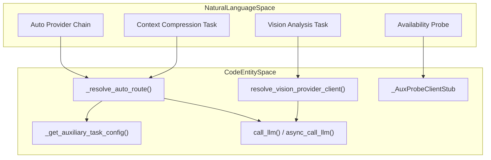
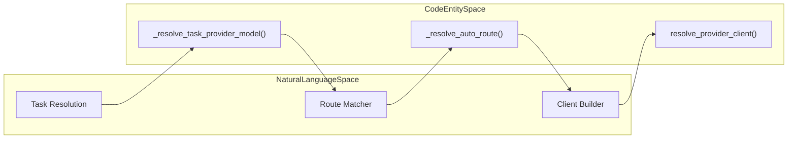

<!-- source: DeepWiki mcp.deepwiki.com · repo nousresearch/hermes-agent · page 4.5 Auxiliary Client · fetched 2026-10-27 -->

# Auxiliary Client

Relevant source files

The following files were used as context for generating this wiki page:

- [agent/acp_openai_bridge.py](agent/acp_openai_bridge.py)
- [agent/anthropic_adapter.py](agent/anthropic_adapter.py)
- [agent/anthropic_credentials.py](agent/anthropic_credentials.py)
- [agent/anthropic_endpoints.py](agent/anthropic_endpoints.py)
- [agent/anthropic_message_convert.py](agent/anthropic_message_convert.py)
- [agent/anthropic_thinking_policy.py](agent/anthropic_thinking_policy.py)
- [agent/anthropic_thinking_replay.py](agent/anthropic_thinking_replay.py)
- [agent/auxiliary_client.py](agent/auxiliary_client.py)
- [agent/azure_identity_adapter.py](agent/azure_identity_adapter.py)
- [agent/bedrock_adapter.py](agent/bedrock_adapter.py)
- [agent/copilot_acp_client.py](agent/copilot_acp_client.py)
- [agent/credential_persistence.py](agent/credential_persistence.py)
- [agent/credential_sources.py](agent/credential_sources.py)
- [agent/credits_tracker.py](agent/credits_tracker.py)
- [agent/gemini_long_decode.py](agent/gemini_long_decode.py)
- [agent/gemini_native_adapter.py](agent/gemini_native_adapter.py)
- [agent/image_eviction_policy.py](agent/image_eviction_policy.py)
- [agent/nous_rate_guard.py](agent/nous_rate_guard.py)
- [agent/turn_usage.py](agent/turn_usage.py)
- [apps/desktop/src/app/contrib/dev/credits-notice-demo.ts](apps/desktop/src/app/contrib/dev/credits-notice-demo.ts)
- [apps/desktop/src/components/notifications.test.tsx](apps/desktop/src/components/notifications.test.tsx)
- [apps/desktop/src/components/notifications.tsx](apps/desktop/src/components/notifications.tsx)
- [apps/desktop/src/components/ui/card-stack.test.tsx](apps/desktop/src/components/ui/card-stack.test.tsx)
- [apps/desktop/src/components/ui/card-stack.tsx](apps/desktop/src/components/ui/card-stack.tsx)
- [apps/desktop/src/store/agent-notices.test.ts](apps/desktop/src/store/agent-notices.test.ts)
- [apps/desktop/src/store/agent-notices.ts](apps/desktop/src/store/agent-notices.ts)
- [apps/desktop/src/store/notifications.test.ts](apps/desktop/src/store/notifications.test.ts)
- [apps/desktop/src/store/notifications.ts](apps/desktop/src/store/notifications.ts)
- [apps/shared/src/billing-policy.ts](apps/shared/src/billing-policy.ts)
- [apps/shared/src/charge-settlement.ts](apps/shared/src/charge-settlement.ts)
- [cli-config.yaml.example](cli-config.yaml.example)
- [cli.py](cli.py)
- [contributors/emails/tudor.pastor@glencore.com](contributors/emails/tudor.pastor@glencore.com)
- [evals/anthropic_proxy_thinking_replay.py](evals/anthropic_proxy_thinking_replay.py)
- [gateway/run.py](gateway/run.py)
- [gateway/session.py](gateway/session.py)
- [gateway/slash_commands.py](gateway/slash_commands.py)
- [hermes_cli/anon_auth.py](hermes_cli/anon_auth.py)
- [hermes_cli/anon_sign_in.py](hermes_cli/anon_sign_in.py)
- [hermes_cli/cli_commands_mixin.py](hermes_cli/cli_commands_mixin.py)
- [hermes_cli/commands.py](hermes_cli/commands.py)
- [hermes_cli/config.py](hermes_cli/config.py)
- [hermes_cli/config_defaults.py](hermes_cli/config_defaults.py)
- [hermes_cli/config_migrations.py](hermes_cli/config_migrations.py)
- [hermes_cli/config_version_stamp.py](hermes_cli/config_version_stamp.py)
- [hermes_cli/free_tier_bootstrap.py](hermes_cli/free_tier_bootstrap.py)
- [hermes_cli/gateway_launchd.py](hermes_cli/gateway_launchd.py)
- [hermes_cli/gateway_service_owner.py](hermes_cli/gateway_service_owner.py)
- [hermes_cli/gateway_setup_wizard.py](hermes_cli/gateway_setup_wizard.py)
- [hermes_cli/install_state.py](hermes_cli/install_state.py)
- [hermes_cli/main.py](hermes_cli/main.py)
- [hermes_cli/nous_billing.py](hermes_cli/nous_billing.py)
- [hermes_cli/onboarding_run.py](hermes_cli/onboarding_run.py)
- [hermes_cli/process_identity.py](hermes_cli/process_identity.py)
- [hermes_cli/setup.py](hermes_cli/setup.py)
- [hermes_cli/welcome_trial.py](hermes_cli/welcome_trial.py)
- [hermes_platform/resolver/known_dirs.py](hermes_platform/resolver/known_dirs.py)
- [hermes_state.py](hermes_state.py)
- [plugins/model-providers/gemini/__init__.py](plugins/model-providers/gemini/__init__.py)
- [run_agent.py](run_agent.py)
- [scripts/docker_config_migrate.py](scripts/docker_config_migrate.py)
- [tests/agent/test_acp_openai_bridge.py](tests/agent/test_acp_openai_bridge.py)
- [tests/agent/test_anthropic_adapter.py](tests/agent/test_anthropic_adapter.py)
- [tests/agent/test_anthropic_borrowed_row_authority.py](tests/agent/test_anthropic_borrowed_row_authority.py)
- [tests/agent/test_anthropic_client_auth.py](tests/agent/test_anthropic_client_auth.py)
- [tests/agent/test_anthropic_credential_persist_failure.py](tests/agent/test_anthropic_credential_persist_failure.py)
- [tests/agent/test_anthropic_keychain.py](tests/agent/test_anthropic_keychain.py)
- [tests/agent/test_anthropic_owned_routing.py](tests/agent/test_anthropic_owned_routing.py)
- [tests/agent/test_anthropic_preserved_thinking_replay.py](tests/agent/test_anthropic_preserved_thinking_replay.py)
- [tests/agent/test_anthropic_route_oauth_identity.py](tests/agent/test_anthropic_route_oauth_identity.py)
- [tests/agent/test_anthropic_signed_platform_replay.py](tests/agent/test_anthropic_signed_platform_replay.py)
- [tests/agent/test_anthropic_spent_rotation_verdict.py](tests/agent/test_anthropic_spent_rotation_verdict.py)
- [tests/agent/test_anthropic_thinking_disable.py](tests/agent/test_anthropic_thinking_disable.py)
- [tests/agent/test_auxiliary_client.py](tests/agent/test_auxiliary_client.py)
- [tests/agent/test_auxiliary_client_azure_foundry.py](tests/agent/test_auxiliary_client_azure_foundry.py)
- [tests/agent/test_auxiliary_runtime_cache_key.py](tests/agent/test_auxiliary_runtime_cache_key.py)
- [tests/agent/test_azure_identity_adapter.py](tests/agent/test_azure_identity_adapter.py)
- [tests/agent/test_bedrock_adapter.py](tests/agent/test_bedrock_adapter.py)
- [tests/agent/test_bedrock_credential_probe.py](tests/agent/test_bedrock_credential_probe.py)
- [tests/agent/test_bedrock_integration.py](tests/agent/test_bedrock_integration.py)
- [tests/agent/test_copilot_acp_client.py](tests/agent/test_copilot_acp_client.py)
- [tests/agent/test_credits_cold_start.py](tests/agent/test_credits_cold_start.py)
- [tests/agent/test_credits_policy.py](tests/agent/test_credits_policy.py)
- [tests/agent/test_deepseek_anthropic_thinking.py](tests/agent/test_deepseek_anthropic_thinking.py)
- [tests/agent/test_free_tier_rate_limit_class.py](tests/agent/test_free_tier_rate_limit_class.py)
- [tests/agent/test_gemini_long_decode.py](tests/agent/test_gemini_long_decode.py)
- [tests/agent/test_gemini_native_adapter.py](tests/agent/test_gemini_native_adapter.py)
- [tests/agent/test_multiplex_cloud_credential_clients.py](tests/agent/test_multiplex_cloud_credential_clients.py)
- [tests/agent/test_nous_portal_anthropic_wire.py](tests/agent/test_nous_portal_anthropic_wire.py)
- [tests/agent/test_nous_rate_guard.py](tests/agent/test_nous_rate_guard.py)
- [tests/agent/test_nous_welcome_client_contract.py](tests/agent/test_nous_welcome_client_contract.py)
- [tests/agent/test_outbound_stale_vision.py](tests/agent/test_outbound_stale_vision.py)
- [tests/agent/test_run_budget.py](tests/agent/test_run_budget.py)
- [tests/agent/test_turn_usage_log_line.py](tests/agent/test_turn_usage_log_line.py)
- [tests/agent/test_welcome_error_identity.py](tests/agent/test_welcome_error_identity.py)
- [tests/agent/test_welcome_tier_recovery.py](tests/agent/test_welcome_tier_recovery.py)
- [tests/gateway/test_notice_rendering.py](tests/gateway/test_notice_rendering.py)
- [tests/gateway/test_queue_consumption.py](tests/gateway/test_queue_consumption.py)
- [tests/gateway/test_session.py](tests/gateway/test_session.py)
- [tests/gateway/test_stt_config.py](tests/gateway/test_stt_config.py)
- [tests/gateway/test_telegram_audio_vs_voice.py](tests/gateway/test_telegram_audio_vs_voice.py)
- [tests/gateway/test_telegram_voice_v0_regressions.py](tests/gateway/test_telegram_voice_v0_regressions.py)
- [tests/gateway/test_video_context_note.py](tests/gateway/test_video_context_note.py)
- [tests/hermes_cli/anon_portal.py](tests/hermes_cli/anon_portal.py)
- [tests/hermes_cli/test_anon_auth_core.py](tests/hermes_cli/test_anon_auth_core.py)
- [tests/hermes_cli/test_anthropic_model_flow_stale_oauth.py](tests/hermes_cli/test_anthropic_model_flow_stale_oauth.py)
- [tests/hermes_cli/test_anthropic_oauth_flow.py](tests/hermes_cli/test_anthropic_oauth_flow.py)
- [tests/hermes_cli/test_azure_foundry_entra.py](tests/hermes_cli/test_azure_foundry_entra.py)
- [tests/hermes_cli/test_bedrock_model_picker.py](tests/hermes_cli/test_bedrock_model_picker.py)
- [tests/hermes_cli/test_commands.py](tests/hermes_cli/test_commands.py)
- [tests/hermes_cli/test_config.py](tests/hermes_cli/test_config.py)
- [tests/hermes_cli/test_config_migration_nested_guards.py](tests/hermes_cli/test_config_migration_nested_guards.py)
- [tests/hermes_cli/test_config_unversioned_migration.py](tests/hermes_cli/test_config_unversioned_migration.py)
- [tests/hermes_cli/test_copilot_model_api_mode.py](tests/hermes_cli/test_copilot_model_api_mode.py)
- [tests/hermes_cli/test_copilot_runtime_api_mode.py](tests/hermes_cli/test_copilot_runtime_api_mode.py)
- [tests/hermes_cli/test_gateway_no_new_standalone_profile.py](tests/hermes_cli/test_gateway_no_new_standalone_profile.py)
- [tests/hermes_cli/test_gateway_service_owner.py](tests/hermes_cli/test_gateway_service_owner.py)
- [tests/hermes_cli/test_install_state.py](tests/hermes_cli/test_install_state.py)
- [tests/hermes_cli/test_launchd_install_start_now.py](tests/hermes_cli/test_launchd_install_start_now.py)
- [tests/hermes_cli/test_launchd_refresh_reporting.py](tests/hermes_cli/test_launchd_refresh_reporting.py)
- [tests/hermes_cli/test_nous_billing_request.py](tests/hermes_cli/test_nous_billing_request.py)
- [tests/hermes_cli/test_onboarding_run.py](tests/hermes_cli/test_onboarding_run.py)
- [tests/hermes_cli/test_process_identity.py](tests/hermes_cli/test_process_identity.py)
- [tests/hermes_cli/test_provider_precedence.py](tests/hermes_cli/test_provider_precedence.py)
- [tests/hermes_cli/test_resolve_provider_custom_endpoint.py](tests/hermes_cli/test_resolve_provider_custom_endpoint.py)
- [tests/hermes_cli/test_welcome_trial.py](tests/hermes_cli/test_welcome_trial.py)
- [tests/tools/test_docker_config_migrate.py](tests/tools/test_docker_config_migrate.py)
- [tests/tools/test_mcp_windows_orphan_fix.py](tests/tools/test_mcp_windows_orphan_fix.py)
- [tui_gateway/methods_free_tier.py](tui_gateway/methods_free_tier.py)
- [ui-tui/src/__tests__/details.test.ts](ui-tui/src/__tests__/details.test.ts)
- [ui-tui/src/domain/details.ts](ui-tui/src/domain/details.ts)
- [website/docs/getting-started/quickstart.md](website/docs/getting-started/quickstart.md)
- [website/docs/guides/aws-bedrock.md](website/docs/guides/aws-bedrock.md)
- [website/docs/guides/azure-foundry.md](website/docs/guides/azure-foundry.md)
- [website/docs/guides/google-gemini.md](website/docs/guides/google-gemini.md)
- [website/docs/integrations/providers.md](website/docs/integrations/providers.md)
- [website/docs/reference/cli-commands.md](website/docs/reference/cli-commands.md)
- [website/docs/reference/environment-variables.md](website/docs/reference/environment-variables.md)
- [website/docs/reference/slash-commands.md](website/docs/reference/slash-commands.md)
- [website/docs/user-guide/cli.md](website/docs/user-guide/cli.md)
- [website/docs/user-guide/configuration.md](website/docs/user-guide/configuration.md)
- [website/docs/user-guide/features/fallback-providers.md](website/docs/user-guide/features/fallback-providers.md)
- [website/docs/user-guide/messaging/index.md](website/docs/user-guide/messaging/index.md)
- [website/docs/user-guide/tui.md](website/docs/user-guide/tui.md)
- [website/i18n/zh-Hans/docusaurus-plugin-content-docs/current/user-guide/features/credential-pools.md](website/i18n/zh-Hans/docusaurus-plugin-content-docs/current/user-guide/features/credential-pools.md)

## Purpose and Scope

The auxiliary client subsystem in Hermes Agent centralizes the invocation of secondary LLM backends that offload side tasks distinct from the primary conversation model [agent/auxiliary_client.py:1-9](). These auxiliary tasks include:

- **Text-focused tasks:** Context compression, session search, web extraction, and title generation [agent/auxiliary_client.py:1-6]().
- **Vision or multimodal tasks:** Analysis of images and screenshots for vision and browser tools [agent/auxiliary_client.py:4-6]().

The auxiliary client implements a shared resolution chain that selects the best available provider backend for auxiliary workloads, ensuring efficient fallback handling and consistent credential management [agent/auxiliary_client.py:3-8](). Supported providers include OpenRouter, Nous Portal OAuth, local/self-hosted custom endpoints, OpenAI Codex OAuth, native Anthropic, and direct API-key providers [agent/auxiliary_client.py:3-8]().

Sources: [agent/auxiliary_client.py:1-9]()

---

## Architecture Overview

The auxiliary client provides a centralized routing and fallback mechanism for auxiliary LLM invocations via `resolve_provider_client()` and `_resolve_auto_route()` [agent/auxiliary_client.py:205-215](), [agent/auxiliary_client.py:217-227]().

### Key Features

- **Per-task Configuration:** Auxiliary tasks specify provider and model overrides in `config.yaml` under the `auxiliary:` namespace, managed via `_get_auxiliary_task_config()` [tests/agent/test_auxiliary_client.py:126]().
- **Automatic Provider Chaining:** When set to `auto`, providers are resolved in a priority sequence with fallback on failures [agent/auxiliary_client.py:3-8]().
- **Transparent Payment Fallback:** On HTTP 402 or credit-related errors in `call_llm()`, the system falls through the provider chain [agent/auxiliary_client.py:8]().
- **Availability Probes:** The `aux_probe_mode()` context manager returns an `_AuxProbeClientStub` to check provider resolvability without full SDK initialization, avoiding CLI startup latency [agent/auxiliary_client.py:76-107]().

### Natural Language to Code Entity Mapping: Routing Subsystem

Title: "Auxiliary Routing Natural Language to Code Entity Mapping"

Sources: [agent/auxiliary_client.py:76-107](), [agent/auxiliary_client.py:205-215](), [agent/auxiliary_client.py:217-227](), [tests/agent/test_auxiliary_client.py:126]()

---

## Provider Resolution Chain

### Text Auto Chain

The auxiliary text chain evaluates potential providers in a strict precedence order:
1. Main provider + model (if healthy) [agent/auxiliary_client.py:3]()
2. OpenRouter (`auxiliary.free_only` can restrict to `:free` SKUs) [agent/auxiliary_client.py:3-6]()
3. Nous Portal [agent/auxiliary_client.py:3]()
4. Custom endpoint [agent/auxiliary_client.py:3]()
5. Native Anthropic [agent/auxiliary_client.py:4]()
6. Direct API-key providers [agent/auxiliary_client.py:4]()
7. `None` [agent/auxiliary_client.py:4]()

Note: Codex OAuth is excluded from the auto chain and requires explicit configuration or main provider match [agent/auxiliary_client.py:6-8]().

### Vision Auto Chain

Vision tasks prioritize vision-capable backends:
1. Main provider (if supporting vision) [agent/auxiliary_client.py:4]()
2. OpenRouter [agent/auxiliary_client.py:5]()
3. Nous Portal [agent/auxiliary_client.py:5]()
4. Anthropic [agent/auxiliary_client.py:5]()
5. Custom endpoints [agent/auxiliary_client.py:5]()

### Natural Language to Code Entity Mapping: Resolution Flow

Title: "Auxiliary Resolution Natural Language to Code Entity Mapping"

Sources: [agent/auxiliary_client.py:3-8](), [agent/auxiliary_client.py:205-215](), [agent/auxiliary_client.py:217-227]()

---

## Client Types and Adapters

### OpenAI Client Proxy

The `_OpenAIProxy` class provides a lazy stand-in for `openai.OpenAI`, importing the actual class only on first use to reduce cold startup time [agent/auxiliary_client.py:63-76](). This ensures that calls like `auxiliary_client.OpenAI` and `isinstance(obj, auxiliary_client.OpenAI)` work correctly while deferring the potentially expensive import [agent/auxiliary_client.py:63-76]().

### Codex Auxiliary Client

For Codex and Responses API endpoints, `CodexAuxiliaryClient` handles client instantiation and execution formatting [agent/auxiliary_client.py:381-383](). It integrates with `_CodexCompletionsAdapter` to translate chat completions payload structures into OpenAI Responses API specifications [agent/auxiliary_client.py:381-383](), [agent/codex_responses_adapter.py:1-4](). The `_CodexCompletionsAdapter` also handles specific behaviors like stripping provider prefixes from model names [agent/codex_responses_adapter.py:54-57]() and managing tool call serialization leaks [agent/codex_responses_adapter.py:59-84](). The `_CodexCompletionsAdapter` also handles the `strict` parameter for tools, ensuring it's correctly passed to the Responses API [tests/agent/test_codex_responses_adapter.py:58-64](). It also manages the conversion of image content, downgrading unsupported inline image formats (like SVG data URLs) to text placeholders while rasterizing supported formats to PNG when a rasterizer is available [tests/agent/test_codex_responses_adapter.py:103-145]().

### Anthropic Adapter

When routing auxiliary workloads to Anthropic, the system leverages native message conversion routines (`agent/anthropic_adapter.py`) [agent/anthropic_adapter.py:1-5](). The `_get_anthropic_sdk()` function lazily imports the `anthropic` SDK to avoid startup overhead [agent/anthropic_adapter.py:41-56](). The adapter handles model-specific behaviors such as adaptive thinking efforts (`ADAPTIVE_EFFORT_MAP`) and output token limits (`_ANTHROPIC_OUTPUT_LIMITS`) [agent/anthropic_adapter.py:77-137](). It also correctly handles authentication for various Anthropic endpoints, including API keys and OAuth tokens, and applies attribution headers for specific third-party endpoints like OpenCode [tests/agent/test_anthropic_adapter.py:63-145]().

### Bedrock Adapter

For AWS Bedrock endpoints, the system utilizes `agent/bedrock_adapter.py` to interact with the Bedrock Converse API [agent/bedrock_adapter.py:1-6](). It uses `boto3` (lazily imported) and handles AWS credential chain resolution, including scoped credentials for multiplexed profiles [agent/bedrock_adapter.py:88-132](). It also identifies Bedrock-hosted OpenAI Responses models (`BEDROCK_OPENAI_RESPONSES_MODEL_IDS`) and applies model-specific sampling parameter restrictions for models like xAI Grok [agent/bedrock_adapter.py:77-84](). The `scoped_aws_session_kwargs` function ensures that under multiplexed profiles, Bedrock authentication is refused if a profile does not provide its own complete AWS credentials, preventing accidental use of the launch context's identity [agent/bedrock_adapter.py:40-73](), [tests/agent/test_bedrock_adapter.py:127-158]().

### Gemini Adapter

The `agent/gemini_native_adapter.py` module provides an adapter for Google Gemini models, converting OpenAI-style messages and tool calls to Gemini's native format [agent/gemini_native_adapter.py:1-5](). It handles specific Gemini features like `response_mime_type` for structured output and `safety_settings` [agent/gemini_native_adapter.py:10-15](). It also includes detailed guidance for common API key issues, such as free tier limitations, incorrect key types, and key/host pairing mismatches between Google AI Studio and Vertex AI express mode [agent/gemini_native_adapter.py:45-73]().

Sources: [agent/auxiliary_client.py:63-76](), [agent/auxiliary_client.py:381-383](), [agent/anthropic_adapter.py:1-5](), [agent/anthropic_adapter.py:41-56](), [agent/anthropic_adapter.py:77-137](), [agent/bedrock_adapter.py:1-6](), [agent/bedrock_adapter.py:40-73](), [agent/bedrock_adapter.py:77-84](), [agent/bedrock_adapter.py:88-132](), [agent/codex_responses_adapter.py:1-4](), [agent/codex_responses_adapter.py:54-57](), [agent/codex_responses_adapter.py:59-84](), [agent/gemini_native_adapter.py:1-5](), [agent/gemini_native_adapter.py:10-15](), [agent/gemini_native_adapter.py:45-73](), [tests/agent/test_anthropic_adapter.py:63-145](), [tests/agent/test_bedrock_adapter.py:127-158](), [tests/agent/test_codex_responses_adapter.py:58-64](), [tests/agent/test_codex_responses_adapter.py:103-145]()

---

## Error Handling and Fallbacks

When `call_llm()` executes an auxiliary request, HTTP errors are inspected to determine failure categories:
- **Payment Errors:** Detected via `_is_payment_error()` (e.g., HTTP 402) [agent/auxiliary_client.py:8](), [tests/agent/test_auxiliary_client.py:25]().
- **Rate Limits:** Handled via `_is_rate_limit_error()` [tests/agent/test_auxiliary_client.py:26]().
- **Model Incompatibilities:** Detected via `_is_model_not_found_error()` and `_is_model_incompatible_error()` [tests/agent/test_auxiliary_client.py:27-28]().

Upon encountering an HTTP 402 or unrecoverable payment error, the client falls through to the next provider in the configured chain [agent/auxiliary_client.py:8]().

Sources: [agent/auxiliary_client.py:8](), [tests/agent/test_auxiliary_client.py:25-28]()

---

## Summary Table: Auxiliary Client Entities

| Natural Language Concept | Code Symbol / Function | Implementation File & Lines |
|--------------------------|------------------------|-----------------------------|
| Auxiliary client router | `resolve_provider_client()` | `agent/auxiliary_client.py:205-215` |
| Auto-route resolution | `_resolve_auto_route()` | `agent/auxiliary_client.py:217-227` |
| Task provider/model resolver | `_resolve_task_provider_model()` | `agent/auxiliary_client.py:217-227` |
| Codex auxiliary client | `CodexAuxiliaryClient` | `agent/auxiliary_client.py:381-383` |
| OpenAI client proxy | `_OpenAIProxy` | `agent/auxiliary_client.py:63-76` |
| Anthropic SDK lazy import | `_get_anthropic_sdk()` | `agent/anthropic_adapter.py:41-56` |
| Bedrock client caching | `_cached_client()` | `agent/bedrock_adapter.py:118-132` |
| Availability probe mode | `aux_probe_mode()` | `agent/auxiliary_client.py:99-107` |
| Payment error fallback | `_is_payment_error()` | `tests/agent/test_auxiliary_client.py:25` |
| Gemini API key guidance | `_FREE_TIER_GUIDANCE`, `_STANDARD_KEY_GUIDANCE`, `_EXPRESS_KEY_ON_STUDIO_GUIDANCE`, `_STUDIO_KEY_ON_EXPRESS_GUIDANCE` | `agent/gemini_native_adapter.py:45-73` |
| Codex tool strictness | `_strict_tool` | `tests/agent/test_codex_responses_adapter.py:23-29` |
| Codex image conversion | `_chat_content_to_responses_parts` | `tests/agent/test_codex_responses_adapter.py:67-78` |
| Anthropic client build | `build_anthropic_client` | `tests/agent/test_anthropic_adapter.py:64` |
| Bedrock scoped session | `scoped_aws_session_kwargs` | `agent/bedrock_adapter.py:40-73` |

Sources: [agent/auxiliary_client.py:25-28](), [agent/auxiliary_client.py:63-76](), [agent/auxiliary_client.py:99-107](), [agent/auxiliary_client.py:205-215](), [agent/auxiliary_client.py:217-227](), [agent/auxiliary_client.py:381-383](), [agent/anthropic_adapter.py:41-56](), [agent/bedrock_adapter.py:40-73](), [agent/bedrock_adapter.py:118-132](), [agent/gemini_native_adapter.py:45-73](), [tests/agent/test_anthropic_adapter.py:64](), [tests/agent/test_auxiliary_client.py:25](), [tests/agent/test_codex_responses_adapter.py:23-29](), [tests/agent/test_codex_responses_adapter.py:67-78]()

---

