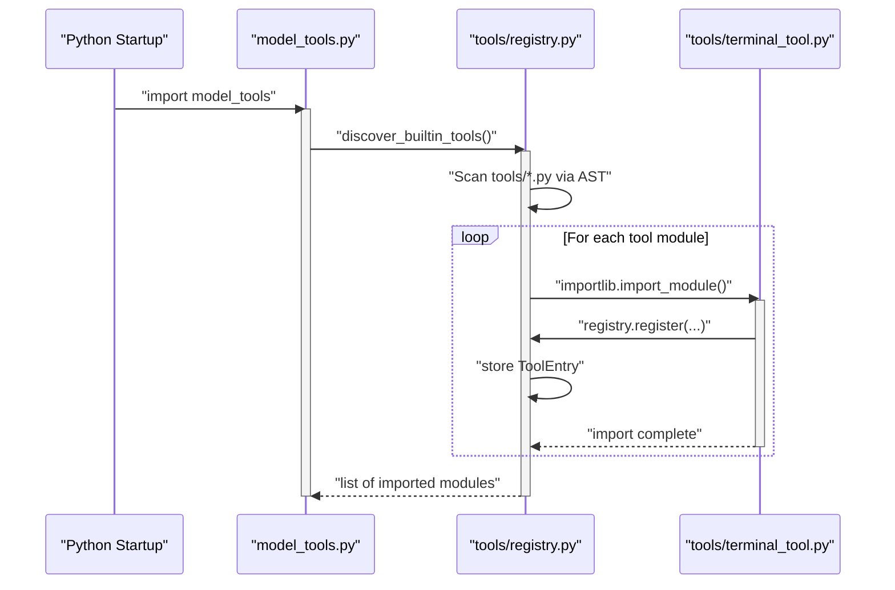
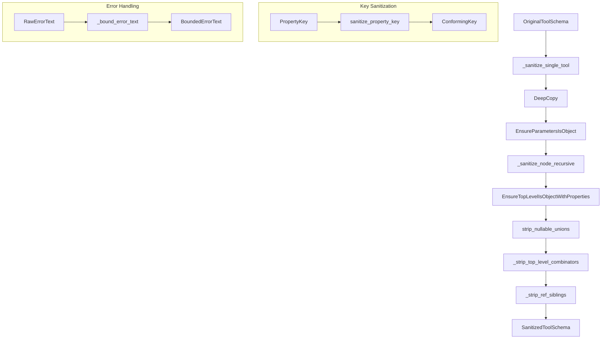
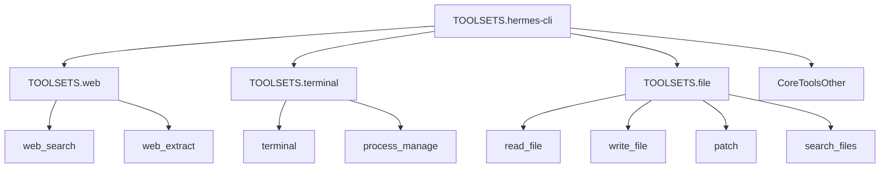

<!-- source: DeepWiki mcp.deepwiki.com · repo nousresearch/hermes-agent · page 5.1 Tool Registry and Toolsets · fetched 2026-10-27 -->

# Tool Registry and Toolsets

<details>
<summary>Relevant source files</summary>

The following files were used as context for generating this wiki page:

- [contributors/emails/Cryptodombili@gmail.com](contributors/emails/Cryptodombili@gmail.com)
- [contributors/emails/fangliquan@qq.com](contributors/emails/fangliquan@qq.com)
- [contributors/emails/southpawinmusic@gmail.com](contributors/emails/southpawinmusic@gmail.com)
- [gateway/authz_mixin.py](gateway/authz_mixin.py)
- [gateway/channel_directory.py](gateway/channel_directory.py)
- [gateway/config_env.py](gateway/config_env.py)
- [gateway/pairing.py](gateway/pairing.py)
- [hermes_cli/nous_auth_keepalive.py](hermes_cli/nous_auth_keepalive.py)
- [hermes_cli/nous_subscription.py](hermes_cli/nous_subscription.py)
- [hermes_cli/pairing.py](hermes_cli/pairing.py)
- [hermes_cli/plugin_validate.py](hermes_cli/plugin_validate.py)
- [hermes_cli/plugin_validate_core_override.py](hermes_cli/plugin_validate_core_override.py)
- [hermes_cli/plugin_validate_desktop.py](hermes_cli/plugin_validate_desktop.py)
- [hermes_cli/plugin_validate_private_imports.py](hermes_cli/plugin_validate_private_imports.py)
- [hermes_cli/portal_cli.py](hermes_cli/portal_cli.py)
- [hermes_cli/tools_config.py](hermes_cli/tools_config.py)
- [model_tools.py](model_tools.py)
- [tests/agent/test_codex_token_expired_replay_recovery.py](tests/agent/test_codex_token_expired_replay_recovery.py)
- [tests/agent/test_tool_arg_coercion.py](tests/agent/test_tool_arg_coercion.py)
- [tests/gateway/test_channel_directory.py](tests/gateway/test_channel_directory.py)
- [tests/gateway/test_env_override_explicit_disable.py](tests/gateway/test_env_override_explicit_disable.py)
- [tests/gateway/test_multiplex_pairing_stores.py](tests/gateway/test_multiplex_pairing_stores.py)
- [tests/gateway/test_pairing.py](tests/gateway/test_pairing.py)
- [tests/gateway/test_pairing_allowlist_bypass.py](tests/gateway/test_pairing_allowlist_bypass.py)
- [tests/gateway/test_whatsapp_cloud_allowed_users.py](tests/gateway/test_whatsapp_cloud_allowed_users.py)
- [tests/hermes_cli/test_install_cua_driver.py](tests/hermes_cli/test_install_cua_driver.py)
- [tests/hermes_cli/test_nous_auth_keepalive.py](tests/hermes_cli/test_nous_auth_keepalive.py)
- [tests/hermes_cli/test_nous_subscription.py](tests/hermes_cli/test_nous_subscription.py)
- [tests/hermes_cli/test_plugin_validate.py](tests/hermes_cli/test_plugin_validate.py)
- [tests/hermes_cli/test_plugin_validate_private_imports.py](tests/hermes_cli/test_plugin_validate_private_imports.py)
- [tests/hermes_cli/test_tools_config.py](tests/hermes_cli/test_tools_config.py)
- [tests/tools/test_container_cwd_sanitize.py](tests/tools/test_container_cwd_sanitize.py)
- [tests/tools/test_image_generation_managed.py](tests/tools/test_image_generation_managed.py)
- [tests/tools/test_modal_sandbox_fixes.py](tests/tools/test_modal_sandbox_fixes.py)
- [tests/tools/test_plugin_guard.py](tests/tools/test_plugin_guard.py)
- [tests/tools/test_project_tools.py](tests/tools/test_project_tools.py)
- [tests/tools/test_registry.py](tests/tools/test_registry.py)
- [tests/tools/test_schema_sanitizer.py](tests/tools/test_schema_sanitizer.py)
- [tests/tools/test_self_repo_guard.py](tests/tools/test_self_repo_guard.py)
- [tests/tools/test_skills_guard.py](tests/tools/test_skills_guard.py)
- [tests/tools/test_skills_guard_agent_config.py](tests/tools/test_skills_guard_agent_config.py)
- [tests/tools/test_terminal_requirements.py](tests/tools/test_terminal_requirements.py)
- [tests/tools/test_terminal_self_repo_guard.py](tests/tools/test_terminal_self_repo_guard.py)
- [tests/tools/test_terminal_tool_requirements.py](tests/tools/test_terminal_tool_requirements.py)
- [tests/tools/test_tts_path_traversal.py](tests/tools/test_tts_path_traversal.py)
- [tools/__init__.py](tools/__init__.py)
- [tools/arg_coercion.py](tools/arg_coercion.py)
- [tools/blueprints.py](tools/blueprints.py)
- [tools/image_generation_managed.py](tools/image_generation_managed.py)
- [tools/path_security.py](tools/path_security.py)
- [tools/plugin_guard.py](tools/plugin_guard.py)
- [tools/plugin_guard_context.py](tools/plugin_guard_context.py)
- [tools/project_tools.py](tools/project_tools.py)
- [tools/registry.py](tools/registry.py)
- [tools/schema_sanitizer.py](tools/schema_sanitizer.py)
- [tools/self_repo_guard.py](tools/self_repo_guard.py)
- [tools/skills_guard.py](tools/skills_guard.py)
- [toolsets.py](toolsets.py)
- [website/docs/developer-guide/agent-loop.md](website/docs/developer-guide/agent-loop.md)
- [website/docs/developer-guide/architecture.md](website/docs/developer-guide/architecture.md)
- [website/docs/developer-guide/cron-internals.md](website/docs/developer-guide/cron-internals.md)
- [website/docs/developer-guide/gateway-internals.md](website/docs/developer-guide/gateway-internals.md)
- [website/docs/developer-guide/provider-runtime.md](website/docs/developer-guide/provider-runtime.md)
- [website/docs/reference/tools-reference.md](website/docs/reference/tools-reference.md)
- [website/docs/reference/toolsets-reference.md](website/docs/reference/toolsets-reference.md)
- [website/docs/user-guide/features/tool-gateway.md](website/docs/user-guide/features/tool-gateway.md)

</details>


This page documents the Hermes Agent tool registry system, focusing on tool registration, discovery, schema sanitization, tool search/deferral, toolset composition, and platform-specific toolset management. It details how individual tools self-register in the centralized registry, how toolsets group tools for different use cases, and dynamic aspects such as tool search/deferral and persistent per-platform configuration [model_tools.py:1-21](), [tools/registry.py:1-15](), [toolsets.py:1-3]().

---

## Overview

Hermes Agent uses a centralized tool registry pattern, where each tool module registers its schema, handler function, toolset category, and runtime availability check at import time [model_tools.py:1-7](). The registry acts as a unified store for metadata and dispatching logic [tools/registry.py:1-6](). This decouples core agent orchestration from individual tool implementations, avoiding redundant data structures.

Toolsets group tools logically to enable or disable coherent feature bundles (e.g., web research, terminal execution, vision analysis) [toolsets.py:1-3](). They support composition by incorporating other toolsets recursively [toolsets.py:50-58]().

Sources: [model_tools.py:1-21](), [tools/registry.py:1-15](), [toolsets.py:1-3](), [toolsets.py:50-58]()

---

## Architecture and Component Data Flow

The tool subsystem bridges natural language control spaces with code entity implementations across several layers:

- **Tool Modules**: Individual implementation files (e.g., `tools/terminal_tool.py`, `tools/file_operations.py`) define schemas and register via `registry.register()` [tools/registry.py:1-6]().
- **ToolRegistry Singleton**: Defined in `tools/registry.py`, managing `ToolEntry` metadata collections, availability checking, and dispatching [tools/registry.py:1-15]().
- **Toolset Definitions**: Defined in `toolsets.py`, mapping named bundles to flat sets of tool names [toolsets.py:1-3]().
- **Public API Layer**: Orchestrated by `model_tools.py`, which triggers tool discovery, resolves tool definitions against enabled toolsets, and exposes `handle_function_call()` [model_tools.py:1-21]().

### Diagram: Tool System Component Map (Natural Language to Code Entities)

```mermaid
graph TB
    subgraph "NaturalLanguageSpace"
        NLWeb[""Web & Search Research""]
        NLTerminal[""Terminal & Process Execution""]
        NLFile[""File Operations & Patching""]
    end

    subgraph "CodeEntitySpace: Tool Modules"
        TerminalTool[""tools/terminal_tool.py""]
        FileTool[""tools/file_operations.py""]
        WebTool[""tools/web_tools.py""]
    end
    
    subgraph "CodeEntitySpace: Registry and Toolsets"
        Registry[""tools/registry.py: ToolRegistry""]
        Toolsets[""toolsets.py: TOOLSETS""]
    end
    
    subgraph "CodeEntitySpace: Public API Layer"
        ModelTools[""model_tools.py: discover_builtin_tools()""]
        GetDefs[""model_tools.py: get_tool_definitions()""]
        Dispatch[""model_tools.py: handle_function_call()""]
    end

    NLWeb --> WebTool
    NLTerminal --> TerminalTool
    NLFile --> FileTool
    
    TerminalTool -->|"registry.register()"| Registry
    FileTool -->|"registry.register()"| Registry
    WebTool -->|"registry.register()"| Registry
    
    Registry -->|"ToolEntry metadata"| ModelTools
    Toolsets -->|"resolve_toolset()"| GetDefs
    
    GetDefs -->|"filtered schemas"| ModelTools
    Dispatch -->|"registry.dispatch()"| Registry
```

Sources: [model_tools.py:1-21](), [toolsets.py:1-3](), [tools/registry.py:1-15]()

---

## Tool Discovery Process

Tools are discovered by dynamically importing tool modules containing top-level `registry.register()` calls. The main discovery function `discover_builtin_tools()` scans the `tools/` directory, inspects files using an AST prefilter (`_module_registers_tools()`), and imports valid modules [tools/registry.py:121-155]().

To optimize startup performance, verdicts are memoized on disk keyed by file modification time and size [tools/registry.py:121-155]().

### Diagram: Registration Sequence



Sources: [model_tools.py:148-150](), [tools/registry.py:121-155](), [toolsets.py:1-3]()

---

## Tool Registration, Entries, and Schema Sanitization

The `ToolRegistry` class maintains instances of tool entries [tools/registry.py:1-15](). Each entry holds:
- `name`: Unique identifier string for the tool.
- `toolset`: Grouping category name.
- `schema`: JSON schema dictionary used for LLM function calling.
- `handler`: Execution callable (sync or async).
- `check_fn`: Optional callable validating runtime pre-requisites (e.g., API keys, environment state).

Before delivery to language model providers, schemas undergo sanitization to ensure schema validator compliance across various backends. The `sanitize_tool_schemas()` function in `tools/schema_sanitizer.py` performs deep copies and fixes common issues like missing `properties` for `type: object`, bare-string schemas, `type` arrays, nullable `anyOf` at the top level, `default` beside `$ref`, and top-level combinators [tools/schema_sanitizer.py:1-10](). Error outputs are bounded by `_bound_error_text()` to prevent context window saturation from runaway tracebacks [tools/registry.py:57-82]().

### Diagram: Schema Sanitization Process



Sources: [tools/registry.py:57-82](), [tools/schema_sanitizer.py:1-10]()

---

## Tool Search and Deferral

To prevent context window overflow when hundreds of tools (including MCP and plugin tools) are loaded, Hermes implements progressive tool disclosure (`tools/tool_search.py`).

- **Deferral Configuration**: Core tools remain direct by default, while event-triggered and heavy auxiliary tools are deferred.
- **Bridge Tools**: Deferred tools are replaced in the model-visible schema array by bridge tools (`tool_search`, `tool_describe`, `tool_call`).
- **Catalog**: A stateless catalog is rebuilt from live tool definitions during prompt assembly, allowing the agent to dynamically search for and invoke tools on demand.

Sources: [tools/registry.py:1-15]()

---

## Toolset System and Composition

Toolsets are defined in `toolsets.py` as a dictionary of named tool groups (`TOOLSETS`) [toolsets.py:74-133](). Each entry specifies explicit tool names or includes other toolsets recursively [toolsets.py:50-52]().

The core set of tools (`_HERMES_CORE_TOOLS`) establishes the baseline capabilities shared across standard configurations [toolsets.py:11-39](). Function `resolve_toolset()` flattens and expands composite toolset selections [model_tools.py:23]().

### Diagram: Toolset Composition Example



Sources: [toolsets.py:11-39](), [toolsets.py:50-52](), [toolsets.py:74-133](), [model_tools.py:23]()

---

## Platform-Specific Toolsets and Configuration

Users configure toolsets per platform (e.g., CLI, Discord, Telegram) via preferences persisting in configuration files.

### Diagram: Platform Toolset Architecture (Natural Language to Code Entities)

```mermaid
graph TB
    subgraph "NaturalLanguageSpace"
        NLPlatform[""Platform Selection (CLI, Discord, Web)""]
        NLConfig[""User Toolset Preferences""]
    end

    subgraph "CodeEntitySpace: Configuration & Scoping"
        ToolsConfig[""hermes_cli/tools_config.py""]
        ToolsetScope[""hermes_cli/toolset_scope.py: _toolset_allowed_for_platform()""]
        ResolveToolset[""toolsets.py: resolve_toolset()""]
    end

    NLPlatform --> ToolsetScope
    NLConfig --> ToolsConfig
    ToolsConfig --> ResolveToolset
    ToolsetScope --> ResolveToolset
```

- **Configurable Toolsets**: Lists all user-manageable toolsets such as `web`, `browser`, `terminal`, `file`, `code_execution`, `vision`, `video`, `image_gen`, `video_gen`, `x_search`, `tts`, `skills`, `todo`, `kanban`, `memory`, `context_engine`, `session_search`, `connections`, `clarify`, `delegation`, `cronjob`, and `computer_use` [hermes_cli/tools_config.py:67-94]().
- **Platform Restrictions**: Certain toolsets are platform-restricted and will not be enabled on non-applicable platforms [tests/hermes_cli/test_tools_config.py:139-147](). The `_toolset_allowed_for_platform` function enforces these restrictions [hermes_cli/tools_config.py:15-16]().

Sources: [hermes_cli/tools_config.py:15-16](), [hermes_cli/tools_config.py:67-94](), [tests/hermes_cli/test_tools_config.py:139-147]()

---

