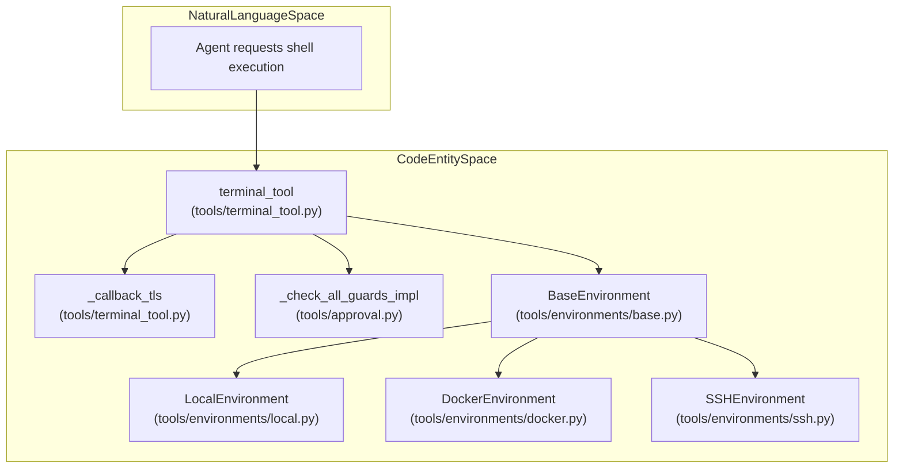
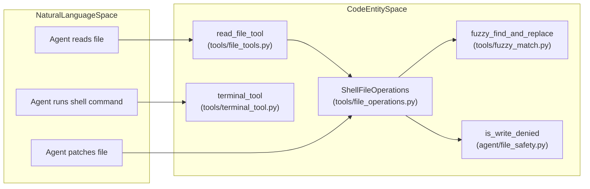

<!-- source: DeepWiki mcp.deepwiki.com · repo nousresearch/hermes-agent · page 5.2 Terminal and File Operations · fetched 2026-10-27 -->

# Terminal and File Operations

Relevant source files

The following files were used as context for generating this wiki page:

- [agent/file_safety.py](agent/file_safety.py)
- [agent/runtime_self_protection.py](agent/runtime_self_protection.py)
- [agent/search_policy.py](agent/search_policy.py)
- [agent/skill_bundles.py](agent/skill_bundles.py)
- [agent/subdirectory_hints.py](agent/subdirectory_hints.py)
- [tests/agent/lsp/test_shell_linter_lsp_skip.py](tests/agent/lsp/test_shell_linter_lsp_skip.py)
- [tests/agent/test_file_safety.py](tests/agent/test_file_safety.py)
- [tests/agent/test_file_safety_credentials.py](tests/agent/test_file_safety_credentials.py)
- [tests/agent/test_file_safety_write_credentials.py](tests/agent/test_file_safety_write_credentials.py)
- [tests/agent/test_runtime_self_protection.py](tests/agent/test_runtime_self_protection.py)
- [tests/agent/test_skill_bundles.py](tests/agent/test_skill_bundles.py)
- [tests/agent/test_subdirectory_hints.py](tests/agent/test_subdirectory_hints.py)
- [tests/gateway/test_restart_service_detection.py](tests/gateway/test_restart_service_detection.py)
- [tests/gateway/test_startup_environment_probe.py](tests/gateway/test_startup_environment_probe.py)
- [tests/hermes_cli/test_bundles.py](tests/hermes_cli/test_bundles.py)
- [tests/tools/test_binary_document_write_guard.py](tests/tools/test_binary_document_write_guard.py)
- [tests/tools/test_cross_profile_guard.py](tests/tools/test_cross_profile_guard.py)
- [tests/tools/test_docker_windows_cwd_mount.py](tests/tools/test_docker_windows_cwd_mount.py)
- [tests/tools/test_escape_drift_autocorrect.py](tests/tools/test_escape_drift_autocorrect.py)
- [tests/tools/test_execute_code_lifecycle_guard_deadline.py](tests/tools/test_execute_code_lifecycle_guard_deadline.py)
- [tests/tools/test_file_operations.py](tests/tools/test_file_operations.py)
- [tests/tools/test_file_operations_delete.py](tests/tools/test_file_operations_delete.py)
- [tests/tools/test_file_operations_edge_cases.py](tests/tools/test_file_operations_edge_cases.py)
- [tests/tools/test_file_read_guards.py](tests/tools/test_file_read_guards.py)
- [tests/tools/test_file_staleness.py](tests/tools/test_file_staleness.py)
- [tests/tools/test_file_state_registry.py](tests/tools/test_file_state_registry.py)
- [tests/tools/test_file_tools.py](tests/tools/test_file_tools.py)
- [tests/tools/test_file_tools_container_config.py](tests/tools/test_file_tools_container_config.py)
- [tests/tools/test_file_tools_cwd_resolution.py](tests/tools/test_file_tools_cwd_resolution.py)
- [tests/tools/test_file_tools_live.py](tests/tools/test_file_tools_live.py)
- [tests/tools/test_file_tools_tilde_profile.py](tests/tools/test_file_tools_tilde_profile.py)
- [tests/tools/test_file_write_safety.py](tests/tools/test_file_write_safety.py)
- [tests/tools/test_fuzzy_match.py](tests/tools/test_fuzzy_match.py)
- [tests/tools/test_interrupted_command_cwd.py](tests/tools/test_interrupted_command_cwd.py)
- [tests/tools/test_known_file_write_baseline.py](tests/tools/test_known_file_write_baseline.py)
- [tests/tools/test_launchctl_guard_diagnostic.py](tests/tools/test_launchctl_guard_diagnostic.py)
- [tests/tools/test_line_ending_preservation.py](tests/tools/test_line_ending_preservation.py)
- [tests/tools/test_macos_protected_search.py](tests/tools/test_macos_protected_search.py)
- [tests/tools/test_patch_already_applied.py](tests/tools/test_patch_already_applied.py)
- [tests/tools/test_patch_parser.py](tests/tools/test_patch_parser.py)
- [tests/tools/test_read_loop_detection.py](tests/tools/test_read_loop_detection.py)
- [tests/tools/test_read_shell_line_clamp.py](tests/tools/test_read_shell_line_clamp.py)
- [tests/tools/test_resolve_path.py](tests/tools/test_resolve_path.py)
- [tests/tools/test_search_budget_truncation.py](tests/tools/test_search_budget_truncation.py)
- [tests/tools/test_search_files_engine_selection.py](tests/tools/test_search_files_engine_selection.py)
- [tests/tools/test_search_hidden_dirs.py](tests/tools/test_search_hidden_dirs.py)
- [tests/tools/test_search_native_rg.py](tests/tools/test_search_native_rg.py)
- [tests/tools/test_search_zero_match_and_multipath.py](tests/tools/test_search_zero_match_and_multipath.py)
- [tests/tools/test_session_cwd_store.py](tests/tools/test_session_cwd_store.py)
- [tests/tools/test_skill_view_dedup.py](tests/tools/test_skill_view_dedup.py)
- [tests/tools/test_ssh_remote_cwd.py](tests/tools/test_ssh_remote_cwd.py)
- [tests/tools/test_terminal_pre_guard_deadline.py](tests/tools/test_terminal_pre_guard_deadline.py)
- [tests/tools/test_terminal_task_cwd.py](tests/tools/test_terminal_task_cwd.py)
- [tests/tools/test_terminal_yield_to_background.py](tests/tools/test_terminal_yield_to_background.py)
- [tests/tools/test_write_deny.py](tests/tools/test_write_deny.py)
- [tools/binary_extensions.py](tools/binary_extensions.py)
- [tools/escape_drift_autocorrect.py](tools/escape_drift_autocorrect.py)
- [tools/file_operations.py](tools/file_operations.py)
- [tools/file_operations_common.py](tools/file_operations_common.py)
- [tools/file_operations_lint.py](tools/file_operations_lint.py)
- [tools/file_operations_search.py](tools/file_operations_search.py)
- [tools/file_state.py](tools/file_state.py)
- [tools/file_tools.py](tools/file_tools.py)
- [tools/file_tools_paths.py](tools/file_tools_paths.py)
- [tools/file_tools_read_tracking.py](tools/file_tools_read_tracking.py)
- [tools/file_tools_write_guards.py](tools/file_tools_write_guards.py)
- [tools/fuzzy_match.py](tools/fuzzy_match.py)
- [tools/hook_output_spill.py](tools/hook_output_spill.py)
- [tools/patch_parser.py](tools/patch_parser.py)
- [tools/terminal_tool.py](tools/terminal_tool.py)
- [tools/terminal_tool_background.py](tools/terminal_tool_background.py)
- [tools/terminal_tool_config.py](tools/terminal_tool_config.py)
- [tools/terminal_tool_guards.py](tools/terminal_tool_guards.py)

This page documents the terminal and file operation tools, which provide command execution and filesystem manipulation capabilities across Hermes Agent. The terminal tool executes shell commands across multiple backend environments (`local`, `docker`, `ssh`, `singularity`, `modal`, `daytona`, `vercel_sandbox`), while file tools provide specialized operations for reading, writing, patching, fuzzy matching, and searching files with integrated safety guards, V4A patch parsing, and LSP semantic diagnostics.

Sources: [tools/terminal_tool.py:2-19](), [tools/file_tools.py:2-7](), [tools/file_operations.py:2-8]()

---

## Overview

The terminal and file tools share a common architecture built on the environment abstraction layer (`BaseEnvironment`). Both tool families:

- Support multiple backend environments leveraging environment selection via the `TERMINAL_ENV` configuration or environment variable [tools/terminal_tool.py:2-10]().
- Provide per-task isolation through a `task_id` parameter enabling parallel and nested command execution contexts [agent/delegation_context.py:113-114]().
- Reuse persistent environment instances cached in active session pools to avoid startup overhead and cache state across calls [tools/terminal_tool_lifecycle.py:178-185]().
- Integrate a security approval system that inspects terminal commands and requests user approval on dangerous operations via a thread-local callback mechanism (`_callback_tls`) [tools/terminal_tool.py:80-103]().
- Handle command redaction and sensitive text filtering to prevent secret leakage in logs [tools/terminal_tool.py:34-39]().

Sources: [tools/terminal_tool.py:2-39, 80-103](), [tools/terminal_tool_lifecycle.py:178-185](), [agent/delegation_context.py:113-114]()

---

## Terminal Tool Architecture

The terminal tool serves as the core component to execute shell commands, supporting various execution backends including local host, Docker containers, Modal cloud sandboxes, SSH, Singularity, Daytona, and Vercel Sandbox.

### Core Components and Data Flow

Below is a bridge diagram connecting natural language space intents to the underlying code entities in the terminal subsystem:

*Figure 1: Terminal subsystem natural language to code entity mapping.*

- `terminal_tool` is the primary entry point that executes shell commands in a specified isolated environment, returning a JSON-serializable result containing stdout, stderr, return code, and execution metadata [tools/terminal_tool.py:27-34]().
- Thread-local storage (`_callback_tls`) manages `sudo_password` and `approval` callbacks separately across concurrent ACP sessions and gateway threads [tools/terminal_tool.py:80-103]().
- Command execution is gated by `_check_all_guards()` which merges Tirith analysis and dangerous command heuristics [tools/terminal_tool.py:146-151]().
- Backends inherit from `BaseEnvironment` (`tools/environments/base.py`) which implements unified snapshot sourcing, CWD tracking, interrupt handling, and timeout enforcement [tools/environments/base.py:142-146]().

Sources: [tools/terminal_tool.py:27-34, 80-151](), [tools/environments/base.py:142-146]()

---

## File Operations

The file tools provide the agent LLM with structured file reading, writing, patching, and searching capabilities. They leverage shell command execution under the hood (`ShellFileOperations`) and add layered logic for pagination, safety, and normalization.

### Architecture and Key Classes

- The `FileOperations` abstract base class defines the interface for file operations across terminal backends, while `ShellFileOperations` implements these actions via shell commands [tools/file_operations.py:96-135]().
- These methods return structured dataclasses defined in `tools/file_operations_common.py`:
  - `ReadResult`: Includes content, pagination metadata, and binary detection flags [tools/file_operations.py:100-106]().
  - `WriteResult`: Reports bytes written and LSP diagnostics [tools/file_operations.py:108-110]().
  - `PatchResult`: Returns diffs, success status, and modified files [tools/file_operations.py:112-118]().
  - `SearchResult`: Contains line-grouped matches and total counts [tools/file_operations.py:129-133]().

Sources: [tools/file_operations.py:96-135]()

---

## Fuzzy Matching (`fuzzy_match.py`)

When the agent invokes `patch_replace`, exact string matching is attempted first. If whitespace, indentation, escaping, or typographic Unicode variants drift, `fuzzy_find_and_replace` steps through an ordered chain of increasingly permissive strategies [tools/fuzzy_match.py:2-10]().

- **Unicode Normalization**: Maps smart quotes, em/en dashes, non-breaking spaces, and typographic minus signs to ASCII equivalents via `_unicode_normalize()` before matching [tools/fuzzy_match.py:23-40]().
- **Whitespace Normalization**: Collapses internal whitespace runs (`[ \t]+` -> `' '`) while ensuring boundary spacing is preserved so operators or adjacent words do not merge incorrectly [tools/fuzzy_match.py:122-143]().
- **Indentation Preservation**: When a non-exact fuzzy strategy matches, the incoming `new_string` is automatically re-indented to match the target file's actual indentation depth, preventing malformed code blocks [tests/tools/test_fuzzy_match.py:105-135]().

Sources: [tools/fuzzy_match.py:2-10, 23-40, 122-143](), [tests/tools/test_fuzzy_match.py:105-135]()

---

## Content Budgeting and Truncation

To prevent the agent from blowing its context window with massive files, several guards are in place:

- **Read Guard**: `read_file` content is capped by `_get_max_read_chars()` (default 100,000 characters) [tools/file_tools.py:45-58](). If exceeded, `_truncate_to_char_budget()` trims the content to the last complete line within the budget and provides a continuation offset [tools/file_tools.py:61-90]().
- **Pagination**: The `normalize_read_pagination` helper ensures that reads are performed in manageable chunks using `offset` and `limit` [tools/file_operations.py:23-24]().
- **Binary Protection**: Files with binary extensions or opaque formats are identified via magic signatures (`_MAGIC_SIGNATURES`) in `identify_binary_bytes()` to prevent terminal corruption and return structured refusal messages via `describe_binary_file()` [tools/file_operations.py:41-94]().

Sources: [tools/file_tools.py:45-90](), [tools/file_operations.py:23-94]()

---

## Safety, Write Protection, and Device Blocks

File writes and terminal operations are guarded by strict safety layers implemented in `agent/file_safety.py` and `tools/file_tools_write_guards.py`:

- **Write Denylist**: `is_write_denied()` blocks writes to sensitive user credential files (`~/.ssh/authorized_keys`, `~/.netrc`, `.aws/credentials`, `.pgpass`, `.npmrc`, `.pypirc`), Hermes root secrets (`.env`, `.anthropic_oauth.json`), system configuration files, and internal application stores (`mcp-tokens/`, `pairing/`, `state.db`, `sessions/`) [tests/tools/test_file_operations.py:28-96]().
- **Device Path Blocking**: Reads and writes against blocking device files (`/dev/zero`, `/dev/random`, `/dev/urandom`, `/dev/stdin`, `/dev/tty`) and sensitive `/proc` pseudo-files (`/proc/self/environ`, `/proc/self/cmdline`, `/proc/self/maps`, `/proc/self/mem`) are rejected immediately before any I/O occurs [tools/file_tools.py:114-128]().
- **NT-Namespace Path Guard**: `is_nt_namespace_path()` prevents access to Windows NT-namespace paths (e.g., `\\??\\`, `\\\\.\\`, `\\\\?\\UNC\\`) to mitigate NTLM credential leaks, running on the raw path string before any resolution [agent/file_safety.py:144-158]().
- **Gateway Lifecycle Command Blocking**: The `cron.lifecycle_guard` module prevents cron jobs from being created that would restart or stop the gateway process itself [cron/lifecycle_guard.py:30-100](). This is a hard block preventing a SIGTERM-respawn loop [cron/lifecycle_guard.py:2-6]().

Sources: [tools/file_tools.py:114-128](), [tests/tools/test_file_operations.py:28-96](), [agent/file_safety.py:144-158](), [cron/lifecycle_guard.py:30-100](), [cron/lifecycle_guard.py:2-6]()

---

## V4A Patching and LSP Integration

- **V4A Patching**: Structured multi-file and single-file edits are handled via `parse_v4a_patch()` and `apply_v4a_operations()` in `tools/patch_parser.py`, supporting `ADD`, `UPDATE`, `DELETE`, and `MOVE` operations wrapped between `*** Begin Patch` and `*** End Patch` markers [tools/patch_parser.py:1-57]().
- **LSP Semantic Diagnostics**: File operations integrate semantic syntax diagnostics from Language Server Protocol (LSP) servers (`pyright`, `gopls`, `rust-analyzer`, etc.). `WriteResult` and `PatchResult` include diagnostic fields holding semantic error and warning messages detected during file verification [tools/file_operations.py:108-118]().

Sources: [tools/patch_parser.py:1-57](), [tools/file_operations.py:108-118]()

---

## Execution Flow Summary

The following diagram maps natural language space agent intents to code entity space implementations for file and terminal operations:

*Figure 2: File and terminal operation dispatch flow.*

Sources: [tools/file_tools.py:1-40](), [tools/file_operations.py:96-135](), [tools/fuzzy_match.py:1-15](), [tools/terminal_tool.py:27-34]()

---

