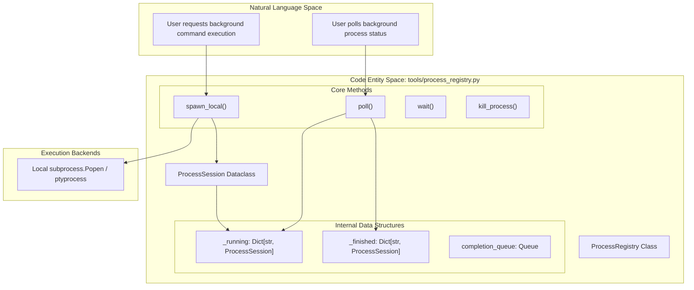
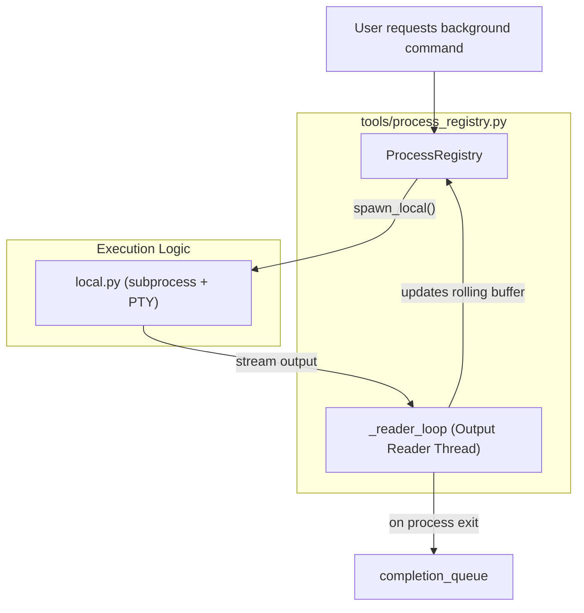
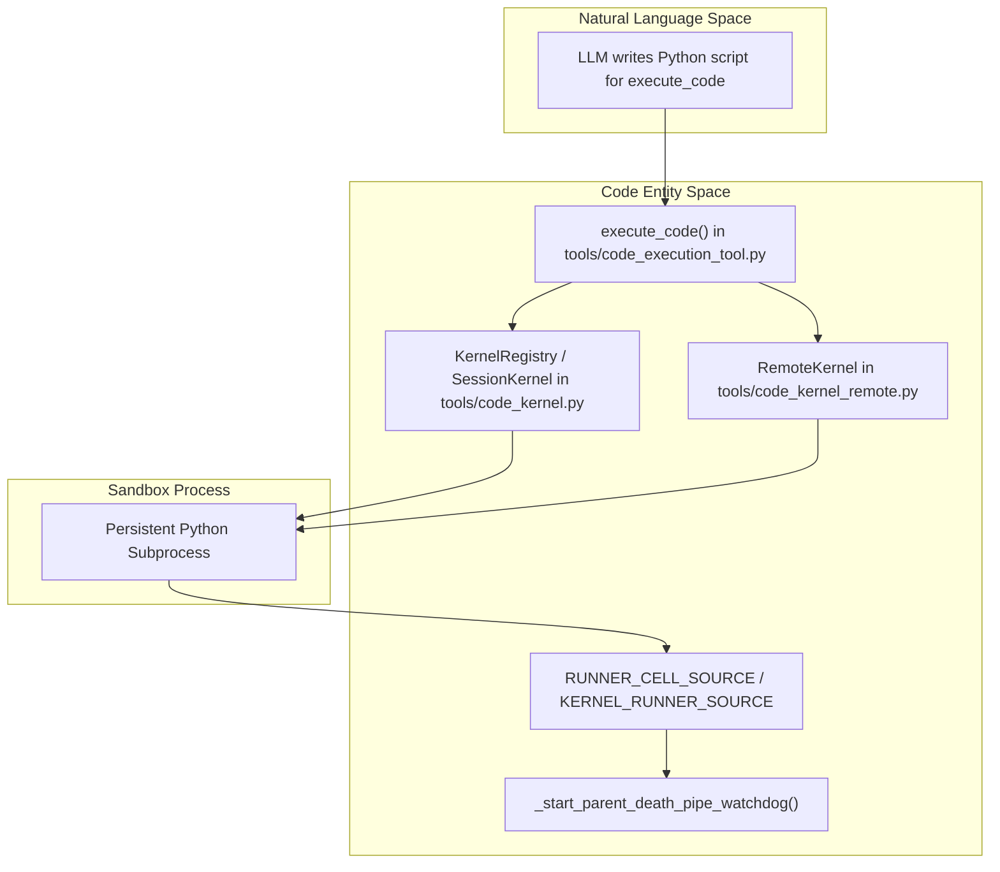

<!-- source: DeepWiki mcp.deepwiki.com · repo nousresearch/hermes-agent · page 5.3 Process Management · fetched 2026-10-27 -->

# Process Management

Relevant source files

The following files were used as context for generating this wiki page:

- [agent/delegation_context.py](agent/delegation_context.py)
- [agent/estop.py](agent/estop.py)
- [agent/kanban_stop.py](agent/kanban_stop.py)
- [tests/agent/test_file_safety_cross_profile.py](tests/agent/test_file_safety_cross_profile.py)
- [tests/agent/test_kanban_stop.py](tests/agent/test_kanban_stop.py)
- [tests/cron/test_cron_kanban_env_isolation.py](tests/cron/test_cron_kanban_env_isolation.py)
- [tests/gateway/test_internal_event_bypass_pairing.py](tests/gateway/test_internal_event_bypass_pairing.py)
- [tests/tools/test_base_environment.py](tests/tools/test_base_environment.py)
- [tests/tools/test_delegate_kanban_isolation.py](tests/tools/test_delegate_kanban_isolation.py)
- [tests/tools/test_docker_environment.py](tests/tools/test_docker_environment.py)
- [tests/tools/test_drain_fd_windows.py](tests/tools/test_drain_fd_windows.py)
- [tests/tools/test_env_passthrough.py](tests/tools/test_env_passthrough.py)
- [tests/tools/test_env_probe.py](tests/tools/test_env_probe.py)
- [tests/tools/test_execute_code_approval_cluster.py](tests/tools/test_execute_code_approval_cluster.py)
- [tests/tools/test_hermes_subprocess_env.py](tests/tools/test_hermes_subprocess_env.py)
- [tests/tools/test_local_background_child_hang.py](tests/tools/test_local_background_child_hang.py)
- [tests/tools/test_local_env_blocklist.py](tests/tools/test_local_env_blocklist.py)
- [tests/tools/test_local_shell_init.py](tests/tools/test_local_shell_init.py)
- [tests/tools/test_notify_on_complete.py](tests/tools/test_notify_on_complete.py)
- [tests/tools/test_process_registry.py](tests/tools/test_process_registry.py)
- [tests/tools/test_protected_instruction_cli_channel.py](tests/tools/test_protected_instruction_cli_channel.py)
- [tests/tools/test_singularity_persistent_overlay.py](tests/tools/test_singularity_persistent_overlay.py)
- [tests/tools/test_snapshot_multiline_session_env_injection.py](tests/tools/test_snapshot_multiline_session_env_injection.py)
- [tests/tools/test_snapshot_session_id_leak.py](tests/tools/test_snapshot_session_id_leak.py)
- [tests/tools/test_subagent_sudo_prompt.py](tests/tools/test_subagent_sudo_prompt.py)
- [tests/tools/test_terminal_output_transform_hook.py](tests/tools/test_terminal_output_transform_hook.py)
- [tests/tools/test_terminal_tool.py](tests/tools/test_terminal_tool.py)
- [tests/tools/test_watch_patterns.py](tests/tools/test_watch_patterns.py)
- [tests/tui_gateway/test_served_profile_child_env.py](tests/tui_gateway/test_served_profile_child_env.py)
- [tests/tui_gateway/test_sudo_command_context.py](tests/tui_gateway/test_sudo_command_context.py)
- [tools/env_passthrough.py](tools/env_passthrough.py)
- [tools/env_probe.py](tools/env_probe.py)
- [tools/environments/base.py](tools/environments/base.py)
- [tools/environments/base_output.py](tools/environments/base_output.py)
- [tools/environments/base_session_env.py](tools/environments/base_session_env.py)
- [tools/environments/base_wait.py](tools/environments/base_wait.py)
- [tools/environments/docker.py](tools/environments/docker.py)
- [tools/environments/docker_egress.py](tools/environments/docker_egress.py)
- [tools/environments/local.py](tools/environments/local.py)
- [tools/environments/local_env_policy.py](tools/environments/local_env_policy.py)
- [tools/environments/local_pythonpath.py](tools/environments/local_pythonpath.py)
- [tools/environments/path_utils.py](tools/environments/path_utils.py)
- [tools/environments/remote_common.py](tools/environments/remote_common.py)
- [tools/environments/singularity.py](tools/environments/singularity.py)
- [tools/process_registry.py](tools/process_registry.py)
- [tools/terminal_tool_result.py](tools/terminal_tool_result.py)
- [tools/terminal_tool_sudo.py](tools/terminal_tool_sudo.py)

## Purpose and Scope

Process Management in Hermes Agent coordinates the spawning, tracking, isolation, and lifecycle control of background processes and code execution kernels. These subsystems enable asynchronous long-running tasks—such as background servers, file watchers, build loops, and session-persistent code evaluation kernels—to operate independently of the agent’s interactive turn-based conversation loop.

The core components of this subsystem include:
- `ProcessRegistry`: An in-memory, thread-safe registry managing background processes spawned via the terminal tool with `background=true` [tools/process_registry.py:1-30]().
- `ProcessSession`: A dataclass tracking process metadata, rolling output buffers, and session scopes [tools/process_registry.py:29-30]().
- Session-persistent execution kernels (`tools/code_kernel.py`) and remote session kernels (`tools/code_kernel_remote.py`) that handle Programmatic Tool Calling (PTC) through Unix sockets or loopback TCP [tools/code_execution_tool.py:1-12](), [tools/code_kernel.py:1-16](), [tools/code_kernel_remote.py:1-17]().

All background processes execute strictly through the environment abstraction interface (`tools/environments/`), ensuring isolation inside local or remote/container backends (Docker, Singularity, Modal, Daytona, SSH) rather than directly on the host unless explicitly configured via `TERMINAL_ENV=local` [tools/process_registry.py:1-5]().

Sources: [tools/process_registry.py:1-30](), [tools/code_execution_tool.py:1-12](), [tools/code_kernel.py:1-16](), [tools/code_kernel_remote.py:1-17]()

---

## Background vs Foreground Execution

Hermes' terminal tool distinguishes two execution modes based on the `background` flag:

| Mode | Behavior | Use Cases | Return Value |
|---|---|---|---|
| **Foreground** | Blocks until command completes or times out, returning output and exit code.| One-off commands and scripts | Command stdout & exit code |
| **Background** | Spawns process asynchronously, returns immediately with a session ID. | Daemons, servers, watchers | Unique process session ID |

Foreground execution enforces a default timeout to prevent agent hangs. Background processes register inside `ProcessRegistry` for ongoing monitoring, log capture, and event notifications.

Sources: [tools/process_registry.py:1-5](), [tools/code_execution_tool.py:1-12]()

---

## ProcessRegistry Architecture

`ProcessRegistry` maintains the lifecycle states of all managed background processes. It organizes process metadata and handles state transitions, output buffering, and event notifications.

### Key Internal Structures

- `_running: Dict[str, ProcessSession]` — Active processes keyed by session ID [tests/tools/test_process_registry.py:79]().
- `_finished: Dict[str, ProcessSession]` — Recently exited processes retained temporarily (default TTL 1800s) for inspection [tools/process_registry.py:57]().
- `completion_queue: Queue` — Events enqueued upon process exit to notify external clients or gateways [tests/tools/test_notify_on_complete.py:70-73]().

### Primary Interfaces

- `spawn_local()` — Locally spawn a background process via subprocess or PTY [tools/process_registry.py:1-30]().
- `poll(session_id)` — Query process status, exit code, and log output [tests/tools/test_process_registry.py:213-218]().
- `wait(session_id, timeout)` — Block until process completion or timeout with interrupt checking.
- `kill_process(session_id)` — Terminate a given process gracefully or forcefully [tests/tools/test_process_registry.py:90-96]().

### Code Association Diagram: ProcessRegistry

Title: "ProcessRegistry Architecture and Code Entities"

Sources: [tools/process_registry.py:1-57](), [tests/tools/test_notify_on_complete.py:70-73](), [tests/tools/test_process_registry.py:79](), [tests/tools/test_process_registry.py:90-96](), [tests/tools/test_process_registry.py:213-218]()

---

## ProcessSession Data Structure

The fundamental unit modeling a background process is the `ProcessSession` dataclass. It encapsulates all metadata, runtime handles, and output buffers necessary for management.

| Field | Type | Description |
|---|---|---|
| `id` | `str` | Unique session identifier, prefixed `"proc_"` for consistency |
| `command` | `str` | The full shell command line invoked |
| `task_id` | `str` | Isolation key (e.g. gateway turn or task ID) to scope process control|
| `pid` | `Optional[int]` | OS process ID (only for local execution) |
| `process` | `Optional[Popen]` | The local subprocess or PTY handle, if local backend is used |
| `started_at` | `float` | POSIX timestamp when the process was started |
| `exited` | `bool` | Set to True upon process termination |
| `exit_code` | `Optional[int]` | Numeric exit code returned by the process |
| `output_buffer` | `str` | Rolling log buffer (max 200KB) capturing stdout/stderr [tools/process_registry.py:55]() |
| `notify_on_complete` | `bool` | If True, generates notification when process exits [tests/tools/test_notify_on_complete.py:36-37]() |

Sources: [tools/process_registry.py:29-55](), [tests/tools/test_notify_on_complete.py:36-37]()

---

## Spawn Modes and Environment Management

### Local Process Spawning and Isolation

In the `TERMINAL_ENV=local` mode, Hermes uses Python's `subprocess.Popen` or `ptyprocess.PtyProcess` to spawn background processes.

- **Environment Sanitization:** Environment variables are sanitized via `_sanitize_subprocess_env` [tools/environments/local.py:28]() to strip sensitive Hermes-managed credentials. This includes blocking provider API keys and internal secrets from leaking into subprocesses [tools/environments/local_env_policy.py:19-52](). However, general AWS credential chains are preserved to allow users to run AWS tools [tools/environments/local_env_policy.py:58-62]().
- **Systemd Cgroup Isolation:** Under Linux systemd gateways, background commands inherit the gateway's cgroup. To prevent memory-heavy executors from triggering systemd-oomd and killing the entire gateway, Hermes uses `systemd-run --user --scope` to place workers into transient cgroups [tools/process_registry.py:99-108]().
- **Memory Caps:** Memory limits are bounded via `_worker_memory_max_bytes()`, which computes a safe limit based on cgroup-v2 limits or physical RAM (capped at 4 GiB) [tools/process_registry.py:119-134]().
- **Path Translation (Windows/MSYS):** On Windows, paths are translated between MSYS-style (`/c/Users/x`) and native Windows paths (`C:\Users\x`) to ensure `subprocess.Popen(cwd=...)` and `os.path.isdir` function correctly [tools/environments/local.py:116-124](). This prevents warnings about missing directories.

Sources: [tools/environments/local.py:28](), [tools/environments/local.py:116-124](), [tools/environments/local_env_policy.py:19-52](), [tools/environments/local_env_policy.py:58-62](), [tools/process_registry.py:99-134]()

---

## Background Process Execution Flow

Title: "Background Process Spawning and Execution Flow"

Sources: [tools/process_registry.py:1-30]()

---

## Code Execution Kernels

Programmatic Tool Calling (PTC) via `execute_code` allows the LLM to write a Python script that calls Hermes tools over an RPC interface, collapsing multi-step tool chains into a single inference turn [tools/code_execution_tool.py:1-12]().

### Session-Persistent Kernels (`tools/code_kernel.py` and `tools/code_kernel_remote.py`)
- **Architecture:** One child process per conversation session, mode, interpreter, cwd, and tool-set [tools/code_kernel.py:1-3](), [tools/code_kernel_remote.py:1-17](). State persists across tool calls.
- **Communication:** Local mode uses Unix sockets (or loopback TCP on Windows) [tools/code_execution_tool.py:6-10](). Remote backends use a file-based cell protocol inside the kernel directory (`cell_req_*.json` / `cell_res_*.json`) [tools/code_kernel_remote.py:1-17]().
- **Wire Protocol:** Requests are sent as JSON lines over stdin (`{"id", "code"}`); replies are framed on stdout as `<SENTINEL> <byte-length>\n<json>` [tools/code_kernel.py:11-16]().
- **Safety Watchdogs:** Includes parent process death watchdogs (POSIX pipe watchdogs and Windows handle watchdogs) to ensure orphaned kernel processes terminate if the host gateway crashes or exits unexpectedly [tools/code_kernel.py:94-175]().

### Code Association Diagram: Code Execution Kernels

Title: "Code Execution Kernels and RPC Infrastructure"

Sources: [tools/code_execution_tool.py:1-12](), [tools/code_kernel.py:1-175](), [tools/code_kernel_remote.py:1-153]()

---

## Monitoring, Security, and Lifecycle

### Watch Patterns and Rate Limiting
`ProcessRegistry` supports output monitoring via watch patterns subject to strict rate limits:
- **Cooldown:** `WATCH_MIN_INTERVAL_SECONDS` (15s) between notifications per session [tools/process_registry.py:66]().
- **Strike Limit:** `WATCH_STRIKE_LIMIT` (3 consecutive strikes) disables automated matching to prevent feedback loops [tools/process_registry.py:67]().
- **Lifetime Cap:** `WATCH_LIFETIME_MAX_HITS` (8 total hits) caps total deliveries per session [tools/process_registry.py:78]().
- **Global Circuit Breaker:** `WATCH_GLOBAL_MAX_PER_WINDOW` and `WATCH_GLOBAL_WINDOW_SECONDS` provide a global rate limit across all sessions to prevent collective flooding [tools/process_registry.py:94-96]().

### Checkpoint and Recovery
Active background processes are periodically serialized to a JSON checkpoint file (`processes.json` inside the Hermes home directory) to allow recovery after gateway restarts [tools/process_registry.py:43-54]().

### Credential File Passthrough
For remote terminal backends (Docker, Modal, SSH), specific credential files can be registered for mounting into the sandbox. This is controlled by `skill.required_credential_files` and `terminal.credential_files` in `config.yaml`.
- **Security:** Absolute paths and path traversals out of `HERMES_HOME` are rejected. Master credential stores (`.env`, `auth.json`) are explicitly denied from being mounted to prevent sensitive data exposure.
- **Skills Directory:** The `skills` directory can also be mounted, with symlinks sanitized to prevent traversal attacks.

### Environment Variable Passthrough
Environment variables can be explicitly allowed to pass into sandboxed children via `skill.required_environment_variables` or `terminal.env_passthrough` in `config.yaml`.
- **Security:** Hermes-managed provider credentials (e.g., `OPENAI_API_KEY`) are strictly blocked from passthrough to prevent credential leakage, even if explicitly requested by a skill or configuration [tools/env_passthrough.py:46-65](). This addresses security vulnerabilities like GHSA-rhgp-j443-p4rf.

### Background Process Notifications
The gateway process watcher pushes status updates to users' chats when background terminal commands run. The verbosity is controlled by `display.background_process_notifications` in `config.yaml` (options: `off`, `result`, `error`, `all`, `concise`).
- **Consumption Check:** If a process completion has already been consumed (e.g., by `process(wait)`), the watcher will not send a duplicate notification [tests/tools/test_notify_on_complete.py:124-141]().

Sources: [tools/process_registry.py:43-96](), [tools/env_passthrough.py:46-65](), [tests/tools/test_notify_on_complete.py:124-141]()

---

