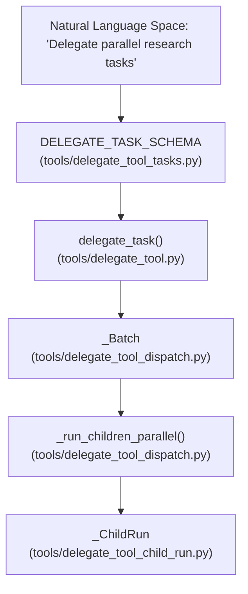
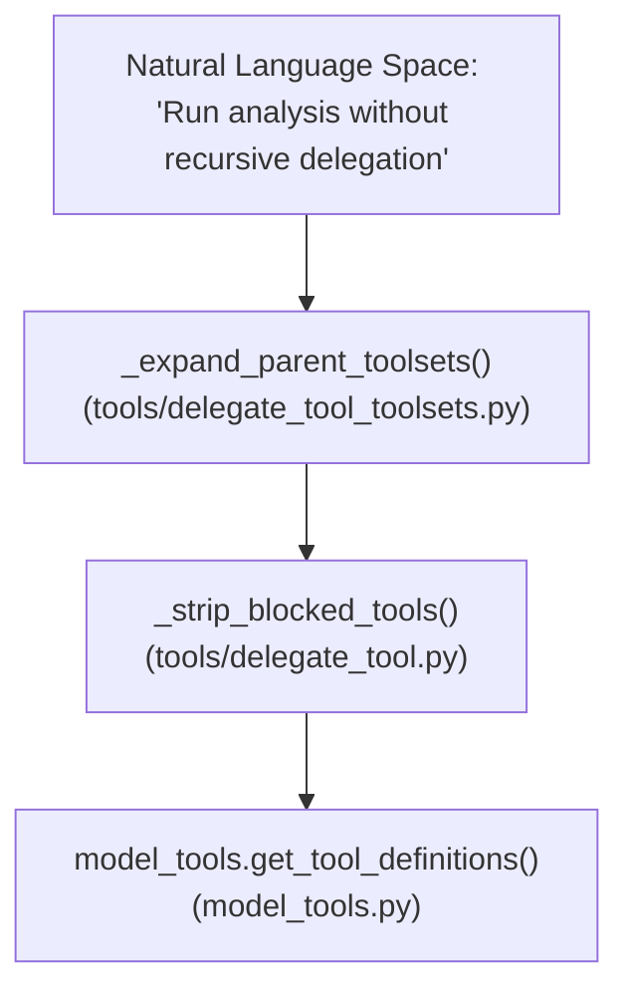

<!-- source: DeepWiki mcp.deepwiki.com · repo nousresearch/hermes-agent · page 5.7 Subagent Delegation · fetched 2026-10-27 -->

# Subagent Delegation

Relevant source files

The following files were used as context for generating this wiki page:

- [hermes_cli/cli_process_notifications.py](hermes_cli/cli_process_notifications.py)
- [tests/agent/test_sequential_deadline_delegate_exempt.py](tests/agent/test_sequential_deadline_delegate_exempt.py)
- [tests/hermes_cli/test_process_notification_display.py](tests/hermes_cli/test_process_notification_display.py)
- [tests/tools/test_async_delegation.py](tests/tools/test_async_delegation.py)
- [tests/tools/test_delegate.py](tests/tools/test_delegate.py)
- [tests/tools/test_delegate_capacity_interrupt.py](tests/tools/test_delegate_capacity_interrupt.py)
- [tests/tools/test_delegate_composite_toolsets.py](tests/tools/test_delegate_composite_toolsets.py)
- [tests/tools/test_delegate_depth_prompt.py](tests/tools/test_delegate_depth_prompt.py)
- [tests/tools/test_delegate_images.py](tests/tools/test_delegate_images.py)
- [tests/tools/test_delegate_stale_wait_release.py](tests/tools/test_delegate_stale_wait_release.py)
- [tests/tools/test_delegate_summary_budget.py](tests/tools/test_delegate_summary_budget.py)
- [tests/tools/test_process_heartbeat.py](tests/tools/test_process_heartbeat.py)
- [tests/tui_gateway/test_heartbeat_wakes.py](tests/tui_gateway/test_heartbeat_wakes.py)
- [tools/AGENTS.md](tools/AGENTS.md)
- [tools/async_delegation.py](tools/async_delegation.py)
- [tools/delegate_tool.py](tools/delegate_tool.py)
- [tools/delegate_tool_child_run.py](tools/delegate_tool_child_run.py)
- [tools/delegate_tool_config.py](tools/delegate_tool_config.py)
- [tools/delegate_tool_dispatch.py](tools/delegate_tool_dispatch.py)
- [tools/delegate_tool_progress.py](tools/delegate_tool_progress.py)
- [tools/delegate_tool_registry.py](tools/delegate_tool_registry.py)
- [tools/delegate_tool_results.py](tools/delegate_tool_results.py)
- [tools/delegate_tool_tasks.py](tools/delegate_tool_tasks.py)
- [tools/delegate_tool_toolsets.py](tools/delegate_tool_toolsets.py)
- [tools/process_registry_notifications.py](tools/process_registry_notifications.py)

## Purpose and Scope

This page documents the subagent delegation subsystem in Hermes Agent, centered around the `delegate_task` tool, asynchronous delegation, subagent spawning mechanics, tool filtering, heartbeats, staleness monitoring, and the control plane [tools/delegate_tool.py:3-12](). Subagents allow an orchestrator `AIAgent` to delegate parallel or specialized workstreams into isolated child agent instances while keeping intermediate tool calls and raw reasoning traces hidden from the parent context window [tools/delegate_tool.py:5-12]().

Sources: [tools/delegate_tool.py:1-18](), [tools/async_delegation.py:1-10]()

---

## 1. Architecture and Core Modules

The delegation subsystem is split into modular components located under `tools/`:
- `tools/delegate_tool.py`: Main entrypoint defining `delegate_task`, default constants (`DEFAULT_MAX_ITERATIONS = 250`, `_HEARTBEAT_INTERVAL = 30`), and re-exporting sibling modules [tools/delegate_tool.py:1-112]().
- `tools/async_delegation.py`: Manages background thread execution, durable ledger persistence in SQLite (`state.db`), and completion re-injection via `process_registry.completion_queue` [tools/async_delegation.py:2-134]().
- `tools/delegate_tool_child_run.py`: Implements `_ChildRun`, handling individual child lifecycles, workspace seeding, timeouts, and diagnostic dumps [tools/delegate_tool_child_run.py:1-150]().
- `tools/delegate_tool_dispatch.py`: Orchestrates synchronous and parallel batch execution structures (`_Batch`) [tools/delegate_tool_dispatch.py:1-65]().
- `tools/delegate_tool_config.py`: Handles delegation configuration knobs (`delegation.*`), non-interactive approval callbacks, and timeout calculations [tools/delegate_tool_config.py:1-140]().
- `tools/delegate_tool_registry.py`: Maintains the active subagents registry (`_active_subagents`), attribution lookups, pause states, steering (`steer_subagent`), and interruption (`interrupt_subagent`) [tools/delegate_tool_registry.py:1-141]().

Diagram: Natural Language Space to Code Entity Space for Delegation Dispatch

Sources: [tools/delegate_tool.py:1-60](), [tools/async_delegation.py:1-30](), [tools/delegate_tool_dispatch.py:28-65]()

---

## 2. Tool Schema, Toolsets, and Blocked Tools

The `delegate_task` tool is registered under the delegation toolset [tools/delegate_tool_toolsets.py:30](). Its input schema enforces a `tasks` array containing a `goal`, optional `context`, and optional `output_schema` [tools/delegate_tool_tasks.py:21-30]().

To prevent recursive loops, deadlocks, and privilege escalation, subagents automatically strip sensitive or recursive tools via `_strip_blocked_tools` [tools/delegate_tool.py:54](), [tools/delegate_tool_toolsets.py:47-52]().

Diagram: Natural Language Space to Code Entity Space for Tool Filtering

| Blocked Toolset / Tool | Rationale |
|---|---|
| `delegate_task` | Prevents runaway recursion beyond `max_spawn_depth` [tools/delegate_tool_config.py:21-23](). |
| `clarify` | Child threads cannot block on interactive user input without deadlocking the TUI [tools/delegate_tool_config.py:38-41](). |
| `memory` | Prevents race conditions and corruption on the parent's shared `MEMORY.md` [tools/delegate_tool_toolsets.py:51](). |
| `send_message` | Blocks subagents from emitting platform-level messages directly [tools/delegate_tool_toolsets.py:51](). |
| `cronjob` | Disallows background job scheduling in the parent's name [tests/tools/test_delegate.py:63-76](). |

Sources: [tools/delegate_tool.py:49-58](), [tools/delegate_tool_toolsets.py:1-52](), [tools/delegate_tool_tasks.py:1-36](), [tests/tools/test_delegate.py:60-84]()

---

## 3. Subagent Spawning, Isolation, and Runtime Resolution

Subagents execute with strict operational isolation from the parent agent session:
- **Fresh Conversation History:** Each child starts with a clean slate; conversation state does not leak from parent to child [tools/delegate_tool.py:5-12]().
- **Unique Task IDs:** Children operate under distinct `task_id` terminal session and file-operation caches [tools/delegate_tool.py:5-12]().
- **Git Worktree Isolation:** When configured via `delegation.worktree_isolation: true`, local backends spawn an isolated Git worktree off the parent's HEAD to prevent write collisions across parallel workers [tools/delegate_tool_config.py:115-120]().
- **Credential Pooling:** Child agents inherit runtime credentials or resolve credential pools through `_resolve_child_credential_pool` and `_resolve_delegation_credentials` [tools/delegate_tool_config.py:34-36](), [tests/tools/test_delegate.py:183-190]().

Sources: [tools/delegate_tool.py:5-12](), [tools/delegate_tool_config.py:34-36](), [tools/delegate_tool_config.py:115-120](), [tests/tools/test_delegate.py:183-190]()

---

## 4. Synchronous and Asynchronous Delegation

Delegation execution paths are bifurcated based on the `background` parameter passed to `delegate_task`:
- **Synchronous Execution:** The orchestrator agent halts and awaits completion of single-task or parallel batch runs executed via `_run_children_parallel` inside `tools/delegate_tool_dispatch.py` [tools/delegate_tool_dispatch.py:119-123](). Concurrency is bounded by `delegation.max_concurrent_children` (default `10`) [tools/delegate_tool_config.py:17](), [tools/delegate_tool_config.py:93-109]().
- **Asynchronous Delegation (`background=true`):**
  - Dispatched via `dispatch_async_delegation` in `tools/async_delegation.py` [tools/async_delegation.py:1-9]().
  - Executes on a persistent module-level daemon thread pool (`ThreadPoolExecutor`), returning a `delegation_id` handle immediately [tools/async_delegation.py:30-38](), [tests/tools/test_async_delegation.py:126-150]().
  - Durable persistence is maintained in SQLite table `async_delegations` within `state.db` to survive restarts and manage delivery claims [tools/async_delegation.py:96-134]().
  - Completion events are posted to `process_registry.completion_queue` and re-injected as a new turn when the parent session is idle [tools/async_delegation.py:5-9](), [tests/tools/test_async_delegation.py:155-175]().

Sources: [tools/async_delegation.py:1-134](), [tools/delegate_tool_config.py:17-109](), [tools/delegate_tool_dispatch.py:119-123](), [tests/tools/test_async_delegation.py:126-175]()

---

## 5. Progress Relay, Heartbeats, and Stale Detection

To maintain visibility without overwhelming the console, subagents emit progress events through a dedicated relay system:
- **Progress Events:** `DelegateEvent` (in `tools/delegate_tool_progress.py`) defines formal statuses such as `delegate.task_spawned`, `delegate.task_progress`, `delegate.task_completed`, `delegate.task_failed`, `delegate.task_thinking`, `delegate.tool_started`, and `delegate.tool_completed` [tools/delegate_tool_progress.py:96-109]().
- **Heartbeat Monitor:** Active child runs are audited at interval `_HEARTBEAT_INTERVAL = 30` seconds [tools/delegate_tool.py:106]().
- **Staleness Thresholds:** Stale detection monitors iteration progress, current tool execution, and `last_activity_ts`. Thresholds are defined by `_HEARTBEAT_STALE_CYCLES_IDLE = 15` (450s idle limit) and `_HEARTBEAT_STALE_CYCLES_IN_TOOL = 40` (1200s in-tool limit) [tools/delegate_tool.py:111-112](). If a child freezes, it receives an interrupt signal and a grace window (`_STAL_GRACE_SECONDS` / `_STALE_RESULT_GRACE_SECONDS`) to unwind cleanly [tools/delegate_tool.py:113-116](), [tools/async_delegation.py:76-83]().

Sources: [tools/delegate_tool.py:106-116](), [tools/async_delegation.py:68-83](), [tools/delegate_tool_progress.py:96-117]()

---

## 6. Result Processing, Summary Budgets, and Tool-Trace Summaries

When a child completes execution, its results undergo automated post-processing:
- **Summary Budgets & Spill:** `_apply_summary_budget` ensures the final summary payload conforms to token constraints [tools/delegate_tool_results.py:1]().
- **Tool Trace Extraction:** `_extract_output_tail` collects the last `N` tool results (`{tool, preview, is_error}`) from the child's conversation history in chronological order [tools/delegate_tool_results.py:50-73]().
- **Argument Summarization:** `_summarize_tool_arguments` strips raw sensitive payloads while keeping bounded side-effect targets (such as file paths and sanitized URLs) via `_sanitize_tool_target` and `_sanitize_targets` [tools/delegate_tool_results.py:75-133]().

Sources: [tools/delegate_tool_results.py:1-133]()

---

## 7. Subagent Control Plane, Steering, and Interrupt Propagation

The subagent control plane (`tools/delegate_tool_registry.py`) provides thread-safe runtime management for active subagents:
- **Active Registry:** `_active_subagents` tracks running subagents by `subagent_id`, while `_recent_subagents` maintains a bounded FIFO cache for attribution of lingering background processes [tools/delegate_tool_registry.py:17-26]().
- **Attribution:** `get_subagent_attribution(task_id)` resolves a process `task_id` to its owning subagent record and goal [tools/delegate_tool_registry.py:28-37]().
- **Spawn Pausing:** `set_spawn_paused(paused)` globally gates new `delegate_task` spawns without terminating already running children [tools/delegate_tool_registry.py:39-48]().
- **Steering:** `steer_subagent(subagent_id, text, ...)` injects guidance text into a running subagent's last tool result at the next iteration boundary without interrupting current tool execution [tools/delegate_tool_registry.py:124-135]().
- **Interruption:** `interrupt_subagent(subagent_id)` requests a cooperative hard interrupt via `request_hard_interrupt` [tools/delegate_tool_registry.py:92-105]().

Sources: [tools/delegate_tool_registry.py:1-141]()

---

## 8. Security, Non-Interactive Approvals, and Budget Sharing

Subagent execution environments impose strict security and resource guardrails:
- **Non-Interactive Approvals:** Child worker threads cannot block on interactive user prompts (`input()`). They automatically use a non-interactive callback (`_subagent_auto_deny` or `_subagent_auto_approve`) provided by `_get_subagent_approval_callback()` [tools/delegate_tool_config.py:35-60]().
- **Iteration Budgets:** Child agents are constrained by an iteration budget (`DEFAULT_MAX_ITERATIONS = 250` [tools/delegate_tool.py:105](), or config limits) to prevent runaway infinite execution loops [tests/tools/test_delegate.py:99-100]().
- **Audit Logging:** Unapproved dangerous commands triggered inside subagents are caught, evaluated against `delegation.subagent_auto_approve`, and logged with audit warnings [tools/delegate_tool_config.py:42-54]().

Sources: [tools/delegate_tool.py:105](), [tools/delegate_tool_config.py:35-60](), [tests/tools/test_delegate.py:99-100]()

---

