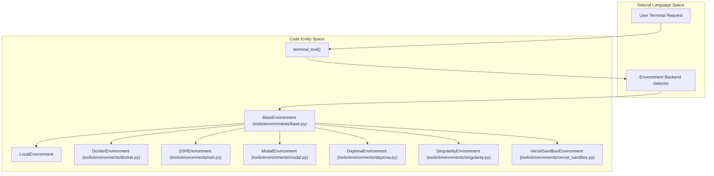
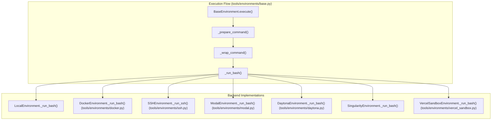

<!-- source: DeepWiki mcp.deepwiki.com · repo nousresearch/hermes-agent · page 6 Execution Environments · fetched 2026-10-27 -->

# Execution Environments

Relevant source files

The following files were used as context for generating this wiki page:

- [agent/delegation_context.py](agent/delegation_context.py)
- [agent/estop.py](agent/estop.py)
- [agent/kanban_stop.py](agent/kanban_stop.py)
- [tests/agent/test_file_safety_cross_profile.py](tests/agent/test_file_safety_cross_profile.py)
- [tests/agent/test_kanban_stop.py](tests/agent/test_kanban_stop.py)
- [tests/cron/test_cron_kanban_env_isolation.py](tests/cron/test_cron_kanban_env_isolation.py)
- [tests/gateway/test_internal_event_bypass_pairing.py](tests/gateway/test_internal_event_bypass_pairing.py)
- [tests/tools/test_base_environment.py](tests/tools/test_base_environment.py)
- [tests/tools/test_delegate_kanban_isolation.py](tests/tools/test_delegate_kanban_isolation.py)
- [tests/tools/test_docker_environment.py](tests/tools/test_docker_environment.py)
- [tests/tools/test_drain_fd_windows.py](tests/tools/test_drain_fd_windows.py)
- [tests/tools/test_env_passthrough.py](tests/tools/test_env_passthrough.py)
- [tests/tools/test_env_probe.py](tests/tools/test_env_probe.py)
- [tests/tools/test_execute_code_approval_cluster.py](tests/tools/test_execute_code_approval_cluster.py)
- [tests/tools/test_hermes_subprocess_env.py](tests/tools/test_hermes_subprocess_env.py)
- [tests/tools/test_local_background_child_hang.py](tests/tools/test_local_background_child_hang.py)
- [tests/tools/test_local_env_blocklist.py](tests/tools/test_local_env_blocklist.py)
- [tests/tools/test_local_shell_init.py](tests/tools/test_local_shell_init.py)
- [tests/tools/test_notify_on_complete.py](tests/tools/test_notify_on_complete.py)
- [tests/tools/test_process_registry.py](tests/tools/test_process_registry.py)
- [tests/tools/test_protected_instruction_cli_channel.py](tests/tools/test_protected_instruction_cli_channel.py)
- [tests/tools/test_singularity_persistent_overlay.py](tests/tools/test_singularity_persistent_overlay.py)
- [tests/tools/test_snapshot_multiline_session_env_injection.py](tests/tools/test_snapshot_multiline_session_env_injection.py)
- [tests/tools/test_snapshot_session_id_leak.py](tests/tools/test_snapshot_session_id_leak.py)
- [tests/tools/test_subagent_sudo_prompt.py](tests/tools/test_subagent_sudo_prompt.py)
- [tests/tools/test_terminal_output_transform_hook.py](tests/tools/test_terminal_output_transform_hook.py)
- [tests/tools/test_terminal_tool.py](tests/tools/test_terminal_tool.py)
- [tests/tools/test_watch_patterns.py](tests/tools/test_watch_patterns.py)
- [tests/tui_gateway/test_served_profile_child_env.py](tests/tui_gateway/test_served_profile_child_env.py)
- [tests/tui_gateway/test_sudo_command_context.py](tests/tui_gateway/test_sudo_command_context.py)
- [tools/env_passthrough.py](tools/env_passthrough.py)
- [tools/env_probe.py](tools/env_probe.py)
- [tools/environments/base.py](tools/environments/base.py)
- [tools/environments/base_output.py](tools/environments/base_output.py)
- [tools/environments/base_session_env.py](tools/environments/base_session_env.py)
- [tools/environments/base_wait.py](tools/environments/base_wait.py)
- [tools/environments/docker.py](tools/environments/docker.py)
- [tools/environments/docker_egress.py](tools/environments/docker_egress.py)
- [tools/environments/local.py](tools/environments/local.py)
- [tools/environments/local_env_policy.py](tools/environments/local_env_policy.py)
- [tools/environments/local_pythonpath.py](tools/environments/local_pythonpath.py)
- [tools/environments/path_utils.py](tools/environments/path_utils.py)
- [tools/environments/remote_common.py](tools/environments/remote_common.py)
- [tools/environments/singularity.py](tools/environments/singularity.py)
- [tools/process_registry.py](tools/process_registry.py)
- [tools/terminal_tool_result.py](tools/terminal_tool_result.py)
- [tools/terminal_tool_sudo.py](tools/terminal_tool_sudo.py)

## Purpose and Scope

Execution Environments provide an abstraction layer that enables Hermes Agent's terminal and file tools to execute commands seamlessly across diverse backends [tools/environments/base.py:1-8](). This architecture allows commands to run locally on the host machine, isolated securely in containers, or remotely in cloud sandboxes. It supports session persistence, resource isolation, and security constraints tailored to each backend type, ensuring consistent shell and filesystem interactions regardless of where Hermes runs.

This system is utilized by the `terminal_tool` subsystem which orchestrates environment selection, session lifecycle, and concurrency control.

Sources: `tools/environments/base.py:1-8`

---

## Environment Selection

The environment backend is selected via configuration parameters or environment variables. Internally, factory functions dispatch execution to the appropriate backend implementation class.

### Architecture and Code Mapping

Sources: `tools/environments/base.py:18-20`, `tools/environments/docker.py:1-6`, `tools/environments/ssh.py:45-51`, `tools/environments/modal.py:130-133`, `tools/environments/daytona.py:24-29`, `tools/environments/vercel_sandbox.py:1-6`

---

## Environment Abstraction

The `BaseEnvironment` abstract base class defines the unified lifecycle interface for all terminal backends [tools/environments/base.py:18-20](). Every command execution follows a spawn-per-call model where a fresh shell process is initialized [tools/environments/base.py:3-4](). A session snapshot (environment variables, functions, aliases) is captured once at initialization and re-sourced before each command [tools/environments/base.py:4-5](). Current working directory (CWD) persistence is managed via in-band stdout markers for remote environments or a temporary file for local execution [tools/environments/base.py:5-6]().

The base environment also handles activity callbacks for long-running processes [tools/environments/base.py:52-55](), manages a sandbox directory for persistent storage, and provides utilities for JSON store management [tools/environments/base.py:10-11](). It also defines `EnvironmentConnectionError` for infrastructure-level failures [tools/environments/base.py:140-154](). The `kill_live_foreground_processes` function ensures that any in-flight foreground commands are terminated during process exit [tools/environments/base.py:95-129]().

For details, see [Environment Abstraction](#6.1).

Sources: `tools/environments/base.py:3-6`, `tools/environments/base.py:10-11`, `tools/environments/base.py:18-20`, `tools/environments/base.py:52-55`, `tools/environments/base.py:95-129`, `tools/environments/base.py:140-154`

---

## Backend Implementations

Hermes provides multiple concrete backend implementations extending `BaseEnvironment` to support local execution, containerized environments, and cloud sandboxes. Each backend implements specialized configuration options, resource limits (CPU, memory, disk), and synchronization strategies.

### Backend Execution Flow

The `_prepare_command` method handles pre-execution tasks such as `sudo` password management and command transformation [tests/tools/test_base_environment.py:43-54](), [tools/terminal_tool_sudo.py:1-5](). The `_wrap_command` method constructs the final shell script, incorporating session snapshot sourcing, CWD tracking, and error handling [tests/tools/test_base_environment.py:116-130](). The `_run_bash` method (or its backend-specific equivalent like `_run_ssh` for SSH [tools/environments/ssh.py:128-130]()) then executes this script in the target environment. File synchronization for remote backends like SSH, Modal, and Daytona is managed by `FileSyncManager` [tools/environments/file_sync.py:45-49](), which tracks local file changes and syncs them to the remote environment [tools/environments/file_sync.py:1-6]().

For details, see [Backend Implementations](#6.2).

Sources: `tools/environments/base.py:1-8`, `tools/environments/docker.py:1-6`, `tools/environments/ssh.py:128-130`, `tools/environments/modal.py:130-133`, `tools/environments/daytona.py:140-142`, `tests/tools/test_base_environment.py:43-54`, `tests/tools/test_base_environment.py:116-130`, `tools/terminal_tool_sudo.py:1-5`, `tools/environments/file_sync.py:1-6`, `tools/environments/file_sync.py:45-49`

---

## Related Child Pages

- [Environment Abstraction](#6.1) — Covers the environment interface, lifecycle management, session reuse, credential file handling, and cleanup.
- [Backend Implementations](#6.2) — Documents local, Docker, SSH, Singularity, Modal, Vercel Sandbox, and Daytona backends, including configuration and resource limits.

---

