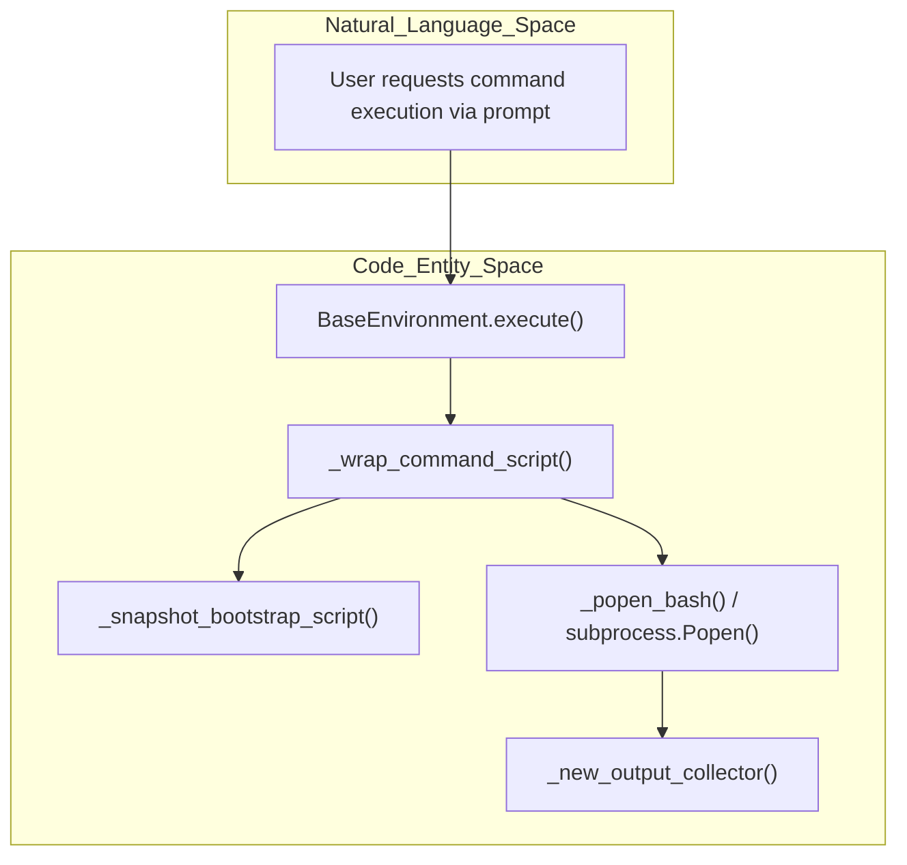
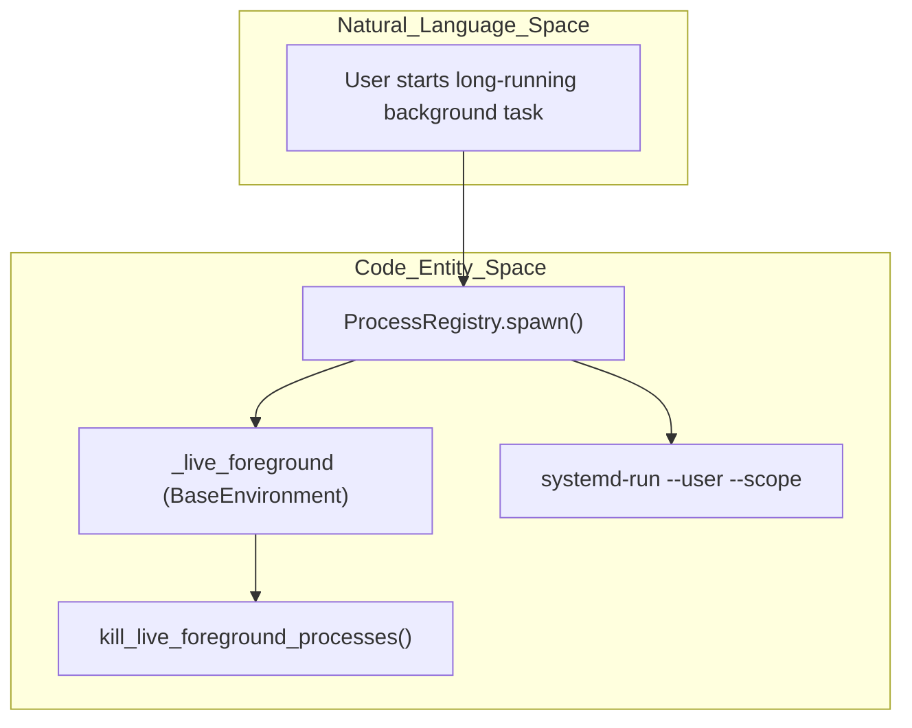
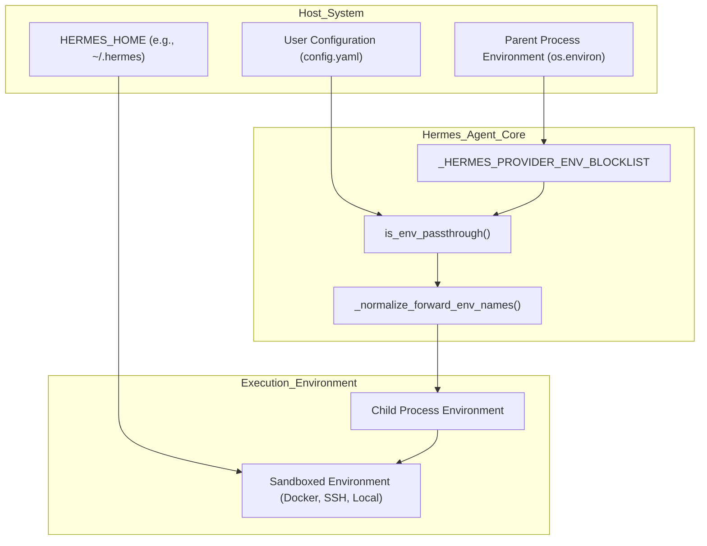

<!-- source: DeepWiki mcp.deepwiki.com · repo nousresearch/hermes-agent · page 6.1 Environment Abstraction · fetched 2026-10-27 -->

# Environment Abstraction

Relevant source files

The following files were used as context for generating this wiki page:

- [agent/delegation_context.py](agent/delegation_context.py)
- [agent/estop.py](agent/estop.py)
- [agent/kanban_stop.py](agent/kanban_stop.py)
- [tests/agent/test_file_safety_cross_profile.py](tests/agent/test_file_safety_cross_profile.py)
- [tests/agent/test_kanban_stop.py](tests/agent/test_kanban_stop.py)
- [tests/cron/test_cron_kanban_env_isolation.py](tests/cron/test_cron_kanban_env_isolation.py)
- [tests/gateway/test_internal_event_bypass_pairing.py](tests/gateway/test_internal_event_bypass_pairing.py)
- [tests/tools/test_base_environment.py](tests/tools/test_base_environment.py)
- [tests/tools/test_delegate_kanban_isolation.py](tests/tools/test_delegate_kanban_isolation.py)
- [tests/tools/test_docker_environment.py](tests/tools/test_docker_environment.py)
- [tests/tools/test_drain_fd_windows.py](tests/tools/test_drain_fd_windows.py)
- [tests/tools/test_env_passthrough.py](tests/tools/test_env_passthrough.py)
- [tests/tools/test_env_probe.py](tests/tools/test_env_probe.py)
- [tests/tools/test_execute_code_approval_cluster.py](tests/tools/test_execute_code_approval_cluster.py)
- [tests/tools/test_hermes_subprocess_env.py](tests/tools/test_hermes_subprocess_env.py)
- [tests/tools/test_local_background_child_hang.py](tests/tools/test_local_background_child_hang.py)
- [tests/tools/test_local_env_blocklist.py](tests/tools/test_local_env_blocklist.py)
- [tests/tools/test_local_shell_init.py](tests/tools/test_local_shell_init.py)
- [tests/tools/test_notify_on_complete.py](tests/tools/test_notify_on_complete.py)
- [tests/tools/test_process_registry.py](tests/tools/test_process_registry.py)
- [tests/tools/test_protected_instruction_cli_channel.py](tests/tools/test_protected_instruction_cli_channel.py)
- [tests/tools/test_singularity_persistent_overlay.py](tests/tools/test_singularity_persistent_overlay.py)
- [tests/tools/test_snapshot_multiline_session_env_injection.py](tests/tools/test_snapshot_multiline_session_env_injection.py)
- [tests/tools/test_snapshot_session_id_leak.py](tests/tools/test_snapshot_session_id_leak.py)
- [tests/tools/test_subagent_sudo_prompt.py](tests/tools/test_subagent_sudo_prompt.py)
- [tests/tools/test_terminal_output_transform_hook.py](tests/tools/test_terminal_output_transform_hook.py)
- [tests/tools/test_terminal_tool.py](tests/tools/test_terminal_tool.py)
- [tests/tools/test_watch_patterns.py](tests/tools/test_watch_patterns.py)
- [tests/tui_gateway/test_served_profile_child_env.py](tests/tui_gateway/test_served_profile_child_env.py)
- [tests/tui_gateway/test_sudo_command_context.py](tests/tui_gateway/test_sudo_command_context.py)
- [tools/env_passthrough.py](tools/env_passthrough.py)
- [tools/env_probe.py](tools/env_probe.py)
- [tools/environments/base.py](tools/environments/base.py)
- [tools/environments/base_output.py](tools/environments/base_output.py)
- [tools/environments/base_session_env.py](tools/environments/base_session_env.py)
- [tools/environments/base_wait.py](tools/environments/base_wait.py)
- [tools/environments/docker.py](tools/environments/docker.py)
- [tools/environments/docker_egress.py](tools/environments/docker_egress.py)
- [tools/environments/local.py](tools/environments/local.py)
- [tools/environments/local_env_policy.py](tools/environments/local_env_policy.py)
- [tools/environments/local_pythonpath.py](tools/environments/local_pythonpath.py)
- [tools/environments/path_utils.py](tools/environments/path_utils.py)
- [tools/environments/remote_common.py](tools/environments/remote_common.py)
- [tools/environments/singularity.py](tools/environments/singularity.py)
- [tools/process_registry.py](tools/process_registry.py)
- [tools/terminal_tool_result.py](tools/terminal_tool_result.py)
- [tools/terminal_tool_sudo.py](tools/terminal_tool_sudo.py)

## Purpose and Scope

This page documents the environment abstraction layer in Hermes Agent, which provides a unified and extensible interface for shell command execution, background process tracking, file operations, and security isolation across multiple backend execution environments. These backends include local shells, Docker containers, SSH remote connections, cloud sandboxes (Modal, Daytona, Vercel Sandbox), and Singularity containers.

The abstraction layer handles:
- Spawn-per-call execution models with atomic session environment snapshots [tools/environments/base.py:3-8]().
- Environment lifecycle management, task-keyed session reuse, and idle reaping [tools/environments/docker.py:126-159]().
- Background process tracking, rolling output buffering, and systemd cgroup isolation via `ProcessRegistry` [tools/process_registry.py:1-127]().
- Transactional file synchronization and secure credential file passthrough with master-store deny-list validation.

Sources: [tools/environments/base.py:3-8](), [tools/environments/docker.py:126-159](), [tools/process_registry.py:1-127]()

---

## The BaseEnvironment Interface and Execution Flow

The core execution abstraction is defined by the abstract base class `BaseEnvironment` [tools/environments/base.py:1-155](). All concrete execution backends inherit from this class and implement backend-specific command execution and cleanup routines.

| Method | Signature | Description |
| :--- | :--- | :--- |
| `execute()` | `execute(command: str, cwd: str = None, timeout: int = None, stdin_data: str = None) -> dict` | Executes a shell command within the environment context, returning a dictionary containing `output` and `returncode`. |
| `cleanup()` | `cleanup() -> None` | Terminates or cleans up backend execution resources (containers, SSH sessions, sandboxes). |

### Session Snapshot Mechanism
- Each execution captures environment state (variables, functions, aliases) into an atomic snapshot script [tools/environments/base_session_env.py:28-30](), [tests/tools/test_base_environment.py:106-170]().
- To prevent torn environment files during concurrent terminal calls (regression #38249), environment dumps are written atomically via `mktemp` and renamed into place using `mv -f` [tests/tools/test_base_environment.py:106-170]().
- Before every command invocation, the snapshot is sourced in a fresh shell process to maintain continuity without sharing persistent process state [tools/environments/base_session_env.py:28-30]().
- Current working directory (CWD) persistence is handled via in-band stdout markers or temporary files [tools/environments/base_session_env.py:28-30]().

Title: "Natural Language to BaseEnvironment Execution Flow"

Sources: [tools/environments/base.py:1-155](), [tools/environments/base_output.py:1-26](), [tools/environments/base_session_env.py:1-30](), [tests/tools/test_base_environment.py:1-176]()

---

## Environment Lifecycle Management and Process Registry

### Idle Reaping and Task Caching
- Environments are initialized lazily per `task_id` and cached in a global dictionary, guarded by per-task creation locks.
- A background worker thread periodically checks active environments. If an environment has no active processes tracked by `_live_foreground` and exceeds idle thresholds, `env.cleanup()` is invoked [tools/environments/base.py:59-66]().

### Process Registry and Foreground Cleanup
- The `_live_foreground` dictionary in `BaseEnvironment` tracks foreground commands in flight across all environments [tools/environments/base.py:59-66](). `kill_live_foreground_processes` handles termination of these processes during application exit [tools/environments/base.py:95-129]().
- **Systemd Cgroup Isolation:** On Linux hosts, gateway-spawned local executors inherit the gateway's cgroup. To prevent memory-heavy processes (like test suites or build tools) from triggering `systemd-oomd` kills on the entire gateway, workers use transient systemd scopes (`systemd-run --user --scope`) when available [tools/process_registry.py:101-127]().
- `ProcessRegistry` maintains rolling output buffers (capped at `MAX_OUTPUT_CHARS = 200_000`), crash-recovery checkpoints (`processes.json`), and worker output logs [tools/process_registry.py:1-48]().

Title: "Natural Language to Process Registry and Lifecycle Flow"

Sources: [tools/environments/base.py:59-129](), [tools/process_registry.py:1-127]()

---

## Backend Implementations and File Synchronization

Hermes implements multiple environment backends tailored for different security and infrastructure models:

| Backend | Class Name | Key Characteristics |
| :--- | :--- | :--- |
| **Local** | `LocalEnvironment` | Executes directly on the host OS; scrubs sensitive internal secrets and provider keys from subprocess environments [tools/environments/local.py:1-169](). |
| **Docker** | `DockerEnvironment` | Runs inside hardened containers (`cap-drop ALL`, `no-new-privileges`) with support for bind mounts, environment validation via `_normalize_env_dict`, and container reuse fingerprinting [tools/environments/docker.py:1-159](). |
| **SSH** | `SSHEnvironment` | Connects to remote hosts using OpenSSH with `ControlMaster` multiplexing for persistent connection reuse. |
| **Daytona** | `DaytonaEnvironment` | Manages cloud sandboxes via the Daytona Python SDK with persistent mode support. |
| **Vercel Sandbox** | `VercelSandboxEnvironment` | Runs commands in Vercel cloud sandboxes using snapshot IDs stored under `HERMES_HOME`. |
| **Modal** | `ModalEnvironment` | Executes in Modal cloud sandboxes, leveraging `Sandbox.create()` and `Sandbox.exec()` with persistent snapshots across sessions. |

### File Synchronization (`FileSyncManager`)
Remote backends (SSH, Daytona, Modal) use file synchronization mechanisms to transactionally sync credentials, configuration, and skill files by comparing modification times and file sizes. Docker and local environments rely on host bind mounts directly.

Sources: [tools/environments/docker.py:1-159](), [tools/environments/local.py:1-169]()

---

## Credential File Handling and Environment Security

### Subprocess Environment Scrubbing and Policy
- Spawn-per-call mechanisms strip Hermes-managed provider API keys and internal secrets (`_HERMES_PROVIDER_ENV_BLOCKLIST`) to prevent accidental leakage into user-spawned child processes and external CLIs [tools/environments/local_env_policy.py:19-52]().
- The environment configuration ensures allowed variables are forwarded into sandboxed children while explicitly protecting sensitive credentials [tools/environments/local_env_policy.py:1-115]().
- **Passthrough Security:** Skills can request environment variables via `required_environment_variables`, and operators can configure `terminal.env_passthrough`. However, registry mechanisms explicitly reject Hermes-managed provider credentials to mitigate credential-bypass vulnerabilities (GHSA-rhgp-j443-p4rf) [tools/env_passthrough.py:46-81]().

Title: "Credential File and Environment Variable Flow"

Sources: [tools/environments/local_env_policy.py:1-115](), [tools/env_passthrough.py:1-142](), [tools/environments/docker.py:52-87]()

---

