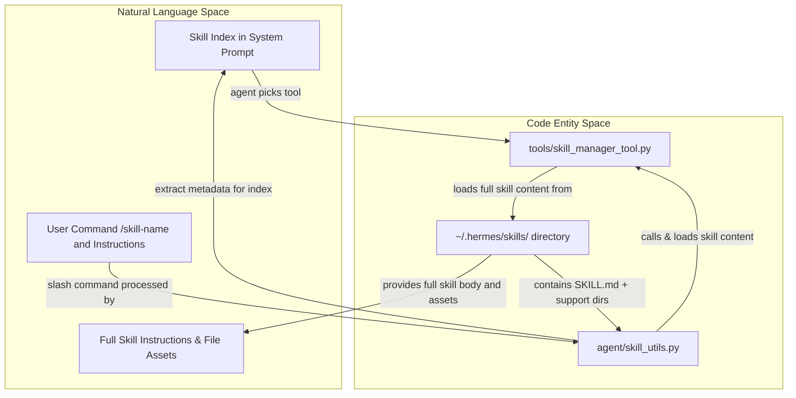
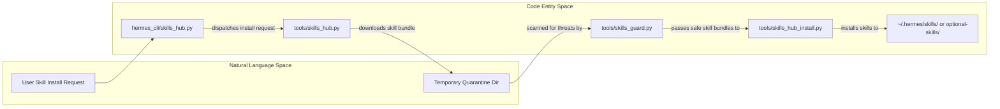

<!-- source: DeepWiki mcp.deepwiki.com · repo nousresearch/hermes-agent · page 8 Skills System · fetched 2026-10-27 -->

# Skills System

<details>
<summary>Relevant source files</summary>

The following files were used as context for generating this wiki page:

- [agent/curator.py](agent/curator.py)
- [agent/curator_backup.py](agent/curator_backup.py)
- [hermes_cli/curator.py](hermes_cli/curator.py)
- [optional-skills/software-development/grill-me/SKILL.md](optional-skills/software-development/grill-me/SKILL.md)
- [optional-skills/software-development/subagent-driven-development/SKILL.md](optional-skills/software-development/subagent-driven-development/SKILL.md)
- [skills/creative/songwriting-and-ai-music/SKILL.md](skills/creative/songwriting-and-ai-music/SKILL.md)
- [skills/software-development/simplify-code/SKILL.md](skills/software-development/simplify-code/SKILL.md)
- [tests/agent/test_curator.py](tests/agent/test_curator.py)
- [tests/agent/test_curator_backup.py](tests/agent/test_curator_backup.py)
- [tests/agent/test_curator_classification.py](tests/agent/test_curator_classification.py)
- [tests/agent/test_curator_reports.py](tests/agent/test_curator_reports.py)
- [tests/agent/test_curator_rollback_staging.py](tests/agent/test_curator_rollback_staging.py)
- [tests/agent/test_curator_run_hygiene.py](tests/agent/test_curator_run_hygiene.py)
- [tests/cron/test_rewrite_skill_refs.py](tests/cron/test_rewrite_skill_refs.py)
- [tests/hermes_cli/test_curator_archive_prune.py](tests/hermes_cli/test_curator_archive_prune.py)
- [tests/hermes_cli/test_curator_run.py](tests/hermes_cli/test_curator_run.py)
- [tests/hermes_cli/test_curator_status.py](tests/hermes_cli/test_curator_status.py)
- [tests/skills/test_authoring_standards.py](tests/skills/test_authoring_standards.py)
- [tests/tools/test_skill_ledger.py](tests/tools/test_skill_ledger.py)
- [tests/tools/test_skill_ledger_delta.py](tests/tools/test_skill_ledger_delta.py)
- [tests/tools/test_skill_linter.py](tests/tools/test_skill_linter.py)
- [tests/tools/test_skill_manage_batch.py](tests/tools/test_skill_manage_batch.py)
- [tests/tools/test_skill_manage_schema_diet.py](tests/tools/test_skill_manage_schema_diet.py)
- [tests/tools/test_skill_manager_tool.py](tests/tools/test_skill_manager_tool.py)
- [tests/tools/test_skill_usage.py](tests/tools/test_skill_usage.py)
- [tests/website/__init__.py](tests/website/__init__.py)
- [tests/website/test_generate_skill_docs.py](tests/website/test_generate_skill_docs.py)
- [tools/skill_ledger.py](tools/skill_ledger.py)
- [tools/skill_linter.py](tools/skill_linter.py)
- [tools/skill_manager_batch.py](tools/skill_manager_batch.py)
- [tools/skill_manager_guards.py](tools/skill_manager_guards.py)
- [tools/skill_manager_tool.py](tools/skill_manager_tool.py)
- [tools/skill_usage.py](tools/skill_usage.py)
- [website/docs/reference/optional-skills-catalog.md](website/docs/reference/optional-skills-catalog.md)
- [website/docs/reference/skills-catalog.md](website/docs/reference/skills-catalog.md)
- [website/docs/user-guide/features/curator.md](website/docs/user-guide/features/curator.md)
- [website/docs/user-guide/skills/bundled/creative/creative-p5js.md](website/docs/user-guide/skills/bundled/creative/creative-p5js.md)
- [website/docs/user-guide/skills/bundled/creative/creative-songwriting-and-ai-music.md](website/docs/user-guide/skills/bundled/creative/creative-songwriting-and-ai-music.md)
- [website/docs/user-guide/skills/bundled/productivity/productivity-notion.md](website/docs/user-guide/skills/bundled/productivity/productivity-notion.md)
- [website/docs/user-guide/skills/bundled/software-development/software-development-simplify-code.md](website/docs/user-guide/skills/bundled/software-development/software-development-simplify-code.md)
- [website/docs/user-guide/skills/optional/creative/creative-audiocraft-audio-generation.md](website/docs/user-guide/skills/optional/creative/creative-audiocraft-audio-generation.md)
- [website/docs/user-guide/skills/optional/creative/creative-heartmula.md](website/docs/user-guide/skills/optional/creative/creative-heartmula.md)
- [website/docs/user-guide/skills/optional/mlops/mlops-evaluation-evaluating-llms-harness.md](website/docs/user-guide/skills/optional/mlops/mlops-evaluation-evaluating-llms-harness.md)
- [website/docs/user-guide/skills/optional/mlops/mlops-models-segment-anything-model.md](website/docs/user-guide/skills/optional/mlops/mlops-models-segment-anything-model.md)
- [website/docs/user-guide/skills/optional/mlops/mlops-tensorrt-llm.md](website/docs/user-guide/skills/optional/mlops/mlops-tensorrt-llm.md)
- [website/docs/user-guide/skills/optional/software-development/software-development-grill-me.md](website/docs/user-guide/skills/optional/software-development/software-development-grill-me.md)
- [website/i18n/zh-Hans/docusaurus-plugin-content-docs/current/reference/optional-skills-catalog.md](website/i18n/zh-Hans/docusaurus-plugin-content-docs/current/reference/optional-skills-catalog.md)
- [website/i18n/zh-Hans/docusaurus-plugin-content-docs/current/reference/skills-catalog.md](website/i18n/zh-Hans/docusaurus-plugin-content-docs/current/reference/skills-catalog.md)
- [website/i18n/zh-Hans/docusaurus-plugin-content-docs/current/user-guide/skills/bundled/creative/creative-songwriting-and-ai-music.md](website/i18n/zh-Hans/docusaurus-plugin-content-docs/current/user-guide/skills/bundled/creative/creative-songwriting-and-ai-music.md)
- [website/i18n/zh-Hans/docusaurus-plugin-content-docs/current/user-guide/skills/optional/creative/creative-heartmula.md](website/i18n/zh-Hans/docusaurus-plugin-content-docs/current/user-guide/skills/optional/creative/creative-heartmula.md)
- [website/i18n/zh-Hans/docusaurus-plugin-content-docs/current/user-guide/skills/optional/productivity/productivity-shop.md](website/i18n/zh-Hans/docusaurus-plugin-content-docs/current/user-guide/skills/optional/productivity/productivity-shop.md)
- [website/scripts/generate-skill-docs.py](website/scripts/generate-skill-docs.py)
- [website/sidebars.ts](website/sidebars.ts)

</details>


This page introduces the Hermes skills system, which supplies on-demand procedural knowledge, reference documents, and tool extensions via agent-created and hub-downloaded packages.

As a parent page, this section provides a high-level architectural overview. For comprehensive instructions on skill authoring, editing, security linting, background review, and syncing, see [Skills Management and Security](#8.1). For details on browsing external registries, taps, and installation pipelines, see [Skills Hub](#8.2).

---

## Overview and Storage Architecture

A **skill** is a self-contained directory housing a `SKILL.md` file (containing YAML frontmatter and instructional markdown body) alongside optional `references/`, `templates/`, `assets/` or `scripts/` subdirectories. Skills reside locally in the user profile under `~/.hermes/skills/`, commonly referenced via the `SKILLS_DIR` constant [tools/skill_manager_tool.py:69](). This directory is seeded initially by copying the repository’s bundled skills found in the top-level `skills/` catalog.

Multi-profile or long-running Hermes Agent instances dynamically resolve the current `SKILLS_DIR` per active profile via indirection, ensuring proper isolation and scope [tools/skill_manager_tool.py:73-81](). External skills directories (`skills.external_dirs`) can be added for delegation or extendability.

### Skills Directory Layout Example
```
~/.hermes/skills/
├── mlops/
│   ├── axolotl/
│   │   └── SKILL.md
│   └── ...
├── web/
│   ├── web-search/
│   │   └── SKILL.md
│   └── ...
├── SKILL.md
└── references/
```

Sources: [tools/skill_manager_tool.py:69, 73-81]()

---

## Progressive Disclosure and System Prompt Integration

To prevent excessive token usage in system prompts, Hermes uses **progressive disclosure** of skill information. At agent startup, only minimal metadata—skill names and truncated descriptions—are injected into the system prompt.

When the agent requires detailed instructions or auxiliary skill files, it invokes tools such as `skills_list` to enumerate metadata or `skill_view` to retrieve full skill content and linked assets. This lookup supports progressive indexing rather than flooding the prompt with full skill texts.

The `agent/skill_utils.py` module manages skill name slugification for commands (e.g., `"Foo Bar"` → `/foo-bar`), and extraction of user instructions from embedded skill scaffolding in prompts.

### Diagram: Bridging Natural Language Skill Concepts to Code Entities


Sources: [agent/skill_utils.py](), [tools/skill_manager_tool.py]()

---

## Skills Management and Security (Child Page 8.1)

Skill creation, editing, patching, and file management are exposed to the agent through the `skill_manage` tool [tools/skill_manager_tool.py:28](). This tool includes validation checks for skill names [tools/skill_manager_tool.py:129-132](), categories [tools/skill_manager_tool.py:135-144](), and frontmatter fields [tools/skill_manager_tool.py:146-154](), enforcing constraints such as disallowing absolute paths and path traversal components in skill lookups [tools/skill_manager_tool.py:135-144]().

Static threat pattern scanning is performed on skill content and attached files to prevent injection attacks, persistent backdoors, or exfiltration tactics. The critical scanning logic resides in `tools/skills_guard.py` and is invoked both during skill loading and context file reading [tools/skill_manager_tool.py:36](). The `_security_scan_skill` function in `skill_manager_tool.py` performs a post-write scan for agent-created skills, blocking dangerous findings [tools/skill_manager_tool.py:50-64]().

A **Curator** (`agent/curator.py`) runs in the background to maintain agent-created skills. It tracks usage, marks skills as `active`, `stale`, or `archived` based on inactivity, and can optionally perform LLM-driven consolidation or patching [agent/curator.py:1-7](). The curator is triggered by inactivity, not a cron job, and runs in a background fork of `AIAgent` [website/docs/user-guide/features/curator.md:19-28](). It uses a persistent state file (`.curator_state`) to track its last run and summary [agent/curator.py:40-65]().

All skill mutations are recorded in a per-mutation audit ledger (`~/.hermes/skills/.curator_ledger.jsonl`) [tools/skill_ledger.py:1-4](). This ledger stores before/after file manifests, with contents stored content-addressed (SHA256-deduplicated) in `~/.hermes/.curator_backups/blobs/` [tools/skill_ledger.py:4-6](). This allows for single-edit rollbacks [tools/skill_ledger.py:1-4](). Before any mutating curator pass, a snapshot of `~/.hermes/skills/` is created and stored in `~/.hermes/skills/.curator_backups/` [agent/curator_backup.py:1-3]().

### Diagram: Skill Management and Security Flow
```mermaid
graph TD
    A[Agent/User Intent] --> B{skill_manage tool};
    B --> C{Validate Name/Category/Frontmatter};
    C -- "Valid" --> D{Perform CRUD Operation};
    D -- "Pre-write" --> E{Snapshot Skills Directory};
    E --> F{Security Scan Skill Content};
    F -- "Safe" --> G{Apply Changes to Filesystem};
    G --> H{Append Entry to Skill Ledger};
    H --> I[Skill Updated/Created];
    F -- "Blocked" --> J[Operation Refused];
    C -- "Invalid" --> J;

    subgraph Background Processes
        K[Curator (agent/curator.py)] --> L{Inactivity Check};
        L -- "Idle & Interval Met" --> M{Perform Automatic Transitions};
        M --> N{Optional: LLM Consolidation};
        N --> B;
        M --> H;
    end

    subgraph Rollback System
        O[Skill Ledger (tools/skill_ledger.py)] --> P{Rollback Request};
        P --> Q{Verify Rollback Entry};
        Q -- "Valid" --> R{Restore Files from Blobs};
        R --> S[Skill Restored];
        Q -- "Invalid/Missing Blob" --> J;
    end

    style K fill:#ace,stroke:#333,stroke-width:2px
    style L fill:#ace,stroke:#333,stroke-width:2px
    style M fill:#ace,stroke:#333,stroke-width:2px
    style N fill:#ace,stroke:#333,stroke-width:2px
    style O fill:#ace,stroke:#333,stroke-width:2px
    style P fill:#ace,stroke:#333,stroke-width:2px
    style Q fill:#ace,stroke:#333,stroke-width:2px
    style R fill:#ace,stroke:#333,stroke-width:2px
    style S fill:#ace,stroke:#333,stroke-width:2px
```

Sources: [tools/skill_manager_tool.py:28, 50-64, 129-132, 135-144, 146-154](), [tools/skills_guard.py]() (referenced by [tools/skill_manager_tool.py:36]()), [agent/curator.py:1-7, 40-65](), [website/docs/user-guide/features/curator.md:19-28](), [tools/skill_ledger.py:1-6](), [agent/curator_backup.py:1-3]()

Detailed documentation covering skill creation workflows, security linting, manifest management, syncing, and background review are available in the dedicated [Skills Management and Security](#8.1) child page.

---

## Skills Hub (Child Page 8.2)

The Skills Hub subsystem enables browsing, installation, and management of external skill packages sourced from community and official registries. Installation requests flow through commands implemented in `hermes_cli/skills_hub.py` and are routed by source adapters that fetch skill bundles into quarantined directories for safety scanning.

After security acceptance, skill bundles are written to the active `~/.hermes/skills/` directory or optionally to `optional-skills/`, a supplementary catalog shipped in the repository but not active by default. The `optional-skills/` catalog provides a playground for experimental or non-default skills that users can optionally install.

The Skills Hub also handles tap management for third-party skill catalogs, provenance tracking for installed skills, and the automatic regeneration of skill catalog documentation.

### Diagram: Skills Hub Installation Flow and Security Integration


Sources: [hermes_cli/skills_hub.py](), [tools/skills_hub.py](), [tools/skills_guard.py](), [tools/skills_hub_install.py]()

For comprehensive details on browsing catalogs, managing taps, tracking provenance, and the docs generation pipeline, see [Skills Hub](#8.2).

---

## Bundled and Optional Skills Catalogs

Hermes Agent ships with two primary skill catalogs:

1.  **Bundled Skills (`skills/`)**: These skills are copied into `~/.hermes/skills/` upon initial installation and are synced during updates. They represent the core set of capabilities provided out-of-the-box. Examples include `creative/songwriting-and-ai-music` [skills/creative/songwriting-and-ai-music/SKILL.md]() and `software-development/simplify-code` [skills/software-development/simplify-code/SKILL.md](). The full list is available in the [Bundled Skills Catalog](website/docs/reference/skills-catalog.md) documentation.
2.  **Optional Skills (`optional-skills/`)**: These skills are shipped with the agent but are *not* active by default. They must be explicitly installed by the user via `hermes skills install official/<category>/<skill>`. This catalog often contains experimental, specialized, or less commonly used skills, such as `creative/heartmula` [website/docs/user-guide/skills/optional/creative/creative-heartmula.md]() or `software-development/grill-me` [optional-skills/software-development/grill-me/SKILL.md](). The full list is available in the [Optional Skills Catalog](website/docs/reference/optional-skills-catalog.md) documentation.

Both catalogs are managed by the `skills_sync` module, which handles manifest-based seeding and updating, respecting user modifications and deletions.

Sources: [tools/skill_manager_tool.py](), [skills/creative/songwriting-and-ai-music/SKILL.md](), [skills/software-development/simplify-code/SKILL.md](), [website/docs/reference/skills-catalog.md](), [website/docs/user-guide/skills/optional/creative/creative-heartmula.md](), [optional-skills/software-development/grill-me/SKILL.md](), [website/docs/reference/optional-skills-catalog.md]()

---

This completes the high-level overview of the Hermes Skills System. For detailed documentation, please proceed to the child pages:

- [Skills Management and Security](#8.1)
- [Skills Hub](#8.2)

---

