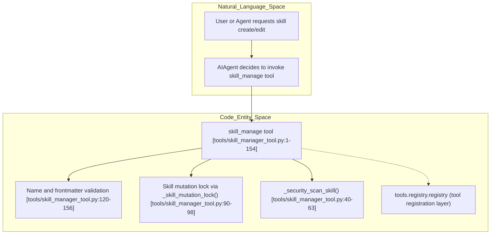
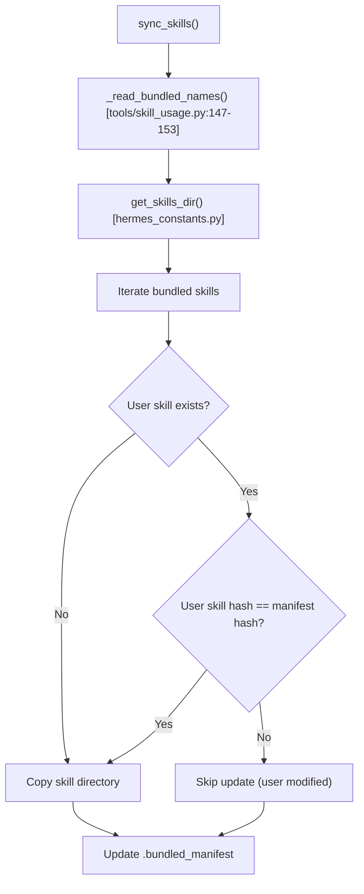
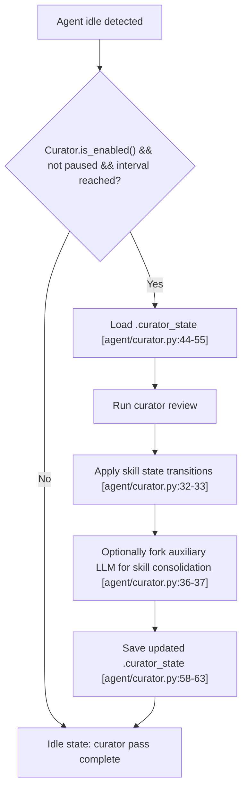

<!-- source: DeepWiki mcp.deepwiki.com · repo nousresearch/hermes-agent · page 8.1 Skills Management and Security · fetched 2026-10-27 -->

# Skills Management and Security

<details>
<summary>Relevant source files</summary>

The following files were used as context for generating this wiki page:

- [agent/coding_context.py](agent/coding_context.py)
- [agent/curator.py](agent/curator.py)
- [agent/curator_backup.py](agent/curator_backup.py)
- [agent/prompt_builder.py](agent/prompt_builder.py)
- [agent/skill_commands.py](agent/skill_commands.py)
- [agent/skill_utils.py](agent/skill_utils.py)
- [agent/surface_switch.py](agent/surface_switch.py)
- [agent/system_prompt.py](agent/system_prompt.py)
- [contributors/emails/southpawinmusic@gmail.com](contributors/emails/southpawinmusic@gmail.com)
- [hermes_cli/curator.py](hermes_cli/curator.py)
- [hermes_cli/plugin_validate.py](hermes_cli/plugin_validate.py)
- [hermes_cli/plugin_validate_core_override.py](hermes_cli/plugin_validate_core_override.py)
- [hermes_cli/plugin_validate_desktop.py](hermes_cli/plugin_validate_desktop.py)
- [hermes_cli/plugin_validate_private_imports.py](hermes_cli/plugin_validate_private_imports.py)
- [tests/agent/test_coding_context.py](tests/agent/test_coding_context.py)
- [tests/agent/test_compaction_prompt_rebuild.py](tests/agent/test_compaction_prompt_rebuild.py)
- [tests/agent/test_curator.py](tests/agent/test_curator.py)
- [tests/agent/test_curator_backup.py](tests/agent/test_curator_backup.py)
- [tests/agent/test_curator_classification.py](tests/agent/test_curator_classification.py)
- [tests/agent/test_curator_reports.py](tests/agent/test_curator_reports.py)
- [tests/agent/test_curator_rollback_staging.py](tests/agent/test_curator_rollback_staging.py)
- [tests/agent/test_curator_run_hygiene.py](tests/agent/test_curator_run_hygiene.py)
- [tests/agent/test_prompt_builder.py](tests/agent/test_prompt_builder.py)
- [tests/agent/test_skill_commands.py](tests/agent/test_skill_commands.py)
- [tests/agent/test_skill_utils.py](tests/agent/test_skill_utils.py)
- [tests/agent/test_system_prompt.py](tests/agent/test_system_prompt.py)
- [tests/agent/test_system_prompt_switch_invalidation.py](tests/agent/test_system_prompt_switch_invalidation.py)
- [tests/agent/test_tool_arg_coercion.py](tests/agent/test_tool_arg_coercion.py)
- [tests/cron/test_rewrite_skill_refs.py](tests/cron/test_rewrite_skill_refs.py)
- [tests/hermes_cli/test_curator_archive_prune.py](tests/hermes_cli/test_curator_archive_prune.py)
- [tests/hermes_cli/test_curator_run.py](tests/hermes_cli/test_curator_run.py)
- [tests/hermes_cli/test_curator_status.py](tests/hermes_cli/test_curator_status.py)
- [tests/hermes_cli/test_plugin_validate.py](tests/hermes_cli/test_plugin_validate.py)
- [tests/hermes_cli/test_plugin_validate_private_imports.py](tests/hermes_cli/test_plugin_validate_private_imports.py)
- [tests/hermes_cli/test_session_system_prompt_dedup.py](tests/hermes_cli/test_session_system_prompt_dedup.py)
- [tests/tools/test_container_cwd_sanitize.py](tests/tools/test_container_cwd_sanitize.py)
- [tests/tools/test_modal_sandbox_fixes.py](tests/tools/test_modal_sandbox_fixes.py)
- [tests/tools/test_plugin_guard.py](tests/tools/test_plugin_guard.py)
- [tests/tools/test_project_tools.py](tests/tools/test_project_tools.py)
- [tests/tools/test_registry.py](tests/tools/test_registry.py)
- [tests/tools/test_schema_sanitizer.py](tests/tools/test_schema_sanitizer.py)
- [tests/tools/test_self_repo_guard.py](tests/tools/test_self_repo_guard.py)
- [tests/tools/test_skill_ledger.py](tests/tools/test_skill_ledger.py)
- [tests/tools/test_skill_ledger_delta.py](tests/tools/test_skill_ledger_delta.py)
- [tests/tools/test_skill_linter.py](tests/tools/test_skill_linter.py)
- [tests/tools/test_skill_manage_batch.py](tests/tools/test_skill_manage_batch.py)
- [tests/tools/test_skill_manage_schema_diet.py](tests/tools/test_skill_manage_schema_diet.py)
- [tests/tools/test_skill_manager_tool.py](tests/tools/test_skill_manager_tool.py)
- [tests/tools/test_skill_usage.py](tests/tools/test_skill_usage.py)
- [tests/tools/test_skills_guard.py](tests/tools/test_skills_guard.py)
- [tests/tools/test_skills_guard_agent_config.py](tests/tools/test_skills_guard_agent_config.py)
- [tests/tools/test_skills_tool.py](tests/tools/test_skills_tool.py)
- [tests/tools/test_terminal_requirements.py](tests/tools/test_terminal_requirements.py)
- [tests/tools/test_terminal_self_repo_guard.py](tests/tools/test_terminal_self_repo_guard.py)
- [tests/tools/test_terminal_tool_requirements.py](tests/tools/test_terminal_tool_requirements.py)
- [tests/tools/test_tts_path_traversal.py](tests/tools/test_tts_path_traversal.py)
- [tools/arg_coercion.py](tools/arg_coercion.py)
- [tools/blueprints.py](tools/blueprints.py)
- [tools/path_security.py](tools/path_security.py)
- [tools/plugin_guard.py](tools/plugin_guard.py)
- [tools/plugin_guard_context.py](tools/plugin_guard_context.py)
- [tools/project_tools.py](tools/project_tools.py)
- [tools/registry.py](tools/registry.py)
- [tools/schema_sanitizer.py](tools/schema_sanitizer.py)
- [tools/self_repo_guard.py](tools/self_repo_guard.py)
- [tools/skill_ledger.py](tools/skill_ledger.py)
- [tools/skill_linter.py](tools/skill_linter.py)
- [tools/skill_manager_batch.py](tools/skill_manager_batch.py)
- [tools/skill_manager_guards.py](tools/skill_manager_guards.py)
- [tools/skill_manager_tool.py](tools/skill_manager_tool.py)
- [tools/skill_usage.py](tools/skill_usage.py)
- [tools/skills_guard.py](tools/skills_guard.py)
- [tools/skills_tool.py](tools/skills_tool.py)
- [website/docs/user-guide/features/curator.md](website/docs/user-guide/features/curator.md)

</details>


This page documents the skills management system, which allows the agent to create, modify, patch, and delete skills—reusable procedural knowledge for recurring task types. Skills serve as the agent's procedural memory, capturing “how to do X” workflows and solutions that can be applied repeatedly.

It covers programmatic skill management, validation, linting, security scanning, the skill ledger, the `skill_manage` tool, bundled and optional skills directories, synchronization, and background review. For hub browsing and installation, see **8.2 Skills Hub**.

---

## Purpose and Scope

The skills system provides:

- **Programmatic skill creation & editing**: The `skill_manage` tool enables the agent to create, modify, patch, and delete skills and supporting files dynamically [tools/skill_manager_tool.py:1-154]().
- **Validation and linting**: Name, category, content length, and frontmatter validation enforce correctness and prompt suitability [tools/skill_manager_tool.py:100-156]().
- **Security scanning**: Static threat-pattern scanning of skill contents for injection, exfiltration, destructive commands, and persistence risk. Enforcement varies by trust level (builtin, trusted, community, agent-created) [tools/skills_guard.py:50-61](), [tools/skill_manager_tool.py:40-63]().
- **Skill ledger and telemetry**: Usage provenance, modification history, view counts, and per-skill lock guarding coordinated access [tools/skill_usage.py:1-81]().
- **Support files inside each skill directory**: `references/`, `templates/`, `scripts/`, and `assets/` are optional language assets related to a skill [tools/skill_manager_tool.py:113-117]().
- **Bundled vs. optional skill catalogs**: `skills/` directory for shipped skills, synced on install, and `optional-skills/` for officially curated but user-installed extras [agent/skill_utils.py:600-602]().
- **Synchronization**: Detects differences between bundled and user skills with a manifest `.bundled_manifest` tracking hashes and respecting user edits [tools/skill_usage.py:147-153]().
- **Background skill review and curation**: Automated archival, consolidation, and pinning managed by the curator process during idle periods [agent/curator.py:1-175]().

All skills reside under the unified user skills directory (`~/.hermes/skills/`) and follow a standardized directory and file layout [tools/skills_tool.py:66-67](), [agent/skill_utils.py:21-32]().

Sources:
[tools/skill_manager_tool.py:1-154]()
[tools/skills_guard.py:50-61]()
[tools/skill_usage.py:1-81]()
[tools/skills_tool.py:66-67]()
[agent/curator.py:1-175]()
[agent/skill_utils.py:21-32]()
[agent/skill_utils.py:600-602]()
[tools/skill_usage.py:147-153]()

---

## Skills Directory Structure

Skills are stored under the active profile’s skills directory (`SKILLS_DIR`), typically `~/.hermes/skills/`. The structure is:

```text
~/.hermes/skills/
├── .bundled_manifest         # Manifest tracking hashes of bundled skills
├── .hub/                     # State, locks, and quarantine for installed hub skills
├── .curator_state            # Persistent state for background skill maintenance (Curator)
├── .usage.json               # Telemetry and usage ledger sidecar
├── .curator_ledger.jsonl     # Audit ledger for skill mutations
├── .locks/                   # Per-skill file locks
├── .archive/                 # Archived skills
├── my-skill/                 # A skill directory
│   ├── SKILL.md              # Required: primary skill definition (YAML frontmatter + instructions)
│   ├── references/           # Optional docs or references
│   ├── templates/            # Optional reusable templates
│   ├── scripts/              # Optional helper scripts
│   └── assets/               # Optional assets such as images or examples
└── category-name/            # Optional category subdirectory
    └── another-skill/
        └── SKILL.md
```

- Categories are a single directory name (no slashes) and appear as subfolders for organizational purposes [tools/skill_manager_tool.py:134-145]().

The `SKILL.md` file is mandatory for a skill and central to all operations.

Sources:
[tools/skills_tool.py:66-67]()
[agent/skill_utils.py:21-32]()
[agent/curator.py:39-40]()
[tools/skill_manager_tool.py:110-145]()
[tools/skill_ledger.py:85-87]()
[tools/skill_manager_tool.py:88-90]()
[tools/skill_usage.py:55-57]()

### SKILL.md Format and Constraints

Each `SKILL.md` starts with a YAML frontmatter block defining:

| Field        | Requirement                                  | Notes                                                           |
|--------------|----------------------------------------------|-----------------------------------------------------------------|
| `name`       | Required, max 64 characters                  | Lowercase alphanumeric, hyphens, dots, underscores; slug safe   |
| `description`| Required, max 1024 characters                | Brief human summary, used in prompts and skill indices          |
| `platforms`  | Optional list (e.g., `["linux", "windows"]`)| Used to filter skills by OS/platform                             |
| `prerequisites` | Optional legacy env-vars/commands          | Advisory checks; ignored by prompts                              |
| `version`    | Optional string                              | Skill version metadata                                           |
| `license`    | Optional string                              | SPDX license identifier                                          |

- The frontmatter must parse correctly as YAML and include at least `name` and `description` [tools/skill_manager_tool.py:147-154]().
- Skill content total character size is limited (default ~100K chars) to keep model context manageable [tools/skill_manager_tool.py:110-140]().
- Path names are validated for disallowed characters and max length [tools/skill_manager_tool.py:120-140]().

Sources:
[tools/skill_manager_tool.py:80-156]()
[agent/skill_utils.py:104-107]()
[tools/skill_manager_tool.py:110-140]()

---

## Skill Management and the `skill_manage` Tool

The `skill_manage` tool is the agent's interface to procedural memory management, exposing skill CRUD and supporting file operations as command handlers implemented in `tools/skill_manager_tool.py`.

### Key API Commands

- `_create_skill(name, category, content, ...)`: adds a new skill with its initial `SKILL.md` [tools/skill_manager_tool.py:400-402]().
- `_edit_skill(name, content)`: overwrites or replaces skill content [tools/skill_manager_tool.py:460-462]().
- `_patch_skill(name, patch_ops)`: applies unified-text-patch-style diffs to skill files to incrementally update [tools/skill_manager_tool.py:520-522]().
- `_delete_skill(name)`: safely removes a skill directory, respecting pinned and curated state [tools/skill_manager_tool.py:600-602]().
- `_write_file(name, path, content)`: create/update support files inside approved subdirectories [tools/skill_manager_tool.py:700-702]().
- `_remove_file(name, path)`: remove chosen support files [tools/skill_manager_tool.py:780-782]().

### Concurrency and Locking

- All mutations on a skill acquire an exclusive per-skill file lock in the `.locks/` directory to avoid concurrent modifications causing corruption. Locks are keyed by a digest of the basename so `foo` and `category/foo` share one lock and no name can hit a filesystem limit [tools/skill_manager_tool.py:88-92]().

### Validation and Security Scan

- Each edit and creation operation validates naming, category, frontmatter, file sizes, and path safety.
- After mutation, an optional security scan is performed to detect dangerous patterns and block or warn depending on policy [tools/skill_manager_tool.py:50-65]().

---

### Skill Management Tool: Interaction Diagram



Sources:
[tools/skill_manager_tool.py:1-154]()
[tools/skill_manager_tool.py:40-63]()
[tools/skill_manager_tool.py:90-98]()
[tools/skill_manager_tool.py:120-156]()

---

## Security Scanning, Linting, and Ledger

Hermes includes multi-layered security scanning and validation to protect from prompt injection, malicious skill content, and unsafe skill manipulations.

### 1. Context File Scanning (Prompt Injection Prevention)

- `agent/prompt_builder.py` reads sensitive context files like `AGENTS.md`, `.cursorrules`, and `SOUL.md` using a controlled timeout and scans them for injection threat patterns [agent/prompt_builder.py:83-111]().
- Detected injections in third-party files cause blocking with a placeholder replacement; user-authored identity files (`SOUL.md` in `HERMES_HOME`) are loaded with a warning instead [agent/prompt_builder.py:105-108](), [agent/prompt_builder.py:109-111]().
- Reads avoid indefinite blocking by using daemon threads and short timeouts (default 5s) [agent/prompt_builder.py:52-80]().

### 2. Skills Guard

- Implements regex-based threat pattern scanning on all files inside a skill directory [tools/skills_guard.py:135-145]().
- Categorizes findings by severity (`critical`, `high`, `medium`, `low`) and type (`exfiltration`, `injection`, `destructive`, etc.) [tools/skills_guard.py:39-59]().
- Applies a trust-level-aware installation policy:
  - `builtin` skills allow all severities
  - `trusted` skills allow safe & caution but block dangerous
  - `community` allow safe only; caution/dangerous block unless --force override
  - `agent-created` skills allow safe & caution; dangerous cause agent to "ask" for remediation [tools/skills_guard.py:26-33]().

### 3. Skill Manager Guard & Linting

- When `skill_manage` processes agent-created skills, it invokes the security scan if the `skills.guard_agent_created` gate config is enabled (default off) [tools/skill_manager_tool.py:42-63]().
- Linting includes strict frontmatter validation, name format checks, max lengths, disallowed subdirectories, and file size caps [tools/skill_manager_tool.py:110-155]().

### 4. Skill Ledger and Usage Telemetry

- The skill usage subsystem tracks skill read/write counts, view counts, enabled or suppressed state, and archives this data under `.usage.json` in the skills directory [tools/skill_usage.py:10-60]().
- Access is guarded with cross-process file locks and supports atomic updates [tools/skill_usage.py:61-95]().
- A separate audit ledger, `.curator_ledger.jsonl`, records every skill mutation with before/after file manifests, storing content-addressed blobs for rollback capability [tools/skill_ledger.py:1-9]().

Sources:
[agent/prompt_builder.py:52-111]()
[tools/skills_guard.py:26-33]()
[tools/skills_guard.py:39-59]()
[tools/skills_guard.py:135-145]()
[tools/skill_manager_tool.py:40-63]()
[tools/skill_manager_tool.py:110-156]()
[tools/skill_usage.py:1-95]()
[tools/skill_ledger.py:1-9]()

---

## Bundled (`skills/`) and Optional (`optional-skills/`) Skills

### Bundled Skills (`skills/`)

- Shipped with the Hermes repository, representing a trusted baseline for core procedures.
- Synced from the repository into the user skills directory on install/update using a manifest to track hashes and avoid overwriting user edits [tools/skill_usage.py:147-153]().

### Optional Skills (`optional-skills/`)

- An additional catalog of curated but optional skills shipped separately in `optional-skills/`.
- These are not seeded automatically and require explicit install/load commands.
- The optional skills directory path is resolved via `get_skill_search_roots()` which includes `optional-skills/` [agent/skill_utils.py:600-602]().

Sources:
[agent/skill_utils.py:600-602]()
[tools/skill_usage.py:147-153]()

---

## Skills Synchronization Mechanism

The synchronization module (`tools/skills_sync.py`) controls seeding and updating bundled skills from the repository copy (`skills/`) into the active profile's skills directory.

### Manifest and Sync Logic

- The manifest `.bundled_manifest` records mappings of skill names to origin hashes for the synced bundled skills [tools/skill_usage.py:147-153]().
- Sync behaves as follows:

| Scenario                  | Action                                   |
|---------------------------|------------------------------------------|
| New skill (not in manifest) | Copy from bundled dir, record new hash |
| Existing skill matches manifest hash | Overwrite user skill with bundled version, update hash |
| Existing user skill modified (hash mismatch) | Skip update, preserving user customizations |
| User-deleted skill | Do not re-add; remove from manifest if no installed copies |

### Sync flow (simplified):



Sources:
[tools/skill_usage.py:147-153]()
[hermes_constants.py]()

---

## Background Review and Maintenance

Hermes performs continuous background health monitoring and maintenance of the skill system:

- **Background review** is triggered after conversation turns, replaying context snapshots in a forked auxiliary `AIAgent` instance to propose improvements or archive stale skills [agent/curator.py:5-7]().

- The **Curator** (`agent/curator.py`) is the inactive skill lifecycle manager. It:

  - Runs on agent idle intervals (default 7 days interval, 2 hours min idle) [agent/curator.py:31-32]().
  - Manages skill state transitions: marking skills as stale, archiving after configurable inactivity days (default 14 and 30 days respectively) [agent/curator.py:32-33]().

  - Never deletes user data; archives skills to preserve recovery options [agent/curator.py:5-7]().
  - Honors pinning flags to exclude skills from automatic transitions [tools/skill_usage.py:6-7]().
  - Stores persistent state in `.curator_state` inside `~/.hermes/skills/` [agent/curator.py:39-41]().
  - Can be paused/resumed via config or CLI commands [agent/curator.py:67-72]().
  - Configuration values are rigorously bounded to sane defaults to avoid accidental mass pruning [agent/curator.py:120-135]().

- The CLI exposes `hermes curator status` summarizing configuration and runtime status [hermes_cli/curator.py:104-142]().

### Curator Workflow Diagram



Sources:
[agent/curator.py:1-175]()
[agent/curator.py:32-33]()
[agent/curator.py:36-37]()
[agent/curator.py:44-55]()
[agent/curator.py:58-63]()
[hermes_cli/curator.py:104-142]()
[tools/skill_usage.py:6-7]()

---

# Summary

The Hermes skills management and security subsystem is a robust, tightly integrated framework for procedural memory management in AI agents. It provides:

- Precise file structure standards and schema validations.
- An exclusive-locking, multi-operation skill management CLI tool.
- Automated static security scanning sensitive to trust provenance.
- Manifest-tracked bundling and optional skill catalogs.
- Background review and curator orchestration for skill lifecycle and telemetry.

This ensures safe, efficient skill lifecycle operations, careful provenance tracking, and ongoing background hygiene to maintain an evolving, secure skillset for the autonomous agent.

---

# References

- `agent/curator.py` [1-175]()
- `agent/prompt_builder.py` [52-111]()
- `agent/skill_utils.py` [21-32]()
- `agent/skill_utils.py` [104-107]()
- `agent/skill_utils.py` [600-602]()
- `hermes_cli/curator.py` [104-142]()
- `tools/skill_ledger.py` [1-9]()
- `tools/skill_ledger.py` [85-87]()
- `tools/skill_manager_tool.py` [1-154]()
- `tools/skill_manager_tool.py` [40-63]()
- `tools/skill_manager_tool.py` [80-156]()
- `tools/skill_manager_tool.py` [88-92]()
- `tools/skill_manager_tool.py` [90-98]()
- `tools/skill_manager_tool.py` [110-140]()
- `tools/skill_manager_tool.py` [113-117]()
- `tools/skill_manager_tool.py` [120-156]()
- `tools/skill_manager_tool.py` [134-145]()
- `tools/skill_manager_tool.py` [147-154]()
- `tools/skill_manager_tool.py` [400-402]()
- `tools/skill_manager_tool.py` [460-462]()
- `tools/skill_manager_tool.py` [520-522]()
- `tools/skill_manager_tool.py` [600-602]()
- `tools/skill_manager_tool.py` [700-702]()
- `tools/skill_manager_tool.py` [780-782]()
- `tools/skill_usage.py` [1-95]()
- `tools/skill_usage.py` [6-7]()
- `tools/skill_usage.py` [10-60]()
- `tools/skill_usage.py` [61-95]()
- `tools/skill_usage.py` [147-153]()
- `tools/skills_guard.py` [26-33]()
- `tools/skills_guard.py` [39-59]()
- `tools/skills_guard.py` [50-61]()
- `tools/skills_guard.py` [135-145]()
- `tools/skills_tool.py` [66-67]()

---

