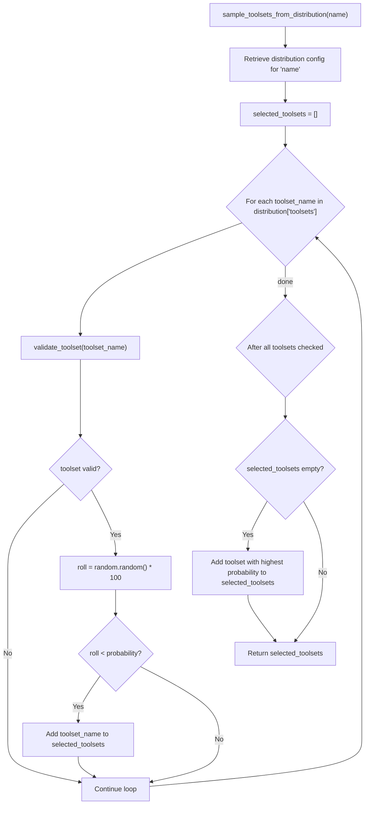
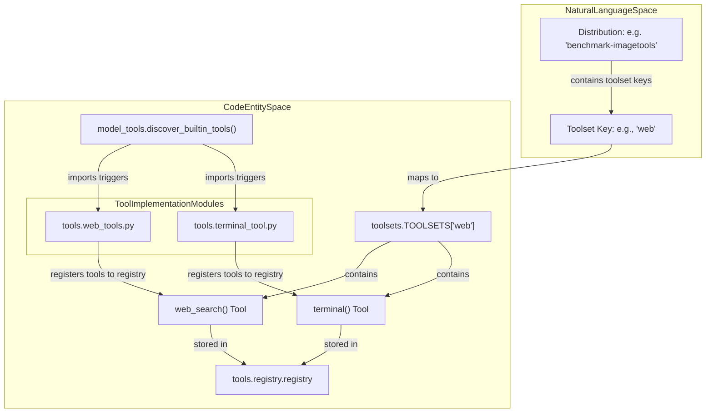

<!-- source: DeepWiki mcp.deepwiki.com · repo nousresearch/hermes-agent · page 9.2 Toolset Distributions · fetched 2026-10-27 -->

# Toolset Distributions

<details>
<summary>Relevant source files</summary>

The following files were used as context for generating this wiki page:

- [.dockerignore](.dockerignore)
- [.gitignore](.gitignore)
- [.hadolint.yaml](.hadolint.yaml)
- [Dockerfile](Dockerfile)
- [contributors/emails/Cryptodombili@gmail.com](contributors/emails/Cryptodombili@gmail.com)
- [contributors/emails/dstkwll@users.noreply.github.com](contributors/emails/dstkwll@users.noreply.github.com)
- [contributors/emails/fangliquan@qq.com](contributors/emails/fangliquan@qq.com)
- [docker-compose.yml](docker-compose.yml)
- [docker/cont-init.d/02-reconcile-profiles](docker/cont-init.d/02-reconcile-profiles)
- [docker/entrypoint-dispatch.sh](docker/entrypoint-dispatch.sh)
- [docker/entrypoint.sh](docker/entrypoint.sh)
- [docker/hermes-exec-shim.sh](docker/hermes-exec-shim.sh)
- [docker/main-wrapper.sh](docker/main-wrapper.sh)
- [docker/s6-rc.d/dashboard/run](docker/s6-rc.d/dashboard/run)
- [docker/stage2-hook.sh](docker/stage2-hook.sh)
- [gateway/authz_mixin.py](gateway/authz_mixin.py)
- [gateway/channel_directory.py](gateway/channel_directory.py)
- [gateway/config_env.py](gateway/config_env.py)
- [gateway/pairing.py](gateway/pairing.py)
- [hermes_cli/container_boot.py](hermes_cli/container_boot.py)
- [hermes_cli/copilot_auth.py](hermes_cli/copilot_auth.py)
- [hermes_cli/dashboard_register.py](hermes_cli/dashboard_register.py)
- [hermes_cli/main_profile_recovery.py](hermes_cli/main_profile_recovery.py)
- [hermes_cli/nous_auth_keepalive.py](hermes_cli/nous_auth_keepalive.py)
- [hermes_cli/nous_subscription.py](hermes_cli/nous_subscription.py)
- [hermes_cli/pairing.py](hermes_cli/pairing.py)
- [hermes_cli/portal_cli.py](hermes_cli/portal_cli.py)
- [hermes_cli/service_manager.py](hermes_cli/service_manager.py)
- [hermes_cli/tools_config.py](hermes_cli/tools_config.py)
- [hermes_time.py](hermes_time.py)
- [model_tools.py](model_tools.py)
- [registration_lifecycle.py](registration_lifecycle.py)
- [scripts/docker_rebootstrap_nous_session.py](scripts/docker_rebootstrap_nous_session.py)
- [setup.py](setup.py)
- [tests/agent/test_codex_token_expired_replay_recovery.py](tests/agent/test_codex_token_expired_replay_recovery.py)
- [tests/cron/test_timezone.py](tests/cron/test_timezone.py)
- [tests/dashboard/test_ws_client_host.py](tests/dashboard/test_ws_client_host.py)
- [tests/docker/__init__.py](tests/docker/__init__.py)
- [tests/docker/conftest.py](tests/docker/conftest.py)
- [tests/docker/test_config_migration.py](tests/docker/test_config_migration.py)
- [tests/docker/test_container_restart.py](tests/docker/test_container_restart.py)
- [tests/docker/test_dashboard.py](tests/docker/test_dashboard.py)
- [tests/docker/test_docker_exec_privilege_drop.py](tests/docker/test_docker_exec_privilege_drop.py)
- [tests/docker/test_gateway_bootstrap_state.py](tests/docker/test_gateway_bootstrap_state.py)
- [tests/docker/test_gateway_run_supervised.py](tests/docker/test_gateway_run_supervised.py)
- [tests/docker/test_home_override_scripts.py](tests/docker/test_home_override_scripts.py)
- [tests/docker/test_license_file_present.py](tests/docker/test_license_file_present.py)
- [tests/docker/test_main_invocation.py](tests/docker/test_main_invocation.py)
- [tests/docker/test_profile_gateway.py](tests/docker/test_profile_gateway.py)
- [tests/docker/test_s6_profile_gateway_integration.py](tests/docker/test_s6_profile_gateway_integration.py)
- [tests/docker/test_tui_passthrough.py](tests/docker/test_tui_passthrough.py)
- [tests/docker/test_zombie_reaping.py](tests/docker/test_zombie_reaping.py)
- [tests/gateway/test_channel_directory.py](tests/gateway/test_channel_directory.py)
- [tests/gateway/test_env_override_explicit_disable.py](tests/gateway/test_env_override_explicit_disable.py)
- [tests/gateway/test_multiplex_pairing_stores.py](tests/gateway/test_multiplex_pairing_stores.py)
- [tests/gateway/test_pairing.py](tests/gateway/test_pairing.py)
- [tests/gateway/test_pairing_allowlist_bypass.py](tests/gateway/test_pairing_allowlist_bypass.py)
- [tests/gateway/test_whatsapp_cloud_allowed_users.py](tests/gateway/test_whatsapp_cloud_allowed_users.py)
- [tests/hermes_cli/test_apply_profile_override.py](tests/hermes_cli/test_apply_profile_override.py)
- [tests/hermes_cli/test_container_boot.py](tests/hermes_cli/test_container_boot.py)
- [tests/hermes_cli/test_copilot_auth.py](tests/hermes_cli/test_copilot_auth.py)
- [tests/hermes_cli/test_copilot_token_exchange.py](tests/hermes_cli/test_copilot_token_exchange.py)
- [tests/hermes_cli/test_credential_pool_off_loop.py](tests/hermes_cli/test_credential_pool_off_loop.py)
- [tests/hermes_cli/test_dashboard_register.py](tests/hermes_cli/test_dashboard_register.py)
- [tests/hermes_cli/test_doctor_terminal_backends.py](tests/hermes_cli/test_doctor_terminal_backends.py)
- [tests/hermes_cli/test_gateway_s6_dispatch.py](tests/hermes_cli/test_gateway_s6_dispatch.py)
- [tests/hermes_cli/test_install_cua_driver.py](tests/hermes_cli/test_install_cua_driver.py)
- [tests/hermes_cli/test_nous_auth_keepalive.py](tests/hermes_cli/test_nous_auth_keepalive.py)
- [tests/hermes_cli/test_nous_subscription.py](tests/hermes_cli/test_nous_subscription.py)
- [tests/hermes_cli/test_profile_export_default_path.py](tests/hermes_cli/test_profile_export_default_path.py)
- [tests/hermes_cli/test_service_manager.py](tests/hermes_cli/test_service_manager.py)
- [tests/hermes_cli/test_setup_terminal.py](tests/hermes_cli/test_setup_terminal.py)
- [tests/hermes_cli/test_terminal_backend_docker_probe.py](tests/hermes_cli/test_terminal_backend_docker_probe.py)
- [tests/hermes_cli/test_tools_config.py](tests/hermes_cli/test_tools_config.py)
- [tests/hermes_cli/test_update_flat_install_state_gitignore.py](tests/hermes_cli/test_update_flat_install_state_gitignore.py)
- [tests/tools/test_docker_find.py](tests/tools/test_docker_find.py)
- [tests/tools/test_docker_rebootstrap_nous_session.py](tests/tools/test_docker_rebootstrap_nous_session.py)
- [tests/tools/test_image_generation_managed.py](tests/tools/test_image_generation_managed.py)
- [tests/tools/test_stage2_hook_api_server_keygen.py](tests/tools/test_stage2_hook_api_server_keygen.py)
- [tests/tools/test_stage2_hook_nous_routing_env.py](tests/tools/test_stage2_hook_nous_routing_env.py)
- [tests/tools/test_stage2_hook_seed_one_symlinks.py](tests/tools/test_stage2_hook_seed_one_symlinks.py)
- [tests/tools/test_stage2_hook_symlink_chown.py](tests/tools/test_stage2_hook_symlink_chown.py)
- [tests/tui_gateway/test_cold_start_gil_stall.py](tests/tui_gateway/test_cold_start_gil_stall.py)
- [tests/tui_gateway/test_entry_sys_path.py](tests/tui_gateway/test_entry_sys_path.py)
- [tests/tui_gateway/test_subprocess_encoding.py](tests/tui_gateway/test_subprocess_encoding.py)
- [tools/__init__.py](tools/__init__.py)
- [tools/image_generation_managed.py](tools/image_generation_managed.py)
- [toolset_distributions.py](toolset_distributions.py)
- [toolsets.py](toolsets.py)
- [website/docs/developer-guide/agent-loop.md](website/docs/developer-guide/agent-loop.md)
- [website/docs/developer-guide/architecture.md](website/docs/developer-guide/architecture.md)
- [website/docs/developer-guide/cron-internals.md](website/docs/developer-guide/cron-internals.md)
- [website/docs/developer-guide/gateway-internals.md](website/docs/developer-guide/gateway-internals.md)
- [website/docs/developer-guide/provider-runtime.md](website/docs/developer-guide/provider-runtime.md)
- [website/docs/reference/tools-reference.md](website/docs/reference/tools-reference.md)
- [website/docs/reference/toolsets-reference.md](website/docs/reference/toolsets-reference.md)
- [website/docs/user-guide/docker.md](website/docs/user-guide/docker.md)
- [website/docs/user-guide/features/tool-gateway.md](website/docs/user-guide/features/tool-gateway.md)
- [website/i18n/zh-Hans/docusaurus-plugin-content-docs/current/user-guide/docker.md](website/i18n/zh-Hans/docusaurus-plugin-content-docs/current/user-guide/docker.md)

</details>


This page explains the toolset distribution system within Hermes Agent, detailing how toolsets are sampled probabilistically during batch evaluation runs, how these distributions are defined, and how the agent resolves these definitions into executable code entities.

---

## Purpose and Overview

Toolset distributions enable flexible, probability-based sampling of tool availability during batch runs to produce diverse evaluation trajectories. Each distribution defines multiple toolsets mapped to independent inclusion probabilities (0–100%). This simulates realistic scenarios where different sets of agent tools might be available at different times, which is critical for training and evaluating robust agents.

**Key properties:**
- Independent Bernoulli sampling of each toolset according to specified probabilities.
- Support for multiple toolsets being enabled simultaneously in a single run.
- Ensures at least one toolset is selected by forcibly enabling the one with the highest chance if all random draws fail.
- Used primarily by batch evaluation runners to vary enabled toolsets for trajectory generation.

Sources: `[toolset_distributions.py:1-40]()`, `[model_tools.py:1-25]()`

---

## Distribution Configuration

Toolset distributions are statically defined as dictionaries keyed by descriptive names. Each distribution includes a textual description and a map of toolset keys to their independent selection probability percentages.

**Example distribution snippet:**
```python
{
    "description": "Heavy focus on image generation with vision and web support",
    "toolsets": {
        "image_gen": 90,
        "vision": 90,
        "web": 55,
        "terminal": 45
    }
}
```

- The probabilities indicate the **independent chance** a given toolset is enabled.
- These are not weights normalized to sum 100%; each toolset's inclusion is sampled separately.
- Usually, distributions map to task focuses or experimental conditions for benchmarking.

Sources: `[toolset_distributions.py:1-50]()`, `[toolsets.py:50-75]()`

---

## Sampling Mechanism

The runtime entry point for sampling toolsets by distribution is the function `sample_toolsets_from_distribution(name: str)` found in the distribution management module.

The function operates as follows:

1. Retrieves the specified distribution configuration by name.
2. Iterates over all toolsets listed in the distribution.
3. For each toolset:
   - Validates toolset existence via `validate_toolset(toolset_key)`.
   - Generates a random number between 0 and 100.
   - Includes the toolset if the random roll is less than the configured probability.
4. If no toolsets are selected by chance, forcibly includes the toolset with the highest configuration probability to guarantee at least one toolset is enabled.
5. Returns the final list of sampled toolsets.

### Sampling Logic Flowchart


Sources: `[toolset_distributions.py:1-60]()`, `[toolsets.py:1-20]()`

- Validation ensures only known toolsets are considered.
- Independent random draws determine presence.
- If none selected, fallback ensures there is always at least one toolset active.

Sources: `[toolset_distributions.py:1-60]()`, `[toolsets.py:1-20]()`

---

## Toolset Registry and Resolution

Hermes Agent maintains a central registry of toolsets, which are groups of related tools, organized by functional domain. These toolsets are the building blocks for what capabilities the agent enables during a batch run.

### Configurable Toolsets Registry

The `toolsets.py` file contains the list of configurable toolsets, exposed for enabling, disabling, and configuration by users or batch systems:

| Toolset Key | Label | Representative Tools |
|-------------|-------|---------------------|
| `web` | Web research and content extraction tools | `web_search`, `web_extract` |
| `search` | Web search only (no content extraction/scraping) | `web_search` |
| `x_search` | Search X (Twitter) posts and threads | `x_search` |
| `vision` | Image analysis and vision tools | `vision_analyze` |
| `video` | Video analysis and understanding tools | `video_analyze` |
| `image_gen` | Creative generation tools (images) | `image_generate` |
| `video_gen` | Video generation tools | `video_generate`, `xai_video_edit`, `xai_video_extend` |
| `computer_use` | Background desktop control via cua-driver | `computer_use` |
| `terminal` | Terminal/command execution and process management tools | `terminal`, `process_manage` |
| `skills` | Access, create, edit, and manage skill documents | `skills_list`, `skill_view`, `skill_manage` |
| `browser` | Browser automation for web interaction | `browser_back`, `browser_click`, `browser_navigate`, etc. |
| `cronjob` | Cronjob management tool | `cronjob_manage` |
| `file` | File manipulation tools | `read_file`, `write_file`, `patch`, `search_files` |
| `tts` | Text-to-speech | `text_to_speech` |
| `todo` | Task planning and tracking for multi-step work | `todo_list` |
| `memory` | Persistent memory across sessions | `memory` |
| `context_engine` | Runtime tools exposed by the active context engine | (varies) |
| `session_search` | Search and recall past conversations with summarization | `session_search` |
| `connections` | Remote connector discovery, execution, and account authorization | `manage_connections` |
| `clarify` | Ask the user one or more questions | `clarify` |
| `execute_code` | Run Python scripts that call Hermes tools programmatically | `execute_code` |
| `delegate_task` | Spawn isolated subagent instances for parallel work | `delegate_task` |
| `kanban` | Multi-agent coordination tools | `kanban_show`, `kanban_list`, `kanban_create`, etc. |
| `desktop_ui` | Affordances that act on the Hermes desktop app itself | `annotate_preview`, `apply_layout`, `read_terminal`, etc. |
| `project` | Create and switch desktop Projects | `desktop_project` |

Some toolsets are **off by default**, requiring explicit enabling to activate, including `video`, `video_gen`, `x_search`, and `computer_use`. The `_HERMES_CORE_TOOLS` list defines the default set of tools available across most platforms `[toolsets.py:11-39]`. The `_DEFAULT_OFF_TOOLSETS` in `hermes_cli/tools_config.py` explicitly lists toolsets that are off by default for new installs, such as `spotify`, `discord`, `discord_admin`, `video`, `video_gen`, `x_search`, `a2a`, and `kanban` `[hermes_cli/tools_config.py:110-111]`.

Sources: `[toolsets.py:11-133]()`, `[website/docs/reference/tools-reference.md:1-15]()`, `[hermes_cli/tools_config.py:110-111]()`

---

### Mapping Toolsets to Code Entities

The `toolsets.py` defines the comprehensive dictionary `TOOLSETS` mapping toolset keys to the corresponding list of tool names and configurations `[toolsets.py:74-133]`.

The implemented tools themselves are registered via side effects in module imports within `model_tools.py`, which imports all tools, triggering their registration in the central `tools.registry` `[model_tools.py:147-150]`.

This creates the connection chain:
- Distribution config → Toolset keys (e.g. `"web"`) → `toolsets.TOOLSETS` dictionary → tool names in `tools.registry` → actual tool functions and classes.

The diagram below illustrates this mapping bridging natural language distribution concepts to actual code entities called during batch runs:


Sources: `[toolsets.py:74-133]()`, `[model_tools.py:147-166]()`, `[tools/registry.py:1-30]()`

- Importing `model_tools` triggers discovery and registration `[model_tools.py:147-150]`.
- The `TOOLSETS` dictionary defines tool collections per key `[toolsets.py:74-133]`.
- Registered tool functions implement the actual capabilities called by the agent.

Sources: `[toolsets.py:74-133]()`, `[model_tools.py:147-166]()`, `[tools/registry.py:1-30]()`

---

## Integration with Batch Processing

Batch runner orchestrations generate evaluation trajectories by executing conversations with dynamically sampled toolsets. Integration with toolset distributions occurs as follows:

1. **Initialization:** The batch runner accepts a toolset distribution name indicating which distribution to use.
2. **Sampling:** For each prompt in the batch, the runner calls `sample_toolsets_from_distribution()` to pick enabled toolsets probabilistically.
3. **Agent Setup:** A new `AIAgent` instance is created and configured with the sampled toolsets for that run, controlling which tools are available.
4. **Metadata:** The toolset sampling result is saved into the trajectory's metadata, enabling offline analysis by configuration.

Sources: `[toolset_distributions.py:1-50]()`, `[agent/tool_executor.py:1-50]()`

---

## Managed Features and Entitlements

Toolset availability and configuration can be gated by user entitlements and subscription features. For example, the Docker image's `stage2-hook.sh` script handles UID/GID remapping, volume chown, config seeding, and skills sync, which influence runtime tool environments `[docker/stage2-hook.sh:1-50]`. The `NousSubscriptionFeatures` class and related functions in `hermes_cli/nous_subscription.py` manage the availability and activation of features like web tools, image generation, video generation, TTS, STT, and browser automation based on Nous subscription status and direct credential overrides `[hermes_cli/nous_subscription.py:23-67]`. This system determines if a feature is `available`, `active`, `managed_by_nous`, or has a `direct_override` `[hermes_cli/nous_subscription.py:98-106]`.

This layered entitlement model ensures batch runs reflect the actual capabilities granted to a given user environment.

Sources: `[docker/stage2-hook.sh:1-50]()`, `[toolsets.py:1-40]()`, `[hermes_cli/nous_subscription.py:23-67]()`, `[hermes_cli/nous_subscription.py:98-106]()`

---

## Validation and Error Handling

Robustness mechanisms ensure correct toolset sampling and configuration during batch processing:

- **Toolset Validation:** Toolsets specified in configurations or distributions pass through `validate_toolset()` to verify correctness `[toolsets.py:1-50]`. The `_get_platform_tools` function in `hermes_cli/tools_config.py` handles cases of invalid or malformed `platform_toolsets` configurations, logging warnings and falling back to default toolsets if necessary `[hermes_cli/tools_config.py:39-47]`, `[hermes_cli/tools_config.py:109-124]`.
- **Tool Requirements:** Each tool includes a check function that validates runtime environment requirements (e.g., credentials, helper binaries) before enabling `[model_tools.py:20-30]`.
- **Platform Restrictions:** Toolsets like `discord` and `discord_admin` are platform-restricted and will not leak to other platforms even if explicitly configured `[tests/hermes_cli/test_tools_config.py:139-147]`.
- **Profile Name Validation:** Profile names used in service directories for toolsets are validated to ensure they are filesystem and process-safe `[hermes_cli/service_manager.py:1-30]`.
- **Container Boot Reconciliation:** The container boot module reconciles per-profile gateway services, ensuring toolsets associated with profiles are correctly managed `[hermes_cli/container_boot.py:1-50]`.
- **Allowlist System:** The `gateway/authz_mixin.py` module implements an allowlist system for platforms, ensuring only authorized users or chats can interact with the agent and its tools `[gateway/authz_mixin.py:1-30]`. This includes handling platform-specific identifiers and aliases like WhatsApp and Nostr `[gateway/authz_mixin.py:163-166]`.

Sources: `[toolsets.py:1-50]()`, `[model_tools.py:20-30]`, `[hermes_cli/service_manager.py:1-30]()`, `[hermes_cli/container_boot.py:1-50]()`, `[hermes_cli/tools_config.py:39-47]()`, `[hermes_cli/tools_config.py:109-124]()`, `[tests/hermes_cli/test_tools_config.py:139-147]()`, `[gateway/authz_mixin.py:1-30]()`, `[gateway/authz_mixin.py:163-166]()`

---

# References

- `toolset_distributions.py`
- `toolsets.py`
- `model_tools.py`
- `docker/stage2-hook.sh`
- `hermes_cli/service_manager.py`
- `hermes_cli/container_boot.py`
- `hermes_cli/tools_config.py`
- `hermes_cli/nous_subscription.py`
- `gateway/authz_mixin.py`
- `website/docs/reference/tools-reference.md`

Sources: `[toolset_distributions.py]()`, `[toolsets.py]()`, `[model_tools.py]()`, `[docker/stage2-hook.sh]()`, `[hermes_cli/service_manager.py]()`, `[hermes_cli/container_boot.py]()`, `[hermes_cli/tools_config.py]()`, `[hermes_cli/nous_subscription.py]()`, `[gateway/authz_mixin.py]()`, `[website/docs/reference/tools-reference.md]()`

---

