# Page: Overview

# Overview

<details>
<summary>Relevant source files</summary>

The following files were used as context for generating this wiki page:

- [.env.example](.env.example)
- [AGENTS.md](AGENTS.md)
- [CONTRIBUTING.es.md](CONTRIBUTING.es.md)
- [CONTRIBUTING.md](CONTRIBUTING.md)
- [README.md](README.md)
- [agent/auxiliary_client.py](agent/auxiliary_client.py)
- [cli-config.yaml.example](cli-config.yaml.example)
- [cli.py](cli.py)
- [gateway/run.py](gateway/run.py)
- [gateway/session.py](gateway/session.py)
- [gateway/slash_commands.py](gateway/slash_commands.py)
- [hermes_cli/cli_commands_mixin.py](hermes_cli/cli_commands_mixin.py)
- [hermes_cli/commands.py](hermes_cli/commands.py)
- [hermes_cli/config.py](hermes_cli/config.py)
- [hermes_cli/config_defaults.py](hermes_cli/config_defaults.py)
- [hermes_cli/config_migrations.py](hermes_cli/config_migrations.py)
- [hermes_cli/config_version_stamp.py](hermes_cli/config_version_stamp.py)
- [hermes_cli/main.py](hermes_cli/main.py)
- [hermes_cli/setup.py](hermes_cli/setup.py)
- [hermes_state.py](hermes_state.py)
- [run_agent.py](run_agent.py)
- [scripts/check](scripts/check)
- [scripts/ci/check_agents_md_size.py](scripts/ci/check_agents_md_size.py)
- [scripts/code_health/cli.py](scripts/code_health/cli.py)
- [scripts/code_health/compare.py](scripts/code_health/compare.py)
- [scripts/code_health/config.py](scripts/code_health/config.py)
- [scripts/code_health/gitio.py](scripts/code_health/gitio.py)
- [scripts/code_health/measure.py](scripts/code_health/measure.py)
- [scripts/code_health/model.py](scripts/code_health/model.py)
- [scripts/code_health/py_rules.py](scripts/code_health/py_rules.py)
- [scripts/code_health/py_structure.py](scripts/code_health/py_structure.py)
- [scripts/code_health/replay.py](scripts/code_health/replay.py)
- [scripts/code_health/report.py](scripts/code_health/report.py)
- [scripts/code_health/ruff_runner.py](scripts/code_health/ruff_runner.py)
- [scripts/code_health/ts_measure.py](scripts/code_health/ts_measure.py)
- [scripts/code_health/ts_units.mjs](scripts/code_health/ts_units.mjs)
- [scripts/docker_config_migrate.py](scripts/docker_config_migrate.py)
- [tests/agent/test_auxiliary_client.py](tests/agent/test_auxiliary_client.py)
- [tests/gateway/test_session.py](tests/gateway/test_session.py)
- [tests/hermes_cli/test_commands.py](tests/hermes_cli/test_commands.py)
- [tests/hermes_cli/test_config.py](tests/hermes_cli/test_config.py)
- [tests/hermes_cli/test_config_migration_nested_guards.py](tests/hermes_cli/test_config_migration_nested_guards.py)
- [tests/hermes_cli/test_config_unversioned_migration.py](tests/hermes_cli/test_config_unversioned_migration.py)
- [tests/scripts/test_check_agents_md_size.py](tests/scripts/test_check_agents_md_size.py)
- [tests/scripts/test_code_health.py](tests/scripts/test_code_health.py)
- [tests/scripts/test_code_health_cli.py](tests/scripts/test_code_health_cli.py)
- [tests/scripts/test_code_health_identity.py](tests/scripts/test_code_health_identity.py)
- [tests/scripts/test_code_health_rules.py](tests/scripts/test_code_health_rules.py)
- [tests/tools/test_docker_config_migrate.py](tests/tools/test_docker_config_migrate.py)
- [ui-tui/src/__tests__/details.test.ts](ui-tui/src/__tests__/details.test.ts)
- [ui-tui/src/domain/details.ts](ui-tui/src/domain/details.ts)
- [website/docs/developer-guide/contributing.md](website/docs/developer-guide/contributing.md)
- [website/docs/getting-started/quickstart.md](website/docs/getting-started/quickstart.md)
- [website/docs/integrations/providers.md](website/docs/integrations/providers.md)
- [website/docs/reference/cli-commands.md](website/docs/reference/cli-commands.md)
- [website/docs/reference/environment-variables.md](website/docs/reference/environment-variables.md)
- [website/docs/reference/slash-commands.md](website/docs/reference/slash-commands.md)
- [website/docs/user-guide/cli.md](website/docs/user-guide/cli.md)
- [website/docs/user-guide/configuration.md](website/docs/user-guide/configuration.md)
- [website/docs/user-guide/features/fallback-providers.md](website/docs/user-guide/features/fallback-providers.md)
- [website/docs/user-guide/messaging/index.md](website/docs/user-guide/messaging/index.md)
- [website/docs/user-guide/tui.md](website/docs/user-guide/tui.md)
- [website/i18n/zh-Hans/docusaurus-plugin-content-docs/current/developer-guide/contributing.md](website/i18n/zh-Hans/docusaurus-plugin-content-docs/current/developer-guide/contributing.md)

</details>


Hermes Agent is an advanced, self-improving AI agent framework developed by **Nous Research**. It provides a robust conversation loop with tool-calling capabilities, persistent memory, support for agent-created extensible skills, and multi-platform messaging integrations. Hermes Agent operates seamlessly across multiple user interfaces, including a command-line interface (CLI), messaging platforms via a messaging gateway, editor integrations through the Agent Client Protocol (ACP), and a web dashboard UI.

The framework integrates with any OpenAI-compatible LLM provider and can execute commands in terminal environments, browsers, and other tool plugins across diverse execution backends ranging from local shells to Docker containers, SSH servers, and cloud sandboxes.

This page offers a high-level overview of Hermes Agent’s purpose, core architecture, and key runtime modes. For detailed technical descriptions, see the child pages:  
- **[Architecture Overview](#1.1)** — Detailed breakdown of the three-tier architecture, major subsystems, and their interactions.  
- **[Project Structure and Dependencies](#1.2)** — Directory layout, `uv` dependency management, lazy installation, and Nix support.

Sources: [cli.py:1-14](), [run_agent.py:1-7](), [gateway/run.py:1-4]()

---

## System Architecture

### Three-Tier Architecture

Hermes Agent is designed as a modular three-tier architecture separating user-facing interaction layers, core agent orchestration, and backend tool execution environments.

- **Tier 1: User Interfaces**  
  These entry points facilitate interaction with the agent by end-users or integrated systems:  
  - `cli.py` — Command-line interface offering an interactive REPL chat, slash commands, and session management, using `prompt_toolkit` for enhanced terminal UX [cli.py:1-14]().  
  - `gateway/run.py` — Messaging gateway service managing multi-platform bot connections, including Telegram, Discord, Slack, and others [gateway/run.py:1-4]().  
  - `hermes_cli/main.py` — The main CLI entrypoint, dispatching subcommands like chat, gateway, setup, and ACP server modes [hermes_cli/main.py:1-9]().  
  - FastAPI backend (in `hermes_cli/web_server.py`) — Hosts the web dashboard UI for session management, configuration, cron jobs, and analytics.

- **Tier 2: Core Agent Logic**  
  This layer orchestrates conversation flow, prompt assembly, tool dispatching, error handling, and session state management:  
  - `run_agent.py` — Defines the main `AIAgent` class running the tool-calling conversation loop and overseeing session lifecycles [run_agent.py:1-7]().  
  - `agent/conversation_loop.py` — Implements the iterative conversation and tool-call rounds.  
  - `model_tools.py` — Responsible for discovery, registration, and validation of tools callable by the agent.  
  - `agent/conversation_compression.py` — Manages context pruning and compression to fit conversations within LLM token limits.

- **Tier 3: Execution & Inference Backends**  
  This tier provides the environments and systems for command execution, process management, and provider authentication:  
  - Terminal and process management tools under `tools/`, with lifecycle and sandboxing support [run_agent.py:103-107]().  
  - Configuration and secret loading managed by `hermes_cli/config.py` for user settings, API keys, and environment variables [hermes_cli/config.py:1-6]().
  - Auxiliary client routing in `agent/auxiliary_client.py` handles side tasks like compression, search, and vision, with a fallback chain for provider resolution [agent/auxiliary_client.py:1-9]().

Sources: [cli.py:1-14](), [gateway/run.py:1-4](), [hermes_cli/main.py:1-9](), [run_agent.py:1-7](), [run_agent.py:103-107](), [hermes_cli/config.py:1-6](), [agent/auxiliary_client.py:1-9]()

---

### Diagram: Hermes Agent Three-Tier Architecture

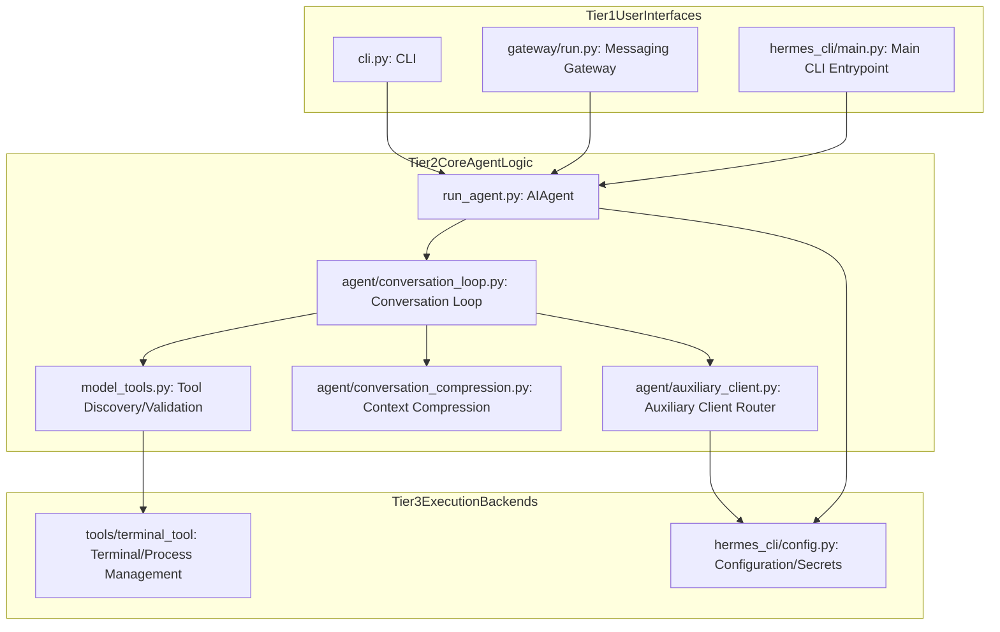

Sources: [cli.py:1-14](), [gateway/run.py:1-4](), [hermes_cli/main.py:1-9](), [run_agent.py:1-7](), [hermes_cli/config.py:1-6](), [agent/auxiliary_client.py:1-9]()

---

### Bridging Natural Language Space to Code Entity Space #1

This diagram shows how user natural language inputs, from CLI or messaging platforms, flow into the core code entities responsible for conversation management and tool execution, linking system components to their code implementations.

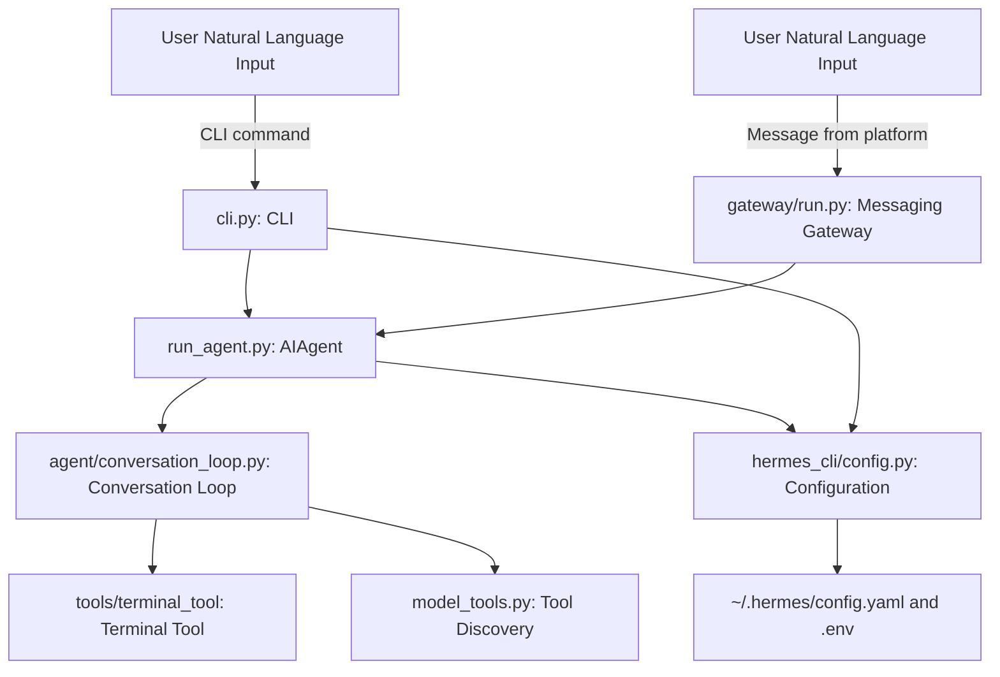

Sources: [cli.py:1-14](), [gateway/run.py:1-4](), [run_agent.py:1-7](), [hermes_cli/config.py:1-6]()

---

### Bridging Natural Language Space to Code Entity Space #2

This diagram traces a typical user request path through Hermes Agent: reception, conversation management, tool discovery and dispatch, actual execution in environment backends, and session & memory persistence.

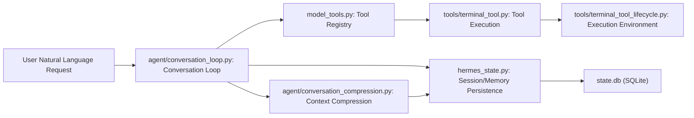

Sources: [run_agent.py:1-7](), [hermes_state.py:1-10](), [agent/conversation_compression.py:35-39]()

---

## Runtime Modes

Hermes Agent supports multiple operational modes adaptable to diverse user needs and environments:

| Runtime Mode  | Primary Entry Point               | Description                                                                                           |
|---------------|---------------------------------|----------------------------------------------------------------------------------------------------|
| **CLI**       | `cli.py`                        | Interactive terminal interface providing REPL prompt, slash commands, session management, and prompt-toolkit UX [cli.py:1-14](). |
| **Gateway**   | `gateway/run.py`                | Messaging gateway service supporting multi-platform bot interactions with Telegram, Discord, Slack, and others [gateway/run.py:1-4](). |
| **Web UI**    | `hermes web` (FastAPI backend) | Browser-based dashboard UI for session/config management and cron job administration.              |
| **ACP Server**| `hermes acp` (via `hermes_cli/main.py`) | Agent Client Protocol server enabling deep editor integrations (e.g., VS Code, Zed).               |

Sources: [cli.py:1-14](), [gateway/run.py:1-4](), [hermes_cli/main.py:1-9]()

---

## Core Components and Self-Improvement

- **`AIAgent` and the Conversation Loop**  
  The `AIAgent` class (defined in `run_agent.py`) is the runtime heart managing the tool-calling conversation loop, session lifecycle, streaming LLM calls, prompt composition, retries, fallback provider detection, and turn finalization [run_agent.py:1-7]().

- **Extensible Skills and Agent Self-Improvement**  
  Hermes supports user-created and dynamically managed skills stored in directories like `~/.hermes/skills/`. These agent-created skills expand capabilities, are managed centrally through tools and UI, and undergo background security and quality reviews. This modular skill system encourages continual self-improvement and extensibility of agents [website/docs/user-guide/configuration.md:28-29]().

- **Configuration Hierarchy and Management**  
  Configuration primarily resides in the user's `~/.hermes/config.yaml` file for general settings and `.env` files for secrets such as API keys or tokens. Settings resolve in this order of precedence: CLI arguments override `config.yaml`, which overrides `.env`, with built-in defaults as fallback. The system supports live editing, validation, safe migration workflows, and dedicated secret handling to securely support provider authentication and environment-specific overrides [website/docs/user-guide/configuration.md:58-68](). The `hermes_cli/setup.py` module provides an interactive wizard for initial configuration [hermes_cli/setup.py:1-7]().

Sources: [run_agent.py:1-7](), [website/docs/user-guide/configuration.md:28-29](), [website/docs/user-guide/configuration.md:58-68](), [hermes_cli/setup.py:1-7]()

---

## Child Pages

For more detailed and technical documentation, please see:  

- **[Architecture Overview](#1.1)** — Explains the three-tier architecture, major subsystems, and how they interact.  
- **[Project Structure and Dependencies](#1.2)** — Documents the directory structure, dependency management with `uv` and the `pm/` package manager, lazy dependency installation, and the installation ecosystem including Nix flake support.

Sources: [website/docs/user-guide/configuration.md:1-20]()

---

# Page: Architecture Overview

# Architecture Overview

<details>
<summary>Relevant source files</summary>

The following files were used as context for generating this wiki page:

- [agent/agent_init.py](agent/agent_init.py)
- [agent/agent_runtime_helpers.py](agent/agent_runtime_helpers.py)
- [agent/auxiliary_client.py](agent/auxiliary_client.py)
- [agent/chat_completion_helpers.py](agent/chat_completion_helpers.py)
- [agent/compaction_display.py](agent/compaction_display.py)
- [agent/compression_facade.py](agent/compression_facade.py)
- [agent/context_compressor.py](agent/context_compressor.py)
- [agent/conversation_compression.py](agent/conversation_compression.py)
- [agent/conversation_compression_archive.py](agent/conversation_compression_archive.py)
- [agent/conversation_compression_manual.py](agent/conversation_compression_manual.py)
- [agent/conversation_loop.py](agent/conversation_loop.py)
- [agent/inline_tool_executors.py](agent/inline_tool_executors.py)
- [agent/micro_compaction.py](agent/micro_compaction.py)
- [agent/tool_dispatch_helpers.py](agent/tool_dispatch_helpers.py)
- [agent/tool_executor.py](agent/tool_executor.py)
- [agent/turn_context.py](agent/turn_context.py)
- [agent/turn_finalizer.py](agent/turn_finalizer.py)
- [apps/desktop/e2e/core/reply-painted-once.spec.ts](apps/desktop/e2e/core/reply-painted-once.spec.ts)
- [apps/desktop/src/app/session/hooks/use-message-stream/reused-final-after-tool.test.tsx](apps/desktop/src/app/session/hooks/use-message-stream/reused-final-after-tool.test.tsx)
- [apps/desktop/src/app/session/hooks/use-message-stream/test-harness.tsx](apps/desktop/src/app/session/hooks/use-message-stream/test-harness.tsx)
- [cli-config.yaml.example](cli-config.yaml.example)
- [cli.py](cli.py)
- [gateway/run.py](gateway/run.py)
- [gateway/session.py](gateway/session.py)
- [gateway/slash_commands.py](gateway/slash_commands.py)
- [hermes_cli/cli_commands_mixin.py](hermes_cli/cli_commands_mixin.py)
- [hermes_cli/commands.py](hermes_cli/commands.py)
- [hermes_cli/config.py](hermes_cli/config.py)
- [hermes_cli/config_defaults.py](hermes_cli/config_defaults.py)
- [hermes_cli/config_migrations.py](hermes_cli/config_migrations.py)
- [hermes_cli/config_version_stamp.py](hermes_cli/config_version_stamp.py)
- [hermes_cli/main.py](hermes_cli/main.py)
- [hermes_cli/setup.py](hermes_cli/setup.py)
- [hermes_state.py](hermes_state.py)
- [run_agent.py](run_agent.py)
- [scripts/docker_config_migrate.py](scripts/docker_config_migrate.py)
- [scripts/micro_compaction_report.py](scripts/micro_compaction_report.py)
- [tests/agent/test_auxiliary_client.py](tests/agent/test_auxiliary_client.py)
- [tests/agent/test_compression_commit_fence_race.py](tests/agent/test_compression_commit_fence_race.py)
- [tests/agent/test_compression_concurrent_fork.py](tests/agent/test_compression_concurrent_fork.py)
- [tests/agent/test_compression_stall_fallback.py](tests/agent/test_compression_stall_fallback.py)
- [tests/agent/test_compressor_truncated_summary_guard.py](tests/agent/test_compressor_truncated_summary_guard.py)
- [tests/agent/test_context_compressor.py](tests/agent/test_context_compressor.py)
- [tests/agent/test_conversation_compression_manual.py](tests/agent/test_conversation_compression_manual.py)
- [tests/agent/test_empty_response_recovery_persistence.py](tests/agent/test_empty_response_recovery_persistence.py)
- [tests/agent/test_in_place_merged_user_rows.py](tests/agent/test_in_place_merged_user_rows.py)
- [tests/agent/test_message_sequence_repair.py](tests/agent/test_message_sequence_repair.py)
- [tests/agent/test_micro_compaction.py](tests/agent/test_micro_compaction.py)
- [tests/agent/test_proactive_prune_rearm_threshold.py](tests/agent/test_proactive_prune_rearm_threshold.py)
- [tests/agent/test_proactive_prune_restart_safety.py](tests/agent/test_proactive_prune_restart_safety.py)
- [tests/agent/test_proactive_tool_result_pruning.py](tests/agent/test_proactive_tool_result_pruning.py)
- [tests/agent/test_setup_beat_card_round.py](tests/agent/test_setup_beat_card_round.py)
- [tests/agent/test_tool_call_args_sanitizer.py](tests/agent/test_tool_call_args_sanitizer.py)
- [tests/agent/test_tool_dispatch_helpers.py](tests/agent/test_tool_dispatch_helpers.py)
- [tests/agent/test_turn_finalizer_final_response_persistence.py](tests/agent/test_turn_finalizer_final_response_persistence.py)
- [tests/agent/test_turn_finalizer_iteration_limit_exit.py](tests/agent/test_turn_finalizer_iteration_limit_exit.py)
- [tests/agent/test_unicode_ascii_codec.py](tests/agent/test_unicode_ascii_codec.py)
- [tests/gateway/test_api_server_compaction_projection.py](tests/gateway/test_api_server_compaction_projection.py)
- [tests/gateway/test_session.py](tests/gateway/test_session.py)
- [tests/hermes_cli/test_commands.py](tests/hermes_cli/test_commands.py)
- [tests/hermes_cli/test_config.py](tests/hermes_cli/test_config.py)
- [tests/hermes_cli/test_config_migration_nested_guards.py](tests/hermes_cli/test_config_migration_nested_guards.py)
- [tests/hermes_cli/test_config_unversioned_migration.py](tests/hermes_cli/test_config_unversioned_migration.py)
- [tests/hermes_cli/test_kanban_comment_queries.py](tests/hermes_cli/test_kanban_comment_queries.py)
- [tests/tools/test_docker_config_migrate.py](tests/tools/test_docker_config_migrate.py)
- [tests/tools/test_kanban_comment_injection.py](tests/tools/test_kanban_comment_injection.py)
- [tests/tools/test_kanban_persisted_identity.py](tests/tools/test_kanban_persisted_identity.py)
- [tests/tui_gateway/test_manual_compress_history_fence.py](tests/tui_gateway/test_manual_compress_history_fence.py)
- [tests/tui_gateway/test_turn_payload_reused_final.py](tests/tui_gateway/test_turn_payload_reused_final.py)
- [ui-tui/src/__tests__/details.test.ts](ui-tui/src/__tests__/details.test.ts)
- [ui-tui/src/domain/details.ts](ui-tui/src/domain/details.ts)
- [website/docs/developer-guide/context-compression-and-caching.md](website/docs/developer-guide/context-compression-and-caching.md)
- [website/docs/getting-started/quickstart.md](website/docs/getting-started/quickstart.md)
- [website/docs/integrations/providers.md](website/docs/integrations/providers.md)
- [website/docs/reference/cli-commands.md](website/docs/reference/cli-commands.md)
- [website/docs/reference/environment-variables.md](website/docs/reference/environment-variables.md)
- [website/docs/reference/slash-commands.md](website/docs/reference/slash-commands.md)
- [website/docs/user-guide/cli.md](website/docs/user-guide/cli.md)
- [website/docs/user-guide/configuration.md](website/docs/user-guide/configuration.md)
- [website/docs/user-guide/features/fallback-providers.md](website/docs/user-guide/features/fallback-providers.md)
- [website/docs/user-guide/messaging/index.md](website/docs/user-guide/messaging/index.md)
- [website/docs/user-guide/tui.md](website/docs/user-guide/tui.md)

</details>


## Purpose and Scope

This document presents a detailed technical overview of Hermes Agent’s architecture. Hermes Agent is an AI agent framework featuring autonomous reasoning, tool usage, conversational memory, and self-improvement capabilities. The system is architected as a three-tier platform, integrating interactive user interfaces, a core agent orchestration layer, and a diverse tool and execution backend. This page explains these tiers, the major subsystems comprising them, and the technical flow of data and control between components.

The architecture supports multiple frontend interfaces—including CLI [cli.py:1-3](), the Messaging Gateway [gateway/run.py:1-5](), terminal TUI, and the web dashboard—all converging on the central core agent [run_agent.py:2-7](). The core agent manages conversational loops, memory persistence, tool orchestration, and auxiliary LLM clients. The tool layer abstracts a wide range of capabilities: terminal commands [tools/terminal_tool_lifecycle.py:104-104](), browser automation [tools/browser_tool_lifecycle.py:1-1](), vision tools, and more, executed within isolated runtime environments.

Sources: [run_agent.py:1-7](), [cli.py:1-13](), [gateway/run.py:1-5]()

---

## Three-Tier Architecture

The system is organized into three distinct tiers:

1.  **User Interface Tier**: Consists of multiple frontends including the interactive CLI (`cli.py`), the Messaging Gateway (`gateway/run.py`), terminal TUI (`hermes_cli/main.py`), and the web dashboard server.
2.  **Core Agent Tier**: Built around the `AIAgent` class (`run_agent.py`), handling conversation loops (`agent/conversation_loop.py`), auxiliary LLM client tasks, context compression (`agent/conversation_compression.py`), and memory management (`agent/memory_provider.py`).
3.  **Tool and Execution Tier**: Manages tool registration, discovery (`model_tools.py`), and execution across local, Docker, SSH, or sandboxed environments (`tools/terminal_tool_lifecycle.py`), backed by a persistent SQLite session state store (`hermes_state.py`).

Sources: [run_agent.py:2-7](), [cli.py:1-3](), [gateway/run.py:1-5](), [hermes_state.py:1-10]()

---

## Core Architecture Components

### System Overview Diagram

This diagram bridges user-facing concepts to concrete code entities across the system layers.

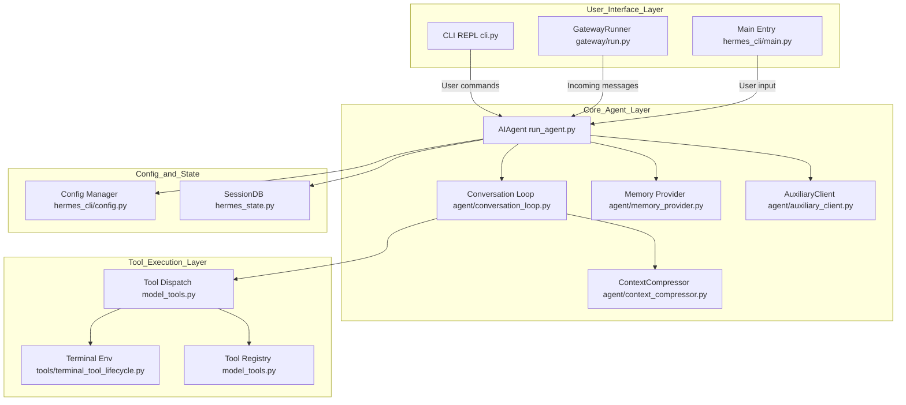

This diagram illustrates the layered organization:
-   **User Interface Layer** connects users to Hermes via CLI (`cli.py`), Gateway (`gateway/run.py`), and terminal interfaces (`hermes_cli/main.py`).
-   **Core Agent Layer** centers on the `AIAgent` class (`run_agent.py`), managing conversation state, memory, context compression, and tool integration. It also includes the `AuxiliaryClient` (`agent/auxiliary_client.py`) for side tasks.
-   **Tool & Execution Layer** manages tool definitions, discovery, and execution within isolated environments (`tools/terminal_tool_lifecycle.py`).
-   **Config & State** components handle persistent user configuration (`hermes_cli/config.py`) and session message storage in SQLite (`hermes_state.py`).

Sources: [run_agent.py:102-136](), [cli.py:35-47](), [gateway/run.py:1-10](), [hermes_cli/config.py:1-25](), [hermes_state.py:1-25](), [agent/auxiliary_client.py:1-10]()

---

## AIAgent: The Central Orchestrator

The core of Hermes Agent is the `AIAgent` class defined in `run_agent.py`. This class encapsulates primary conversation orchestration, including iterative reasoning, tool dispatch, session management, and integration with memory and compression subsystems.

### Conversation Orchestration

-   Conversations are managed as iterative loops in `agent/conversation_loop.py`.
-   The `run_conversation()` method on `AIAgent` drives:
    -   Building system prompts, injecting personality and behavioral cues (`SOUL.md`).
    -   Calling the configured LLM provider, supporting streaming and non-streaming modes via `perform_api_call` [agent/turn_api_call.py:1-5]().
    -   Parsing model outputs for function calls representing tool invocations.
    -   Invoking `handle_function_call()` (from `model_tools.py`) to dispatch tool calls.
    -   Handling retries, fallbacks, and error conditions with detailed error classification via `handle_api_error` [agent/turn_api_error.py:1-5]().
    -   Managing iteration budgets (`IterationBudget`) to prevent runaway loops [run_agent.py:91-91]().
-   Conversation turns involve sanitizing messages and tool call IDs to ensure consistency using functions like `_sanitize_uniquify_tool_call_ids` [run_agent.py:130-130]().

### Memory, Sessions, and Persistence

-   Persistent session data and message history are stored in the SQLite-backed session database (`hermes_state.py`). The `SessionDB` class manages interactions with `state.db` [hermes_state.py:1-6]().
-   The state store supports WAL mode (`apply_wal_with_fallback`) for concurrent readers and single-writer safety [hermes_state_wal.py:1-5]().
-   Memory providers (`agent/memory_provider.py`) load persona and user memories from structured files (`MEMORY.md`, `USER.md`).
-   The context compression subsystem (`agent/context_compressor.py`) summarizes message history with auxiliary LLM calls to keep context within model token budgets. This involves the `ContextCompressor` class [agent/context_compressor.py:1-5]().

### Auxiliary Client System

-   The `agent/auxiliary_client.py` module provides a shared client router for side tasks such as compression, search, and vision.
-   It handles provider resolution fallbacks for auxiliary tasks, including routing through OpenRouter, Nous Portal, custom endpoints, and direct API-key providers [agent/auxiliary_client.py:1-8]().
-   The `call_llm` function [agent/auxiliary_client.py:30-30]() is used to make LLM calls for these auxiliary tasks.
-   The system includes mechanisms for health checks and quarantining unhealthy providers [agent/auxiliary_health.py:1-5]().

Sources: [run_agent.py:90-136](), [agent/conversation_loop.py:1-50](), [hermes_state.py:1-50](), [agent/auxiliary_client.py:1-10](), [agent/context_compressor.py:1-5](), [agent/turn_api_call.py:1-5](), [agent/turn_api_error.py:1-5]()

---

## Tool System and Execution Flow

Hermes Agent implements a modular tool system that translates LLM-instructed tool calls into command invocations executed in controlled environments.

### Tool Execution Flow Diagram

This diagram maps natural language space intents to specific code entities in the tool execution layer.

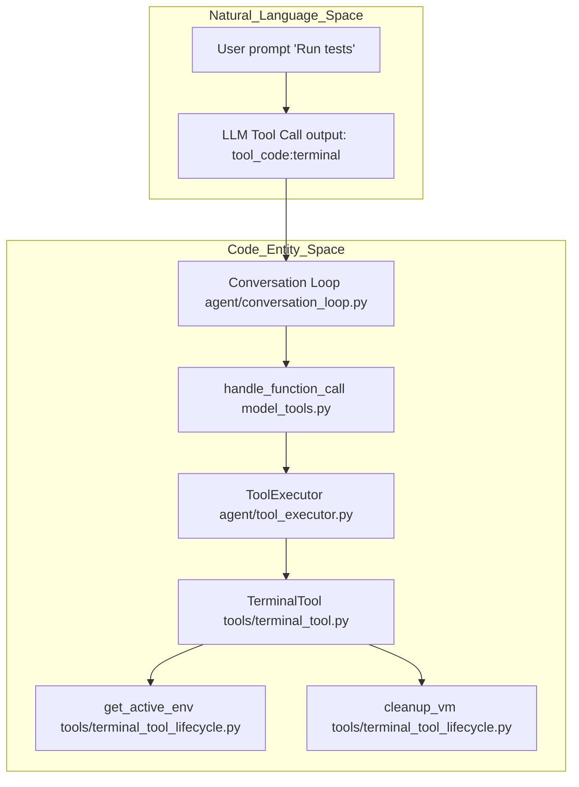

-   Tools are registered and discovered through `model_tools.py`. The `get_toolset_for_tool` function is used to retrieve tool definitions [run_agent.py:103-103]().
-   The conversation loop in `agent/conversation_loop.py` detects function calls embedded in LLM responses and routes them to `handle_function_call()` in `model_tools.py`.
-   Tool execution is managed by `ToolExecutor` in `agent/tool_executor.py`.
-   Terminal tools execute commands inside managed environments (`tools/terminal_tool_lifecycle.py`), including environment acquisition via `get_active_env()`, command execution, and cleanup routines via `cleanup_vm()` [run_agent.py:104-104]().
-   The tool execution layer abstracts runtime isolation and lifecycle, allowing reproducible tool runs within ephemeral or persistent sandboxes.

Sources: [run_agent.py:102-105](), [agent/conversation_loop.py:1-50](), [tools/terminal_tool_lifecycle.py:1-80](), [agent/tool_executor.py:1-5]()

---

## Configuration, Precedence, and State Storage

Hermes Agent’s configuration is centralized in `hermes_cli/config.py` and layered across multiple sources for flexibility and security.

| Configuration Level | Description | Example Files / Components |
|:--------------------|:------------|:---------------------------|
| 1. CLI Arguments | Per-invocation overrides with highest precedence | CLI flags parsed in `cli.py` |
| 2. `config.yaml` | Main config for non-secret settings, including model/toolsets | `~/.hermes/config.yaml` |
| 3. `.env` file | Secrets storage for API keys, tokens, and passwords | `~/.hermes/.env` |
| 4. Built-in Defaults | Fallback hardcoded safe defaults | `hermes_cli/config_defaults.py` |

-   CLI arguments take highest priority, allowing dynamic overrides per run.
-   `config.yaml` contains structured settings such as model selection, toolsets enabled, compression parameters, and runtime limits (`runtime.nofile_soft_limit`) [website/docs/user-guide/configuration.md:76-85](). The `load_cli_config` function in `hermes_cli/cli_config_load.py` handles loading this configuration [hermes_cli/cli_config_load.py:156-156]().
-   `.env` stores sensitive credentials securely and is loaded at startup by `hermes_cli/config.py`. The `load_hermes_dotenv` function in `hermes_cli.env_loader` is responsible for this [run_agent.py:92-92]().
-   Database storage is governed by `database:` settings in `config.yaml` specifying WAL journal mode, synchronization levels, and autocheckpoint limits [website/docs/user-guide/configuration.md:94-123]().

Sources: [hermes_cli/config.py:1-145](), [hermes_cli/config_defaults.py:33-120](), [website/docs/user-guide/configuration.md:6-68](), [hermes_cli/cli_config_load.py:156-156](), [run_agent.py:92-92]()

---

## Summary

Hermes Agent is structured as a robust, modular three-tier system:
-   **User Interface Tier**: Multiple interactive frontends including CLI REPL (`cli.py`), terminal TUI, and messaging Gateway (`gateway/run.py`).
-   **Core Agent Tier**: The `AIAgent` class (`run_agent.py`) orchestrates autonomous reasoning, conversation loops, session management, context compression (`agent/context_compressor.py`), and auxiliary LLM delegation (`agent/auxiliary_client.py`).
-   **Tool & Execution Tier**: A dynamic tool registry supports execution of terminal commands (`tools/terminal_tool_lifecycle.py`), browser automation, and multi-agent delegation within isolated environments.
-   **Configuration and State**: Centralized configuration management with layered precedence and secure secret handling, alongside a SQLite-based session database (`hermes_state.py`) providing persistent state, FTS5 search, and concurrency support.

Sources: [run_agent.py:1-7](), [cli.py:1-13](), [gateway/run.py:1-5](), [hermes_cli/config.py:1-145](), [agent/conversation_loop.py:1-50](), [hermes_state.py:1-50](), [agent/context_compressor.py:1-5](), [agent/auxiliary_client.py:1-10]()

---

# Page: Project Structure and Dependencies

# Project Structure and Dependencies

<details>
<summary>Relevant source files</summary>

The following files were used as context for generating this wiki page:

- [agent/model_metadata_http.py](agent/model_metadata_http.py)
- [apps/desktop/electron/feature-flags.test.ts](apps/desktop/electron/feature-flags.test.ts)
- [apps/desktop/electron/feature-flags.ts](apps/desktop/electron/feature-flags.ts)
- [contributors/README.md](contributors/README.md)
- [hermes_cli/__init__.py](hermes_cli/__init__.py)
- [hermes_cli/data_cleanup.py](hermes_cli/data_cleanup.py)
- [hermes_cli/data_cleanup_holders.py](hermes_cli/data_cleanup_holders.py)
- [hermes_cli/home_data_layout.py](hermes_cli/home_data_layout.py)
- [pm/AGENTS.md](pm/AGENTS.md)
- [pm/_marker_eval.py](pm/_marker_eval.py)
- [pm/build_env.py](pm/build_env.py)
- [pm/build_operations.py](pm/build_operations.py)
- [pm/cli.py](pm/cli.py)
- [pm/environment.py](pm/environment.py)
- [pm/extras.py](pm/extras.py)
- [pm/filesystem.py](pm/filesystem.py)
- [pm/install.py](pm/install.py)
- [pm/lock.json](pm/lock.json)
- [pm/lock.py](pm/lock.py)
- [pm/native_build.py](pm/native_build.py)
- [pm/operations.py](pm/operations.py)
- [pm/package.py](pm/package.py)
- [pm/packages.py](pm/packages.py)
- [pm/plugin_eviction.py](pm/plugin_eviction.py)
- [pm/plugins_state.py](pm/plugins_state.py)
- [pm/progress.py](pm/progress.py)
- [pm/recovery.py](pm/recovery.py)
- [pm/security_packages.py](pm/security_packages.py)
- [pm/store.py](pm/store.py)
- [pm/update.py](pm/update.py)
- [pm/uv_cache_prune.py](pm/uv_cache_prune.py)
- [pm/workspace.py](pm/workspace.py)
- [pyproject.toml](pyproject.toml)
- [scripts/add_contributor.py](scripts/add_contributor.py)
- [scripts/audit_pr_attribution.py](scripts/audit_pr_attribution.py)
- [scripts/contributor_audit.py](scripts/contributor_audit.py)
- [scripts/releases/authors.py](scripts/releases/authors.py)
- [scripts/releases/authors_legacy.py](scripts/releases/authors_legacy.py)
- [tests-js/bundle-inputs.test.mjs](tests-js/bundle-inputs.test.mjs)
- [tests/hermes_cli/test_data_uninstall.py](tests/hermes_cli/test_data_uninstall.py)
- [tests/hermes_cli/test_local_legacy_engine.py](tests/hermes_cli/test_local_legacy_engine.py)
- [tests/hermes_cli/test_local_runtime_pm.py](tests/hermes_cli/test_local_runtime_pm.py)
- [tests/install/BUNDLED_UPDATES.md](tests/install/BUNDLED_UPDATES.md)
- [tests/install/e2e-assets/bundle-inputs.mjs](tests/install/e2e-assets/bundle-inputs.mjs)
- [tests/install/e2e-assets/bundle-manifest.cjs](tests/install/e2e-assets/bundle-manifest.cjs)
- [tests/install/e2e-assets/bundle-plan.mjs](tests/install/e2e-assets/bundle-plan.mjs)
- [tests/pm/test_archive_safety.py](tests/pm/test_archive_safety.py)
- [tests/pm/test_baked_selection.py](tests/pm/test_baked_selection.py)
- [tests/pm/test_build_operations.py](tests/pm/test_build_operations.py)
- [tests/pm/test_custom_root_union.py](tests/pm/test_custom_root_union.py)
- [tests/pm/test_deb_safety.py](tests/pm/test_deb_safety.py)
- [tests/pm/test_environment_build.py](tests/pm/test_environment_build.py)
- [tests/pm/test_extras.py](tests/pm/test_extras.py)
- [tests/pm/test_ffmpeg_resolution.py](tests/pm/test_ffmpeg_resolution.py)
- [tests/pm/test_filesystem_is_junction.py](tests/pm/test_filesystem_is_junction.py)
- [tests/pm/test_held_entry_windows_live.py](tests/pm/test_held_entry_windows_live.py)
- [tests/pm/test_index_bridging.py](tests/pm/test_index_bridging.py)
- [tests/pm/test_installed_package.py](tests/pm/test_installed_package.py)
- [tests/pm/test_llamacpp_pins.py](tests/pm/test_llamacpp_pins.py)
- [tests/pm/test_lockfile_publication.py](tests/pm/test_lockfile_publication.py)
- [tests/pm/test_member_selection.py](tests/pm/test_member_selection.py)
- [tests/pm/test_node_sidecar.py](tests/pm/test_node_sidecar.py)
- [tests/pm/test_npm_dist_tags.py](tests/pm/test_npm_dist_tags.py)
- [tests/pm/test_plugin_survival_contract.py](tests/pm/test_plugin_survival_contract.py)
- [tests/pm/test_plugins_state.py](tests/pm/test_plugins_state.py)
- [tests/pm/test_pm_core.py](tests/pm/test_pm_core.py)
- [tests/pm/test_progress.py](tests/pm/test_progress.py)
- [tests/pm/test_python_release_identity.py](tests/pm/test_python_release_identity.py)
- [tests/pm/test_recovery.py](tests/pm/test_recovery.py)
- [tests/pm/test_store_extract.py](tests/pm/test_store_extract.py)
- [tests/pm/test_sync_bytecode_compile_fallback.py](tests/pm/test_sync_bytecode_compile_fallback.py)
- [tests/pm/test_takeover_preparation.py](tests/pm/test_takeover_preparation.py)
- [tests/pm/test_tree_digest_links.py](tests/pm/test_tree_digest_links.py)
- [tests/pm/test_update.py](tests/pm/test_update.py)
- [tests/pm/test_update_request_reuse.py](tests/pm/test_update_request_reuse.py)
- [tests/pm/test_workspace.py](tests/pm/test_workspace.py)
- [tests/pm/test_workspace_build_inputs.py](tests/pm/test_workspace_build_inputs.py)
- [tests/pm/test_workspace_output_encoding.py](tests/pm/test_workspace_output_encoding.py)
- [tests/scripts/install/test_install_ps1_pinned_git_extract.py](tests/scripts/install/test_install_ps1_pinned_git_extract.py)
- [tests/scripts/test_contributor_map.py](tests/scripts/test_contributor_map.py)
- [tests/scripts/test_release_revision_anchor.py](tests/scripts/test_release_revision_anchor.py)
- [tests/test_packaging_metadata.py](tests/test_packaging_metadata.py)
- [tests/test_project_metadata.py](tests/test_project_metadata.py)
- [tools/lazy_deps.py](tools/lazy_deps.py)
- [uv.lock](uv.lock)

</details>


This page documents the repository organization, dependency management, and installation ecosystem of Hermes Agent. It covers the directory layout, key source files, the `uv`-based Python environment and dependency management system, the runtime lazy dependency installation engine, and the multi-platform installation ecosystem including Nix flake support.

---

## Repository Layout and Code Entities

Hermes Agent adopts a modular directory structure with well-defined boundaries separating subsystems such as the CLI, core agent logic, tool infrastructure, messaging gateways, frontends, and deployment packaging.

### Top-Level Directory Structure and System Components

The following diagram maps natural language subsystem names to their concrete code entities, classes, and entry points within the repo:

```mermaid
graph TB
    Root["Repository Root"]

    Root --> CLI["hermes_cli/ [hermes_cli/]"]
    Root --> Agent["agent/ [agent/]"]
    Root --> Tools["tools/ [tools/]"]
    Root --> Gateway["gateway/ [gateway/]"]
    Root --> Nix["nix/ [nix/]"]
    Root --> TUI["ui-tui/ [ui-tui/]"]
    Root --> Web["web/ [web/]"]
    Root --> AppsDesktop["apps/desktop/ [apps/desktop/]"]
    Root --> PM["pm/ [pm/]"]

    CLI --> MainPy["main.py [hermes_cli/main.py]<br/>CLI Dispatcher"]
    CLI --> WebServer["web_server.py [hermes_cli/web_server.py]<br/>FastAPI Web Dashboard"]
    CLI --> UpdateCmd["update_cmd.py [hermes_cli/update_cmd.py]<br/>Self-Healing Pipeline"]
    CLI --> InitPy["__init__.py [hermes_cli/__init__.py:1-45]<br/>Version & _ensure_utf8()"]

    Agent --> AIAgent["run_agent.py [agent/run_agent.py]<br/>AIAgent Orchestration"]
    Agent --> StatePy["hermes_state.py [agent/hermes_state.py]<br/>Session & Memory Persistence"]

    Tools --> RegistryPy["registry.py [tools/registry.py]<br/>Tool Registry"]
    Tools --> ToolsetsPy["toolsets.py [tools/toolsets.py]<br/>Toolset Composer"]
    Tools --> LazyDeps["lazy_deps.py [tools/lazy_deps.py:1-16]<br/>ensure() & LAZY_DEPS"]

    Gateway --> GatewayRunner["run.py [gateway/run.py]<br/>GatewayRunner Service"]
    Gateway --> Platforms["platforms/ [gateway/platforms/]<br/>Platform Adapters"]

    Nix --> LibNix["lib.nix [nix/lib.nix]<br/>pythonSrc & npmWorkspaces"]
    Nix --> TuiNix["tui.nix [nix/tui.nix]<br/>buildNpmPackage TUI"]

    TUI --> TuiPkg["package.json [ui-tui/package.json]<br/>Ink / React Manifest"]
    Web --> WebPkg["package.json [web/package.json]<br/>Web Dashboard Manifest"]
    AppsDesktop --> DesktopPkg["package.json [apps/desktop/package.json]<br/>Electron Shell Manifest"]

    PM --> PackagesPy["packages.py [pm/packages.py:1-185]<br/>Package Definitions"]
    PM --> InstallPy["install.py [pm/install.py:1-166]<br/>Installation Logic"]
    PM --> CliPy["cli.py [pm/cli.py:1-177]<br/>PM CLI Commands"]
    PM --> WorkspacePy["workspace.py [pm/workspace.py:1-151]<br/>Build Snapshots"]
```

- **`hermes_cli/`** — Contains the unified command-line interface, including the main CLI dispatcher (`main.py`), the FastAPI-based web dashboard backend (`web_server.py`), and the update command pipeline (`update_cmd.py`). It also defines version info and startup UTF-8 enforcement routines in `__init__.py` [hermes_cli/__init__.py:1-45]().

- **`agent/`** — Implements the core AI agent runtime, including the AIAgent orchestration (`run_agent.py`) and session persistence logic (`hermes_state.py`).

- **`tools/`** — Hosts built-in tools, the tool registry, toolsets, and the lazy dependency provisioning system (`lazy_deps.py`) [tools/lazy_deps.py:1-16]().

- **`gateway/`** — The messaging gateway service, including the main service runner and platform adapters.

- **`nix/`** — Nix flakes and module definitions supporting the build and packaging of the Python runtime and frontends.

- **`ui-tui/`** — Terminal user interface implemented in React Ink with its own Node.js dependency.

- **`web/`** — React web dashboard frontend with a separate package configuration.

- **`apps/desktop/`** — Electron native desktop shell and associated Node.js tooling.

- **`pm/`** — The internal package manager for Hermes, handling tool definitions, installation, and environment management [pm/packages.py:1-185](), [pm/install.py:1-166](), [pm/cli.py:1-177](), [pm/workspace.py:1-151]().

Sources: [hermes_cli/__init__.py:1-45](), [pyproject.toml:3-16](), [tools/lazy_deps.py:1-16](), [nix/lib.nix](), [ui-tui/package.json](), [web/package.json](), [apps/desktop/package.json](), [pm/packages.py:1-185](), [pm/install.py:1-166](), [pm/cli.py:1-177](), [pm/workspace.py:1-151]()

---

## Versioning and System Constants

- The package metadata in `hermes_cli/__init__.py` provides versioning symbols:

  ```python
  __release_date__ = "2026.9.24"
  __version__: str
  ```

  The `__version__` attribute is resolved lazily to maintain compatibility with legacy updater behavior and editable installs. It reads an installation stamp JSON file if package metadata is inaccessible [hermes_cli/__init__.py:6-39]().

- UTF-8 encoding is enforced on stdout/stderr during CLI startup via the `_ensure_utf8()` function. This guarantees proper rendering of special glyphs and box-drawing characters, especially important for the setup wizard, status messages, and cross-platform terminal support [hermes_cli/__init__.py:42-70]().

- The release automation is handled by a separate script `scripts/release.py` (not detailed here) which implements tagging, changelog publishing, and GitHub release integration with contributor attribution.

- The `hermes_constants.py` file defines shared constants, including platform-aware logic for determining the Hermes home directory (`get_hermes_home`, `get_process_hermes_home`) and handling context-local overrides [hermes_constants.py:1-167](). It also includes utility functions like `sudo_invoker_default_home` for handling root execution scenarios [hermes_constants.py:61-77]().

Sources: [hermes_cli/__init__.py:6-70](), [hermes_constants.py:1-167]()

---

## Dependency Management via `uv`

Hermes Agent employs the `uv` package manager and environment toolset to manage Python dependency resolution, locking, and virtual environments with a philosophy focused on safety and exact pins.

### Python Version Constraints and Dependency Pinning

- The `pyproject.toml` file constrains the Python interpreter version range strictly:

  ```toml
  requires-python = ">=3.11,<3.15"
  ```

  The upper bound is intentional to avoid source builds of Rust dependencies such as `pydantic-core` that currently do not have wheels beyond Python 3.14 [pyproject.toml:15-16]().

- All core dependencies in `[project.dependencies]` are exact version pinned (e.g., `"openai==2.24.0"`), avoiding version ranges entirely. This policy ensures that automatic upgrades or supply-chain compromise through transitive dep updates cannot happen without explicit developer action, code review, and lock regeneration [pyproject.toml:19-125]().

- The resolution is frozen as `uv.lock` which records full hashes and versions of every resolved package for all supported targets, with special package overrides applied for security patches (e.g., `cryptography==50.0.1`) [uv.lock:1-118](). Overrides are also used to manage specific package versions, such as `pynacl` [uv.lock:18]().

- The `pm/cli.py` module provides commands for managing the `uv.lock` file, including `cmd_lock` to relock `uv.lock` from `pyproject.toml` and `_pin_tool` to bump specific tool versions [pm/cli.py:23-145]().

- The `uv.lock` file also specifies `exclude-newer-span = "P3D"` [uv.lock:14](), which corresponds to the `exclude-newer = "3 days"` policy in `pyproject.toml` [tests/test_packaging_metadata.py:65](). This ensures that all dependencies must be at least 3 days old when locked, preventing fresh, potentially unstable releases from entering the dependency graph [tests/test_packaging_metadata.py:56-69]().

### JavaScript Workspaces and Frontend Package Management

- Hermes adopts a JavaScript monorepo workspace structure for frontends and desktop apps, allowing efficient sharing and dependency management among React Ink TUI, React web DASH, and Electron desktop shell.

- The root-level `package.json` declares workspaces including `apps/*`, `ui-tui`, `ui-tui/packages/*`, `web`, and `tests-js`. Each workspace has its own locked dependencies manifested in independent `package.json` files [ui-tui/package.json](), [web/package.json](), [apps/desktop/package.json]().

Sources: [pyproject.toml:15-125](), [uv.lock:1-118](), [pm/cli.py:23-145](), [tests/test_packaging_metadata.py:56-69]()

---

## Lazy Dependency Installation System

To reduce initial install size and to safely handle optional backends, Hermes employs a runtime lazy dependency installation framework.

### Design and Behavioral Details in `tools/lazy_deps.py`

- The `tools/lazy_deps.py` module provides a key function:

  ```python
  def ensure(feature: str, *, prompt: bool = True) -> NoReturn:
  ```

  This function attempts to ensure that the runtime dependencies for a given feature are installed and importable. It raises an ImportError with a re-launch hint if the environment is not ready [tools/lazy_deps.py:1-16](). The `install_specs` function, also in this module, is retired and will raise an `ImportError` if called outside of a historical update context [tools/lazy_deps.py:14-26]().

- The system uses a curated dictionary of feature keys to frozen tuples of PyPI dependency specs (not shown here for brevity). Examples of such features include:

  - `"provider.anthropic"` → `("anthropic==0.87.0",)`
  - `"search.exa"` → `("exa-py==2.10.2",)`
  - `"tts.mistral"` → `("mistralai==2.4.8",)`
  - `"platform.discord"` → `("discord.py[voice]==2.7.1", "brotlicffi==1.2.0", "aiohttp==3.14.3")`

- If the feature dependencies are not importable, the system checks a security gate `security.allow_lazy_installs` config; if disallowed, it raises a user-friendly error with remediation hint.

- When allowed, the system invokes `pip` programmatically to install exact versions of packages into a separate durable directory appended to `sys.path` after core packages, preventing shadowing or supply-chain risks.

- After installing, it instructs a relaunch to pick up new packages, ensuring atomic upgrades.

### Lazy Dependency Installation Flow Diagram

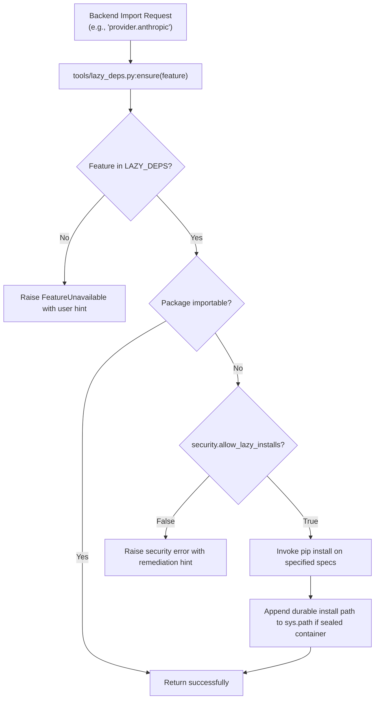

This mechanism enables a lean initial environment with controlled on-demand extension of optional backends and reduces the attack surface of dependency bloat.

Sources: [tools/lazy_deps.py:1-26]()

---

## Installation Ecosystem and Nix Flake Support

Hermes supports a multi-platform installation ecosystem including Unix shell installers, Windows PowerShell installers, and Nix flakes for declarative system provisioning.

### Installers and Bootstrap Scripts

- **Unix Shell Installer (`scripts/install.sh`)**

  - Extracts a pinned `uv` binary from internal package locking (`pm/lock.json`), ensuring checksum validated staging.

  - Builds a hermetic Python virtual environment, resetting environment variables like `UV_NO_CONFIG` to avoid leaking host configs.

  - Supports options like `--skip-browser` to omit optional browser-related tooling.

  - Implements a multi-stage protocol for concurrency safety and robustness across platforms.

- **PowerShell Installer (`scripts/install.ps1`)**

  - Windows-specific installer with care to resolve user profile paths to 8.3 short paths as required by some PowerShell cmdlets.

  - Similar staging and checksum verification flow, catering to Windows nuances.

  - Supports verbose logging, skipping browser tools, and integration with Hermes Setup UI and CI.

### Nix Flake Packaging and Build Definitions

- The `nix/lib.nix` file defines the `pythonSrc` derivation that filters the source tree to exclude JavaScript codebases (`ui-tui`, `web`, `apps/desktop`), documentation, tests, locales, and non-Python tooling. This yields a minimal, pure Python derivation to reduce rebuilds and improve reproducibility.

- Defines `npmWorkspaces` for JavaScript parts, read from the root `package.json`.

- The `nix/tui.nix` defines a build for the terminal React Ink UI frontend, packaging it as a standalone NPM package named `hermes-agent-ui-tui` with outputs isolated for efficient downstream use.

This infrastructure empowers NixOS and Home Manager users to declaratively manage their Hermes agent environments with precise control over Python and frontend runtime deps.

Sources: [nix/lib.nix](), [nix/tui.nix]()

---

## Summary Diagrams Bridging Natural Language and Code Entity Space

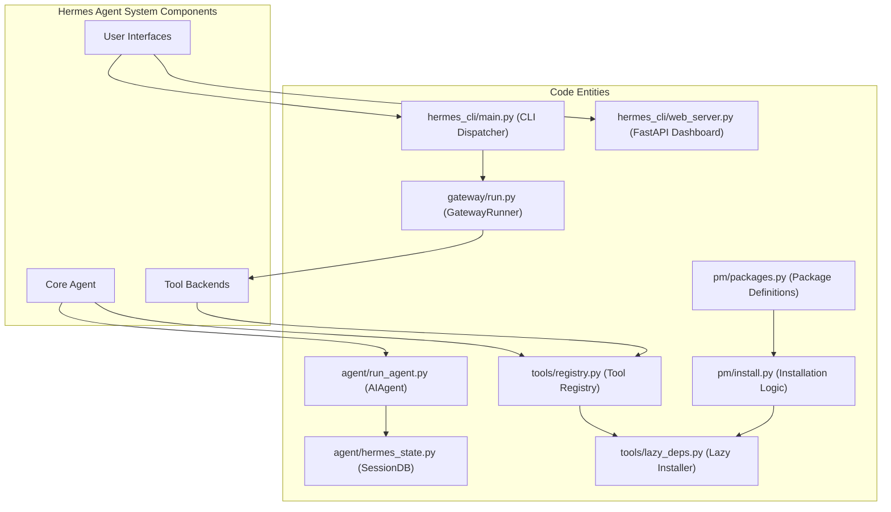

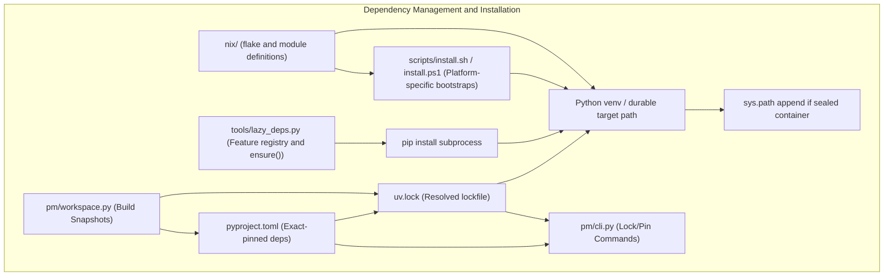

---

# Additional Notes

- The strict exact dependency pinning policy in `pyproject.toml` is enforced to prevent inadvertent dependency upgrades without audit, protecting against supply-chain attacks and ensuring stable reproducible environments [pyproject.toml:19-125]().

- The Python interpreter version limit (below 3.15) avoids unstable or unavailable prebuilt wheels in Rust-driven dependencies like `pydantic-core` [pyproject.toml:8-15]().

- Lazy installation requires explicit opt-in (`security.allow_lazy_installs`), presenting remediation hints when disabled, ensuring runtime installs don't happen without user awareness [tools/lazy_deps.py:1-16]().

- The Nix infrastructure enables users to fully reproduce Hermes builds and runtime environments declaratively, including frontend assets and the Python runtime, aiding NixOS and Home Manager distributions [nix/lib.nix](), [nix/tui.nix]().

- The multi-platform install scripts are carefully engineered for cross-OS robustness, including checksum verification, concurrency-safe staging, and environment hygiene, easing installation for end users across Windows, Unix, and containerized setups.

- The `pm/` directory contains the core logic for Hermes's internal package management, including defining packages (`pm/packages.py`), handling installation (`pm/install.py`), providing CLI commands (`pm/cli.py`), and managing build workspaces (`pm/workspace.py`) [pm/packages.py:1-185](), [pm/install.py:1-166](), [pm/cli.py:1-177](), [pm/workspace.py:1-151]().

---

# Page: Getting Started

# Getting Started

<details>
<summary>Relevant source files</summary>

The following files were used as context for generating this wiki page:

- [activate](activate)
- [activate.fish](activate.fish)
- [activate.ps1](activate.ps1)
- [hermes](hermes)
- [scripts/_activation.sh](scripts/_activation.sh)
- [scripts/install.ps1](scripts/install.ps1)
- [scripts/install.sh](scripts/install.sh)
- [setup-hermes.sh](setup-hermes.sh)
- [tests/acp_adapter/test_edit_approval.py](tests/acp_adapter/test_edit_approval.py)
- [tests/hermes_cli/test_launcher.py](tests/hermes_cli/test_launcher.py)
- [tests/hermes_cli/test_setup_pin_values.py](tests/hermes_cli/test_setup_pin_values.py)
- [tests/install/e2e-assets/source-build-env.ps1](tests/install/e2e-assets/source-build-env.ps1)
- [tests/pm/activation_support.py](tests/pm/activation_support.py)
- [tests/pm/test_activate_fish.py](tests/pm/test_activate_fish.py)
- [tests/pm/test_activate_scripts.py](tests/pm/test_activate_scripts.py)
- [tests/pm/test_activation_runtime.py](tests/pm/test_activation_runtime.py)
- [tests/pm/test_environment_script.py](tests/pm/test_environment_script.py)
- [tests/pm/test_setup_lock_format.py](tests/pm/test_setup_lock_format.py)
- [tests/scripts/install/test_install_sh_repository_stage.py](tests/scripts/install/test_install_sh_repository_stage.py)
- [tests/scripts/test_install_ps1_desktop_stage.py](tests/scripts/test_install_ps1_desktop_stage.py)
- [tests/scripts/test_install_sh_launch_handoff.py](tests/scripts/test_install_sh_launch_handoff.py)
- [tests/scripts/test_install_stage_frames.py](tests/scripts/test_install_stage_frames.py)
- [tests/scripts/test_mint_launchers.py](tests/scripts/test_mint_launchers.py)
- [website/docs/getting-started/installation.md](website/docs/getting-started/installation.md)
- [website/docs/getting-started/updating.md](website/docs/getting-started/updating.md)

</details>


This page provides a high-level introduction to setting up Hermes Agent, guiding users from initial installation through configuration, authentication, and model selection to starting their first conversation with the agent. It outlines the main steps and how the subsystems relate, linking to detailed child pages for comprehensive coverage.

---

## 2.1 Installation

Hermes Agent supports multiple platforms including Linux, macOS, WSL2, native Windows, and Android via Termux, providing flexible installation methods [website/docs/getting-started/installation.md:11-68]().

- **POSIX Platforms (Linux/macOS/WSL2):** Installation is typically done via the `scripts/install.sh` shell script, which clones the repository, bootstraps the `uv` binary, sets up Python, and delegates dependency management to PM (Package Manager). The script handles configuring the data directories and publishes a CLI wrapper for running Hermes [scripts/install.sh:1-146](), [website/docs/getting-started/installation.md:47-50]().

- **Windows:** Installation uses the PowerShell script `scripts/install.ps1` which performs a git checkout, sets up a virtual environment, and places a `hermes` command on the PATH. It integrates pinned binaries such as `uv` and `git-for-windows` for portability. The script supports flags to skip optional components like browser and computer-use tool installation, remembered for future updates [scripts/install.ps1:1-45](), [website/docs/getting-started/installation.md:52-57]().

- **Environment Activation:** After installation, an environment activation script (`activate` for POSIX or `activate.ps1` for PowerShell) syncs environment variables and shell functions. This provides seamless access to the installed `hermes` command within a managed Python virtual environment. The activation scripts include shell prompt customization to reflect the current Hermes source checkout [activate:1-23](), [activate.ps1:1-10]().

- **Other Platforms:** Android installation is supported via a Termux APT package [website/docs/getting-started/installation.md:64-68]().

Installation ensures heavy dependencies (browsers, Node.js, FFmpeg, etc.) are handled by Hermes’s package management (PM), allowing minimal bootstrap scripts to maintain smooth updates.

For detailed installation methods (including source scripts, manual install, Nix flake, Desktop bundles, and Tauri bootstrap), dependency provisioning, update commands, and platform-specific considerations, see [Installation](#2.1).

---

## 2.2 Configuration and Setup

Hermes Agent stores user data and configuration under a designated data directory, typically `~/.hermes/` on POSIX or `%LOCALAPPDATA%\hermes` on Windows. This includes profiles, sessions, secrets, and local caches [scripts/install.sh:26-27](), [scripts/install.ps1:23-24]().

Configuration follows a hierarchical precedence:

- CLI arguments override
- `config.yaml` values override
- `.env` environment variables override
- Built-in defaults

This layered approach ensures flexibility and sanity checks. Configuration changes can be interactively applied or migrated via dedicated commands.

The interactive setup wizard (`hermes setup`) guides users through creating profiles, selecting default providers and models, configuring gateways for messaging platforms, and enabling optional features. It supports automated flows such as “portal” logins that automatically configure providers and keys [website/docs/getting-started/installation.md:128-147]().

Users can also check for configuration drift, migrate obsolete keys, and inspect effective settings via CLI commands.

For full details on the configuration hierarchy, profile management, setup wizard usage, and configuration migrations, refer to [Configuration and Setup](#2.2).

---

## 2.3 Authentication and Providers

Hermes Agent integrates with a wide variety of LLM providers, supporting multiple credential management methods:

- API keys stored in `.env` or environment variables
- OAuth flows for supported providers
- Secret vault integration (e.g., Bitwarden, 1Password) for fetching keys securely

Provider resolution uses a chain of credential sources and fallback mechanisms, allowing automatic detection and transparent failover among providers. Credential Pools group credentials to balance usage and rate limits.

Providers are represented internally by `ProviderProfile` plugins and configured through the authentication subsystem. Auxiliary providers used for side-tasks like vision or compression are resolved through a similar system [website/docs/getting-started/installation.md:139-146]().

For a comprehensive listing of authentication methods, resolution logic, secret sources, and provider configuration, see [Authentication and Providers](#2.3).

---

## 2.4 Model Selection and Management

Selecting the appropriate LLM model is critical for cost control, response quality, and operational behavior. Hermes supports dynamic model cataloging:

- Discovers available LLM models through provider plugins
- Automatically validates model capabilities and context length limits
- Tracks pricing and usage metadata for cost estimation

Users can configure default and fallback models globally or per-profile. Model configuration is accessible via interactive CLI commands (`hermes model`) and exposed in configuration files [website/docs/getting-started/installation.md:130-136]().

Model catalogs abstract provider-specific details to present a unified interface for model selection and metadata.

For detailed explainers on the model catalog internals, validation processes, pricing metadata, and configuration options, see [Model Selection and Management](#2.4).

---

# Bridging Natural Language Concepts to Code Entities

To clarify the relationship between user-facing concepts and their implementation in the codebase, the following diagrams expose links between key natural language setup steps and corresponding scripts or classes.

### Diagram 1: Installation and Bootstrap Flow

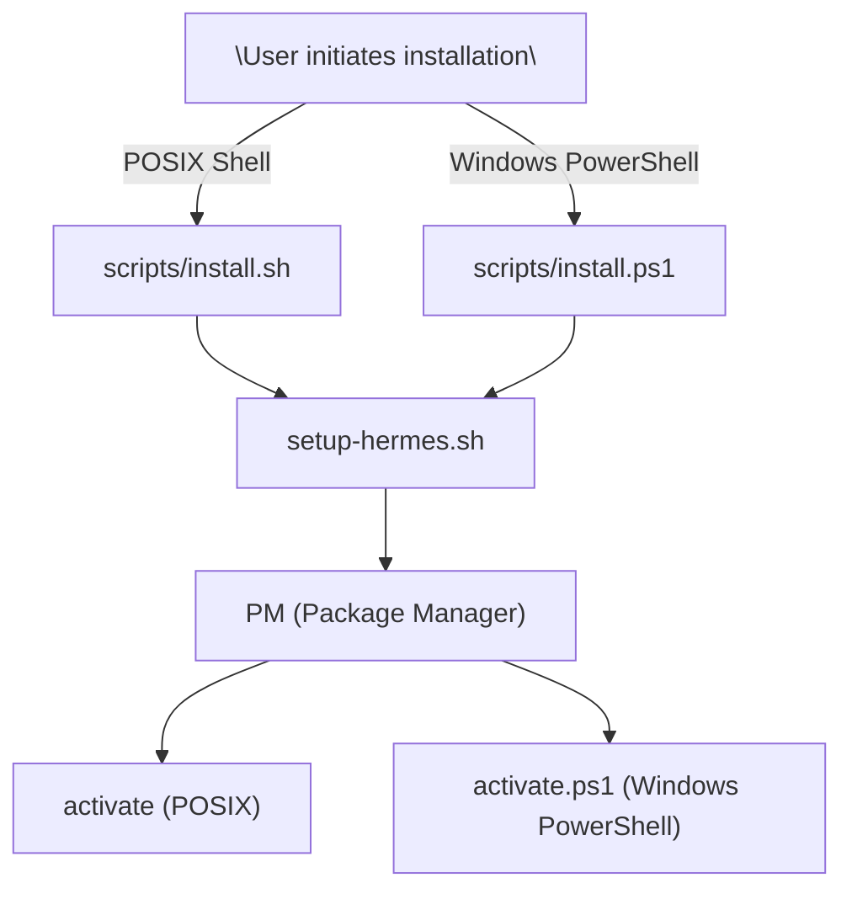

This flow shows the initial user installation command triggering platform-appropriate install scripts, which in turn bootstrap minimal binaries like `uv` for Python installation. The package manager (PM) handles complex dependency installation and environment preparation. Finally, activation scripts configure the interactive shell environment for Hermes usage.

Sources: [scripts/install.sh:1-146](), [scripts/install.ps1:1-45](), [setup-hermes.sh:1-20](), [activate:1-23](), [activate.ps1:1-10]()

---

### Diagram 2: Configuration and Update Subsystem

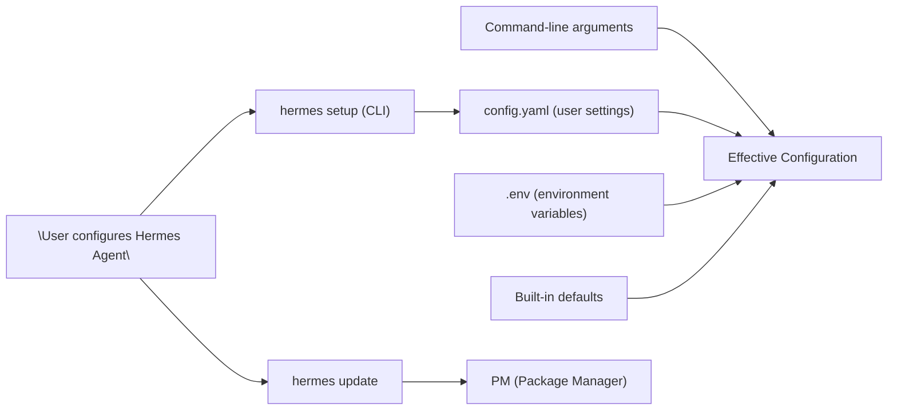

This diagram depicts how multiple configuration sources compose the final effective settings during Hermes execution. Users employ the setup wizard to create initial configurations, which are saved into `config.yaml`. Updates trigger PM to refresh dependencies or code, and configuration changes flow through the hierarchy from CLI args down to defaults.

Sources: [website/docs/getting-started/installation.md:1-149](), [website/docs/getting-started/updating.md:1-119]()

---

For detailed operational information and advanced configuration, please consult the respective child pages linked above. This overview aims to orient new users and developers to the initial steps of using Hermes Agent.

---

# Page: Installation

# Installation

<details>
<summary>Relevant source files</summary>

The following files were used as context for generating this wiki page:

- [activate](activate)
- [activate.fish](activate.fish)
- [activate.ps1](activate.ps1)
- [agent/legacy_cli.py](agent/legacy_cli.py)
- [contributors/emails/alan.harman-box@burningsuit.co.uk](contributors/emails/alan.harman-box@burningsuit.co.uk)
- [hermes](hermes)
- [hermes_cli/_early_recovery.py](hermes_cli/_early_recovery.py)
- [hermes_cli/_early_recovery_zip.py](hermes_cli/_early_recovery_zip.py)
- [hermes_cli/gitlock.py](hermes_cli/gitlock.py)
- [hermes_cli/managed_uv.py](hermes_cli/managed_uv.py)
- [hermes_cli/update_cmd.py](hermes_cli/update_cmd.py)
- [hermes_cli/update_cmd_check.py](hermes_cli/update_cmd_check.py)
- [hermes_cli/update_cmd_commit.py](hermes_cli/update_cmd_commit.py)
- [hermes_cli/update_cmd_git.py](hermes_cli/update_cmd_git.py)
- [hermes_cli/update_cmd_maint.py](hermes_cli/update_cmd_maint.py)
- [hermes_cli/update_cmd_stash.py](hermes_cli/update_cmd_stash.py)
- [hermes_cli/update_cmd_zip.py](hermes_cli/update_cmd_zip.py)
- [hermes_cli/update_host_obligation.py](hermes_cli/update_host_obligation.py)
- [hermes_cli/update_serve_resume.py](hermes_cli/update_serve_resume.py)
- [scripts/_activation.sh](scripts/_activation.sh)
- [scripts/install.ps1](scripts/install.ps1)
- [scripts/install.sh](scripts/install.sh)
- [setup-hermes.sh](setup-hermes.sh)
- [tests/acp_adapter/test_edit_approval.py](tests/acp_adapter/test_edit_approval.py)
- [tests/agent/test_legacy_cli.py](tests/agent/test_legacy_cli.py)
- [tests/gateway/test_multiplex_notice_egress_profile_adapter.py](tests/gateway/test_multiplex_notice_egress_profile_adapter.py)
- [tests/gateway/test_planned_restart_notice_multiplex.py](tests/gateway/test_planned_restart_notice_multiplex.py)
- [tests/hermes_cli/test_cmd_update.py](tests/hermes_cli/test_cmd_update.py)
- [tests/hermes_cli/test_discard_lockfile_churn.py](tests/hermes_cli/test_discard_lockfile_churn.py)
- [tests/hermes_cli/test_early_recovery.py](tests/hermes_cli/test_early_recovery.py)
- [tests/hermes_cli/test_gitlock.py](tests/hermes_cli/test_gitlock.py)
- [tests/hermes_cli/test_gitlock_tmp_packs.py](tests/hermes_cli/test_gitlock_tmp_packs.py)
- [tests/hermes_cli/test_launcher.py](tests/hermes_cli/test_launcher.py)
- [tests/hermes_cli/test_setup_pin_values.py](tests/hermes_cli/test_setup_pin_values.py)
- [tests/hermes_cli/test_shallow_boundary_repair.py](tests/hermes_cli/test_shallow_boundary_repair.py)
- [tests/hermes_cli/test_shallow_graft_prune.py](tests/hermes_cli/test_shallow_graft_prune.py)
- [tests/hermes_cli/test_shared_profile_warning.py](tests/hermes_cli/test_shared_profile_warning.py)
- [tests/hermes_cli/test_tag_fetch_partial_clone.py](tests/hermes_cli/test_tag_fetch_partial_clone.py)
- [tests/hermes_cli/test_update_autostash.py](tests/hermes_cli/test_update_autostash.py)
- [tests/hermes_cli/test_update_commit_obligations.py](tests/hermes_cli/test_update_commit_obligations.py)
- [tests/hermes_cli/test_update_completion_routing.py](tests/hermes_cli/test_update_completion_routing.py)
- [tests/hermes_cli/test_update_existing_branch_baseline.py](tests/hermes_cli/test_update_existing_branch_baseline.py)
- [tests/hermes_cli/test_update_fetch_failure_classifier.py](tests/hermes_cli/test_update_fetch_failure_classifier.py)
- [tests/hermes_cli/test_update_fork_sync_identity.py](tests/hermes_cli/test_update_fork_sync_identity.py)
- [tests/hermes_cli/test_update_head_moved_gate.py](tests/hermes_cli/test_update_head_moved_gate.py)
- [tests/hermes_cli/test_update_host_obligation.py](tests/hermes_cli/test_update_host_obligation.py)
- [tests/hermes_cli/test_update_import_guard.py](tests/hermes_cli/test_update_import_guard.py)
- [tests/hermes_cli/test_update_interrupted_pull.py](tests/hermes_cli/test_update_interrupted_pull.py)
- [tests/hermes_cli/test_update_parked_branch_guard.py](tests/hermes_cli/test_update_parked_branch_guard.py)
- [tests/hermes_cli/test_update_post_pull_syntax_guard.py](tests/hermes_cli/test_update_post_pull_syntax_guard.py)
- [tests/hermes_cli/test_update_products.py](tests/hermes_cli/test_update_products.py)
- [tests/hermes_cli/test_update_shallow_heal.py](tests/hermes_cli/test_update_shallow_heal.py)
- [tests/hermes_cli/test_update_sqlite_remediation.py](tests/hermes_cli/test_update_sqlite_remediation.py)
- [tests/hermes_cli/test_update_target_identity.py](tests/hermes_cli/test_update_target_identity.py)
- [tests/hermes_cli/test_update_upstream_prompt_noninteractive.py](tests/hermes_cli/test_update_upstream_prompt_noninteractive.py)
- [tests/hermes_cli/test_update_venv_holder_retirement.py](tests/hermes_cli/test_update_venv_holder_retirement.py)
- [tests/hermes_cli/test_update_zip_completion.py](tests/hermes_cli/test_update_zip_completion.py)
- [tests/hermes_cli/test_update_zip_fallback_guards.py](tests/hermes_cli/test_update_zip_fallback_guards.py)
- [tests/hermes_cli/test_update_zip_release_preserve.py](tests/hermes_cli/test_update_zip_release_preserve.py)
- [tests/hermes_cli/test_update_zip_symlink_reject.py](tests/hermes_cli/test_update_zip_symlink_reject.py)
- [tests/hermes_cli/test_update_zip_two_phase.py](tests/hermes_cli/test_update_zip_two_phase.py)
- [tests/install/e2e-assets/source-build-env.ps1](tests/install/e2e-assets/source-build-env.ps1)
- [tests/pm/activation_support.py](tests/pm/activation_support.py)
- [tests/pm/test_activate_fish.py](tests/pm/test_activate_fish.py)
- [tests/pm/test_activate_scripts.py](tests/pm/test_activate_scripts.py)
- [tests/pm/test_activation_runtime.py](tests/pm/test_activation_runtime.py)
- [tests/pm/test_environment_script.py](tests/pm/test_environment_script.py)
- [tests/pm/test_setup_lock_format.py](tests/pm/test_setup_lock_format.py)
- [tests/scripts/install/test_install_sh_repository_stage.py](tests/scripts/install/test_install_sh_repository_stage.py)
- [tests/scripts/test_install_ps1_desktop_stage.py](tests/scripts/test_install_ps1_desktop_stage.py)
- [tests/scripts/test_install_sh_launch_handoff.py](tests/scripts/test_install_sh_launch_handoff.py)
- [tests/scripts/test_install_stage_frames.py](tests/scripts/test_install_stage_frames.py)
- [tests/scripts/test_mint_launchers.py](tests/scripts/test_mint_launchers.py)
- [tests/test_windows_subprocess_no_window_flags.py](tests/test_windows_subprocess_no_window_flags.py)
- [tests/tools/test_send_message_multiplex_profile_adapter.py](tests/tools/test_send_message_multiplex_profile_adapter.py)
- [website/docs/getting-started/installation.md](website/docs/getting-started/installation.md)
- [website/docs/getting-started/updating.md](website/docs/getting-started/updating.md)

</details>


This page covers the installation methods for Hermes Agent, including `curl|bash`, PowerShell, manual setups, Nix flakes, and the Tauri bootstrap installer. It also details dependency provisioning via `uv` and `managed_uv`, the update pipeline (`hermes update`), and platform-specific considerations across Linux, macOS, Windows, and Android Termux.

---

## Overview

Hermes Agent provides a zero-configuration, automated installer designed to provision an isolated Python environment and manage dependencies across diverse platforms. The primary entry points are:

- `scripts/install.sh` for POSIX-compliant environments (Linux, macOS, WSL2, Android Termux) [scripts/install.sh:1-15]()
- `scripts/install.ps1` for Windows PowerShell environments [scripts/install.ps1:1-15]()
- Declarative Nix flake packaging and build assistance in `nix/lib.nix`
- Hermes-managed Python and `uv` runtimes implemented in `hermes_cli/managed_uv.py` [hermes_cli/managed_uv.py:1-46]()

The installation subsystem automates OS detection, package manager selection, `uv` and Python environment provisioning, repository cloning, and CLI integration.

Sources: [scripts/install.sh:1-15](), [scripts/install.ps1:1-15](), [hermes_cli/managed_uv.py:1-46]()

---

## Installation Methods

### 1. Quick Install: curl|bash or PowerShell Script

#### Linux, macOS, WSL2, Android (Termux) — `install.sh`

Invoke the POSIX install script directly from the web using:

```bash
curl -fsSL https://hermes-agent.nousresearch.com/install.sh | bash
```

**Implementation Details:**

- The script runs in strict mode (`set -u`) to fail on unset variables, ensuring early detection of errors [scripts/install.sh:15-16]().

- It sanitizes the environment by unsetting `PYTHONPATH` and `PYTHONHOME` to prevent conflicts affecting fresh virtual environments.

- The installation detects the host OS and environment, adapting provisioning for special cases such as Termux on Android where Rust-based `uv` binaries are incompatible; the installer falls back to Python `venv` in such cases [scripts/install.sh:6-7]().

- `uv`, a Rust-based Python environment and dependency manager, is installed or updated to create a consistent virtual environment [scripts/install.sh:77-80]().

- The Hermes Agent repository is cloned recursively with submodules. Shallow cloning is used where possible to expedite deployment.

- After environment setup, the installer runs a post-clone completion step that installs dependencies and sets executable shims.

Sources: [scripts/install.sh:15-16](), [scripts/install.sh:77-80]()

#### Windows Native PowerShell — `install.ps1`

Run the PowerShell installation command as:

```powershell
iex (irm https://hermes-agent.nousresearch.com/install.ps1)
```

**Technical Highlights:**

- The installer sets the console output encoding to UTF-8 (`[Console]::OutputEncoding`) forcibly to enable proper rendering of Unicode progress bars and glyphs on Windows consoles, avoiding mojibake and garbled output.

- Windows paths often include 8.3 short-path aliases (e.g., `FIRST~1.LAS`). PowerShell cmdlets such as `Test-Path` or `New-Item` may malfunction with these; the installer performs path normalization using multiple strategies including:
  - Calling WinAPI `GetLongPathNameW`
  - Using Windows Scripting Host `FileSystemObject` COM object
  - Substituting user profile root paths
  This ensures reliable file system operations during installation [scripts/install.ps1:108-121]().

- A bundled MinGit version is included in `%LOCALAPPDATA%\hermes\git` to isolate git operations from any system Git installations, improving stability and consistency during updates [scripts/install.ps1:93-105]().

- The installer supports an optional desktop app build stage (`-IncludeDesktop`) that builds the Electron-based desktop UI bundled with Hermes [scripts/install.ps1:8]().

Sources: [scripts/install.ps1:8](), [scripts/install.ps1:93-121]()

---

### 2. Manual Installation (Developer or Custom Deployments)

For fine-grained control or development environments, users can manually clone the repository and perform a setup:

```bash
git clone --recurse-submodules https://github.com/NousResearch/hermes-agent.git
cd hermes-agent
./setup-hermes.sh
```

This script:
- Creates a Python virtual environment using `uv` or falls back to Python `venv` if necessary.
- Installs pinned dependencies based on `pyproject.toml`, including optional extras like skills and TUI support.
- Configures workspace overlays and local plugins.

Sources: []()

---

### 3. Nix Flake and NixOS Module Support

Hermes supports declarative, reproducible builds using the Nix package manager:
- `nix/lib.nix` provides reusable Nix functions and derivations to build Python packages with Poetry dependencies, filtering unnecessary files such as JS bundles, docs, and tests to optimize build time and store size.
- The file defines build inputs, poetry dependency resolution, and workspace tooling including NPM overlays.
- `nix/tui.nix` builds the React Ink terminal UI frontend as a Nix derivation, ensuring integration into the Nix ecosystem.

Sources: []()

---

### 4. Tauri Bootstrap Installer (Desktop GUI)

Hermes's bootstrap installer (based on the Tauri framework) provides a native desktop app installation experience:
- The `--include-desktop` flag in PowerShell or POSIX installers triggers the build of the Tauri/Electron-based desktop React UI app (located in `apps/desktop`) [scripts/install.ps1:8](), [scripts/install.sh:32]().
- The installer handles in-use executable file locking, atomic updates, and graceful handoff to running background services on all platforms.
- Native installers for Windows and macOS adapt the update channel and restart logic for desktop apps.

Sources: [scripts/install.ps1:8](), [scripts/install.sh:32]()

---

## Dependency Management & Update Pipeline

### Managed UV and Python Runtime Provisioning

The `hermes_cli/managed_uv.py` module implements Hermes's controlled Python runtime and dependency environment:
- It provides a managed `uv` executable installed under `$HERMES_HOME/bin/` which is a Rust-based utility that wraps Python virtual environment management and caching [hermes_cli/managed_uv.py:20-38]().
- A stable, shared Python runtime is installed at `<repo-root>/.hermes-runtime/python` allowing all Hermes profiles to share the same base runtime, optimizing disk space and startup.
- On macOS, Hermes signs the managed Python runtimes with a stable entitlement (identifier: `com.nousresearch.hermes.managed-python`), satisfying Transparent Consent and Control (TCC) permissions for runtime environments.

Sources: [hermes_cli/managed_uv.py:1-38]()

### The `hermes update` Command

The update command (`hermes update`) automates secure, atomic upgrades of Hermes Agent:
- It stashes or parks local modifications to the repository safely to avoid data loss during git pulls and status resets [hermes_cli/update_cmd.py:78-85]().
- The update fetches the configured branch or stable release tag and applies code and submodules [hermes_cli/update_cmd.py:96-105]().
- Python dependencies are reinstalled efficiently using the `uv` tool's caching layers, minimizing download and build times [hermes_cli/update_cmd.py:92-95]().
- Background services such as gateway runners, launchd/systemd units, Windows services, and s6 supervisors are gracefully stopped and restarted after updates [hermes_cli/update_cmd.py:56-71]().
- The update system contains multi-layer recovery and fallback mechanisms (including a ZIP-download fallback on Windows for broken Git installations implemented in `hermes_cli/update_cmd_zip.py`) to guarantee that Hermes runs a consistent version after updates [hermes_cli/update_cmd_zip.py:1-77]().

Sources: [hermes_cli/update_cmd.py:56-105](), [hermes_cli/update_cmd_zip.py:1-77](), [hermes_cli/update_cmd_stash.py:1-139](), [hermes_cli/update_cmd_git.py:1-105](), [hermes_cli/update_cmd_fleet.py:1-71](), [hermes_cli/old_updater_deps.py:70]()

---

## Platform-Specific Considerations

| Platform          | Key Aspects                                                                                                 |
|-------------------|------------------------------------------------------------------------------------------------------------|
| Windows           | - Console output is forcibly set to UTF-8 to enable Unicode progress bars                                  |
|                   | - 8.3 short-path aliases in Windows paths are expanded to avoid PowerShell cmdlet failures [scripts/install.ps1:108-121]() |
|                   | - Bundled portable MinGit ensures isolated and consistent git usage [scripts/install.ps1:93-105]()           |
|                   | - Optional desktop app build process with shortcuts and integration [scripts/install.ps1:8]()            |
| Linux/macOS       | - Supports FHS-style root installation with symlinks in `/usr/local/bin`                                   |
| Android Termux    | - Rust-based `uv` tool is not used for ABI incompatibility; fallback to Python `venv` and pip is applied [scripts/install.sh:6-7]() |

Sources: [scripts/install.ps1:8](), [scripts/install.ps1:93-121](), [scripts/install.sh:6-7]()

---

## Installation Flow Diagrams

### Diagram: Installation Provisioning Flow

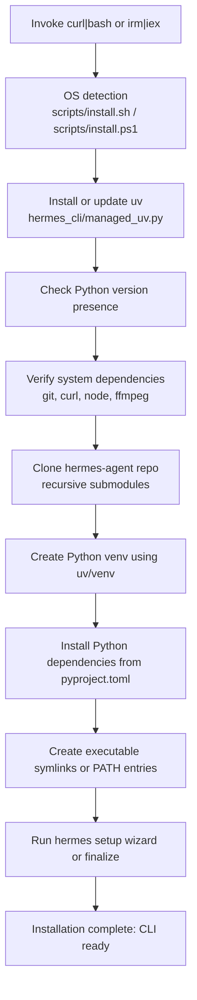

Sources: [scripts/install.sh:1-145](), [scripts/install.ps1:1-121](), [hermes_cli/managed_uv.py:20-38]()

---

### Diagram: Installer Scripts and Update Submodules

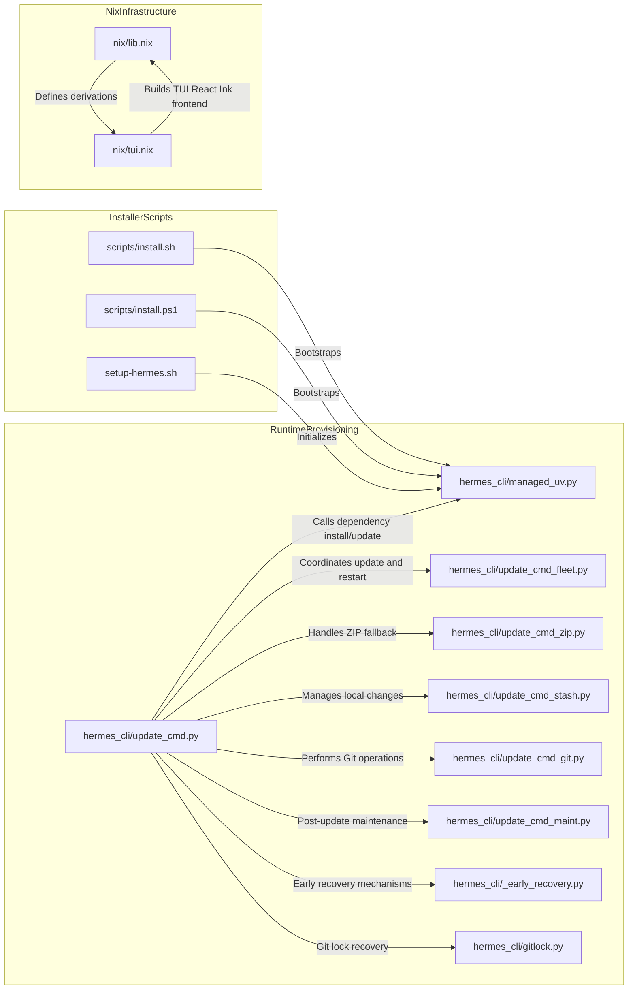

Sources: [scripts/install.sh:1-15](), [scripts/install.ps1:1-15](), [hermes_cli/managed_uv.py:1-46](), [hermes_cli/update_cmd.py:1-111](), [hermes_cli/update_cmd_fleet.py:1-71](), [hermes_cli/update_cmd_zip.py:1-77](), [hermes_cli/update_cmd_stash.py:1-139](), [hermes_cli/update_cmd_git.py:1-105](), [hermes_cli/update_cmd_maint.py:1-175](), [hermes_cli/_early_recovery.py:1-167](), [hermes_cli/gitlock.py:1-136]()

---

## Summary

Hermes Agent’s installation solution encompasses multiple methods suited for diverse platforms, utilizing automated script bootstraps, a managed Python runtime via `hermes_cli/managed_uv.py`, a robust update pipeline with fallback safety (`hermes_cli/update_cmd.py` and `hermes_cli/update_cmd_zip.py`), and platform-specific accommodations across POSIX, Windows PowerShell, and Nix.

---

# Page: Configuration and Setup

# Configuration and Setup

<details>
<summary>Relevant source files</summary>

The following files were used as context for generating this wiki page:

- [agent/auxiliary_client.py](agent/auxiliary_client.py)
- [agent/secret_scope.py](agent/secret_scope.py)
- [agent/secret_sources/__init__.py](agent/secret_sources/__init__.py)
- [agent/secret_sources/_cache.py](agent/secret_sources/_cache.py)
- [agent/secret_sources/base.py](agent/secret_sources/base.py)
- [agent/secret_sources/bitwarden.py](agent/secret_sources/bitwarden.py)
- [agent/secret_sources/command.py](agent/secret_sources/command.py)
- [agent/secret_sources/onepassword.py](agent/secret_sources/onepassword.py)
- [agent/secret_sources/registry.py](agent/secret_sources/registry.py)
- [cli-config.yaml.example](cli-config.yaml.example)
- [cli.py](cli.py)
- [cron/job_definition.py](cron/job_definition.py)
- [cron/scheduler_script.py](cron/scheduler_script.py)
- [gateway/run.py](gateway/run.py)
- [gateway/session.py](gateway/session.py)
- [gateway/slash_commands.py](gateway/slash_commands.py)
- [hermes_cli/cli_commands_mixin.py](hermes_cli/cli_commands_mixin.py)
- [hermes_cli/commands.py](hermes_cli/commands.py)
- [hermes_cli/config.py](hermes_cli/config.py)
- [hermes_cli/config_backups.py](hermes_cli/config_backups.py)
- [hermes_cli/config_defaults.py](hermes_cli/config_defaults.py)
- [hermes_cli/config_migrations.py](hermes_cli/config_migrations.py)
- [hermes_cli/config_version_stamp.py](hermes_cli/config_version_stamp.py)
- [hermes_cli/env_loader.py](hermes_cli/env_loader.py)
- [hermes_cli/kanban_decompose.py](hermes_cli/kanban_decompose.py)
- [hermes_cli/kanban_specify.py](hermes_cli/kanban_specify.py)
- [hermes_cli/main.py](hermes_cli/main.py)
- [hermes_cli/profile_cmd.py](hermes_cli/profile_cmd.py)
- [hermes_cli/profile_describer.py](hermes_cli/profile_describer.py)
- [hermes_cli/profile_distribution.py](hermes_cli/profile_distribution.py)
- [hermes_cli/profiles.py](hermes_cli/profiles.py)
- [hermes_cli/setup.py](hermes_cli/setup.py)
- [hermes_cli/subcommands/profile.py](hermes_cli/subcommands/profile.py)
- [hermes_cli/xai_retirement.py](hermes_cli/xai_retirement.py)
- [hermes_state.py](hermes_state.py)
- [run_agent.py](run_agent.py)
- [scripts/docker_config_migrate.py](scripts/docker_config_migrate.py)
- [tests/agent/test_auxiliary_client.py](tests/agent/test_auxiliary_client.py)
- [tests/agent/test_env_loader_secret_sources.py](tests/agent/test_env_loader_secret_sources.py)
- [tests/agent/test_onepassword_secrets.py](tests/agent/test_onepassword_secrets.py)
- [tests/agent/test_secret_scope.py](tests/agent/test_secret_scope.py)
- [tests/agent/test_secret_scope_pinned_launch_home.py](tests/agent/test_secret_scope_pinned_launch_home.py)
- [tests/cron/test_cron_multiplex_desktop_ticker_scope.py](tests/cron/test_cron_multiplex_desktop_ticker_scope.py)
- [tests/cron/test_cron_no_agent.py](tests/cron/test_cron_no_agent.py)
- [tests/cron/test_cron_script.py](tests/cron/test_cron_script.py)
- [tests/cron/test_script_claim_heartbeat.py](tests/cron/test_script_claim_heartbeat.py)
- [tests/gateway/test_session.py](tests/gateway/test_session.py)
- [tests/hermes_cli/test_commands.py](tests/hermes_cli/test_commands.py)
- [tests/hermes_cli/test_config.py](tests/hermes_cli/test_config.py)
- [tests/hermes_cli/test_config_backups.py](tests/hermes_cli/test_config_backups.py)
- [tests/hermes_cli/test_config_lkg_backup.py](tests/hermes_cli/test_config_lkg_backup.py)
- [tests/hermes_cli/test_config_migration_nested_guards.py](tests/hermes_cli/test_config_migration_nested_guards.py)
- [tests/hermes_cli/test_config_unversioned_migration.py](tests/hermes_cli/test_config_unversioned_migration.py)
- [tests/hermes_cli/test_desktop_cron_ticker_gateway_standdown.py](tests/hermes_cli/test_desktop_cron_ticker_gateway_standdown.py)
- [tests/hermes_cli/test_desktop_cron_ticker_profiles.py](tests/hermes_cli/test_desktop_cron_ticker_profiles.py)
- [tests/hermes_cli/test_env_loader.py](tests/hermes_cli/test_env_loader.py)
- [tests/hermes_cli/test_env_sanitize_on_load.py](tests/hermes_cli/test_env_sanitize_on_load.py)
- [tests/hermes_cli/test_kanban_aux_affinity.py](tests/hermes_cli/test_kanban_aux_affinity.py)
- [tests/hermes_cli/test_kanban_decompose.py](tests/hermes_cli/test_kanban_decompose.py)
- [tests/hermes_cli/test_kanban_decompose_db.py](tests/hermes_cli/test_kanban_decompose_db.py)
- [tests/hermes_cli/test_kanban_specify.py](tests/hermes_cli/test_kanban_specify.py)
- [tests/hermes_cli/test_kanban_specify_db.py](tests/hermes_cli/test_kanban_specify_db.py)
- [tests/hermes_cli/test_kanban_worktree_isolation.py](tests/hermes_cli/test_kanban_worktree_isolation.py)
- [tests/hermes_cli/test_migrate_xai.py](tests/hermes_cli/test_migrate_xai.py)
- [tests/hermes_cli/test_noninteractive_config_guard.py](tests/hermes_cli/test_noninteractive_config_guard.py)
- [tests/hermes_cli/test_profile_alias_orphan_removal.py](tests/hermes_cli/test_profile_alias_orphan_removal.py)
- [tests/hermes_cli/test_profile_delete_service_name.py](tests/hermes_cli/test_profile_delete_service_name.py)
- [tests/hermes_cli/test_profile_describer.py](tests/hermes_cli/test_profile_describer.py)
- [tests/hermes_cli/test_profile_distribution.py](tests/hermes_cli/test_profile_distribution.py)
- [tests/hermes_cli/test_profile_export_credentials.py](tests/hermes_cli/test_profile_export_credentials.py)
- [tests/hermes_cli/test_profile_export_special_files.py](tests/hermes_cli/test_profile_export_special_files.py)
- [tests/hermes_cli/test_profile_rename_service.py](tests/hermes_cli/test_profile_rename_service.py)
- [tests/hermes_cli/test_profiles.py](tests/hermes_cli/test_profiles.py)
- [tests/hermes_cli/test_secret_source_bootstrap.py](tests/hermes_cli/test_secret_source_bootstrap.py)
- [tests/hermes_cli/test_uninstall_shell_configs.py](tests/hermes_cli/test_uninstall_shell_configs.py)
- [tests/hermes_cli/test_web_profile_soul_writes.py](tests/hermes_cli/test_web_profile_soul_writes.py)
- [tests/hermes_cli/test_web_profiles_off_loop.py](tests/hermes_cli/test_web_profiles_off_loop.py)
- [tests/hermes_cli/test_xai_retirement.py](tests/hermes_cli/test_xai_retirement.py)
- [tests/secret_sources/test_profile_secrets.py](tests/secret_sources/test_profile_secrets.py)
- [tests/tools/test_docker_config_migrate.py](tests/tools/test_docker_config_migrate.py)
- [ui-tui/src/__tests__/details.test.ts](ui-tui/src/__tests__/details.test.ts)
- [ui-tui/src/domain/details.ts](ui-tui/src/domain/details.ts)
- [website/docs/developer-guide/secret-source-plugin.md](website/docs/developer-guide/secret-source-plugin.md)
- [website/docs/getting-started/quickstart.md](website/docs/getting-started/quickstart.md)
- [website/docs/guides/cron-troubleshooting.md](website/docs/guides/cron-troubleshooting.md)
- [website/docs/integrations/providers.md](website/docs/integrations/providers.md)
- [website/docs/reference/cli-commands.md](website/docs/reference/cli-commands.md)
- [website/docs/reference/environment-variables.md](website/docs/reference/environment-variables.md)
- [website/docs/reference/faq.md](website/docs/reference/faq.md)
- [website/docs/reference/profile-commands.md](website/docs/reference/profile-commands.md)
- [website/docs/reference/slash-commands.md](website/docs/reference/slash-commands.md)
- [website/docs/user-guide/cli.md](website/docs/user-guide/cli.md)
- [website/docs/user-guide/configuration.md](website/docs/user-guide/configuration.md)
- [website/docs/user-guide/features/fallback-providers.md](website/docs/user-guide/features/fallback-providers.md)
- [website/docs/user-guide/messaging/index.md](website/docs/user-guide/messaging/index.md)
- [website/docs/user-guide/profile-distributions.md](website/docs/user-guide/profile-distributions.md)
- [website/docs/user-guide/profiles.md](website/docs/user-guide/profiles.md)
- [website/docs/user-guide/secrets/index.md](website/docs/user-guide/secrets/index.md)
- [website/docs/user-guide/tui.md](website/docs/user-guide/tui.md)
- [website/i18n/zh-Hans/docusaurus-plugin-content-docs/current/guides/cron-troubleshooting.md](website/i18n/zh-Hans/docusaurus-plugin-content-docs/current/guides/cron-troubleshooting.md)
- [website/i18n/zh-Hans/docusaurus-plugin-content-docs/current/reference/profile-commands.md](website/i18n/zh-Hans/docusaurus-plugin-content-docs/current/reference/profile-commands.md)
- [website/i18n/zh-Hans/docusaurus-plugin-content-docs/current/user-guide/profile-distributions.md](website/i18n/zh-Hans/docusaurus-plugin-content-docs/current/user-guide/profile-distributions.md)
- [website/i18n/zh-Hans/docusaurus-plugin-content-docs/current/user-guide/profiles.md](website/i18n/zh-Hans/docusaurus-plugin-content-docs/current/user-guide/profiles.md)

</details>


This page covers the detailed mechanics of configuration management, profiles, setup, and migrations in Hermes Agent. It explains the layered configuration hierarchy governing runtime settings, multi-profile isolation, configuration migrations, and key configuration files.

---

## Directory Structure and Profiles

Hermes stores configuration, persistent data, and runtime artifacts in a structured user directory (`~/.hermes/` by default), which can be overridden via the `HERMES_HOME` environment variable. The core layout is ensured by `ensure_hermes_home()` which creates the directory if missing and sets up the initial structure [hermes_cli/setup.py:23-30]().

Named profiles allow running multiple isolated instances of Hermes concurrently. Each profile lives under `~/.hermes/profiles/<profile_name>/` and maintains isolated subdirectories for session data, memories, skill definitions, logs, and other runtime artifacts. The standard profile subdirectories bootstrapped include:

- `memories/`
- `sessions/`
- `skills/`
- `logs/`
- `cron/`
- `plans/`
- `workspace/`
- `home/`
- `skins/`

These subdirectories are defined and created during profile initialization to ensure full profile isolation, enabling each Hermes agent instance to operate independently without data conflicts [hermes_cli/profiles.py:30-104](). 

| Path          | Purpose                                            | Code Reference                     |
|---------------|---------------------------------------------------|----------------------------------|
| `config.yaml` | Main structured settings (models, toolsets, terminal backend) | [tests/hermes_cli/test_profiles.py:167-169]() |
| `.env`        | Environment-specific overrides and sensitive secrets | [hermes_cli/profiles.py:99-104]() |
| `auth.json`   | OAuth provider credentials (Nous Portal, etc.)    | [website/docs/user-guide/configuration.md:25]() |
| `SOUL.md`     | Primary agent identity persona used for system prompts | [website/docs/user-guide/configuration.md:26]() |
| `memories/`   | Persistent memory files (`MEMORY.md`, `USER.md`)  | [hermes_cli/profiles.py:33]()    |
| `skills/`     | User-defined or downloaded skills                   | [hermes_cli/profiles.py:33]()    |
| `cron/`       | Scheduled task jobs                                 | [hermes_cli/profiles.py:33]()    |
| `sessions/`   | Gateway session data and conversation states       | [hermes_cli/profiles.py:33]()    |
| `logs/`       | Rotating system logs with automatic secret redaction | [hermes_cli/profiles.py:33]()    |

### Profile Isolation Flow Diagram

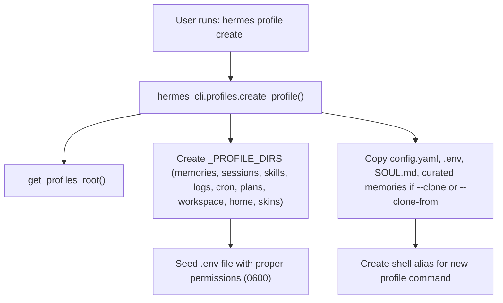

Sources: [hermes_cli/profiles.py:30-104](), [hermes_cli/setup.py:23-30](), [tests/hermes_cli/test_profiles.py:167-169](), [website/docs/user-guide/configuration.md:25-26]()

---

## Configuration Hierarchy and Resolution

Hermes resolves configuration settings through a strict precedence hierarchy to provide flexibility and security:

1. **CLI Arguments**: Immediate runtime overrides passed interactively via command-line options (e.g., `hermes chat --model anthropic/claude-opus-4`) that apply only for the current invocation [website/docs/user-guide/configuration.md:61]().
2. **`config.yaml`**: The primary user-editable YAML configuration file located in the Hermes home directory or active profile directory. It contains most agent behavior settings including provider choices, model names, session parameters, toolsets, and terminal backend options [website/docs/user-guide/configuration.md:62]().
3. **`.env`**: A dotenv-style environment file co-located with config.yaml that holds API keys, tokens, and sensitive secret variables. This file overrides shell environment variables and is separate from config.yaml to safeguard secrets [website/docs/user-guide/configuration.md:63]().
4. **Built-In Defaults**: Hardcoded fallback defaults supply safe baseline values when no other source provides them, preventing runtime failures [website/docs/user-guide/configuration.md:64]().

This layered resolution cleanly separates secrets management (.env) from general settings (config.yaml) while integrating immediate CLI overrides.

### Configuration Resolution Architecture

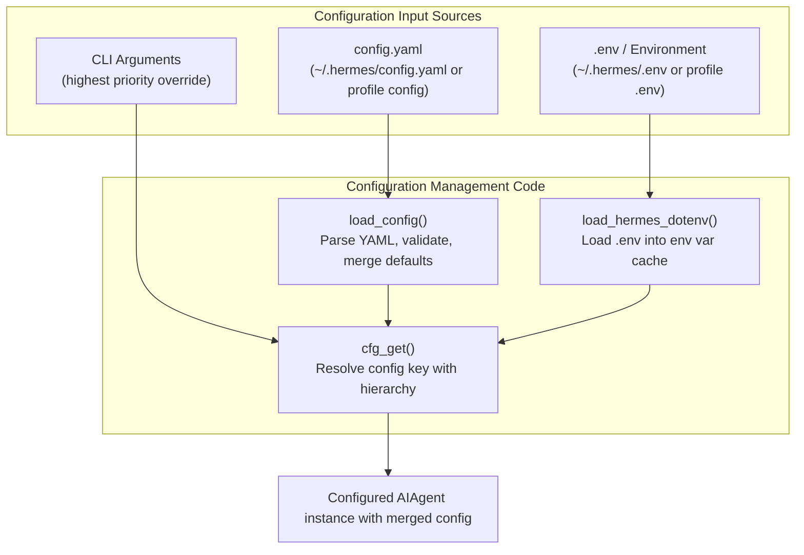

### Implementation Details

- **Loading Config**: `load_config()` parses `config.yaml` with robust error handling, creating timestamped backup files upon parse failures to prevent data loss and warn the user [hermes_cli/config.py:50-100]().

- **Environment Loading**: `.env` is loaded through `load_hermes_dotenv()` which reads and parses dotenv files with strict owner-only (0600) permission enforcement to secure secrets [hermes_cli/env_loader.py:1-110]().

- **Merged Access**: `cfg_get()` provides unified access to configuration keys, layering CLI overrides, config.yaml values, loaded environment variables, and built-in defaults [hermes_cli/config.py:40-80]().

- **Secrets vs Config Handling**: Explicit separation is enforced so secret environment variables (UPPER_SNAKE_CASE keys) live only in `.env`, while structured keys with dotted notation (e.g., `model.provider`, `terminal.backend`) live in `config.yaml` [website/docs/user-guide/configuration.md:54]().

Sources: [website/docs/user-guide/configuration.md:57-68](), [hermes_cli/config.py:1-145](), [hermes_cli/env_loader.py:1-110]()

---

## Configuration Migrations

Hermes manages configuration schema evolution through a migration framework that automatically upgrades user config files on load to maintain compatibility:

- Migrations are keyed by `_config_version` present in the root of `config.yaml` which tracks the version of the config schema applied [cli-config.yaml.example:10]().

- On loading a config with a version older than the current supported version, migration functions run sequentially to transform keys, values, and the structure as needed.

- Migrations can normalize deprecated keys, move settings from environment to config.yaml or vice versa, and clean up obsolete values.

- The migration code ensures idempotency and runs only when strictly necessary to avoid disrupting user-customized settings.

- It uses partial persistence to update only affected keys and writes files atomically to prevent corruption.

This system allows Hermes to evolve internal settings without forcing manual edits or breaking compatibility.

Sources: [cli-config.yaml.example:10](), [hermes_cli/config.py:1-55]()

---

## Setup Wizard and Tool Configuration

Hermes offers an interactive command-line setup wizard accessible via `hermes setup` that aids users in creating and updating their configuration interactively [hermes_cli/setup.py:1-141]().

- The setup wizard is a prompt-driven, stepwise system with forward and backward navigation support.

- Users are guided through configuration sections, including:
  - **Model & Provider:** Selecting the preferred default LLM provider, setting API keys, base URLs, and default models.
  - **Terminal Backend:** Choosing execution backend (local shell, Docker, Modal, Vercel Sandbox).
  - **Agent Settings:** Configuring agent runtime limits, session caps, and reasoning effort.
  - **Messaging Platforms:** Enabling and configuring supported messaging platform gateways.
  - **Toolsets & Skills:** Specifying included toolsets and enabling skill sets.

- The wizard uses exceptions `_SetupCancelled` and `_SetupGoBack` for internal flow control in navigation.

- Changes are written back atomically to `config.yaml` and `.env` with correct file ownership and permission handling to maintain security and integrity.

- The setup respects the active profile context, configuring the correct isolated profile directory.

Sources: [hermes_cli/setup.py:1-141](), [website/docs/user-guide/configuration.md:25-32]()

---

## Profiles: Multi-Instance Isolation and Identity

Profiles provide isolated Hermes homes to run multiple independent agent instances on the same machine. Each profile maintains its own secrets, configurations, memories, sessions, skills, and gateway states.

- Profiles reside under `~/.hermes/profiles/<profile_name>/` with full sandboxing of configuration and data directories:

- Profile creation scaffolds the directory hierarchy, optionally cloning or copying configuration from an existing profile or default.

- Each profile can have a shell alias generated for convenience, mapping commands to the appropriate `HERMES_PROFILE` environment variable.

- Identity files like `SOUL.md` (agent personality), `auth.json` (OAuth credentials), and `config.yaml` define each profile's autonomous configuration state.

### Profiles and Setup Workflow Diagram

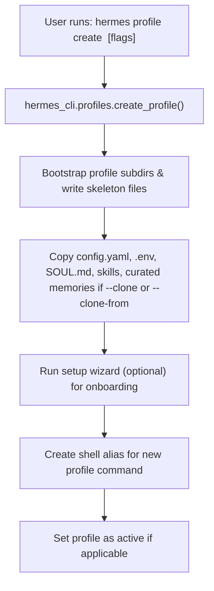

Sources: [hermes_cli/profiles.py:30-104](), [website/docs/user-guide/configuration.md:23-30]()

---

## Key Configuration Files

| File Name    | Location                        | Description                                                                                     |
|--------------|--------------------------------|-------------------------------------------------------------------------------------------------|
| `config.yaml`| `HERMES_HOME/config.yaml` or `<profile>/config.yaml` | YAML file capturing main structured configuration: selected model, toolsets, agent limits, terminal backend settings, and runtime options. |
| `.env`       | `HERMES_HOME/.env` or `<profile>/.env` | Environment variable overrides, API keys, tokens, and sensitive secrets. Owner permission (`0600`) enforced. Separate from structured config. |
| `auth.json`  | `HERMES_HOME/auth.json` or `<profile>/auth.json` | OAuth tokens and subscription info, especially for Nous Portal integrations.                    |
| `SOUL.md`    | `HERMES_HOME/SOUL.md` or `<profile>/SOUL.md` | The core agent persona file defining system prompts, personality, and behavior traits for conversations. |
| `memories/`  | `<profile>/memories/`           | Memory files (`MEMORY.md`, `USER.md`) storing long-term data used in agent context.             |
| `skills/`    | `<profile>/skills/`             | User-installed or bundled skill definitions controlling agent abilities.                         |
| `cron/`      | `<profile>/cron/`               | Scheduled task job definitions for periodic activities.                                         |
| `sessions/`  | `<profile>/sessions/`           | Persistent session data and conversation states from chat gateways.                             |

Sources: [hermes_cli/profiles.py:30-104](), [website/docs/user-guide/configuration.md:23-32]()

---

# Summary

Hermes Agent's configuration and setup system provides:

- A **hierarchical resolution** of configuration keys applying CLI arguments → `config.yaml` → `.env` → built-in defaults, ensuring flexibility and security separation of secrets [website/docs/user-guide/configuration.md:57-68]().
- **Profile-based isolation**: fully sandboxed directories per profile to support concurrent agent instances without conflicts [hermes_cli/profiles.py:30-104]().
- **Automatic migration and validation** framework to upgrade user configs smoothly across schema changes [hermes_cli/config.py:1-55]().
- An **interactive setup wizard** implemented with robust navigation and lifecycle control, enabling stepwise onboarding and configuration of models, toolsets, and backends [hermes_cli/setup.py:1-141]().
- Clear separation of **secrets management** (`.env`) from **structured config** (`config.yaml`), enforcing file permission policies and override rules [website/docs/user-guide/configuration.md:66-68]().

This system forms the cornerstone for Hermes' maintainability, multi-user deployments, and proper handling of secrets and user preferences.

Sources: [hermes_cli/config.py:1-145](), [hermes_cli/profiles.py:30-104](), [hermes_cli/setup.py:1-141](), [website/docs/user-guide/configuration.md:57-68]()

---

# Page: Authentication and Providers

# Authentication and Providers

<details>
<summary>Relevant source files</summary>

The following files were used as context for generating this wiki page:

- [agent/credential_pool.py](agent/credential_pool.py)
- [agent/credential_pool_admin.py](agent/credential_pool_admin.py)
- [agent/credential_pool_model_cooldowns.py](agent/credential_pool_model_cooldowns.py)
- [agent/fallback_cooldown.py](agent/fallback_cooldown.py)
- [agent/secret_scope.py](agent/secret_scope.py)
- [agent/secret_sources/__init__.py](agent/secret_sources/__init__.py)
- [agent/secret_sources/_cache.py](agent/secret_sources/_cache.py)
- [agent/secret_sources/base.py](agent/secret_sources/base.py)
- [agent/secret_sources/bitwarden.py](agent/secret_sources/bitwarden.py)
- [agent/secret_sources/command.py](agent/secret_sources/command.py)
- [agent/secret_sources/onepassword.py](agent/secret_sources/onepassword.py)
- [agent/secret_sources/registry.py](agent/secret_sources/registry.py)
- [contributors/emails/kboxstar@gmail.com](contributors/emails/kboxstar@gmail.com)
- [cron/scheduler_script.py](cron/scheduler_script.py)
- [hermes_cli/auth.py](hermes_cli/auth.py)
- [hermes_cli/auth_codex.py](hermes_cli/auth_codex.py)
- [hermes_cli/auth_commands.py](hermes_cli/auth_commands.py)
- [hermes_cli/auth_constants.py](hermes_cli/auth_constants.py)
- [hermes_cli/auth_device_flow.py](hermes_cli/auth_device_flow.py)
- [hermes_cli/auth_error_copy.py](hermes_cli/auth_error_copy.py)
- [hermes_cli/auth_nous.py](hermes_cli/auth_nous.py)
- [hermes_cli/auth_oauth_grants.py](hermes_cli/auth_oauth_grants.py)
- [hermes_cli/auth_openrouter.py](hermes_cli/auth_openrouter.py)
- [hermes_cli/env_loader.py](hermes_cli/env_loader.py)
- [hermes_cli/observability/shared_metrics_disabled.py](hermes_cli/observability/shared_metrics_disabled.py)
- [hermes_cli/observability/shared_metrics_setup.py](hermes_cli/observability/shared_metrics_setup.py)
- [hermes_cli/observability/shared_metrics_signals.py](hermes_cli/observability/shared_metrics_signals.py)
- [hermes_cli/proxy/adapters/__init__.py](hermes_cli/proxy/adapters/__init__.py)
- [hermes_cli/proxy/adapters/base.py](hermes_cli/proxy/adapters/base.py)
- [hermes_cli/proxy/adapters/nous_portal.py](hermes_cli/proxy/adapters/nous_portal.py)
- [hermes_cli/proxy/adapters/xai.py](hermes_cli/proxy/adapters/xai.py)
- [hermes_cli/proxy/cli.py](hermes_cli/proxy/cli.py)
- [hermes_cli/proxy/server.py](hermes_cli/proxy/server.py)
- [hermes_cli/proxy/sse_done.py](hermes_cli/proxy/sse_done.py)
- [hermes_cli/proxy_cli.py](hermes_cli/proxy_cli.py)
- [hermes_cli/psutil_android.py](hermes_cli/psutil_android.py)
- [hermes_cli/relaunch.py](hermes_cli/relaunch.py)
- [hermes_cli/relay_plugin_cutover.py](hermes_cli/relay_plugin_cutover.py)
- [hermes_cli/resource_limits.py](hermes_cli/resource_limits.py)
- [tests/agent/test_codex_model_entitlement_rotation.py](tests/agent/test_codex_model_entitlement_rotation.py)
- [tests/agent/test_credential_pool.py](tests/agent/test_credential_pool.py)
- [tests/agent/test_credential_pool_profile_oauth_fork.py](tests/agent/test_credential_pool_profile_oauth_fork.py)
- [tests/agent/test_env_loader_secret_sources.py](tests/agent/test_env_loader_secret_sources.py)
- [tests/agent/test_onepassword_secrets.py](tests/agent/test_onepassword_secrets.py)
- [tests/agent/test_provider_reset_cooldown.py](tests/agent/test_provider_reset_cooldown.py)
- [tests/agent/test_secret_scope.py](tests/agent/test_secret_scope.py)
- [tests/agent/test_secret_scope_pinned_launch_home.py](tests/agent/test_secret_scope_pinned_launch_home.py)
- [tests/cron/test_cron_multiplex_desktop_ticker_scope.py](tests/cron/test_cron_multiplex_desktop_ticker_scope.py)
- [tests/cron/test_cron_no_agent.py](tests/cron/test_cron_no_agent.py)
- [tests/cron/test_cron_script.py](tests/cron/test_cron_script.py)
- [tests/cron/test_script_claim_heartbeat.py](tests/cron/test_script_claim_heartbeat.py)
- [tests/hermes_cli/test_auth_commands.py](tests/hermes_cli/test_auth_commands.py)
- [tests/hermes_cli/test_auth_nous_provider.py](tests/hermes_cli/test_auth_nous_provider.py)
- [tests/hermes_cli/test_auth_profile_fallback.py](tests/hermes_cli/test_auth_profile_fallback.py)
- [tests/hermes_cli/test_codex_token_writethrough.py](tests/hermes_cli/test_codex_token_writethrough.py)
- [tests/hermes_cli/test_desktop_cron_ticker_gateway_standdown.py](tests/hermes_cli/test_desktop_cron_ticker_gateway_standdown.py)
- [tests/hermes_cli/test_desktop_cron_ticker_profiles.py](tests/hermes_cli/test_desktop_cron_ticker_profiles.py)
- [tests/hermes_cli/test_device_poll_waf_backoff.py](tests/hermes_cli/test_device_poll_waf_backoff.py)
- [tests/hermes_cli/test_env_loader.py](tests/hermes_cli/test_env_loader.py)
- [tests/hermes_cli/test_env_sanitize_on_load.py](tests/hermes_cli/test_env_sanitize_on_load.py)
- [tests/hermes_cli/test_global_auth_store_memo.py](tests/hermes_cli/test_global_auth_store_memo.py)
- [tests/hermes_cli/test_launchd_plist_guard.py](tests/hermes_cli/test_launchd_plist_guard.py)
- [tests/hermes_cli/test_model_cache_swr.py](tests/hermes_cli/test_model_cache_swr.py)
- [tests/hermes_cli/test_nous_nonproduction_inference_host.py](tests/hermes_cli/test_nous_nonproduction_inference_host.py)
- [tests/hermes_cli/test_oauth_status_pool_observation.py](tests/hermes_cli/test_oauth_status_pool_observation.py)
- [tests/hermes_cli/test_profile_delete_service_name.py](tests/hermes_cli/test_profile_delete_service_name.py)
- [tests/hermes_cli/test_proxy.py](tests/hermes_cli/test_proxy.py)
- [tests/hermes_cli/test_relaunch.py](tests/hermes_cli/test_relaunch.py)
- [tests/hermes_cli/test_secret_source_bootstrap.py](tests/hermes_cli/test_secret_source_bootstrap.py)
- [tests/hermes_cli/test_shared_metrics_signals.py](tests/hermes_cli/test_shared_metrics_signals.py)
- [tests/hermes_cli/test_slash_confirm_windows.py](tests/hermes_cli/test_slash_confirm_windows.py)
- [tests/scripts/test_powershell_script_syntax.py](tests/scripts/test_powershell_script_syntax.py)
- [tests/secret_sources/test_profile_secrets.py](tests/secret_sources/test_profile_secrets.py)
- [website/docs/developer-guide/egress-internals.md](website/docs/developer-guide/egress-internals.md)
- [website/docs/developer-guide/secret-source-plugin.md](website/docs/developer-guide/secret-source-plugin.md)
- [website/docs/guides/cron-troubleshooting.md](website/docs/guides/cron-troubleshooting.md)
- [website/docs/user-guide/egress/iron-proxy.md](website/docs/user-guide/egress/iron-proxy.md)
- [website/docs/user-guide/features/credential-pools.md](website/docs/user-guide/features/credential-pools.md)
- [website/docs/user-guide/features/subscription-proxy.md](website/docs/user-guide/features/subscription-proxy.md)
- [website/docs/user-guide/secrets/index.md](website/docs/user-guide/secrets/index.md)
- [website/i18n/zh-Hans/docusaurus-plugin-content-docs/current/guides/cron-troubleshooting.md](website/i18n/zh-Hans/docusaurus-plugin-content-docs/current/guides/cron-troubleshooting.md)
- [website/i18n/zh-Hans/docusaurus-plugin-content-docs/current/user-guide/features/subscription-proxy.md](website/i18n/zh-Hans/docusaurus-plugin-content-docs/current/user-guide/features/subscription-proxy.md)

</details>


This page documents the authentication system that enables Hermes Agent to connect to Large Language Model (LLM) inference providers. It covers provider authentication methods (OAuth, API keys), the provider resolution chain, credential pools, automatic provider credential detection, and secret injection from external sources such as Bitwarden and 1Password.

**Scope**: This page focuses on authentication and the selection of the **primary inference provider** for conversation tasks. For auxiliary models used by tools (vision, compression, web extraction, etc.), see [Auxiliary Client (4.5)]().

Sources: [hermes_cli/auth.py:1-106](), [agent/credential_pool.py:1-51](), [agent/secret_scope.py:22-23]().

---

## Overview

Hermes Agent’s authentication system supports multiple LLM inference providers with uniform management for credential handling:

- **OAuth Device Code Flows**: Used by Nous Portal, xAI, MiniMax, and others. These flows manage device authorization, polling for token issuance and automatic refresh, implemented across submodules like `auth_nous`, `auth_xai`, `auth_minimax`, and coordinated in the main `hermes_cli.auth` [hermes_cli/auth.py:1-106]().

- **OAuth External Flows**: Providers such as OpenAI Codex and Qwen utilize OAuth login handled externally, e.g., via browser or CLI helpers. Hermes imports and manages the resulting tokens in its credential pools [hermes_cli/auth.py:77-90]().

- **API Key Authentication**: Traditional API key auth is supported directly for providers like OpenRouter, Anthropic, Google AI Studio, Z.AI/GLM, Kimi/Moonshot, MiniMax, Alibaba, DeepSeek, and xAI [hermes_cli/auth.py:36-44]().

- **Credential Pools**: Hermes supports multiple credentials per provider for failover and automatic rotation on quota limits, rate-limits, or token expiry. The `CredentialPool` class abstracts this with persistent storage and cooldown tracking [agent/credential_pool.py:1-168]().

- **Secret Injection from External Sources**: Credentials can be automatically injected from external secret managers (Bitwarden, 1Password) via the `agent.secret_scope` system. This allows dynamic environment hydration without polluting global envvars [agent/secret_scope.py:22-23]().

- **Provider Resolution Chain**: An ordered sequence to select the active provider and relevant credentials using explicit user input, config file settings, environment variables, or autodetection heuristics.

---

## Provider Registry and Profiles

Hermes manages a registry via the `PROVIDER_REGISTRY` dictionary and the `ProviderConfig` dataclass in `hermes_cli.auth`, describing each inference provider with authentication meta and runtime connection info:

- **Transport Protocol Identifiers:** Specify request/response handling types (`openai_chat`, `anthropic_messages`, `codex_responses`, etc.).
- **Auth Types:** Support for `api_key`, `oauth_device_code`, `oauth_external`, and others.
- **Inference Base URLs:** Provider API endpoints, overridable by environment or user config.
- **Aggregator Flags:** Mark meta-providers like MOA presets or OpenRouter aggregators.

### Example Providers and Schemes

| Provider Key    | Authentication Scheme   | Typical Env Vars / Credentials           | Notes                                |
|-----------------|-------------------------|------------------------------------------|-------------------------------------|
| `nous`          | OAuth Device Code       | Managed internally via device code flows | Nous Portal models                  |
| `openai-codex`  | OAuth External          | External CLI/browser helper tokens       | OpenAI-compatible OAuth             |
| `anthropic`     | API Key or OAuth        | `ANTHROPIC_API_KEY`, OAuth tokens        | Supports both key and OAuth modes   |
| `openrouter`    | API Key                 | `OPENROUTER_API_KEY`                      | Aggregator proxy for many LLMs      |
| `xai-oauth`     | OAuth Device Code       | Managed internally for xAI token flows   | xAI direct OAuth device code        |
| `minimax-oauth` | OAuth External          | Internal OAuth token storage              | MiniMax OAuth token fetch / refresh |

Sources: [hermes_cli/auth.py:1-106]().

---

## Provider Resolution Chain

The entrypoint `resolve_provider()` in `hermes_cli.auth` selects the active inference provider and credentials by following a clear priority chain: explicit CLI arguments, config file (`config.yaml`) entries, environment variables, and lastly auto-detection/fallback [hermes_cli/auth.py:7]().

This function coordinates:

- Loading credential pools for a provider from `~/.hermes/auth.json`.
- Checking credential availability status.
- Selecting the current usable credential based on priority and rotation strategy.
- Dispatching to provider-specific credential resolution functions depending on the `auth_type` enumerated.

### Key classes / functions involved

| Name                                   | Description                                          | Code Location                |
|---------------------------------------|------------------------------------------------------|------------------------------|
| `resolve_provider()`                  | Selects the active LLM provider and runtime creds   | [hermes_cli/auth.py:7]()     |
| `CredentialPool.load_pool()`          | Loads credential entries with rotation state         | [agent/credential_pool.py:1-51]() |
| `CredentialPool.select()`             | Picks the next ready credential entry                | [agent/credential_pool.py:1-168]() |
| `_load_auth_store()` / `_save_auth_store()` | Load/save credential JSON with Locking               | [hermes_cli/auth.py:4-6]()   |
| `resolve_nous_runtime_credentials()` | Resolves Nous Portal OAuth runtime credentials       | [hermes_cli/auth.py:64]()    |
| `resolve_codex_runtime_credentials()`| Resolves OpenAI Codex OAuth external flow credentials| [hermes_cli/auth.py:83]()    |

### Diagram: Provider Resolution Flow

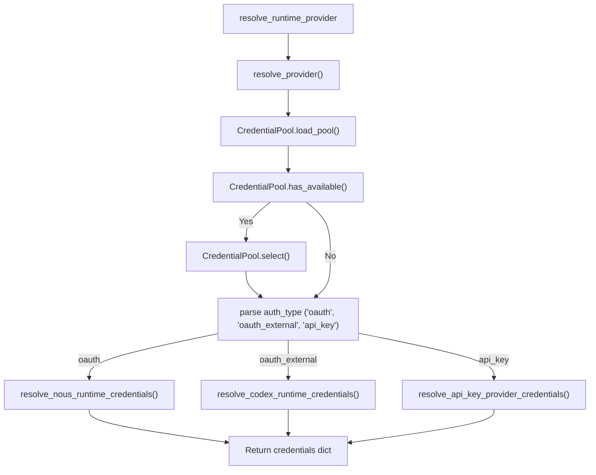

Sources: [hermes_cli/auth.py:1-106](), [agent/credential_pool.py:1-168](), [hermes_cli/auth.py:7]().

---

## Credential Pool and Rotation

The credential pool, implemented as the `CredentialPool` class in `agent.credential_pool`, enables grouping multiple credentials for the same provider to support continuous failover and rate limit recovery.

- **Status Management:** Credentials track states such as:

  - `STATUS_OK` — credential is valid and usable,
  - `STATUS_EXHAUSTED` — temporarily unusable due to rate or quota limits,
  - `STATUS_DEAD` — permanently invalid (e.g., token revoked),

  allowing smooth rotation between available credentials [agent/credential_pool.py:82-89]().

- **Cooldown Periods:** Cooldown TTLs delay retry for exhausted credentials, tuned per HTTP response codes (e.g., 401 Unauthorized, 429 Rate Limit, 402 Billing) [agent/credential_pool.py:130-136]().

- **Rotation Strategies:**

  - `fill_first`: always pick the highest priority available credential first,
  - `round_robin`: cycle through credentials in order,
  - `random`: random credential selection,
  - `least_used`: pick the credential with the fewest recent usages,

  configurable per provider for flexible balancing [agent/credential_pool.py:119-123]().

- **Persistence and Safety:** Credential pools are stored in an encrypted (permission 0600) JSON file `~/.hermes/auth.json` with cross-process locking via `_auth_store_lock()` to serialize concurrent access safely [hermes_cli/auth.py:4-6]().

- **Billing and Token Expiry:** The pool supports specific heuristics for billing errors (e.g., exhaust all entries with the same key on 402 Billing errors), and automatic token refresh for OAuth credentials to ensure minimal disruption [agent/credential_pool.py:80-166]().

### Diagram: Credential Pool Internal Flow

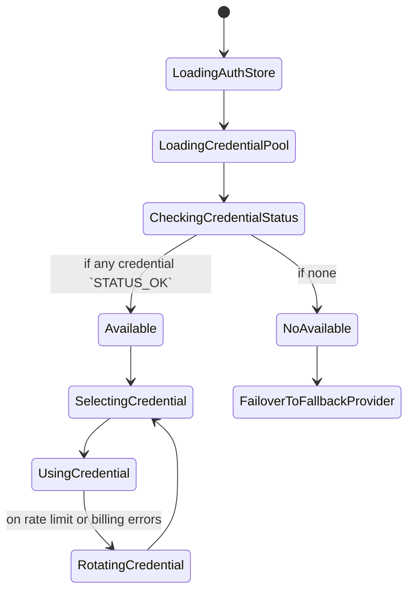

Sources: [agent/credential_pool.py:1-168](), [hermes_cli/auth.py:4-6]().

---

## Authentication Implementation Details

### OAuth Device Code and External Flows

- **Device Code Login:** Providers like Nous, xAI, and MiniMax initiate OAuth via device code flows. This involves displaying a user code and URL for browser authentication and polling the token endpoint asynchronously until the access token is issued. The device code logic is handled in dedicated modules (`auth_nous`, `auth_xai`, `auth_minimax`) and integrated with the global auth store [hermes_cli/auth.py:50-90]().

- **External OAuth Flows:** Some providers (OpenAI Codex, Qwen) rely on external CLI or browser flows for OAuth authentication. Hermes imports these OAuth tokens into its own `auth.json` credential pool and manages token refreshes internally. This decouples Hermes from external tool token rotation, reducing interference [hermes_cli/auth.py:77-90]().

- **Single-Use Refresh Tokens:** To avoid token reuse problems with single-use refresh tokens (common in OAuth), `hermes_cli.auth_oauth_grants` manages token hygiene by stripping cloned grants, healing forked refresh tokens, and mapping token generations consistently across profiles [hermes_cli/auth_oauth_grants.py:1-156]().

### API Key Authentication and Secret Sources

- API keys can be provided explicitly in Hermes config files (`config.yaml`) or injected via environment variables scoped to specific profiles.

- **Secret Injection:** Hermes uses the `agent.secret_scope` system to dynamically source secrets from secret management backends without global env pollution. This supports:

  - **Bitwarden** — via `agent.secret_sources.bitwarden`,
  - **1Password** — via `agent.secret_sources.onepassword`.

  These secret sources inject credentials transparently into Hermes environments or child process environments as needed, keeping secret management secure and separate [agent/secret_scope.py:22]().

---

## Natural Language to Code Entity Mapping

The following diagrams clarify how user-level authentication concepts map to underlying Hermes Agent code entities.

### Diagram: Storage and Loader Components Mapping

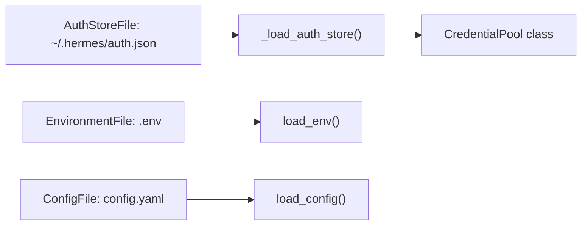

Sources: [hermes_cli/auth.py:4-6](), [agent/credential_pool.py:21](), [agent/secret_scope.py:22]().

---

### Diagram: Runtime Resolution of Provider Credentials

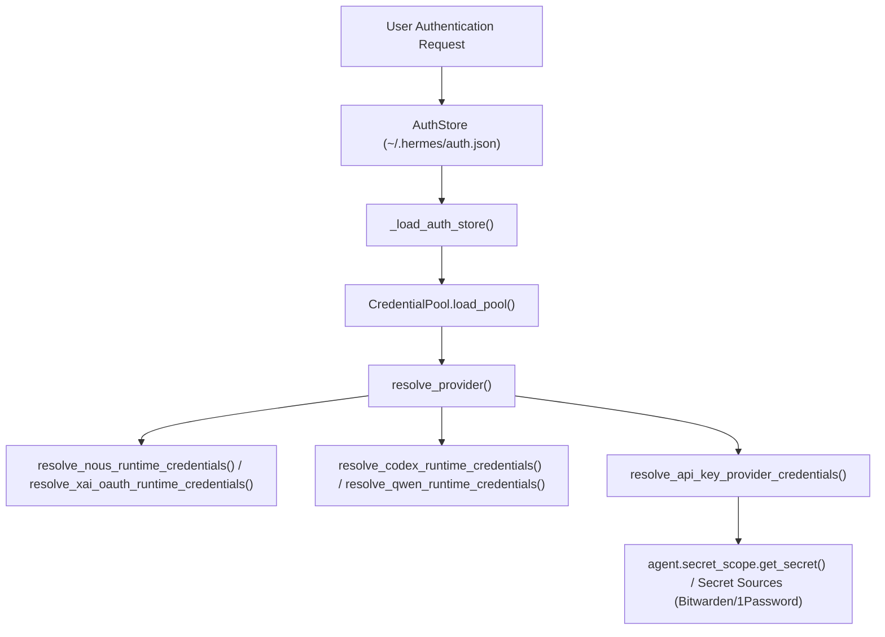

Sources: [hermes_cli/auth.py:4-7](), [hermes_cli/auth.py:64](), [hermes_cli/auth.py:83](), [agent/credential_pool.py:22]().

---

# References

- Multi-provider authentication and OAuth flows: [hermes_cli/auth.py:1-106]()
- Credential Pool implementation and rotation: [agent/credential_pool.py:1-168]()
- Environment loading and secret injection from external sources: [agent/secret_scope.py:22-23]()
- Provider runtime credential resolution logic: [hermes_cli/auth.py:7]()

---

# End of 2.3 Authentication and Providers

---

# Page: Model Selection and Management

# Model Selection and Management

<details>
<summary>Relevant source files</summary>

The following files were used as context for generating this wiki page:

- [agent/image_routing.py](agent/image_routing.py)
- [agent/insights.py](agent/insights.py)
- [agent/moa_loop.py](agent/moa_loop.py)
- [agent/model_metadata.py](agent/model_metadata.py)
- [agent/models_dev.py](agent/models_dev.py)
- [agent/reasoning_effort.py](agent/reasoning_effort.py)
- [agent/reasoning_timeouts.py](agent/reasoning_timeouts.py)
- [agent/usage_pricing.py](agent/usage_pricing.py)
- [apps/desktop/src/app/settings/model-settings.test.tsx](apps/desktop/src/app/settings/model-settings.test.tsx)
- [apps/desktop/src/app/settings/model-settings.tsx](apps/desktop/src/app/settings/model-settings.tsx)
- [contributors/emails/elisam@nvidia.com](contributors/emails/elisam@nvidia.com)
- [contributors/emails/kevinbanjo@gmail.com](contributors/emails/kevinbanjo@gmail.com)
- [hermes_cli/codex_models.py](hermes_cli/codex_models.py)
- [hermes_cli/inventory.py](hermes_cli/inventory.py)
- [hermes_cli/local_runtime/capabilities.py](hermes_cli/local_runtime/capabilities.py)
- [hermes_cli/moa_cmd.py](hermes_cli/moa_cmd.py)
- [hermes_cli/moa_config.py](hermes_cli/moa_config.py)
- [hermes_cli/model_switch.py](hermes_cli/model_switch.py)
- [hermes_cli/model_switch_providers.py](hermes_cli/model_switch_providers.py)
- [hermes_cli/models.py](hermes_cli/models.py)
- [hermes_cli/models_catalog_static.py](hermes_cli/models_catalog_static.py)
- [hermes_cli/models_local.py](hermes_cli/models_local.py)
- [hermes_cli/models_pricing.py](hermes_cli/models_pricing.py)
- [hermes_cli/models_profile_cache.py](hermes_cli/models_profile_cache.py)
- [hermes_cli/models_reasoning_caps.py](hermes_cli/models_reasoning_caps.py)
- [hermes_cli/models_validate.py](hermes_cli/models_validate.py)
- [tests/agent/test_astra_baseline_runtime.py](tests/agent/test_astra_baseline_runtime.py)
- [tests/agent/test_cache_disabled_on_stubs.py](tests/agent/test_cache_disabled_on_stubs.py)
- [tests/agent/test_capability_probe_credentials.py](tests/agent/test_capability_probe_credentials.py)
- [tests/agent/test_image_routing.py](tests/agent/test_image_routing.py)
- [tests/agent/test_insights.py](tests/agent/test_insights.py)
- [tests/agent/test_model_metadata.py](tests/agent/test_model_metadata.py)
- [tests/agent/test_model_metadata_local_ctx.py](tests/agent/test_model_metadata_local_ctx.py)
- [tests/agent/test_models_dev.py](tests/agent/test_models_dev.py)
- [tests/agent/test_probe_cache_followups.py](tests/agent/test_probe_cache_followups.py)
- [tests/agent/test_reasoning_effort_module.py](tests/agent/test_reasoning_effort_module.py)
- [tests/agent/test_reasoning_stale_timeout_floor.py](tests/agent/test_reasoning_stale_timeout_floor.py)
- [tests/agent/test_usage_pricing.py](tests/agent/test_usage_pricing.py)
- [tests/gateway/test_model_command_async_offload.py](tests/gateway/test_model_command_async_offload.py)
- [tests/gateway/test_model_command_custom_providers.py](tests/gateway/test_model_command_custom_providers.py)
- [tests/hermes_cli/test_codex_cli_model_picker.py](tests/hermes_cli/test_codex_cli_model_picker.py)
- [tests/hermes_cli/test_codex_models.py](tests/hermes_cli/test_codex_models.py)
- [tests/hermes_cli/test_custom_provider_model_switch.py](tests/hermes_cli/test_custom_provider_model_switch.py)
- [tests/hermes_cli/test_inventory.py](tests/hermes_cli/test_inventory.py)
- [tests/hermes_cli/test_inventory_pricing.py](tests/hermes_cli/test_inventory_pricing.py)
- [tests/hermes_cli/test_list_picker_providers.py](tests/hermes_cli/test_list_picker_providers.py)
- [tests/hermes_cli/test_local_models_activate_rescan.py](tests/hermes_cli/test_local_models_activate_rescan.py)
- [tests/hermes_cli/test_managed_vision_capability.py](tests/hermes_cli/test_managed_vision_capability.py)
- [tests/hermes_cli/test_moa_config.py](tests/hermes_cli/test_moa_config.py)
- [tests/hermes_cli/test_model_switch_custom_providers.py](tests/hermes_cli/test_model_switch_custom_providers.py)
- [tests/hermes_cli/test_model_validation.py](tests/hermes_cli/test_model_validation.py)
- [tests/hermes_cli/test_model_validation_managed_local.py](tests/hermes_cli/test_model_validation_managed_local.py)
- [tests/hermes_cli/test_models.py](tests/hermes_cli/test_models.py)
- [tests/hermes_cli/test_multiplex_cli_cache_scope.py](tests/hermes_cli/test_multiplex_cli_cache_scope.py)
- [tests/hermes_cli/test_nous_picker_on_sale.py](tests/hermes_cli/test_nous_picker_on_sale.py)
- [tests/hermes_cli/test_nous_reasoning_metadata.py](tests/hermes_cli/test_nous_reasoning_metadata.py)
- [tests/hermes_cli/test_ollama_cloud_provider.py](tests/hermes_cli/test_ollama_cloud_provider.py)
- [tests/hermes_cli/test_reasoning_caps_disk_cache.py](tests/hermes_cli/test_reasoning_caps_disk_cache.py)
- [tests/hermes_cli/test_sale_pricing.py](tests/hermes_cli/test_sale_pricing.py)
- [tests/hermes_cli/test_setup_provider_catalog.py](tests/hermes_cli/test_setup_provider_catalog.py)
- [tests/hermes_cli/test_user_providers_model_switch.py](tests/hermes_cli/test_user_providers_model_switch.py)
- [tests/tui_gateway/test_session_create_model_provider_guard.py](tests/tui_gateway/test_session_create_model_provider_guard.py)
- [tui_gateway/methods_session_model_guard.py](tui_gateway/methods_session_model_guard.py)
- [website/docs/user-guide/features/mixture-of-agents.md](website/docs/user-guide/features/mixture-of-agents.md)
- [website/static/api/model-catalog.json](website/static/api/model-catalog.json)

</details>


This page details the implementation and data flow for model selection, validation, context length discovery, pricing/usage metadata, and the model catalog system within Hermes Agent. It explains how Hermes manages diverse LLM providers, normalizes model identifiers, pools credentials for provider failover, dynamically discovers model context lengths, uses curated and live model catalogs to present viable model options, and handles endpoint blackhole mitigation.

---

## Model Catalog System

Hermes employs a multi-tiered model catalog system combining curated snapshots, a community-maintained registry, live API discovery, inventory management, and user-defined providers to supply updated, validated, and context-aware model listings.

### The models.dev Registry and Static Catalogs

The central metadata source is the `models.dev` registry, managed and queried through `agent/models_dev.py` [agent/models_dev.py:31-97](). Each model is represented by the `ModelInfo` dataclass containing detailed metadata such as:

- Capabilities (reasoning levels, tool calling)
- Supported modal types (text, vision, code)
- Context/input and output token limits
- Pricing info and experimental status

Provider metadata is captured by `ProviderInfo` dataclasses describing environment variables, API endpoints, documentation links, and per-model counts [agent/models_dev.py:39-97]().

In addition to live data, Hermes ships and caches curated static catalogs for pickers and CLI defaults, such as the snapshot in `website/static/api/model-catalog.json` [website/static/api/model-catalog.json:1-252](). Internally, `hermes_cli/models.py` provides layered access to these curated registries, managing cache lifecycles and TTLs (`_openrouter_catalog_disk_ttl()`, `_openrouter_catalog_disk_path()`) [hermes_cli/models.py:156-160](). It proactively caches and merges catalogs from live sources like OpenRouter and Vercel AI Gateway, persisting results to disk under `$HERMES_HOME/cache/` [hermes_cli/models.py:109-117]().

Inventory payloads for UI components, the TUI RPC handlers, and dashboard endpoints are assembled via `hermes_cli/inventory.py:build_models_payload()` [hermes_cli/inventory.py:75-103](). This function integrates live credential authentication checks (`hermes_cli/model_switch.py:list_authenticated_providers()`), manages managed local runtimes (`_local_runtime_row()`), and injects Mixture-of-Agents (`moa`) provider rows [hermes_cli/inventory.py:92-125](). Live model discovery for custom and Ollama endpoints is handled by `hermes_cli/model_switch_providers.py:_fetch_picker_live_models()`, which supports native Ollama tags and persistent caching in `provider_models_cache.json` [tests/hermes_cli/test_model_switch_custom_providers.py:64-97]().

### Diagram: Catalog Resolution & Natural Language to Code Entity Space

```mermaid
graph TD
    subgraph "NaturalLanguageSpace"
        UserChoice["User Model Selection /model"]
        PresetChoice["Mixture-of-Agents Preset /moa"]
    end

    subgraph "CodeEntitySpace"
        PayloadBuilder["hermes_cli/inventory.py:build_models_payload()"]
        AuthList["hermes_cli/model_switch_providers.py:list_authenticated_providers()"]
        LiveFetch["hermes_cli/model_switch_providers.py:_fetch_picker_live_models()"]
        GetModelInfo["agent/models_dev.py:get_model_info()"]
        FetchJson["hermes_cli/models.py:_get_json()"]
        ReadJsonCache["hermes_cli/models.py:_read_json_cache()"]
        WriteJsonCache["hermes_cli/models.py:_write_json_cache()"]
    end

    subgraph "StorageAndRegistry"
        StaticCatalog["website/static/api/model-catalog.json"]
        ModelsDev["agent/models_dev.py Remote/Cached Registry"]
        DiskCache["$HERMES_HOME/cache/openrouter_curated_catalog.json"]
        ProviderModelsCache["$HERMES_HOME/cache/provider_models_cache.json"]
    end

    UserChoice --> PayloadBuilder
    PresetChoice --> PayloadBuilder
    PayloadBuilder --> AuthList
    AuthList --> LiveFetch
    LiveFetch --> GetModelInfo
    GetModelInfo --> ModelsDev
    FetchJson --> StaticCatalog
    LiveFetch --> ReadJsonCache
    LiveFetch --> WriteJsonCache
    ReadJsonCache --> DiskCache
    WriteJsonCache --> DiskCache
    LiveFetch --> ProviderModelsCache
```

**Sources:**  
[website/static/api/model-catalog.json:1-252](), [hermes_cli/models.py:85-96](), [hermes_cli/models.py:109-117](), [hermes_cli/models.py:156-160](), [agent/models_dev.py:39-97](), [hermes_cli/inventory.py:75-125](), [hermes_cli/model_switch_providers.py:92-144](), [tests/hermes_cli/test_model_switch_custom_providers.py:64-97]()

---

## Model Selection and Normalization

Hermes performs provider-aware model normalization to ensure compatibility with diverse transport APIs, naming conventions, and credential contexts. This process is critical because model identifiers often include provider prefixes, variant tags, or alias shorthands that must be translated into canonical internal forms.

### Provider-Aware Model Normalization

Normalization rules vary by provider type:

| Provider Type        | Normalization Logic                                                                                      | Code Reference                         |
|----------------------|--------------------------------------------------------------------------------------------------------|--------------------------------------|
| **Aggregators**       | Preserve vendor prefix as a routing hint (e.g., OpenRouter models like `anthropic/claude-opus-4.6`)     | `hermes_cli/model_switch.py:29-151` |
| **Ollama**            | Strips `local:` provider prefix if suffix is not an Ollama-specific version tag (e.g., `:latest`)     | `agent/model_metadata.py:47-61`      |
| **Custom Providers**  | Support stable keys with aliases resolving to canonical internal IDs, often requiring direct `base_url`| `hermes_cli/providers.py:28-92`      |

Aliases such as `"sonnet"`, `"opus"`, `"haiku"`, or `"gpt5"` are resolved dynamically against the live `models.dev` catalog via `MODEL_ALIASES`, mapping shorthand identifiers to vendor/family `ModelIdentity` tuples [hermes_cli/model_switch.py:140-151]().

### Model Switcher Pipeline

The core of model selection is implemented in `switch_model()` within `hermes_cli/model_switch.py`. It follows these steps:

1. **Parsing input:** Accepts string, list, or dictionary inputs to extract model IDs via `_declared_model_ids()` [hermes_cli/model_switch.py:30-50]().

2. **Alias resolution:** Replaces short names with canonical vendor-family prefixes [hermes_cli/model_switch.py:140-151]().

3. **Provider resolution:** Maps provider aliases and names to a complete `ProviderDef` dataclass including API mode, transport, and authentication types via `resolve_provider_full()` [hermes_cli/providers.py:97-107]().

4. **Model normalization:** Uses `normalize_model_for_provider()` to transform model names depending on provider transport and conventions [hermes_cli/model_normalize.py:15-32]().

5. **Agent warning checks:** Uses regular expressions (`_NOUS_HERMES_NON_AGENTIC_RE`) to detect non-agentic Nous Hermes base models and warns users that these lack tool-calling capabilities [hermes_cli/model_switch.py:110-135]().

### Diagram: Model Selection Execution Flow

```mermaid
graph LR
    subgraph "NaturalLanguageSpace"
        InputModel["User Selected Model Name"]
    end

    subgraph "CodeEntitySpace"
        SwitchFn["hermes_cli/model_switch.py:switch_model()"]
        DeclaredModelIds["hermes_cli/model_switch.py:_declared_model_ids()"]
        ModelAliases["hermes_cli/model_switch.py:MODEL_ALIASES"]
        ResolveProv["hermes_cli/providers.py:resolve_provider_full()"]
        NormFn["hermes_cli/model_normalize.py:normalize_model_for_provider()"]
        CheckAgentic["hermes_cli/model_switch.py:is_nous_hermes_non_agentic()"]
        NousHermesNonAgenticRe["hermes_cli/model_switch.py:_NOUS_HERMES_NON_AGENTIC_RE"]
    end

    InputModel --> SwitchFn
    SwitchFn --> DeclaredModelIds
    SwitchFn --> ModelAliases
    SwitchFn --> ResolveProv
    SwitchFn --> NormFn
    SwitchFn --> CheckAgentic
    CheckAgentic --> NousHermesNonAgenticRe
```

**Sources:**  
[hermes_cli/model_switch.py:29-151](), [hermes_cli/model_switch.py:30-50](), [hermes_cli/model_switch.py:110-135](), [hermes_cli/providers.py:28-92](), [hermes_cli/providers.py:97-107](), [hermes_cli/model_normalize.py:15-32]()

---

## Context Length Discovery and Token Estimation

To avoid request errors caused by exceeding model context windows, Hermes dynamically discovers and caches context length limits per model.

### Context Length Resolution Priority

The key function `get_model_context_length()` in `agent/model_metadata.py` implements context-length discovery with a priority fallback strategy:

1. **Models.dev registry lookup:** Cached or live context length metadata keyed by vendor/family or full model ID is returned when available [agent/model_metadata.py:63-70]().

2. **Hardcoded fallback defaults:** For older or unsupported models, a heuristic default minimum context is applied to avoid zero or missing values [tests/agent/test_model_metadata.py:20-22]().

3. **Endpoint probes:** If the model is attached to a live HTTP endpoint supporting OpenAI-compatible `/models` metadata, this endpoint is asynchronously queried for up-to-date context lengths. To handle routable-but-dead endpoints (such as corporate LAN off-VPN), Hermes implements **TCP blackhole detection** (`_note_endpoint_blackholed()`, `_ENDPOINT_BLACKHOLE_TTL_SECONDS = 30.0`) [agent/model_metadata.py:82-132](), short-circuiting connection attempts after a timeout.

4. **Error parsing for token limit:** If prior requests fail due to context limit errors, Hermes parses error strings with `parse_context_limit_from_error()` to extract explicit context max tokens [tests/agent/test_model_metadata.py:28-30]().

Context length caches use TTLs (`_MODEL_CACHE_TTL = 3600`), and endpoint probe responses are stored with expiration windows and failure caching (`_ENDPOINT_PROBE_FAILURE_TTL_SECONDS = 300.0`) [agent/model_metadata.py:65-80]().

### Token Estimation Utilities

Hermes provides rough token estimators to aid context budgeting and prompt compression:

- `estimate_tokens_rough()`: Estimates token count from a text string by dividing character length by ~4 [tests/agent/test_model_metadata.py:54-56]().

- `estimate_messages_tokens_rough()`: Computes token counts for chat messages considering roles, tool calls, and multimodal content (images are weighted at a flat ~1500 token cost to approximate base64 transmission overhead) [tests/agent/test_model_metadata.py:62-113]().

- Handles `api_content` sidecar messages correctly by counting only the replaced content on the wire, preventing double counting [tests/agent/test_model_metadata.py:115-159]().

**Sources:**  
[agent/model_metadata.py:20-132](), [agent/model_metadata.py:65-80](), [tests/agent/test_model_metadata.py:20-22](), [tests/agent/test_model_metadata.py:28-30](), [tests/agent/test_model_metadata.py:54-56](), [tests/agent/test_model_metadata.py:62-113](), [tests/agent/test_model_metadata.py:115-159]()

---

## Pricing, Usage Metadata, and Auxiliary Resolution

Hermes tracks usage statistics and costs for each model request to provide detailed costing and budget management.

### Usage and Pricing Metadata Structures

The `CanonicalUsage` dataclass in `agent/usage_pricing.py` standardizes usage tracking:

- `input_tokens` and `output_tokens` consumed during completion requests
- `cache_read_tokens` and `cache_write_tokens` indicating tokens handled via context cache layers
- `reasoning_tokens` used internally for agent reasoning functionality
- `request_count` denoting the number of batched requests aggregated [agent/usage_pricing.py:66-74]()

Pricing details are encapsulated in the `PricingEntry` dataclass, representing per-million-token costs segmented by input, output, and cache reads/writes. Tiered pricing (e.g., Gemini Pro above 200k prompt tokens) is supported via `tier_threshold_tokens` and `*_above` rate fields [agent/usage_pricing.py:104-123](). Costs are formatted using `format_cost_label()`, which applies a sub-cent threshold (`_SUBCENT_THRESHOLD = Decimal("0.01")`) to render cheap model turns at 4 decimal places (e.g. `~$0.0046` instead of `$0.00`) [agent/usage_pricing.py:32-56]().

### Auxiliary Model Resolution Chain

Hermes uses an extensible auxiliary LLM client system (`agent/auxiliary_client.py`) to route side tasks (such as vision, text compression, and web extraction) to an alternate model/provider chain. The resolution strategy falls through:

- Main configured provider and model for the auxiliary task
- OpenRouter auxiliary keys (`:free` or unrestricted SKUs)
- Nous Portal keys with custom endpoints
- Native Anthropic backends
- Direct API key providers

Failures and 402 payment errors trigger fallbacks automatically, with lazy client instantiation and custom headers [agent/auxiliary_client.py:1-170]().

**Sources:**  
[agent/usage_pricing.py:1-163](), [agent/usage_pricing.py:32-56](), [agent/usage_pricing.py:66-74](), [agent/usage_pricing.py:104-123](), [agent/auxiliary_client.py:1-170]()

---

# Page: CLI

# CLI

<details>
<summary>Relevant source files</summary>

The following files were used as context for generating this wiki page:

- [agent/auxiliary_client.py](agent/auxiliary_client.py)
- [cli-config.yaml.example](cli-config.yaml.example)
- [cli.py](cli.py)
- [gateway/run.py](gateway/run.py)
- [gateway/session.py](gateway/session.py)
- [gateway/slash_commands.py](gateway/slash_commands.py)
- [hermes_cli/cli_commands_mixin.py](hermes_cli/cli_commands_mixin.py)
- [hermes_cli/commands.py](hermes_cli/commands.py)
- [hermes_cli/config.py](hermes_cli/config.py)
- [hermes_cli/config_defaults.py](hermes_cli/config_defaults.py)
- [hermes_cli/config_migrations.py](hermes_cli/config_migrations.py)
- [hermes_cli/config_version_stamp.py](hermes_cli/config_version_stamp.py)
- [hermes_cli/main.py](hermes_cli/main.py)
- [hermes_cli/setup.py](hermes_cli/setup.py)
- [hermes_state.py](hermes_state.py)
- [run_agent.py](run_agent.py)
- [scripts/docker_config_migrate.py](scripts/docker_config_migrate.py)
- [tests/agent/test_auxiliary_client.py](tests/agent/test_auxiliary_client.py)
- [tests/gateway/test_session.py](tests/gateway/test_session.py)
- [tests/hermes_cli/test_commands.py](tests/hermes_cli/test_commands.py)
- [tests/hermes_cli/test_config.py](tests/hermes_cli/test_config.py)
- [tests/hermes_cli/test_config_migration_nested_guards.py](tests/hermes_cli/test_config_migration_nested_guards.py)
- [tests/hermes_cli/test_config_unversioned_migration.py](tests/hermes_cli/test_config_unversioned_migration.py)
- [tests/tools/test_docker_config_migrate.py](tests/tools/test_docker_config_migrate.py)
- [ui-tui/src/__tests__/details.test.ts](ui-tui/src/__tests__/details.test.ts)
- [ui-tui/src/domain/details.ts](ui-tui/src/domain/details.ts)
- [website/docs/getting-started/quickstart.md](website/docs/getting-started/quickstart.md)
- [website/docs/integrations/providers.md](website/docs/integrations/providers.md)
- [website/docs/reference/cli-commands.md](website/docs/reference/cli-commands.md)
- [website/docs/reference/environment-variables.md](website/docs/reference/environment-variables.md)
- [website/docs/reference/slash-commands.md](website/docs/reference/slash-commands.md)
- [website/docs/user-guide/cli.md](website/docs/user-guide/cli.md)
- [website/docs/user-guide/configuration.md](website/docs/user-guide/configuration.md)
- [website/docs/user-guide/features/fallback-providers.md](website/docs/user-guide/features/fallback-providers.md)
- [website/docs/user-guide/messaging/index.md](website/docs/user-guide/messaging/index.md)
- [website/docs/user-guide/tui.md](website/docs/user-guide/tui.md)

</details>


This page provides a high-level overview of the Hermes Agent command-line interface (CLI). It covers the main entry point, operating modes, configuration hierarchy, subcommand groups, and the key components bridging user interaction with the core AI agent orchestration. Detailed technical information and usage instructions for each subtopic are provided in dedicated child pages linked below.

Sources: [hermes_cli/main.py:1-9](), [cli.py:1-3]()

---

## Entry Point

The main CLI entry point of Hermes Agent is the `hermes` executable, implemented by the `hermes_cli/main.py` module. Its `main()` function parses command-line arguments and dispatches to the appropriate subcommands such as interactive chat, gateway, setup, auth, config, cron, honcho, sessions, or web UI. Early in startup, it sets environment variables to isolate the active profile and uses `hermes_bootstrap` to ensure UTF-8 stdio support on Windows platforms.

The command dispatch flow routes user commands to specific handlers or interfaces, as illustrated below:

```mermaid
flowchart TD
    ENTRY["hermes\nhermes_cli/main.py:main()"]
    PROFILE["_config_default_interface_early()\nhermes_cli/main.py:113-144"]
    GUARD["_wants_tui_early()\nhermes_cli/main.py:147-154"]
    SETUP["cmd_setup()\nhermes_cli/setup.py"]

    ENTRY --> PROFILE
    PROFILE -->|"No subcommand or 'chat'"| CHAT
    PROFILE -->|"gateway ..."| GW
    PROFILE -->|"setup"| SETUP
    PROFILE -->|"auth ..."| AUTH
    PROFILE -->|"config ..."| CONFIG
    PROFILE -->|"cron ..."| CRON
    PROFILE -->|"honcho ..."| HONCHO
    PROFILE -->|"sessions ..."| SESSIONS
    PROFILE -->|"web"| WEB

    CHAT["cmd_chat()\ncli.py"]
    CHAT --> GUARD
    GUARD --> CLIMAIN["cli.main()\nHermesCLI\ncli.py:1-13"]

    GW["cmd_gateway()\ngateway/run.py"]
    AUTH["cmd_auth()\nhermes_cli/auth.py"]
    CONFIG["cmd_config()\nhermes_cli/config.py"]
    CRON["cmd_cron()\nhermes_cli/main.py"]
    HONCHO["cmd_honcho()\nhermes_cli/main.py"]
    SESSIONS["cmd_sessions()\nhermes_cli/main.py"]
    WEB["cmd_web()\nhermes_cli/web_server.py"]
```

Sources: [hermes_cli/main.py:1-154](), [gateway/run.py:1-4](), [cli.py:1-13]()

---

## Operating Modes

The Hermes CLI supports multiple modes suited to various user needs:

| Mode                   | Invocation              | Description                                                                                          |
|------------------------|-------------------------|--------------------------------------------------------------------------------------------------|
| **Interactive CLI**     | `hermes` or `hermes chat`| Launches the interactive prompt shell implemented by the `HermesCLI` class using `prompt_toolkit` for multiline editing, history, and rich text rendering. Core CLI logic resides in `cli.py`. |
| **Interactive TUI**     | `hermes --tui`          | Starts a React Ink-based Terminal User Interface with enhanced terminal features, mouse support, and an embedded JSON-RPC gateway server for UI interaction. Offers a richer terminal experience differing from prompt_toolkit CLI. |
| **Single-query Mode**   | `hermes chat -q "query"`| Runs a single prompt without launching an interactive shell, streaming the response to stdout. Useful for scripting and automation workflows. |

These modes integrate tightly with the core agent runtime and model/tool provider resolution layers.

For insights into the interactive shell's session and conversation controls, slash commands, and bang-shell mode, see the [Interactive Chat](#3.1) child page. The TUI mode’s architecture and differences are detailed on the [TUI (Terminal User Interface)](#3.3) page.

Sources: [cli.py:51-73](), [hermes_cli/main.py:135-180]()

---

## Configuration Hierarchy

Hermes CLI's configuration resolution is a layered design combining convenience and security:

1. **Command-line Arguments:** Highest precedence to allow per-invocation overrides.
2. **User Configuration File:** The YAML config at `~/.hermes/config.yaml` holds primary settings like model selection, agent tuning, terminal backend, and toolsets.
3. **Environment Variables and Secrets:** The `.env` file at `~/.hermes/.env` stores secret credentials (API keys, tokens) and environment variables needed by providers and plugins.
4. **Built-in Defaults:** Hardcoded fallback values within the codebase.

This system supports seamless override of defaults, secure external secrets storage, and avoiding accidental credential leaks in plaintext configs.

An interactive setup wizard (`hermes setup`) assists users in generating or repairing configuration, profile management, and credential provisioning.

Certain environment variables that affect loading/execution environments (like `PATH`, `LD_PRELOAD`, `PYTHONPATH`) are explicitly write-protected from config management commands to preserve runtime integrity and security.

Sources: [website/docs/user-guide/configuration.md:53-64](), [hermes_cli/setup.py:1-12](), [hermes_cli/config.py:94-134]()

---

## Subcommand Reference and Web Dashboard

The Hermes CLI includes robust subcommands covering the full feature set:

- **Model Management:** Selecting and listing models, validating context lengths, and analyzing usage metadata.
- **Messaging Gateway:** Running platform adapters (Telegram, Discord, Slack, etc.) that bridge multi-platform messaging and the AI agent.
- **Configuration Management:** Console commands for viewing, editing, and validating config and secrets.
- **Cron Scheduling:** Managing scheduled jobs and recurrent tasks.
- **Diagnostics:** `hermes doctor`, `hermes verify`, status checks, and debugging tools.
- **Session Controls:** Creating, exporting, importing, and managing chat sessions.
- **Skills System:** Managing agent skills toolsets and skill catalogs.
- **Web UI Dashboard:** Running the FastAPI backend and React UI for managing sessions, cron jobs, analytics, API keys, and skills.

The `hermes web` command launches a full browser-based management console backed by the FastAPI server in `hermes_cli/web_server.py`.

For comprehensive detailed documentation of subcommands, see the [Command Reference](#3.2) child page. For web UI dashboard internals, see [Web UI Dashboard](#3.4).

Sources: [hermes_cli/main.py:1-44]()

---

## Bridging the Natural Language Space to Code Entities

Developers working with the CLI can map user-intent and commands to core components and code entities. The following diagrams clarify these mappings.

### Diagram 1: CLI Command Dispatch and Agent Initialization

This diagram shows how user commands proceed through CLI entry points into the agent runtime classes and submodules.

```mermaid
flowchart TD
    USER_COMMAND["User command: e.g., 'hermes chat', 'hermes setup', 'hermes gateway'"]
    MAIN_ENTRY["hermes_cli/main.py: main()"]
    CMD_PARSER["Argument Parsing & Dispatch"]
    CHAT_CMD["cmd_chat() handler\ncli.py"]
    SETUP_CMD["cmd_setup() handler\nhermes_cli/setup.py"]
    GATEWAY_CMD["cmd_gateway() handler\ngateway/run.py"]
    CLI_CLASS["HermesCLI class\ncli.py"]
    AIA_AGENT["AIAgent class\nrun_agent.py"]

    USER_COMMAND --> MAIN_ENTRY
    MAIN_ENTRY --> CMD_PARSER
    CMD_PARSER -->|chat| CHAT_CMD
    CHAT_CMD --> CLI_CLASS
    CLI_CLASS --> AIA_AGENT

    CMD_PARSER -->|setup| SETUP_CMD
    CMD_PARSER -->|gateway| GATEWAY_CMD
```

Sources: [hermes_cli/main.py:1-44](), [cli.py:1-13](), [hermes_cli/setup.py:1-12](), [gateway/run.py:1-4](), [run_agent.py:1-7]()

---

### Diagram 2: Interactive Chat Command Flow and Provider Resolution

This diagram illustrates the processing chain from user input in the interactive prompt through the command handler, core agent, tool invocation, and LLM provider client resolution.

```mermaid
flowchart LR
    USER_INPUT["User Input (text or slash commands)"]
    PROMPT_TOOLKIT["prompt_toolkit REPL\ncli.py: HermesCLI"]
    HERMES_CLI["HermesCLI instance\ncli.py: HermesCLI"]
    AIA_AGENT["AIAgent instance\nrun_agent.py: AIAgent"]
    TOOL_INVOKER["Toolset Manager\nmodel_tools.py"]
    RUNTIME_RESOLVER["Runtime Provider Resolver\nhermes_cli/runtime_provider.py"]
    CREDENTIAL_POOL["CredentialPool Manager\nagent/credential_pool.py"]
    API_CLIENT["LLM API Client\nagent/auxiliary_client.py"]

    USER_INPUT --> PROMPT_TOOLKIT
    PROMPT_TOOLKIT --> HERMES_CLI
    HERMES_CLI --> AIA_AGENT
    AIA_AGENT --> TOOL_INVOKER
    AIA_AGENT --> RUNTIME_RESOLVER
    RUNTIME_RESOLVER --> CREDENTIAL_POOL
    RUNTIME_RESOLVER --> API_CLIENT
```

The flowchart identifies how natural language input is routed through CLI classes, resolves tools, and finally invokes model clients via provider resolvers and credential management.

Sources: [cli.py:1-13](), [run_agent.py:1-7]()

---

## Child Pages

- [Interactive Chat](#3.1) — Covers the interactive REPL mode, slash commands, bang-shell mode, session management, and conversation controls
- [Command Reference](#3.2) — Provides a comprehensive reference for all hermes subcommands (`chat`, `model`, `gateway`, `setup`, `config`, `skills`, `sessions`, `verify`, `doctor`, etc.)
- [TUI (Terminal User Interface)](#3.3) — Documents the React Ink-based TUI frontend (`--tui` flag), the `hermes-ink` renderer package, its JSON-RPC gateway server, components, and differences from the default `prompt_toolkit` CLI
- [Web UI Dashboard](#3.4) — Documents the `hermes web` command, the FastAPI backend (`hermes_cli/web_server.py`), web routers, and the React dashboard for managing configuration, sessions, cron jobs, skills, analytics, and API keys via a browser interface

Sources: [hermes_cli/main.py:1-44](), [cli.py:1-13]()

---

# Page: Interactive Chat

# Interactive Chat

<details>
<summary>Relevant source files</summary>

The following files were used as context for generating this wiki page:

- [agent/auxiliary_client.py](agent/auxiliary_client.py)
- [cli-config.yaml.example](cli-config.yaml.example)
- [cli.py](cli.py)
- [contributors/emails/byjaps@users.noreply.github.com](contributors/emails/byjaps@users.noreply.github.com)
- [gateway/run.py](gateway/run.py)
- [gateway/session.py](gateway/session.py)
- [gateway/slash_commands.py](gateway/slash_commands.py)
- [gateway/slash_commands_session.py](gateway/slash_commands_session.py)
- [hermes_cli/cli_commands_mixin.py](hermes_cli/cli_commands_mixin.py)
- [hermes_cli/cli_info_mixin.py](hermes_cli/cli_info_mixin.py)
- [hermes_cli/cli_init_mixin.py](hermes_cli/cli_init_mixin.py)
- [hermes_cli/cli_loops_mixin.py](hermes_cli/cli_loops_mixin.py)
- [hermes_cli/cli_session_mixin.py](hermes_cli/cli_session_mixin.py)
- [hermes_cli/cli_tui_runtime_mixin.py](hermes_cli/cli_tui_runtime_mixin.py)
- [hermes_cli/commands.py](hermes_cli/commands.py)
- [hermes_cli/config.py](hermes_cli/config.py)
- [hermes_cli/config_defaults.py](hermes_cli/config_defaults.py)
- [hermes_cli/config_migrations.py](hermes_cli/config_migrations.py)
- [hermes_cli/config_version_stamp.py](hermes_cli/config_version_stamp.py)
- [hermes_cli/gateway_agent.py](hermes_cli/gateway_agent.py)
- [hermes_cli/gateway_automation.py](hermes_cli/gateway_automation.py)
- [hermes_cli/gateway_connection.py](hermes_cli/gateway_connection.py)
- [hermes_cli/gateway_session_store.py](hermes_cli/gateway_session_store.py)
- [hermes_cli/gateway_side.py](hermes_cli/gateway_side.py)
- [hermes_cli/main.py](hermes_cli/main.py)
- [hermes_cli/projects_cmd.py](hermes_cli/projects_cmd.py)
- [hermes_cli/projects_db.py](hermes_cli/projects_db.py)
- [hermes_cli/session_export.py](hermes_cli/session_export.py)
- [hermes_cli/session_export_html.py](hermes_cli/session_export_html.py)
- [hermes_cli/session_export_md.py](hermes_cli/session_export_md.py)
- [hermes_cli/session_filters.py](hermes_cli/session_filters.py)
- [hermes_cli/session_listing.py](hermes_cli/session_listing.py)
- [hermes_cli/setup.py](hermes_cli/setup.py)
- [hermes_cli/sqlite_util.py](hermes_cli/sqlite_util.py)
- [hermes_state.py](hermes_state.py)
- [run_agent.py](run_agent.py)
- [scripts/docker_config_migrate.py](scripts/docker_config_migrate.py)
- [tests/agent/test_auxiliary_client.py](tests/agent/test_auxiliary_client.py)
- [tests/gateway/test_local_viewer_clarify_batch.py](tests/gateway/test_local_viewer_clarify_batch.py)
- [tests/gateway/test_resume_command.py](tests/gateway/test_resume_command.py)
- [tests/gateway/test_session.py](tests/gateway/test_session.py)
- [tests/hermes_cli/test_cli_init.py](tests/hermes_cli/test_cli_init.py)
- [tests/hermes_cli/test_commands.py](tests/hermes_cli/test_commands.py)
- [tests/hermes_cli/test_config.py](tests/hermes_cli/test_config.py)
- [tests/hermes_cli/test_config_migration_nested_guards.py](tests/hermes_cli/test_config_migration_nested_guards.py)
- [tests/hermes_cli/test_config_unversioned_migration.py](tests/hermes_cli/test_config_unversioned_migration.py)
- [tests/hermes_cli/test_gateway_agent.py](tests/hermes_cli/test_gateway_agent.py)
- [tests/hermes_cli/test_gateway_automation.py](tests/hermes_cli/test_gateway_automation.py)
- [tests/hermes_cli/test_gateway_session_store.py](tests/hermes_cli/test_gateway_session_store.py)
- [tests/hermes_cli/test_gateway_side.py](tests/hermes_cli/test_gateway_side.py)
- [tests/hermes_cli/test_projects_cli.py](tests/hermes_cli/test_projects_cli.py)
- [tests/hermes_cli/test_projects_db.py](tests/hermes_cli/test_projects_db.py)
- [tests/hermes_cli/test_save_transcript_history.py](tests/hermes_cli/test_save_transcript_history.py)
- [tests/hermes_cli/test_session_export.py](tests/hermes_cli/test_session_export.py)
- [tests/hermes_cli/test_session_export_html.py](tests/hermes_cli/test_session_export_html.py)
- [tests/hermes_cli/test_session_export_html_escape.py](tests/hermes_cli/test_session_export_html_escape.py)
- [tests/hermes_cli/test_session_export_md.py](tests/hermes_cli/test_session_export_md.py)
- [tests/hermes_cli/test_session_filters.py](tests/hermes_cli/test_session_filters.py)
- [tests/hermes_cli/test_session_listing.py](tests/hermes_cli/test_session_listing.py)
- [tests/hermes_cli/test_sessions_export_md_cli.py](tests/hermes_cli/test_sessions_export_md_cli.py)
- [tests/hermes_state/test_session_md_export.py](tests/hermes_state/test_session_md_export.py)
- [tests/tools/test_docker_config_migrate.py](tests/tools/test_docker_config_migrate.py)
- [ui-tui/src/__tests__/details.test.ts](ui-tui/src/__tests__/details.test.ts)
- [ui-tui/src/domain/details.ts](ui-tui/src/domain/details.ts)
- [website/docs/getting-started/quickstart.md](website/docs/getting-started/quickstart.md)
- [website/docs/integrations/providers.md](website/docs/integrations/providers.md)
- [website/docs/reference/cli-commands.md](website/docs/reference/cli-commands.md)
- [website/docs/reference/environment-variables.md](website/docs/reference/environment-variables.md)
- [website/docs/reference/slash-commands.md](website/docs/reference/slash-commands.md)
- [website/docs/user-guide/cli.md](website/docs/user-guide/cli.md)
- [website/docs/user-guide/configuration.md](website/docs/user-guide/configuration.md)
- [website/docs/user-guide/features/fallback-providers.md](website/docs/user-guide/features/fallback-providers.md)
- [website/docs/user-guide/messaging/index.md](website/docs/user-guide/messaging/index.md)
- [website/docs/user-guide/tui.md](website/docs/user-guide/tui.md)

</details>


## Purpose and Scope

This page documents the Hermes Agent's interactive terminal chat subsystem, the default user interface for conversational agent interaction via the CLI. It details the interactive REPL mode, implementing text input with contextual multi-line support, slash command parsing and execution, bang-shell mode for inline shell command execution, session lifecycle management with persistence, and conversation control features including context compression, model switching, and interrupt handling.

The goal is to provide a comprehensive understanding of how user inputs are processed, routed, and managed within the Hermes Agent CLI, including the integration points with core agent components and persistent storage.

Sources: [cli.py:1-209](), [run_agent.py:1-162]()

---

## Component Architecture and REPL Loop

The interactive chat system is implemented chiefly in `cli.py`, which integrates a command-line frontend with the core `AIAgent` class in `run_agent.py` that manages conversation orchestration and tool-calling.

### Architectural Layers

1. **Terminal Input Layer:**  
   Utilizes `prompt_toolkit` based `TextArea` for flexible multi-line input editing. This layer handles reading user typing, displaying previous responses, and managing text history. It provides keybindings for command submission, line continuation, and paste sanitation [cli.py:20-195]().

2. **Slash Command System:**  
   Inputs beginning with `/` are parsed as slash commands. The slash command registry defined elsewhere (`hermes_cli/commands.py`) provides metadata and handlers for each command. Commands can control sessions, configuration, help, etc. Parsing and dispatch happen in the CLI code [cli.py:1-209]().

3. **Bang-Shell Mode:**  
   Input lines starting with `!` are interpreted as shell commands to execute locally. This execution is offloaded to terminal tool lifecycle handlers integrated as a CLI mixin [cli.py:30-45]().

4. **Agent Conversation Core:**  
   Text inputs not recognized as commands are forwarded to the `AIAgent` instance which runs the conversation loop—sending messages to the LLM, managing tool calls, retries, and streaming responses [run_agent.py:1-162]().

5. **Session Persistence Layer:**  
   Conversation history and session metadata are durably stored in a SQLite WAL database managed by `hermes_state.py`. This supports session resumption, search, and export [hermes_state.py:1-1718]().

### REPL Input Processing Diagram: "Natural Language Space" to "Code Entity Space"

```mermaid
flowchart TD
    UserInput["User Natural Language Input"] -->|Terminal Input| PromptToolKit["prompt_toolkit TextArea\n(cli.py)"]
    PromptToolKit -->|Line Submission| HermesCLI["HermesCLI (cli.py)"]
    
    HermesCLI -->|Start with '/'?| SlashCommandCheck{{"Slash Command?"}}
    SlashCommandCheck -- Yes --> CommandRegistry["Slash Command Registry\n(hermes_cli/commands.py)"]
    CommandRegistry --> CommandHandler["Command Handlers\n(cli.py)"]
    
    SlashCommandCheck -- No --> BangShellCheck{{"Starts with '!'?"}}
    BangShellCheck -- Yes --> ShellExecution["Bang-Shell Execution\n(cli.py CLITerminalMixin)"]
    BangShellCheck -- No --> AIAgentCore["AIAgent.run_conversation()\n(run_agent.py)"]
    
    AIAgentCore --> ConversationLoop["Conversation Loop\n(run_agent.py)"]
    ConversationLoop --> SessionPersistence["SessionPersistenceMixin\n(run_agent.py)"]
    SessionPersistence --> SQLiteDB["SQLite state.db\n(hermes_state.py)"]
```

Sources: [cli.py:1-209](), [run_agent.py:1-162](), [hermes_state.py:1-1718]()

---

## Slash Commands

Slash commands are a pivotal mechanism for controlling the interactive chat session, exposing internal APIs for session, configuration, and interaction management in a uniform text prefix `/`.

### Common Slash Commands

| Command    | Alias       | Description                                   | Category       |
|------------|-------------|-----------------------------------------------|----------------|
| `/new`     | `/reset`    | Start a new conversation session with fresh context | Session Reset  |
| `/model`   |             | Switch the active LLM model or provider      | Configuration  |
| `/config`  |             | View or modify configuration settings        | Configuration  |
| `/undo`    |             | Undo last N conversation turns                | Session Edit   |
| `/compress`| `/compact`  | Manually trigger context compression          | Session Compression |
| `/exit`    | `/quit`     | Exit the interactive chat session              | Control        |
| `/help`    | `/commands` | Show available slash commands                   | Info           |

### Slash Command Processing

- Slash commands are recognized by the CLI before agent invocation.
- Dispatch uses a registry mapping command names to handler functions, implemented as CLI mixins.
- These handlers execute synchronous logic or asynchronously modify the session state.
- Critical handlers involve session teardown cleanup, environment resets, and reloading configurations.
- Most slash commands either interact with session persistence or agent orchestration layers.

Sources: [cli.py:1-209](), [run_agent.py:1-162](), [hermes_cli/config.py:1-145]()

---

## Bang-Shell Mode and Terminal Execution

Bang-shell mode enables running arbitrary shell commands inline by prefixing input lines with `!`. This feature supports quick diagnostics or local environment queries without leaving the CLI.

### Execution Flow

- User inputs a line starting with `!`.
- The CLI detects this prefix.
- The command string (stripped of `!`) is passed to the terminal shell execution handler in `CLITerminalMixin` [cli.py].
- A subprocess is spawned in the user's environment context, with live stdout/stderr streaming back to CLI output.
- After completion, control returns to the standard CLI prompt.

### Diagram: Command Input Routing

```mermaid
flowchart LR
    InputPrompt["Terminal Input Prompt"] --> PrefixCheck{"Starts with '!'?"}
    PrefixCheck -- Yes --> ShellExecHandler["Shell Execution Handler\nCLITerminalMixin (cli.py)"]
    ShellExecHandler --> LocalShell["Local OS Shell Subprocess"]
    PrefixCheck -- No --> AgentInputHandler["Agent Input Handler\nAIAgent.run_conversation()"]
    AgentInputHandler --> LLMProviderAPI["LLM Provider API"]
```

Sources: [cli.py:30-45](), [run_agent.py:1-162]()

---

## Session Management and Persistence

### Configuration Layer

Hermes enforces a layered configuration hierarchy for session and agent settings:

| Layer               | Source                       | Role                                   |
|---------------------|------------------------------|---------------------------------------|
| CLI Arguments       | Command-line flags            | Per-invocation overrides              |
| `config.yaml`       | `~/.hermes/config.yaml`       | Primary persistent non-secret config  |
| `.env`              | `~/.hermes/.env`              | Secrets: API keys, tokens              |
| Built-in Defaults   | `hermes_cli/config_defaults.py` | Baseline safe defaults                |

Settings relevant to sessions include terminal behavior, agent model/provider selections, session limits, concurrency, and attachment storage.

### Session Persistence

Hermes persists sessions and their message histories in a SQLite-based `state.db` file with WAL journaling:

- Sessions are indexed by unique IDs with lineage management for parent-child session chains.
- Messages are timestamped and source-tagged (CLI, gateway platforms).
- Message history limits (`max_resume_messages`) are enforceable to maintain performance and prevent overloading [hermes_state.py].
- Session persistence integrates with the `SessionPersistenceMixin` in `run_agent.py`, abstracting database transactions from core agent logic.

### Diagram: Session Data Flow

```mermaid
flowchart TD
    UserChatTurn["User Conversation Turn"] --> Agent["AIAgent\n(run_agent.py)"]
    Agent --> SessionPersistence["SessionPersistenceMixin\n(run_agent.py)"]
    SessionPersistence --> SessionDB["SessionDB\n(hermes_state.py)"]
    SessionDB --> DBFile["~/.hermes/state.db SQLite WAL database"]
    ConfigYaml["config.yaml\n(hermes_cli/config.py)"] -.-> Agent
    EnvFile[".env secrets\n(hermes_cli/config.py)"] -.-> Agent
```

Sources: [run_agent.py:39-120](), [hermes_state.py:1-1718](), [hermes_cli/config.py:1-145](), [website/docs/user-guide/configuration.md:15-70]()

---

## Conversation Controls and Context Management

### Context Compression (Compaction)

Hermes automatically triggers context compression when the conversation context nears the model's token limit. It invokes auxiliary LLM calls to summarize and prune older conversation turns, maintaining context relevance and reducing token count. Status messages such as `COMPACTION_STATUS` are emitted internally and suppressed from user-facing logs but usable for diagnostics [gateway/run.py:35-107]().

### Model Switching

The `/model` slash command allows seamless switching of the LLM model or provider mid-session. This dynamically rebinding model endpoints preserves history while adjusting conversational capabilities or pricing tiers.

### Interrupt Handling

Users can interrupt ongoing request or tool call streams with Ctrl+C, triggering `request_hard_interrupt()` to abort upstream API calls cleanly. Interrupts are classified to avoid loss of session integrity and are managed to safely stop or pause conversation turns [gateway/run.py:41](), [run_agent.py:105-115]().

---

# Summary

The Hermes Agent Interactive Chat subsystem implements an advanced terminal REPL environment combining:

- Rich multi-line prompt input via `prompt_toolkit`
- Slash commands for configuration, session control, and diagnostics
- Bang-shell mode for inline shell command execution
- Robust session persistence backed by SQLite WAL DB
- Conversation controls including dynamic model switching, context compression, and graceful interrupt handling

These capabilities provide users with a powerful, extensible CLI experience that integrates closely with the agent core and tooling for flexible AI interactions.

Sources: [cli.py:1-209](), [run_agent.py:1-162](), [hermes_state.py:1-1718](), [gateway/run.py:35-107]()

---

# Page: Command Reference

# Command Reference

<details>
<summary>Relevant source files</summary>

The following files were used as context for generating this wiki page:

- [agent/auxiliary_client.py](agent/auxiliary_client.py)
- [cli-config.yaml.example](cli-config.yaml.example)
- [cli.py](cli.py)
- [gateway/platform_registry.py](gateway/platform_registry.py)
- [gateway/platforms/ADDING_A_PLATFORM.md](gateway/platforms/ADDING_A_PLATFORM.md)
- [gateway/run.py](gateway/run.py)
- [gateway/session.py](gateway/session.py)
- [gateway/slash_commands.py](gateway/slash_commands.py)
- [hermes_cli/cli_commands_mixin.py](hermes_cli/cli_commands_mixin.py)
- [hermes_cli/commands.py](hermes_cli/commands.py)
- [hermes_cli/config.py](hermes_cli/config.py)
- [hermes_cli/config_defaults.py](hermes_cli/config_defaults.py)
- [hermes_cli/config_migrations.py](hermes_cli/config_migrations.py)
- [hermes_cli/config_version_stamp.py](hermes_cli/config_version_stamp.py)
- [hermes_cli/main.py](hermes_cli/main.py)
- [hermes_cli/setup.py](hermes_cli/setup.py)
- [hermes_cli/status.py](hermes_cli/status.py)
- [hermes_state.py](hermes_state.py)
- [plugins/platforms/dingtalk/adapter.py](plugins/platforms/dingtalk/adapter.py)
- [plugins/platforms/google_chat/__init__.py](plugins/platforms/google_chat/__init__.py)
- [plugins/platforms/google_chat/adapter.py](plugins/platforms/google_chat/adapter.py)
- [plugins/platforms/google_chat/oauth.py](plugins/platforms/google_chat/oauth.py)
- [plugins/platforms/google_chat/plugin.yaml](plugins/platforms/google_chat/plugin.yaml)
- [plugins/platforms/irc/adapter.py](plugins/platforms/irc/adapter.py)
- [plugins/platforms/irc/plugin.yaml](plugins/platforms/irc/plugin.yaml)
- [plugins/platforms/line/adapter.py](plugins/platforms/line/adapter.py)
- [plugins/platforms/mattermost/adapter.py](plugins/platforms/mattermost/adapter.py)
- [plugins/platforms/ntfy/adapter.py](plugins/platforms/ntfy/adapter.py)
- [plugins/platforms/raft/__init__.py](plugins/platforms/raft/__init__.py)
- [plugins/platforms/raft/adapter.py](plugins/platforms/raft/adapter.py)
- [plugins/platforms/raft/plugin.yaml](plugins/platforms/raft/plugin.yaml)
- [plugins/platforms/simplex/__init__.py](plugins/platforms/simplex/__init__.py)
- [plugins/platforms/simplex/adapter.py](plugins/platforms/simplex/adapter.py)
- [plugins/platforms/simplex/plugin.yaml](plugins/platforms/simplex/plugin.yaml)
- [plugins/platforms/sms/adapter.py](plugins/platforms/sms/adapter.py)
- [plugins/platforms/teams/adapter.py](plugins/platforms/teams/adapter.py)
- [plugins/platforms/teams/plugin.yaml](plugins/platforms/teams/plugin.yaml)
- [plugins/platforms/telegram/plugin.yaml](plugins/platforms/telegram/plugin.yaml)
- [run_agent.py](run_agent.py)
- [scripts/docker_config_migrate.py](scripts/docker_config_migrate.py)
- [tests/agent/test_auxiliary_client.py](tests/agent/test_auxiliary_client.py)
- [tests/gateway/_plugin_adapter_loader.py](tests/gateway/_plugin_adapter_loader.py)
- [tests/gateway/test_dingtalk.py](tests/gateway/test_dingtalk.py)
- [tests/gateway/test_google_chat.py](tests/gateway/test_google_chat.py)
- [tests/gateway/test_google_chat_oauth_dependencies.py](tests/gateway/test_google_chat_oauth_dependencies.py)
- [tests/gateway/test_irc_adapter.py](tests/gateway/test_irc_adapter.py)
- [tests/gateway/test_line_plugin.py](tests/gateway/test_line_plugin.py)
- [tests/gateway/test_mattermost.py](tests/gateway/test_mattermost.py)
- [tests/gateway/test_ntfy_plugin.py](tests/gateway/test_ntfy_plugin.py)
- [tests/gateway/test_platform_registry.py](tests/gateway/test_platform_registry.py)
- [tests/gateway/test_raft_adapter.py](tests/gateway/test_raft_adapter.py)
- [tests/gateway/test_session.py](tests/gateway/test_session.py)
- [tests/gateway/test_simplex_plugin.py](tests/gateway/test_simplex_plugin.py)
- [tests/gateway/test_sms.py](tests/gateway/test_sms.py)
- [tests/gateway/test_teams.py](tests/gateway/test_teams.py)
- [tests/gateway/test_teams_dotenv_isolation.py](tests/gateway/test_teams_dotenv_isolation.py)
- [tests/gateway/test_unauthorized_dm_behavior.py](tests/gateway/test_unauthorized_dm_behavior.py)
- [tests/hermes_cli/test_commands.py](tests/hermes_cli/test_commands.py)
- [tests/hermes_cli/test_config.py](tests/hermes_cli/test_config.py)
- [tests/hermes_cli/test_config_migration_nested_guards.py](tests/hermes_cli/test_config_migration_nested_guards.py)
- [tests/hermes_cli/test_config_unversioned_migration.py](tests/hermes_cli/test_config_unversioned_migration.py)
- [tests/hermes_cli/test_status.py](tests/hermes_cli/test_status.py)
- [tests/hermes_cli/test_tools_disable_enable.py](tests/hermes_cli/test_tools_disable_enable.py)
- [tests/tools/test_docker_config_migrate.py](tests/tools/test_docker_config_migrate.py)
- [ui-tui/src/__tests__/details.test.ts](ui-tui/src/__tests__/details.test.ts)
- [ui-tui/src/domain/details.ts](ui-tui/src/domain/details.ts)
- [website/docs/developer-guide/adding-platform-adapters.md](website/docs/developer-guide/adding-platform-adapters.md)
- [website/docs/getting-started/quickstart.md](website/docs/getting-started/quickstart.md)
- [website/docs/integrations/providers.md](website/docs/integrations/providers.md)
- [website/docs/reference/cli-commands.md](website/docs/reference/cli-commands.md)
- [website/docs/reference/environment-variables.md](website/docs/reference/environment-variables.md)
- [website/docs/reference/slash-commands.md](website/docs/reference/slash-commands.md)
- [website/docs/user-guide/cli.md](website/docs/user-guide/cli.md)
- [website/docs/user-guide/configuration.md](website/docs/user-guide/configuration.md)
- [website/docs/user-guide/features/fallback-providers.md](website/docs/user-guide/features/fallback-providers.md)
- [website/docs/user-guide/messaging/google_chat.md](website/docs/user-guide/messaging/google_chat.md)
- [website/docs/user-guide/messaging/index.md](website/docs/user-guide/messaging/index.md)
- [website/docs/user-guide/messaging/ntfy.md](website/docs/user-guide/messaging/ntfy.md)
- [website/docs/user-guide/messaging/raft.md](website/docs/user-guide/messaging/raft.md)
- [website/docs/user-guide/messaging/simplex.md](website/docs/user-guide/messaging/simplex.md)
- [website/docs/user-guide/messaging/teams.md](website/docs/user-guide/messaging/teams.md)
- [website/docs/user-guide/messaging/whatsapp-cloud.md](website/docs/user-guide/messaging/whatsapp-cloud.md)
- [website/docs/user-guide/tui.md](website/docs/user-guide/tui.md)
- [website/i18n/zh-Hans/docusaurus-plugin-content-docs/current/user-guide/messaging/google_chat.md](website/i18n/zh-Hans/docusaurus-plugin-content-docs/current/user-guide/messaging/google_chat.md)
- [website/i18n/zh-Hans/docusaurus-plugin-content-docs/current/user-guide/messaging/teams.md](website/i18n/zh-Hans/docusaurus-plugin-content-docs/current/user-guide/messaging/teams.md)

</details>


This page provides a comprehensive technical reference for all `hermes` terminal subcommands. It details how the command-line interface (CLI) parses arguments, dispatches to underlying subsystems, and handles runtime lifecycle management.

**Scope:** Covers all top-level `hermes` subcommands (e.g., `chat`, `model`, `gateway`, `setup`, `config`, `skills`, `sessions`, `status`, `debug`, `verify`, `doctor`, `honcho`, `update`, `uninstall`, `acp`, `claw`, `backup`). For interactive REPL slash commands (like `/help`, `/model`, `/tools`), see [Interactive Chat (3.1)]().

---

## Command Entry Point and Dispatch Architecture

All Hermes terminal commands are invoked through the `hermes` executable, which functions as a console script mapping directly to `hermes_cli.main:main()` `[hermes_cli/main.py:1-42]()`.

At process startup, before argument parsing, the entrypoint establishes profile isolation by inspecting global flags (such as `-p` or `--profile`) and setting the `HERMES_HOME` environment variable to the active profile's directory `[hermes_cli/main.py:79-85]()`. It also initiates early dependency recovery handlers if an interrupted installation marker is detected `[hermes_cli/main.py:38-53]()`. Subcommand routing is managed via `argparse.ArgumentParser` sub-parsers, which map CLI strings to dedicated command handlers.

### CLI Dispatch: Natural Language to Code Mapping

```mermaid
graph LR
  Shell["Terminal: $ hermes chat"] --> Entrypoint["hermes_cli/main.py:main()"]
  Entrypoint --> Parser["argparse.ArgumentParser"]
  Parser --> Subcommand["Command Handler Function"]
  Subcommand --> Implementation["Feature Implementation"]

  Parser --> chat["cmd_chat()"]
  Parser --> model["cmd_model()"]
  Parser --> gateway["gateway_command()"]
  Parser --> setup["cmd_setup()"]
  Parser --> config["cmd_config()"]
  Parser --> doctor["run_doctor()"]
  Parser --> status["show_status()"]
  Parser --> claw["claw_command()"]
  Parser --> backup["backup_command()"]

  chat --> cli_main["cli.py:main()"]
  model --> model_switch["hermes_cli/models.py"]
  gateway --> gw_cmd["hermes_cli/gateway.py"]
  setup --> setup_wizard["hermes_cli/setup.py"]
  config --> config_cmd["hermes_cli/config.py"]
  doctor --> doctor_run["hermes_cli/doctor.py"]
  status --> status_run["hermes_cli/status.py"]
  claw --> claw_cmd["hermes_cli/claw.py"]
  backup --> backup_cmd["hermes_cli/backup.py"]
```

Sources: `[hermes_cli/main.py:1-42]()`, `[hermes_cli/setup.py:1-173]()`, `[hermes_cli/config.py:1-126]()`, `[hermes_cli/gateway.py:1-47]`, `[hermes_cli/claw.py:1-145]()`, `[hermes_cli/backup.py:1-141]()`

---

## Command Hierarchy

The CLI supports structured, nested subcommands using Python `argparse` subparsers. This hierarchy reflects the modular division of concerns across the Hermes codebase.

### Command Structure Tree

```mermaid
graph TB
  hermes["hermes_cli/main.py"]

  hermes --> chat["chat"]
  hermes --> model["model"]
  hermes --> gateway["gateway"]
  hermes --> setup["setup"]
  hermes --> auth["auth"]
  hermes --> status["status"]
  hermes --> cron["cron"]
  hermes --> honcho["honcho"]
  hermes --> doctor["doctor"]
  hermes --> config["config"]
  hermes --> sessions["sessions"]
  hermes --> skills["skills"]
  hermes --> verify["verify"]
  hermes --> acp["acp"]
  hermes --> update["update"]
  hermes --> uninstall["uninstall"]
  hermes --> debug["debug"]
  hermes --> claw["claw"]
  hermes --> backup["backup"]

  gateway --> gw_start["start"]
  gateway --> gw_stop["stop"]
  gateway --> gw_status["status"]
  gateway --> gw_install["install"]

  honcho --> honcho_setup["setup"]
  honcho --> honcho_status["status"]
  honcho --> honcho_mode["mode"]
  honcho --> honcho_tokens["tokens"]

  config --> config_edit["edit"]
  config --> config_get["get"]
  config --> config_set["set"]
  config --> config_wizard["wizard"]

  sessions --> sessions_browse["browse"]
  sessions --> sessions_recover["recover"]
  sessions --> sessions_repair["repair"]

  cron --> cron_list["list"]
  cron --> cron_create["create"]
  cron --> cron_edit["edit"]
  cron --> cron_run["run"]
  cron --> cron_pause["pause"]
  cron --> cron_resume["resume"]
  cron --> cron_delete["delete"]

  claw --> claw_migrate["migrate"]
  claw --> claw_cleanup["cleanup"]

  backup --> backup_create["create"]
  backup --> backup_import["import"]
```

Sources: `[hermes_cli/main.py:5-41]()`, `[hermes_cli/setup.py:4-173]()`, `[hermes_cli/config.py:1-126]()`, `[hermes_cli/sessions_cmd_journal_mode.py:1-110]()`, `[hermes_cli/subcommands/cron.py:1-205]()`, `[hermes_cli/claw.py:1-145]()`, `[hermes_cli/subcommands/backup.py:1-30]()`

---

## Subcommand Reference

### `hermes chat`

Starts an interactive conversational REPL session or executes one-shot queries.

- **Usage:** `hermes chat [options] [PROMPT]`
- **Implementation Detail:** Delegates execution directly to `cli.py:main()`, which provides the main loop using `prompt_toolkit` for efficient input handling, styled prompts, and advanced keybindings `[cli.py:51-78]()`.
- **Features:**
  - Interactive REPL with token streaming.
  - Session resume and management via `-c` / `--continue`.
  - Supports the `--tui` flag for the Ink-based terminal UI.
- **Overrides and Environment:** Reads and respects environment variables and config settings such as model selection and active profiles.

Sources: `[cli.py:1-78]()`, `[hermes_cli/main.py:5-15]()`

---

### `hermes model`

Manages model selection, aliases, and catalog queries.

- **Usage:** `hermes model [list|switch|alias]`
- **Implementation Detail:** Maintains an offline model catalog fallback system for when network endpoints like OpenRouter or Vercel AI Gateway are unreachable. Performs validation and stamp requests with custom User-Agent headers to confirm model availability `[hermes_cli/model_catalog.py:1-100]()`. The `_model_flow_named_custom` function ensures that the model selection menu is always shown for custom providers, allowing users to switch models even if one is already saved `[tests/hermes_cli/test_custom_provider_model_switch.py:33-119]()`.
- **Model Configuration:** The `model:` schema in `config.yaml` can be an empty string (meaning "not configured yet") or a mapping with `provider`, `default`, `base_url`, and `api_mode` sub-keys `[website/docs/user-guide/configuring-models.md:20-24]()`.
- **Mid-session Switches:** Switching models mid-session can incur a re-read cost due to prompt cache invalidation. Hermes prompts for explicit confirmation if the session context exceeds a configurable token limit (`model.switch_context_confirm_tokens`) `[website/docs/user-guide/configuring-models.md:50-65]()`.
- **Data Training Tiers:** Models with a `-contributor` suffix may train on prompts. Unattended workloads require `security.allow_data_training_tiers_noninteractive` to be set to `true` to proceed without interactive confirmation `[website/docs/user-guide/configuring-models.md:70-79]()`.

Sources: `[hermes_cli/model_catalog.py:1-100]()`, `[cli.py:130-170]()`, `[tests/hermes_cli/test_custom_provider_model_switch.py:33-119]()`, `[website/docs/user-guide/configuring-models.md:20-79]()`

---

### `hermes gateway`

Manages messaging platform adapters and lifecycle control (Telegram, Discord, Slack, WhatsApp, Matrix, etc.).

- **Usage:** `hermes gateway [run|start|stop|restart|status|install|uninstall|setup]`
- **Implementation:**
  - Managed in `hermes_cli/gateway.py` with runtime status tracking via `gateway/status.py`.
  - Tracks adapter PIDs, runtime locks, and state files under `HERMES_HOME` `[gateway/status.py:1-50]()`.
  - Implements `GatewayRuntimeSnapshot` and process supervision across systemd (Linux), launchd (macOS), and Scheduled Tasks / Startup Folders (Windows via `hermes_cli/gateway_windows.py`) `[hermes_cli/subcommands/gateway.py:91-96]()`, `[hermes_cli/gateway_windows.py:1-10]()`.
  - Prevents respawn storms and handles graceful draining during restarts `[tests/hermes_cli/test_gateway_service.py:64-102]()`.
  - The `--force` flag allows starting a separate gateway for a profile even if the default multiplexer already serves it, though this is not recommended `[hermes_cli/subcommands/gateway.py:13-16]()`.
  - The `gateway restart` command includes a timeout of 90 seconds. If the restart takes longer, it prints guidance to check `hermes gateway status` instead of a raw `TimeoutExpired` traceback `[tests/hermes_cli/test_gateway_service.py:66-104]()`.
  - `refresh_systemd_unit_if_needed()` includes a guard to prevent baking pytest temporary directories into real user systemd units, which could silently break the gateway `[tests/hermes_cli/test_gateway_service.py:106-158]()`.

Sources: `[hermes_cli/subcommands/gateway.py:1-218]()`, `[gateway/status.py:1-165]()`, `[hermes_cli/gateway_windows.py:1-62]()`, `[tests/hermes_cli/test_gateway_service.py:64-158]()`

---

### `hermes config`

Performs configuration management: viewing, editing, setting, unsetting, checking, and migrating.

- **Usage:** `hermes config [get|set|unset|edit|check|migrate] [KEY] [VALUE]`
- **Configuration Precedence:**
  1. CLI command-line arguments.
  2. `~/.hermes/config.yaml`
  3. `~/.hermes/.env`
  4. Built-in defaults.
- **Implementation Highlights:**
  - Secret keys (ending in `_API_KEY`, `_TOKEN`, `_SECRET`, or explicit allowlists) automatically route to `.env`, while standard options save to `config.yaml` `[tests/hermes_cli/test_set_config_value.py:39-74]()`.
  - Automatically redirects keys like `gateway.platforms.<p>.<field>` to top-level `platforms.<p>.<field>` blocks `[tests/hermes_cli/test_set_config_value.py:79-119]()`.
  - Recognizes `tools.tool_search.defer` as a valid configuration key and correctly parses its list value `[tests/hermes_cli/test_set_config_value.py:134-144]()`.
  - Preserves string values for keys like `terminal.docker_shared_container_key` `[tests/hermes_cli/test_set_config_value.py:146-159]()`.

Sources: `[hermes_cli/subcommands/config.py:1-30]()`, `[tests/hermes_cli/test_set_config_value.py:1-163]()`, `[website/docs/user-guide/configuration.md:7-140]()`

---

### `hermes setup`

Launches an interactive configuration and credential provisioning wizard.

- **Usage:** `hermes setup [--portal]`
- **Implementation Detail:**
  - Uses a curses-based menu and prompt state machine handling forward and backward navigation.
  - Strips bracketed paste terminal sequences for clean input.
  - Organizes setup sections independently for model/provider, terminal backend, agent settings, and messaging platform configuration `[hermes_cli/setup.py:30-173]()`.

Sources: `[hermes_cli/setup.py:1-173]()`

---

### `hermes skills`

Manages agent skill definitions, local catalogs, and remote skill hub synchronization.

- **Usage:** `hermes skills [list|install|sync|lint]`
- **Implementation Overview:** Scans the `~/.hermes/skills/` directory, validates skill manifest files, and registers available skills and tool executables into Hermes’s runtime execution registry, enabling modular extension of agent capabilities.

Sources: `[hermes_cli/subcommands/skills.py:1-20]()`

---

### `hermes sessions`

Enables session inspection, browsing, repair, recovery, and export of conversation histories.

- **Usage:** `hermes sessions [list|browse|delete|export|repair|recover]`
- **Implementation:**
  - Handled by `hermes_cli/sessions_cmd_journal_mode.py` and `hermes_cli/session_recovery.py` `[hermes_cli/sessions_cmd_journal_mode.py:1-110]()`, `[hermes_cli/session_recovery.py:1-60]()`.
  - Features pre-DB repair (`_cmd_repair`) and offline recovery (`_cmd_recover`) which copies state databases to disposable work directories and rebuilds metadata without mutating active stores.
  - Integrates with SQLite FTS5 full-text search under `~/.hermes/state.db` `[website/docs/user-guide/sessions.md:13-28]()`.

Sources: `[hermes_cli/sessions_cmd_journal_mode.py:1-110]()`, `[hermes_cli/session_recovery.py:1-108]()`, `[website/docs/user-guide/sessions.md:1-72]()`

---

### `hermes status`

Outputs an extensive status dashboard about the agent runtime environment, including environment variables, config file locations, active models and providers, messaging platform tokens, and terminal backend states.

- **Usage:** `hermes status`
- **Implementation:** Queries config, environment, and runtime metrics; also observes emergency stop flags to alert users `[hermes_cli/status.py:1-125]()`.

Sources: `[hermes_cli/status.py:1-150]()`, `[hermes_cli/main.py:28]()`

---

### `hermes debug`

Provides debugging utilities such as log inspection, filtering, and secure uploading to paste services (`paste.rs`, `dpaste.com` fallback).

- **Usage:** `hermes debug [share|delete|local]`
- **Implementation:** Filters sensitive cryptographic secrets from logs while preserving context-rich metadata about system state and recent conversation turns `[hermes_cli/subcommands/debug.py:1-65]()`.

Sources: `[hermes_cli/subcommands/debug.py:1-65]()`

---

### `hermes verify`

Runs system and integration verification tests, including database schema checks, tool backend accessibility, and secret storage integrity.

- **Usage:** `hermes verify [--strict]`
- **Implementation:** Executes comprehensive test suite to ensure core functionality and configuration correctness at startup.

Sources: `[hermes_cli/main.py:29-35]()`

---

### `hermes doctor`

Conducts diagnostic integrity checks over environment configuration, dependency presence, and file permission settings.

- **Usage:** `hermes doctor`
- **Implementation:** Invokes submodules performing environment sanity checks, including Python version compatibility and package installation requirements, reporting issues and corrective advice `[hermes_cli/config.py:94-126]()`, `[hermes_cli/main.py:87-103]()`.

Sources: `[hermes_cli/config.py:94-126]()`, `[hermes_cli/main.py:87-103]()`

---

### `hermes honcho`

Manages the Honcho AI-native memory persistence subsystem.

- **Usage:** `hermes honcho [setup|status|mode|tokens]`
- **Subcommands:**
  - `setup`: Initializes connection and storage parameters.
  - `mode`: Switches persistence strategy (hybrid/local/Honcho-based).
  - `tokens`: Configures token window caps for sessions.

Sources: `[hermes_cli/main.py:30-40]()`

---

### `hermes cron`

Manages scheduled tasks and cron jobs.

- **Usage:** `hermes cron [list|create|edit|run|pause|resume|delete]`
- **Implementation:**
  - Allows scheduling tasks with various options like `schedule`, `prompt`, `name`, `deliver` target, `repeat` count, `skills`, and `script` execution `[hermes_cli/subcommands/cron.py:24-90]()`.
  - Supports `--no-agent` for script-only execution without LLM involvement, useful for watchdog patterns `[hermes_cli/subcommands/cron.py:47-51]()`.
  - Includes monitoring modes (`--monitor-script`, `--monitor-url`) to trigger agent runs only on content changes `[hermes_cli/subcommands/cron.py:52-62]()`.
  - Jobs can be pinned to specific models and reasoning efforts `[hermes_cli/subcommands/cron.py:67-80]()`.
  - The `--continuity` flag enables injecting previous job output into the prompt for incremental tasks `[hermes_cli/subcommands/cron.py:85-89]()`.

Sources: `[hermes_cli/subcommands/cron.py:1-205]()`

---

### `hermes claw`

Provides commands for migrating data from OpenClaw to Hermes.

- **Usage:** `hermes claw [migrate|cleanup]`
- **Implementation:**
  - The `migrate` subcommand uses the `openclaw_to_hermes.py` script to transfer configurations, skills, memories, and other data `[hermes_cli/claw.py:23-26]()`.
  - It detects running OpenClaw processes to prevent data corruption during migration `[hermes_cli/claw.py:102-143]()`.
  - The `full` preset for migration does not implicitly enable secret import; `--migrate-secrets` must be explicitly provided `[tests/hermes_cli/test_claw.py:150-191]()`.
  - Handles unreadable `config.yaml` files gracefully, refusing to overwrite them `[tests/skills/test_openclaw_migration.py:161-181]()`.
  - The `cleanup` subcommand helps remove OpenClaw directories after migration `[hermes_cli/claw.py:490-531]()`.

Sources: `[hermes_cli/claw.py:1-531]()`, `[optional-skills/migration/openclaw-migration/scripts/openclaw_to_hermes.py:1-179]()`, `[tests/hermes_cli/test_claw.py:1-191]()`, `[tests/skills/test_openclaw_migration.py:161-181]()`

---

### `hermes backup`

Manages backup and import operations for Hermes data.

- **Usage:** `hermes backup [create|import]`
- **Implementation:**
  - The `create` subcommand generates a zip archive of the Hermes home directory, excluding temporary files, caches, and regenerable runtime data like `hermes-agent` source, `__pycache__`, `.git`, `node_modules`, `backups`, `state-snapshots`, `checkpoints`, `browser-profiles`, `.venv`, `venv`, `site-packages`, `.cache`, `.tox`, `.nox`, `.pytest_cache`, `.mypy_cache`, `.ruff_cache`, SQLite sidecar files (`.db-wal`, `.db-shm`, `.db-journal`), and PID files `[hermes_cli/backup.py:59-134]()`.
  - It includes specific subdirectories within `cache/` that contain durable artifacts like media and grounded citations `[hermes_cli/backup.py:104-105]()`.
  - The `import` subcommand restores data from a backup archive, with safeguards against overwriting critical runtime files and ensuring proper database restoration `[hermes_cli/backup.py:140-141]()`.
  - Snapshot directories (`state-snapshots/`) are excluded from backups to prevent exponential nesting of `state.db` copies `[tests/hermes_cli/test_backup.py:138-149]()`.
  - Managed runtime trees at the root (e.g., `models/`, `runtimes/`, `node/`) are excluded from backups to prevent zipping large, re-downloadable files `[tests/hermes_cli/test_backup.py:162-169]()`.

Sources: `[hermes_cli/subcommands/backup.py:1-30]()`, `[hermes_cli/backup.py:1-141]()`, `[tests/hermes_cli/test_backup.py:1-168]()`

---

### `hermes update` and `hermes uninstall`

Handles package updates, virtual environment process sweeps, and clean uninstallation procedures.

- **`update`:** Pulls latest source changes, cleans stale modules, triggers reindexing, manages dashboard process hygiene, and sweeps venv holders via `hermes_cli/update_cmd_windows.py` on Windows `[hermes_cli/update_cmd_windows.py:1-80]()`.
- **`uninstall`:** Removes configuration directories and cache files safely after confirmation.

Sources: `[hermes_cli/update_cmd_windows.py:1-80]()`, `[hermes_cli/main.py:35-42]()`

---

## Natural Language to Code Bridge: Gateway Service Lifecycle

The following diagram bridges user-facing gateway management commands to their corresponding backend execution units across platforms (`systemd`, `launchd`, and Windows Scheduled Tasks).

```mermaid
graph TD
  CLICommand["User Command: hermes gateway start"] --> Dispatch["hermes_cli/subcommands/gateway.py:build_gateway_parser()"]
  Dispatch --> OSCheck{Platform?}
  
  OSCheck -->|"Linux (systemd)"| Sysd["hermes_cli/gateway.py:systemd_start()"]
  OSCheck -->|"macOS (launchd)"| Launchd["hermes_cli/gateway.py:launchd_start()"]
  OSCheck -->|"Windows"| Win["hermes_cli/gateway_windows.py:start_windows_service()"]
  
  Sysd --> SystemctlExec["subprocess.run(['systemctl', '--user', 'start', ...])"]
  Launchd --> LaunchctlExec["subprocess.run(['launchctl', 'bootstrap', ...])"]
  Win --> SchtasksExec["subprocess.run(['schtasks', '/Run', ...])"]
  
  SystemctlExec --> ActiveStatus["gateway/status.py:acquire_gateway_runtime_lock()"]
  LaunchctlExec --> ActiveStatus
  SchtasksExec --> ActiveStatus
```

Sources: `[hermes_cli/subcommands/gateway.py:91-96]()`, `[hermes_cli/gateway_windows.py:1-60]()`, `[gateway/status.py:52-62]()`

---

## Summary

This reference covers all core CLI subcommands for the Hermes agent, from conversation initiation (`chat`), model and provider management (`model`), to platform gateway control (`gateway`), configuration (`config`), skills (`skills`), and session history management (`sessions`). It also lists tools for diagnostics (`doctor`, `debug`, `verify`), updates, internal memory management (`honcho`), cron job scheduling (`cron`), OpenClaw migration (`claw`), and data backup/import (`backup`). The dispatch flow ties high-level commands to specific modules and underlying features, providing a complete navigation of Hermes's command infrastructure.

---

Sources:  
- `[hermes_cli/main.py:1-85]()`  
- `[cli.py:1-78]()`  
- `[hermes_cli/model_catalog.py:1-100]()`  
- `[hermes_cli/subcommands/gateway.py:1-218]()`  
- `[gateway/status.py:1-165]()`  
- `[hermes_cli/subcommands/config.py:1-30]()`  
- `[tests/hermes_cli/test_set_config_value.py:1-163]()`  
- `[website/docs/user-guide/configuration.md:7-140]()`  
- `[hermes_cli/setup.py:1-173]()`  
- `[hermes_cli/subcommands/skills.py:1-20]()`  
- `[hermes_cli/sessions_cmd_journal_mode.py:1-110]()`  
- `[hermes_cli/session_recovery.py:1-108]()`  
- `[website/docs/user-guide/sessions.md:1-72]()`  
- `[hermes_cli/status.py:1-150]()`  
- `[hermes_cli/subcommands/debug.py:1-65]()`  
- `[hermes_cli/update_cmd_windows.py:1-80]()`  
- `[hermes_cli/gateway_windows.py:1-62]()`
- `[hermes_cli/subcommands/cron.py:1-205]()`
- `[hermes_cli/claw.py:1-531]()`
- `[optional-skills/migration/openclaw-migration/scripts/openclaw_to_hermes.py:1-179]()`
- `[tests/hermes_cli/test_claw.py:1-191]()`
- `[tests/skills/test_openclaw_migration.py:161-181]()`
- `[hermes_cli/subcommands/backup.py:1-30]()`
- `[hermes_cli/backup.py:1-141]()`
- `[tests/hermes_cli/test_backup.py:1-168]()`
- `[tests/hermes_cli/test_custom_provider_model_switch.py:33-119]()`
- `[website/docs/user-guide/configuring-models.md:20-79]()`
- `[tests/hermes_cli/test_gateway_service.py:64-158]()`

---

# Page: TUI (Terminal User Interface)

# TUI (Terminal User Interface)

<details>
<summary>Relevant source files</summary>

The following files were used as context for generating this wiki page:

- [agent/agent_init_params.py](agent/agent_init_params.py)
- [agent/turn_scripted_prelude.py](agent/turn_scripted_prelude.py)
- [contributors/emails/12357213+Halldrix@users.noreply.github.com](contributors/emails/12357213+Halldrix@users.noreply.github.com)
- [evals/desktop_bug_campaign/leases_live.py](evals/desktop_bug_campaign/leases_live.py)
- [gateway/session_images.py](gateway/session_images.py)
- [gateway/session_tui_config.py](gateway/session_tui_config.py)
- [hermes_cli/context_switch_guard.py](hermes_cli/context_switch_guard.py)
- [hermes_cli/oneshot.py](hermes_cli/oneshot.py)
- [tests/agent/test_switch_model_reapplies_config_context_pin.py](tests/agent/test_switch_model_reapplies_config_context_pin.py)
- [tests/agent/test_turn_scripted_prelude.py](tests/agent/test_turn_scripted_prelude.py)
- [tests/gateway/test_session_images.py](tests/gateway/test_session_images.py)
- [tests/gateway/test_session_images_profile.py](tests/gateway/test_session_images_profile.py)
- [tests/gateway/test_session_tui_config.py](tests/gateway/test_session_tui_config.py)
- [tests/hermes_cli/test_auth_lock_timeout_diagnosis.py](tests/hermes_cli/test_auth_lock_timeout_diagnosis.py)
- [tests/hermes_cli/test_context_switch_guard.py](tests/hermes_cli/test_context_switch_guard.py)
- [tests/hermes_cli/test_custom_provider_identity.py](tests/hermes_cli/test_custom_provider_identity.py)
- [tests/hermes_cli/test_model_picker_expensive_confirm.py](tests/hermes_cli/test_model_picker_expensive_confirm.py)
- [tests/hermes_cli/test_oneshot_resume.py](tests/hermes_cli/test_oneshot_resume.py)
- [tests/hermes_cli/test_tui_resume_flow.py](tests/hermes_cli/test_tui_resume_flow.py)
- [tests/hermes_cli/test_web_multi_profile_scope.py](tests/hermes_cli/test_web_multi_profile_scope.py)
- [tests/tools/test_async_delegation_orphan_sweep.py](tests/tools/test_async_delegation_orphan_sweep.py)
- [tests/tui_gateway/test_auto_continue.py](tests/tui_gateway/test_auto_continue.py)
- [tests/tui_gateway/test_bot_live_owner_delivery.py](tests/tui_gateway/test_bot_live_owner_delivery.py)
- [tests/tui_gateway/test_busy_compression_demotion.py](tests/tui_gateway/test_busy_compression_demotion.py)
- [tests/tui_gateway/test_compression_config_hot_reload.py](tests/tui_gateway/test_compression_config_hot_reload.py)
- [tests/tui_gateway/test_deferred_model_switch_confirm.py](tests/tui_gateway/test_deferred_model_switch_confirm.py)
- [tests/tui_gateway/test_file_attachment_allocation.py](tests/tui_gateway/test_file_attachment_allocation.py)
- [tests/tui_gateway/test_heartbeat_tui_tick.py](tests/tui_gateway/test_heartbeat_tui_tick.py)
- [tests/tui_gateway/test_hosted_room_turn_slot_release.py](tests/tui_gateway/test_hosted_room_turn_slot_release.py)
- [tests/tui_gateway/test_live_config_context_pin_mirror.py](tests/tui_gateway/test_live_config_context_pin_mirror.py)
- [tests/tui_gateway/test_multi_profile_hosting_fail_closed.py](tests/tui_gateway/test_multi_profile_hosting_fail_closed.py)
- [tests/tui_gateway/test_out_of_band_history_adoption.py](tests/tui_gateway/test_out_of_band_history_adoption.py)
- [tests/tui_gateway/test_profile_terminal_scope_entrypoints.py](tests/tui_gateway/test_profile_terminal_scope_entrypoints.py)
- [tests/tui_gateway/test_prompt_accept_logging.py](tests/tui_gateway/test_prompt_accept_logging.py)
- [tests/tui_gateway/test_protocol.py](tests/tui_gateway/test_protocol.py)
- [tests/tui_gateway/test_serve_exit_flush.py](tests/tui_gateway/test_serve_exit_flush.py)
- [tests/tui_gateway/test_shared_session_delivery.py](tests/tui_gateway/test_shared_session_delivery.py)
- [tests/tui_gateway/test_ssh_session_cwd_persistence.py](tests/tui_gateway/test_ssh_session_cwd_persistence.py)
- [tests/tui_gateway/test_submit_time_user_row.py](tests/tui_gateway/test_submit_time_user_row.py)
- [tests/tui_gateway/test_tui_gateway_server.py](tests/tui_gateway/test_tui_gateway_server.py)
- [tests/tui_gateway/test_turn_finished_failure_cause.py](tests/tui_gateway/test_turn_finished_failure_cause.py)
- [tests/tui_gateway/test_user_messages.py](tests/tui_gateway/test_user_messages.py)
- [tests/tui_gateway/test_ws_orphan_races.py](tests/tui_gateway/test_ws_orphan_races.py)
- [tui_gateway/contracts/liveness.py](tui_gateway/contracts/liveness.py)
- [tui_gateway/methods_complete.py](tui_gateway/methods_complete.py)
- [tui_gateway/methods_complete_helpers.py](tui_gateway/methods_complete_helpers.py)
- [tui_gateway/methods_prompt.py](tui_gateway/methods_prompt.py)
- [tui_gateway/methods_session.py](tui_gateway/methods_session.py)
- [tui_gateway/methods_slash.py](tui_gateway/methods_slash.py)
- [tui_gateway/methods_tools.py](tui_gateway/methods_tools.py)
- [tui_gateway/prompt_attachments.py](tui_gateway/prompt_attachments.py)
- [tui_gateway/prompt_turn.py](tui_gateway/prompt_turn.py)
- [tui_gateway/render.py](tui_gateway/render.py)
- [tui_gateway/server.py](tui_gateway/server.py)
- [tui_gateway/server_requests.py](tui_gateway/server_requests.py)
- [tui_gateway/session_auto_continue.py](tui_gateway/session_auto_continue.py)
- [tui_gateway/session_compression.py](tui_gateway/session_compression.py)
- [tui_gateway/session_lifecycle.py](tui_gateway/session_lifecycle.py)
- [tui_gateway/session_notifications.py](tui_gateway/session_notifications.py)
- [tui_gateway/session_reaper.py](tui_gateway/session_reaper.py)
- [tui_gateway/session_transports.py](tui_gateway/session_transports.py)
- [tui_gateway/session_workdir.py](tui_gateway/session_workdir.py)
- [tui_gateway/slash_fuzzy.py](tui_gateway/slash_fuzzy.py)
- [tui_gateway/synthetic_turn.py](tui_gateway/synthetic_turn.py)
- [tui_gateway/turn_marker.py](tui_gateway/turn_marker.py)
- [tui_gateway/user_messages.py](tui_gateway/user_messages.py)
- [ui-tui/README.md](ui-tui/README.md)
- [ui-tui/src/__tests__/appChromeStatusRule.test.tsx](ui-tui/src/__tests__/appChromeStatusRule.test.tsx)
- [ui-tui/src/__tests__/canonicalDisplayPrefs.test.ts](ui-tui/src/__tests__/canonicalDisplayPrefs.test.ts)
- [ui-tui/src/__tests__/canonicalSlashCommands.test.ts](ui-tui/src/__tests__/canonicalSlashCommands.test.ts)
- [ui-tui/src/__tests__/clipboard.test.ts](ui-tui/src/__tests__/clipboard.test.ts)
- [ui-tui/src/__tests__/createGatewayEventHandler.test.ts](ui-tui/src/__tests__/createGatewayEventHandler.test.ts)
- [ui-tui/src/__tests__/createGatewayEventHandler.usage.test.ts](ui-tui/src/__tests__/createGatewayEventHandler.usage.test.ts)
- [ui-tui/src/__tests__/createSlashHandler.test.ts](ui-tui/src/__tests__/createSlashHandler.test.ts)
- [ui-tui/src/__tests__/messages.test.ts](ui-tui/src/__tests__/messages.test.ts)
- [ui-tui/src/__tests__/osc52.test.ts](ui-tui/src/__tests__/osc52.test.ts)
- [ui-tui/src/__tests__/platform.test.ts](ui-tui/src/__tests__/platform.test.ts)
- [ui-tui/src/__tests__/rpc.test.ts](ui-tui/src/__tests__/rpc.test.ts)
- [ui-tui/src/__tests__/statusRule.test.ts](ui-tui/src/__tests__/statusRule.test.ts)
- [ui-tui/src/__tests__/text.test.ts](ui-tui/src/__tests__/text.test.ts)
- [ui-tui/src/__tests__/themeBoot.test.ts](ui-tui/src/__tests__/themeBoot.test.ts)
- [ui-tui/src/__tests__/useConfigSync.test.ts](ui-tui/src/__tests__/useConfigSync.test.ts)
- [ui-tui/src/__tests__/useInputHandlers.test.ts](ui-tui/src/__tests__/useInputHandlers.test.ts)
- [ui-tui/src/__tests__/useSessionLifecycle.test.ts](ui-tui/src/__tests__/useSessionLifecycle.test.ts)
- [ui-tui/src/app.tsx](ui-tui/src/app.tsx)
- [ui-tui/src/app/createGatewayEventHandler.ts](ui-tui/src/app/createGatewayEventHandler.ts)
- [ui-tui/src/app/createSlashHandler.ts](ui-tui/src/app/createSlashHandler.ts)
- [ui-tui/src/app/interfaces.ts](ui-tui/src/app/interfaces.ts)
- [ui-tui/src/app/slash/commands/core.ts](ui-tui/src/app/slash/commands/core.ts)
- [ui-tui/src/app/slash/commands/session.ts](ui-tui/src/app/slash/commands/session.ts)
- [ui-tui/src/app/turnController.ts](ui-tui/src/app/turnController.ts)
- [ui-tui/src/app/uiStore.ts](ui-tui/src/app/uiStore.ts)
- [ui-tui/src/app/useConfigSync.ts](ui-tui/src/app/useConfigSync.ts)
- [ui-tui/src/app/useInputHandlers.ts](ui-tui/src/app/useInputHandlers.ts)
- [ui-tui/src/app/useMainApp.ts](ui-tui/src/app/useMainApp.ts)
- [ui-tui/src/app/useSessionLifecycle.ts](ui-tui/src/app/useSessionLifecycle.ts)
- [ui-tui/src/components/appChrome.tsx](ui-tui/src/components/appChrome.tsx)
- [ui-tui/src/components/appLayout.tsx](ui-tui/src/components/appLayout.tsx)
- [ui-tui/src/components/messageLine.tsx](ui-tui/src/components/messageLine.tsx)
- [ui-tui/src/components/textInput.tsx](ui-tui/src/components/textInput.tsx)
- [ui-tui/src/components/thinking.tsx](ui-tui/src/components/thinking.tsx)
- [ui-tui/src/content/hotkeys.ts](ui-tui/src/content/hotkeys.ts)
- [ui-tui/src/domain/messages.ts](ui-tui/src/domain/messages.ts)
- [ui-tui/src/domain/usage.ts](ui-tui/src/domain/usage.ts)
- [ui-tui/src/gatewayTypes.ts](ui-tui/src/gatewayTypes.ts)
- [ui-tui/src/lib/clipboard.ts](ui-tui/src/lib/clipboard.ts)
- [ui-tui/src/lib/platform.ts](ui-tui/src/lib/platform.ts)
- [ui-tui/src/lib/rpc.ts](ui-tui/src/lib/rpc.ts)
- [ui-tui/src/lib/text.test.ts](ui-tui/src/lib/text.test.ts)
- [ui-tui/src/lib/text.ts](ui-tui/src/lib/text.ts)
- [ui-tui/src/lib/themeBoot.ts](ui-tui/src/lib/themeBoot.ts)
- [ui-tui/src/types.ts](ui-tui/src/types.ts)

</details>


The Hermes Agent Terminal User Interface (TUI) is a high-fidelity terminal frontend implemented using **React Ink** and packaged via `hermes-ink`. Activated by the `--tui` flag, it provides an immersive, stateful interaction experience that complements the default `prompt_toolkit`-based CLI. The TUI supports live streaming of the assistant’s chain-of-thought, real-time tool execution tracking, markdown and ANSI rendering, mouse and multi-line input support, and robust session management.

This page documents the TUI architecture, its JSON-RPC gateway server, core frontend components, event handlers, and how it differs from the default CLI.

Sources: [tui_gateway/server.py:1-70](), [ui-tui/src/app/useMainApp.ts:1-132]()

---

## Architecture and Data Flow

The TUI uses a decoupled client-server architecture. The Node.js frontend communicates asynchronously via JSON-RPC 2.0 over standard I/O streams with a Python-based gateway server (`tui_gateway/server.py`) [tui_gateway/server.py:62-70]().

### Architecture Diagram: Code Entity Mapping (Backend & Gateway)

```mermaid
graph TD
    subgraph "Python Gateway Space"
        Server["tui_gateway/server.py:handle_request()"]
        MethodsSession["tui_gateway/methods_session.py:_with_live_session()"]
        MethodsPrompt["tui_gateway/methods_prompt.py"]
        MethodsTools["tui_gateway/methods_tools.py"]
        AIAgent["agent.aiagent.AIAgent"]
        CrashLog["tui_gateway/server.py:_record_crash()"]
        
        Server -->|routes RPC| MethodsSession
        Server -->|routes RPC| MethodsPrompt
        Server -->|routes RPC| MethodsTools
        MethodsSession -->|orchestrates| AIAgent
        MethodsPrompt -->|orchestrates| AIAgent
        MethodsTools -->|orchestrates| AIAgent
        Server -->|captures panics| CrashLog
    end

    subgraph "Node.js Frontend Space"
        GatewayClient["ui-tui/src/gatewayClient.js:GatewayClient"]
        UseMainApp["ui-tui/src/app/useMainApp.ts:useMainApp()"]
        EventHandler["ui-tui/src/app/createGatewayEventHandler.ts:createGatewayEventHandler()"]
        TextInput["ui-tui/src/components/textInput.tsx:TextInput"]

        GatewayClient -. JSON-RPC stdio .-> Server
        Server -. JSON-RPC Events .-> GatewayClient
        GatewayClient -->|updates state| UseMainApp
        UseMainApp -->|dispatches events| EventHandler
        TextInput -->|captures input| UseMainApp
    end

    AIAgent -->|delta/tool events| Server
```
*Sources: [tui_gateway/server.py:62-82](), [tui_gateway/methods_session.py:27-35](), [tui_gateway/methods_prompt.py:1-15](), [tui_gateway/methods_tools.py:1-17](), [ui-tui/src/app/useMainApp.ts:1-132](), [ui-tui/src/app/createGatewayEventHandler.ts:1-79]*

- The **gateway server** processes RPC requests, enforces concurrency locks, and manages agent sessions (`_sessions`) [tui_gateway/server.py:89-104]().
- Session lifecycles, branching, and recovery are coordinated by helper modules like `tui_gateway/methods_session.py` [tui_gateway/methods_session.py:1-69]().
- Prompt-related operations, including message truncation and reaction handling, are managed by `tui_gateway/methods_prompt.py` [tui_gateway/methods_prompt.py:1-150]().
- Tool and system-level operations are handled by `tui_gateway/methods_tools.py` [tui_gateway/methods_tools.py:1-17]().
- The frontend client (`ui-tui/`) receives notifications and updates React state stores (`uiStore.ts`, `turnStore.ts`), driving incremental React Ink re-renders [ui-tui/src/app/useMainApp.ts:1-132]().

Sources: [tui_gateway/server.py:62-104](), [tui_gateway/methods_session.py:1-69](), [tui_gateway/methods_prompt.py:1-150](), [tui_gateway/methods_tools.py:1-17](), [ui-tui/src/app/useMainApp.ts:1-132](), [ui-tui/src/app/createGatewayEventHandler.ts:1-79]()

---

## JSON-RPC Gateway Server (`tui_gateway/server.py`)

The Python gateway acts as the orchestration broker between the TUI frontend and the core agent framework.

- **Transport & Protocol**: JSON-RPC messages are transmitted over `stdout`. To prevent corrupting the protocol stream, diagnostics, logging, and crash summaries are redirected exclusively to `stderr` [tui_gateway/server.py:45-70]().
- **Panic Logging**: Unhandled exceptions and thread crashes are intercepted by custom hooks (`_panic_hook`, `_record_crash`) and logged to `_CRASH_LOG` (`~/.hermes/logs/tui_gateway_crash.log`) alongside stderr summaries [tui_gateway/server.py:53-81]().
- **Concurrency Control**: Session slots are validated against concurrent session constraints when a turn or session is created. The `_sessions_lock` and `_stdout_lock` ensure thread-safe access to shared resources [tui_gateway/server.py:94-99]().
- **Workspace CWD Binding**: Individual sessions pin their working directory (`_set_session_context`) so background operations execute relative to the specific project path rather than the global process CWD [tui_gateway/methods_session.py:78-85]().
- **Orphaned WebSocket Session Reaping**: The gateway includes logic to detect and reap orphaned WebSocket sessions after a configurable grace period (`_WS_ORPHAN_REAP_GRACE_S`) to prevent resource leaks, especially in dashboard or desktop app contexts [tui_gateway/server.py:117-137]().

### Diagram: Gateway Request Routing

```mermaid
graph TD
    Incoming["Incoming JSON-RPC Request"] --> ServerDispatch["tui_gateway/server.py:handle_request()"]
    ServerDispatch --> CheckLock["_sessions_lock / _stdout_lock"]
    CheckLock --> RouteMethod{Method Type}
    RouteMethod -->|session.* RPC| MethodsSession["tui_gateway/methods_session.py"]
    RouteMethod -->|config.* RPC| MethodsConfig["tui_gateway/methods_config.py"]
    RouteMethod -->|prompt.* RPC| MethodsPrompt["tui_gateway/methods_prompt.py"]
    RouteMethod -->|tools.* RPC| MethodsTools["tui_gateway/methods_tools.py"]
    RouteMethod -->|voice.* RPC| MethodsVoice["tui_gateway/methods_voice.py"]
    
    MethodsSession --> AIAgent["AIAgent Execution"]
    MethodsPrompt --> AIAgent
    MethodsTools --> AIAgent
    AIAgent --> EmitEvent["Emit Event (message.delta / tool.start)"]
    EmitEvent --> WriteJson["tui_gateway/server.py:write_json() -> stdout"]
```
*Sources: [tui_gateway/server.py:89-104](), [tui_gateway/methods_session.py:27-45](), [tui_gateway/methods_prompt.py:1-15](), [tui_gateway/methods_tools.py:1-17](), [tests/tui_gateway/test_protocol.py:113-128]*

Sources: [tui_gateway/server.py:45-137](), [tui_gateway/methods_session.py:27-45](), [tui_gateway/methods_prompt.py:1-15](), [tui_gateway/methods_tools.py:1-17](), [tests/tui_gateway/test_protocol.py:113-128]()

---

## React Ink Frontend & Components (`ui-tui/`)

The TUI frontend is an Ink-based React application residing under `ui-tui/src/`.

- **Root Component (`ui-tui/src/app.tsx`)**: Initializes the `GatewayProvider`, reads global UI settings from `uiStore.ts`, and mounts `App` and `AppLayout` [ui-tui/src/app.tsx:1-25]().
- **Main App Hook (`ui-tui/src/app/useMainApp.ts`)**: Manages terminal resizing via `createResizeCoalescer` (preventing remount storms during window drag), bracketed paste modes (`\x1b[?2004h`), transcript message history, and active sessions [ui-tui/src/app/useMainApp.ts:1-132](). It also handles starting new live sessions and switching models within a session [ui-tui/src/app/useMainApp.ts:1-132]().
- **Text Input Component (`ui-tui/src/components/textInput.tsx`)**: A UTF-8 aware multi-line input box supporting clipboard integration, bracketed paste detection, and helper coloring functions like `colorizeHint` and `colorizeEcho` [ui-tui/src/components/textInput.tsx:1-125]().
- **Grapheme-Aware Cursors**: Uses `Intl.Segmenter` via `graphemeStops()` to calculate precise cursor positions and selection offsets across multi-byte unicode sequences and emojis [ui-tui/src/components/textInput.tsx:127-177]().

Sources: [ui-tui/src/app.tsx:1-25](), [ui-tui/src/app/useMainApp.ts:1-132](), [ui-tui/src/components/textInput.tsx:1-177]()

---

## Event Handling and Theme Engine

Events streaming from the gateway are processed by `createGatewayEventHandler` (`ui-tui/src/app/createGatewayEventHandler.ts`), which manages state updates for tool execution, todo lists, and usage metrics.

- **Usage Stability (`usageChanged`, `mergeUsageStable`)**: Performs a shallow comparison across `Usage` keys to avoid creating redundant object references on high-frequency streaming deltas, preventing status-bar flicker [ui-tui/src/app/createGatewayEventHandler.ts:68-88]().
- **Theme Pipeline (`commitTheme`, `themeForSkin`)**: Converts gateway skins (`GatewaySkin`) into local `Theme` instances, supports dynamic light/dark polarity overlays, and persists resolved palettes to a boot cache (`writeBootTheme`) to eliminate startup flashing [ui-tui/src/app/createGatewayEventHandler.ts:96-154]().
- **Petdex Mascot (`PetPane`)**: Publishes mascot bounding boxes to `$petBox`, allowing the `TranscriptPane` to responsively reserve a right gutter (on wide screens) or bottom row bands (on narrow screens) so transcript text wraps cleanly around the mascot [ui-tui/src/components/appLayout.tsx:68-122](), [ui-tui/src/components/appLayout.tsx:149-156]().
- **Status Indicator (`FaceTicker`)**: Renders animated status indicators (kaomoji, emoji, ASCII, unicode spinners) in the status bar, with configurable styles and verbosity [ui-tui/src/components/appChrome.tsx:123-163]().

Sources: [ui-tui/src/app/createGatewayEventHandler.ts:68-154](), [ui-tui/src/components/appLayout.tsx:68-122](), [ui-tui/src/components/appLayout.tsx:149-156]()

---

## TUI vs. Default CLI Feature Comparison

| Feature | Default CLI (`prompt_toolkit`) | TUI (`--tui` React Ink + Gateway) |
| :--- | :--- | :--- |
| **Rendering Engine** | Procedural ANSI sequences via `prompt_toolkit` | React Virtual DOM via `hermes-ink` |
| **Reasoning Display** | Buffered or hidden output | Live-streamed internal reasoning with custom spinners |
| **Tool Execution** | Sequential log text | Interactive event tree with live todo panels |
| **Input Editor** | Single/multi-line line editor | Full editor with grapheme-aware segment tracking |
| **Mascot Integration** | None | Floating Petdex mascot with responsive gutter reservation |
| **Architecture** | Single-process Python CLI | Node.js client interacting via JSON-RPC stdio with Python Gateway |
| **Session Management** | Basic session switching | Advanced session lifecycle, resume, and orphan reaping |
| **Configuration** | Direct `config.yaml` access | RPC-driven `config.set` with deferred application |

Sources: [ui-tui/src/app/useMainApp.ts:1-132](), [tui_gateway/server.py:62-70](), [ui-tui/src/components/textInput.tsx:127-177](), [ui-tui/src/components/appLayout.tsx:68-156](), [tui_gateway/server.py:117-137]()

---

## Implementation Highlights

### 1. Grapheme-Aware Text Editing
The text input engine relies on `Intl.Segmenter` grapheme boundaries (`graphemeStops`) to guarantee proper caret navigation across complex emoji clusters and multi-byte text without splitting glyph pairs [ui-tui/src/components/textInput.tsx:127-177]().

### 2. Flash-Free Theme Bootstrap
By writing resolved theme colors and terminal backgrounds to disk via `writeBootTheme` (`ui-tui/src/lib/themeBoot.ts`), the TUI paints its first frame immediately on startup using cached values, preventing visual flashes prior to the gateway handshake [ui-tui/src/app/createGatewayEventHandler.ts:132-154]().

### 3. Responsive Layout Adaptation
The layout manager computes available terminal width (`cols`) against ambient sidebars and floating pet footprints, dynamically switching between right-gutter text wrapping and bottom-band row reservation [ui-tui/src/components/appLayout.tsx:149-156]().

### 4. Robust Session Interrupts
The `session.interrupt` RPC method handles various agent interrupt mechanisms, including `interrupt()` and `hard_interrupt()`, ensuring compatibility with different agent implementations and proper cleanup of session resources [tests/tui_gateway/test_protocol.py:96-140]().

### 5. Pending Approval Replay
When a client reconnects, the gateway replays any pending approval requests that were issued while the client was detached, ensuring no critical user confirmations are missed [tests/tui_gateway/test_protocol.py:147-187]().

Sources: [ui-tui/src/components/textInput.tsx:127-177](), [ui-tui/src/app/createGatewayEventHandler.ts:132-154](), [ui-tui/src/components/appLayout.tsx:149-156](), [tests/tui_gateway/test_protocol.py:96-187]()

---

# Page: Web UI Dashboard

# Web UI Dashboard

<details>
<summary>Relevant source files</summary>

The following files were used as context for generating this wiki page:

- [apps/desktop/src/api/plugins.ts](apps/desktop/src/api/plugins.ts)
- [apps/desktop/src/app/settings/fallback-models-field.test.tsx](apps/desktop/src/app/settings/fallback-models-field.test.tsx)
- [apps/desktop/src/app/settings/fallback-models-field.tsx](apps/desktop/src/app/settings/fallback-models-field.tsx)
- [apps/desktop/src/hermes.ts](apps/desktop/src/hermes.ts)
- [apps/desktop/src/types/hermes.ts](apps/desktop/src/types/hermes.ts)
- [apps/shared/src/reconnect-backoff.test.ts](apps/shared/src/reconnect-backoff.test.ts)
- [apps/shared/src/reconnect-backoff.ts](apps/shared/src/reconnect-backoff.ts)
- [hermes_cli/web_routers/_common.py](hermes_cli/web_routers/_common.py)
- [hermes_cli/web_routers/actions.py](hermes_cli/web_routers/actions.py)
- [hermes_cli/web_routers/analytics.py](hermes_cli/web_routers/analytics.py)
- [hermes_cli/web_routers/audio.py](hermes_cli/web_routers/audio.py)
- [hermes_cli/web_routers/config_env.py](hermes_cli/web_routers/config_env.py)
- [hermes_cli/web_routers/dashboard_ui.py](hermes_cli/web_routers/dashboard_ui.py)
- [hermes_cli/web_routers/memory_providers.py](hermes_cli/web_routers/memory_providers.py)
- [hermes_cli/web_routers/messaging.py](hermes_cli/web_routers/messaging.py)
- [hermes_cli/web_routers/models.py](hermes_cli/web_routers/models.py)
- [hermes_cli/web_routers/oauth.py](hermes_cli/web_routers/oauth.py)
- [hermes_cli/web_routers/ops.py](hermes_cli/web_routers/ops.py)
- [hermes_cli/web_routers/profiles.py](hermes_cli/web_routers/profiles.py)
- [hermes_cli/web_routers/status.py](hermes_cli/web_routers/status.py)
- [hermes_cli/web_server.py](hermes_cli/web_server.py)
- [hermes_cli/web_server_profiles.py](hermes_cli/web_server_profiles.py)
- [tests/acp_adapter/test_gateway_tool_projection.py](tests/acp_adapter/test_gateway_tool_projection.py)
- [tests/gateway/test_matrix_plugin_setup.py](tests/gateway/test_matrix_plugin_setup.py)
- [tests/hermes_cli/test_auth_codex_bounded_body.py](tests/hermes_cli/test_auth_codex_bounded_body.py)
- [tests/hermes_cli/test_dashboard_admin_endpoints.py](tests/hermes_cli/test_dashboard_admin_endpoints.py)
- [tests/hermes_cli/test_dashboard_initial_profile_bootstrap.py](tests/hermes_cli/test_dashboard_initial_profile_bootstrap.py)
- [tests/hermes_cli/test_gateway_unnamed_default_home_verbs.py](tests/hermes_cli/test_gateway_unnamed_default_home_verbs.py)
- [tests/hermes_cli/test_moa_preset_config_warnings.py](tests/hermes_cli/test_moa_preset_config_warnings.py)
- [tests/hermes_cli/test_moa_preset_deletion.py](tests/hermes_cli/test_moa_preset_deletion.py)
- [tests/hermes_cli/test_moa_set_models_preserves_extra_keys.py](tests/hermes_cli/test_moa_set_models_preserves_extra_keys.py)
- [tests/hermes_cli/test_models_analytics_dedup.py](tests/hermes_cli/test_models_analytics_dedup.py)
- [tests/hermes_cli/test_pooled_served_profile_backend_unscoped.py](tests/hermes_cli/test_pooled_served_profile_backend_unscoped.py)
- [tests/hermes_cli/test_profiles_sidebar_cache.py](tests/hermes_cli/test_profiles_sidebar_cache.py)
- [tests/hermes_cli/test_profiles_sidebar_scope.py](tests/hermes_cli/test_profiles_sidebar_scope.py)
- [tests/hermes_cli/test_served_profile_mirror_platforms.py](tests/hermes_cli/test_served_profile_mirror_platforms.py)
- [tests/hermes_cli/test_update_receipt_endpoint.py](tests/hermes_cli/test_update_receipt_endpoint.py)
- [tests/hermes_cli/test_web_analytics_corrupt_store.py](tests/hermes_cli/test_web_analytics_corrupt_store.py)
- [tests/hermes_cli/test_web_oauth_dispatch.py](tests/hermes_cli/test_web_oauth_dispatch.py)
- [tests/hermes_cli/test_web_routers_destructive_profile_scope.py](tests/hermes_cli/test_web_routers_destructive_profile_scope.py)
- [tests/hermes_cli/test_web_server.py](tests/hermes_cli/test_web_server.py)
- [tests/hermes_cli/test_web_server_gateway_topology.py](tests/hermes_cli/test_web_server_gateway_topology.py)
- [tests/hermes_cli/test_web_server_messaging_profiles.py](tests/hermes_cli/test_web_server_messaging_profiles.py)
- [tests/hermes_cli/test_web_server_skills_profiles.py](tests/hermes_cli/test_web_server_skills_profiles.py)
- [tests/hermes_cli/test_web_server_speak_stream.py](tests/hermes_cli/test_web_server_speak_stream.py)
- [tests/hermes_cli/test_web_server_update_status.py](tests/hermes_cli/test_web_server_update_status.py)
- [tests/tools/test_delegate_liveness_timeout.py](tests/tools/test_delegate_liveness_timeout.py)
- [web/eslint.config.js](web/eslint.config.js)
- [web/src/App.tsx](web/src/App.tsx)
- [web/src/components/AuthWidget.test.tsx](web/src/components/AuthWidget.test.tsx)
- [web/src/components/AuthWidget.tsx](web/src/components/AuthWidget.tsx)
- [web/src/components/ChatSidebar.test.tsx](web/src/components/ChatSidebar.test.tsx)
- [web/src/components/ChatSidebar.tsx](web/src/components/ChatSidebar.tsx)
- [web/src/components/OAuthLoginModal.tsx](web/src/components/OAuthLoginModal.tsx)
- [web/src/components/OAuthProvidersCard.tsx](web/src/components/OAuthProvidersCard.tsx)
- [web/src/components/auth-widget-visibility.ts](web/src/components/auth-widget-visibility.ts)
- [web/src/contexts/ProfileProvider.test.tsx](web/src/contexts/ProfileProvider.test.tsx)
- [web/src/contexts/ProfileProvider.tsx](web/src/contexts/ProfileProvider.tsx)
- [web/src/i18n/en.ts](web/src/i18n/en.ts)
- [web/src/i18n/types.ts](web/src/i18n/types.ts)
- [web/src/i18n/zh.ts](web/src/i18n/zh.ts)
- [web/src/lib/api.test.ts](web/src/lib/api.test.ts)
- [web/src/lib/api.ts](web/src/lib/api.ts)
- [web/src/lib/chat-channel-id.test.ts](web/src/lib/chat-channel-id.test.ts)
- [web/src/lib/chat-channel-id.ts](web/src/lib/chat-channel-id.ts)
- [web/src/lib/chat-copy-last.ts](web/src/lib/chat-copy-last.ts)
- [web/src/lib/chat-image-drop.ts](web/src/lib/chat-image-drop.ts)
- [web/src/lib/events-reconnect.test.ts](web/src/lib/events-reconnect.test.ts)
- [web/src/lib/events-reconnect.ts](web/src/lib/events-reconnect.ts)
- [web/src/lib/eventsFeedClient.ts](web/src/lib/eventsFeedClient.ts)
- [web/src/lib/gatewayClient.ts](web/src/lib/gatewayClient.ts)
- [web/src/lib/mcp-server-create.test.ts](web/src/lib/mcp-server-create.test.ts)
- [web/src/lib/mcp-server-create.ts](web/src/lib/mcp-server-create.ts)
- [web/src/lib/profile-bootstrap.test.ts](web/src/lib/profile-bootstrap.test.ts)
- [web/src/lib/profile-bootstrap.ts](web/src/lib/profile-bootstrap.ts)
- [web/src/lib/pty-composition.test.ts](web/src/lib/pty-composition.test.ts)
- [web/src/lib/pty-composition.ts](web/src/lib/pty-composition.ts)
- [web/src/lib/pty-mobile-input.test.ts](web/src/lib/pty-mobile-input.test.ts)
- [web/src/lib/pty-mobile-input.ts](web/src/lib/pty-mobile-input.ts)
- [web/src/lib/pty-mouse-report.ts](web/src/lib/pty-mouse-report.ts)
- [web/src/lib/pty-reconnect.test.ts](web/src/lib/pty-reconnect.test.ts)
- [web/src/lib/pty-reconnect.ts](web/src/lib/pty-reconnect.ts)
- [web/src/lib/pty-resume-sanitizer.test.ts](web/src/lib/pty-resume-sanitizer.test.ts)
- [web/src/lib/pty-resume-sanitizer.ts](web/src/lib/pty-resume-sanitizer.ts)
- [web/src/lib/xterm-webgl-gating.test.ts](web/src/lib/xterm-webgl-gating.test.ts)
- [web/src/lib/xterm-webgl-gating.ts](web/src/lib/xterm-webgl-gating.ts)
- [web/src/lib/xterm-webgl-release.test.ts](web/src/lib/xterm-webgl-release.test.ts)
- [web/src/lib/xterm-webgl-release.ts](web/src/lib/xterm-webgl-release.ts)
- [web/src/pages/AnalyticsPage.tsx](web/src/pages/AnalyticsPage.tsx)
- [web/src/pages/ChannelsPage.tsx](web/src/pages/ChannelsPage.tsx)
- [web/src/pages/ChatPage.test.tsx](web/src/pages/ChatPage.test.tsx)
- [web/src/pages/ChatPage.tsx](web/src/pages/ChatPage.tsx)
- [web/src/pages/ConfigPage.tsx](web/src/pages/ConfigPage.tsx)
- [web/src/pages/CronPage.tsx](web/src/pages/CronPage.tsx)
- [web/src/pages/EnvPage.tsx](web/src/pages/EnvPage.tsx)
- [web/src/pages/LogsPage.tsx](web/src/pages/LogsPage.tsx)
- [web/src/pages/McpPage.tsx](web/src/pages/McpPage.tsx)
- [web/src/pages/PairingPage.tsx](web/src/pages/PairingPage.tsx)
- [web/src/pages/PluginsPage.tsx](web/src/pages/PluginsPage.tsx)
- [web/src/pages/ProfileBuilderPage.tsx](web/src/pages/ProfileBuilderPage.tsx)
- [web/src/pages/SessionsPage.tsx](web/src/pages/SessionsPage.tsx)
- [web/src/pages/SkillsPage.tsx](web/src/pages/SkillsPage.tsx)
- [web/src/pages/SystemPage.tsx](web/src/pages/SystemPage.tsx)
- [web/src/pages/WebhooksPage.tsx](web/src/pages/WebhooksPage.tsx)

</details>


The Hermes Web UI Dashboard provides a browser-based management interface for local and remote Hermes Agent instances [hermes_cli/web_server.py:1-7](). It exposes a React single-page application (SPA) backed by a FastAPI server implemented in `hermes_cli/web_server.py`, enabling administrators and users to configure agent settings, manage multi-profile scopes, inspect agent sessions, handle cron jobs, browse skills, view analytics, and interact with an embedded terminal chat interface [hermes_cli/web_server.py:1-7](), [web/src/lib/api.ts:10-40](), [web/src/pages/ChatPage.tsx:1-17]().

---

## FastAPI Backend Architecture (`hermes_cli/web_server.py`)

The backend entry point `hermes_cli/web_server.py` assembles the FastAPI application, manages background tickers, and coordinates lazy dependency installation [hermes_cli/web_server.py:1-60](). If required dependencies such as `fastapi` or `uvicorn` are missing, the module invokes `pm.ensure_import("web")` to provision dashboard extras dynamically [hermes_cli/web_server.py:43-59]().

Title: FastAPI Server Initialization and Lifespan Execution
```mermaid
graph TD
    subgraph NaturalLanguageSpace["Natural Language Space"]
        A["User invokes hermes web CLI command"] --> B["Initialize web dashboard server"]
    end
    subgraph CodeEntitySpace["Code Entity Space"]
        B --> C["hermes_cli/web_server.py"]
        C --> D["ensure_import('web')"]
        C --> E["_lifespan()"]
        E --> F["_start_desktop_cron_ticker()"]
        E --> G["_eager_reconcile_own_session_db()"]
    end
```

Sources:
[hermes_cli/web_server.py:1-77]()

### Server Lifespan and Cron Ticker

The application lifespan is managed via `_lifespan()` in `hermes_cli/web_server.py` [hermes_cli/web_server.py:9-30](). It initializes state variables, ensures database reconciliation via `_eager_reconcile_own_session_db()`, and warms the gateway module cache [hermes_cli/web_server.py:65-77](). When running inside the desktop dashboard wrapper rather than a standalone gateway, `_start_desktop_cron_ticker()` ticks per-profile cron stores concurrently [hermes_cli/web_server.py:80-125](). It leverages `resolve_cron_scheduler()` and applies multi-profile gating (`profile_gate`) to prevent lock contention with running gateways [hermes_cli/web_server.py:106-124]().

Sources:
[hermes_cli/web_server.py:65-154]()

---

## Modular Sub-Routers (`hermes_cli/web_routers/`)

Domain logic is cleanly separated into modular routers under `hermes_cli/web_routers/` and imported by the main server module [hermes_cli/web_server.py:1-7](), [tests/hermes_cli/test_web_server.py:24-33]():

- **`profiles.py`**: Manages profile creation, renaming, active updates, session pruning scans, and profile-scoped model assignments [hermes_cli/web_routers/profiles.py:1-50]().
- **`sessions.py`**: Handles session listing, searching, stream-safe imports, and bulk pruning via `_prune_sessions()` [hermes_cli/web_routers/sessions.py:1-121]().
- **`config_env.py`**: Exposes `/api/config`, schema discovery with dynamic provider options, environment variable updates, and configuration serialization via `update_config()` [hermes_cli/web_routers/config_env.py:1-142]().
- **`messaging.py`**: Manages platform onboarding (WhatsApp, Telegram) and messaging configuration fallbacks (`_MESSAGING_ENV_FALLBACKS`) [hermes_cli/web_routers/messaging.py:1-100]().
- **`status.py`**: Provides system health checks, `/api/health`, active session garnish counts, and host identity verification [hermes_cli/web_routers/status.py:1-144]().

Sources:
[hermes_cli/web_routers/profiles.py:1-50](), [hermes_cli/web_routers/sessions.py:1-121](), [hermes_cli/web_routers/config_env.py:1-142](), [hermes_cli/web_routers/messaging.py:1-100](), [hermes_cli/web_routers/status.py:1-144]()

---

## Management Profile Scoping and API Client (`web/src/lib/api.ts`)

The dashboard functions as a machine-level management plane capable of controlling multiple isolated profile homes. The frontend API client in `web/src/lib/api.ts` maintains a global `_managementProfile` state via `setManagementProfile()` [web/src/lib/api.ts:70-74](). 

Title: Management Profile Scope Resolution and Routing
```mermaid
graph TD
    subgraph NaturalLanguageSpace["Natural Language Space"]
        H["User switches management profile in Dashboard UI"] --> I["Frontend captures profile selection"]
    end
    subgraph CodeEntitySpace["Code Entity Space"]
        I --> J["setManagementProfile() in web/src/lib/api.ts"]
        J --> K["withManagementProfile()"]
        K --> L["PROFILE_SCOPED_PREFIXES match check"]
        L --> M["Append ?profile=<name> to query string"]
        M --> N["_config_profile_scope() in hermes_cli/web_routers/config_env.py"]
    end
```

Sources:
[web/src/lib/api.ts:70-159](), [hermes_cli/web_routers/config_env.py:117-123]()

`withManagementProfile()` inspects outgoing request URLs against `PROFILE_SCOPED_PREFIXES` (covering config, status, analytics, sessions, and credentials) and transparently appends `?profile=<name>` [web/src/lib/api.ts:94-159](). On the backend, routers ingest this query parameter and execute operations within `_config_profile_scope()` or `_profile_scope()` blocks [hermes_cli/web_routers/config_env.py:117-123](), [hermes_cli/web_routers/profiles.py:47-49]().

Sources:
[web/src/lib/api.ts:94-159](), [hermes_cli/web_routers/config_env.py:117-123](), [hermes_cli/web_routers/profiles.py:47-49]()

---

## React Frontend Dashboard (`web/`)

### Application Shell and Lazy Routing (`web/src/App.tsx`)

The React SPA utilizes React Router to render administrative views, leveraging `lazy()` and `Suspense` for code-splitting heavy modules such as `ConfigPage`, `SessionsPage`, `AnalyticsPage`, `ModelsPage`, `CronPage`, and `SkillsPage` [web/src/App.tsx:78-176](). 

The embedded terminal chat page (`ChatPage.tsx`) is mounted persistently outside the main router switch when enabled, ensuring that the underlying WebSocket connection and xterm.js instance remain active across tab transitions [web/src/App.tsx:138-155](), [web/src/pages/ChatPage.tsx:1-17]().

Sources:
[web/src/App.tsx:78-155](), [web/src/pages/ChatPage.tsx:1-17]()

### Embedded Terminal Chat Implementation (`web/src/pages/ChatPage.tsx`)

`ChatPage.tsx` embeds an `@xterm/xterm` terminal emulator enhanced with Fit, Unicode11, WebLinks, and WebGL addons [web/src/pages/ChatPage.tsx:19-24]().

Title: Terminal Chat WebSocket and PTY Dataflow
```mermaid
graph TD
    NaturalLanguageChat["User types prompt in Dashboard Chat tab"] --> XtermTerminal["Terminal UI in web/src/pages/ChatPage.tsx"]
    XtermTerminal -->|onData keystrokes| WebSocketClient["WebSocket Client /api/pty?token=<session>"]
    WebSocketClient -->|FastAPI WebSocket Route| PtyServer["pty_ws in hermes_cli/web_server.py"]
    PtyServer -->|POSIX PTY Master/Slave| TuiEntry["hermes --tui node process"]
    TuiEntry --> AIAgentCore["AIAgent Conversation Core"]
```

Sources:
[web/src/pages/ChatPage.tsx:1-24](), [web/src/pages/ChatPage.tsx:132-152]()

The terminal forwards keystrokes over WebSocket connections to the `/api/pty` endpoint managed by the FastAPI backend [web/src/pages/ChatPage.tsx:8-17](). The backend spawns a POSIX PTY running `hermes --tui`, bridging browser-based user input directly to the agent runtime terminal interface [web/src/pages/ChatPage.tsx:12-17](). Per-tab session tokens stored in browser memory allow independent tab recovery and secure reattachment [web/src/pages/ChatPage.tsx:95-125]().

Sources:
[web/src/pages/ChatPage.tsx:8-17](), [web/src/pages/ChatPage.tsx:95-125]()

---

## Sources

- [hermes_cli/web_server.py:1-160]()
- [tests/hermes_cli/test_web_server.py:24-36]()
- [web/src/lib/api.ts:10-175]()
- [web/src/pages/ChatPage.tsx:1-152]()
- [web/src/App.tsx:78-176]()
- [hermes_cli/web_routers/profiles.py:1-50]()
- [hermes_cli/web_routers/sessions.py:1-121]()
- [hermes_cli/web_routers/config_env.py:1-142]()
- [hermes_cli/web_routers/messaging.py:1-100]()
- [hermes_cli/web_routers/status.py:1-144]()
- [tests/hermes_cli/test_dashboard_admin_endpoints.py:1-187]()

---

# Page: Core Agent

# Core Agent

<details>
<summary>Relevant source files</summary>

The following files were used as context for generating this wiki page:

- [agent/agent_init.py](agent/agent_init.py)
- [agent/agent_runtime_helpers.py](agent/agent_runtime_helpers.py)
- [agent/chat_completion_helpers.py](agent/chat_completion_helpers.py)
- [agent/compaction_display.py](agent/compaction_display.py)
- [agent/compression_facade.py](agent/compression_facade.py)
- [agent/context_compressor.py](agent/context_compressor.py)
- [agent/conversation_compression.py](agent/conversation_compression.py)
- [agent/conversation_compression_archive.py](agent/conversation_compression_archive.py)
- [agent/conversation_compression_manual.py](agent/conversation_compression_manual.py)
- [agent/conversation_loop.py](agent/conversation_loop.py)
- [agent/inline_tool_executors.py](agent/inline_tool_executors.py)
- [agent/micro_compaction.py](agent/micro_compaction.py)
- [agent/tool_dispatch_helpers.py](agent/tool_dispatch_helpers.py)
- [agent/tool_executor.py](agent/tool_executor.py)
- [agent/turn_context.py](agent/turn_context.py)
- [agent/turn_finalizer.py](agent/turn_finalizer.py)
- [apps/desktop/e2e/core/reply-painted-once.spec.ts](apps/desktop/e2e/core/reply-painted-once.spec.ts)
- [apps/desktop/src/app/session/hooks/use-message-stream/reused-final-after-tool.test.tsx](apps/desktop/src/app/session/hooks/use-message-stream/reused-final-after-tool.test.tsx)
- [apps/desktop/src/app/session/hooks/use-message-stream/test-harness.tsx](apps/desktop/src/app/session/hooks/use-message-stream/test-harness.tsx)
- [scripts/micro_compaction_report.py](scripts/micro_compaction_report.py)
- [tests/agent/test_compression_commit_fence_race.py](tests/agent/test_compression_commit_fence_race.py)
- [tests/agent/test_compression_concurrent_fork.py](tests/agent/test_compression_concurrent_fork.py)
- [tests/agent/test_compression_stall_fallback.py](tests/agent/test_compression_stall_fallback.py)
- [tests/agent/test_compressor_truncated_summary_guard.py](tests/agent/test_compressor_truncated_summary_guard.py)
- [tests/agent/test_context_compressor.py](tests/agent/test_context_compressor.py)
- [tests/agent/test_conversation_compression_manual.py](tests/agent/test_conversation_compression_manual.py)
- [tests/agent/test_empty_response_recovery_persistence.py](tests/agent/test_empty_response_recovery_persistence.py)
- [tests/agent/test_in_place_merged_user_rows.py](tests/agent/test_in_place_merged_user_rows.py)
- [tests/agent/test_message_sequence_repair.py](tests/agent/test_message_sequence_repair.py)
- [tests/agent/test_micro_compaction.py](tests/agent/test_micro_compaction.py)
- [tests/agent/test_proactive_prune_rearm_threshold.py](tests/agent/test_proactive_prune_rearm_threshold.py)
- [tests/agent/test_proactive_prune_restart_safety.py](tests/agent/test_proactive_prune_restart_safety.py)
- [tests/agent/test_proactive_tool_result_pruning.py](tests/agent/test_proactive_tool_result_pruning.py)
- [tests/agent/test_setup_beat_card_round.py](tests/agent/test_setup_beat_card_round.py)
- [tests/agent/test_tool_call_args_sanitizer.py](tests/agent/test_tool_call_args_sanitizer.py)
- [tests/agent/test_tool_dispatch_helpers.py](tests/agent/test_tool_dispatch_helpers.py)
- [tests/agent/test_turn_finalizer_final_response_persistence.py](tests/agent/test_turn_finalizer_final_response_persistence.py)
- [tests/agent/test_turn_finalizer_iteration_limit_exit.py](tests/agent/test_turn_finalizer_iteration_limit_exit.py)
- [tests/agent/test_unicode_ascii_codec.py](tests/agent/test_unicode_ascii_codec.py)
- [tests/gateway/test_api_server_compaction_projection.py](tests/gateway/test_api_server_compaction_projection.py)
- [tests/hermes_cli/test_kanban_comment_queries.py](tests/hermes_cli/test_kanban_comment_queries.py)
- [tests/tools/test_kanban_comment_injection.py](tests/tools/test_kanban_comment_injection.py)
- [tests/tools/test_kanban_persisted_identity.py](tests/tools/test_kanban_persisted_identity.py)
- [tests/tui_gateway/test_manual_compress_history_fence.py](tests/tui_gateway/test_manual_compress_history_fence.py)
- [tests/tui_gateway/test_turn_payload_reused_final.py](tests/tui_gateway/test_turn_payload_reused_final.py)
- [website/docs/developer-guide/context-compression-and-caching.md](website/docs/developer-guide/context-compression-and-caching.md)

</details>


The Core Agent is the central orchestration component of Hermes Agent, implemented by the `AIAgent` class in `run_agent.py` [run_agent.py:2-7](). It manages the complete lifecycle of AI-powered conversations, coordinating language model interactions, tool execution, context management, memory handling, and session persistence. All entry points—including the CLI, Gateway service, and Batch Runner—instantiate an `AIAgent` and invoke its conversation methods to execute AI agent tasks [run_agent.py:4-6]().

This page provides a high-level overview of the `AIAgent` class structure, its initialization, core responsibilities, and how it bridges natural language inputs to underlying code entities managing the conversation loop, tools, and memory subsystems.

---

## Purpose and Scope

The Core Agent serves as the unified interface for running AI conversations within Hermes Agent. It abstracts complex system tasks such as:

- Selecting and managing LLM providers and client instances via provider auto-detection and proxy resolution [agent/agent_init.py:1-25]().
- Discovering, enabling, and dispatching tools using the centralized toolset system [run_agent.py:130-131]().
- Maintaining conversation context, system prompts, and user memory, including sanitization and redaction [agent/message_sanitization.py:1-25]().
- Handling persistent sessions, including message logging, trajectory management, and native tokenizer extensions [hermes_state.py:1-6]().
- Enforcing turn iteration budgets, subagent delegation, and user interrupt handling [agent/iteration_budget.py:1-10]().

The Core Agent is designed for high concurrency and integration with multiple frontends and service backends.

Sources: [run_agent.py:2-21](), [run_agent.py:130-154](), [agent/agent_init.py:1-25](), [agent/message_sanitization.py:1-25](), [hermes_state.py:1-6](), [agent/iteration_budget.py:1-10]()

---

## AIAgent Class Overview

The `AIAgent` class embodies the Core Agent. Due to its complexity, its implementation is split across multiple mixins and helper modules under `agent/`. It acts as the primary coordinator for session and conversation management [run_agent.py:2-7]().

### Diagram: Natural Language Space to Code Entity Space (Execution Flow)

```mermaid
graph TB
    subgraph "Natural Language Space"
        UserInput[""User Query / Natural Language Input""]
    end

    subgraph "Code Entity Space"
        PromptBuilder["PromptBuilder\n(agent/prompt_builder.py)"]
        ConversationLoop["run_conversation\n(agent/conversation_loop.py)"]
        AuxiliaryClient["call_llm\n(agent/auxiliary_client.py)"]
        ToolExecution["run_tool_round\n(agent/turn_tool_round.py)"]
        MemoryCheck["is_trivial_prompt\n(agent/memory_provider.py)"]
    end

    UserInput --> PromptBuilder
    PromptBuilder --> ConversationLoop
    ConversationLoop --> AuxiliaryClient
    AuxiliaryClient --> ToolExecution
    ToolExecution --> MemoryCheck
```

This diagram shows how natural language queries flow through various code modules: from prompt building to conversation iteration, LLM API calls, tool execution rounds, and memory checks.

Sources: [run_agent.py:2-7](), [agent/conversation_loop.py:1-7](), [agent/prompt_builder.py:1-30](), [agent/memory_provider.py:136-140]()

---

### Diagram: Natural Language Space to Code Entity Space (Subsystem Architecture)

```mermaid
graph TB
    subgraph "Natural Language Space"
        ExternalInput[""External Request / CLI / Gateway""]
    end

    subgraph "Code Entity Space"
        AIAgent["AIAgent\n(run_agent.py)"]
        AgentInit["agent_init.py"]
        SessionPersistence["SessionPersistenceMixin\n(agent/session_persistence.py)"]
        CompressionFacade["CompressionFacadeMixin\n(agent/compression_facade.py)"]
        ConversationLoop["run_conversation\n(agent/conversation_loop.py)"]
        ApiCall["perform_api_call\n(agent/turn_api_call.py)"]
        TurnFinalizer["finalize_turn\n(agent/turn_finalizer.py)"]
    end

    ExternalInput --> AIAgent
    AIAgent --> AgentInit
    AIAgent --> SessionPersistence
    AIAgent --> CompressionFacade
    AIAgent --> ConversationLoop
    ConversationLoop --> ApiCall
    ApiCall --> TurnFinalizer
```

This diagram captures major Core Agent components: the main `AIAgent` coordinates initialization, session persistence, compression facades, conversation loop execution, API calls, and turn finalization.

Sources: [run_agent.py:108-154](), [agent/conversation_loop.py:35-51](), [agent/agent_init.py:1-25]()

---

## Initialization and Configuration

`AIAgent` supports multiple configuration dimensions provided at construction. These include LLM model parameters, toolsets, session control, iteration budgets, and memory/session backends.

| Configuration Area | Key Parameters | Description |
|--------------------|----------------|-------------|
| **LLM Setup** | `model`, `base_url`, `api_key`, `provider` | Specifies the model identity and endpoint, enabling flexible provider resolution [run_agent.py:5-6]() |
| **Tool Management** | `toolsets`, `disabled_toolsets` | Defines which toolsets are enabled or disabled for tool calls during conversations [run_agent.py:130-131]() |
| **Conversation Control** | `max_iterations`, `iteration_budget` | Controls iteration limits for reasoning loops and tool call budgets [agent/iteration_budget.py:1-10]() |
| **Persistent Sessions** | `session_id`, `_session_db` | Enables session persistence with SQLite-backed state and message trajectory logging [run_agent.py:146-147]() |

The agent also integrates with the `agent_init` bootstrap process to resolve runtime environment and prompt context engines upon startup [agent/agent_init.py:1-25]().

Sources: [run_agent.py:2-7](), [run_agent.py:130-131](), [run_agent.py:146-147](), [agent/iteration_budget.py:1-10](), [agent/agent_init.py:1-25]()

---

## Core Responsibilities of `AIAgent`

### 1. Conversation Loop and Tool Execution

The agent manages an iterative reasoning loop, receiving user messages, querying LLMs, executing tools in rounds, and integrating results back into the conversation context. This loop enforces iteration budgets and handles error classification, interrupts, and concurrency [agent/conversation_loop.py:3-6]().

For comprehensive details, see the child page [Conversation Loop](#4.1).

Sources: [agent/conversation_loop.py:3-6]()

---

### 2. Context and Prompt Management

`AIAgent` orchestrates system prompt construction, injecting persona information from `SOUL.md`, managing message sanitization (e.g., tool call ID uniqueness), prompt caching, and sensitive data redaction during conversation turns [agent/message_sanitization.py:1-25]().

For comprehensive details, see the child page [Context and Prompt Management](#4.2).

Sources: [agent/message_sanitization.py:1-25]()

---

### 3. Memory and Sessions

The agent interfaces with the persistent session backend (`SessionDB`, SQLite-based) to log message trajectories and manage per-user memory files (`MEMORY.md`, `USER.md`). It supports session search, recovery flows, and extends SQLite with native tokenizers for languages such as CJK [hermes_state.py:1-6]().

For comprehensive details, see the child page [Memory and Sessions](#4.3).

Sources: [hermes_state.py:1-6]()

---

### 4. Honcho Integration

The Core Agent optionally integrates with Honcho, a native AI memory system that mediates session state, controlling write frequencies, managing prefetch pipelines, and providing dialectic query capabilities for efficient memory handling [agent/agent_init.py:54-72]().

For comprehensive details, see the child page [Honcho Integration](#4.4).

Sources: [agent/agent_init.py:54-72]()

---

### 5. Auxiliary Client

For side tasks such as vision processing, compression, or web content extraction, `AIAgent` uses an auxiliary LLM client abstraction. This resolves appropriate providers and delegates work to adapters specialized for Anthropic, Bedrock, Codex, Gemini, and others [agent/auxiliary_client.py:24-33]().

For comprehensive details, see the child page [Auxiliary Client](#4.5).

Sources: [agent/auxiliary_client.py:24-33]()

---

## Child Pages

This page serves as a high-level parent; detailed technical coverage is available in the following child pages:

- [Conversation Loop](#4.1) — Deep dive into the iterative conversation loop, tool calling flow, turn finalization, transports, error classification, iteration budget, and interrupt handling.
- [Context and Prompt Management](#4.2) — System prompt building, context file usage, SOUL.md persona injection, prompt caching, message sanitization, redaction, and dynamic prompt injection.
- [Memory and Sessions](#4.3) — Session persistence, trajectory logging, MEMORY.md/USER.md management, session search and recovery, and native CJK FTS5 tokenizer extensions.
- [Honcho Integration](#4.4) — AI-native Honcho memory system, HonchoSessionManager, write frequency modes, prefetch pipeline, and dialectic queries.
- [Auxiliary Client](#4.5) — Auxiliary LLM client subsystem for side tasks, provider resolution for auxiliary tasks, and adapters for Anthropic, Bedrock, Codex, Gemini, etc.

Sources: [run_agent.py:2-7]()

---

# Page: Conversation Loop

# Conversation Loop

<details>
<summary>Relevant source files</summary>

The following files were used as context for generating this wiki page:

- [agent/agent_init.py](agent/agent_init.py)
- [agent/agent_runtime_helpers.py](agent/agent_runtime_helpers.py)
- [agent/auxiliary_async_rebuild.py](agent/auxiliary_async_rebuild.py)
- [agent/auxiliary_fallback_recovery.py](agent/auxiliary_fallback_recovery.py)
- [agent/chat_completion_helpers.py](agent/chat_completion_helpers.py)
- [agent/compaction_display.py](agent/compaction_display.py)
- [agent/compression_facade.py](agent/compression_facade.py)
- [agent/context_compressor.py](agent/context_compressor.py)
- [agent/conversation_compression.py](agent/conversation_compression.py)
- [agent/conversation_compression_archive.py](agent/conversation_compression_archive.py)
- [agent/conversation_compression_manual.py](agent/conversation_compression_manual.py)
- [agent/conversation_loop.py](agent/conversation_loop.py)
- [agent/display.py](agent/display.py)
- [agent/error_classifier.py](agent/error_classifier.py)
- [agent/inline_tool_executors.py](agent/inline_tool_executors.py)
- [agent/message_sanitization.py](agent/message_sanitization.py)
- [agent/micro_compaction.py](agent/micro_compaction.py)
- [agent/portal_tags.py](agent/portal_tags.py)
- [agent/prompt_cache_scope.py](agent/prompt_cache_scope.py)
- [agent/tool_dispatch_helpers.py](agent/tool_dispatch_helpers.py)
- [agent/tool_executor.py](agent/tool_executor.py)
- [agent/transports/chat_completions.py](agent/transports/chat_completions.py)
- [agent/turn_api_error.py](agent/turn_api_error.py)
- [agent/turn_context.py](agent/turn_context.py)
- [agent/turn_finalizer.py](agent/turn_finalizer.py)
- [agent/turn_loop_errors.py](agent/turn_loop_errors.py)
- [agent/turn_recovery.py](agent/turn_recovery.py)
- [apps/desktop/e2e/core/reply-painted-once.spec.ts](apps/desktop/e2e/core/reply-painted-once.spec.ts)
- [apps/desktop/src/app/session/hooks/use-message-stream/reused-final-after-tool.test.tsx](apps/desktop/src/app/session/hooks/use-message-stream/reused-final-after-tool.test.tsx)
- [apps/desktop/src/app/session/hooks/use-message-stream/test-harness.tsx](apps/desktop/src/app/session/hooks/use-message-stream/test-harness.tsx)
- [contributors/emails/coffee@coffeebot.dev](contributors/emails/coffee@coffeebot.dev)
- [contributors/emails/sahabatheri@gmail.com](contributors/emails/sahabatheri@gmail.com)
- [plugins/model-providers/actual/__init__.py](plugins/model-providers/actual/__init__.py)
- [plugins/model-providers/ai-gateway/__init__.py](plugins/model-providers/ai-gateway/__init__.py)
- [plugins/model-providers/bedrock/__init__.py](plugins/model-providers/bedrock/__init__.py)
- [plugins/model-providers/commandcode/__init__.py](plugins/model-providers/commandcode/__init__.py)
- [plugins/model-providers/commandcode/plugin.yaml](plugins/model-providers/commandcode/plugin.yaml)
- [plugins/model-providers/copilot-acp/__init__.py](plugins/model-providers/copilot-acp/__init__.py)
- [plugins/model-providers/custom/__init__.py](plugins/model-providers/custom/__init__.py)
- [plugins/model-providers/fireworks/__init__.py](plugins/model-providers/fireworks/__init__.py)
- [plugins/model-providers/gmi/__init__.py](plugins/model-providers/gmi/__init__.py)
- [plugins/model-providers/minimax/__init__.py](plugins/model-providers/minimax/__init__.py)
- [plugins/model-providers/nous/__init__.py](plugins/model-providers/nous/__init__.py)
- [plugins/model-providers/openrouter/__init__.py](plugins/model-providers/openrouter/__init__.py)
- [plugins/model-providers/router/__init__.py](plugins/model-providers/router/__init__.py)
- [plugins/model-providers/router/plugin.yaml](plugins/model-providers/router/plugin.yaml)
- [providers/README.md](providers/README.md)
- [scripts/micro_compaction_report.py](scripts/micro_compaction_report.py)
- [tests/agent/test_auxiliary_named_custom_providers.py](tests/agent/test_auxiliary_named_custom_providers.py)
- [tests/agent/test_auxiliary_parameter_rung_chaining.py](tests/agent/test_auxiliary_parameter_rung_chaining.py)
- [tests/agent/test_background_review_cache_parity.py](tests/agent/test_background_review_cache_parity.py)
- [tests/agent/test_compression_commit_fence_race.py](tests/agent/test_compression_commit_fence_race.py)
- [tests/agent/test_compression_concurrent_fork.py](tests/agent/test_compression_concurrent_fork.py)
- [tests/agent/test_compression_stall_fallback.py](tests/agent/test_compression_stall_fallback.py)
- [tests/agent/test_compressor_truncated_summary_guard.py](tests/agent/test_compressor_truncated_summary_guard.py)
- [tests/agent/test_context_compressor.py](tests/agent/test_context_compressor.py)
- [tests/agent/test_conversation_compression_manual.py](tests/agent/test_conversation_compression_manual.py)
- [tests/agent/test_credential_pool_provider_boundary.py](tests/agent/test_credential_pool_provider_boundary.py)
- [tests/agent/test_declared_conversation_scope.py](tests/agent/test_declared_conversation_scope.py)
- [tests/agent/test_display.py](tests/agent/test_display.py)
- [tests/agent/test_empty_response_recovery_persistence.py](tests/agent/test_empty_response_recovery_persistence.py)
- [tests/agent/test_error_classifier.py](tests/agent/test_error_classifier.py)
- [tests/agent/test_image_corrupt_recovery.py](tests/agent/test_image_corrupt_recovery.py)
- [tests/agent/test_image_rejection_fallback.py](tests/agent/test_image_rejection_fallback.py)
- [tests/agent/test_in_place_merged_user_rows.py](tests/agent/test_in_place_merged_user_rows.py)
- [tests/agent/test_malformed_tool_args_no_fallback.py](tests/agent/test_malformed_tool_args_no_fallback.py)
- [tests/agent/test_message_sequence_repair.py](tests/agent/test_message_sequence_repair.py)
- [tests/agent/test_micro_compaction.py](tests/agent/test_micro_compaction.py)
- [tests/agent/test_minimax_provider.py](tests/agent/test_minimax_provider.py)
- [tests/agent/test_portal_tags.py](tests/agent/test_portal_tags.py)
- [tests/agent/test_proactive_prune_rearm_threshold.py](tests/agent/test_proactive_prune_rearm_threshold.py)
- [tests/agent/test_proactive_prune_restart_safety.py](tests/agent/test_proactive_prune_restart_safety.py)
- [tests/agent/test_proactive_tool_result_pruning.py](tests/agent/test_proactive_tool_result_pruning.py)
- [tests/agent/test_prompt_cache_scope.py](tests/agent/test_prompt_cache_scope.py)
- [tests/agent/test_review_fork_cache_scope.py](tests/agent/test_review_fork_cache_scope.py)
- [tests/agent/test_setup_beat_card_round.py](tests/agent/test_setup_beat_card_round.py)
- [tests/agent/test_tool_call_args_sanitizer.py](tests/agent/test_tool_call_args_sanitizer.py)
- [tests/agent/test_tool_dispatch_helpers.py](tests/agent/test_tool_dispatch_helpers.py)
- [tests/agent/test_turn_finalizer_final_response_persistence.py](tests/agent/test_turn_finalizer_final_response_persistence.py)
- [tests/agent/test_turn_finalizer_iteration_limit_exit.py](tests/agent/test_turn_finalizer_iteration_limit_exit.py)
- [tests/agent/test_unicode_ascii_codec.py](tests/agent/test_unicode_ascii_codec.py)
- [tests/agent/transports/test_chat_completions.py](tests/agent/transports/test_chat_completions.py)
- [tests/agent/transports/test_router_codex_efforts.py](tests/agent/transports/test_router_codex_efforts.py)
- [tests/gateway/test_api_server_compaction_projection.py](tests/gateway/test_api_server_compaction_projection.py)
- [tests/gateway/test_api_server_declared_conversation.py](tests/gateway/test_api_server_declared_conversation.py)
- [tests/gateway/test_discord_format.py](tests/gateway/test_discord_format.py)
- [tests/hermes_cli/test_actual_provider.py](tests/hermes_cli/test_actual_provider.py)
- [tests/hermes_cli/test_ai_gateway_models.py](tests/hermes_cli/test_ai_gateway_models.py)
- [tests/hermes_cli/test_bedrock_mantle_key_env.py](tests/hermes_cli/test_bedrock_mantle_key_env.py)
- [tests/hermes_cli/test_bedrock_region_scoped_picker.py](tests/hermes_cli/test_bedrock_region_scoped_picker.py)
- [tests/hermes_cli/test_copilot_in_model_list.py](tests/hermes_cli/test_copilot_in_model_list.py)
- [tests/hermes_cli/test_fireworks_provider.py](tests/hermes_cli/test_fireworks_provider.py)
- [tests/hermes_cli/test_gmi_provider.py](tests/hermes_cli/test_gmi_provider.py)
- [tests/hermes_cli/test_inventory_reasoning_caps.py](tests/hermes_cli/test_inventory_reasoning_caps.py)
- [tests/hermes_cli/test_kanban_comment_queries.py](tests/hermes_cli/test_kanban_comment_queries.py)
- [tests/hermes_cli/test_keyed_provider_credential_pool.py](tests/hermes_cli/test_keyed_provider_credential_pool.py)
- [tests/hermes_cli/test_model_flow_pooled_credentials.py](tests/hermes_cli/test_model_flow_pooled_credentials.py)
- [tests/hermes_cli/test_prompt_api_key.py](tests/hermes_cli/test_prompt_api_key.py)
- [tests/hermes_cli/test_router_provider.py](tests/hermes_cli/test_router_provider.py)
- [tests/hermes_state/test_conversation_root.py](tests/hermes_state/test_conversation_root.py)
- [tests/plugins/model_providers/test_commandcode_profile.py](tests/plugins/model_providers/test_commandcode_profile.py)
- [tests/plugins/model_providers/test_custom_profile.py](tests/plugins/model_providers/test_custom_profile.py)
- [tests/plugins/model_providers/test_fireworks_profile.py](tests/plugins/model_providers/test_fireworks_profile.py)
- [tests/plugins/model_providers/test_minimax_profile.py](tests/plugins/model_providers/test_minimax_profile.py)
- [tests/plugins/model_providers/test_nous_profile.py](tests/plugins/model_providers/test_nous_profile.py)
- [tests/providers/test_fetch_models_base_url.py](tests/providers/test_fetch_models_base_url.py)
- [tests/providers/test_profile_wiring.py](tests/providers/test_profile_wiring.py)
- [tests/providers/test_provider_profiles.py](tests/providers/test_provider_profiles.py)
- [tests/providers/test_transport_parity.py](tests/providers/test_transport_parity.py)
- [tests/tools/test_kanban_comment_injection.py](tests/tools/test_kanban_comment_injection.py)
- [tests/tools/test_kanban_persisted_identity.py](tests/tools/test_kanban_persisted_identity.py)
- [tests/tui_gateway/test_manual_compress_history_fence.py](tests/tui_gateway/test_manual_compress_history_fence.py)
- [tests/tui_gateway/test_turn_payload_reused_final.py](tests/tui_gateway/test_turn_payload_reused_final.py)
- [website/docs/developer-guide/adding-providers.md](website/docs/developer-guide/adding-providers.md)
- [website/docs/developer-guide/context-compression-and-caching.md](website/docs/developer-guide/context-compression-and-caching.md)

</details>


This page details the internal mechanics of the Hermes Agent's conversation loop, implemented primarily in `agent/conversation_loop.py` [agent/conversation_loop.py:1-6]() and orchestrated by `run_agent.AIAgent`. It covers the iterative process of managing a conversational turn, tool calling flows, multi-provider model transports, error classification, iteration budgeting, and interrupt handling.

---

## Overview and Scope

The core lifecycle of a conversational turn is managed by `run_conversation` in `agent/conversation_loop.py` [agent/conversation_loop.py:1-6](). It coordinates message context construction, prompt caching plans, context compression, API calls across various model transports, tool execution, turn finalization, and error recovery.

Sources:
- `agent/conversation_loop.py:1-6`

---

## The Iterative Conversation Loop

The conversation loop executes iteratively for a given user prompt until a final assistant text response is produced, an error forces termination, or the iteration budget is exhausted.

### Loop Phases

1.  **Pre-flight & Turn Context Construction**: `build_turn_context` [agent/turn_context.py:1-10]() prepares system prompts, persona injection (`SOUL.md`), and ephemeral API content sidecars.
2.  **Compression Check**: `run_preflight_gate` [agent/turn_preflight_gate.py:1-35]() evaluates whether token usage exceeds thresholds, triggering history summarization via `ContextCompressor` [agent/context_compressor.py:1-38]().
3.  **API Request Assembly**: `assemble_api_request` [agent/turn_request_assembly.py:1-50]() and `build_api_request` [agent/turn_api_request.py:1-50]() construct the payload containing messages, tools, and caching headers.
4.  **Model Transport Execution**: Calls the configured LLM backend using streaming or non-streaming transports with rate-limit guards (`nous_rate_limit_guard`) [agent/turn_api_call.py:43]().
5.  **Response Intake & Sanitization**: `normalize_model_response` [agent/turn_response_intake.py:1-45]() parses assistant text, reasoning blocks (`<think>`), and tool call requests.
6.  **Tool Dispatch**: If the model requests tool execution, `run_tool_round` [agent/turn_tool_round.py:1-35]() executes tools sequentially or concurrently via `_execute_tool_calls_sequential` [agent/turn_tool_round.py:60]().
7.  **Iteration Budget Accounting**: `IterationBudget.consume()` [agent/iteration_budget.py:1-47]() decrements remaining allowances.
8.  **Turn Finalization**: `finalize_turn` [agent/turn_finalizer.py:1-100]() saves trajectories, logs metrics, and flushes message history to `SessionDB`.

### Conversation Loop Flow

```mermaid
flowchart TD
    RC["run_conversation"]
    BTC["build_turn_context"]
    CPG["run_preflight_gate"]
    CC["ContextCompressor.compress"]
    API["perform_api_call"]
    NR["normalize_model_response"]
    TR{"Tool Call Requested?"}
    ET["run_tool_round"]
    IB["IterationBudget.consume"]
    FIN["finalize_turn"]

    RC --> BTC
    BTC --> CPG
    CPG -- "Token limit exceeded" --> CC
    CPG -- "Within limits" --> API
    CC --> API
    API --> NR
    NR --> TR
    TR -- "Yes" --> ET
    ET --> IB
    IB -- "Budget Remaining" --> BTC
    IB -- "Exhausted" --> FIN
    TR -- "No Text Response" --> FIN
```

Sources:
- `agent/conversation_loop.py:1-56`
- `agent/turn_context.py:1-10`
- `agent/turn_preflight_gate.py:1-35`
- `agent/context_compressor.py:1-38`
- `agent/turn_api_call.py:43`
- `agent/turn_tool_round.py:1-35`
- `agent/turn_tool_round.py:60`
- `agent/iteration_budget.py:1-47`
- `agent/turn_finalizer.py:1-100`
- `agent/turn_request_assembly.py:1-50`
- `agent/turn_api_request.py:1-50`
- `agent/turn_response_intake.py:1-45`

---

## Model Transports

Hermes Agent supports multiple model backend transports to interact with diverse LLM APIs, handling protocol translation, response streaming, and formatting differences.

### Transport Implementations

-   **Chat Completions (`chat_completions.py`):** The standard OpenAI-compatible transport handling standard streaming and non-streaming requests, function call schemas, and custom headers [agent/transports/chat_completions.py:1-100](). It also includes logic for handling router timeout shims, where a router failure is encoded as a successful ChatCompletion [agent/transports/chat_completions.py:113-135]().
-   **Codex Transport (`codex.py`):** Adapts OpenAI Codex and specialized provider schemas, mapping raw completions and responses adapters (`agent/codex_responses_adapter.py`).
-   **Anthropic Adapter (`anthropic_adapter.py`):** Translates standard tool definitions and message histories into Anthropic Messages API formats, supporting prompt caching headers and structured block parsing.
-   **Bedrock Adapter (`bedrock_adapter.py`):** Interfaces with AWS Bedrock inference endpoints, handling model invocation payloads and credential negotiation.
-   **Gemini Native Adapter (`gemini_native_adapter.py`):** Connects directly to Google AI Studio or Vertex AI endpoints, mapping Gemini safety settings, thought parts, and native tool-calling structures [agent/gemini_native_adapter.py:1-75]().

Sources:
- `agent/transports/chat_completions.py:1-100`
- `agent/transports/chat_completions.py:113-135`
- `agent/gemini_native_adapter.py:1-75`

---

## Iteration Budget and Interrupt Handling

### Iteration Budget Management

-   **Purpose:** Prevents runaway agent loops and infinite tool recursion.
-   **Class:** `IterationBudget` tracks allowed assistant-model turns and tool roundtrips [agent/iteration_budget.py:1-47]().
-   **Sharing:** Subagent delegation (`delegate_task`) proportionally shares budget pools [agent/agent_runtime_helpers.py:92-93]().

### Interrupt Handling

-   **Hard Interrupts:** Triggered via `request_hard_interrupt()` from the CLI or signal handlers.
-   **Scaffold Markers:** When interrupted while awaiting model responses, turns insert `_INTERRUPT_SCAFFOLD_MARKER` to record user intervention [agent/conversation_loop.py:72](). This marker is shared with the `api_messages` ghost-row filter to ensure consistency [agent/conversation_loop.py:71]().
-   **Sequence Repair:** `close_interrupted_tool_sequence()` [agent/message_sanitization.py:28]() patches dangling tool call blocks to maintain transcript validity.
-   **Relay Teardown:** `_join_worker_for_relay_teardown` [agent/chat_completion_helpers.py:83-101]() ensures that Relay LLM scopes are properly joined before raising `InterruptedError` to prevent race conditions during turn teardown.

Sources:
- `agent/iteration_budget.py:1-47`
- `agent/agent_runtime_helpers.py:92-93`
- `agent/conversation_loop.py:72`
- `agent/conversation_loop.py:71`
- `agent/message_sanitization.py:28`
- `agent/chat_completion_helpers.py:83-101`

---

## Error Classification and Recovery

When API errors or stream failures occur during a turn, Hermes classifies the exception to determine the recovery strategy.

### Error Classification Taxonomy

-   **ClassifiedError (`error_classifier.py`):** Evaluates provider status codes, malformed payloads, and stream disruptions [agent/error_classifier.py:70-85]().
-   **Failover Reasons:** Categorizes failures into conditions such as `rate_limit`, `context_overflow`, `auth_permanent`, or `server_error` [agent/error_classifier.py:34-67]().
-   **Credential Rotation:** `resolve_runtime_pool_key` [agent/agent_runtime_helpers.py:30]() switches API keys or accounts upon encountering 429 rate limits.
-   **Model Fallbacks:** `_init_fallback_chain` [agent/agent_init.py:32]() and fallback chains manage automatic failover to alternative provider models when primary endpoints exhaust retries.
-   **Provider Stream Error:** `ProviderStreamError` [agent/chat_completion_helpers.py:109-132]() is raised when a provider encodes an API error as streaming content instead of a standard SDK error. This allows for specific handling of such cases.
-   **Hygiene Cooldowns:** `_is_hygiene_preagent_only_cooldown` [agent/context_compressor.py:137-145]() identifies cooldowns that are specific to pre-agent hygiene processes (e.g., watchdog timeouts or turn-hold deferrals) and should not block the in-agent compressor.

Sources:
- `agent/error_classifier.py:70-85`
- `agent/error_classifier.py:34-67`
- `agent/agent_runtime_helpers.py:30`
- `agent/agent_init.py:32`
- `agent/chat_completion_helpers.py:109-132`
- `agent/context_compressor.py:137-145`

---

## Diagram: Natural Language to Code Entity Mapping

The following diagram bridges natural language interactions to the underlying Python classes and functions executing the conversation loop.

```mermaid
graph TD
    NL["UserPromptInput"] --> BTC["build_turn_context (agent/turn_context.py)"]
    BTC --> CPG["run_preflight_gate (agent/turn_preflight_gate.py)"]
    CPG -- "Token limit exceeded" --> CC["ContextCompressor.compress (agent/context_compressor.py)"]
    CPG -- "Within limits" --> PAC["perform_api_call (agent/turn_api_call.py)"]
    CC --> PAC
    PAC --> NMR["normalize_model_response (agent/turn_response_intake.py)"]
    NMR --> TR{"Tool Calls Present?"}
    TR -- "Yes" --> RTR["run_tool_round (agent/turn_tool_round.py)"]
    RTR --> TEC["_execute_tool_calls_sequential (agent/turn_tool_round.py)"]
    TEC --> HFC["handle_function_call (run_agent.py)"]
    HFC --> IBC["IterationBudget.consume (agent/iteration_budget.py)"]
    IBC --> BTC
    TR -- "No" --> FIN["finalize_turn (agent/turn_finalizer.py)"]
```

Sources:
- `agent/turn_context.py:1-10`
- `agent/turn_preflight_gate.py:1-35`
- `agent/context_compressor.py:1-38`
- `agent/turn_api_call.py:43`
- `agent/turn_response_intake.py:1-45`
- `agent/turn_tool_round.py:1-35`
- `agent/turn_tool_round.py:60`
- `agent/iteration_budget.py:1-47`
- `agent/turn_finalizer.py:1-100`

---

## Diagram: Tool Execution and Response Lifecycle

```mermaid
graph LR
    AR["AssistantResponseWithTools"] --> RTR["run_tool_round (agent/turn_tool_round.py)"]
    RTR --> TEC["_execute_tool_calls_sequential (agent/turn_tool_round.py)"]
    TEC --> HFC["handle_function_call (run_agent.py)"]
    HFC --> TRM["make_tool_result_message (agent/agent_runtime_helpers.py)"]
    TRM --> IB["IterationBudget.consume (agent/iteration_budget.py)"]
    IB --> BTC["build_turn_context (agent/turn_context.py)"]
```

Sources:
- `agent/turn_tool_round.py:1-35`
- `agent/turn_tool_round.py:60`
- `agent/agent_runtime_helpers.py:20-25`
- `agent/iteration_budget.py:1-47`
- `agent/turn_context.py:1-10`

---

## References and Sources

- `agent/conversation_loop.py:1-1860`
- `agent/turn_context.py:1-155`
- `agent/context_compressor.py:1-148`
- `agent/conversation_compression.py:1-130`
- `agent/iteration_budget.py:1-47`
- `agent/error_classifier.py:1-119`
- `agent/agent_runtime_helpers.py:1-141`
- `agent/message_sanitization.py:28`
- `agent/transports/chat_completions.py:1-135`
- `agent/gemini_native_adapter.py:1-75`
- `agent/turn_preflight_gate.py:1-35`
- `agent/turn_request_assembly.py:1-50`
- `agent/turn_api_request.py:1-50`
- `agent/turn_response_intake.py:1-45`
- `agent/turn_api_call.py:43`
- `agent/turn_finalizer.py:1-100`
- `agent/chat_completion_helpers.py:83-132`
- `agent/agent_init.py:32`
- `agent/turn_tool_round.py:1-60`

---

# Page: Context and Prompt Management

# Context and Prompt Management

<details>
<summary>Relevant source files</summary>

The following files were used as context for generating this wiki page:

- [agent/codex_responses_adapter.py](agent/codex_responses_adapter.py)
- [agent/coding_context.py](agent/coding_context.py)
- [agent/native_compaction.py](agent/native_compaction.py)
- [agent/prompt_builder.py](agent/prompt_builder.py)
- [agent/prompt_cache_boundary.py](agent/prompt_cache_boundary.py)
- [agent/prompt_caching.py](agent/prompt_caching.py)
- [agent/skill_commands.py](agent/skill_commands.py)
- [agent/skill_utils.py](agent/skill_utils.py)
- [agent/surface_switch.py](agent/surface_switch.py)
- [agent/system_prompt.py](agent/system_prompt.py)
- [agent/transports/codex.py](agent/transports/codex.py)
- [contributors/emails/qhs19950124@outlook.com](contributors/emails/qhs19950124@outlook.com)
- [tests/agent/test_codex_responses_adapter.py](tests/agent/test_codex_responses_adapter.py)
- [tests/agent/test_coding_context.py](tests/agent/test_coding_context.py)
- [tests/agent/test_compaction_prompt_rebuild.py](tests/agent/test_compaction_prompt_rebuild.py)
- [tests/agent/test_failover_identity.py](tests/agent/test_failover_identity.py)
- [tests/agent/test_moa_aggregator_prefix_stability.py](tests/agent/test_moa_aggregator_prefix_stability.py)
- [tests/agent/test_native_compaction.py](tests/agent/test_native_compaction.py)
- [tests/agent/test_native_compaction_nontext_retention.py](tests/agent/test_native_compaction_nontext_retention.py)
- [tests/agent/test_native_compaction_typed_user_retention.py](tests/agent/test_native_compaction_typed_user_retention.py)
- [tests/agent/test_prompt_builder.py](tests/agent/test_prompt_builder.py)
- [tests/agent/test_prompt_cache_boundary.py](tests/agent/test_prompt_cache_boundary.py)
- [tests/agent/test_prompt_caching.py](tests/agent/test_prompt_caching.py)
- [tests/agent/test_provider_parity.py](tests/agent/test_provider_parity.py)
- [tests/agent/test_responses_empty_tool_replay.py](tests/agent/test_responses_empty_tool_replay.py)
- [tests/agent/test_skill_cache_thrash.py](tests/agent/test_skill_cache_thrash.py)
- [tests/agent/test_skill_commands.py](tests/agent/test_skill_commands.py)
- [tests/agent/test_skill_commands_reload.py](tests/agent/test_skill_commands_reload.py)
- [tests/agent/test_skill_invocation_description.py](tests/agent/test_skill_invocation_description.py)
- [tests/agent/test_skill_utils.py](tests/agent/test_skill_utils.py)
- [tests/agent/test_system_prompt.py](tests/agent/test_system_prompt.py)
- [tests/agent/test_system_prompt_switch_invalidation.py](tests/agent/test_system_prompt_switch_invalidation.py)
- [tests/agent/transports/test_codex_transport.py](tests/agent/transports/test_codex_transport.py)
- [tests/fixtures/spark_failing_turn_shape.json](tests/fixtures/spark_failing_turn_shape.json)
- [tests/gateway/test_reload_skills_command.py](tests/gateway/test_reload_skills_command.py)
- [tests/gateway/test_stacked_skill_platform_disabled.py](tests/gateway/test_stacked_skill_platform_disabled.py)
- [tests/hermes_cli/test_session_skill_previews.py](tests/hermes_cli/test_session_skill_previews.py)
- [tests/hermes_cli/test_session_system_prompt_dedup.py](tests/hermes_cli/test_session_system_prompt_dedup.py)
- [tests/tools/test_skills_tool.py](tests/tools/test_skills_tool.py)
- [tests/tools/test_vision_history_budget.py](tests/tools/test_vision_history_budget.py)
- [tools/skills_tool.py](tools/skills_tool.py)
- [tools/vision_tools_history_budget.py](tools/vision_tools_history_budget.py)
- [tools/vision_tools_image_prep.py](tools/vision_tools_image_prep.py)
- [website/docs/user-guide/features/vision.md](website/docs/user-guide/features/vision.md)

</details>


## Purpose and Scope

This page explains the end-to-end prompt lifecycle within Hermes Agent (`agent/prompt_builder.py` [agent/prompt_builder.py:1-5](), `agent/system_prompt.py` [agent/system_prompt.py:1-10]()). It covers system prompt assembly into a cached structure, discovery and validation of global and project-local context files (`SOUL.md`, `AGENTS.md`, `.cursorrules`, `.hermes.md`), prompt caching mechanisms (`agent/prompt_caching.py`, `agent/prompt_cache_boundary.py`), message payload sanitization (`agent/message_sanitization.py`), secret redaction, and dynamic prompt injection defenses.

Sources: [agent/prompt_builder.py:1-5](), [agent/system_prompt.py:1-10]()

---

## System Prompt Assembly

The core logic for system prompt construction is orchestrated by `AIAgent._build_system_prompt()`, which relies on `build_system_prompt_parts()` defined in `agent/system_prompt.py` [agent/system_prompt.py:1-24](). The system prompt is built once per session and reused across all turns to optimize upstream prefix caching; it is only rebuilt when context compression occurs [agent/system_prompt.py:3-5]().

### Three-Tier Prompt Structure
The prompt is assembled by joining three tiers with double newlines (`\n\n`) [agent/system_prompt.py:10]():

1.  **Stable Tier:** Contains the core identity (from `SOUL.md` or `DEFAULT_AGENT_IDENTITY` [agent/prompt_builder.py:160]()), tool guidance, computer-use guidance, model-specific operational instructions, and platform hints [agent/system_prompt.py:12-16]().
2.  **Context Tier:** Includes the caller-supplied `system_message`, context files discovered in the working directory (`.hermes.md`, `HERMES.md`, `AGENTS.md`, `.cursorrules`), and a snapshot of the current coding workspace [agent/system_prompt.py:17-19]().
3.  **Volatile Tier:** Contains the dynamic skills index, memory snapshots, the `USER.md` profile, external memory provider blocks, and a metadata line containing the timestamp, session ID, and model provider [agent/system_prompt.py:20-22]().

### Platform Hints and Overrides
Platform-specific instructions are resolved via `_resolve_platform_hint()` [agent/system_prompt.py:54-68](). This function reads `agent._platform_hint_overrides` from the configuration and allows for `replace` or `append` operations on default hints [agent/system_prompt.py:59-67](). For instance, if the agent runs in the desktop's embedded terminal, a specific clarifier is appended to the TUI hint [agent/system_prompt.py:77-83]().

### System Prompt Assembly Flow

Title: "System Prompt Assembly Architecture"
```mermaid
flowchart TD
    AIAgent["AIAgent._build_system_prompt"]
    Parts["build_system_prompt_parts\n(agent/system_prompt.py)"]
    Identity["load_soul_md\n(agent/prompt_builder.py)"]
    Skills["build_skills_system_prompt\n(agent/prompt_builder.py)"]
    ContextFiles["build_context_files_prompt\n(agent/prompt_builder.py)"]
    Platform["_resolve_platform_hint\n(agent/system_prompt.py)"]
    
    AIAgent --> Parts
    Parts --> Identity
    Parts --> Skills
    Parts --> ContextFiles
    Parts --> Platform
    Parts --> Cache["self._cached_system_prompt"]
```
Sources: [agent/system_prompt.py:1-24](), [agent/system_prompt.py:54-68](), [agent/prompt_builder.py:1-46]()

---

## Context Files and Persona (SOUL.md)

### Persona Discovery
The agent's persona is defined by `DEFAULT_AGENT_IDENTITY` [agent/prompt_builder.py:160](), but can be overridden by a `SOUL.md` file located in the Hermes home directory (`HERMES_HOME`). The `load_soul_md` function in `agent/prompt_builder.py` is responsible for loading this file [tests/agent/test_prompt_builder.py:85]().

### Project Context Discovery and Timeout Protection
Hermes scans for project-specific instructions in files named `.hermes.md` or `HERMES.md` [agent/prompt_builder.py:141-150](). Context file reads use `_read_text_with_timeout()` with a strict deadline (`_CONTEXT_FILE_READ_TIMEOUT_SECS = 5.0`) executed on a daemon thread to prevent network-backed filesystems (e.g., NFS, iCloud Drive) from stalling startup [agent/prompt_builder.py:36-81]().

### Security Scanning
To prevent prompt injection, all context file content is scanned via `_scan_context_content()` [agent/prompt_builder.py:83-111]().
- It utilizes `_scan_for_threats` from `tools.threat_patterns.py` with the `context` scope [agent/prompt_builder.py:30](), [agent/prompt_builder.py:101]().
- If a threat is detected, the content is blocked and replaced with a warning placeholder in the system prompt [agent/prompt_builder.py:109-110]().
- For user-authored files (such as `SOUL.md` in `HERMES_HOME`), a detected injection pattern results in a warning, but the content is still loaded [agent/prompt_builder.py:103-107](). This is because `SOUL.md` sits in the same trust class as `config.yaml` [agent/prompt_builder.py:90-93]().
- Project-dir files (`AGENTS.md`, `.cursorrules`, `.hermes.md`) and `SOUL.md` owned by a profile distribution (e.g., installed via `hermes profile install <git-url>`) will still block on injection patterns [agent/prompt_builder.py:94-96](), [tests/agent/test_prompt_builder.py:80-93]().
- It strips UTF-8 BOMs and YAML frontmatter using `_strip_yaml_frontmatter()` to ensure only the markdown body reaches the LLM [agent/prompt_builder.py:98-100](), [agent/prompt_builder.py:153-158]().

### Content Truncation
Context files are subject to truncation to fit within token budgets. The character limit is either a static constant (`CONTEXT_FILE_MAX_CHARS`) or a dynamic value calculated based on the model's context window, configurable via `context_file_max_chars` in `config.yaml` [tests/agent/test_prompt_builder.py:24-27](), [tests/agent/test_prompt_builder.py:165-175](). Truncation warnings are managed per-context using `contextvars` [tests/agent/test_prompt_builder.py:136-163]().

Sources: [agent/prompt_builder.py:36-160](), [tests/agent/test_prompt_builder.py:24-27](), [tests/agent/test_prompt_builder.py:80-93](), [tests/agent/test_prompt_builder.py:136-163](), [tests/agent/test_prompt_builder.py:165-175]()

---

## Prompt Caching Strategy

Hermes implements an Anthropic-compatible prompt caching strategy managed by `agent/prompt_caching.py` and `agent/prompt_cache_boundary.py`.

### Breakpoints and TTL Management
- **Layout:** Cache markers (`cache_control`) are placed at strategic breakpoints including the static system prefix boundary, the end of the system prompt, and recent non-system messages.
- **TTL Resolution:** The function `effective_cache_ttl()` clamps requested cache TTLs (`5m` or `1h`) based on destination provider capabilities and model constraints.
- **Request-Local Splitting:** `_apply_cache_marker()` and `_apply_system_cache_markers()` dynamically inject cache control properties into message payloads at request time without mutating stored session histories.

Sources: [agent/prompt_caching.py:1-139](), [agent/prompt_cache_boundary.py:1-12]()

---

## Redaction and Secret Sanitization

Hermes uses a regex-based redaction system in `agent/redact.py` to prevent API keys and credentials from appearing in logs or tool outputs.

### Redaction Logic
- **Prefix Matching:** The system maintains a comprehensive list of known API key prefixes (e.g., `sk-`, `ghp_`, `AIza`, `glpat-`) in `_PREFIX_PATTERNS` [agent/redact.py:138-140]().
- **Assignment Matching:** It identifies secrets in environment variable assignments (`_ENV_ASSIGN_RE`) covering secret keywords like `API_KEY`, `TOKEN`, `SECRET`, and `PASSWORD` [tests/agent/test_redact.py:142-145]().
- **Masking Strategy:** The `mask_secret()` function fully masks short tokens and preserves the edges of longer tokens for debugging [agent/redact.py:1-5]().
- **Vault Value Redaction:** Exact secret values that transit a server-side vault fill (e.g., `browser_vault`) are registered via `register_vault_redaction_value()` and scrubbed from tool results [agent/redact.py:20-58]().
- **Sensitive Query Parameters:** Sensitive query string parameters (`access_token`, `api_key`, `password`) are scrubbed [agent/redact.py:78-87]().
- **Feature Flag:** Redaction status is governed by `_REDACT_ENABLED`, initialized from `HERMES_REDACT_SECRETS` or `security.redact_secrets` in `config.yaml` [agent/redact.py:91-97]().

Sources: [agent/redact.py:1-140](), [tests/agent/test_redact.py:22-145]()

---

## Message Sanitization

Message payloads are normalized and sanitized via `agent/message_sanitization.py` prior to dispatching LLM requests [agent/message_sanitization.py:1-6]().
- **Surrogate Repair:** `_sanitize_surrogates()` intercepts lone surrogate code points (`[\ud800-\udfff]`) that would otherwise crash JSON serialization in the OpenAI SDK or upstream clients [agent/message_sanitization.py:21-36]().
- **Tool Argument Recovery:** Malformed JSON tool arguments and structural elements are repaired via `_sanitize_structure()` and `_sanitize_messages()` [agent/message_sanitization.py:74-121]().

Sources: [agent/message_sanitization.py:1-121]()

---

## Plugin and Middleware Integration

Plugins can dynamically inject content into the system prompt and interact with execution loops.

### Middleware Hooks
The middleware system allows plugins to intercept and rewrite LLM requests, tool arguments, and execution callbacks across four kinds: `llm_request`, `llm_execution`, `tool_request`, and `tool_execution`.

### Plugin Context Injection
Plugins can register hooks to render custom prompt sections. The `AIAgent` resolves these via `_frozen_plugin_prompt_sections()` and embeds them safely inside canonical XML-like framing [agent/system_prompt.py:113-135](). These sections are rendered once per session and frozen on the agent, with a snapshot stored in `_plugin_system_prompt_sections_snapshot` [agent/system_prompt.py:118-119]().

Sources: [agent/system_prompt.py:1-32](), [agent/system_prompt.py:113-135]()

---

## Dynamic Prompt Injection

Dynamic prompt injection refers to inserting context-relevant information into the prompt at runtime:

-   **Skill Indexing:** `build_skills_system_prompt()` in `agent/prompt_builder.py` dynamically generates a list of available skills and descriptions. `_parse_skill_file()` extracts metadata, and `_skill_should_show()` determines relevance based on platform, environment, and application conditions.
-   **Environment Hints:** `build_environment_hints()` provides the LLM with OS info, available tools, and other contextual variables.
-   **Kanban Guidance:** When operating as a Kanban worker, `KANBAN_GUIDANCE` is injected via `_tool_guidance_block()` [agent/system_prompt.py:24]().
-   **Memory Guidance:** Guidance on how to use memory tools is injected when enabled.
-   **Title Generation:** `agent/title_generator.py` dynamically generates session titles from user messages.
-   **Shell Hooks:** `agent/shell_hooks.py` allows dynamic injection of shell scripts as hooks.

Sources: [agent/prompt_builder.py:1-5](), [tools/skills_tool.py:21](), [agent/skill_commands.py:18-34](), [agent/system_prompt.py:24](), [agent/title_generator.py:1-6](), [agent/shell_hooks.py:1-5]()

---

## Mapping Concepts to Code Entities

The following diagrams bridge natural language concepts to the specific code entities responsible for them.

Title: "Prompt Construction Mapping"
```mermaid
flowchart LR
    subgraph NaturalLanguageSpace["Natural Language Space"]
        Identity["Agent Identity"]
        Rules["Project Rules"]
        Safety["Secret Safety"]
    end

    subgraph CodeEntitySpace["Code Entity Space"]
        IdentityFile["SOUL.md"]
        Builder["agent/prompt_builder.py"]
        Redactor["agent/redact.py"]
        SystemPrompt["agent/system_prompt.py"]
    end

    Identity --> IdentityFile
    IdentityFile --> SystemPrompt
    Rules --> Builder
    Builder --> SystemPrompt
    Safety --> Redactor
    Redactor --> SystemPrompt
```
Sources: [agent/prompt_builder.py:1-158](), [agent/system_prompt.py:1-24]()

Title: "Context Injection Caching and Filtering"
```mermaid
flowchart LR
    subgraph NaturalLanguageSpace["Natural Language Space"]
        Injection["Prompt Injection Prevention"]
        Caching["Prompt Caching Strategy"]
        Sanitization["Secret Sanitization"]
    end

    subgraph CodeEntitySpace["Code Entity Space"]
        Scanner["agent/prompt_builder.py\n_scan_context_content"]
        CachePlanner["agent/prompt_caching.py\neffective_cache_ttl"]
        Redactor["agent/redact.py\nmask_secret"]
    end

    Injection --> Scanner
    Caching --> CachePlanner
    Sanitization --> Redactor
```
Sources: [agent/prompt_builder.py:81-109](), [agent/prompt_cache_boundary.py:1-12]()

---

# Page: Memory and Sessions

# Memory and Sessions

<details>
<summary>Relevant source files</summary>

The following files were used as context for generating this wiki page:

- [agent/background_review.py](agent/background_review.py)
- [agent/message_metadata.py](agent/message_metadata.py)
- [agent/session_persistence.py](agent/session_persistence.py)
- [agent/transcript_repair.py](agent/transcript_repair.py)
- [hermes_cli/sessions_cmd.py](hermes_cli/sessions_cmd.py)
- [hermes_cli/write_approval_commands.py](hermes_cli/write_approval_commands.py)
- [hermes_state_common.py](hermes_state_common.py)
- [hermes_state_compression.py](hermes_state_compression.py)
- [hermes_state_gateway.py](hermes_state_gateway.py)
- [hermes_state_maintenance.py](hermes_state_maintenance.py)
- [hermes_state_messages.py](hermes_state_messages.py)
- [hermes_state_portability.py](hermes_state_portability.py)
- [hermes_state_schema.py](hermes_state_schema.py)
- [hermes_state_search.py](hermes_state_search.py)
- [hermes_state_sessions.py](hermes_state_sessions.py)
- [hermes_state_telegram.py](hermes_state_telegram.py)
- [hermes_state_titles.py](hermes_state_titles.py)
- [hermes_state_usage.py](hermes_state_usage.py)
- [tests/agent/test_builtin_memory_disabled_surface.py](tests/agent/test_builtin_memory_disabled_surface.py)
- [tests/agent/test_context_engine_message_uid.py](tests/agent/test_context_engine_message_uid.py)
- [tests/agent/test_tool_call_incremental_persistence.py](tests/agent/test_tool_call_incremental_persistence.py)
- [tests/gateway/test_profile_identity_purge.py](tests/gateway/test_profile_identity_purge.py)
- [tests/gateway/test_rekey_profile_routing.py](tests/gateway/test_rekey_profile_routing.py)
- [tests/hermes_cli/test_profile_identity_purge_cmd.py](tests/hermes_cli/test_profile_identity_purge_cmd.py)
- [tests/hermes_cli/test_sessions_delete.py](tests/hermes_cli/test_sessions_delete.py)
- [tests/hermes_state/test_canonical_title_guard.py](tests/hermes_state/test_canonical_title_guard.py)
- [tests/hermes_state/test_delete_session_write_guards.py](tests/hermes_state/test_delete_session_write_guards.py)
- [tests/hermes_state/test_fts_rebuild_corruption_class.py](tests/hermes_state/test_fts_rebuild_corruption_class.py)
- [tests/hermes_state/test_hermes_state.py](tests/hermes_state/test_hermes_state.py)
- [tests/hermes_state/test_isolation_marker_env.py](tests/hermes_state/test_isolation_marker_env.py)
- [tests/hermes_state/test_live_db_guard_ancestry.py](tests/hermes_state/test_live_db_guard_ancestry.py)
- [tests/hermes_state/test_message_uid.py](tests/hermes_state/test_message_uid.py)
- [tests/hermes_state/test_never_active_keyed_prune.py](tests/hermes_state/test_never_active_keyed_prune.py)
- [tests/hermes_state/test_orphan_gateway_session_repair.py](tests/hermes_state/test_orphan_gateway_session_repair.py)
- [tests/hermes_state/test_pinned_lineage.py](tests/hermes_state/test_pinned_lineage.py)
- [tests/hermes_state/test_purge_profile_state.py](tests/hermes_state/test_purge_profile_state.py)
- [tests/hermes_state/test_rekey_profile_state.py](tests/hermes_state/test_rekey_profile_state.py)
- [tests/hermes_state/test_search_or_relaxed_fallback.py](tests/hermes_state/test_search_or_relaxed_fallback.py)
- [tests/hermes_state/test_session_import_keep_flags.py](tests/hermes_state/test_session_import_keep_flags.py)
- [tests/hermes_state/test_session_list_index_choice.py](tests/hermes_state/test_session_list_index_choice.py)
- [tests/hermes_state/test_telegram_topic_selfheal.py](tests/hermes_state/test_telegram_topic_selfheal.py)
- [tests/hermes_state/test_unaddressed_rewrite_identity.py](tests/hermes_state/test_unaddressed_rewrite_identity.py)
- [tests/test_utils_atomic_writers_deleted_profile.py](tests/test_utils_atomic_writers_deleted_profile.py)
- [tests/tools/test_memory_patch_action.py](tests/tools/test_memory_patch_action.py)
- [tests/tools/test_memory_target_contract.py](tests/tools/test_memory_target_contract.py)
- [tests/tools/test_memory_tool.py](tests/tools/test_memory_tool.py)
- [tests/tools/test_session_search.py](tests/tools/test_session_search.py)
- [tests/tools/test_session_search_readonly.py](tests/tools/test_session_search_readonly.py)
- [tests/tools/test_threat_patterns.py](tests/tools/test_threat_patterns.py)
- [tests/tools/test_translate_execute_context.py](tests/tools/test_translate_execute_context.py)
- [tests/tools/test_write_approval.py](tests/tools/test_write_approval.py)
- [tests/tui_gateway/test_stranded_session_adoption.py](tests/tui_gateway/test_stranded_session_adoption.py)
- [tools/memory_tool.py](tools/memory_tool.py)
- [tools/memory_tool_store.py](tools/memory_tool_store.py)
- [tools/session_search_tool.py](tools/session_search_tool.py)
- [tools/threat_patterns.py](tools/threat_patterns.py)
- [website/docs/developer-guide/context-engine-plugin.md](website/docs/developer-guide/context-engine-plugin.md)
- [website/docs/developer-guide/session-storage.md](website/docs/developer-guide/session-storage.md)
- [website/docs/user-guide/features/memory.md](website/docs/user-guide/features/memory.md)
- [website/docs/user-guide/sessions.md](website/docs/user-guide/sessions.md)
- [website/i18n/zh-Hans/docusaurus-plugin-content-docs/current/guides/tips.md](website/i18n/zh-Hans/docusaurus-plugin-content-docs/current/guides/tips.md)
- [website/i18n/zh-Hans/docusaurus-plugin-content-docs/current/user-guide/messaging/index.md](website/i18n/zh-Hans/docusaurus-plugin-content-docs/current/user-guide/messaging/index.md)
- [website/i18n/zh-Hans/docusaurus-plugin-content-docs/current/user-guide/sessions.md](website/i18n/zh-Hans/docusaurus-plugin-content-docs/current/user-guide/sessions.md)

</details>


## Purpose and Scope
This page covers the core subsystems responsible for persistent memory management and session lifecycle persistence in Hermes Agent. It details the file-based curated memory store (`MEMORY.md` and `USER.md`), the SQLite-backed `SessionDB` storage and transaction architecture (`SessionMessagesMixin`, `SessionSessionsMixin`, `SessionPortabilityMixin`), background review daemons, conversational transcript persistence, advanced full-text session search with the native CJK FTS5 extension, and offline recovery workflows.

---

## Memory Management (`MEMORY.md` & `USER.md`)

The agent memory system maintains persistent, curated knowledge across sessions using two markdown files located in the profile's memories directory (`~/.hermes/memories/`): `MEMORY.md` (the agent's internal notes, operational heuristics, and environment facts) and `USER.md` (user preferences, profile configuration, and communication guidelines) [tools/memory_tool.py:38-42]().

| File | Purpose | Character Limit | Supported Tool Actions |
|---|---|---|---|
| `MEMORY.md` | Agent's internal notes & heuristics | 2,200 chars | `add`, `replace`, `remove`, `patch` |
| `USER.md` | User profile & preferences | 1,375 chars | `add`, `replace`, `remove`, `patch` |

### `MemoryStore` and Frozen Snapshot Pattern

The `MemoryStore` class manages file I/O, character limit validations, and structural integrity [tools/memory_tool.py:43-61](). It uses a **frozen snapshot pattern**:
- **Initialization**: At startup, `load_from_disk()` parses the markdown files, validates structural integrity against prompt injection attacks, and builds a static system prompt snapshot that remains immutable for the duration of the session [tools/memory_tool.py:47-61]().
- **Atomic Operations**: Mid-session mutations invoked via the `memory` tool are safeguarded by advisory file locking (`fcntl` on Unix systems, `msvcrt` on Windows) to prevent race conditions during concurrent multi-process access [tools/memory_tool.py:18-29]().
- **Write Gating**: The function `_apply_write_gate()` intercepts write operations, evaluating them against configured write approval rules before writing updates to disk [tools/memory_tool.py:131-138]().

### Memory Persistence Data Flow

```mermaid
graph TD
    subgraph "NaturalLanguageSpace"
        MEM_FILES["MEMORY.md and USER.md files"]
    end

    subgraph "CodeEntitySpace"
        STORE["MemoryStore tools/memory_tool_store.py"]
        LOAD["load_on_disk_store() tools/memory_tool.py"]
        SNAPSHOT["System Prompt Snapshot"]
        GATE["_apply_write_gate() tools/memory_tool.py"]
        TOOL["memory tool handler tools/memory_tool.py"]
    end

    MEM_FILES -->|read| LOAD
    LOAD -->|populate| SNAPSHOT
    TOOL -->|validate mutation| GATE
    GATE -->|advisory lock write| STORE
    STORE -->|persists updates| MEM_FILES
```
Sources: [tools/memory_tool.py:38-138](), [tools/memory_tool_store.py:1-45]()

---

## Background Review System

After conversation turns complete, Hermes can optionally spawn a background review daemon. This daemon forks the `AIAgent` instance and replays conversation snapshots asynchronously in a background thread to evaluate whether new skills or memory updates should be persisted, without blocking the foreground interactive session [agent/background_review.py:1-14](). 

- **`_BackgroundReviewRun`**: Manages per-review cancellation flags, request-completion handshakes, and reference tracking [agent/background_review.py:28-36]().
- **Lifecycle Functions**: `prepare_background_review_run()` installs the run token on the parent agent [agent/background_review.py:75-89](), while `finish_background_review_run()` publishes request exit state [agent/background_review.py:92-100]().
- **Preemption**: `cancel_background_review_for_live_turn()` ensures that background self-improvement work never blocks user-facing interactive turns or session teardowns [agent/background_review.py:129-150]().

Sources: [agent/background_review.py:1-158]()

---

## Session Architecture and SQLite Persistence (`SessionDB`)

Conversational histories, system prompts, routing metadata, and token usage statistics are durably stored in a SQLite database (`~/.hermes/state.db`) managed by the `SessionDB` class [website/docs/user-guide/sessions.md:17-28](). Write-Ahead Logging (WAL) mode is enabled to support multiple concurrent readers alongside a single active writer.

### Core Mixins and Tables
- **`SessionMessagesMixin`**: Implements transcript persistence via `_INSERT_MESSAGE_SQL`, handling message appends, replacements, rewinds, and resume assembly [hermes_state_messages.py:1-37](). It manages message UIDs, tool call UIDs, and display metadata [hermes_state_messages.py:18-20]().
- **`SessionSessionsMixin`**: Manages session lifecycle operations such as row upserts, lifecycle flags (`archived`, `pinned`, `hidden`), model configuration updates, listing/counting queries, and auto-archive sweeps [hermes_state_sessions.py:1-12](). It uses `_session_filter_where()` to filter sessions across criteria like source platform, working directory (`cwd`), and message count [hermes_state_sessions.py:112-149]().
- **`SessionPortabilityMixin`**: Handles rich session listing (`list_sessions_rich`), database export routines, structured import verification, and timing analytics (`_export_timings`) [hermes_state_portability.py:1-131]().
- **Lineage Tracking**: Uses a recursive Common Table Expression (`_LINEAGE_CTE_SQL`) traversing `parent_session_id` fields to connect compression-split child sessions and delegation branches [hermes_state_sessions.py:48-72]().
- **Transcript Persistence Guardrails**: `agent/session_persistence.py` filters out internal ephemeral recovery scaffolding via `_EPHEMERAL_SCAFFOLDING_FLAGS` (e.g., `_empty_recovery_synthetic`, `_dropped_toolcall_nudge`) so synthetic turns do not reach the durable database [agent/session_persistence.py:34-54](). It also computes `durable_user_row_content` for transcript writes [agent/session_persistence.py:94-104]().

### Session State Storage Flow

```mermaid
graph TD
    subgraph "NaturalLanguageAndGatewaySpace"
        MSG_EVENTS["Incoming Message Events & SessionSource"]
    end

    subgraph "CodeEntitySpace"
        DB["SessionDB hermes_state/"]
        SESSIONS_MIXIN["SessionSessionsMixin hermes_state_sessions.py"]
        MESSAGES_MIXIN["SessionMessagesMixin hermes_state_messages.py"]
        SESSIONS_TBL["sessions table hermes_state_schema.py"]
        MESSAGES_TBL["messages table hermes_state_messages.py"]
    end

    MSG_EVENTS -->|metadata routing| SESSIONS_MIXIN
    MSG_EVENTS -->|message turns| MESSAGES_MIXIN
    SESSIONS_MIXIN -->|upsert/query lineage| SESSIONS_TBL
    MESSAGES_MIXIN -->|_INSERT_MESSAGE_SQL| MESSAGES_TBL
```
Sources: [hermes_state_messages.py:1-37](), [hermes_state_sessions.py:1-149](), [hermes_state_schema.py:76-96](), [agent/session_persistence.py:34-104](), [hermes_state_portability.py:1-131]()

---

## Session Search, Recall, and Native CJK FTS5 Extension

Hermes provides conversational history recall through the `session_search` tool without requiring LLM generation calls [tools/session_search_tool.py:1-10]().

### Search Modes

| Mode | Trigger Arguments | Description |
|---|---|---|
| **DISCOVERY** | `query` | Full-text search across all sessions with lineage deduplication and adaptive context windows [tools/session_search_tool.py:4-7](). It scans up to `_DISCOVER_SCAN_LIMIT` FTS rows before deduping by lineage [tools/session_search_tool.py:43-44](). |
| **SCROLL** | `session_id` + `around_message_id` | Retrieves a bounded window of messages around a target anchor message [tools/session_search_tool.py:4-7](). The `_CONTEXT_WINDOW_SQL` query is used to fetch neighbor messages efficiently [hermes_state_search.py:60-72](). |
| **READ** | `session_id` | Returns the full transcript or an optimized head/tail truncation of a session [tools/session_search_tool.py:4-7](). Message content is bounded by `_READ_MAX_CONTENT` characters [tools/session_search_tool.py:38-41](). |
| **BROWSE** | None | Lists recent sessions chronologically with preview metadata [tools/session_search_tool.py:4-7](). |

### Native CJK FTS5 Tokenizer
Standard whitespace-based tokenizers fail to parse unspaced Chinese, Japanese, or Korean scripts. Hermes integrates a native CJK tokenizer extension (`native/fts5_cjk/`) into SQLite FTS5 virtual table schemas (`messages_fts`), enabling accurate ngram and codepoint-based full-text indexing over multilingual conversation histories [hermes_state_schema.py:1-28](). 
- **Character Classification**: `_is_cjk()` evaluates code points against defined CJK Unicode ranges [hermes_state_search.py:90-92]().
- **Query Sanitization**: `_strip_cjk_wildcards()` strips trailing wildcard search artifacts that FTS5 cannot honor, preventing query aborts [hermes_state_search.py:110-131]().

```mermaid
graph TD
    subgraph "UserQuery"
        QUERY["Search Query (e.g., 'how to fix X', '如何修复 X')"]
    end

    subgraph "CodeEntitySpace"
        SEARCH_TOOL["session_search tool tools/session_search_tool.py"]
        FTS_QUERY_BUILDER["_quote_fts_tokens() / _strip_cjk_wildcards() hermes_state_search.py"]
        FTS_TABLE["messages_fts Virtual Table hermes_state_schema.py"]
        CJK_TOKENIZER["Native CJK FTS5 Tokenizer native/fts5_cjk/"]
        SQLITE_DB["state.db"]
        SEARCH_RESULTS["Hydrated Search Snippets & Metadata"]
    end

    QUERY -->|DISCOVERY mode| SEARCH_TOOL
    SEARCH_TOOL -->|process query| FTS_QUERY_BUILDER
    FTS_QUERY_BUILDER -->|generates FTS5 MATCH query| FTS_TABLE
    FTS_TABLE -->|uses| CJK_TOKENIZER
    CJK_TOKENIZER -->|indexes CJK content| SQLITE_DB
    FTS_TABLE -->|retrieves matching messages| SEARCH_RESULTS
```
Sources: [tools/session_search_tool.py:1-44](), [hermes_state_search.py:60-131](), [hermes_state_schema.py:1-28]()

---

## Lifecycle, Maintenance, and Recovery

Session lifecycles are governed by metadata flags in SQLite supporting automatic archiving, manual pinning, and recovery after abrupt termination [website/docs/user-guide/sessions.md:128]().

### Database Repair and Offline Recovery CLI
When database corruption or schema drift occurs, recovery utilities can be invoked via the CLI:
- **`hermes sessions repair`**: Evaluates database schema integrity and executes safe in-place repairs accompanied by automated backups via `repair_state_db_schema` [hermes_cli/sessions_cmd.py:102-143]().
- **`hermes sessions recover`**: Performs offline recovery by operating on a temporary isolated copy of the database, rebuilding clean canonical tables (`sessions`, `messages`) and indexing trees into a fresh SQLite output file without touching live operational data [hermes_cli/sessions_cmd.py:145-165](). This command utilizes `inspect_session_database` and `recover_session_database` [hermes_cli/sessions_cmd.py:148-150]().

Sources: [hermes_cli/sessions_cmd.py:102-165](), [website/docs/user-guide/sessions.md:128]()

---

# Page: Honcho Integration

# Honcho Integration

<details>
<summary>Relevant source files</summary>

The following files were used as context for generating this wiki page:

- [agent/memory_manager.py](agent/memory_manager.py)
- [agent/memory_provider.py](agent/memory_provider.py)
- [contributors/emails/erosika@users.noreply.github.com](contributors/emails/erosika@users.noreply.github.com)
- [plugins/memory/__init__.py](plugins/memory/__init__.py)
- [tests/_fixtures/live_system_guard.py](tests/_fixtures/live_system_guard.py)
- [tests/agent/test_memory_context_dedupe.py](tests/agent/test_memory_context_dedupe.py)
- [tests/agent/test_memory_provider.py](tests/agent/test_memory_provider.py)
- [tests/agent/test_memory_write_bridge.py](tests/agent/test_memory_write_bridge.py)
- [tests/agent/test_moa_quiet_reference_output.py](tests/agent/test_moa_quiet_reference_output.py)
- [tests/agent/test_pre_compress_checkpoint_contract.py](tests/agent/test_pre_compress_checkpoint_contract.py)
- [tests/gateway/test_clarify_progress_leak.py](tests/gateway/test_clarify_progress_leak.py)
- [tests/gateway/test_control_socket_windows_live.py](tests/gateway/test_control_socket_windows_live.py)
- [tests/gateway/test_delivery_ledger_single_connection.py](tests/gateway/test_delivery_ledger_single_connection.py)
- [tests/gateway/test_gateway_command_line_matcher.py](tests/gateway/test_gateway_command_line_matcher.py)
- [tests/hermes_cli/test_desktop_lifecycle_windows_live.py](tests/hermes_cli/test_desktop_lifecycle_windows_live.py)
- [tests/hermes_cli/test_gateway_proc_fallback.py](tests/hermes_cli/test_gateway_proc_fallback.py)
- [tests/hermes_cli/test_plan_reconciliation_windows_live.py](tests/hermes_cli/test_plan_reconciliation_windows_live.py)
- [tests/hermes_cli/test_windows_relaunch_verify_budget.py](tests/hermes_cli/test_windows_relaunch_verify_budget.py)
- [tests/plugins/memory/test_discovery_sources.py](tests/plugins/memory/test_discovery_sources.py)
- [tests/plugins/test_plugin_loader_unreadable.py](tests/plugins/test_plugin_loader_unreadable.py)
- [tests/tools/test_capability_fingerprint_skill_scope.py](tests/tools/test_capability_fingerprint_skill_scope.py)
- [website/docs/developer-guide/memory-provider-plugin.md](website/docs/developer-guide/memory-provider-plugin.md)

</details>


## Purpose and Scope

This page documents the Honcho AI-native memory integration within Hermes Agent. Honcho serves as a pluggable memory provider (hosted under `plugins/memory/` and managed via `MemoryManager` and the `MemoryProvider` abstract base class) [agent/memory_provider.py:1-6](). It provides persistent, cross-session user modeling, rich semantic search, dialectic reasoning, peer cards, and context summaries [website/docs/developer-guide/memory-provider-plugin.md:9-12]().

---

## Configuration System

Honcho configuration is resolved through a prioritized hierarchy supporting isolated Hermes profiles, default paths, legacy global configurations, and environment variables [website/docs/developer-guide/memory-provider-plugin.md:100-114]().

### Configuration Resolution Chain

- **Profile-local config**: `$HERMES_HOME/honcho.json` [plugins/memory/__init__.py:31-34]()
- **Default profile config**: `~/.hermes/honcho.json` [website/docs/developer-guide/memory-provider-plugin.md:22]()
- **Legacy global config**: `~/.honcho/config.json`
- **Environment variables**: `HONCHO_API_KEY`, `HONCHO_ENVIRONMENT`, `HONCHO_BASE_URL`, etc.

The active host key is derived from the active Hermes profile name [website/docs/developer-guide/memory-provider-plugin.md:131]().

### Configuration Resolution Diagram

```mermaid
graph TB
    subgraph "ConfigSources"
        GlobalConfig["~/.honcho/config.json"]
        DefaultProfileConfig["~/.hermes/honcho.json"]
        LocalConfig["$HERMES_HOME/honcho.json"]
        EnvVars["HONCHO_API_KEY"]
    end

    subgraph "ConfigResolutionLogic"
        HostBlock["HostBlock"]
        RootFields["RootFields"]
        ResolvedConfig["HonchoClientConfig"]
    end

    GlobalConfig --> DefaultProfileConfig
    DefaultProfileConfig --> LocalConfig
    LocalConfig --> HostBlock
    LocalConfig --> RootFields
    EnvVars --> ResolvedConfig

    HostBlock --> ResolvedConfig
    RootFields --> ResolvedConfig

    ResolvedConfig --> ActiveManager["HonchoSessionManager"]
```

Sources: [plugins/memory/__init__.py:31-34](), [website/docs/developer-guide/memory-provider-plugin.md:22-131]()

### Key Configuration Fields

| Key | Default | Description |
|-----|---------|-------------|
| `apiKey` | -- | API key from app.honcho.dev |
| `baseUrl` | -- | Base URL for self-hosted Honcho |
| `peerName` | -- | User peer identity |
| `aiPeer` | host key | AI peer identity (one per profile) |
| `workspace` | host key | Shared workspace ID |
| `contextTokens` | `null` | Token budget for auto-injected context per turn |
| `contextCadence` | `1` | Minimum turns between context API calls |
| `dialecticCadence` | `2` | Minimum turns between peer.chat() LLM calls |
| `dialecticDepth` | `1` | Number of chat passes per dialectic invocation |
| `recallMode` | `'hybrid'` | hybrid, context, or tools mode |
| `writeFrequency` | `'async'` | async, turn, session, or integer N |

Sources: [website/docs/developer-guide/memory-provider-plugin.md:100-131]()

---

## HonchoSessionManager and Session Storage

The `HonchoSessionManager` class orchestrates conversation sessions backed by Honcho AI-native memory. It manages thread-safe local caches mirroring remote Honcho sessions, allowing low-latency message buffering and asynchronous syncing.

### Core Methods and Architecture

- `initialize(session_id, **kwargs)`: Initializes the provider connection and validates workspace/peer scoping [agent/memory_provider.py:103-110]().
- `sync_turn(...)`: Persists a completed turn to the remote store or queues it depending on the write frequency mode [agent/memory_provider.py:133-138]().

### Session Data Flow Diagram

```mermaid
graph TD
    subgraph "NaturalLanguageSpace"
        UserPlatformMsg["UserPlatformMessage"]
        SessionKey["SessionIdentifier"]
    end

    subgraph "CodeEntitySpace"
        GetSession["HonchoSessionManager.get_or_create"]
        Cache["HonchoSessionManager._cache"]
        SyncTurn["HonchoSessionManager.sync_turn"]
    end

    subgraph "CodeEntitySpaceSDK"
        RemoteSession["Honcho.Session"]
        PeerObj["Honcho.Peer"]
        AddMessagesAPI["Honcho.add_messages"]
    end

    SessionKey --> GetSession
    GetSession --> Cache
    GetSession --> PeerObj
    GetSession --> RemoteSession
    UserPlatformMsg --> Cache
    Cache --> SyncTurn
    SyncTurn --> AddMessagesAPI
```

Sources: [agent/memory_provider.py:84-150](), [plugins/memory/__init__.py:1-35]()

---

## Write Frequency Modes

`HonchoSessionManager` supports flexible message flush strategies configured via `write_frequency`:

| Mode | Behavior |
| :--- | :--- |
| `async` (default) | Messages are queued to an internal queue and flushed by a background daemon worker thread spawned via `spawn_context_thread` [agent/memory_provider.py:29-34](). |
| `turn` | Messages are flushed synchronously after each conversation turn [agent/memory_provider.py:133-138](). |
| `session` | Messages are buffered locally and flushed only upon session termination. |
| Integer `N` | Messages are batched and flushed automatically every `N` turns. |

Sources: [agent/memory_provider.py:29-34](), [agent/memory_provider.py:133-138]()

---

## Recall, Prefetch Pipeline, and Context Injection

Honcho injects aggregated context into the user message payload wrapped within `<memory-context>` fences, preserving prompt caching [agent/memory_manager.py:164]().

### Two-Layer Context Injection

1. **Base Context**: Refreshed periodically according to `contextCadence`. Includes session summary, user representation, and peer cards [agent/memory_provider.py:120-125]().
2. **Dialectic Supplement**: Refreshed every `dialecticCadence` turns, providing multi-pass reasoning about the user's state [agent/memory_provider.py:120-125]().

Sources: [agent/memory_provider.py:120-125](), [agent/memory_manager.py:164]()

---

## Dialectic Queries and Memory Tools

Honcho exposes tools through the `MemoryProvider` interface (`get_tool_schemas`, `handle_tool_call`) [agent/memory_provider.py:141-146]():

| Tool Name | Description |
| :--- | :--- |
| `honcho_profile` | Read or update a Peer Card |
| `honcho_search` | Hybrid semantic search over historical sessions |
| `honcho_context` | Retrieve raw peer context and session snapshots |
| `honcho_reasoning` | Query the dialectic agent for synthesized answers |
| `honcho_conclude` | Create, list, or delete persistent conclusions |

Sources: [agent/memory_provider.py:141-146](), [website/docs/developer-guide/memory-provider-plugin.md:60-70]()

---

## Natural Language Space to Code Entity Space Bridge

```mermaid
graph LR
    subgraph "NaturalLanguageSpace"
        NLU_UserProfile["UserProfile"]
        NLU_SessionContext["SessionContext"]
        NLU_Reasoning["SynthesizedReasoning"]
        NLU_Search["SemanticSearch"]
        NLU_Conclusions["PersistentConclusions"]
    end

    subgraph "CodeEntitySpaceHonchoMemoryProvider"
        HMP_Tools["get_tool_schemas"]
        HMP_HandleToolCall["handle_tool_call"]
        HMP_SystemPromptBlock["system_prompt_block"]
        HMP_Prefetch["prefetch"]
        HMP_QueuePrefetch["queue_prefetch"]
        HMP_SyncTurn["sync_turn"]
    end

    subgraph "CodeEntitySpaceHonchoSessionManager"
        HSM_GetOrCreate["get_or_create"]
        HSM_Cache["_cache"]
        HSM_PeersCache["_peers_cache"]
        HSM_AsyncWriter["_async_queue"]
        HSM_HonchoClient["honcho"]
    end

    subgraph "CodeEntitySpaceHonchoSDK"
        HonchoAPI_Profile["Honcho.Peer.profile"]
        HonchoAPI_Search["Honcho.search"]
        HonchoAPI_Context["Honcho.Session.context"]
        HonchoAPI_Reasoning["Honcho.Peer.chat"]
        HonchoAPI_Conclude["Honcho.Conclusion.create"]
        HonchoAPI_AddMessages["Honcho.add_messages"]
    end

    NLU_UserProfile --> HMP_Tools
    NLU_SessionContext --> HMP_SystemPromptBlock
    NLU_Reasoning --> HMP_Tools
    NLU_Search --> HMP_Tools
    NLU_Conclusions --> HMP_Tools

    HMP_Tools --> HonchoAPI_Profile
    HMP_Tools --> HonchoAPI_Search
    HMP_Tools --> HonchoAPI_Context
    HMP_Tools --> HonchoAPI_Reasoning
    HMP_Tools --> HonchoAPI_Conclude

    HMP_SystemPromptBlock --> HSM_HonchoClient
    HMP_Prefetch --> HSM_HonchoClient
    HMP_QueuePrefetch --> HSM_AsyncWriter
    HMP_SyncTurn --> HSM_AsyncWriter

    HSM_GetOrCreate --> HSM_Cache
    HSM_GetOrCreate --> HSM_PeersCache
    HSM_HonchoClient --> HonchoAPI_AddMessages
    HSM_AsyncWriter --> HonchoAPI_AddMessages
```

Sources: [agent/memory_provider.py:84-151](), [website/docs/developer-guide/memory-provider-plugin.md:60-70]()

---

# Page: Auxiliary Client

# Auxiliary Client

<details>
<summary>Relevant source files</summary>

The following files were used as context for generating this wiki page:

- [agent/acp_openai_bridge.py](agent/acp_openai_bridge.py)
- [agent/anthropic_adapter.py](agent/anthropic_adapter.py)
- [agent/anthropic_credentials.py](agent/anthropic_credentials.py)
- [agent/anthropic_endpoints.py](agent/anthropic_endpoints.py)
- [agent/anthropic_message_convert.py](agent/anthropic_message_convert.py)
- [agent/anthropic_thinking_policy.py](agent/anthropic_thinking_policy.py)
- [agent/anthropic_thinking_replay.py](agent/anthropic_thinking_replay.py)
- [agent/auxiliary_client.py](agent/auxiliary_client.py)
- [agent/azure_identity_adapter.py](agent/azure_identity_adapter.py)
- [agent/bedrock_adapter.py](agent/bedrock_adapter.py)
- [agent/copilot_acp_client.py](agent/copilot_acp_client.py)
- [agent/credential_persistence.py](agent/credential_persistence.py)
- [agent/credential_sources.py](agent/credential_sources.py)
- [agent/credits_tracker.py](agent/credits_tracker.py)
- [agent/gemini_long_decode.py](agent/gemini_long_decode.py)
- [agent/gemini_native_adapter.py](agent/gemini_native_adapter.py)
- [agent/image_eviction_policy.py](agent/image_eviction_policy.py)
- [agent/nous_rate_guard.py](agent/nous_rate_guard.py)
- [agent/turn_usage.py](agent/turn_usage.py)
- [apps/desktop/src/app/contrib/dev/credits-notice-demo.ts](apps/desktop/src/app/contrib/dev/credits-notice-demo.ts)
- [apps/desktop/src/components/notifications.test.tsx](apps/desktop/src/components/notifications.test.tsx)
- [apps/desktop/src/components/notifications.tsx](apps/desktop/src/components/notifications.tsx)
- [apps/desktop/src/components/ui/card-stack.test.tsx](apps/desktop/src/components/ui/card-stack.test.tsx)
- [apps/desktop/src/components/ui/card-stack.tsx](apps/desktop/src/components/ui/card-stack.tsx)
- [apps/desktop/src/store/agent-notices.test.ts](apps/desktop/src/store/agent-notices.test.ts)
- [apps/desktop/src/store/agent-notices.ts](apps/desktop/src/store/agent-notices.ts)
- [apps/desktop/src/store/notifications.test.ts](apps/desktop/src/store/notifications.test.ts)
- [apps/desktop/src/store/notifications.ts](apps/desktop/src/store/notifications.ts)
- [apps/shared/src/billing-policy.ts](apps/shared/src/billing-policy.ts)
- [apps/shared/src/charge-settlement.ts](apps/shared/src/charge-settlement.ts)
- [cli-config.yaml.example](cli-config.yaml.example)
- [cli.py](cli.py)
- [contributors/emails/tudor.pastor@glencore.com](contributors/emails/tudor.pastor@glencore.com)
- [evals/anthropic_proxy_thinking_replay.py](evals/anthropic_proxy_thinking_replay.py)
- [gateway/run.py](gateway/run.py)
- [gateway/session.py](gateway/session.py)
- [gateway/slash_commands.py](gateway/slash_commands.py)
- [hermes_cli/anon_auth.py](hermes_cli/anon_auth.py)
- [hermes_cli/anon_sign_in.py](hermes_cli/anon_sign_in.py)
- [hermes_cli/cli_commands_mixin.py](hermes_cli/cli_commands_mixin.py)
- [hermes_cli/commands.py](hermes_cli/commands.py)
- [hermes_cli/config.py](hermes_cli/config.py)
- [hermes_cli/config_defaults.py](hermes_cli/config_defaults.py)
- [hermes_cli/config_migrations.py](hermes_cli/config_migrations.py)
- [hermes_cli/config_version_stamp.py](hermes_cli/config_version_stamp.py)
- [hermes_cli/free_tier_bootstrap.py](hermes_cli/free_tier_bootstrap.py)
- [hermes_cli/gateway_launchd.py](hermes_cli/gateway_launchd.py)
- [hermes_cli/gateway_service_owner.py](hermes_cli/gateway_service_owner.py)
- [hermes_cli/gateway_setup_wizard.py](hermes_cli/gateway_setup_wizard.py)
- [hermes_cli/install_state.py](hermes_cli/install_state.py)
- [hermes_cli/main.py](hermes_cli/main.py)
- [hermes_cli/nous_billing.py](hermes_cli/nous_billing.py)
- [hermes_cli/onboarding_run.py](hermes_cli/onboarding_run.py)
- [hermes_cli/process_identity.py](hermes_cli/process_identity.py)
- [hermes_cli/setup.py](hermes_cli/setup.py)
- [hermes_cli/welcome_trial.py](hermes_cli/welcome_trial.py)
- [hermes_platform/resolver/known_dirs.py](hermes_platform/resolver/known_dirs.py)
- [hermes_state.py](hermes_state.py)
- [plugins/model-providers/gemini/__init__.py](plugins/model-providers/gemini/__init__.py)
- [run_agent.py](run_agent.py)
- [scripts/docker_config_migrate.py](scripts/docker_config_migrate.py)
- [tests/agent/test_acp_openai_bridge.py](tests/agent/test_acp_openai_bridge.py)
- [tests/agent/test_anthropic_adapter.py](tests/agent/test_anthropic_adapter.py)
- [tests/agent/test_anthropic_borrowed_row_authority.py](tests/agent/test_anthropic_borrowed_row_authority.py)
- [tests/agent/test_anthropic_client_auth.py](tests/agent/test_anthropic_client_auth.py)
- [tests/agent/test_anthropic_credential_persist_failure.py](tests/agent/test_anthropic_credential_persist_failure.py)
- [tests/agent/test_anthropic_keychain.py](tests/agent/test_anthropic_keychain.py)
- [tests/agent/test_anthropic_owned_routing.py](tests/agent/test_anthropic_owned_routing.py)
- [tests/agent/test_anthropic_preserved_thinking_replay.py](tests/agent/test_anthropic_preserved_thinking_replay.py)
- [tests/agent/test_anthropic_route_oauth_identity.py](tests/agent/test_anthropic_route_oauth_identity.py)
- [tests/agent/test_anthropic_signed_platform_replay.py](tests/agent/test_anthropic_signed_platform_replay.py)
- [tests/agent/test_anthropic_spent_rotation_verdict.py](tests/agent/test_anthropic_spent_rotation_verdict.py)
- [tests/agent/test_anthropic_thinking_disable.py](tests/agent/test_anthropic_thinking_disable.py)
- [tests/agent/test_auxiliary_client.py](tests/agent/test_auxiliary_client.py)
- [tests/agent/test_auxiliary_client_azure_foundry.py](tests/agent/test_auxiliary_client_azure_foundry.py)
- [tests/agent/test_auxiliary_runtime_cache_key.py](tests/agent/test_auxiliary_runtime_cache_key.py)
- [tests/agent/test_azure_identity_adapter.py](tests/agent/test_azure_identity_adapter.py)
- [tests/agent/test_bedrock_adapter.py](tests/agent/test_bedrock_adapter.py)
- [tests/agent/test_bedrock_credential_probe.py](tests/agent/test_bedrock_credential_probe.py)
- [tests/agent/test_bedrock_integration.py](tests/agent/test_bedrock_integration.py)
- [tests/agent/test_copilot_acp_client.py](tests/agent/test_copilot_acp_client.py)
- [tests/agent/test_credits_cold_start.py](tests/agent/test_credits_cold_start.py)
- [tests/agent/test_credits_policy.py](tests/agent/test_credits_policy.py)
- [tests/agent/test_deepseek_anthropic_thinking.py](tests/agent/test_deepseek_anthropic_thinking.py)
- [tests/agent/test_free_tier_rate_limit_class.py](tests/agent/test_free_tier_rate_limit_class.py)
- [tests/agent/test_gemini_long_decode.py](tests/agent/test_gemini_long_decode.py)
- [tests/agent/test_gemini_native_adapter.py](tests/agent/test_gemini_native_adapter.py)
- [tests/agent/test_multiplex_cloud_credential_clients.py](tests/agent/test_multiplex_cloud_credential_clients.py)
- [tests/agent/test_nous_portal_anthropic_wire.py](tests/agent/test_nous_portal_anthropic_wire.py)
- [tests/agent/test_nous_rate_guard.py](tests/agent/test_nous_rate_guard.py)
- [tests/agent/test_nous_welcome_client_contract.py](tests/agent/test_nous_welcome_client_contract.py)
- [tests/agent/test_outbound_stale_vision.py](tests/agent/test_outbound_stale_vision.py)
- [tests/agent/test_run_budget.py](tests/agent/test_run_budget.py)
- [tests/agent/test_turn_usage_log_line.py](tests/agent/test_turn_usage_log_line.py)
- [tests/agent/test_welcome_error_identity.py](tests/agent/test_welcome_error_identity.py)
- [tests/agent/test_welcome_tier_recovery.py](tests/agent/test_welcome_tier_recovery.py)
- [tests/gateway/test_notice_rendering.py](tests/gateway/test_notice_rendering.py)
- [tests/gateway/test_queue_consumption.py](tests/gateway/test_queue_consumption.py)
- [tests/gateway/test_session.py](tests/gateway/test_session.py)
- [tests/gateway/test_stt_config.py](tests/gateway/test_stt_config.py)
- [tests/gateway/test_telegram_audio_vs_voice.py](tests/gateway/test_telegram_audio_vs_voice.py)
- [tests/gateway/test_telegram_voice_v0_regressions.py](tests/gateway/test_telegram_voice_v0_regressions.py)
- [tests/gateway/test_video_context_note.py](tests/gateway/test_video_context_note.py)
- [tests/hermes_cli/anon_portal.py](tests/hermes_cli/anon_portal.py)
- [tests/hermes_cli/test_anon_auth_core.py](tests/hermes_cli/test_anon_auth_core.py)
- [tests/hermes_cli/test_anthropic_model_flow_stale_oauth.py](tests/hermes_cli/test_anthropic_model_flow_stale_oauth.py)
- [tests/hermes_cli/test_anthropic_oauth_flow.py](tests/hermes_cli/test_anthropic_oauth_flow.py)
- [tests/hermes_cli/test_azure_foundry_entra.py](tests/hermes_cli/test_azure_foundry_entra.py)
- [tests/hermes_cli/test_bedrock_model_picker.py](tests/hermes_cli/test_bedrock_model_picker.py)
- [tests/hermes_cli/test_commands.py](tests/hermes_cli/test_commands.py)
- [tests/hermes_cli/test_config.py](tests/hermes_cli/test_config.py)
- [tests/hermes_cli/test_config_migration_nested_guards.py](tests/hermes_cli/test_config_migration_nested_guards.py)
- [tests/hermes_cli/test_config_unversioned_migration.py](tests/hermes_cli/test_config_unversioned_migration.py)
- [tests/hermes_cli/test_copilot_model_api_mode.py](tests/hermes_cli/test_copilot_model_api_mode.py)
- [tests/hermes_cli/test_copilot_runtime_api_mode.py](tests/hermes_cli/test_copilot_runtime_api_mode.py)
- [tests/hermes_cli/test_gateway_no_new_standalone_profile.py](tests/hermes_cli/test_gateway_no_new_standalone_profile.py)
- [tests/hermes_cli/test_gateway_service_owner.py](tests/hermes_cli/test_gateway_service_owner.py)
- [tests/hermes_cli/test_install_state.py](tests/hermes_cli/test_install_state.py)
- [tests/hermes_cli/test_launchd_install_start_now.py](tests/hermes_cli/test_launchd_install_start_now.py)
- [tests/hermes_cli/test_launchd_refresh_reporting.py](tests/hermes_cli/test_launchd_refresh_reporting.py)
- [tests/hermes_cli/test_nous_billing_request.py](tests/hermes_cli/test_nous_billing_request.py)
- [tests/hermes_cli/test_onboarding_run.py](tests/hermes_cli/test_onboarding_run.py)
- [tests/hermes_cli/test_process_identity.py](tests/hermes_cli/test_process_identity.py)
- [tests/hermes_cli/test_provider_precedence.py](tests/hermes_cli/test_provider_precedence.py)
- [tests/hermes_cli/test_resolve_provider_custom_endpoint.py](tests/hermes_cli/test_resolve_provider_custom_endpoint.py)
- [tests/hermes_cli/test_welcome_trial.py](tests/hermes_cli/test_welcome_trial.py)
- [tests/tools/test_docker_config_migrate.py](tests/tools/test_docker_config_migrate.py)
- [tests/tools/test_mcp_windows_orphan_fix.py](tests/tools/test_mcp_windows_orphan_fix.py)
- [tui_gateway/methods_free_tier.py](tui_gateway/methods_free_tier.py)
- [ui-tui/src/__tests__/details.test.ts](ui-tui/src/__tests__/details.test.ts)
- [ui-tui/src/domain/details.ts](ui-tui/src/domain/details.ts)
- [website/docs/getting-started/quickstart.md](website/docs/getting-started/quickstart.md)
- [website/docs/guides/aws-bedrock.md](website/docs/guides/aws-bedrock.md)
- [website/docs/guides/azure-foundry.md](website/docs/guides/azure-foundry.md)
- [website/docs/guides/google-gemini.md](website/docs/guides/google-gemini.md)
- [website/docs/integrations/providers.md](website/docs/integrations/providers.md)
- [website/docs/reference/cli-commands.md](website/docs/reference/cli-commands.md)
- [website/docs/reference/environment-variables.md](website/docs/reference/environment-variables.md)
- [website/docs/reference/slash-commands.md](website/docs/reference/slash-commands.md)
- [website/docs/user-guide/cli.md](website/docs/user-guide/cli.md)
- [website/docs/user-guide/configuration.md](website/docs/user-guide/configuration.md)
- [website/docs/user-guide/features/fallback-providers.md](website/docs/user-guide/features/fallback-providers.md)
- [website/docs/user-guide/messaging/index.md](website/docs/user-guide/messaging/index.md)
- [website/docs/user-guide/tui.md](website/docs/user-guide/tui.md)
- [website/i18n/zh-Hans/docusaurus-plugin-content-docs/current/user-guide/features/credential-pools.md](website/i18n/zh-Hans/docusaurus-plugin-content-docs/current/user-guide/features/credential-pools.md)

</details>


## Purpose and Scope

The auxiliary client subsystem in Hermes Agent centralizes the invocation of secondary LLM backends that offload side tasks distinct from the primary conversation model [agent/auxiliary_client.py:1-9](). These auxiliary tasks include:

- **Text-focused tasks:** Context compression, session search, web extraction, and title generation [agent/auxiliary_client.py:1-6]().
- **Vision or multimodal tasks:** Analysis of images and screenshots for vision and browser tools [agent/auxiliary_client.py:4-6]().

The auxiliary client implements a shared resolution chain that selects the best available provider backend for auxiliary workloads, ensuring efficient fallback handling and consistent credential management [agent/auxiliary_client.py:3-8](). Supported providers include OpenRouter, Nous Portal OAuth, local/self-hosted custom endpoints, OpenAI Codex OAuth, native Anthropic, and direct API-key providers [agent/auxiliary_client.py:3-8]().

Sources: [agent/auxiliary_client.py:1-9]()

---

## Architecture Overview

The auxiliary client provides a centralized routing and fallback mechanism for auxiliary LLM invocations via `resolve_provider_client()` and `_resolve_auto_route()` [agent/auxiliary_client.py:205-215](), [agent/auxiliary_client.py:217-227]().

### Key Features

- **Per-task Configuration:** Auxiliary tasks specify provider and model overrides in `config.yaml` under the `auxiliary:` namespace, managed via `_get_auxiliary_task_config()` [tests/agent/test_auxiliary_client.py:126]().
- **Automatic Provider Chaining:** When set to `auto`, providers are resolved in a priority sequence with fallback on failures [agent/auxiliary_client.py:3-8]().
- **Transparent Payment Fallback:** On HTTP 402 or credit-related errors in `call_llm()`, the system falls through the provider chain [agent/auxiliary_client.py:8]().
- **Availability Probes:** The `aux_probe_mode()` context manager returns an `_AuxProbeClientStub` to check provider resolvability without full SDK initialization, avoiding CLI startup latency [agent/auxiliary_client.py:76-107]().

### Natural Language to Code Entity Mapping: Routing Subsystem

Title: "Auxiliary Routing Natural Language to Code Entity Mapping"
```mermaid
graph TB
    subgraph "NaturalLanguageSpace"
        NL_Vision["Vision Analysis Task"]
        NL_Compression["Context Compression Task"]
        NL_Auto["Auto Provider Chain"]
        NL_Probe["Availability Probe"]
    end

    subgraph "CodeEntitySpace"
        CE_Vision["resolve_vision_provider_client()"]
        CE_Resolve["_resolve_auto_route()"]
        CE_TaskConfig["_get_auxiliary_task_config()"]
        CE_Stub["_AuxProbeClientStub"]
        CE_Call["call_llm() / async_call_llm()"]
    end

    NL_Vision --> CE_Vision
    NL_Compression --> CE_Resolve
    NL_Auto --> CE_Resolve
    NL_Probe --> CE_Stub
    CE_Resolve --> CE_TaskConfig
    CE_Vision --> CE_Call
    CE_Resolve --> CE_Call
```

Sources: [agent/auxiliary_client.py:76-107](), [agent/auxiliary_client.py:205-215](), [agent/auxiliary_client.py:217-227](), [tests/agent/test_auxiliary_client.py:126]()

---

## Provider Resolution Chain

### Text Auto Chain

The auxiliary text chain evaluates potential providers in a strict precedence order:
1. Main provider + model (if healthy) [agent/auxiliary_client.py:3]()
2. OpenRouter (`auxiliary.free_only` can restrict to `:free` SKUs) [agent/auxiliary_client.py:3-6]()
3. Nous Portal [agent/auxiliary_client.py:3]()
4. Custom endpoint [agent/auxiliary_client.py:3]()
5. Native Anthropic [agent/auxiliary_client.py:4]()
6. Direct API-key providers [agent/auxiliary_client.py:4]()
7. `None` [agent/auxiliary_client.py:4]()

Note: Codex OAuth is excluded from the auto chain and requires explicit configuration or main provider match [agent/auxiliary_client.py:6-8]().

### Vision Auto Chain

Vision tasks prioritize vision-capable backends:
1. Main provider (if supporting vision) [agent/auxiliary_client.py:4]()
2. OpenRouter [agent/auxiliary_client.py:5]()
3. Nous Portal [agent/auxiliary_client.py:5]()
4. Anthropic [agent/auxiliary_client.py:5]()
5. Custom endpoints [agent/auxiliary_client.py:5]()

### Natural Language to Code Entity Mapping: Resolution Flow

Title: "Auxiliary Resolution Natural Language to Code Entity Mapping"
```mermaid
graph LR
    subgraph "NaturalLanguageSpace"
        NL_Task["Task Resolution"]
        NL_Route["Route Matcher"]
        NL_Client["Client Builder"]
    end

    subgraph "CodeEntitySpace"
        CE_Task["_resolve_task_provider_model()"]
        CE_Auto["_resolve_auto_route()"]
        CE_Resolve["resolve_provider_client()"]
    end

    NL_Task --> CE_Task
    CE_Task --> NL_Route
    NL_Route --> CE_Auto
    CE_Auto --> NL_Client
    NL_Client --> CE_Resolve
```

Sources: [agent/auxiliary_client.py:3-8](), [agent/auxiliary_client.py:205-215](), [agent/auxiliary_client.py:217-227]()

---

## Client Types and Adapters

### OpenAI Client Proxy

The `_OpenAIProxy` class provides a lazy stand-in for `openai.OpenAI`, importing the actual class only on first use to reduce cold startup time [agent/auxiliary_client.py:63-76](). This ensures that calls like `auxiliary_client.OpenAI` and `isinstance(obj, auxiliary_client.OpenAI)` work correctly while deferring the potentially expensive import [agent/auxiliary_client.py:63-76]().

### Codex Auxiliary Client

For Codex and Responses API endpoints, `CodexAuxiliaryClient` handles client instantiation and execution formatting [agent/auxiliary_client.py:381-383](). It integrates with `_CodexCompletionsAdapter` to translate chat completions payload structures into OpenAI Responses API specifications [agent/auxiliary_client.py:381-383](), [agent/codex_responses_adapter.py:1-4](). The `_CodexCompletionsAdapter` also handles specific behaviors like stripping provider prefixes from model names [agent/codex_responses_adapter.py:54-57]() and managing tool call serialization leaks [agent/codex_responses_adapter.py:59-84](). The `_CodexCompletionsAdapter` also handles the `strict` parameter for tools, ensuring it's correctly passed to the Responses API [tests/agent/test_codex_responses_adapter.py:58-64](). It also manages the conversion of image content, downgrading unsupported inline image formats (like SVG data URLs) to text placeholders while rasterizing supported formats to PNG when a rasterizer is available [tests/agent/test_codex_responses_adapter.py:103-145]().

### Anthropic Adapter

When routing auxiliary workloads to Anthropic, the system leverages native message conversion routines (`agent/anthropic_adapter.py`) [agent/anthropic_adapter.py:1-5](). The `_get_anthropic_sdk()` function lazily imports the `anthropic` SDK to avoid startup overhead [agent/anthropic_adapter.py:41-56](). The adapter handles model-specific behaviors such as adaptive thinking efforts (`ADAPTIVE_EFFORT_MAP`) and output token limits (`_ANTHROPIC_OUTPUT_LIMITS`) [agent/anthropic_adapter.py:77-137](). It also correctly handles authentication for various Anthropic endpoints, including API keys and OAuth tokens, and applies attribution headers for specific third-party endpoints like OpenCode [tests/agent/test_anthropic_adapter.py:63-145]().

### Bedrock Adapter

For AWS Bedrock endpoints, the system utilizes `agent/bedrock_adapter.py` to interact with the Bedrock Converse API [agent/bedrock_adapter.py:1-6](). It uses `boto3` (lazily imported) and handles AWS credential chain resolution, including scoped credentials for multiplexed profiles [agent/bedrock_adapter.py:88-132](). It also identifies Bedrock-hosted OpenAI Responses models (`BEDROCK_OPENAI_RESPONSES_MODEL_IDS`) and applies model-specific sampling parameter restrictions for models like xAI Grok [agent/bedrock_adapter.py:77-84](). The `scoped_aws_session_kwargs` function ensures that under multiplexed profiles, Bedrock authentication is refused if a profile does not provide its own complete AWS credentials, preventing accidental use of the launch context's identity [agent/bedrock_adapter.py:40-73](), [tests/agent/test_bedrock_adapter.py:127-158]().

### Gemini Adapter

The `agent/gemini_native_adapter.py` module provides an adapter for Google Gemini models, converting OpenAI-style messages and tool calls to Gemini's native format [agent/gemini_native_adapter.py:1-5](). It handles specific Gemini features like `response_mime_type` for structured output and `safety_settings` [agent/gemini_native_adapter.py:10-15](). It also includes detailed guidance for common API key issues, such as free tier limitations, incorrect key types, and key/host pairing mismatches between Google AI Studio and Vertex AI express mode [agent/gemini_native_adapter.py:45-73]().

Sources: [agent/auxiliary_client.py:63-76](), [agent/auxiliary_client.py:381-383](), [agent/anthropic_adapter.py:1-5](), [agent/anthropic_adapter.py:41-56](), [agent/anthropic_adapter.py:77-137](), [agent/bedrock_adapter.py:1-6](), [agent/bedrock_adapter.py:40-73](), [agent/bedrock_adapter.py:77-84](), [agent/bedrock_adapter.py:88-132](), [agent/codex_responses_adapter.py:1-4](), [agent/codex_responses_adapter.py:54-57](), [agent/codex_responses_adapter.py:59-84](), [agent/gemini_native_adapter.py:1-5](), [agent/gemini_native_adapter.py:10-15](), [agent/gemini_native_adapter.py:45-73](), [tests/agent/test_anthropic_adapter.py:63-145](), [tests/agent/test_bedrock_adapter.py:127-158](), [tests/agent/test_codex_responses_adapter.py:58-64](), [tests/agent/test_codex_responses_adapter.py:103-145]()

---

## Error Handling and Fallbacks

When `call_llm()` executes an auxiliary request, HTTP errors are inspected to determine failure categories:
- **Payment Errors:** Detected via `_is_payment_error()` (e.g., HTTP 402) [agent/auxiliary_client.py:8](), [tests/agent/test_auxiliary_client.py:25]().
- **Rate Limits:** Handled via `_is_rate_limit_error()` [tests/agent/test_auxiliary_client.py:26]().
- **Model Incompatibilities:** Detected via `_is_model_not_found_error()` and `_is_model_incompatible_error()` [tests/agent/test_auxiliary_client.py:27-28]().

Upon encountering an HTTP 402 or unrecoverable payment error, the client falls through to the next provider in the configured chain [agent/auxiliary_client.py:8]().

Sources: [agent/auxiliary_client.py:8](), [tests/agent/test_auxiliary_client.py:25-28]()

---

## Summary Table: Auxiliary Client Entities

| Natural Language Concept | Code Symbol / Function | Implementation File & Lines |
|--------------------------|------------------------|-----------------------------|
| Auxiliary client router | `resolve_provider_client()` | `agent/auxiliary_client.py:205-215` |
| Auto-route resolution | `_resolve_auto_route()` | `agent/auxiliary_client.py:217-227` |
| Task provider/model resolver | `_resolve_task_provider_model()` | `agent/auxiliary_client.py:217-227` |
| Codex auxiliary client | `CodexAuxiliaryClient` | `agent/auxiliary_client.py:381-383` |
| OpenAI client proxy | `_OpenAIProxy` | `agent/auxiliary_client.py:63-76` |
| Anthropic SDK lazy import | `_get_anthropic_sdk()` | `agent/anthropic_adapter.py:41-56` |
| Bedrock client caching | `_cached_client()` | `agent/bedrock_adapter.py:118-132` |
| Availability probe mode | `aux_probe_mode()` | `agent/auxiliary_client.py:99-107` |
| Payment error fallback | `_is_payment_error()` | `tests/agent/test_auxiliary_client.py:25` |
| Gemini API key guidance | `_FREE_TIER_GUIDANCE`, `_STANDARD_KEY_GUIDANCE`, `_EXPRESS_KEY_ON_STUDIO_GUIDANCE`, `_STUDIO_KEY_ON_EXPRESS_GUIDANCE` | `agent/gemini_native_adapter.py:45-73` |
| Codex tool strictness | `_strict_tool` | `tests/agent/test_codex_responses_adapter.py:23-29` |
| Codex image conversion | `_chat_content_to_responses_parts` | `tests/agent/test_codex_responses_adapter.py:67-78` |
| Anthropic client build | `build_anthropic_client` | `tests/agent/test_anthropic_adapter.py:64` |
| Bedrock scoped session | `scoped_aws_session_kwargs` | `agent/bedrock_adapter.py:40-73` |

Sources: [agent/auxiliary_client.py:25-28](), [agent/auxiliary_client.py:63-76](), [agent/auxiliary_client.py:99-107](), [agent/auxiliary_client.py:205-215](), [agent/auxiliary_client.py:217-227](), [agent/auxiliary_client.py:381-383](), [agent/anthropic_adapter.py:41-56](), [agent/bedrock_adapter.py:40-73](), [agent/bedrock_adapter.py:118-132](), [agent/gemini_native_adapter.py:45-73](), [tests/agent/test_anthropic_adapter.py:64](), [tests/agent/test_auxiliary_client.py:25](), [tests/agent/test_codex_responses_adapter.py:23-29](), [tests/agent/test_codex_responses_adapter.py:67-78]()

---

# Page: Tool System

# Tool System

<details>
<summary>Relevant source files</summary>

The following files were used as context for generating this wiki page:

- [contributors/emails/Cryptodombili@gmail.com](contributors/emails/Cryptodombili@gmail.com)
- [contributors/emails/fangliquan@qq.com](contributors/emails/fangliquan@qq.com)
- [contributors/emails/southpawinmusic@gmail.com](contributors/emails/southpawinmusic@gmail.com)
- [gateway/authz_mixin.py](gateway/authz_mixin.py)
- [gateway/channel_directory.py](gateway/channel_directory.py)
- [gateway/config_env.py](gateway/config_env.py)
- [gateway/pairing.py](gateway/pairing.py)
- [hermes_cli/nous_auth_keepalive.py](hermes_cli/nous_auth_keepalive.py)
- [hermes_cli/nous_subscription.py](hermes_cli/nous_subscription.py)
- [hermes_cli/pairing.py](hermes_cli/pairing.py)
- [hermes_cli/plugin_validate.py](hermes_cli/plugin_validate.py)
- [hermes_cli/plugin_validate_core_override.py](hermes_cli/plugin_validate_core_override.py)
- [hermes_cli/plugin_validate_desktop.py](hermes_cli/plugin_validate_desktop.py)
- [hermes_cli/plugin_validate_private_imports.py](hermes_cli/plugin_validate_private_imports.py)
- [hermes_cli/portal_cli.py](hermes_cli/portal_cli.py)
- [hermes_cli/tools_config.py](hermes_cli/tools_config.py)
- [model_tools.py](model_tools.py)
- [tests/agent/test_codex_token_expired_replay_recovery.py](tests/agent/test_codex_token_expired_replay_recovery.py)
- [tests/agent/test_tool_arg_coercion.py](tests/agent/test_tool_arg_coercion.py)
- [tests/gateway/test_channel_directory.py](tests/gateway/test_channel_directory.py)
- [tests/gateway/test_env_override_explicit_disable.py](tests/gateway/test_env_override_explicit_disable.py)
- [tests/gateway/test_multiplex_pairing_stores.py](tests/gateway/test_multiplex_pairing_stores.py)
- [tests/gateway/test_pairing.py](tests/gateway/test_pairing.py)
- [tests/gateway/test_pairing_allowlist_bypass.py](tests/gateway/test_pairing_allowlist_bypass.py)
- [tests/gateway/test_whatsapp_cloud_allowed_users.py](tests/gateway/test_whatsapp_cloud_allowed_users.py)
- [tests/hermes_cli/test_install_cua_driver.py](tests/hermes_cli/test_install_cua_driver.py)
- [tests/hermes_cli/test_nous_auth_keepalive.py](tests/hermes_cli/test_nous_auth_keepalive.py)
- [tests/hermes_cli/test_nous_subscription.py](tests/hermes_cli/test_nous_subscription.py)
- [tests/hermes_cli/test_plugin_validate.py](tests/hermes_cli/test_plugin_validate.py)
- [tests/hermes_cli/test_plugin_validate_private_imports.py](tests/hermes_cli/test_plugin_validate_private_imports.py)
- [tests/hermes_cli/test_tools_config.py](tests/hermes_cli/test_tools_config.py)
- [tests/tools/test_container_cwd_sanitize.py](tests/tools/test_container_cwd_sanitize.py)
- [tests/tools/test_image_generation_managed.py](tests/tools/test_image_generation_managed.py)
- [tests/tools/test_modal_sandbox_fixes.py](tests/tools/test_modal_sandbox_fixes.py)
- [tests/tools/test_plugin_guard.py](tests/tools/test_plugin_guard.py)
- [tests/tools/test_project_tools.py](tests/tools/test_project_tools.py)
- [tests/tools/test_registry.py](tests/tools/test_registry.py)
- [tests/tools/test_schema_sanitizer.py](tests/tools/test_schema_sanitizer.py)
- [tests/tools/test_self_repo_guard.py](tests/tools/test_self_repo_guard.py)
- [tests/tools/test_skills_guard.py](tests/tools/test_skills_guard.py)
- [tests/tools/test_skills_guard_agent_config.py](tests/tools/test_skills_guard_agent_config.py)
- [tests/tools/test_terminal_requirements.py](tests/tools/test_terminal_requirements.py)
- [tests/tools/test_terminal_self_repo_guard.py](tests/tools/test_terminal_self_repo_guard.py)
- [tests/tools/test_terminal_tool_requirements.py](tests/tools/test_terminal_tool_requirements.py)
- [tests/tools/test_tts_path_traversal.py](tests/tools/test_tts_path_traversal.py)
- [tools/__init__.py](tools/__init__.py)
- [tools/arg_coercion.py](tools/arg_coercion.py)
- [tools/blueprints.py](tools/blueprints.py)
- [tools/image_generation_managed.py](tools/image_generation_managed.py)
- [tools/path_security.py](tools/path_security.py)
- [tools/plugin_guard.py](tools/plugin_guard.py)
- [tools/plugin_guard_context.py](tools/plugin_guard_context.py)
- [tools/project_tools.py](tools/project_tools.py)
- [tools/registry.py](tools/registry.py)
- [tools/schema_sanitizer.py](tools/schema_sanitizer.py)
- [tools/self_repo_guard.py](tools/self_repo_guard.py)
- [tools/skills_guard.py](tools/skills_guard.py)
- [toolsets.py](toolsets.py)
- [website/docs/developer-guide/agent-loop.md](website/docs/developer-guide/agent-loop.md)
- [website/docs/developer-guide/architecture.md](website/docs/developer-guide/architecture.md)
- [website/docs/developer-guide/cron-internals.md](website/docs/developer-guide/cron-internals.md)
- [website/docs/developer-guide/gateway-internals.md](website/docs/developer-guide/gateway-internals.md)
- [website/docs/developer-guide/provider-runtime.md](website/docs/developer-guide/provider-runtime.md)
- [website/docs/reference/tools-reference.md](website/docs/reference/tools-reference.md)
- [website/docs/reference/toolsets-reference.md](website/docs/reference/toolsets-reference.md)
- [website/docs/user-guide/features/tool-gateway.md](website/docs/user-guide/features/tool-gateway.md)

</details>


The tool system provides the Hermes Agent with its action capabilities through a structured function-calling architecture. This page introduces the high-level framework of the tool registry, how toolsets are composed and managed, and how tool discovery and execution flow through the system.

Specific technical details about individual tool categories and implementations are delegated to child pages, linked below. This parent page provides the architectural context and explains the integration among major components involved in the Hermes tool system.

Sources: [tools/registry.py:1-6]()

---

## Architecture Overview

The Hermes Agent leverages a **centralized registry pattern** for tools, where each tool module self-registers its schema, handler, and availability check function at module import time [tools/registry.py:1-6]().

- The **tool registry singleton** (`ToolRegistry`) holds metadata and handlers, serving as the definitive source of available tools in the system [tools/registry.py:1-27]().
- The `model_tools.py` module orchestrates tool discovery by importing all tool modules, then provides the public API for retrieving tool schemas and handling function calls [model_tools.py:1-7]().
- Toolsets declared in `toolsets.py` group tools by use case or scenario, defining core tool pools like `_HERMES_CORE_TOOLS` [toolsets.py:11-39]().
- MCP (Model Context Protocol) servers provide dynamically registered external tools integrated into the same registry.

For details on toolset composition and platform-specific configurations, see [Tool Registry and Toolsets](#5.1).

Sources: [tools/registry.py:1-27](), [model_tools.py:1-7](), [toolsets.py:11-39]()

---

## Tool Registration and Discovery

Each tool registers itself by calling `registry.register()` at module load time [tools/registry.py:1-6](). Tool discovery scans candidate modules in `tools/` using `discover_builtin_tools()` [tools/registry.py:96-141]() and leverages a persistent cache (`tool_discovery_cache.json`) to memoize AST registrations [tools/registry.py:98-104](). Schema sanitization ensures strict backend compatibility via `tools/schema_sanitizer.py` [tools/schema_sanitizer.py:81-84]().

For details, see [Tool Registry and Toolsets](#5.1).

Title: "Tool Discovery Sequence"
```mermaid
sequenceDiagram
    participant Startup as "hermes_cli/main.py"
    participant ModelTools as "model_tools.py"
    participant RegistryMod as "tools/registry.py"
    participant ToolModule as "tools/*.py"
    participant Registry as "ToolRegistry"

    Startup->>ModelTools: "import model_tools"
    ModelTools->>RegistryMod: "discover_builtin_tools()"

    loop "for each tool .py file"
        RegistryMod->>ToolModule: "import module"
        ToolModule->>Registry: "registry.register()"
        Registry->>Registry: "add ToolEntry to _tools dict"
    end
```
Sources: [tools/registry.py:96-141](), [tools/schema_sanitizer.py:81-84]()

---

## Tool Dispatch and Execution

Tool execution bridges LLM function calls to registered handlers. The `model_tools.py` module provides the `handle_function_call()` entry point, which dispatches to the appropriate tool handler [model_tools.py:1-7](). Asynchronous tool handlers are managed by `_run_async()` to ensure compatibility with various execution contexts, including running event loops [model_tools.py:94-146](). Security guards protect execution via `tools/self_repo_guard.py` [tools/self_repo_guard.py:1-13]() and `tools/skills_guard.py` [tools/skills_guard.py:1-8]().

Title: "Tool Dispatch Flow bridging Natural Language Space to Code Entity Space"
```mermaid
graph TB
    subgraph NaturalLanguageSpace["Natural Language Space"]
        UserReq["User_Input"]
        LLM["LLM_generates_tool_calls"]
    end

    subgraph CodeEntitySpace["Code Entity Space"]
        AgentLoop["AIAgent.chat_loop()"]
        ModelTools["model_tools.py: handle_function_call()"]
        Registry["tools/registry.py: ToolRegistry"]
        AsyncBridge["model_tools.py: _run_async()"]
        Handler["Tool_Handler_Function"]
    end

    UserReq --> LLM
    LLM --> AgentLoop
    AgentLoop --> ModelTools
    ModelTools --> Registry
    Registry --> Handler
    Handler -. "async" .-> AsyncBridge
    AsyncBridge --> Result["Return_JSON_string"]
    Result --> AgentLoop
```
Sources: [model_tools.py:1-7](), [model_tools.py:94-146](), [tools/registry.py:1-30](), [tools/self_repo_guard.py:1-13](), [tools/skills_guard.py:1-8]()

---

## Toolsets and Sub-Topics

Tools are categorized into functional toolsets and specialized execution domains, detailed in the child pages. Toolsets are defined in `toolsets.py` and can be configured per-session, per-platform, or interactively [toolsets.py:1-132](), [website/docs/reference/toolsets-reference.md:20-49]().

- [Tool Registry and Toolsets](#5.1) — Registration, schema sanitization, tool search/deferral [tools/registry.py:1-155](), [tools/schema_sanitizer.py:1-84]().
- [Terminal and File Operations](#5.2) — Terminal execution, file read/write/patch, fuzzy matching, and safety guards.
- [Process Management](#5.3) — Background process spawning, process registry, and execution kernels.
- [Security and Command Approval](#5.4) — Dangerous command detection, Tirith integration, self-repo guards (`tools/self_repo_guard.py` [tools/self_repo_guard.py:1-13]()), and allowlists.
- [Web, Browser, and Vision Tools](#5.5) — Web search/extract, Playwright automation, vision analysis, and video processing.
- [Code Execution and MCP Tools](#5.6) — `execute_code` sandbox, MCP server integration and transports.
- [Subagent Delegation](#5.7) — `delegate_task` tool, async subagent spawning, and iteration budget sharing.
- [Other Tools](#5.8) — Memory tools, todo management, image/video generation, skill management (`tools/skills_guard.py` [tools/skills_guard.py:1-8]()), and Petdex.

Title: "Toolset and Tool Code Entity Mapping bridging Natural Language Space to Code Entity Space"
```mermaid
graph TD
    subgraph NaturalLanguageSpace["Natural Language Space"]
        UserGoal["User_Request_For_Tools"]
    end

    subgraph CodeEntitySpace["Code Entity Space"]
        ToolsetTerminal["toolsets.py: _HERMES_CORE_TOOLS (terminal)"]
        ToolsetFile["toolsets.py: _HERMES_CORE_TOOLS (file)"]
        Registry["tools/registry.py: ToolRegistry"]
        TerminalTool["tools/terminal_tool.py: terminal_tool()"]
        FileTools["tools/file_tools.py: read_file()"]
    end

    UserGoal --> ToolsetTerminal
    UserGoal --> ToolsetFile
    ToolsetTerminal --> Registry
    ToolsetFile --> Registry
    Registry --> TerminalTool
    Registry --> FileTools
```
Sources: [tools/registry.py:86-125](), [tools/skills_guard.py:1-8](), [toolsets.py:1-132](), [website/docs/reference/toolsets-reference.md:20-49]()

---

## Related Child Pages

For detailed technical documentation and implementation specifics, see the following child pages:

- [Tool Registry and Toolsets](#5.1) — Tool registration, discovery, and platform-specific configurations.
- [Terminal and File Operations](#5.2) — Terminal execution and semantic file tools.
- [Process Management](#5.3) — Background process spawning and lifecycle management.
- [Security and Command Approval](#5.4) — Dangerous command detection and approval callbacks.
- [Web, Browser, and Vision Tools](#5.5) — Web search, Playwright automation, and multimodal analysis.
- [Code Execution and MCP Tools](#5.6) — Python sandbox and MCP server integration.
- [Subagent Delegation](#5.7) — Subagent spawning and iteration budget sharing.
- [Other Tools](#5.8) — Memory, image/video generation, and computer use.

Sources: [tools/registry.py:1-27]()

---

# Page: Tool Registry and Toolsets

# Tool Registry and Toolsets

<details>
<summary>Relevant source files</summary>

The following files were used as context for generating this wiki page:

- [contributors/emails/Cryptodombili@gmail.com](contributors/emails/Cryptodombili@gmail.com)
- [contributors/emails/fangliquan@qq.com](contributors/emails/fangliquan@qq.com)
- [contributors/emails/southpawinmusic@gmail.com](contributors/emails/southpawinmusic@gmail.com)
- [gateway/authz_mixin.py](gateway/authz_mixin.py)
- [gateway/channel_directory.py](gateway/channel_directory.py)
- [gateway/config_env.py](gateway/config_env.py)
- [gateway/pairing.py](gateway/pairing.py)
- [hermes_cli/nous_auth_keepalive.py](hermes_cli/nous_auth_keepalive.py)
- [hermes_cli/nous_subscription.py](hermes_cli/nous_subscription.py)
- [hermes_cli/pairing.py](hermes_cli/pairing.py)
- [hermes_cli/plugin_validate.py](hermes_cli/plugin_validate.py)
- [hermes_cli/plugin_validate_core_override.py](hermes_cli/plugin_validate_core_override.py)
- [hermes_cli/plugin_validate_desktop.py](hermes_cli/plugin_validate_desktop.py)
- [hermes_cli/plugin_validate_private_imports.py](hermes_cli/plugin_validate_private_imports.py)
- [hermes_cli/portal_cli.py](hermes_cli/portal_cli.py)
- [hermes_cli/tools_config.py](hermes_cli/tools_config.py)
- [model_tools.py](model_tools.py)
- [tests/agent/test_codex_token_expired_replay_recovery.py](tests/agent/test_codex_token_expired_replay_recovery.py)
- [tests/agent/test_tool_arg_coercion.py](tests/agent/test_tool_arg_coercion.py)
- [tests/gateway/test_channel_directory.py](tests/gateway/test_channel_directory.py)
- [tests/gateway/test_env_override_explicit_disable.py](tests/gateway/test_env_override_explicit_disable.py)
- [tests/gateway/test_multiplex_pairing_stores.py](tests/gateway/test_multiplex_pairing_stores.py)
- [tests/gateway/test_pairing.py](tests/gateway/test_pairing.py)
- [tests/gateway/test_pairing_allowlist_bypass.py](tests/gateway/test_pairing_allowlist_bypass.py)
- [tests/gateway/test_whatsapp_cloud_allowed_users.py](tests/gateway/test_whatsapp_cloud_allowed_users.py)
- [tests/hermes_cli/test_install_cua_driver.py](tests/hermes_cli/test_install_cua_driver.py)
- [tests/hermes_cli/test_nous_auth_keepalive.py](tests/hermes_cli/test_nous_auth_keepalive.py)
- [tests/hermes_cli/test_nous_subscription.py](tests/hermes_cli/test_nous_subscription.py)
- [tests/hermes_cli/test_plugin_validate.py](tests/hermes_cli/test_plugin_validate.py)
- [tests/hermes_cli/test_plugin_validate_private_imports.py](tests/hermes_cli/test_plugin_validate_private_imports.py)
- [tests/hermes_cli/test_tools_config.py](tests/hermes_cli/test_tools_config.py)
- [tests/tools/test_container_cwd_sanitize.py](tests/tools/test_container_cwd_sanitize.py)
- [tests/tools/test_image_generation_managed.py](tests/tools/test_image_generation_managed.py)
- [tests/tools/test_modal_sandbox_fixes.py](tests/tools/test_modal_sandbox_fixes.py)
- [tests/tools/test_plugin_guard.py](tests/tools/test_plugin_guard.py)
- [tests/tools/test_project_tools.py](tests/tools/test_project_tools.py)
- [tests/tools/test_registry.py](tests/tools/test_registry.py)
- [tests/tools/test_schema_sanitizer.py](tests/tools/test_schema_sanitizer.py)
- [tests/tools/test_self_repo_guard.py](tests/tools/test_self_repo_guard.py)
- [tests/tools/test_skills_guard.py](tests/tools/test_skills_guard.py)
- [tests/tools/test_skills_guard_agent_config.py](tests/tools/test_skills_guard_agent_config.py)
- [tests/tools/test_terminal_requirements.py](tests/tools/test_terminal_requirements.py)
- [tests/tools/test_terminal_self_repo_guard.py](tests/tools/test_terminal_self_repo_guard.py)
- [tests/tools/test_terminal_tool_requirements.py](tests/tools/test_terminal_tool_requirements.py)
- [tests/tools/test_tts_path_traversal.py](tests/tools/test_tts_path_traversal.py)
- [tools/__init__.py](tools/__init__.py)
- [tools/arg_coercion.py](tools/arg_coercion.py)
- [tools/blueprints.py](tools/blueprints.py)
- [tools/image_generation_managed.py](tools/image_generation_managed.py)
- [tools/path_security.py](tools/path_security.py)
- [tools/plugin_guard.py](tools/plugin_guard.py)
- [tools/plugin_guard_context.py](tools/plugin_guard_context.py)
- [tools/project_tools.py](tools/project_tools.py)
- [tools/registry.py](tools/registry.py)
- [tools/schema_sanitizer.py](tools/schema_sanitizer.py)
- [tools/self_repo_guard.py](tools/self_repo_guard.py)
- [tools/skills_guard.py](tools/skills_guard.py)
- [toolsets.py](toolsets.py)
- [website/docs/developer-guide/agent-loop.md](website/docs/developer-guide/agent-loop.md)
- [website/docs/developer-guide/architecture.md](website/docs/developer-guide/architecture.md)
- [website/docs/developer-guide/cron-internals.md](website/docs/developer-guide/cron-internals.md)
- [website/docs/developer-guide/gateway-internals.md](website/docs/developer-guide/gateway-internals.md)
- [website/docs/developer-guide/provider-runtime.md](website/docs/developer-guide/provider-runtime.md)
- [website/docs/reference/tools-reference.md](website/docs/reference/tools-reference.md)
- [website/docs/reference/toolsets-reference.md](website/docs/reference/toolsets-reference.md)
- [website/docs/user-guide/features/tool-gateway.md](website/docs/user-guide/features/tool-gateway.md)

</details>


This page documents the Hermes Agent tool registry system, focusing on tool registration, discovery, schema sanitization, tool search/deferral, toolset composition, and platform-specific toolset management. It details how individual tools self-register in the centralized registry, how toolsets group tools for different use cases, and dynamic aspects such as tool search/deferral and persistent per-platform configuration [model_tools.py:1-21](), [tools/registry.py:1-15](), [toolsets.py:1-3]().

---

## Overview

Hermes Agent uses a centralized tool registry pattern, where each tool module registers its schema, handler function, toolset category, and runtime availability check at import time [model_tools.py:1-7](). The registry acts as a unified store for metadata and dispatching logic [tools/registry.py:1-6](). This decouples core agent orchestration from individual tool implementations, avoiding redundant data structures.

Toolsets group tools logically to enable or disable coherent feature bundles (e.g., web research, terminal execution, vision analysis) [toolsets.py:1-3](). They support composition by incorporating other toolsets recursively [toolsets.py:50-58]().

Sources: [model_tools.py:1-21](), [tools/registry.py:1-15](), [toolsets.py:1-3](), [toolsets.py:50-58]()

---

## Architecture and Component Data Flow

The tool subsystem bridges natural language control spaces with code entity implementations across several layers:

- **Tool Modules**: Individual implementation files (e.g., `tools/terminal_tool.py`, `tools/file_operations.py`) define schemas and register via `registry.register()` [tools/registry.py:1-6]().
- **ToolRegistry Singleton**: Defined in `tools/registry.py`, managing `ToolEntry` metadata collections, availability checking, and dispatching [tools/registry.py:1-15]().
- **Toolset Definitions**: Defined in `toolsets.py`, mapping named bundles to flat sets of tool names [toolsets.py:1-3]().
- **Public API Layer**: Orchestrated by `model_tools.py`, which triggers tool discovery, resolves tool definitions against enabled toolsets, and exposes `handle_function_call()` [model_tools.py:1-21]().

### Diagram: Tool System Component Map (Natural Language to Code Entities)

```mermaid
graph TB
    subgraph "NaturalLanguageSpace"
        NLWeb[""Web & Search Research""]
        NLTerminal[""Terminal & Process Execution""]
        NLFile[""File Operations & Patching""]
    end

    subgraph "CodeEntitySpace: Tool Modules"
        TerminalTool[""tools/terminal_tool.py""]
        FileTool[""tools/file_operations.py""]
        WebTool[""tools/web_tools.py""]
    end
    
    subgraph "CodeEntitySpace: Registry and Toolsets"
        Registry[""tools/registry.py: ToolRegistry""]
        Toolsets[""toolsets.py: TOOLSETS""]
    end
    
    subgraph "CodeEntitySpace: Public API Layer"
        ModelTools[""model_tools.py: discover_builtin_tools()""]
        GetDefs[""model_tools.py: get_tool_definitions()""]
        Dispatch[""model_tools.py: handle_function_call()""]
    end

    NLWeb --> WebTool
    NLTerminal --> TerminalTool
    NLFile --> FileTool
    
    TerminalTool -->|"registry.register()"| Registry
    FileTool -->|"registry.register()"| Registry
    WebTool -->|"registry.register()"| Registry
    
    Registry -->|"ToolEntry metadata"| ModelTools
    Toolsets -->|"resolve_toolset()"| GetDefs
    
    GetDefs -->|"filtered schemas"| ModelTools
    Dispatch -->|"registry.dispatch()"| Registry
```

Sources: [model_tools.py:1-21](), [toolsets.py:1-3](), [tools/registry.py:1-15]()

---

## Tool Discovery Process

Tools are discovered by dynamically importing tool modules containing top-level `registry.register()` calls. The main discovery function `discover_builtin_tools()` scans the `tools/` directory, inspects files using an AST prefilter (`_module_registers_tools()`), and imports valid modules [tools/registry.py:121-155]().

To optimize startup performance, verdicts are memoized on disk keyed by file modification time and size [tools/registry.py:121-155]().

### Diagram: Registration Sequence

```mermaid
sequenceDiagram
    participant Startup as "Python Startup"
    participant ModelTools as "model_tools.py"
    participant Registry as "tools/registry.py"
    participant ToolModule as "tools/terminal_tool.py"
    
    Startup->>ModelTools: "import model_tools"
    activate ModelTools
    
    ModelTools->>Registry: "discover_builtin_tools()"
    activate Registry
    
    Registry->>Registry: "Scan tools/*.py via AST"
    
    loop For each tool module
        Registry->>ToolModule: "importlib.import_module()"
        activate ToolModule
        
        ToolModule->>Registry: "registry.register(...)"
        Registry->>Registry: "store ToolEntry"
        
        ToolModule-->>Registry: "import complete"
        deactivate ToolModule
    end
    Registry-->>ModelTools: "list of imported modules"
    deactivate Registry
    
    deactivate ModelTools
```

Sources: [model_tools.py:148-150](), [tools/registry.py:121-155](), [toolsets.py:1-3]()

---

## Tool Registration, Entries, and Schema Sanitization

The `ToolRegistry` class maintains instances of tool entries [tools/registry.py:1-15](). Each entry holds:
- `name`: Unique identifier string for the tool.
- `toolset`: Grouping category name.
- `schema`: JSON schema dictionary used for LLM function calling.
- `handler`: Execution callable (sync or async).
- `check_fn`: Optional callable validating runtime pre-requisites (e.g., API keys, environment state).

Before delivery to language model providers, schemas undergo sanitization to ensure schema validator compliance across various backends. The `sanitize_tool_schemas()` function in `tools/schema_sanitizer.py` performs deep copies and fixes common issues like missing `properties` for `type: object`, bare-string schemas, `type` arrays, nullable `anyOf` at the top level, `default` beside `$ref`, and top-level combinators [tools/schema_sanitizer.py:1-10](). Error outputs are bounded by `_bound_error_text()` to prevent context window saturation from runaway tracebacks [tools/registry.py:57-82]().

### Diagram: Schema Sanitization Process

```mermaid
graph TD
    A["OriginalToolSchema"] --> B["_sanitize_single_tool"];
    B --> C["DeepCopy"];
    C --> D["EnsureParametersIsObject"];
    D --> E["_sanitize_node_recursive"];
    E --> F["EnsureTopLevelIsObjectWithProperties"];
    F --> G["strip_nullable_unions"];
    G --> H["_strip_top_level_combinators"];
    H --> I["_strip_ref_siblings"];
    I --> J["SanitizedToolSchema"];

    subgraph "Key Sanitization"
        K["PropertyKey"] --> L["sanitize_property_key"];
        L --> M["ConformingKey"];
    end

    subgraph "Error Handling"
        N["RawErrorText"] --> O["_bound_error_text"];
        O --> P["BoundedErrorText"];
    end
```

Sources: [tools/registry.py:57-82](), [tools/schema_sanitizer.py:1-10]()

---

## Tool Search and Deferral

To prevent context window overflow when hundreds of tools (including MCP and plugin tools) are loaded, Hermes implements progressive tool disclosure (`tools/tool_search.py`).

- **Deferral Configuration**: Core tools remain direct by default, while event-triggered and heavy auxiliary tools are deferred.
- **Bridge Tools**: Deferred tools are replaced in the model-visible schema array by bridge tools (`tool_search`, `tool_describe`, `tool_call`).
- **Catalog**: A stateless catalog is rebuilt from live tool definitions during prompt assembly, allowing the agent to dynamically search for and invoke tools on demand.

Sources: [tools/registry.py:1-15]()

---

## Toolset System and Composition

Toolsets are defined in `toolsets.py` as a dictionary of named tool groups (`TOOLSETS`) [toolsets.py:74-133](). Each entry specifies explicit tool names or includes other toolsets recursively [toolsets.py:50-52]().

The core set of tools (`_HERMES_CORE_TOOLS`) establishes the baseline capabilities shared across standard configurations [toolsets.py:11-39](). Function `resolve_toolset()` flattens and expands composite toolset selections [model_tools.py:23]().

### Diagram: Toolset Composition Example

```mermaid
graph TD
    A["TOOLSETS.web"] --> B["web_search"];
    A --> C["web_extract"];

    D["TOOLSETS.terminal"] --> E["terminal"];
    D --> F["process_manage"];

    G["TOOLSETS.file"] --> H["read_file"];
    G --> I["write_file"];
    G --> J["patch"];
    G --> K["search_files"];

    L["TOOLSETS.hermes-cli"] --> A;
    L --> D;
    L --> G;
    L --> M["CoreToolsOther"];
```

Sources: [toolsets.py:11-39](), [toolsets.py:50-52](), [toolsets.py:74-133](), [model_tools.py:23]()

---

## Platform-Specific Toolsets and Configuration

Users configure toolsets per platform (e.g., CLI, Discord, Telegram) via preferences persisting in configuration files.

### Diagram: Platform Toolset Architecture (Natural Language to Code Entities)

```mermaid
graph TB
    subgraph "NaturalLanguageSpace"
        NLPlatform[""Platform Selection (CLI, Discord, Web)""]
        NLConfig[""User Toolset Preferences""]
    end

    subgraph "CodeEntitySpace: Configuration & Scoping"
        ToolsConfig[""hermes_cli/tools_config.py""]
        ToolsetScope[""hermes_cli/toolset_scope.py: _toolset_allowed_for_platform()""]
        ResolveToolset[""toolsets.py: resolve_toolset()""]
    end

    NLPlatform --> ToolsetScope
    NLConfig --> ToolsConfig
    ToolsConfig --> ResolveToolset
    ToolsetScope --> ResolveToolset
```

- **Configurable Toolsets**: Lists all user-manageable toolsets such as `web`, `browser`, `terminal`, `file`, `code_execution`, `vision`, `video`, `image_gen`, `video_gen`, `x_search`, `tts`, `skills`, `todo`, `kanban`, `memory`, `context_engine`, `session_search`, `connections`, `clarify`, `delegation`, `cronjob`, and `computer_use` [hermes_cli/tools_config.py:67-94]().
- **Platform Restrictions**: Certain toolsets are platform-restricted and will not be enabled on non-applicable platforms [tests/hermes_cli/test_tools_config.py:139-147](). The `_toolset_allowed_for_platform` function enforces these restrictions [hermes_cli/tools_config.py:15-16]().

Sources: [hermes_cli/tools_config.py:15-16](), [hermes_cli/tools_config.py:67-94](), [tests/hermes_cli/test_tools_config.py:139-147]()

---

# Page: Terminal and File Operations

# Terminal and File Operations

<details>
<summary>Relevant source files</summary>

The following files were used as context for generating this wiki page:

- [agent/file_safety.py](agent/file_safety.py)
- [agent/runtime_self_protection.py](agent/runtime_self_protection.py)
- [agent/search_policy.py](agent/search_policy.py)
- [agent/skill_bundles.py](agent/skill_bundles.py)
- [agent/subdirectory_hints.py](agent/subdirectory_hints.py)
- [tests/agent/lsp/test_shell_linter_lsp_skip.py](tests/agent/lsp/test_shell_linter_lsp_skip.py)
- [tests/agent/test_file_safety.py](tests/agent/test_file_safety.py)
- [tests/agent/test_file_safety_credentials.py](tests/agent/test_file_safety_credentials.py)
- [tests/agent/test_file_safety_write_credentials.py](tests/agent/test_file_safety_write_credentials.py)
- [tests/agent/test_runtime_self_protection.py](tests/agent/test_runtime_self_protection.py)
- [tests/agent/test_skill_bundles.py](tests/agent/test_skill_bundles.py)
- [tests/agent/test_subdirectory_hints.py](tests/agent/test_subdirectory_hints.py)
- [tests/gateway/test_restart_service_detection.py](tests/gateway/test_restart_service_detection.py)
- [tests/gateway/test_startup_environment_probe.py](tests/gateway/test_startup_environment_probe.py)
- [tests/hermes_cli/test_bundles.py](tests/hermes_cli/test_bundles.py)
- [tests/tools/test_binary_document_write_guard.py](tests/tools/test_binary_document_write_guard.py)
- [tests/tools/test_cross_profile_guard.py](tests/tools/test_cross_profile_guard.py)
- [tests/tools/test_docker_windows_cwd_mount.py](tests/tools/test_docker_windows_cwd_mount.py)
- [tests/tools/test_escape_drift_autocorrect.py](tests/tools/test_escape_drift_autocorrect.py)
- [tests/tools/test_execute_code_lifecycle_guard_deadline.py](tests/tools/test_execute_code_lifecycle_guard_deadline.py)
- [tests/tools/test_file_operations.py](tests/tools/test_file_operations.py)
- [tests/tools/test_file_operations_delete.py](tests/tools/test_file_operations_delete.py)
- [tests/tools/test_file_operations_edge_cases.py](tests/tools/test_file_operations_edge_cases.py)
- [tests/tools/test_file_read_guards.py](tests/tools/test_file_read_guards.py)
- [tests/tools/test_file_staleness.py](tests/tools/test_file_staleness.py)
- [tests/tools/test_file_state_registry.py](tests/tools/test_file_state_registry.py)
- [tests/tools/test_file_tools.py](tests/tools/test_file_tools.py)
- [tests/tools/test_file_tools_container_config.py](tests/tools/test_file_tools_container_config.py)
- [tests/tools/test_file_tools_cwd_resolution.py](tests/tools/test_file_tools_cwd_resolution.py)
- [tests/tools/test_file_tools_live.py](tests/tools/test_file_tools_live.py)
- [tests/tools/test_file_tools_tilde_profile.py](tests/tools/test_file_tools_tilde_profile.py)
- [tests/tools/test_file_write_safety.py](tests/tools/test_file_write_safety.py)
- [tests/tools/test_fuzzy_match.py](tests/tools/test_fuzzy_match.py)
- [tests/tools/test_interrupted_command_cwd.py](tests/tools/test_interrupted_command_cwd.py)
- [tests/tools/test_known_file_write_baseline.py](tests/tools/test_known_file_write_baseline.py)
- [tests/tools/test_launchctl_guard_diagnostic.py](tests/tools/test_launchctl_guard_diagnostic.py)
- [tests/tools/test_line_ending_preservation.py](tests/tools/test_line_ending_preservation.py)
- [tests/tools/test_macos_protected_search.py](tests/tools/test_macos_protected_search.py)
- [tests/tools/test_patch_already_applied.py](tests/tools/test_patch_already_applied.py)
- [tests/tools/test_patch_parser.py](tests/tools/test_patch_parser.py)
- [tests/tools/test_read_loop_detection.py](tests/tools/test_read_loop_detection.py)
- [tests/tools/test_read_shell_line_clamp.py](tests/tools/test_read_shell_line_clamp.py)
- [tests/tools/test_resolve_path.py](tests/tools/test_resolve_path.py)
- [tests/tools/test_search_budget_truncation.py](tests/tools/test_search_budget_truncation.py)
- [tests/tools/test_search_files_engine_selection.py](tests/tools/test_search_files_engine_selection.py)
- [tests/tools/test_search_hidden_dirs.py](tests/tools/test_search_hidden_dirs.py)
- [tests/tools/test_search_native_rg.py](tests/tools/test_search_native_rg.py)
- [tests/tools/test_search_zero_match_and_multipath.py](tests/tools/test_search_zero_match_and_multipath.py)
- [tests/tools/test_session_cwd_store.py](tests/tools/test_session_cwd_store.py)
- [tests/tools/test_skill_view_dedup.py](tests/tools/test_skill_view_dedup.py)
- [tests/tools/test_ssh_remote_cwd.py](tests/tools/test_ssh_remote_cwd.py)
- [tests/tools/test_terminal_pre_guard_deadline.py](tests/tools/test_terminal_pre_guard_deadline.py)
- [tests/tools/test_terminal_task_cwd.py](tests/tools/test_terminal_task_cwd.py)
- [tests/tools/test_terminal_yield_to_background.py](tests/tools/test_terminal_yield_to_background.py)
- [tests/tools/test_write_deny.py](tests/tools/test_write_deny.py)
- [tools/binary_extensions.py](tools/binary_extensions.py)
- [tools/escape_drift_autocorrect.py](tools/escape_drift_autocorrect.py)
- [tools/file_operations.py](tools/file_operations.py)
- [tools/file_operations_common.py](tools/file_operations_common.py)
- [tools/file_operations_lint.py](tools/file_operations_lint.py)
- [tools/file_operations_search.py](tools/file_operations_search.py)
- [tools/file_state.py](tools/file_state.py)
- [tools/file_tools.py](tools/file_tools.py)
- [tools/file_tools_paths.py](tools/file_tools_paths.py)
- [tools/file_tools_read_tracking.py](tools/file_tools_read_tracking.py)
- [tools/file_tools_write_guards.py](tools/file_tools_write_guards.py)
- [tools/fuzzy_match.py](tools/fuzzy_match.py)
- [tools/hook_output_spill.py](tools/hook_output_spill.py)
- [tools/patch_parser.py](tools/patch_parser.py)
- [tools/terminal_tool.py](tools/terminal_tool.py)
- [tools/terminal_tool_background.py](tools/terminal_tool_background.py)
- [tools/terminal_tool_config.py](tools/terminal_tool_config.py)
- [tools/terminal_tool_guards.py](tools/terminal_tool_guards.py)

</details>


This page documents the terminal and file operation tools, which provide command execution and filesystem manipulation capabilities across Hermes Agent. The terminal tool executes shell commands across multiple backend environments (`local`, `docker`, `ssh`, `singularity`, `modal`, `daytona`, `vercel_sandbox`), while file tools provide specialized operations for reading, writing, patching, fuzzy matching, and searching files with integrated safety guards, V4A patch parsing, and LSP semantic diagnostics.

Sources: [tools/terminal_tool.py:2-19](), [tools/file_tools.py:2-7](), [tools/file_operations.py:2-8]()

---

## Overview

The terminal and file tools share a common architecture built on the environment abstraction layer (`BaseEnvironment`). Both tool families:

- Support multiple backend environments leveraging environment selection via the `TERMINAL_ENV` configuration or environment variable [tools/terminal_tool.py:2-10]().
- Provide per-task isolation through a `task_id` parameter enabling parallel and nested command execution contexts [agent/delegation_context.py:113-114]().
- Reuse persistent environment instances cached in active session pools to avoid startup overhead and cache state across calls [tools/terminal_tool_lifecycle.py:178-185]().
- Integrate a security approval system that inspects terminal commands and requests user approval on dangerous operations via a thread-local callback mechanism (`_callback_tls`) [tools/terminal_tool.py:80-103]().
- Handle command redaction and sensitive text filtering to prevent secret leakage in logs [tools/terminal_tool.py:34-39]().

Sources: [tools/terminal_tool.py:2-39, 80-103](), [tools/terminal_tool_lifecycle.py:178-185](), [agent/delegation_context.py:113-114]()

---

## Terminal Tool Architecture

The terminal tool serves as the core component to execute shell commands, supporting various execution backends including local host, Docker containers, Modal cloud sandboxes, SSH, Singularity, Daytona, and Vercel Sandbox.

### Core Components and Data Flow

Below is a bridge diagram connecting natural language space intents to the underlying code entities in the terminal subsystem:

```mermaid
graph TB
    subgraph "NaturalLanguageSpace"
        NLCommand["Agent requests shell execution"]
    end

    subgraph "CodeEntitySpace"
        TerminalTool["terminal_tool\n(tools/terminal_tool.py)"]
        CallbackTLS["_callback_tls\n(tools/terminal_tool.py)"]
        GuardImpl["_check_all_guards_impl\n(tools/approval.py)"]
        EnvironmentInstance["BaseEnvironment\n(tools/environments/base.py)"]
        LocalEnv["LocalEnvironment\n(tools/environments/local.py)"]
        DockerEnv["DockerEnvironment\n(tools/environments/docker.py)"]
        SSHEnv["SSHEnvironment\n(tools/environments/ssh.py)"]
    end

    NLCommand --> TerminalTool
    TerminalTool --> CallbackTLS
    TerminalTool --> GuardImpl
    TerminalTool --> EnvironmentInstance
    EnvironmentInstance --> LocalEnv
    EnvironmentInstance --> DockerEnv
    EnvironmentInstance --> SSHEnv
```
*Figure 1: Terminal subsystem natural language to code entity mapping.*

- `terminal_tool` is the primary entry point that executes shell commands in a specified isolated environment, returning a JSON-serializable result containing stdout, stderr, return code, and execution metadata [tools/terminal_tool.py:27-34]().
- Thread-local storage (`_callback_tls`) manages `sudo_password` and `approval` callbacks separately across concurrent ACP sessions and gateway threads [tools/terminal_tool.py:80-103]().
- Command execution is gated by `_check_all_guards()` which merges Tirith analysis and dangerous command heuristics [tools/terminal_tool.py:146-151]().
- Backends inherit from `BaseEnvironment` (`tools/environments/base.py`) which implements unified snapshot sourcing, CWD tracking, interrupt handling, and timeout enforcement [tools/environments/base.py:142-146]().

Sources: [tools/terminal_tool.py:27-34, 80-151](), [tools/environments/base.py:142-146]()

---

## File Operations

The file tools provide the agent LLM with structured file reading, writing, patching, and searching capabilities. They leverage shell command execution under the hood (`ShellFileOperations`) and add layered logic for pagination, safety, and normalization.

### Architecture and Key Classes

- The `FileOperations` abstract base class defines the interface for file operations across terminal backends, while `ShellFileOperations` implements these actions via shell commands [tools/file_operations.py:96-135]().
- These methods return structured dataclasses defined in `tools/file_operations_common.py`:
  - `ReadResult`: Includes content, pagination metadata, and binary detection flags [tools/file_operations.py:100-106]().
  - `WriteResult`: Reports bytes written and LSP diagnostics [tools/file_operations.py:108-110]().
  - `PatchResult`: Returns diffs, success status, and modified files [tools/file_operations.py:112-118]().
  - `SearchResult`: Contains line-grouped matches and total counts [tools/file_operations.py:129-133]().

Sources: [tools/file_operations.py:96-135]()

---

## Fuzzy Matching (`fuzzy_match.py`)

When the agent invokes `patch_replace`, exact string matching is attempted first. If whitespace, indentation, escaping, or typographic Unicode variants drift, `fuzzy_find_and_replace` steps through an ordered chain of increasingly permissive strategies [tools/fuzzy_match.py:2-10]().

- **Unicode Normalization**: Maps smart quotes, em/en dashes, non-breaking spaces, and typographic minus signs to ASCII equivalents via `_unicode_normalize()` before matching [tools/fuzzy_match.py:23-40]().
- **Whitespace Normalization**: Collapses internal whitespace runs (`[ \t]+` -> `' '`) while ensuring boundary spacing is preserved so operators or adjacent words do not merge incorrectly [tools/fuzzy_match.py:122-143]().
- **Indentation Preservation**: When a non-exact fuzzy strategy matches, the incoming `new_string` is automatically re-indented to match the target file's actual indentation depth, preventing malformed code blocks [tests/tools/test_fuzzy_match.py:105-135]().

Sources: [tools/fuzzy_match.py:2-10, 23-40, 122-143](), [tests/tools/test_fuzzy_match.py:105-135]()

---

## Content Budgeting and Truncation

To prevent the agent from blowing its context window with massive files, several guards are in place:

- **Read Guard**: `read_file` content is capped by `_get_max_read_chars()` (default 100,000 characters) [tools/file_tools.py:45-58](). If exceeded, `_truncate_to_char_budget()` trims the content to the last complete line within the budget and provides a continuation offset [tools/file_tools.py:61-90]().
- **Pagination**: The `normalize_read_pagination` helper ensures that reads are performed in manageable chunks using `offset` and `limit` [tools/file_operations.py:23-24]().
- **Binary Protection**: Files with binary extensions or opaque formats are identified via magic signatures (`_MAGIC_SIGNATURES`) in `identify_binary_bytes()` to prevent terminal corruption and return structured refusal messages via `describe_binary_file()` [tools/file_operations.py:41-94]().

Sources: [tools/file_tools.py:45-90](), [tools/file_operations.py:23-94]()

---

## Safety, Write Protection, and Device Blocks

File writes and terminal operations are guarded by strict safety layers implemented in `agent/file_safety.py` and `tools/file_tools_write_guards.py`:

- **Write Denylist**: `is_write_denied()` blocks writes to sensitive user credential files (`~/.ssh/authorized_keys`, `~/.netrc`, `.aws/credentials`, `.pgpass`, `.npmrc`, `.pypirc`), Hermes root secrets (`.env`, `.anthropic_oauth.json`), system configuration files, and internal application stores (`mcp-tokens/`, `pairing/`, `state.db`, `sessions/`) [tests/tools/test_file_operations.py:28-96]().
- **Device Path Blocking**: Reads and writes against blocking device files (`/dev/zero`, `/dev/random`, `/dev/urandom`, `/dev/stdin`, `/dev/tty`) and sensitive `/proc` pseudo-files (`/proc/self/environ`, `/proc/self/cmdline`, `/proc/self/maps`, `/proc/self/mem`) are rejected immediately before any I/O occurs [tools/file_tools.py:114-128]().
- **NT-Namespace Path Guard**: `is_nt_namespace_path()` prevents access to Windows NT-namespace paths (e.g., `\\??\\`, `\\\\.\\`, `\\\\?\\UNC\\`) to mitigate NTLM credential leaks, running on the raw path string before any resolution [agent/file_safety.py:144-158]().
- **Gateway Lifecycle Command Blocking**: The `cron.lifecycle_guard` module prevents cron jobs from being created that would restart or stop the gateway process itself [cron/lifecycle_guard.py:30-100](). This is a hard block preventing a SIGTERM-respawn loop [cron/lifecycle_guard.py:2-6]().

Sources: [tools/file_tools.py:114-128](), [tests/tools/test_file_operations.py:28-96](), [agent/file_safety.py:144-158](), [cron/lifecycle_guard.py:30-100](), [cron/lifecycle_guard.py:2-6]()

---

## V4A Patching and LSP Integration

- **V4A Patching**: Structured multi-file and single-file edits are handled via `parse_v4a_patch()` and `apply_v4a_operations()` in `tools/patch_parser.py`, supporting `ADD`, `UPDATE`, `DELETE`, and `MOVE` operations wrapped between `*** Begin Patch` and `*** End Patch` markers [tools/patch_parser.py:1-57]().
- **LSP Semantic Diagnostics**: File operations integrate semantic syntax diagnostics from Language Server Protocol (LSP) servers (`pyright`, `gopls`, `rust-analyzer`, etc.). `WriteResult` and `PatchResult` include diagnostic fields holding semantic error and warning messages detected during file verification [tools/file_operations.py:108-118]().

Sources: [tools/patch_parser.py:1-57](), [tools/file_operations.py:108-118]()

---

## Execution Flow Summary

The following diagram maps natural language space agent intents to code entity space implementations for file and terminal operations:

```mermaid
graph LR
    subgraph "NaturalLanguageSpace"
        NLRead["Agent reads file"]
        NLPatch["Agent patches file"]
        NLShell["Agent runs shell command"]
    end

    subgraph "CodeEntitySpace"
        FileTools["read_file_tool\n(tools/file_tools.py)"]
        FileOps["ShellFileOperations\n(tools/file_operations.py)"]
        FuzzyMatch["fuzzy_find_and_replace\n(tools/fuzzy_match.py)"]
        Safety["is_write_denied\n(agent/file_safety.py)"]
        TerminalTool["terminal_tool\n(tools/terminal_tool.py)"]
    end

    NLRead --> FileTools
    FileTools --> FileOps
    NLPatch --> FileOps
    FileOps --> FuzzyMatch
    FileOps --> Safety
    NLShell --> TerminalTool
```
*Figure 2: File and terminal operation dispatch flow.*

Sources: [tools/file_tools.py:1-40](), [tools/file_operations.py:96-135](), [tools/fuzzy_match.py:1-15](), [tools/terminal_tool.py:27-34]()

---

# Page: Process Management

# Process Management

<details>
<summary>Relevant source files</summary>

The following files were used as context for generating this wiki page:

- [agent/delegation_context.py](agent/delegation_context.py)
- [agent/estop.py](agent/estop.py)
- [agent/kanban_stop.py](agent/kanban_stop.py)
- [tests/agent/test_file_safety_cross_profile.py](tests/agent/test_file_safety_cross_profile.py)
- [tests/agent/test_kanban_stop.py](tests/agent/test_kanban_stop.py)
- [tests/cron/test_cron_kanban_env_isolation.py](tests/cron/test_cron_kanban_env_isolation.py)
- [tests/gateway/test_internal_event_bypass_pairing.py](tests/gateway/test_internal_event_bypass_pairing.py)
- [tests/tools/test_base_environment.py](tests/tools/test_base_environment.py)
- [tests/tools/test_delegate_kanban_isolation.py](tests/tools/test_delegate_kanban_isolation.py)
- [tests/tools/test_docker_environment.py](tests/tools/test_docker_environment.py)
- [tests/tools/test_drain_fd_windows.py](tests/tools/test_drain_fd_windows.py)
- [tests/tools/test_env_passthrough.py](tests/tools/test_env_passthrough.py)
- [tests/tools/test_env_probe.py](tests/tools/test_env_probe.py)
- [tests/tools/test_execute_code_approval_cluster.py](tests/tools/test_execute_code_approval_cluster.py)
- [tests/tools/test_hermes_subprocess_env.py](tests/tools/test_hermes_subprocess_env.py)
- [tests/tools/test_local_background_child_hang.py](tests/tools/test_local_background_child_hang.py)
- [tests/tools/test_local_env_blocklist.py](tests/tools/test_local_env_blocklist.py)
- [tests/tools/test_local_shell_init.py](tests/tools/test_local_shell_init.py)
- [tests/tools/test_notify_on_complete.py](tests/tools/test_notify_on_complete.py)
- [tests/tools/test_process_registry.py](tests/tools/test_process_registry.py)
- [tests/tools/test_protected_instruction_cli_channel.py](tests/tools/test_protected_instruction_cli_channel.py)
- [tests/tools/test_singularity_persistent_overlay.py](tests/tools/test_singularity_persistent_overlay.py)
- [tests/tools/test_snapshot_multiline_session_env_injection.py](tests/tools/test_snapshot_multiline_session_env_injection.py)
- [tests/tools/test_snapshot_session_id_leak.py](tests/tools/test_snapshot_session_id_leak.py)
- [tests/tools/test_subagent_sudo_prompt.py](tests/tools/test_subagent_sudo_prompt.py)
- [tests/tools/test_terminal_output_transform_hook.py](tests/tools/test_terminal_output_transform_hook.py)
- [tests/tools/test_terminal_tool.py](tests/tools/test_terminal_tool.py)
- [tests/tools/test_watch_patterns.py](tests/tools/test_watch_patterns.py)
- [tests/tui_gateway/test_served_profile_child_env.py](tests/tui_gateway/test_served_profile_child_env.py)
- [tests/tui_gateway/test_sudo_command_context.py](tests/tui_gateway/test_sudo_command_context.py)
- [tools/env_passthrough.py](tools/env_passthrough.py)
- [tools/env_probe.py](tools/env_probe.py)
- [tools/environments/base.py](tools/environments/base.py)
- [tools/environments/base_output.py](tools/environments/base_output.py)
- [tools/environments/base_session_env.py](tools/environments/base_session_env.py)
- [tools/environments/base_wait.py](tools/environments/base_wait.py)
- [tools/environments/docker.py](tools/environments/docker.py)
- [tools/environments/docker_egress.py](tools/environments/docker_egress.py)
- [tools/environments/local.py](tools/environments/local.py)
- [tools/environments/local_env_policy.py](tools/environments/local_env_policy.py)
- [tools/environments/local_pythonpath.py](tools/environments/local_pythonpath.py)
- [tools/environments/path_utils.py](tools/environments/path_utils.py)
- [tools/environments/remote_common.py](tools/environments/remote_common.py)
- [tools/environments/singularity.py](tools/environments/singularity.py)
- [tools/process_registry.py](tools/process_registry.py)
- [tools/terminal_tool_result.py](tools/terminal_tool_result.py)
- [tools/terminal_tool_sudo.py](tools/terminal_tool_sudo.py)

</details>


## Purpose and Scope

Process Management in Hermes Agent coordinates the spawning, tracking, isolation, and lifecycle control of background processes and code execution kernels. These subsystems enable asynchronous long-running tasks—such as background servers, file watchers, build loops, and session-persistent code evaluation kernels—to operate independently of the agent’s interactive turn-based conversation loop.

The core components of this subsystem include:
- `ProcessRegistry`: An in-memory, thread-safe registry managing background processes spawned via the terminal tool with `background=true` [tools/process_registry.py:1-30]().
- `ProcessSession`: A dataclass tracking process metadata, rolling output buffers, and session scopes [tools/process_registry.py:29-30]().
- Session-persistent execution kernels (`tools/code_kernel.py`) and remote session kernels (`tools/code_kernel_remote.py`) that handle Programmatic Tool Calling (PTC) through Unix sockets or loopback TCP [tools/code_execution_tool.py:1-12](), [tools/code_kernel.py:1-16](), [tools/code_kernel_remote.py:1-17]().

All background processes execute strictly through the environment abstraction interface (`tools/environments/`), ensuring isolation inside local or remote/container backends (Docker, Singularity, Modal, Daytona, SSH) rather than directly on the host unless explicitly configured via `TERMINAL_ENV=local` [tools/process_registry.py:1-5]().

Sources: [tools/process_registry.py:1-30](), [tools/code_execution_tool.py:1-12](), [tools/code_kernel.py:1-16](), [tools/code_kernel_remote.py:1-17]()

---

## Background vs Foreground Execution

Hermes' terminal tool distinguishes two execution modes based on the `background` flag:

| Mode | Behavior | Use Cases | Return Value |
|---|---|---|---|
| **Foreground** | Blocks until command completes or times out, returning output and exit code.| One-off commands and scripts | Command stdout & exit code |
| **Background** | Spawns process asynchronously, returns immediately with a session ID. | Daemons, servers, watchers | Unique process session ID |

Foreground execution enforces a default timeout to prevent agent hangs. Background processes register inside `ProcessRegistry` for ongoing monitoring, log capture, and event notifications.

Sources: [tools/process_registry.py:1-5](), [tools/code_execution_tool.py:1-12]()

---

## ProcessRegistry Architecture

`ProcessRegistry` maintains the lifecycle states of all managed background processes. It organizes process metadata and handles state transitions, output buffering, and event notifications.

### Key Internal Structures

- `_running: Dict[str, ProcessSession]` — Active processes keyed by session ID [tests/tools/test_process_registry.py:79]().
- `_finished: Dict[str, ProcessSession]` — Recently exited processes retained temporarily (default TTL 1800s) for inspection [tools/process_registry.py:57]().
- `completion_queue: Queue` — Events enqueued upon process exit to notify external clients or gateways [tests/tools/test_notify_on_complete.py:70-73]().

### Primary Interfaces

- `spawn_local()` — Locally spawn a background process via subprocess or PTY [tools/process_registry.py:1-30]().
- `poll(session_id)` — Query process status, exit code, and log output [tests/tools/test_process_registry.py:213-218]().
- `wait(session_id, timeout)` — Block until process completion or timeout with interrupt checking.
- `kill_process(session_id)` — Terminate a given process gracefully or forcefully [tests/tools/test_process_registry.py:90-96]().

### Code Association Diagram: ProcessRegistry

Title: "ProcessRegistry Architecture and Code Entities"
```mermaid
graph TB
    subgraph NaturalLanguageSpace ["Natural Language Space"]
        UserCmd["User requests background command execution"]
        UserPoll["User polls background process status"]
    end

    subgraph CodeEntitySpace ["Code Entity Space: tools/process_registry.py"]
        Registry["ProcessRegistry Class"]
        Session["ProcessSession Dataclass"]

        subgraph InternalState ["Internal Data Structures"]
            Running["_running: Dict[str, ProcessSession]"]
            Finished["_finished: Dict[str, ProcessSession]"]
            CompletionQ["completion_queue: Queue"]
        end

        subgraph CoreMethods ["Core Methods"]
            SpawnLoc["spawn_local()"]
            PollM["poll()"]
            WaitM["wait()"]
            KillM["kill_process()"]
        end
    end

    subgraph ExecutionBackends ["Execution Backends"]
        Local["Local subprocess.Popen / ptyprocess"]
    end

    UserCmd --> SpawnLoc
    UserPoll --> PollM

    SpawnLoc --> Session
    Session --> Running
    PollM --> Running
    PollM --> Finished

    SpawnLoc --> Local
```
Sources: [tools/process_registry.py:1-57](), [tests/tools/test_notify_on_complete.py:70-73](), [tests/tools/test_process_registry.py:79](), [tests/tools/test_process_registry.py:90-96](), [tests/tools/test_process_registry.py:213-218]()

---

## ProcessSession Data Structure

The fundamental unit modeling a background process is the `ProcessSession` dataclass. It encapsulates all metadata, runtime handles, and output buffers necessary for management.

| Field | Type | Description |
|---|---|---|
| `id` | `str` | Unique session identifier, prefixed `"proc_"` for consistency |
| `command` | `str` | The full shell command line invoked |
| `task_id` | `str` | Isolation key (e.g. gateway turn or task ID) to scope process control|
| `pid` | `Optional[int]` | OS process ID (only for local execution) |
| `process` | `Optional[Popen]` | The local subprocess or PTY handle, if local backend is used |
| `started_at` | `float` | POSIX timestamp when the process was started |
| `exited` | `bool` | Set to True upon process termination |
| `exit_code` | `Optional[int]` | Numeric exit code returned by the process |
| `output_buffer` | `str` | Rolling log buffer (max 200KB) capturing stdout/stderr [tools/process_registry.py:55]() |
| `notify_on_complete` | `bool` | If True, generates notification when process exits [tests/tools/test_notify_on_complete.py:36-37]() |

Sources: [tools/process_registry.py:29-55](), [tests/tools/test_notify_on_complete.py:36-37]()

---

## Spawn Modes and Environment Management

### Local Process Spawning and Isolation

In the `TERMINAL_ENV=local` mode, Hermes uses Python's `subprocess.Popen` or `ptyprocess.PtyProcess` to spawn background processes.

- **Environment Sanitization:** Environment variables are sanitized via `_sanitize_subprocess_env` [tools/environments/local.py:28]() to strip sensitive Hermes-managed credentials. This includes blocking provider API keys and internal secrets from leaking into subprocesses [tools/environments/local_env_policy.py:19-52](). However, general AWS credential chains are preserved to allow users to run AWS tools [tools/environments/local_env_policy.py:58-62]().
- **Systemd Cgroup Isolation:** Under Linux systemd gateways, background commands inherit the gateway's cgroup. To prevent memory-heavy executors from triggering systemd-oomd and killing the entire gateway, Hermes uses `systemd-run --user --scope` to place workers into transient cgroups [tools/process_registry.py:99-108]().
- **Memory Caps:** Memory limits are bounded via `_worker_memory_max_bytes()`, which computes a safe limit based on cgroup-v2 limits or physical RAM (capped at 4 GiB) [tools/process_registry.py:119-134]().
- **Path Translation (Windows/MSYS):** On Windows, paths are translated between MSYS-style (`/c/Users/x`) and native Windows paths (`C:\Users\x`) to ensure `subprocess.Popen(cwd=...)` and `os.path.isdir` function correctly [tools/environments/local.py:116-124](). This prevents warnings about missing directories.

Sources: [tools/environments/local.py:28](), [tools/environments/local.py:116-124](), [tools/environments/local_env_policy.py:19-52](), [tools/environments/local_env_policy.py:58-62](), [tools/process_registry.py:99-134]()

---

## Background Process Execution Flow

Title: "Background Process Spawning and Execution Flow"
```mermaid
graph TB
    subgraph Registry ["tools/process_registry.py"]
        PR["ProcessRegistry"]
        Reader["_reader_loop (Output Reader Thread)"]
    end

    subgraph ExecutionBackends ["Execution Logic"]
        Local["local.py (subprocess + PTY)"]
    end

    User["User requests background command"]
    Queue["completion_queue"]

    User --> PR
    PR -- spawn_local() --> Local

    Local -- stream output --> Reader
    Reader -- updates rolling buffer --> PR
    Reader -- on process exit --> Queue
```
Sources: [tools/process_registry.py:1-30]()

---

## Code Execution Kernels

Programmatic Tool Calling (PTC) via `execute_code` allows the LLM to write a Python script that calls Hermes tools over an RPC interface, collapsing multi-step tool chains into a single inference turn [tools/code_execution_tool.py:1-12]().

### Session-Persistent Kernels (`tools/code_kernel.py` and `tools/code_kernel_remote.py`)
- **Architecture:** One child process per conversation session, mode, interpreter, cwd, and tool-set [tools/code_kernel.py:1-3](), [tools/code_kernel_remote.py:1-17](). State persists across tool calls.
- **Communication:** Local mode uses Unix sockets (or loopback TCP on Windows) [tools/code_execution_tool.py:6-10](). Remote backends use a file-based cell protocol inside the kernel directory (`cell_req_*.json` / `cell_res_*.json`) [tools/code_kernel_remote.py:1-17]().
- **Wire Protocol:** Requests are sent as JSON lines over stdin (`{"id", "code"}`); replies are framed on stdout as `<SENTINEL> <byte-length>\n<json>` [tools/code_kernel.py:11-16]().
- **Safety Watchdogs:** Includes parent process death watchdogs (POSIX pipe watchdogs and Windows handle watchdogs) to ensure orphaned kernel processes terminate if the host gateway crashes or exits unexpectedly [tools/code_kernel.py:94-175]().

### Code Association Diagram: Code Execution Kernels

Title: "Code Execution Kernels and RPC Infrastructure"
```mermaid
graph TB
    subgraph NaturalLanguageSpace ["Natural Language Space"]
        LLMScript["LLM writes Python script for execute_code"]
    end

    subgraph CodeEntitySpace ["Code Entity Space"]
        ExecTool["execute_code() in tools/code_execution_tool.py"]
        KernelManager["KernelRegistry / SessionKernel in tools/code_kernel.py"]
        RemoteKernel["RemoteKernel in tools/code_kernel_remote.py"]
        RunnerCode["RUNNER_CELL_SOURCE / KERNEL_RUNNER_SOURCE"]
        Watchdog["_start_parent_death_pipe_watchdog()"]
    end

    subgraph Execution ["Sandbox Process"]
        PythonProcess["Persistent Python Subprocess"]
    end

    LLMScript --> ExecTool
    ExecTool --> KernelManager
    ExecTool --> RemoteKernel
    KernelManager --> PythonProcess
    RemoteKernel --> PythonProcess
    PythonProcess --> RunnerCode
    RunnerCode --> Watchdog
```
Sources: [tools/code_execution_tool.py:1-12](), [tools/code_kernel.py:1-175](), [tools/code_kernel_remote.py:1-153]()

---

## Monitoring, Security, and Lifecycle

### Watch Patterns and Rate Limiting
`ProcessRegistry` supports output monitoring via watch patterns subject to strict rate limits:
- **Cooldown:** `WATCH_MIN_INTERVAL_SECONDS` (15s) between notifications per session [tools/process_registry.py:66]().
- **Strike Limit:** `WATCH_STRIKE_LIMIT` (3 consecutive strikes) disables automated matching to prevent feedback loops [tools/process_registry.py:67]().
- **Lifetime Cap:** `WATCH_LIFETIME_MAX_HITS` (8 total hits) caps total deliveries per session [tools/process_registry.py:78]().
- **Global Circuit Breaker:** `WATCH_GLOBAL_MAX_PER_WINDOW` and `WATCH_GLOBAL_WINDOW_SECONDS` provide a global rate limit across all sessions to prevent collective flooding [tools/process_registry.py:94-96]().

### Checkpoint and Recovery
Active background processes are periodically serialized to a JSON checkpoint file (`processes.json` inside the Hermes home directory) to allow recovery after gateway restarts [tools/process_registry.py:43-54]().

### Credential File Passthrough
For remote terminal backends (Docker, Modal, SSH), specific credential files can be registered for mounting into the sandbox. This is controlled by `skill.required_credential_files` and `terminal.credential_files` in `config.yaml`.
- **Security:** Absolute paths and path traversals out of `HERMES_HOME` are rejected. Master credential stores (`.env`, `auth.json`) are explicitly denied from being mounted to prevent sensitive data exposure.
- **Skills Directory:** The `skills` directory can also be mounted, with symlinks sanitized to prevent traversal attacks.

### Environment Variable Passthrough
Environment variables can be explicitly allowed to pass into sandboxed children via `skill.required_environment_variables` or `terminal.env_passthrough` in `config.yaml`.
- **Security:** Hermes-managed provider credentials (e.g., `OPENAI_API_KEY`) are strictly blocked from passthrough to prevent credential leakage, even if explicitly requested by a skill or configuration [tools/env_passthrough.py:46-65](). This addresses security vulnerabilities like GHSA-rhgp-j443-p4rf.

### Background Process Notifications
The gateway process watcher pushes status updates to users' chats when background terminal commands run. The verbosity is controlled by `display.background_process_notifications` in `config.yaml` (options: `off`, `result`, `error`, `all`, `concise`).
- **Consumption Check:** If a process completion has already been consumed (e.g., by `process(wait)`), the watcher will not send a duplicate notification [tests/tools/test_notify_on_complete.py:124-141]().

Sources: [tools/process_registry.py:43-96](), [tools/env_passthrough.py:46-65](), [tests/tools/test_notify_on_complete.py:124-141]()

---

# Page: Security and Command Approval

# Security and Command Approval

<details>
<summary>Relevant source files</summary>

The following files were used as context for generating this wiki page:

- [contributors/emails/jethachan@gmail.com](contributors/emails/jethachan@gmail.com)
- [contributors/emails/southpawinmusic@gmail.com](contributors/emails/southpawinmusic@gmail.com)
- [cron/lifecycle_guard.py](cron/lifecycle_guard.py)
- [evals/approval_deny_dispatch.py](evals/approval_deny_dispatch.py)
- [hermes_cli/plugin_validate.py](hermes_cli/plugin_validate.py)
- [hermes_cli/plugin_validate_core_override.py](hermes_cli/plugin_validate_core_override.py)
- [hermes_cli/plugin_validate_desktop.py](hermes_cli/plugin_validate_desktop.py)
- [hermes_cli/plugin_validate_private_imports.py](hermes_cli/plugin_validate_private_imports.py)
- [tests/agent/test_tool_arg_coercion.py](tests/agent/test_tool_arg_coercion.py)
- [tests/cron/test_lifecycle_guard_profile_scan.py](tests/cron/test_lifecycle_guard_profile_scan.py)
- [tests/gateway/test_approve_deny_commands.py](tests/gateway/test_approve_deny_commands.py)
- [tests/gateway/test_matrix_project_context_isolation.py](tests/gateway/test_matrix_project_context_isolation.py)
- [tests/gateway/test_session_boundary_security_state.py](tests/gateway/test_session_boundary_security_state.py)
- [tests/gateway/test_yolo_command.py](tests/gateway/test_yolo_command.py)
- [tests/hermes_cli/test_gateway_restart_loop.py](tests/hermes_cli/test_gateway_restart_loop.py)
- [tests/hermes_cli/test_plugin_validate.py](tests/hermes_cli/test_plugin_validate.py)
- [tests/hermes_cli/test_plugin_validate_private_imports.py](tests/hermes_cli/test_plugin_validate_private_imports.py)
- [tests/tools/test_approval.py](tests/tools/test_approval.py)
- [tests/tools/test_approval_bun_deno_eval.py](tests/tools/test_approval_bun_deno_eval.py)
- [tests/tools/test_approval_cancelled_attribution.py](tests/tools/test_approval_cancelled_attribution.py)
- [tests/tools/test_approval_deny_rules.py](tests/tools/test_approval_deny_rules.py)
- [tests/tools/test_approval_grep_in_substitution.py](tests/tools/test_approval_grep_in_substitution.py)
- [tests/tools/test_approval_interrupt.py](tests/tools/test_approval_interrupt.py)
- [tests/tools/test_container_cwd_sanitize.py](tests/tools/test_container_cwd_sanitize.py)
- [tests/tools/test_cron_approval_mode.py](tests/tools/test_cron_approval_mode.py)
- [tests/tools/test_hardline_blocklist.py](tests/tools/test_hardline_blocklist.py)
- [tests/tools/test_mcp_trust_gating.py](tests/tools/test_mcp_trust_gating.py)
- [tests/tools/test_modal_sandbox_fixes.py](tests/tools/test_modal_sandbox_fixes.py)
- [tests/tools/test_plugin_guard.py](tests/tools/test_plugin_guard.py)
- [tests/tools/test_project_tools.py](tests/tools/test_project_tools.py)
- [tests/tools/test_registry.py](tests/tools/test_registry.py)
- [tests/tools/test_schema_sanitizer.py](tests/tools/test_schema_sanitizer.py)
- [tests/tools/test_self_repo_guard.py](tests/tools/test_self_repo_guard.py)
- [tests/tools/test_skills_guard.py](tests/tools/test_skills_guard.py)
- [tests/tools/test_skills_guard_agent_config.py](tests/tools/test_skills_guard_agent_config.py)
- [tests/tools/test_smart_approval_injection.py](tests/tools/test_smart_approval_injection.py)
- [tests/tools/test_smart_approval_policy.py](tests/tools/test_smart_approval_policy.py)
- [tests/tools/test_terminal_requirements.py](tests/tools/test_terminal_requirements.py)
- [tests/tools/test_terminal_self_repo_guard.py](tests/tools/test_terminal_self_repo_guard.py)
- [tests/tools/test_terminal_tool_requirements.py](tests/tools/test_terminal_tool_requirements.py)
- [tests/tools/test_tts_path_traversal.py](tests/tools/test_tts_path_traversal.py)
- [tests/tools/test_yolo_mode.py](tests/tools/test_yolo_mode.py)
- [tools/approval.py](tools/approval.py)
- [tools/approval_context.py](tools/approval_context.py)
- [tools/approval_detection.py](tools/approval_detection.py)
- [tools/approval_floors.py](tools/approval_floors.py)
- [tools/approval_gateway_wait.py](tools/approval_gateway_wait.py)
- [tools/approval_human_wait.py](tools/approval_human_wait.py)
- [tools/approval_prompt.py](tools/approval_prompt.py)
- [tools/approval_smart.py](tools/approval_smart.py)
- [tools/arg_coercion.py](tools/arg_coercion.py)
- [tools/blueprints.py](tools/blueprints.py)
- [tools/path_security.py](tools/path_security.py)
- [tools/plugin_guard.py](tools/plugin_guard.py)
- [tools/plugin_guard_context.py](tools/plugin_guard_context.py)
- [tools/project_tools.py](tools/project_tools.py)
- [tools/registry.py](tools/registry.py)
- [tools/schema_sanitizer.py](tools/schema_sanitizer.py)
- [tools/self_repo_guard.py](tools/self_repo_guard.py)
- [tools/skills_guard.py](tools/skills_guard.py)
- [website/docs/developer-guide/observer-hooks.md](website/docs/developer-guide/observer-hooks.md)
- [website/docs/user-guide/security.md](website/docs/user-guide/security.md)
- [website/i18n/zh-Hans/docusaurus-plugin-content-docs/current/reference/mcp-config-reference.md](website/i18n/zh-Hans/docusaurus-plugin-content-docs/current/reference/mcp-config-reference.md)

</details>


## Purpose and Scope

The Security and Command Approval system in Hermes Agent provides a defense-in-depth architecture designed to protect the host system from destructive, malicious, or inadvertent commands generated by the AI agent or users. It intercepts tool executions and terminal invocations, enforcing strict security policies before any external side effects occur.

The system combines pattern-based threat analysis, external binary security scanning (`Tirith`), hardline blocking rules, gateway lifecycle protection, self-repository mutation guards, context-local session tracking, and interactive/async approval workflows.

Key mechanisms include:

- **Dangerous Command Detection**: Regex-based heuristics identifying risky operations such as recursive deletions or forced overrides [tools/approval_detection.py:20-43]().
- **Hardline Blocklist**: Unconditional vetoes for catastrophic commands (e.g., root wipes) that bypass all override toggles [tools/approval_detection.py:88-109]().
- **Gateway Lifecycle Guard**: Specialized detection preventing infinite restart loops caused by agent-scheduled tasks or commands targeting the gateway itself [website/docs/user-guide/security.md:97-103]().
- **Tirith Security Integration**: An external security binary (`tirith`) that analyzes command strings for homograph URLs, pipe-to-interpreter risks, and terminal injection [tools/skills_guard.py:1-8]().
- **Self-Repo Guards**: Specialized detection preventing Git operations (like `checkout`, `switch`, `rebase`, or `bisect`) from mutating the specific source checkout backing the running process [tools/self_repo_guard.py:1-24]().
- **Per-Session Approval State**: Thread-safe state tracking keyed by session identifiers and pattern hashes [tools/approval.py:50-57]().
- **Circuit Breaker for Smart Approvals**: Consecutive-denial tracking that escalates guardian LLM rejections into hard-stop instructions [tools/approval.py:58-111]().

Sources: [tools/approval.py:1-42](), [tools/approval_detection.py:1-109](), [tools/skills_guard.py:1-8](), [tools/self_repo_guard.py:1-24](), [website/docs/user-guide/security.md:97-103]().

---

## System Architecture and Data Flow

The security guard sits between the agent's tool dispatchers (such as the Terminal Tool or code execution handlers) and environment-level execution backends. It analyzes commands for dangerous patterns, consults per-session and permanent allowlists, invokes external security scanning, and potentially prompts for user approval.

```mermaid
graph TB
  subgraph "Tool Invocation"
    UserCmd["User / Agent Command"]
    TerminalTool["Terminal Tool (terminal_tool())"]
    ExecuteCode["Code Execution Tool (execute_code())"]
  end
  
  subgraph "Security Check Gate"
    HardlineCheck["detect_hardline_command()"]
    LifecycleGuard["contains_gateway_lifecycle_command()"]
    SelfRepoGuard["tools.self_repo_guard.check_self_repo_guard()"]
    DangerousDetection["detect_dangerous_command()"]
    AllowlistCheck["_command_matches_permanent_allowlist()"]
    TirithScanner["Tirith Security Binary (tools.skills_guard)"]
    ApprovalGate["tools.approval._run_approval_gate()"]
  end
  
  subgraph "Approval State & Callbacks"
    SessionState["_session_approved, _session_yolo"]
    DenialBreaker["_record_denial(), _denial_breaker_addendum()"]
    GatewayNotify["register_gateway_notify(), _await_gateway_decision()"]
    CLIApproval["_resolve_cli_approval_callback()"]
    SmartLLM["tools.approval_smart._smart_verdict()"]
  end
  
  subgraph "Execution or Reject"
    ExecuteEnv["LocalEnvironment.execute()"]
    BlockedCmd["Reject with security error"]
  end

  UserCmd --> TerminalTool & ExecuteCode
  TerminalTool & ExecuteCode --> HardlineCheck -->|Match| BlockedCmd
  TerminalTool & ExecuteCode --> LifecycleGuard -->|Match| BlockedCmd

  TerminalTool & ExecuteCode --> SelfRepoGuard -->|Flagged| ApprovalGate
  TerminalTool & ExecuteCode --> DangerousDetection --> AllowlistCheck
  AllowlistCheck -->|Allowed| ExecuteEnv
  AllowlistCheck -->|Not Allowed| TirithScanner -->|Flagged| ApprovalGate
  ApprovalGate --> SessionState
  ApprovalGate --> DenialBreaker
  ApprovalGate --> GatewayNotify
  ApprovalGate --> CLIApproval
  ApprovalGate --> SmartLLM
  ApprovalGate -->|Approved| ExecuteEnv
  ApprovalGate -->|Denied| BlockedCmd
```

**Diagram:** Security Command Approval and Enforcement Flow

- The agent submits commands through terminal or code execution tools.
- The system first applies **hardline rules** that veto commands unconditionally.
- Next, **gateway lifecycle guard** prevents dangerous commands targeting the Hermes gateway lifecycle.
- The **self-repo guard** detects risky Git operations that may mutate the agent's running source.
- The **dangerous command detector** finds suspicious commands via regex patterns.
- Commands are checked against a **permanent allowlist** and transient session approvals, skipping unnecessary prompts.
- Suspicious commands go through the **Tirith scanner** (an external binary) for advanced static analysis.
- When approval is required, various interactive or automated approval flows are invoked, including CLI prompts, gateway message queues, and a "smart" LLM reviewer.
- Approved commands are executed in the environment backend.
- Denied commands are blocked with an error.

Sources: [tools/approval.py:1-40](), [tools/approval_detection.py:1-109](), [tools/skills_guard.py:1-8](), [tools/self_repo_guard.py:1-24](), [website/docs/user-guide/security.md:97-103]().

---

## Dangerous Command Detection and Guards

Hermes enforces a tiered detection model to identify risky commands that could cause data loss or host damage without user approval.

### 1. Hardline Blocklist

Certain commands matching catastrophic patterns are blocked unconditionally. These include:

- Recursive deletion of critical system directories (e.g., `/`, `/etc`, `/usr`, `/var`).
- Forced formatting of device partitions.
- Writing raw data directly to devices (e.g., `dd of=/dev/sda`).

Such patterns are stored in the `HARDLINE_PATTERNS` list within `tools/approval_detection.py` and match based on anchored regular expressions with careful normalization to avoid false positives [tools/approval_detection.py:88-109]().

These commands are rejected regardless of any override or YOLO mode settings.

### 2. Gateway Lifecycle Guard

To prevent an infinite restart or stop loop of the Hermes gateway service, commands that target the gateway lifecycle are detected and rejected. These include:

- `hermes gateway restart`, `hermes gateway stop`
- `launchctl kickstart/unload/submit` targeting hermes-gateway labels
- `systemctl restart/stop hermes-gateway`
- Process killer commands (`pkill`, `taskkill`, `Stop-Process`) targeting the gateway or the hosting Python interpreter processes.

The lifecycle guard uses regex-based detection defined in `cron/lifecycle_guard.py` and is designed as a defense-in-depth layer that cannot be bypassed by approval or force flags [cron/lifecycle_guard.py:30-108](), [website/docs/user-guide/security.md:97-103]().

### 3. Pattern-Based Detection

`detect_dangerous_command` in `tools/approval_detection.py` applies a wide array of regex patterns to recognize dangerous or sensitive command usage, including but not limited to:

- Permuted GNU `rm` flags (e.g., `rm build/ -rf`).
- Windows command shell patterns: `del /f /q`, `rmdir /s /q`.
- PowerShell destructive commands including encoded commands (`encodedCommand`).
- Package manager uninstall commands across npm, pnpm, yarn, pip, and brew (e.g., `npm uninstall`, `pip uninstall`).
- Sensitive file writes to locations like `~/.ssh/`, `~/.hermes/.env`, shell RC files, and credential file paths.

The detection accounts for shell quoting, command wrappers (e.g., sudo), and platform-specific variations [tools/approval_detection.py:20-43](), [tests/tools/test_approval.py:22-34](), [tests/hermes_cli/test_gateway_restart_loop.py:28-53]().

Sources: [tools/approval_detection.py:1-109](), [tests/tools/test_approval.py:22-34](), [tests/tools/test_approval.py:95-110](), [tests/hermes_cli/test_gateway_restart_loop.py:28-53](), [cron/lifecycle_guard.py:30-108](), [website/docs/user-guide/security.md:97-103]().

---

## Tirith Security Integration

Tirith is an external security binary wrapped by the `tools.skills_guard` module, which performs advanced analysis beyond pattern matching, including:

- Detection of homograph or IDN-link URLs that masquerade as safe targets.
- Pipe-to-plaintext interpreter attacks.
- Terminal injection and other shell-related threats.

The core of this support lies in `tools/skills_guard.py`, a module that is also responsible for scanning skill or plugin source files through regex-based threat patterns. The Tirith binary checks commands on a deeper semantic and syntactic level before the approval gate.

Key features:

- `tools.skills_guard.scan_file` performs regex scans per file to identify threat patterns [tools/skills_guard.py:157-162]().
- Verdicts (safe, caution, dangerous) are mapped from the set of findings via severity aggregation in `_determine_verdict` [tools/skills_guard.py:70-79]().
- Installation is gated by `should_allow_install`, which applies trust-based policies involving known trusted repos and community validations [tools/skills_guard.py:29-30](), [tests/tools/test_skills_guard.py:102-105]().

Hermes also applies a related `tools.plugin_guard` module during plugin installations, leveraging similar pattern sets and tuning exemptions for known benign plugin behaviors like environment variable reading [tools/plugin_guard.py:1-10](), [tools/plugin_guard.py:57-65]().

Sources: [tools/skills_guard.py:1-136](), [tools/skills_guard.py:157-162](), [tools/skills_guard.py:70-79](), [tools/skills_guard.py:29-30](), [tests/tools/test_skills_guard.py:102-105](), [tools/plugin_guard.py:1-127]().

---

## Per-Session State, Circuit Breaker, and Approval Callbacks

The approval system maintains thread-safe state in `tools/approval.py` to track approvals, YOLO mode, pending approval requests, and denial tallies keyed by the unique session key.

### Key State Variables

- `_pending`: Dictionary of currently pending approval entries per session key.
- `_session_approved`: Per-session sets of pattern keys (command signatures) that have been approved.
- `_session_yolo`: Set of session keys currently running with YOLO mode enabled (disabling prompts).
- `_launch_yolo_applied`: Tracks if YOLO was already applied at session launch.
- `_permanent_approved`: A set of permanently approved commands that bypass approval gates.
- `_permanent_approved_by_home`: For routed multiplex profiles, keeps allowlists by home directory [tools/approval.py:50-60]().
- `_denial_tally`: Tracks consecutive smart rejection counts per session for circuit breaking [tools/approval.py:61-111]().

### Denial Circuit Breaker

When the guardian LLM repeatedly denies a command beyond a configured threshold (default 3), further retries are blocked with an escalated hard stop message. This prevents denial loops wasting LLM calls and confuses agents.

Functions involved:

- `_record_denial(session_key)`: Increment denial count.
- `_reset_denials(session_key)`: Clear denial count after approval.
- `_denial_breaker_addendum(session_key)`: Fetches escalation text when threshold exceeded [tools/approval.py:80-115]().

### Approval Callbacks and Blocking Waits

The approval system supports multiple modes for requesting approval:

- **CLI Interactive Approvals**: Uses `_resolve_cli_approval_callback()` and `prompt_dangerous_approval()` for interactive prompts on local agents [tools/approval_context.py:27-30](), [tools/approval_prompt.py]().

- **Gateway Approvals**: For gateway sessions, the approval request is enqueued in `_gateway_queues` per session and passed to a registered notify callback (`register_gateway_notify()`). The system then blocks waiting for decisions with `_await_gateway_decision()` until user action or timeout [tools/approval.py:121-144](), [tools/approval_gateway_wait.py]().

- **Smart LLM Approvals**: Uses auxiliary LLM calls (`_smart_verdict`) to auto-approve or deny low-risk cases without human input. This is configurable via `approvals.mode = smart` [tools/approval_smart.py:40](), [tests/tools/test_approval.py:59-90]().

### Mode Configuration and Behavior

The approval system behavior and fallback policies depend on context and configuration keys such as:

- `approvals.mode` (`smart` | `manual` | `off`)
- `cron_mode`, `single_query_mode`, `unattended_mode` defining auto-approval vs deny behavior for those contexts.
- YOLO mode toggled per session or via CLI flags disables approval prompts except hardline blocks.

Sources: [tools/approval.py:50-144](), [tools/approval_context.py:27-30](), [tools/approval_prompt.py:1-100](), [tools/approval_gateway_wait.py:1-100](), [tools/approval_smart.py:1-100](), [website/docs/user-guide/security.md:24-95]().

---

## Self-Repo Guards and Allowlist System

Hermes protects its own running source checkout from being mutated by agent-initiated Git commands through the Self-Repo Guard implemented in `tools/self_repo_guard.py` [tools/self_repo_guard.py:1-79]().

### Guarded Operations

The guard monitors for commands containing Git worktree mutation verbs, such as:

- `checkout`, `switch`, `rebase`, `merge`, `pull`
- `restore`, `clean`, `cherry-pick`, `revert`, `bisect`

and file manipulations that would affect the repository backing the running agent.

### Shell Parsing and Deobfuscation

Given that shell commands can be obfuscated with variable assignments, wrappers (`sudo`, `env`), command substitutions, and heredocs, the guard includes utilities that parse and normalize shell command words and skip comments:

- `_shell_words_at(command, start)`
- `_consume_options(words, start, options_with_arg)`
- `_command_parts(words)`
- `_scope_keys(command, starts)`
- Detection scopes track nested subshells and quoting states.

These routines ensure accurate detection even with complex syntaxes [tools/self_repo_guard.py:70-155]().

### Running Source Root

The current source root is identified by resolving the path of the running `__file__` two levels up and verifying presence of a `.git` directory [tools/self_repo_guard.py:71-77]().

### Allowlist System

Commands that are pre-approved in permanent allowlists bypass the approval process, as do commands that have already been approved in the current session. This reduces excessive prompting and facilitates safe repeated operations.

- `_command_matches_permanent_allowlist(command)`: Checks permanent allowlist [tools/approval_floors.py:33-36]().
- `_session_approved`: Tracks session-scoped approvals [tools/approval.py:52]().

Sources: [tools/self_repo_guard.py:1-79](), [tools/approval.py:33-36](), [tools/approval.py:52-56](), [tools/approval_floors.py:33-36]().

---

## Code Entity Reference Diagram

```mermaid
classDiagram
    class ApprovalModule {
        <<tools/approval.py>>
        +_lock: Lock
        +_pending: dict
        +_session_approved: dict
        +_session_yolo: set
        +_permanent_approved: set
        +_permanent_approved_by_home: dict
        +_denial_tally: dict
        +_gateway_queues: dict
        +_gateway_notify_cbs: dict
        +check_all_command_guards(command, env_type)
        +approve_session(session_key)
        +resolve_gateway_approval(session_key, choice, resolve_all, reason, request_id)
    }

    class ApprovalDetection {
        <<tools/approval_detection.py>>
        +detect_dangerous_command(command)
        +detect_hardline_command(command)
        +HARDLINE_PATTERNS: list
    }

    class ApprovalFloors {
        <<tools/approval_floors.py>>
        +_command_matches_permanent_allowlist(command)
        +_match_user_deny_rule(command)
    }

    class ApprovalGatewayWait {
        <<tools/approval_gateway_wait.py>>
        +_await_gateway_decision(session_key, entry_id, timeout)
    }

    class ApprovalPrompt {
        <<tools/approval_prompt.py>>
        +prompt_dangerous_approval(command, description, session_key, is_dangerous, is_hardline, is_self_repo)
    }

    class ApprovalSmart {
        <<tools/approval_smart.py>>
        +_smart_verdict(command, description)
    }

    class SkillsGuard {
        <<tools/skills_guard.py>>
        +scan_file(file_path, file_name)
        +should_allow_install(scan_result, force)
        +THREAT_PATTERNS: list
    }

    class SelfRepoGuard {
        <<tools/self_repo_guard.py>>
        +check_self_repo_guard(command)
        +get_running_source_root()
    }

    class CronLifecycleGuard {
        <<cron/lifecycle_guard.py>>
        +_GATEWAY_LIFECYCLE_PATTERN: re
        +contains_gateway_lifecycle_command(command)
    }

    ApprovalModule --> ApprovalDetection : "uses for command classification"
    ApprovalModule --> ApprovalFloors : "checks allowlists and deny rules"
    ApprovalModule --> ApprovalGatewayWait : "waits for gateway decisions"
    ApprovalModule --> ApprovalPrompt : "presents interactive prompts"
    ApprovalModule --> ApprovalSmart : "requests LLM-based verdicts"
    ApprovalModule --> SkillsGuard : "integrates external scanner"
    ApprovalModule --> SelfRepoGuard : "applies self-repo protection"
    ApprovalModule --> CronLifecycleGuard : "checks for gateway lifecycle commands"
```

**Diagram:** Detailed Security Module Interactions

Sources: [tools/approval.py:1-143](), [tools/approval_detection.py:1-1501](), [tools/approval_floors.py:1-100](), [tools/approval_gateway_wait.py:1-100](), [tools/approval_prompt.py:1-100](), [tools/approval_smart.py:1-100](), [tools/skills_guard.py:1-852](), [tools/self_repo_guard.py:1-79](), [cron/lifecycle_guard.py:1-1285]().

---

# Summary

The Hermes Agent Security and Command Approval system defines a robust multi-layer defense designed to prevent destructive or malicious commands from executing on the user's host environment. The system leverages a combination of regular expression detection, immutable blocklists, external security analysis (`Tirith`), lifecycle guards, and stateful approval management to enforce strict safety boundaries.

Per-session and permanent allowlists reduce repetitive prompting, while a flexible approval callback system enables interactive CLI prompts, async gateway notifications, and smart LLM-based decision making. The self-repo guard protects agent source integrity from accidental rewriting operations.

This careful architecture allows Hermes Agent to safely execute complex shell and code commands generated autonomously while maintaining host system safety and operational integrity.

---

# Page: Web, Browser, and Vision Tools

# Web, Browser, and Vision Tools

<details>
<summary>Relevant source files</summary>

The following files were used as context for generating this wiki page:

- [contributors/emails/kuangmi@nudge.com.cn](contributors/emails/kuangmi@nudge.com.cn)
- [contributors/emails/yinz7032@gmail.com](contributors/emails/yinz7032@gmail.com)
- [hermes_cli/backup.py](hermes_cli/backup.py)
- [hermes_cli/backup_restore.py](hermes_cli/backup_restore.py)
- [hermes_cli/browser_connect.py](hermes_cli/browser_connect.py)
- [hermes_cli/cli_auto_maintenance.py](hermes_cli/cli_auto_maintenance.py)
- [hermes_cli/nous_account.py](hermes_cli/nous_account.py)
- [plugins/image_gen/fal/plugin.yaml](plugins/image_gen/fal/plugin.yaml)
- [plugins/video_gen/deepinfra/__init__.py](plugins/video_gen/deepinfra/__init__.py)
- [plugins/video_gen/fal/__init__.py](plugins/video_gen/fal/__init__.py)
- [plugins/video_gen/xai/__init__.py](plugins/video_gen/xai/__init__.py)
- [plugins/video_gen/xai/plugin.yaml](plugins/video_gen/xai/plugin.yaml)
- [plugins/web/exa/provider.py](plugins/web/exa/provider.py)
- [plugins/web/firecrawl/provider.py](plugins/web/firecrawl/provider.py)
- [plugins/web/keyless_mcp.py](plugins/web/keyless_mcp.py)
- [plugins/web/parallel/provider.py](plugins/web/parallel/provider.py)
- [plugins/web/perplexity/provider.py](plugins/web/perplexity/provider.py)
- [plugins/web/searxng/__init__.py](plugins/web/searxng/__init__.py)
- [plugins/web/searxng/plugin.yaml](plugins/web/searxng/plugin.yaml)
- [plugins/web/searxng/provider.py](plugins/web/searxng/provider.py)
- [plugins/web/tavily/__init__.py](plugins/web/tavily/__init__.py)
- [plugins/web/tavily/plugin.yaml](plugins/web/tavily/plugin.yaml)
- [plugins/web/tavily/provider.py](plugins/web/tavily/provider.py)
- [tests/agent/test_safe_worker_policy.py](tests/agent/test_safe_worker_policy.py)
- [tests/agent/test_secret_scope_tier1_migration.py](tests/agent/test_secret_scope_tier1_migration.py)
- [tests/agent/test_vision_tool_messages.py](tests/agent/test_vision_tool_messages.py)
- [tests/hermes_cli/test_backup.py](tests/hermes_cli/test_backup.py)
- [tests/hermes_cli/test_browser_connect_default_chromium.py](tests/hermes_cli/test_browser_connect_default_chromium.py)
- [tests/hermes_cli/test_nous_policy_filter.py](tests/hermes_cli/test_nous_policy_filter.py)
- [tests/hermes_cli/test_nous_policy_surfaces.py](tests/hermes_cli/test_nous_policy_surfaces.py)
- [tests/hermes_cli/test_pricing_cache_auth_key.py](tests/hermes_cli/test_pricing_cache_auth_key.py)
- [tests/hermes_cli/test_restore_source_integrity.py](tests/hermes_cli/test_restore_source_integrity.py)
- [tests/hermes_cli/test_snapshot_restore_oauth.py](tests/hermes_cli/test_snapshot_restore_oauth.py)
- [tests/plugins/browser/check_parity_vs_main.py](tests/plugins/browser/check_parity_vs_main.py)
- [tests/plugins/image_gen/check_parity_vs_main.py](tests/plugins/image_gen/check_parity_vs_main.py)
- [tests/plugins/image_gen/test_fal_provider.py](tests/plugins/image_gen/test_fal_provider.py)
- [tests/plugins/video_gen/test_fal_plugin.py](tests/plugins/video_gen/test_fal_plugin.py)
- [tests/plugins/video_gen/test_xai_plugin.py](tests/plugins/video_gen/test_xai_plugin.py)
- [tests/plugins/video_gen/test_xai_plugin_integration.py](tests/plugins/video_gen/test_xai_plugin_integration.py)
- [tests/plugins/web/test_web_search_provider_plugins.py](tests/plugins/web/test_web_search_provider_plugins.py)
- [tests/tools/test_browser_camofox.py](tests/tools/test_browser_camofox.py)
- [tests/tools/test_browser_camofox_persistence.py](tests/tools/test_browser_camofox_persistence.py)
- [tests/tools/test_browser_camofox_private_page_guard.py](tests/tools/test_browser_camofox_private_page_guard.py)
- [tests/tools/test_browser_camofox_state.py](tests/tools/test_browser_camofox_state.py)
- [tests/tools/test_browser_cloud_provider_cache.py](tests/tools/test_browser_cloud_provider_cache.py)
- [tests/tools/test_browser_console.py](tests/tools/test_browser_console.py)
- [tests/tools/test_browser_lightpanda.py](tests/tools/test_browser_lightpanda.py)
- [tests/tools/test_browser_lightpanda_serve.py](tests/tools/test_browser_lightpanda_serve.py)
- [tests/tools/test_browser_real_profile.py](tests/tools/test_browser_real_profile.py)
- [tests/tools/test_browser_secret_exfil.py](tests/tools/test_browser_secret_exfil.py)
- [tests/tools/test_browser_ssrf_local.py](tests/tools/test_browser_ssrf_local.py)
- [tests/tools/test_browser_type_redaction.py](tests/tools/test_browser_type_redaction.py)
- [tests/tools/test_browser_use_cli.py](tests/tools/test_browser_use_cli.py)
- [tests/tools/test_ensure_task_env.py](tests/tools/test_ensure_task_env.py)
- [tests/tools/test_fal_common.py](tests/tools/test_fal_common.py)
- [tests/tools/test_image_generate_schema.py](tests/tools/test_image_generate_schema.py)
- [tests/tools/test_image_generation.py](tests/tools/test_image_generation.py)
- [tests/tools/test_image_generation_image_to_image.py](tests/tools/test_image_generation_image_to_image.py)
- [tests/tools/test_image_generation_plugin_dispatch.py](tests/tools/test_image_generation_plugin_dispatch.py)
- [tests/tools/test_image_source.py](tests/tools/test_image_source.py)
- [tests/tools/test_managed_media_gateways.py](tests/tools/test_managed_media_gateways.py)
- [tests/tools/test_safe_worker_mcp.py](tests/tools/test_safe_worker_mcp.py)
- [tests/tools/test_safe_worker_tools.py](tests/tools/test_safe_worker_tools.py)
- [tests/tools/test_url_safety.py](tests/tools/test_url_safety.py)
- [tests/tools/test_video_analyze.py](tests/tools/test_video_analyze.py)
- [tests/tools/test_video_generation_dispatch.py](tests/tools/test_video_generation_dispatch.py)
- [tests/tools/test_video_generation_dynamic_schema.py](tests/tools/test_video_generation_dynamic_schema.py)
- [tests/tools/test_video_generation_tool_surface_matrix.py](tests/tools/test_video_generation_tool_surface_matrix.py)
- [tests/tools/test_vision_native_fast_path.py](tests/tools/test_vision_native_fast_path.py)
- [tests/tools/test_vision_region.py](tests/tools/test_vision_region.py)
- [tests/tools/test_vision_tools.py](tests/tools/test_vision_tools.py)
- [tests/tools/test_web_extract_robustness.py](tests/tools/test_web_extract_robustness.py)
- [tests/tools/test_web_extract_timeout.py](tests/tools/test_web_extract_timeout.py)
- [tests/tools/test_web_free_fast_search.py](tests/tools/test_web_free_fast_search.py)
- [tests/tools/test_web_keyless_fallback.py](tests/tools/test_web_keyless_fallback.py)
- [tests/tools/test_web_keyless_rescue.py](tests/tools/test_web_keyless_rescue.py)
- [tests/tools/test_web_managed_routing.py](tests/tools/test_web_managed_routing.py)
- [tests/tools/test_web_providers.py](tests/tools/test_web_providers.py)
- [tests/tools/test_web_providers_brave_free.py](tests/tools/test_web_providers_brave_free.py)
- [tests/tools/test_web_providers_ddgs.py](tests/tools/test_web_providers_ddgs.py)
- [tests/tools/test_web_providers_searxng.py](tests/tools/test_web_providers_searxng.py)
- [tests/tools/test_web_result_cache.py](tests/tools/test_web_result_cache.py)
- [tests/tools/test_web_tools_config.py](tests/tools/test_web_tools_config.py)
- [tests/tools/test_web_tools_perplexity.py](tests/tools/test_web_tools_perplexity.py)
- [tests/tools/test_web_tools_tavily.py](tests/tools/test_web_tools_tavily.py)
- [tools/browser_camofox.py](tools/browser_camofox.py)
- [tools/browser_lightpanda.py](tools/browser_lightpanda.py)
- [tools/browser_tool.py](tools/browser_tool.py)
- [tools/browser_tool_cdp.py](tools/browser_tool_cdp.py)
- [tools/browser_tool_cloud.py](tools/browser_tool_cloud.py)
- [tools/browser_tool_eval_policy.py](tools/browser_tool_eval_policy.py)
- [tools/browser_tool_install.py](tools/browser_tool_install.py)
- [tools/browser_tool_lightpanda_fallback.py](tools/browser_tool_lightpanda_fallback.py)
- [tools/browser_tool_real_profile.py](tools/browser_tool_real_profile.py)
- [tools/browser_use_cli.py](tools/browser_use_cli.py)
- [tools/fal_common.py](tools/fal_common.py)
- [tools/image_generation_catalog.py](tools/image_generation_catalog.py)
- [tools/image_generation_tool.py](tools/image_generation_tool.py)
- [tools/image_source.py](tools/image_source.py)
- [tools/url_safety.py](tools/url_safety.py)
- [tools/video_generation_tool.py](tools/video_generation_tool.py)
- [tools/vision_tools.py](tools/vision_tools.py)
- [tools/web_result_cache.py](tools/web_result_cache.py)
- [tools/web_tools.py](tools/web_tools.py)
- [tools/web_tools_extract.py](tools/web_tools_extract.py)
- [tools/web_tools_rescue.py](tools/web_tools_rescue.py)
- [tools/web_tools_truncate.py](tools/web_tools_truncate.py)
- [tools/website_policy.py](tools/website_policy.py)
- [website/docs/integrations/index.md](website/docs/integrations/index.md)
- [website/docs/user-guide/features/browser.md](website/docs/user-guide/features/browser.md)
- [website/docs/user-guide/features/overview.md](website/docs/user-guide/features/overview.md)
- [website/docs/user-guide/features/web-search.md](website/docs/user-guide/features/web-search.md)

</details>


This page documents the technical architecture, implementation details, and provider plugins for Hermes Agent's web tools (`web_search`, `web_extract`), browser automation (`browser_exec`, built-in CDP/Playwright tools, Camofox, Lightpanda), URL safety and SSRF protection, as well as visual analysis (`vision_analyze` and `video_analyze`). These subsystems leverage auxiliary clients and dedicated executors to perform intensive side tasks without exhausting the main conversation context or blocking the main event loop.

---

## Architecture Overview

The system routes natural language tool calls through plugin registries, URL safety validation layers, and specialized executors.

### Natural Language to Code Entity and Backend Mapping

```mermaid
graph TB
    subgraph "Web Tools [tools/web_tools.py]"
        WebSearch["web_search_tool"]
        WebExtract["web_extract_tool"]
    end

    subgraph "Browser Automation [tools/browser_tool.py]"
        BrowserNav["browser_navigate"]
        BrowserSnap["browser_snapshot"]
        BrowserInteract["browser_click / browser_type"]
        BrowserExec["browser_exec [tools/browser_use_cli.py]"]
    end

    subgraph "Vision & Video [tools/vision_tools.py]"
        VisionAnalyze["vision_analyze_tool"]
        VideoAnalyze["video_analyze_tool"]
    end

    subgraph "Core Registries & Security"
        WebRegistry["agent.web_search_registry"]
        BrowserRegistry["agent.browser_registry"]
        URLSafety["tools.url_safety.async_is_safe_url"]
        AuxClient["agent.auxiliary_client.async_call_llm"]
    end

    WebSearch --> WebRegistry
    WebExtract --> WebRegistry
    WebRegistry -.-> Firecrawl["plugins.web.firecrawl.provider"]

    BrowserNav --> URLSafety
    BrowserNav --> BrowserRegistry
    BrowserExec --> BrowserUseCLI["tools/browser_use_cli.py"]

    VisionAnalyze --> AuxClient
    VideoAnalyze --> AuxClient
```
Sources: [tools/web_tools.py:10-37](), [tools/browser_tool.py:5-50](), [tools/browser_use_cli.py:1-6](), [tools/vision_tools.py:1-29]()

---

## Web Tools and Provider Plugins

The web tools subsystem provides model-callable functions for web search and content extraction. Backends are dynamically loaded via provider plugins under `plugins/web/` and registered through `agent.web_search_registry` [tools/web_tools.py:4-8]().

### Backend Providers and Keyless Rotation
Hermes supports multiple search and extraction providers, including Firecrawl, Exa, Tavily, Parallel, SearXNG, and Brave Search.

- **Keyless Fallback Ring**: When no web credentials are supplied, Hermes automatically rotates through public free tiers (Exa, Parallel, Firecrawl, Keenable) using round-robin requests with multi-hop retry behavior. The keyless tier can be disabled with `web.keyless_fallback: false`.
- **Per-Capability Split**: Users can configure separate providers for search vs. extraction (e.g., SearXNG for search and Firecrawl for extraction) via `config.yaml`.

### Backend Selection Logic
The `_get_backend()` function in `tools/web_tools.py` determines the active web backend. It prioritizes explicitly configured backends, then checks for a shared selection, and finally falls back to an autodetected backend or a keyless option [tools/web_tools.py:100-116](). The `_autodetect_backend()` function probes for available credentials for various providers like Tavily, Perplexity, Exa, Parallel, Keenable, Firecrawl, SearXNG, Brave Search, and DDGS [tools/web_tools.py:118-138](). Plugin-contributed providers are also considered [tools/web_tools.py:135-138]().

### Caching and Coalescing Pipeline
- **Search Memoization**: `web_search` calls are memoized in-memory per process for identical queries and providers. Concurrent identical searches are coalesced into a single backend request.
- **Extract Persistence**: `web_extract` results are cached on disk under `~/.hermes/cache/web/`. Local development URLs (`localhost`, `127.0.0.1`, private IP ranges) explicitly bypass the extract cache to ensure live fetches.
- **Truncation Strategy**: Long markdown responses exceeding `web.extract_char_limit` (default 15,000 characters) are trimmed using a head-and-tail window strategy (~75% head, ~25% tail), with the full clean text stored to disk for downstream paging via `read_file`. The truncation budget is configurable via `browser.snapshot_threshold` for browser snapshots [tools/browser_tool.py:148-150]() and `web.extract_char_limit` for web extraction.

Sources: [tools/web_tools.py:1-148](), [tools/browser_tool.py:148-150](), [website/docs/user-guide/features/web-search.md:53-83]()

---

## Browser Automation Tools

Hermes supports multiple browser automation execution models, ranging from direct script execution via the Browser Use CLI to native CDP and cloud-managed sessions.

### Browser Use CLI Mode (`browser_exec`)
By default, if `browser.backend` is unset or set to `"browser-use"` and the Browser Use CLI 3.0 is available, the agent is provisioned with the `browser_exec` tool [tools/browser_use_cli.py:27-27]().
- **Process Isolation**: Each named session (`session=<name>`) spins up a dedicated harness daemon with its own IPC socket and isolated browser context [tools/browser_use_cli.py:30-32]().
- **Script Guardrails**: Code snippets executed within the browser undergo static safety inspection to verify URL literals against navigation policies [tools/browser_use_cli.py:138-142]().
- **Environment Setup**: The `_build_browser_env()` function in `tools/browser_tool.py` prepares a credential-scrubbed environment for the `agent-browser` subprocess, re-adding only necessary browser-backend keys [tools/browser_tool.py:46-76](). It also ensures `TMPDIR` is set to a socket-safe path to prevent Chrome startup issues [tools/browser_tool.py:73-75]().

### Built-in Browser Tools and Providers
When CLI mode is disabled, the system falls back to native primitives driven by `agent-browser`:
- **`browser_navigate(url, task_id)`**: Loads target pages [tools/browser_tool.py:1000-1000]() subject to `tools.url_safety` and `tools.website_policy`.
- **`browser_snapshot(task_id)`**: Serializes the live DOM into an accessibility tree (`ariaSnapshot`) with interactive `@eN` reference IDs [tools/browser_tool.py:1050-1050]()
- **Cloud Providers**: Integrates with Browser Use Cloud, Browserbase, and Firecrawl via provider configurations in `browser.cloud_provider`. The `_BROWSER_PASSTHROUGH_KEYS` tuple defines environment variables for these providers that are re-added to the `agent-browser` subprocess after credential stripping [tools/browser_tool.py:33-36]().
- **Camofox Integration**: A specialized local Firefox fork supporting C++ fingerprint spoofing via a REST API backend (`tools/browser_camofox.py`) [tools/browser_camofox.py:1-9](). The `is_camofox_mode()` function determines if Camofox is the active backend, considering CDP overrides [tools/browser_camofox.py:93-111]().
- **Lightpanda Engine**: Hermes can use Lightpanda, a headless browser built in Zig, for instant startup and lower resource consumption. It works in Browser Use mode and with built-in tools, with automatic Chrome fallback for unsupported actions.
- **Real-Profile & CDP Connection**: Connects to existing user Chrome/Brave/Edge instances via loopback CDP ports (`/browser connect`) or snapshots real profile user data directories with explicit consent [hermes_cli/browser_connect.py:1-35](). The `_Browser` dataclass defines per-browser install/profile locations for various Chromium-family products [hermes_cli/browser_connect.py:38-108](). The `snapshot_real_profile` function handles copying and securing user profiles [tests/tools/test_browser_real_profile.py:74-87]().

Sources: [tools/browser_tool.py:1-151](), [tools/browser_use_cli.py:1-169](), [tools/browser_camofox.py:1-170](), [hermes_cli/browser_connect.py:1-143](), [tests/tools/test_browser_real_profile.py:1-148]()

---

## Vision and Video Analysis Tools

Visual and multimodal capabilities are implemented in `tools/vision_tools.py` and rely on the auxiliary client framework [tools/vision_tools.py:1-35]().

### Vision Analysis (`vision_analyze`)
- **Image Resolution & Ingest**: Images are resolved via `tools.image_source.resolve_image_source`, which supports data URIs, HTTP(S) links, and container or host filesystem paths.
- **CPU Burst Throttling**: To prevent saturation during intensive base64 encoding and Pillow resizing operations, tasks run on a dedicated bounded `ThreadPoolExecutor` (`_vision_cpu_executor`) sized to host core counts [tools/vision_tools.py:114-116](). The number of workers is determined by `_resolve_vision_cpu_workers()` which checks environment variables and configuration [tools/vision_tools.py:106-109]().
- **Payload Limits**: Ingest bounds enforce a 50 MB hard cap on downloads [tools/vision_tools.py:89-89](), while raster images are validated and downscaled to comply with model embedding dimensions [tools/vision_tools.py:48-54]().
- **URL Validation**: `_validate_image_url_async()` performs shape checks and SSRF guards for image URLs [tools/vision_tools.py:126-133]().
- **Auxiliary LLM Integration**: The `_handle_vision_analyze` function resolves the vision model from configuration, environment variables, or defaults, then uses the auxiliary client to call the LLM [tests/tools/test_vision_tools.py:131-165]().

### Video Analysis (`video_analyze`)
The video analysis subsystem chunks video files or streams into discrete frame sequences using local tools (such as `ffmpeg`), applies sequential frame sampling, and coordinates with `vision_analyze_tool` to perform spatio-temporal reasoning across video timelines. The `video_analyze_tool` is defined in `tools/video_generation_tool.py` and leverages the `FAL_FAMILIES` for video generation capabilities. Video generation also uses `fal_client` and can be routed through a managed gateway [tools/video_generation_tool.py:1-100]().

### Vision Tool Data Flow
```mermaid
graph TD
    A[User Request: vision_analyze(image_url, question)] --> B{_handle_vision_analyze}
    B --> C{_validate_image_url_async(image_url)}
    C -- Valid URL --> D{Download Image}
    C -- Invalid URL --> E[Error: Invalid URL]
    D --> F{_run_encode_on_cpu_executor}
    F --> G{_normalize_to_supported_image}
    G --> H{_image_to_base64_data_url}
    H --> I[Base64 Encoded Image]
    I --> J{async_call_llm(model, prompt, image_data)}
    J --> K[LLM Response]
    K --> L[Tool Result]
    F -- CPU-intensive tasks --> M[ThreadPoolExecutor: _vision_cpu_executor]
    M --> G
    M --> H
```
Sources: [tools/vision_tools.py:1-159](), [tests/tools/test_vision_tools.py:1-165]()

---

## URL Safety and SSRF Protection

All network-bound requests across web, browser, and vision tools pass through strict validation gates implemented in `tools/url_safety.py` to prevent Server-Side Request Forgery (SSRF) [tools/url_safety.py:1-8]().

### Data Flow for URL Safety

```mermaid
graph LR
    URL["Raw Tool URL"] --> Norm["normalize_url_for_request"]
    Norm --> Parse["urlsplit & URI Checks"]
    Parse --> HostCheck["Metadata Hostnames Block"]
    HostCheck --> DNS["DNS Resolution"]
    DNS --> IPCheck["Private/Loopback IP Check"]
    IPCheck --> SafeClient["create_ssrf_safe_async_client"]
```
Sources: [tools/url_safety.py:1-150]()

- **Metadata Blocking**: Cloud metadata IP addresses (e.g., `169.254.169.254`) and restricted hostnames (`metadata.google.internal`) are unconditionally blocked, regardless of configuration settings [tools/url_safety.py:93-108]().
- **DNS Rebinding Prevention**: `create_ssrf_safe_async_client()` re-validates IP bindings at TCP connection time and dials validated addresses directly while preserving proper HTTP Host/SNI headers [tools/url_safety.py:1-8]().
- **Credential Scrubbing**: `sensitive_query_param_name()` inspects query strings for sensitive keys (`api_key`, `token`, `authorization`, etc.) to prevent accidental token exfiltration [tools/url_safety.py:70-90]().
- **Website Policy**: The `check_website_access` function from `tools.website_policy` is used to enforce access policies for URLs, failing open if the module is unavailable [tools/browser_tool.py:80-82](), [tools/vision_tools.py:38-38]().

Sources: [tools/url_safety.py:1-150](), [tools/browser_tool.py:80-82](), [tools/vision_tools.py:38-38]()

---

## Summary of Main Tools

| Category | Tool Name | Description | Code Location |
|---|---|---|---|
| Web Tools | `web_search_tool` | Ranked web search via pluggable backends | `tools/web_tools.py` |
| Web Tools | `web_extract_tool` | Markdown content extraction with size budgets | `tools/web_tools.py` |
| Browser Automation | `browser_exec` | Python-driven script execution via Browser Use CLI | `tools/browser_use_cli.py` |
| Browser Automation | `browser_navigate` | Page loading and lifecycle management | `tools/browser_tool.py` |
| Vision Tools | `vision_analyze_tool` | Image ingestion and visual question answering | `tools/vision_tools.py` |
| Video Tools | `video_analyze_tool` | Multimodal temporal video reasoning | `tools/video_generation_tool.py` |

Sources: [tools/web_tools.py:33-36](), [tools/browser_use_cli.py:3-5](), [tools/browser_tool.py:43-43](), [tools/vision_tools.py:5-28](), [tools/video_generation_tool.py:1-7]()

---

# Page: Code Execution and MCP Tools

# Code Execution and MCP Tools

<details>
<summary>Relevant source files</summary>

The following files were used as context for generating this wiki page:

- [agent/image_token_cost.py](agent/image_token_cost.py)
- [apps/desktop/src/app/chat/built-in-tour.ts](apps/desktop/src/app/chat/built-in-tour.ts)
- [contributors/emails/ken.thompson@outlook.com.au](contributors/emails/ken.thompson@outlook.com.au)
- [contributors/emails/n931@qq.com](contributors/emails/n931@qq.com)
- [contributors/emails/tim@growthpath.com.au](contributors/emails/tim@growthpath.com.au)
- [contributors/emails/yagnavudathu@gmail.com](contributors/emails/yagnavudathu@gmail.com)
- [evals/mcp_device_flow.py](evals/mcp_device_flow.py)
- [hermes_cli/mcp_catalog.py](hermes_cli/mcp_catalog.py)
- [hermes_cli/mcp_config.py](hermes_cli/mcp_config.py)
- [hermes_cli/web_routers/cron.py](hermes_cli/web_routers/cron.py)
- [hermes_cli/web_routers/mcp.py](hermes_cli/web_routers/mcp.py)
- [hermes_cli/web_routers/skills.py](hermes_cli/web_routers/skills.py)
- [hermes_cli/web_routers/tools.py](hermes_cli/web_routers/tools.py)
- [optional-mcps/asana/manifest.yaml](optional-mcps/asana/manifest.yaml)
- [scripts/check_no_tmp_literals.py](scripts/check_no_tmp_literals.py)
- [tests/computer_use/test_cua_perf_knobs.py](tests/computer_use/test_cua_perf_knobs.py)
- [tests/cron/test_due_scan_dst_fold.py](tests/cron/test_due_scan_dst_fold.py)
- [tests/cron/test_misfire_catchup.py](tests/cron/test_misfire_catchup.py)
- [tests/gateway/test_api_server_jobs.py](tests/gateway/test_api_server_jobs.py)
- [tests/gateway/test_cron_fire_webhook.py](tests/gateway/test_cron_fire_webhook.py)
- [tests/gateway/test_multiplex_mcp_discovery.py](tests/gateway/test_multiplex_mcp_discovery.py)
- [tests/gateway/test_platform_entry_plugin_seams.py](tests/gateway/test_platform_entry_plugin_seams.py)
- [tests/hermes_cli/test_cron_fire_dashboard.py](tests/hermes_cli/test_cron_fire_dashboard.py)
- [tests/hermes_cli/test_mcp_catalog.py](tests/hermes_cli/test_mcp_catalog.py)
- [tests/hermes_cli/test_mcp_catalog_env_boundary.py](tests/hermes_cli/test_mcp_catalog_env_boundary.py)
- [tests/hermes_cli/test_mcp_config.py](tests/hermes_cli/test_mcp_config.py)
- [tests/hermes_cli/test_mcp_tools_config.py](tests/hermes_cli/test_mcp_tools_config.py)
- [tests/hermes_cli/test_web_server_cron_profiles.py](tests/hermes_cli/test_web_server_cron_profiles.py)
- [tests/hermes_cli/test_web_server_profile_unification.py](tests/hermes_cli/test_web_server_profile_unification.py)
- [tests/scripts/test_check_no_tmp_literals.py](tests/scripts/test_check_no_tmp_literals.py)
- [tests/tools/file_ops_fakes.py](tests/tools/file_ops_fakes.py)
- [tests/tools/test_code_execution.py](tests/tools/test_code_execution.py)
- [tests/tools/test_code_execution_file_rpc.py](tests/tools/test_code_execution_file_rpc.py)
- [tests/tools/test_code_execution_hermes_home.py](tests/tools/test_code_execution_hermes_home.py)
- [tests/tools/test_code_execution_pm_runtime.py](tests/tools/test_code_execution_pm_runtime.py)
- [tests/tools/test_code_execution_windows_env.py](tests/tools/test_code_execution_windows_env.py)
- [tests/tools/test_code_kernel.py](tests/tools/test_code_kernel.py)
- [tests/tools/test_code_kernel_remote.py](tests/tools/test_code_kernel_remote.py)
- [tests/tools/test_compaction_tool_refresh.py](tests/tools/test_compaction_tool_refresh.py)
- [tests/tools/test_computer_use_capture_routing.py](tests/tools/test_computer_use_capture_routing.py)
- [tests/tools/test_connector_local_batches.py](tests/tools/test_connector_local_batches.py)
- [tests/tools/test_connectors_gateway_merge.py](tests/tools/test_connectors_gateway_merge.py)
- [tests/tools/test_connectors_mcp.py](tests/tools/test_connectors_mcp.py)
- [tests/tools/test_connectors_tool.py](tests/tools/test_connectors_tool.py)
- [tests/tools/test_deferral_fixes.py](tests/tools/test_deferral_fixes.py)
- [tests/tools/test_display_toggles.py](tests/tools/test_display_toggles.py)
- [tests/tools/test_file_ops_single_roundtrip.py](tests/tools/test_file_ops_single_roundtrip.py)
- [tests/tools/test_mcp_circuit_breaker.py](tests/tools/test_mcp_circuit_breaker.py)
- [tests/tools/test_mcp_client_cert.py](tests/tools/test_mcp_client_cert.py)
- [tests/tools/test_mcp_connect_secret_scope.py](tests/tools/test_mcp_connect_secret_scope.py)
- [tests/tools/test_mcp_device_flow.py](tests/tools/test_mcp_device_flow.py)
- [tests/tools/test_mcp_dynamic_discovery.py](tests/tools/test_mcp_dynamic_discovery.py)
- [tests/tools/test_mcp_google_offline_access.py](tests/tools/test_mcp_google_offline_access.py)
- [tests/tools/test_mcp_http_body_cap.py](tests/tools/test_mcp_http_body_cap.py)
- [tests/tools/test_mcp_http_proxy.py](tests/tools/test_mcp_http_proxy.py)
- [tests/tools/test_mcp_image_content.py](tests/tools/test_mcp_image_content.py)
- [tests/tools/test_mcp_lazy_start.py](tests/tools/test_mcp_lazy_start.py)
- [tests/tools/test_mcp_multiplex_connection_keys.py](tests/tools/test_mcp_multiplex_connection_keys.py)
- [tests/tools/test_mcp_oauth.py](tests/tools/test_mcp_oauth.py)
- [tests/tools/test_mcp_oauth_issuer_origin.py](tests/tools/test_mcp_oauth_issuer_origin.py)
- [tests/tools/test_mcp_oauth_manager.py](tests/tools/test_mcp_oauth_manager.py)
- [tests/tools/test_mcp_park_log_dedupe.py](tests/tools/test_mcp_park_log_dedupe.py)
- [tests/tools/test_mcp_probe.py](tests/tools/test_mcp_probe.py)
- [tests/tools/test_mcp_schema_cache.py](tests/tools/test_mcp_schema_cache.py)
- [tests/tools/test_mcp_shared_connection_resolved_identity.py](tests/tools/test_mcp_shared_connection_resolved_identity.py)
- [tests/tools/test_mcp_stability.py](tests/tools/test_mcp_stability.py)
- [tests/tools/test_mcp_tool.py](tests/tools/test_mcp_tool.py)
- [tests/tools/test_mcp_tool_errors.py](tests/tools/test_mcp_tool_errors.py)
- [tests/tools/test_mcp_tool_issue_948.py](tests/tools/test_mcp_tool_issue_948.py)
- [tests/tools/test_mcp_tool_session_expired.py](tests/tools/test_mcp_tool_session_expired.py)
- [tests/tools/test_multiplex_tool_cache_scope.py](tests/tools/test_multiplex_tool_cache_scope.py)
- [tests/tools/test_pgid_starttime_drift.py](tests/tools/test_pgid_starttime_drift.py)
- [tests/tools/test_refresh_agent_mcp_tools.py](tests/tools/test_refresh_agent_mcp_tools.py)
- [tests/tools/test_spill_safety.py](tests/tools/test_spill_safety.py)
- [tests/tools/test_tip_tool.py](tests/tools/test_tip_tool.py)
- [tests/tools/test_todo_tool.py](tests/tools/test_todo_tool.py)
- [tests/tools/test_todo_tool_type_coercion.py](tests/tools/test_todo_tool_type_coercion.py)
- [tests/tools/test_tool_backend_helpers.py](tests/tools/test_tool_backend_helpers.py)
- [tests/tools/test_tool_result_storage.py](tests/tools/test_tool_result_storage.py)
- [tests/tools/test_tool_search.py](tests/tools/test_tool_search.py)
- [tests/tools/test_tool_search_multiquery.py](tests/tools/test_tool_search_multiquery.py)
- [tests/tools/test_tour_tool.py](tests/tools/test_tour_tool.py)
- [tests/tui_gateway/test_tour_bridge_fail_fast.py](tests/tui_gateway/test_tour_bridge_fail_fast.py)
- [tools/code_execution_env.py](tools/code_execution_env.py)
- [tools/code_execution_rpc.py](tools/code_execution_rpc.py)
- [tools/code_execution_tool.py](tools/code_execution_tool.py)
- [tools/code_kernel.py](tools/code_kernel.py)
- [tools/code_kernel_remote.py](tools/code_kernel_remote.py)
- [tools/connectors/mcp.py](tools/connectors/mcp.py)
- [tools/mcp_oauth.py](tools/mcp_oauth.py)
- [tools/mcp_oauth_device.py](tools/mcp_oauth_device.py)
- [tools/mcp_oauth_manager.py](tools/mcp_oauth_manager.py)
- [tools/mcp_oauth_provider.py](tools/mcp_oauth_provider.py)
- [tools/mcp_schema_cache.py](tools/mcp_schema_cache.py)
- [tools/mcp_tool.py](tools/mcp_tool.py)
- [tools/mcp_tool_agent.py](tools/mcp_tool_agent.py)
- [tools/mcp_tool_common.py](tools/mcp_tool_common.py)
- [tools/mcp_tool_config.py](tools/mcp_tool_config.py)
- [tools/mcp_tool_content.py](tools/mcp_tool_content.py)
- [tools/mcp_tool_discovery.py](tools/mcp_tool_discovery.py)
- [tools/mcp_tool_errors.py](tools/mcp_tool_errors.py)
- [tools/mcp_tool_handlers.py](tools/mcp_tool_handlers.py)
- [tools/mcp_tool_health.py](tools/mcp_tool_health.py)
- [tools/mcp_tool_lifecycle.py](tools/mcp_tool_lifecycle.py)
- [tools/mcp_tool_loop.py](tools/mcp_tool_loop.py)
- [tools/mcp_tool_registration.py](tools/mcp_tool_registration.py)
- [tools/mcp_tool_sampling.py](tools/mcp_tool_sampling.py)
- [tools/mcp_tool_schema.py](tools/mcp_tool_schema.py)
- [tools/mcp_tool_server_run.py](tools/mcp_tool_server_run.py)
- [tools/mcp_tool_transport.py](tools/mcp_tool_transport.py)
- [tools/spill_safety.py](tools/spill_safety.py)
- [tools/tip_tool.py](tools/tip_tool.py)
- [tools/todo_tool.py](tools/todo_tool.py)
- [tools/tool_backend_helpers.py](tools/tool_backend_helpers.py)
- [tools/tool_output_limits.py](tools/tool_output_limits.py)
- [tools/tool_result_storage.py](tools/tool_result_storage.py)
- [tools/tool_search.py](tools/tool_search.py)
- [tools/tool_search_catalog.py](tools/tool_search_catalog.py)
- [tools/tool_search_validation.py](tools/tool_search_validation.py)
- [tools/tour_tool.py](tools/tour_tool.py)
- [website/docs/reference/mcp-config-reference.md](website/docs/reference/mcp-config-reference.md)
- [website/docs/user-guide/features/mcp.md](website/docs/user-guide/features/mcp.md)
- [website/docs/user-guide/features/tool-search.md](website/docs/user-guide/features/tool-search.md)

</details>


This page covers the advanced extensibility and execution mechanisms in Hermes Agent: the **Code Execution Sandbox** for programmatic tool calling (PTC), the **Model Context Protocol (MCP)** integration layer (transports, session management, discovery, trust gates, health checks, and circuit breakers), **MCP OAuth 2.1** authentication, the **Managed Tool Gateway**, and the **Optional MCPs Catalog**.

---

## 1. Code Execution Sandbox (Programmatic Tool Calling)

The Code Execution Sandbox enables the LLM to write a Python script that invokes Hermes tools programmatically via RPC [tools/code_execution_tool.py:3-7](). This Programmatic Tool Calling (PTC) collapses multi-step tool loops into a single inference turn, returning only the final execution output to the conversation context [tools/code_execution_tool.py:3-7]().

### 1.1 Architecture and Data Flow

The sandbox employs two distinct transport patterns depending on the execution environment backend [tools/code_execution_tool.py:8-29]():

- **Local Backend (Unix Domain Sockets / Loopback TCP on Windows):**
  1. The parent runtime generates a `hermes_tools.py` stub module exposing UDS RPC functions [tools/code_execution_tool.py:11-11]().
  2. A dedicated `_RPCServerThread` opens a Unix domain socket to handle client connections from the child process [tools/code_execution_tool.py:12-12]().
  3. The parent spawns the child execution process running the script, which communicates over the UDS [tools/code_execution_tool.py:13-14]().
  4. Intermediate tool outputs remain off the context window; only final stdout is returned [tools/code_execution_tool.py:24-25]().

- **Remote Backend (File-based RPC):**
  1. The parent generates file-based RPC stubs in `hermes_tools.py` and syncs them to the remote environment (Docker, SSH, Modal, etc.) [tools/code_execution_tool.py:16-19]().
  2. The script writes request files; a parent polling thread reads them via `env.execute()`, performs the dispatch, and writes response files [tools/code_execution_tool.py:20-21]().

Sources: [tools/code_execution_tool.py:1-29]()

### 1.2 Key Functions and Limits

- `execute_code(code: str, ...)`: Entry point for executing arbitrary Python scripts in the sandbox [tools/code_execution_tool.py:54-54]().
- `SANDBOX_ALLOWED_TOOLS`: Whitelist of permitted tools (`web_search`, `web_extract`, `read_file`, `write_file`, `search_files`, `patch`, `terminal`) [tools/code_execution_tool.py:43-45]().
- **Output Management**: `_truncate_stdout_text` caps standard output at `MAX_STDOUT_BYTES` (50 KB) using a head/tail split strategy [tools/code_execution_tool.py:56-80](). Excess output spills to a cache file via `_spill_full_stdout` under `cache/exec/` [tools/code_execution_tool.py:83-102]().
- **Environment Scrubbing**: Sensitive environment variables matching patterns like `KEY`, `TOKEN`, or `PASSWORD` are scrubbed before process spawn [tools/environments/local.py:21-28](). The `_HERMES_PROVIDER_ENV_BLOCKLIST` contains a comprehensive list of environment variables that are blocked from reaching child processes [tests/tools/test_local_env_blocklist.py:35-56]().

Sources: [tools/code_execution_tool.py:30-134](), [tools/environments/local.py:21-28](), [tests/tools/test_local_env_blocklist.py:35-56]()

---

## 2. Model Context Protocol (MCP) Integration

Hermes integrates external MCP servers (local stdio subprocesses or remote HTTP/SSE endpoints) to dynamically discover and register toolsets [tools/mcp_tool.py:2-10]().

### 2.1 Core Subsystems and Transports

- **Background Event Loop (`_mcp_loop`)**: Runs in a daemon thread, maintaining persistent transport tasks (`MCPServerTask`) with `_lock`-synchronized state [tools/mcp_tool.py:8-10]().
- **Transports**: Managed via `MCPServerTransportMixin` supporting Stdio (with OSV malware preflight [tools/mcp_tool.py:39-67]() and cached npx binary resolution [tools/mcp_tool.py:59-65]()), Streamable HTTP, and SSE [tools/mcp_tool_transport.py:1-4]().
- **Protocol Negotiation**: Handshakes and initial tool discovery are handled through robust transport layers and header injectors [tools/mcp_tool_transport.py:1-29]().

Sources: [tools/mcp_tool.py:1-141](), [tools/mcp_tool_transport.py:1-132]()

### 2.2 Tool Registration, Filters, and Trust Gates

Tools discovered from an MCP server pass through registration filters and security checks before entering the tool registry [tools/mcp_tool_registration.py:1-5]():
- **Include/Exclude Filters**: Evaluates `tools.include` and `tools.exclude` rules [hermes_cli/mcp_config.py:63-72]().
- **Trust Tiers**: `_normalize_server_trust` classifies servers as `full` or `untrusted` [tools/mcp_tool_registration.py:37-46](). `_annotation_read_only_hint` checks tool-level `readOnlyHint` annotations to determine write capabilities [tools/mcp_tool_registration.py:49-58]().
- **Utility Tools**: Optional capabilities (`resources`, `prompts`) map to utility schemas and handlers (`list_resources`, `read_resource`, `list_prompts`, `get_prompt`) [tools/mcp_tool_registration.py:30-35]().

Sources: [tools/mcp_tool_registration.py:1-145](), [hermes_cli/mcp_config.py:63-72]()

### 2.3 Health Management and Error Classification

- **Circuit Breaker & Health**: Tracks consecutive failures and enforces cooldown windows when a server exceeds error thresholds [tools/mcp_tool_health.py:1-133]().
- **Error Classification**: Separates permanent auth failures from transient errors that trigger backoff retries [tools/mcp_tool_errors.py:1-137]().
- **Stdio Lifecycle**: Supports idle timeouts, max lifetimes, and dynamic tool refresh upon receiving notification messages [tools/mcp_tool_lifecycle.py:1-74]().

Sources: [tools/mcp_tool_health.py:1-133](), [tools/mcp_tool_lifecycle.py:1-74](), [tools/mcp_tool_errors.py:1-137]()

---

## 3. MCP OAuth 2.1 Support

Hermes provides OAuth 2.1 authorization code flow with PKCE for remote authenticated MCP servers [tools/mcp_oauth.py:1-9]().

### 3.1 Implementation and Storage

- **HermesTokenStorage**: Persists tokens and client metadata per profile under `HERMES_HOME/mcp-tokens/` with strict `0o600` file permissions to prevent token exposure [tools/mcp_oauth.py:75-130](), [tests/tools/test_mcp_oauth.py:75-124]().
- **Refresh Fence**: `acquire_refresh_fence` manages cross-process advisory file locking (`.refresh.lock`) across the token-endpoint POST to prevent single-use refresh token race conditions [tools/mcp_oauth.py:77-152]().
- **Localhost Callback**: An ephemeral HTTP callback listener captures redirect authorization codes with non-interactive fallback support [tools/mcp_oauth.py:1-44]().

Sources: [tools/mcp_oauth.py:1-158](), [tests/tools/test_mcp_oauth.py:1-162]()

---

## 4. Managed Tool Gateway

The Managed Tool Gateway coordinates external tool backends and abstracts lifecycle complexities across different execution contexts [tools/mcp_tool_agent.py:1-50](). It provides unified RPC multiplexing and health supervision for managed child processes and plugin tool providers.

The `NousSubscriptionFeatures` class and related functions in `hermes_cli/nous_subscription.py` determine which managed tools are available based on the user's Nous subscription status [hermes_cli/nous_subscription.py:23-127](). This includes features like web tools, image generation, video generation, TTS, STT, and browser automation, each with specific coverage categories and gateway endpoints [hermes_cli/nous_subscription.py:42-68](). The `apply_nous_managed_defaults` function automatically configures these managed tools if a Nous subscription is active and direct credentials are not present [hermes_cli/nous_subscription.py:1-17]().

Sources: [tools/mcp_tool_agent.py:1-50](), [hermes_cli/nous_subscription.py:1-17](), [hermes_cli/nous_subscription.py:23-127]()

---

## 5. Optional MCPs Catalog

Hermes includes a curated catalog of optional MCP servers under `optional-mcps/`, providing streamlined installation and configuration via the CLI (`hermes mcp`) [hermes_cli/mcp_config.py:1-189]().

### 5.1 Catalog Management and Security

- **CLI Interface**: Users browse, install, enable, disable, and uninstall catalog entries using `hermes mcp` commands [hermes_cli/mcp_config.py:1-40]().
- **Credential Handling**: Server manifests declare required environment variables or OAuth parameters, safely stored in configuration or credential vaults [hermes_cli/mcp_config.py:100-166]().
- **Probe Redaction**: `redact_mcp_probe_text` and `redact_mcp_header_display` ensure credential-shaped headers and authorization tokens are redacted from logs and debug displays [hermes_cli/mcp_config.py:121-166]().

Sources: [hermes_cli/mcp_config.py:1-189]()

---

## Diagrams

### MCP Subsystem and OAuth Flow Architecture

```mermaid
graph TD
    subgraph "NaturalLanguageSpace"
        UserQuery["UserPromptRequestingExternalTool"]
    end

    subgraph "CodeEntitySpaceMCPCore"
        UserQuery --> AIAgent["AIAgent(agent/run_agent.py)"]
        AIAgent --> Registry["ToolRegistry(tools/registry.py)"]
        Registry --> Handler["_core.handle_function_call(tools/mcp_tool_handlers.py)"]
        Handler --> TrustGate["_normalize_server_trust(tools/mcp_tool_registration.py)"]
        Handler --> Acquire["_mcp_loop(tools/mcp_tool.py)"]
    end

    subgraph "CodeEntitySpaceAuthTransport"
        Acquire --> Transport["MCPServerTransportMixin(tools/mcp_tool_transport.py)"]
        Transport --> OAuthProvider["HermesTokenStorage(tools/mcp_oauth.py)"]
        OAuthProvider --> RefreshFence["acquire_refresh_fence(tools/mcp_oauth.py)"]
    end
```
Sources: [tools/mcp_tool.py:1-10](), [tools/mcp_tool_handlers.py:41-97](), [tools/mcp_tool_transport.py:1-4](), [tools/mcp_oauth.py:77-152]()

### Code Execution Data Flow

```mermaid
graph TD
    subgraph "NaturalLanguageSpace"
        TaskDesc["LLMTaskDescription"]
    end

    subgraph "CodeEntitySpaceSandbox"
        TaskDesc --> ExecuteCode["execute_code(tools/code_execution_tool.py)"]
        ExecuteCode --> CheckReq["check_sandbox_requirements(tools/code_execution_tool.py)"]
        CheckReq --> RPCServer["_RPCServerThread(tools/code_execution_rpc.py)"]
        RPCServer --> ChildProcess["LocalEnvironmentOrRemoteBackend(tools/environments/local.py)"]
        ChildProcess --> TruncateOutput["_truncate_stdout_text(tools/code_execution_tool.py)"]
        TruncateOutput --> SpillOutput["_spill_full_stdout(tools/code_execution_tool.py)"]
    end
```
Sources: [tools/code_execution_tool.py:54-102](), [tools/environments/local.py:1-30]()

### Managed Tool Gateway Feature Resolution

```mermaid
graph TD
    subgraph "NaturalLanguageSpace"
        UserRequest["User Request for Tool"]
    end

    subgraph "CodeEntitySpaceManagedTools"
        UserRequest --> GetSubscriptionFeatures["get_nous_subscription_features(hermes_cli/nous_subscription.py)"]
        GetSubscriptionFeatures --> NousPortalAccountInfo["NousPortalAccountInfo(hermes_cli/nous_account.py)"]
        NousPortalAccountInfo --> FeatureState["NousFeatureState(hermes_cli/nous_subscription.py)"]
        FeatureState --> IsManagedToolGatewayReady["is_managed_tool_gateway_ready(tools/managed_tool_gateway.py)"]
        IsManagedToolGatewayReady --> ApplyManagedDefaults["apply_nous_managed_defaults(hermes_cli/nous_subscription.py)"]
        ApplyManagedDefaults --> ToolConfig["Config.yaml (e.g., web.backend, image_gen.provider)"]
    end
```
Sources: [hermes_cli/nous_subscription.py:23-127](), [hermes_cli/nous_account.py:8-12](), [tools/managed_tool_gateway.py:1-1](), [hermes_cli/nous_subscription.py:1-17]()

---

## Configuration Reference

| Key | Description | Location |
|---|---|---|
| `mcp_servers` | Map of external MCP server definitions (stdio, http, sse) | `config.yaml` |
| `mcp_servers.<name>.trust` | Trust tier (`full` or `untrusted`) | `config.yaml` |
| `mcp_servers.<name>.tools.include` | Whitelist of allowed tool names / globs | `config.yaml` |
| `mcp_servers.<name>.tools.exclude` | Blacklist of excluded tool names / globs | `config.yaml` |
| `code_execution.timeout` | Default execution timeout for `execute_code` | `config.yaml` |
| `web.backend` | Backend for web tools, can be set to `nous` for managed gateway | `config.yaml` |
| `image_gen.provider` | Provider for image generation, can be set to `nous` for managed gateway | `config.yaml` |
| `video_gen.provider` | Provider for video generation, can be set to `nous` for managed gateway | `config.yaml` |
| `tts.provider` | Provider for text-to-speech, can be set to `nous` for managed gateway | `config.yaml` |
| `stt.provider` | Provider for speech-to-text, can be set to `nous` for managed gateway | `config.yaml` |
| `browser.cloud_provider` | Cloud provider for browser automation, can be set to `nous` for managed gateway | `config.yaml` |

Sources: [tools/mcp_tool_config.py](), [tools/code_execution_tool.py:48-52](), [hermes_cli/nous_subscription.py:42-68]()

---

# References
- [tools/code_execution_tool.py:1-134]()
- [tools/mcp_tool.py:1-141]()
- [tools/mcp_tool_transport.py:1-132]()
- [tools/mcp_tool_handlers.py:1-126]()
- [tools/mcp_tool_registration.py:1-145]()
- [tools/mcp_tool_errors.py:1-137]()
- [tools/mcp_tool_health.py:1-133]()
- [tools/mcp_oauth.py:1-158]()
- [hermes_cli/mcp_config.py:1-189]()
- [tools/environments/local.py:1-169]()
- [hermes_cli/nous_subscription.py:1-165]()
- [tests/tools/test_local_env_blocklist.py:35-56]()

---

# Page: Subagent Delegation

# Subagent Delegation

<details>
<summary>Relevant source files</summary>

The following files were used as context for generating this wiki page:

- [hermes_cli/cli_process_notifications.py](hermes_cli/cli_process_notifications.py)
- [tests/agent/test_sequential_deadline_delegate_exempt.py](tests/agent/test_sequential_deadline_delegate_exempt.py)
- [tests/hermes_cli/test_process_notification_display.py](tests/hermes_cli/test_process_notification_display.py)
- [tests/tools/test_async_delegation.py](tests/tools/test_async_delegation.py)
- [tests/tools/test_delegate.py](tests/tools/test_delegate.py)
- [tests/tools/test_delegate_capacity_interrupt.py](tests/tools/test_delegate_capacity_interrupt.py)
- [tests/tools/test_delegate_composite_toolsets.py](tests/tools/test_delegate_composite_toolsets.py)
- [tests/tools/test_delegate_depth_prompt.py](tests/tools/test_delegate_depth_prompt.py)
- [tests/tools/test_delegate_images.py](tests/tools/test_delegate_images.py)
- [tests/tools/test_delegate_stale_wait_release.py](tests/tools/test_delegate_stale_wait_release.py)
- [tests/tools/test_delegate_summary_budget.py](tests/tools/test_delegate_summary_budget.py)
- [tests/tools/test_process_heartbeat.py](tests/tools/test_process_heartbeat.py)
- [tests/tui_gateway/test_heartbeat_wakes.py](tests/tui_gateway/test_heartbeat_wakes.py)
- [tools/AGENTS.md](tools/AGENTS.md)
- [tools/async_delegation.py](tools/async_delegation.py)
- [tools/delegate_tool.py](tools/delegate_tool.py)
- [tools/delegate_tool_child_run.py](tools/delegate_tool_child_run.py)
- [tools/delegate_tool_config.py](tools/delegate_tool_config.py)
- [tools/delegate_tool_dispatch.py](tools/delegate_tool_dispatch.py)
- [tools/delegate_tool_progress.py](tools/delegate_tool_progress.py)
- [tools/delegate_tool_registry.py](tools/delegate_tool_registry.py)
- [tools/delegate_tool_results.py](tools/delegate_tool_results.py)
- [tools/delegate_tool_tasks.py](tools/delegate_tool_tasks.py)
- [tools/delegate_tool_toolsets.py](tools/delegate_tool_toolsets.py)
- [tools/process_registry_notifications.py](tools/process_registry_notifications.py)

</details>


## Purpose and Scope

This page documents the subagent delegation subsystem in Hermes Agent, centered around the `delegate_task` tool, asynchronous delegation, subagent spawning mechanics, tool filtering, heartbeats, staleness monitoring, and the control plane [tools/delegate_tool.py:3-12](). Subagents allow an orchestrator `AIAgent` to delegate parallel or specialized workstreams into isolated child agent instances while keeping intermediate tool calls and raw reasoning traces hidden from the parent context window [tools/delegate_tool.py:5-12]().

Sources: [tools/delegate_tool.py:1-18](), [tools/async_delegation.py:1-10]()

---

## 1. Architecture and Core Modules

The delegation subsystem is split into modular components located under `tools/`:
- `tools/delegate_tool.py`: Main entrypoint defining `delegate_task`, default constants (`DEFAULT_MAX_ITERATIONS = 250`, `_HEARTBEAT_INTERVAL = 30`), and re-exporting sibling modules [tools/delegate_tool.py:1-112]().
- `tools/async_delegation.py`: Manages background thread execution, durable ledger persistence in SQLite (`state.db`), and completion re-injection via `process_registry.completion_queue` [tools/async_delegation.py:2-134]().
- `tools/delegate_tool_child_run.py`: Implements `_ChildRun`, handling individual child lifecycles, workspace seeding, timeouts, and diagnostic dumps [tools/delegate_tool_child_run.py:1-150]().
- `tools/delegate_tool_dispatch.py`: Orchestrates synchronous and parallel batch execution structures (`_Batch`) [tools/delegate_tool_dispatch.py:1-65]().
- `tools/delegate_tool_config.py`: Handles delegation configuration knobs (`delegation.*`), non-interactive approval callbacks, and timeout calculations [tools/delegate_tool_config.py:1-140]().
- `tools/delegate_tool_registry.py`: Maintains the active subagents registry (`_active_subagents`), attribution lookups, pause states, steering (`steer_subagent`), and interruption (`interrupt_subagent`) [tools/delegate_tool_registry.py:1-141]().

Diagram: Natural Language Space to Code Entity Space for Delegation Dispatch
```mermaid
graph TD
    NL["Natural Language Space: 'Delegate parallel research tasks'"] --> Schema["DELEGATE_TASK_SCHEMA<br/>(tools/delegate_tool_tasks.py)"]
    Schema --> Handler["delegate_task()<br/>(tools/delegate_tool.py)"]
    Handler --> BatchBuilder["_Batch<br/>(tools/delegate_tool_dispatch.py)"]
    BatchBuilder --> Runner["_run_children_parallel()<br/>(tools/delegate_tool_dispatch.py)"]
    Runner --> ChildRun["_ChildRun<br/>(tools/delegate_tool_child_run.py)"]
```

Sources: [tools/delegate_tool.py:1-60](), [tools/async_delegation.py:1-30](), [tools/delegate_tool_dispatch.py:28-65]()

---

## 2. Tool Schema, Toolsets, and Blocked Tools

The `delegate_task` tool is registered under the delegation toolset [tools/delegate_tool_toolsets.py:30](). Its input schema enforces a `tasks` array containing a `goal`, optional `context`, and optional `output_schema` [tools/delegate_tool_tasks.py:21-30]().

To prevent recursive loops, deadlocks, and privilege escalation, subagents automatically strip sensitive or recursive tools via `_strip_blocked_tools` [tools/delegate_tool.py:54](), [tools/delegate_tool_toolsets.py:47-52]().

Diagram: Natural Language Space to Code Entity Space for Tool Filtering
```mermaid
graph TD
    Intent["Natural Language Space: 'Run analysis without recursive delegation'"] --> Toolsets["_expand_parent_toolsets()<br/>(tools/delegate_tool_toolsets.py)"]
    Toolsets --> Filter["_strip_blocked_tools()<br/>(tools/delegate_tool.py)"]
    Filter --> Registry["model_tools.get_tool_definitions()<br/>(model_tools.py)"]
```

| Blocked Toolset / Tool | Rationale |
|---|---|
| `delegate_task` | Prevents runaway recursion beyond `max_spawn_depth` [tools/delegate_tool_config.py:21-23](). |
| `clarify` | Child threads cannot block on interactive user input without deadlocking the TUI [tools/delegate_tool_config.py:38-41](). |
| `memory` | Prevents race conditions and corruption on the parent's shared `MEMORY.md` [tools/delegate_tool_toolsets.py:51](). |
| `send_message` | Blocks subagents from emitting platform-level messages directly [tools/delegate_tool_toolsets.py:51](). |
| `cronjob` | Disallows background job scheduling in the parent's name [tests/tools/test_delegate.py:63-76](). |

Sources: [tools/delegate_tool.py:49-58](), [tools/delegate_tool_toolsets.py:1-52](), [tools/delegate_tool_tasks.py:1-36](), [tests/tools/test_delegate.py:60-84]()

---

## 3. Subagent Spawning, Isolation, and Runtime Resolution

Subagents execute with strict operational isolation from the parent agent session:
- **Fresh Conversation History:** Each child starts with a clean slate; conversation state does not leak from parent to child [tools/delegate_tool.py:5-12]().
- **Unique Task IDs:** Children operate under distinct `task_id` terminal session and file-operation caches [tools/delegate_tool.py:5-12]().
- **Git Worktree Isolation:** When configured via `delegation.worktree_isolation: true`, local backends spawn an isolated Git worktree off the parent's HEAD to prevent write collisions across parallel workers [tools/delegate_tool_config.py:115-120]().
- **Credential Pooling:** Child agents inherit runtime credentials or resolve credential pools through `_resolve_child_credential_pool` and `_resolve_delegation_credentials` [tools/delegate_tool_config.py:34-36](), [tests/tools/test_delegate.py:183-190]().

Sources: [tools/delegate_tool.py:5-12](), [tools/delegate_tool_config.py:34-36](), [tools/delegate_tool_config.py:115-120](), [tests/tools/test_delegate.py:183-190]()

---

## 4. Synchronous and Asynchronous Delegation

Delegation execution paths are bifurcated based on the `background` parameter passed to `delegate_task`:
- **Synchronous Execution:** The orchestrator agent halts and awaits completion of single-task or parallel batch runs executed via `_run_children_parallel` inside `tools/delegate_tool_dispatch.py` [tools/delegate_tool_dispatch.py:119-123](). Concurrency is bounded by `delegation.max_concurrent_children` (default `10`) [tools/delegate_tool_config.py:17](), [tools/delegate_tool_config.py:93-109]().
- **Asynchronous Delegation (`background=true`):**
  - Dispatched via `dispatch_async_delegation` in `tools/async_delegation.py` [tools/async_delegation.py:1-9]().
  - Executes on a persistent module-level daemon thread pool (`ThreadPoolExecutor`), returning a `delegation_id` handle immediately [tools/async_delegation.py:30-38](), [tests/tools/test_async_delegation.py:126-150]().
  - Durable persistence is maintained in SQLite table `async_delegations` within `state.db` to survive restarts and manage delivery claims [tools/async_delegation.py:96-134]().
  - Completion events are posted to `process_registry.completion_queue` and re-injected as a new turn when the parent session is idle [tools/async_delegation.py:5-9](), [tests/tools/test_async_delegation.py:155-175]().

Sources: [tools/async_delegation.py:1-134](), [tools/delegate_tool_config.py:17-109](), [tools/delegate_tool_dispatch.py:119-123](), [tests/tools/test_async_delegation.py:126-175]()

---

## 5. Progress Relay, Heartbeats, and Stale Detection

To maintain visibility without overwhelming the console, subagents emit progress events through a dedicated relay system:
- **Progress Events:** `DelegateEvent` (in `tools/delegate_tool_progress.py`) defines formal statuses such as `delegate.task_spawned`, `delegate.task_progress`, `delegate.task_completed`, `delegate.task_failed`, `delegate.task_thinking`, `delegate.tool_started`, and `delegate.tool_completed` [tools/delegate_tool_progress.py:96-109]().
- **Heartbeat Monitor:** Active child runs are audited at interval `_HEARTBEAT_INTERVAL = 30` seconds [tools/delegate_tool.py:106]().
- **Staleness Thresholds:** Stale detection monitors iteration progress, current tool execution, and `last_activity_ts`. Thresholds are defined by `_HEARTBEAT_STALE_CYCLES_IDLE = 15` (450s idle limit) and `_HEARTBEAT_STALE_CYCLES_IN_TOOL = 40` (1200s in-tool limit) [tools/delegate_tool.py:111-112](). If a child freezes, it receives an interrupt signal and a grace window (`_STAL_GRACE_SECONDS` / `_STALE_RESULT_GRACE_SECONDS`) to unwind cleanly [tools/delegate_tool.py:113-116](), [tools/async_delegation.py:76-83]().

Sources: [tools/delegate_tool.py:106-116](), [tools/async_delegation.py:68-83](), [tools/delegate_tool_progress.py:96-117]()

---

## 6. Result Processing, Summary Budgets, and Tool-Trace Summaries

When a child completes execution, its results undergo automated post-processing:
- **Summary Budgets & Spill:** `_apply_summary_budget` ensures the final summary payload conforms to token constraints [tools/delegate_tool_results.py:1]().
- **Tool Trace Extraction:** `_extract_output_tail` collects the last `N` tool results (`{tool, preview, is_error}`) from the child's conversation history in chronological order [tools/delegate_tool_results.py:50-73]().
- **Argument Summarization:** `_summarize_tool_arguments` strips raw sensitive payloads while keeping bounded side-effect targets (such as file paths and sanitized URLs) via `_sanitize_tool_target` and `_sanitize_targets` [tools/delegate_tool_results.py:75-133]().

Sources: [tools/delegate_tool_results.py:1-133]()

---

## 7. Subagent Control Plane, Steering, and Interrupt Propagation

The subagent control plane (`tools/delegate_tool_registry.py`) provides thread-safe runtime management for active subagents:
- **Active Registry:** `_active_subagents` tracks running subagents by `subagent_id`, while `_recent_subagents` maintains a bounded FIFO cache for attribution of lingering background processes [tools/delegate_tool_registry.py:17-26]().
- **Attribution:** `get_subagent_attribution(task_id)` resolves a process `task_id` to its owning subagent record and goal [tools/delegate_tool_registry.py:28-37]().
- **Spawn Pausing:** `set_spawn_paused(paused)` globally gates new `delegate_task` spawns without terminating already running children [tools/delegate_tool_registry.py:39-48]().
- **Steering:** `steer_subagent(subagent_id, text, ...)` injects guidance text into a running subagent's last tool result at the next iteration boundary without interrupting current tool execution [tools/delegate_tool_registry.py:124-135]().
- **Interruption:** `interrupt_subagent(subagent_id)` requests a cooperative hard interrupt via `request_hard_interrupt` [tools/delegate_tool_registry.py:92-105]().

Sources: [tools/delegate_tool_registry.py:1-141]()

---

## 8. Security, Non-Interactive Approvals, and Budget Sharing

Subagent execution environments impose strict security and resource guardrails:
- **Non-Interactive Approvals:** Child worker threads cannot block on interactive user prompts (`input()`). They automatically use a non-interactive callback (`_subagent_auto_deny` or `_subagent_auto_approve`) provided by `_get_subagent_approval_callback()` [tools/delegate_tool_config.py:35-60]().
- **Iteration Budgets:** Child agents are constrained by an iteration budget (`DEFAULT_MAX_ITERATIONS = 250` [tools/delegate_tool.py:105](), or config limits) to prevent runaway infinite execution loops [tests/tools/test_delegate.py:99-100]().
- **Audit Logging:** Unapproved dangerous commands triggered inside subagents are caught, evaluated against `delegation.subagent_auto_approve`, and logged with audit warnings [tools/delegate_tool_config.py:42-54]().

Sources: [tools/delegate_tool.py:105](), [tools/delegate_tool_config.py:35-60](), [tests/tools/test_delegate.py:99-100]()

---

# Page: Other Tools

# Other Tools

<details>
<summary>Relevant source files</summary>

The following files were used as context for generating this wiki page:

- [agent/background_review.py](agent/background_review.py)
- [contributors/emails/dickson.neoh@gmail.com](contributors/emails/dickson.neoh@gmail.com)
- [contributors/emails/kuangmi@nudge.com.cn](contributors/emails/kuangmi@nudge.com.cn)
- [contributors/emails/yinz7032@gmail.com](contributors/emails/yinz7032@gmail.com)
- [hermes_cli/subcommands/computer_use.py](hermes_cli/subcommands/computer_use.py)
- [hermes_cli/write_approval_commands.py](hermes_cli/write_approval_commands.py)
- [plugins/image_gen/fal/plugin.yaml](plugins/image_gen/fal/plugin.yaml)
- [plugins/video_gen/deepinfra/__init__.py](plugins/video_gen/deepinfra/__init__.py)
- [plugins/video_gen/fal/__init__.py](plugins/video_gen/fal/__init__.py)
- [plugins/video_gen/xai/__init__.py](plugins/video_gen/xai/__init__.py)
- [plugins/video_gen/xai/plugin.yaml](plugins/video_gen/xai/plugin.yaml)
- [skills/autonomous-ai-agents/computer-use/SKILL.md](skills/autonomous-ai-agents/computer-use/SKILL.md)
- [tests/agent/test_builtin_memory_disabled_surface.py](tests/agent/test_builtin_memory_disabled_surface.py)
- [tests/agent/test_vision_tool_messages.py](tests/agent/test_vision_tool_messages.py)
- [tests/computer_use/test_cua_no_overlay.py](tests/computer_use/test_cua_no_overlay.py)
- [tests/computer_use/test_cua_spawn_env_sanitization.py](tests/computer_use/test_cua_spawn_env_sanitization.py)
- [tests/computer_use/test_cua_wayland_env.py](tests/computer_use/test_cua_wayland_env.py)
- [tests/computer_use/test_cua_wsl_manifest_path.py](tests/computer_use/test_cua_wsl_manifest_path.py)
- [tests/computer_use/test_doctor.py](tests/computer_use/test_doctor.py)
- [tests/hermes_state/test_search_or_relaxed_fallback.py](tests/hermes_state/test_search_or_relaxed_fallback.py)
- [tests/plugins/image_gen/check_parity_vs_main.py](tests/plugins/image_gen/check_parity_vs_main.py)
- [tests/plugins/image_gen/test_fal_provider.py](tests/plugins/image_gen/test_fal_provider.py)
- [tests/plugins/video_gen/test_fal_plugin.py](tests/plugins/video_gen/test_fal_plugin.py)
- [tests/plugins/video_gen/test_xai_plugin.py](tests/plugins/video_gen/test_xai_plugin.py)
- [tests/plugins/video_gen/test_xai_plugin_integration.py](tests/plugins/video_gen/test_xai_plugin_integration.py)
- [tests/tools/test_browser_console.py](tests/tools/test_browser_console.py)
- [tests/tools/test_browser_secret_exfil.py](tests/tools/test_browser_secret_exfil.py)
- [tests/tools/test_browser_ssrf_local.py](tests/tools/test_browser_ssrf_local.py)
- [tests/tools/test_computer_use.py](tests/tools/test_computer_use.py)
- [tests/tools/test_computer_use_ax_walk_bound.py](tests/tools/test_computer_use_ax_walk_bound.py)
- [tests/tools/test_computer_use_capture_self_window.py](tests/tools/test_computer_use_capture_self_window.py)
- [tests/tools/test_computer_use_cua_0_10_permissions.py](tests/tools/test_computer_use_cua_0_10_permissions.py)
- [tests/tools/test_computer_use_cua_0_9.py](tests/tools/test_computer_use_cua_0_9.py)
- [tests/tools/test_computer_use_cua_backend_linux.py](tests/tools/test_computer_use_cua_backend_linux.py)
- [tests/tools/test_computer_use_delivery_ladder.py](tests/tools/test_computer_use_delivery_ladder.py)
- [tests/tools/test_computer_use_doctor_stale_units.py](tests/tools/test_computer_use_doctor_stale_units.py)
- [tests/tools/test_computer_use_screenshot_dedup.py](tests/tools/test_computer_use_screenshot_dedup.py)
- [tests/tools/test_ensure_task_env.py](tests/tools/test_ensure_task_env.py)
- [tests/tools/test_fal_common.py](tests/tools/test_fal_common.py)
- [tests/tools/test_image_generate_schema.py](tests/tools/test_image_generate_schema.py)
- [tests/tools/test_image_generation.py](tests/tools/test_image_generation.py)
- [tests/tools/test_image_generation_image_to_image.py](tests/tools/test_image_generation_image_to_image.py)
- [tests/tools/test_image_generation_plugin_dispatch.py](tests/tools/test_image_generation_plugin_dispatch.py)
- [tests/tools/test_image_source.py](tests/tools/test_image_source.py)
- [tests/tools/test_managed_media_gateways.py](tests/tools/test_managed_media_gateways.py)
- [tests/tools/test_memory_patch_action.py](tests/tools/test_memory_patch_action.py)
- [tests/tools/test_memory_target_contract.py](tests/tools/test_memory_target_contract.py)
- [tests/tools/test_memory_tool.py](tests/tools/test_memory_tool.py)
- [tests/tools/test_session_search.py](tests/tools/test_session_search.py)
- [tests/tools/test_session_search_readonly.py](tests/tools/test_session_search_readonly.py)
- [tests/tools/test_threat_patterns.py](tests/tools/test_threat_patterns.py)
- [tests/tools/test_translate_execute_context.py](tests/tools/test_translate_execute_context.py)
- [tests/tools/test_url_safety.py](tests/tools/test_url_safety.py)
- [tests/tools/test_video_analyze.py](tests/tools/test_video_analyze.py)
- [tests/tools/test_video_generation_dispatch.py](tests/tools/test_video_generation_dispatch.py)
- [tests/tools/test_video_generation_dynamic_schema.py](tests/tools/test_video_generation_dynamic_schema.py)
- [tests/tools/test_video_generation_tool_surface_matrix.py](tests/tools/test_video_generation_tool_surface_matrix.py)
- [tests/tools/test_vision_native_fast_path.py](tests/tools/test_vision_native_fast_path.py)
- [tests/tools/test_vision_region.py](tests/tools/test_vision_region.py)
- [tests/tools/test_vision_tools.py](tests/tools/test_vision_tools.py)
- [tests/tools/test_write_approval.py](tests/tools/test_write_approval.py)
- [tools/computer_use/__init__.py](tools/computer_use/__init__.py)
- [tools/computer_use/backend.py](tools/computer_use/backend.py)
- [tools/computer_use/cua_backend.py](tools/computer_use/cua_backend.py)
- [tools/computer_use/cua_backend_capture.py](tools/computer_use/cua_backend_capture.py)
- [tools/computer_use/cua_backend_daemon.py](tools/computer_use/cua_backend_daemon.py)
- [tools/computer_use/cua_backend_driver.py](tools/computer_use/cua_backend_driver.py)
- [tools/computer_use/cua_backend_input.py](tools/computer_use/cua_backend_input.py)
- [tools/computer_use/cua_backend_parse.py](tools/computer_use/cua_backend_parse.py)
- [tools/computer_use/cua_backend_session.py](tools/computer_use/cua_backend_session.py)
- [tools/computer_use/doctor.py](tools/computer_use/doctor.py)
- [tools/computer_use/permissions.py](tools/computer_use/permissions.py)
- [tools/computer_use/schema.py](tools/computer_use/schema.py)
- [tools/computer_use/tool.py](tools/computer_use/tool.py)
- [tools/computer_use_tool.py](tools/computer_use_tool.py)
- [tools/fal_common.py](tools/fal_common.py)
- [tools/image_generation_catalog.py](tools/image_generation_catalog.py)
- [tools/image_generation_tool.py](tools/image_generation_tool.py)
- [tools/image_source.py](tools/image_source.py)
- [tools/memory_tool.py](tools/memory_tool.py)
- [tools/memory_tool_store.py](tools/memory_tool_store.py)
- [tools/session_search_tool.py](tools/session_search_tool.py)
- [tools/threat_patterns.py](tools/threat_patterns.py)
- [tools/url_safety.py](tools/url_safety.py)
- [tools/video_generation_tool.py](tools/video_generation_tool.py)
- [tools/vision_tools.py](tools/vision_tools.py)
- [website/docs/user-guide/features/computer-use.md](website/docs/user-guide/features/computer-use.md)
- [website/docs/user-guide/features/memory.md](website/docs/user-guide/features/memory.md)
- [website/docs/user-guide/skills/bundled/autonomous-ai-agents/autonomous-ai-agents-computer-use.md](website/docs/user-guide/skills/bundled/autonomous-ai-agents/autonomous-ai-agents-computer-use.md)

</details>


This page documents auxiliary tools that support specialized agent capabilities: persistent memory, todo list management, image and video generation, mixture of agents (MoA), session search, skill management tools, computer use (desktop control via `cua-driver`), persistent goals (`/goal`), checkpoint manager, and the Petdex animated pet system.

---

## Memory and Session Search

Hermes provides two distinct layers of conversation recall: curated persistent memory via file-backed storage (`MEMORY.md` / `USER.md`), and high-performance search over conversation transcripts stored in SQLite.

### Curated Memory Tools

The `memory` tool manages bounded, file-backed storage that persists across sessions. It maintains two parallel memory files:

- `MEMORY.md`: for personal notes and observations about the environment, project conventions, and tool quirks [website/docs/user-guide/features/memory.md:17]().
- `USER.md`: for agent knowledge about the user’s preferences, communication style, and workflow habits [website/docs/user-guide/features/memory.md:18]().

Both files use a §-delimited entry format allowing multiline memory entries [website/docs/user-guide/features/memory.md:54](). The `MemoryStore` class encapsulates operations to load, parse, and mutate these entries [tools/memory_tool.py:43-44](). Key operations include adding new entries, replacing, or removing entries matching a short substring [tools/memory_tool.py:104-111]().

**Frozen Snapshot Pattern**:  
At session start, memory contents are loaded into the system prompt as a frozen snapshot (immutable during the session) to preserve prefix cache stability [website/docs/user-guide/features/memory.md:56-57](). During the session, updates by calls to the `memory` tool immediately alter the backing files on disk and update the live memory store, but they do **not** alter the current session's system prompt [website/docs/user-guide/features/memory.md:56-57](). The snapshot and prompt refresh at the next session start.

**Drift Detection and Safe Writes**:  
When updating memory files, the tool guards against content drift—a mismatch between expected and actual file contents that can arise from external edits or race conditions. If detected, writes are validated or gated [tools/memory_tool.py:64-78]().

**MemoryStore Key Functions and Flow:**

```mermaid
flowchart TB
    LoadMemory["MemoryStore.load_from_disk"]
    ParseEntries["_scan_memory_content"]
    RenderPrompt["Render MEMORY.md/USER.md block"]
    SessionStart["Agent Session Start"]
    MemoryToolCall["memory_tool (add/replace/remove)"]
    UpdateInMemory["Update MemoryStore"]
    WriteFile["Write MEMORY.md or USER.md"]

    SessionStart --> LoadMemory
    LoadMemory --> ParseEntries
    ParseEntries --> RenderPrompt

    MemoryToolCall --> UpdateInMemory
    UpdateInMemory --> WriteFile
```

Sources: [tools/memory_tool.py:1-44](), [tools/memory_tool.py:64-108](), [website/docs/user-guide/features/memory.md:1-122]()

### Session Search Tool

The `session_search_tool` enables long-term recall over all past conversations by querying the SQLite session database. It operates as a single-shape tool with four calling modes, inferred from the presence or absence of arguments [tools/session_search_tool.py:2-9]():

- **DISCOVERY** — `query` provided: runs full-text search (FTS5) on messages, deduplicates hits by session lineage root, and hydrates top matches with a window plus bookends [tools/session_search_tool.py:4-7]().
- **SCROLL** — `session_id` and `around_message_id` provided: returns a message slice around an anchor from that session [tools/session_search_tool.py:4-7]().
- **READ** — `session_id` provided alone: returns the entire conversation history of that session [tools/session_search_tool.py:4-7]().
- **BROWSE** — no args: returns a list of recent sessions with metadata [tools/session_search_tool.py:4-7]().

The tool excludes or demotes non-interactive sessions (e.g., automation, kanban, subagents) from query results to avoid recall blindness [tools/session_search_tool.py:18-32]().

**Key Code Entities:**

- `session_search()` is the main entry point [tests/tools/test_session_search.py:24]().
- Works with `SessionDB` class from `hermes_state` for database interaction [tests/tools/test_session_search.py:18]().
- Uses SQLite FTS5 virtual table `messages_fts` for fast text search [tools/session_search_tool.py:49]().
- `_resolve_to_parent(db, session_id)` resolves lineage roots for deduplication [tools/session_search_tool.py:106-119]().

**Data Flow Diagram:**

```mermaid
flowchart TD
    subgraph NaturalLanguageSpace ["Natural Language Space"]
        UserQuery["User: 'Find where we discussed NeoForge'"]
    end

    subgraph CodeEntitySpace ["Code Entity Space"]
        SESSION_SEARCH_TOOL["tools/session_search_tool.py: session_search()"]
        SESSION_DB["hermes_state.py: SessionDB"]
        FTS5_VTABLE["SQLite3: messages_fts (FTS5)"]
        LINEAGE_RESOLVER["_resolve_to_parent(db, session_id)"]

        UserQuery --> SESSION_SEARCH_TOOL
        SESSION_SEARCH_TOOL -- "query param -> FTS5 query" --> FTS5_VTABLE
        FTS5_VTABLE -- "search results" --> SESSION_SEARCH_TOOL
        SESSION_SEARCH_TOOL -- "resolve lineage" --> LINEAGE_RESOLVER
        LINEAGE_RESOLVER -- "root session_id" --> SESSION_DB
        SESSION_DB -- "anchored message windows" --> SESSION_SEARCH_TOOL
    end
```

Sources: [tools/session_search_tool.py:1-40](), [tests/tools/test_session_search.py:1-26]()

---

## Todo Tool

The todo tool (`tools/todo_tool.py`) provides structured task list management during agent execution.

- Allows agents to create, update, check off, and remove task items within the current context.
- Maintains a clean todo state representation that can be surfaced in UI components and status bars.

Sources: [tools/todo_tool.py]()

---

## Image and Video Generation

### Image Generation

The image generation tool provides access to FAL.ai image synthesis models [tools/image_generation_tool.py:1-10]().

- Supports multiple FAL models, each with defined size styles and capabilities [tools/image_generation_catalog.py]().
- The payload builder translates user prompts and aspect ratios into the request shape expected by the FAL API [tools/image_generation_tool.py:1-7]().
- The `_resolve_managed_fal_gateway()` function determines whether to use a direct FAL.ai connection or the Nous Subscription managed tool gateway for image generation [tools/image_generation_tool.py:55-75]().
- `_get_managed_fal_client()` reuses the managed FAL client to prevent `httpx.Client` leaks [tools/image_generation_tool.py:78-90]().
- `_wait_fal_result()` provides an interrupt-aware mechanism for waiting on FAL job results, polling for user interruptions [tools/image_generation_tool.py:93-120]().
- `_submit_fal_request()` handles submitting requests to FAL, either directly or via the managed gateway, including error handling for gateway rejections [tools/image_generation_tool.py:123-150]().

### Video Generation

Video generation is implemented as a plugin wrapping video models on FAL.ai (such as Luma and Kling) [plugins/video_gen/fal/__init__.py](). These tools use a managed client that polls job queues and delivers generated video media.

Sources: [tools/image_generation_tool.py:1-30](), [tools/image_generation_tool.py:55-75](), [tools/image_generation_tool.py:78-90](), [tools/image_generation_tool.py:93-120](), [tools/image_generation_tool.py:123-150]()

---

## Mixture of Agents (MoA)

MoA is a runtime mode that runs multiple expert "advisor" LLM calls concurrently, aggregates their outputs, and synthesizes a final concise answer [agent/moa_loop.py:1-6]().

### Architectural Highlights

- The `moa_loop()` function coordinates MoA operation [agent/moa_loop.py:1-6]().
- Advisor LLM calls execute in parallel using a `ThreadPoolExecutor`, producing reference context blocks [agent/moa_loop.py:16-18]().
- A filtering method `_redact_reference_outputs()` removes PII (emails, phone numbers) and sensitive credentials from advisor outputs before injection [agent/moa_loop.py:57-60]().
- The aggregator model receives the sanitized advice blocks in one prompt to produce the final response [agent/moa_loop.py:6-7]().
- A short-lived cache bounds credential staleness and reduces call latency [agent/moa_loop.py:144-149]().

### Execution Flow Diagram

```mermaid
sequenceDiagram
    participant Agent as AIAgent
    participant MoA as agent/moa_loop.py: moa_loop()
    participant Aux as agent/auxiliary_client.py: call_llm()
    participant LLM as LLM Providers

    Agent ->> MoA: Start MoA run
    MoA ->> Aux: call_llm(task="moa_reference") x N (parallel advisor calls)
    Aux ->> LLM: Invoke advisor LLM calls
    LLM -->> Aux: Receive advisor responses
    Aux -->> MoA: Advisor output texts
    MoA ->> MoA: _redact_reference_outputs() to remove PII
    MoA -->> Agent: Provide sanitized guidance block
    Agent ->> LLM: Aggregator call with all advice
    LLM -->> Agent: Final aggregated output
```

Sources: [agent/moa_loop.py:1-120](), [tests/run_agent/test_moa_loop_mode.py:15-72]()

---

## Skill Management and Self-Improvement

The `skill_manage` tool handles agent-managed skill lifecycle: creation, editing, patching, deletion, and file management for skills stored on disk.

### Core Concepts and Structure

- Skills are procedural knowledge units stored in `~/.hermes/skills/` directories.
- Each skill directory contains a `SKILL.md` file with YAML frontmatter describing the skill and a markdown procedural description [skills/autonomous-ai-agents/computer-use/SKILL.md]().
- The `_validate_name()` and `_validate_category()` functions enforce naming conventions for skills and categories, ensuring filesystem-safe and URL-friendly identifiers [tools/skill_manager_tool.py:126-143]().
- `_validate_frontmatter()` checks for correct YAML frontmatter and non-empty skill content, with an option to enforce description length limits for new skills [tools/skill_manager_tool.py:146-154]().
- `_security_scan_skill()` performs a post-write security scan on agent-created skills, blocking dangerous findings [tools/skill_manager_tool.py:50-64]().
- `_skill_mutation_lock()` and `_skill_mutation_locks()` provide exclusive locks for single or batch skill mutations to prevent race conditions [tools/skill_manager_tool.py:93-105]().
- The `skill_ledger` module records every skill mutation, storing before/after manifests and content-addressed blobs for audit and rollback [tools/skill_ledger.py:1-9]().

### Background Review and Curator

- After every turn, `prepare_background_review_run` may fire a daemon thread that replays the conversation in a forked `AIAgent` to evaluate if any skill or memory should be saved [agent/background_review.py:75-89]().
- The `Curator` auxiliary agent manages background maintenance of agent-created skills [agent/curator.py:1-10]().
- The `_BackgroundReviewRun` class manages per-review cancellation and request-completion handshakes [agent/background_review.py:27-33]().
- `cancel_background_review_for_live_turn` handles interrupting a background review if a new live turn begins, prioritizing foreground operations [agent/background_review.py:129-150]().
- The curator's state is persisted in `~/.hermes/skills/.curator_state` [agent/curator.py:40-41](), and `load_state()`/`save_state()` manage its reading and writing [agent/curator.py:44-65]().
- `should_run_now()` determines if the curator should execute based on configuration, idle time, and last run timestamp [agent/curator.py:160-175]().
- Configuration settings like `interval_hours`, `min_idle_hours`, `stale_after_days`, `archive_after_days`, and `consolidate` control the curator's behavior [agent/curator.py:106-149]().

**Skill Management Data Flow:**

```mermaid
graph TD
    A[Agent Action] --> B{Skill Mutation?};
    B -- Yes --> C[tools/skill_manager_tool.py: skill_manage()];
    C --> D{Validate Name/Category/Frontmatter};
    D -- Valid --> E{Acquire Skill Lock};
    E --> F[Perform File Operations (SKILL.md, etc.)];
    F --> G[tools/skill_ledger.py: Record Mutation];
    G --> H{Security Scan Skill};
    H -- Blocked --> I[Refuse Operation];
    H -- Allowed --> J[Release Skill Lock];
    J --> K[Return Result];

    subgraph Background Processes
        L[agent/background_review.py: prepare_background_review_run()] --> M[Fork AIAgent for Review];
        M --> N[agent/curator.py: maybe_run_curator()];
        N --> O{Check Curator State/Config};
        O -- Run Now --> P[Apply Automatic Transitions (Stale/Archive)];
        P --> Q[Optionally: LLM Consolidation];
        Q --> G;
    end
```

Sources: [agent/curator.py:1-20](), [agent/background_review.py:1-10](), [agent/background_review.py:27-33](), [agent/background_review.py:129-150](), [agent/background_review.py:75-89](), [tools/skill_manager_tool.py:1-154](), [tools/skill_ledger.py:1-9](), [agent/curator.py:40-41](), [agent/curator.py:44-65](), [agent/curator.py:106-149](), [agent/curator.py:160-175]()

---

## Computer Use (Desktop Control)

The `computer_use` toolset exposes multi-platform GUI desktop control for macOS, Windows, and Linux using the external `cua-driver` backend [tools/computer_use/cua_backend.py:1-7]().

### Backend and Communication

- The `cua_backend.py` module implements an MCP client that communicates over stdio with `cua-driver` [tools/computer_use/cua_backend.py:1-3]().
- It runs a dedicated asyncio event loop on a background thread to marshal synchronous Python calls into async MCP requests [tools/computer_use/cua_backend.py:1-3]().
- Supported actions include mouse clicks, typing text, dragging, scrolling, window listing, and screenshots [tools/computer_use/schema.py:44-51]().

### Safety and Approval

- Actions that do not mutate user-visible state (`capture`, `wait`, `list_apps`, `list_windows`) are allowed [tools/computer_use/tool.py:81-83]().
- Mutative input actions (`click`, `type`, `key`, etc.) require user approval via a registered callback [tools/computer_use/tool.py:30-34]().
- Hard-blocked key combinations and dangerous shell patterns in typing actions are rejected outright [tools/computer_use/tool.py:39-66]().
- The `_computer_use_cfg()` function loads configuration settings for `computer_use` from `config.yaml`, including `no_overlay`, `cua_telemetry`, and `permission_mode` [tools/computer_use/cua_backend.py:38-43]().
- `_cua_no_overlay()` determines whether to pass `--no-overlay` to `cua-driver` based on configuration and platform, defaulting to off on macOS, headless Linux/WSL2/containers, and Linux X11 [tools/computer_use/cua_backend.py:45-66]().
- `_cua_telemetry_disabled()` checks if `cua-driver` telemetry should be disabled based on `computer_use.cua_telemetry` setting [tools/computer_use/cua_backend.py:68-71]().
- `_cua_configured_permission_mode()` retrieves the configured permission mode (`standard` or `bounded`) for `cua-driver` [tools/computer_use/cua_backend.py:73-78]().
- `_cua_configured_ax_max_elements()` sets a bound on the accessibility-tree walk performed by `cua-driver` to prevent performance issues with large trees [tools/computer_use/cua_backend.py:83-99]().

### Dispatch Flow Diagram

```mermaid
flowchart LR
    subgraph NaturalLanguageSpace ["Natural Language Space"]
        NL_Cmd["User natural language command (click, type, etc.)"]
    end

    subgraph CodeEntitySpace ["Code Entity Space"]
        TOOL["tools/computer_use/tool.py: handle_computer_use()"]
        APPROVAL["tools/computer_use/tool.py: _approval_callback"]
        BACKEND["tools/computer_use/cua_backend.py: ComputerUseBackend"]
        DRIVER["External: cua-driver binary (MCP stdio)"]

        NL_Cmd --> TOOL
        TOOL -- "validate action" --> APPROVAL
        APPROVAL -- "approved" --> BACKEND
        BACKEND -- "MCP protocol over stdio" --> DRIVER
    end
```

Sources: [tools/computer_use/cua_backend.py:1-10](), [tools/computer_use/tool.py:1-115](), [tests/tools/test_computer_use.py:1-60](), [tools/computer_use/cua_backend.py:38-43](), [tools/computer_use/cua_backend.py:45-66](), [tools/computer_use/cua_backend.py:68-71](), [tools/computer_use/cua_backend.py:73-78](), [tools/computer_use/cua_backend.py:83-99]()

---

## Persistent Goals (`/goal`) and Checkpoint Manager

The `/goal` feature allows setting and tracking persistent agent objectives within a conversation. Goals are stored in session state, persist across turns, and reflect their progress (in-progress, blocked, completed) in the web dashboard and desktop app [agent/conversation_orchestration.py]().

### Checkpoint Manager

The Checkpoint Manager (`tools/checkpoint_manager.py`) tracks session state checkpoints via a shared shadow git repository under `~/.hermes/checkpoints/` [tools/checkpoint_manager.py:1-11]().
- Snapshots working directories before file-mutating tool calls (once per directory per turn) [tools/checkpoint_manager.py:1-7]().
- Runs git commands with `GIT_DIR`, `GIT_WORK_TREE`, and `GIT_INDEX_FILE` explicitly set so no git state leaks into user repositories [tools/checkpoint_manager.py:9-10]().
- Applies standard exclude patterns (`DEFAULT_EXCLUDES`) to skip dependencies, build output, caches, and large binary files [tools/checkpoint_manager.py:97-158]().
- The `_resolve_checkpoint_base()` function ensures the correct checkpoint root is used, especially in multiplexed gateway environments where multiple profiles might be active [tools/checkpoint_manager.py:37-42]().
- `_project_hash()` generates a deterministic hash for a given working directory, used to identify projects within the checkpoint store [tools/checkpoint_manager.py:110-112]().
- `_validate_commit_hash()` and `_validate_file_path()` provide safety checks for git commit hashes and file paths to prevent command injection or path traversal vulnerabilities [tools/checkpoint_manager.py:173-197]().

Sources: [agent/conversation_orchestration.py](), [tools/checkpoint_manager.py:1-60](), [tools/checkpoint_manager.py:37-42](), [tools/checkpoint_manager.py:110-112](), [tools/checkpoint_manager.py:173-197](), [tools/checkpoint_manager.py:97-158]()

---

## Petdex Animated Pet System

The Petdex system under `agent/pet/` provides an interactive animated pet companion that responds to agent activities:
- Manages internal states such as hunger, happiness, and mood.
- Supports frame-based animations integrated with supported UIs.
- Interacts via dedicated tools to enhance agent engagement.

Sources: [agent/pet/]()

---

## Summary Table of Other Tools

| Feature | Purpose | Key Files |
|---|---|---|
| Memory | Curated persistent notes and user preferences | `tools/memory_tool.py` |
| Session Search | Multi-mode conversation recall via SQLite FTS5 | `tools/session_search_tool.py` |
| Todo | Task list tracking during execution | `tools/todo_tool.py` |
| Image/Video Gen | FAL.ai integrated media synthesis | `tools/image_generation_tool.py` |
| Mixture of Agents | Parallel expert reasoning with privacy filtering | `agent/moa_loop.py` |
| Skill Management | Agent-managed procedural knowledge creation/editing/deletion | `tools/skill_manager_tool.py`, `agent/curator.py` |
| Computer Use | Multi-platform desktop control via `cua-driver` | `tools/computer_use/tool.py`, `tools/computer_use/cua_backend.py` |
| Persistent Goals | Goal tracking across agent conversations | `agent/conversation_orchestration.py` |
| Checkpoint Manager | Transparent filesystem snapshots via shared shadow git store | `tools/checkpoint_manager.py` |
| Petdex | Animated pet companion for agent personality | `agent/pet/` |

Sources: [tools/memory_tool.py:1-44](), [tools/session_search_tool.py:1-40](), [agent/moa_loop.py:1-120](), [tools/computer_use/tool.py:1-115](), [tools/checkpoint_manager.py:1-20]()

---

# Page: Execution Environments

# Execution Environments

<details>
<summary>Relevant source files</summary>

The following files were used as context for generating this wiki page:

- [agent/delegation_context.py](agent/delegation_context.py)
- [agent/estop.py](agent/estop.py)
- [agent/kanban_stop.py](agent/kanban_stop.py)
- [tests/agent/test_file_safety_cross_profile.py](tests/agent/test_file_safety_cross_profile.py)
- [tests/agent/test_kanban_stop.py](tests/agent/test_kanban_stop.py)
- [tests/cron/test_cron_kanban_env_isolation.py](tests/cron/test_cron_kanban_env_isolation.py)
- [tests/gateway/test_internal_event_bypass_pairing.py](tests/gateway/test_internal_event_bypass_pairing.py)
- [tests/tools/test_base_environment.py](tests/tools/test_base_environment.py)
- [tests/tools/test_delegate_kanban_isolation.py](tests/tools/test_delegate_kanban_isolation.py)
- [tests/tools/test_docker_environment.py](tests/tools/test_docker_environment.py)
- [tests/tools/test_drain_fd_windows.py](tests/tools/test_drain_fd_windows.py)
- [tests/tools/test_env_passthrough.py](tests/tools/test_env_passthrough.py)
- [tests/tools/test_env_probe.py](tests/tools/test_env_probe.py)
- [tests/tools/test_execute_code_approval_cluster.py](tests/tools/test_execute_code_approval_cluster.py)
- [tests/tools/test_hermes_subprocess_env.py](tests/tools/test_hermes_subprocess_env.py)
- [tests/tools/test_local_background_child_hang.py](tests/tools/test_local_background_child_hang.py)
- [tests/tools/test_local_env_blocklist.py](tests/tools/test_local_env_blocklist.py)
- [tests/tools/test_local_shell_init.py](tests/tools/test_local_shell_init.py)
- [tests/tools/test_notify_on_complete.py](tests/tools/test_notify_on_complete.py)
- [tests/tools/test_process_registry.py](tests/tools/test_process_registry.py)
- [tests/tools/test_protected_instruction_cli_channel.py](tests/tools/test_protected_instruction_cli_channel.py)
- [tests/tools/test_singularity_persistent_overlay.py](tests/tools/test_singularity_persistent_overlay.py)
- [tests/tools/test_snapshot_multiline_session_env_injection.py](tests/tools/test_snapshot_multiline_session_env_injection.py)
- [tests/tools/test_snapshot_session_id_leak.py](tests/tools/test_snapshot_session_id_leak.py)
- [tests/tools/test_subagent_sudo_prompt.py](tests/tools/test_subagent_sudo_prompt.py)
- [tests/tools/test_terminal_output_transform_hook.py](tests/tools/test_terminal_output_transform_hook.py)
- [tests/tools/test_terminal_tool.py](tests/tools/test_terminal_tool.py)
- [tests/tools/test_watch_patterns.py](tests/tools/test_watch_patterns.py)
- [tests/tui_gateway/test_served_profile_child_env.py](tests/tui_gateway/test_served_profile_child_env.py)
- [tests/tui_gateway/test_sudo_command_context.py](tests/tui_gateway/test_sudo_command_context.py)
- [tools/env_passthrough.py](tools/env_passthrough.py)
- [tools/env_probe.py](tools/env_probe.py)
- [tools/environments/base.py](tools/environments/base.py)
- [tools/environments/base_output.py](tools/environments/base_output.py)
- [tools/environments/base_session_env.py](tools/environments/base_session_env.py)
- [tools/environments/base_wait.py](tools/environments/base_wait.py)
- [tools/environments/docker.py](tools/environments/docker.py)
- [tools/environments/docker_egress.py](tools/environments/docker_egress.py)
- [tools/environments/local.py](tools/environments/local.py)
- [tools/environments/local_env_policy.py](tools/environments/local_env_policy.py)
- [tools/environments/local_pythonpath.py](tools/environments/local_pythonpath.py)
- [tools/environments/path_utils.py](tools/environments/path_utils.py)
- [tools/environments/remote_common.py](tools/environments/remote_common.py)
- [tools/environments/singularity.py](tools/environments/singularity.py)
- [tools/process_registry.py](tools/process_registry.py)
- [tools/terminal_tool_result.py](tools/terminal_tool_result.py)
- [tools/terminal_tool_sudo.py](tools/terminal_tool_sudo.py)

</details>


## Purpose and Scope

Execution Environments provide an abstraction layer that enables Hermes Agent's terminal and file tools to execute commands seamlessly across diverse backends [tools/environments/base.py:1-8](). This architecture allows commands to run locally on the host machine, isolated securely in containers, or remotely in cloud sandboxes. It supports session persistence, resource isolation, and security constraints tailored to each backend type, ensuring consistent shell and filesystem interactions regardless of where Hermes runs.

This system is utilized by the `terminal_tool` subsystem which orchestrates environment selection, session lifecycle, and concurrency control.

Sources: `tools/environments/base.py:1-8`

---

## Environment Selection

The environment backend is selected via configuration parameters or environment variables. Internally, factory functions dispatch execution to the appropriate backend implementation class.

### Architecture and Code Mapping

```mermaid
graph TD
    subgraph "Natural Language Space"
        UserTerminal["User Terminal Request"]
        BackendSelection["Environment Backend Selector"]
    end

    subgraph "Code Entity Space"
        TerminalTool["terminal_tool()"]
        BaseEnv["BaseEnvironment (tools/environments/base.py)"]
        Local["LocalEnvironment"]
        Docker["DockerEnvironment (tools/environments/docker.py)"]
        SSH["SSHEnvironment (tools/environments/ssh.py)"]
        Modal["ModalEnvironment (tools/environments/modal.py)"]
        Daytona["DaytonaEnvironment (tools/environments/daytona.py)"]
        Singularity["SingularityEnvironment (tools/environments/singularity.py)"]
        VercelSandbox["VercelSandboxEnvironment (tools/environments/vercel_sandbox.py)"]
    end

    UserTerminal --> TerminalTool
    TerminalTool --> BackendSelection
    BackendSelection --> BaseEnv
    BaseEnv --> Local
    BaseEnv --> Docker
    BaseEnv --> SSH
    BaseEnv --> Modal
    BaseEnv --> Daytona
    BaseEnv --> Singularity
    BaseEnv --> VercelSandbox
```

Sources: `tools/environments/base.py:18-20`, `tools/environments/docker.py:1-6`, `tools/environments/ssh.py:45-51`, `tools/environments/modal.py:130-133`, `tools/environments/daytona.py:24-29`, `tools/environments/vercel_sandbox.py:1-6`

---

## Environment Abstraction

The `BaseEnvironment` abstract base class defines the unified lifecycle interface for all terminal backends [tools/environments/base.py:18-20](). Every command execution follows a spawn-per-call model where a fresh shell process is initialized [tools/environments/base.py:3-4](). A session snapshot (environment variables, functions, aliases) is captured once at initialization and re-sourced before each command [tools/environments/base.py:4-5](). Current working directory (CWD) persistence is managed via in-band stdout markers for remote environments or a temporary file for local execution [tools/environments/base.py:5-6]().

The base environment also handles activity callbacks for long-running processes [tools/environments/base.py:52-55](), manages a sandbox directory for persistent storage, and provides utilities for JSON store management [tools/environments/base.py:10-11](). It also defines `EnvironmentConnectionError` for infrastructure-level failures [tools/environments/base.py:140-154](). The `kill_live_foreground_processes` function ensures that any in-flight foreground commands are terminated during process exit [tools/environments/base.py:95-129]().

For details, see [Environment Abstraction](#6.1).

Sources: `tools/environments/base.py:3-6`, `tools/environments/base.py:10-11`, `tools/environments/base.py:18-20`, `tools/environments/base.py:52-55`, `tools/environments/base.py:95-129`, `tools/environments/base.py:140-154`

---

## Backend Implementations

Hermes provides multiple concrete backend implementations extending `BaseEnvironment` to support local execution, containerized environments, and cloud sandboxes. Each backend implements specialized configuration options, resource limits (CPU, memory, disk), and synchronization strategies.

### Backend Execution Flow

```mermaid
graph TD
    subgraph "Execution Flow (tools/environments/base.py)"
        Exec["BaseEnvironment.execute()"]
        PrepareCmd["_prepare_command()"]
        WrapCmd["_wrap_command()"]
        RunBash["_run_bash()"]
    end

    subgraph "Backend Implementations"
        LocalRun["LocalEnvironment._run_bash()"]
        DockerRun["DockerEnvironment._run_bash() (tools/environments/docker.py)"]
        SSHRun["SSHEnvironment._run_ssh() (tools/environments/ssh.py)"]
        ModalRun["ModalEnvironment._run_bash() (tools/environments/modal.py)"]
        DaytonaRun["DaytonaEnvironment._run_bash() (tools/environments/daytona.py)"]
        SingularityRun["SingularityEnvironment._run_bash()"]
        VercelSandboxRun["VercelSandboxEnvironment._run_bash() (tools/environments/vercel_sandbox.py)"]
    end

    Exec --> PrepareCmd
    PrepareCmd --> WrapCmd
    WrapCmd --> RunBash
    RunBash --> LocalRun
    RunBash --> DockerRun
    RunBash --> SSHRun
    RunBash --> ModalRun
    RunBash --> DaytonaRun
    RunBash --> SingularityRun
    RunBash --> VercelSandboxRun
```

The `_prepare_command` method handles pre-execution tasks such as `sudo` password management and command transformation [tests/tools/test_base_environment.py:43-54](), [tools/terminal_tool_sudo.py:1-5](). The `_wrap_command` method constructs the final shell script, incorporating session snapshot sourcing, CWD tracking, and error handling [tests/tools/test_base_environment.py:116-130](). The `_run_bash` method (or its backend-specific equivalent like `_run_ssh` for SSH [tools/environments/ssh.py:128-130]()) then executes this script in the target environment. File synchronization for remote backends like SSH, Modal, and Daytona is managed by `FileSyncManager` [tools/environments/file_sync.py:45-49](), which tracks local file changes and syncs them to the remote environment [tools/environments/file_sync.py:1-6]().

For details, see [Backend Implementations](#6.2).

Sources: `tools/environments/base.py:1-8`, `tools/environments/docker.py:1-6`, `tools/environments/ssh.py:128-130`, `tools/environments/modal.py:130-133`, `tools/environments/daytona.py:140-142`, `tests/tools/test_base_environment.py:43-54`, `tests/tools/test_base_environment.py:116-130`, `tools/terminal_tool_sudo.py:1-5`, `tools/environments/file_sync.py:1-6`, `tools/environments/file_sync.py:45-49`

---

## Related Child Pages

- [Environment Abstraction](#6.1) — Covers the environment interface, lifecycle management, session reuse, credential file handling, and cleanup.
- [Backend Implementations](#6.2) — Documents local, Docker, SSH, Singularity, Modal, Vercel Sandbox, and Daytona backends, including configuration and resource limits.

---

# Page: Environment Abstraction

# Environment Abstraction

<details>
<summary>Relevant source files</summary>

The following files were used as context for generating this wiki page:

- [agent/delegation_context.py](agent/delegation_context.py)
- [agent/estop.py](agent/estop.py)
- [agent/kanban_stop.py](agent/kanban_stop.py)
- [tests/agent/test_file_safety_cross_profile.py](tests/agent/test_file_safety_cross_profile.py)
- [tests/agent/test_kanban_stop.py](tests/agent/test_kanban_stop.py)
- [tests/cron/test_cron_kanban_env_isolation.py](tests/cron/test_cron_kanban_env_isolation.py)
- [tests/gateway/test_internal_event_bypass_pairing.py](tests/gateway/test_internal_event_bypass_pairing.py)
- [tests/tools/test_base_environment.py](tests/tools/test_base_environment.py)
- [tests/tools/test_delegate_kanban_isolation.py](tests/tools/test_delegate_kanban_isolation.py)
- [tests/tools/test_docker_environment.py](tests/tools/test_docker_environment.py)
- [tests/tools/test_drain_fd_windows.py](tests/tools/test_drain_fd_windows.py)
- [tests/tools/test_env_passthrough.py](tests/tools/test_env_passthrough.py)
- [tests/tools/test_env_probe.py](tests/tools/test_env_probe.py)
- [tests/tools/test_execute_code_approval_cluster.py](tests/tools/test_execute_code_approval_cluster.py)
- [tests/tools/test_hermes_subprocess_env.py](tests/tools/test_hermes_subprocess_env.py)
- [tests/tools/test_local_background_child_hang.py](tests/tools/test_local_background_child_hang.py)
- [tests/tools/test_local_env_blocklist.py](tests/tools/test_local_env_blocklist.py)
- [tests/tools/test_local_shell_init.py](tests/tools/test_local_shell_init.py)
- [tests/tools/test_notify_on_complete.py](tests/tools/test_notify_on_complete.py)
- [tests/tools/test_process_registry.py](tests/tools/test_process_registry.py)
- [tests/tools/test_protected_instruction_cli_channel.py](tests/tools/test_protected_instruction_cli_channel.py)
- [tests/tools/test_singularity_persistent_overlay.py](tests/tools/test_singularity_persistent_overlay.py)
- [tests/tools/test_snapshot_multiline_session_env_injection.py](tests/tools/test_snapshot_multiline_session_env_injection.py)
- [tests/tools/test_snapshot_session_id_leak.py](tests/tools/test_snapshot_session_id_leak.py)
- [tests/tools/test_subagent_sudo_prompt.py](tests/tools/test_subagent_sudo_prompt.py)
- [tests/tools/test_terminal_output_transform_hook.py](tests/tools/test_terminal_output_transform_hook.py)
- [tests/tools/test_terminal_tool.py](tests/tools/test_terminal_tool.py)
- [tests/tools/test_watch_patterns.py](tests/tools/test_watch_patterns.py)
- [tests/tui_gateway/test_served_profile_child_env.py](tests/tui_gateway/test_served_profile_child_env.py)
- [tests/tui_gateway/test_sudo_command_context.py](tests/tui_gateway/test_sudo_command_context.py)
- [tools/env_passthrough.py](tools/env_passthrough.py)
- [tools/env_probe.py](tools/env_probe.py)
- [tools/environments/base.py](tools/environments/base.py)
- [tools/environments/base_output.py](tools/environments/base_output.py)
- [tools/environments/base_session_env.py](tools/environments/base_session_env.py)
- [tools/environments/base_wait.py](tools/environments/base_wait.py)
- [tools/environments/docker.py](tools/environments/docker.py)
- [tools/environments/docker_egress.py](tools/environments/docker_egress.py)
- [tools/environments/local.py](tools/environments/local.py)
- [tools/environments/local_env_policy.py](tools/environments/local_env_policy.py)
- [tools/environments/local_pythonpath.py](tools/environments/local_pythonpath.py)
- [tools/environments/path_utils.py](tools/environments/path_utils.py)
- [tools/environments/remote_common.py](tools/environments/remote_common.py)
- [tools/environments/singularity.py](tools/environments/singularity.py)
- [tools/process_registry.py](tools/process_registry.py)
- [tools/terminal_tool_result.py](tools/terminal_tool_result.py)
- [tools/terminal_tool_sudo.py](tools/terminal_tool_sudo.py)

</details>


## Purpose and Scope

This page documents the environment abstraction layer in Hermes Agent, which provides a unified and extensible interface for shell command execution, background process tracking, file operations, and security isolation across multiple backend execution environments. These backends include local shells, Docker containers, SSH remote connections, cloud sandboxes (Modal, Daytona, Vercel Sandbox), and Singularity containers.

The abstraction layer handles:
- Spawn-per-call execution models with atomic session environment snapshots [tools/environments/base.py:3-8]().
- Environment lifecycle management, task-keyed session reuse, and idle reaping [tools/environments/docker.py:126-159]().
- Background process tracking, rolling output buffering, and systemd cgroup isolation via `ProcessRegistry` [tools/process_registry.py:1-127]().
- Transactional file synchronization and secure credential file passthrough with master-store deny-list validation.

Sources: [tools/environments/base.py:3-8](), [tools/environments/docker.py:126-159](), [tools/process_registry.py:1-127]()

---

## The BaseEnvironment Interface and Execution Flow

The core execution abstraction is defined by the abstract base class `BaseEnvironment` [tools/environments/base.py:1-155](). All concrete execution backends inherit from this class and implement backend-specific command execution and cleanup routines.

| Method | Signature | Description |
| :--- | :--- | :--- |
| `execute()` | `execute(command: str, cwd: str = None, timeout: int = None, stdin_data: str = None) -> dict` | Executes a shell command within the environment context, returning a dictionary containing `output` and `returncode`. |
| `cleanup()` | `cleanup() -> None` | Terminates or cleans up backend execution resources (containers, SSH sessions, sandboxes). |

### Session Snapshot Mechanism
- Each execution captures environment state (variables, functions, aliases) into an atomic snapshot script [tools/environments/base_session_env.py:28-30](), [tests/tools/test_base_environment.py:106-170]().
- To prevent torn environment files during concurrent terminal calls (regression #38249), environment dumps are written atomically via `mktemp` and renamed into place using `mv -f` [tests/tools/test_base_environment.py:106-170]().
- Before every command invocation, the snapshot is sourced in a fresh shell process to maintain continuity without sharing persistent process state [tools/environments/base_session_env.py:28-30]().
- Current working directory (CWD) persistence is handled via in-band stdout markers or temporary files [tools/environments/base_session_env.py:28-30]().

Title: "Natural Language to BaseEnvironment Execution Flow"
```mermaid
graph TD
    subgraph "Natural_Language_Space"
        UserNL["User requests command execution via prompt"]
    end

    subgraph "Code_Entity_Space"
        Exec["BaseEnvironment.execute()"]
        Wrap["_wrap_command_script()"]
        Snap["_snapshot_bootstrap_script()"]
        Spawn["_popen_bash() / subprocess.Popen()"]
        Output["_new_output_collector()"]
    end

    UserNL --> Exec
    Exec --> Wrap
    Wrap --> Snap
    Wrap --> Spawn
    Spawn --> Output
```

Sources: [tools/environments/base.py:1-155](), [tools/environments/base_output.py:1-26](), [tools/environments/base_session_env.py:1-30](), [tests/tools/test_base_environment.py:1-176]()

---

## Environment Lifecycle Management and Process Registry

### Idle Reaping and Task Caching
- Environments are initialized lazily per `task_id` and cached in a global dictionary, guarded by per-task creation locks.
- A background worker thread periodically checks active environments. If an environment has no active processes tracked by `_live_foreground` and exceeds idle thresholds, `env.cleanup()` is invoked [tools/environments/base.py:59-66]().

### Process Registry and Foreground Cleanup
- The `_live_foreground` dictionary in `BaseEnvironment` tracks foreground commands in flight across all environments [tools/environments/base.py:59-66](). `kill_live_foreground_processes` handles termination of these processes during application exit [tools/environments/base.py:95-129]().
- **Systemd Cgroup Isolation:** On Linux hosts, gateway-spawned local executors inherit the gateway's cgroup. To prevent memory-heavy processes (like test suites or build tools) from triggering `systemd-oomd` kills on the entire gateway, workers use transient systemd scopes (`systemd-run --user --scope`) when available [tools/process_registry.py:101-127]().
- `ProcessRegistry` maintains rolling output buffers (capped at `MAX_OUTPUT_CHARS = 200_000`), crash-recovery checkpoints (`processes.json`), and worker output logs [tools/process_registry.py:1-48]().

Title: "Natural Language to Process Registry and Lifecycle Flow"
```mermaid
graph TD
    subgraph "Natural_Language_Space"
        UserTask["User starts long-running background task"]
    end

    subgraph "Code_Entity_Space"
        Term["ProcessRegistry.spawn()"]
        Reg["_live_foreground (BaseEnvironment)"]
        Sysd["systemd-run --user --scope"]
        Kill["kill_live_foreground_processes()"]
    end

    UserTask --> Term
    Term --> Sysd
    Term --> Reg
    Reg --> Kill
```

Sources: [tools/environments/base.py:59-129](), [tools/process_registry.py:1-127]()

---

## Backend Implementations and File Synchronization

Hermes implements multiple environment backends tailored for different security and infrastructure models:

| Backend | Class Name | Key Characteristics |
| :--- | :--- | :--- |
| **Local** | `LocalEnvironment` | Executes directly on the host OS; scrubs sensitive internal secrets and provider keys from subprocess environments [tools/environments/local.py:1-169](). |
| **Docker** | `DockerEnvironment` | Runs inside hardened containers (`cap-drop ALL`, `no-new-privileges`) with support for bind mounts, environment validation via `_normalize_env_dict`, and container reuse fingerprinting [tools/environments/docker.py:1-159](). |
| **SSH** | `SSHEnvironment` | Connects to remote hosts using OpenSSH with `ControlMaster` multiplexing for persistent connection reuse. |
| **Daytona** | `DaytonaEnvironment` | Manages cloud sandboxes via the Daytona Python SDK with persistent mode support. |
| **Vercel Sandbox** | `VercelSandboxEnvironment` | Runs commands in Vercel cloud sandboxes using snapshot IDs stored under `HERMES_HOME`. |
| **Modal** | `ModalEnvironment` | Executes in Modal cloud sandboxes, leveraging `Sandbox.create()` and `Sandbox.exec()` with persistent snapshots across sessions. |

### File Synchronization (`FileSyncManager`)
Remote backends (SSH, Daytona, Modal) use file synchronization mechanisms to transactionally sync credentials, configuration, and skill files by comparing modification times and file sizes. Docker and local environments rely on host bind mounts directly.

Sources: [tools/environments/docker.py:1-159](), [tools/environments/local.py:1-169]()

---

## Credential File Handling and Environment Security

### Subprocess Environment Scrubbing and Policy
- Spawn-per-call mechanisms strip Hermes-managed provider API keys and internal secrets (`_HERMES_PROVIDER_ENV_BLOCKLIST`) to prevent accidental leakage into user-spawned child processes and external CLIs [tools/environments/local_env_policy.py:19-52]().
- The environment configuration ensures allowed variables are forwarded into sandboxed children while explicitly protecting sensitive credentials [tools/environments/local_env_policy.py:1-115]().
- **Passthrough Security:** Skills can request environment variables via `required_environment_variables`, and operators can configure `terminal.env_passthrough`. However, registry mechanisms explicitly reject Hermes-managed provider credentials to mitigate credential-bypass vulnerabilities (GHSA-rhgp-j443-p4rf) [tools/env_passthrough.py:46-81]().

Title: "Credential File and Environment Variable Flow"
```mermaid
graph TD
    subgraph "Host_System"
        UserConfig["User Configuration (config.yaml)"]
        HermesHome["HERMES_HOME (e.g., ~/.hermes)"]
        ProcessEnv["Parent Process Environment (os.environ)"]
    end

    subgraph "Hermes_Agent_Core"
        Blocklist["_HERMES_PROVIDER_ENV_BLOCKLIST"]
        Passthrough["is_env_passthrough()"]
        Normalize["_normalize_forward_env_names()"]
    end

    subgraph "Execution_Environment"
        SandboxEnv["Sandboxed Environment (Docker, SSH, Local)"]
        ChildProcessEnv["Child Process Environment"]
    end

    UserConfig --> Passthrough
    HermesHome --> SandboxEnv
    ProcessEnv --> Blocklist
    Blocklist --> Passthrough
    Passthrough --> Normalize
    Normalize --> ChildProcessEnv
    ChildProcessEnv --> SandboxEnv
```

Sources: [tools/environments/local_env_policy.py:1-115](), [tools/env_passthrough.py:1-142](), [tools/environments/docker.py:52-87]()

---

# Page: Backend Implementations

# Backend Implementations

<details>
<summary>Relevant source files</summary>

The following files were used as context for generating this wiki page:

- [.dockerignore](.dockerignore)
- [.gitignore](.gitignore)
- [.hadolint.yaml](.hadolint.yaml)
- [Dockerfile](Dockerfile)
- [agent/delegation_context.py](agent/delegation_context.py)
- [agent/estop.py](agent/estop.py)
- [agent/kanban_stop.py](agent/kanban_stop.py)
- [contributors/emails/dstkwll@users.noreply.github.com](contributors/emails/dstkwll@users.noreply.github.com)
- [docker-compose.yml](docker-compose.yml)
- [docker/cont-init.d/02-reconcile-profiles](docker/cont-init.d/02-reconcile-profiles)
- [docker/entrypoint-dispatch.sh](docker/entrypoint-dispatch.sh)
- [docker/entrypoint.sh](docker/entrypoint.sh)
- [docker/hermes-exec-shim.sh](docker/hermes-exec-shim.sh)
- [docker/main-wrapper.sh](docker/main-wrapper.sh)
- [docker/s6-rc.d/dashboard/run](docker/s6-rc.d/dashboard/run)
- [docker/stage2-hook.sh](docker/stage2-hook.sh)
- [hermes_cli/container_boot.py](hermes_cli/container_boot.py)
- [hermes_cli/copilot_auth.py](hermes_cli/copilot_auth.py)
- [hermes_cli/dashboard_register.py](hermes_cli/dashboard_register.py)
- [hermes_cli/main_profile_recovery.py](hermes_cli/main_profile_recovery.py)
- [hermes_cli/service_manager.py](hermes_cli/service_manager.py)
- [hermes_time.py](hermes_time.py)
- [registration_lifecycle.py](registration_lifecycle.py)
- [scripts/docker_rebootstrap_nous_session.py](scripts/docker_rebootstrap_nous_session.py)
- [setup.py](setup.py)
- [tests/agent/test_file_safety_cross_profile.py](tests/agent/test_file_safety_cross_profile.py)
- [tests/agent/test_kanban_stop.py](tests/agent/test_kanban_stop.py)
- [tests/cron/test_cron_kanban_env_isolation.py](tests/cron/test_cron_kanban_env_isolation.py)
- [tests/cron/test_timezone.py](tests/cron/test_timezone.py)
- [tests/dashboard/test_ws_client_host.py](tests/dashboard/test_ws_client_host.py)
- [tests/docker/__init__.py](tests/docker/__init__.py)
- [tests/docker/conftest.py](tests/docker/conftest.py)
- [tests/docker/test_config_migration.py](tests/docker/test_config_migration.py)
- [tests/docker/test_container_restart.py](tests/docker/test_container_restart.py)
- [tests/docker/test_dashboard.py](tests/docker/test_dashboard.py)
- [tests/docker/test_docker_exec_privilege_drop.py](tests/docker/test_docker_exec_privilege_drop.py)
- [tests/docker/test_gateway_bootstrap_state.py](tests/docker/test_gateway_bootstrap_state.py)
- [tests/docker/test_gateway_run_supervised.py](tests/docker/test_gateway_run_supervised.py)
- [tests/docker/test_home_override_scripts.py](tests/docker/test_home_override_scripts.py)
- [tests/docker/test_license_file_present.py](tests/docker/test_license_file_present.py)
- [tests/docker/test_main_invocation.py](tests/docker/test_main_invocation.py)
- [tests/docker/test_profile_gateway.py](tests/docker/test_profile_gateway.py)
- [tests/docker/test_s6_profile_gateway_integration.py](tests/docker/test_s6_profile_gateway_integration.py)
- [tests/docker/test_tui_passthrough.py](tests/docker/test_tui_passthrough.py)
- [tests/docker/test_zombie_reaping.py](tests/docker/test_zombie_reaping.py)
- [tests/gateway/test_internal_event_bypass_pairing.py](tests/gateway/test_internal_event_bypass_pairing.py)
- [tests/hermes_cli/test_apply_profile_override.py](tests/hermes_cli/test_apply_profile_override.py)
- [tests/hermes_cli/test_container_boot.py](tests/hermes_cli/test_container_boot.py)
- [tests/hermes_cli/test_copilot_auth.py](tests/hermes_cli/test_copilot_auth.py)
- [tests/hermes_cli/test_copilot_token_exchange.py](tests/hermes_cli/test_copilot_token_exchange.py)
- [tests/hermes_cli/test_credential_pool_off_loop.py](tests/hermes_cli/test_credential_pool_off_loop.py)
- [tests/hermes_cli/test_dashboard_register.py](tests/hermes_cli/test_dashboard_register.py)
- [tests/hermes_cli/test_doctor_terminal_backends.py](tests/hermes_cli/test_doctor_terminal_backends.py)
- [tests/hermes_cli/test_gateway_s6_dispatch.py](tests/hermes_cli/test_gateway_s6_dispatch.py)
- [tests/hermes_cli/test_profile_export_default_path.py](tests/hermes_cli/test_profile_export_default_path.py)
- [tests/hermes_cli/test_service_manager.py](tests/hermes_cli/test_service_manager.py)
- [tests/hermes_cli/test_setup_terminal.py](tests/hermes_cli/test_setup_terminal.py)
- [tests/hermes_cli/test_terminal_backend_docker_probe.py](tests/hermes_cli/test_terminal_backend_docker_probe.py)
- [tests/hermes_cli/test_update_flat_install_state_gitignore.py](tests/hermes_cli/test_update_flat_install_state_gitignore.py)
- [tests/tools/test_base_environment.py](tests/tools/test_base_environment.py)
- [tests/tools/test_delegate_kanban_isolation.py](tests/tools/test_delegate_kanban_isolation.py)
- [tests/tools/test_docker_environment.py](tests/tools/test_docker_environment.py)
- [tests/tools/test_docker_find.py](tests/tools/test_docker_find.py)
- [tests/tools/test_docker_rebootstrap_nous_session.py](tests/tools/test_docker_rebootstrap_nous_session.py)
- [tests/tools/test_drain_fd_windows.py](tests/tools/test_drain_fd_windows.py)
- [tests/tools/test_env_passthrough.py](tests/tools/test_env_passthrough.py)
- [tests/tools/test_env_probe.py](tests/tools/test_env_probe.py)
- [tests/tools/test_execute_code_approval_cluster.py](tests/tools/test_execute_code_approval_cluster.py)
- [tests/tools/test_hermes_subprocess_env.py](tests/tools/test_hermes_subprocess_env.py)
- [tests/tools/test_local_background_child_hang.py](tests/tools/test_local_background_child_hang.py)
- [tests/tools/test_local_env_blocklist.py](tests/tools/test_local_env_blocklist.py)
- [tests/tools/test_local_shell_init.py](tests/tools/test_local_shell_init.py)
- [tests/tools/test_notify_on_complete.py](tests/tools/test_notify_on_complete.py)
- [tests/tools/test_process_registry.py](tests/tools/test_process_registry.py)
- [tests/tools/test_protected_instruction_cli_channel.py](tests/tools/test_protected_instruction_cli_channel.py)
- [tests/tools/test_singularity_persistent_overlay.py](tests/tools/test_singularity_persistent_overlay.py)
- [tests/tools/test_snapshot_multiline_session_env_injection.py](tests/tools/test_snapshot_multiline_session_env_injection.py)
- [tests/tools/test_snapshot_session_id_leak.py](tests/tools/test_snapshot_session_id_leak.py)
- [tests/tools/test_stage2_hook_api_server_keygen.py](tests/tools/test_stage2_hook_api_server_keygen.py)
- [tests/tools/test_stage2_hook_nous_routing_env.py](tests/tools/test_stage2_hook_nous_routing_env.py)
- [tests/tools/test_stage2_hook_seed_one_symlinks.py](tests/tools/test_stage2_hook_seed_one_symlinks.py)
- [tests/tools/test_stage2_hook_symlink_chown.py](tests/tools/test_stage2_hook_symlink_chown.py)
- [tests/tools/test_subagent_sudo_prompt.py](tests/tools/test_subagent_sudo_prompt.py)
- [tests/tools/test_terminal_output_transform_hook.py](tests/tools/test_terminal_output_transform_hook.py)
- [tests/tools/test_terminal_tool.py](tests/tools/test_terminal_tool.py)
- [tests/tools/test_watch_patterns.py](tests/tools/test_watch_patterns.py)
- [tests/tui_gateway/test_cold_start_gil_stall.py](tests/tui_gateway/test_cold_start_gil_stall.py)
- [tests/tui_gateway/test_entry_sys_path.py](tests/tui_gateway/test_entry_sys_path.py)
- [tests/tui_gateway/test_served_profile_child_env.py](tests/tui_gateway/test_served_profile_child_env.py)
- [tests/tui_gateway/test_subprocess_encoding.py](tests/tui_gateway/test_subprocess_encoding.py)
- [tests/tui_gateway/test_sudo_command_context.py](tests/tui_gateway/test_sudo_command_context.py)
- [tools/env_passthrough.py](tools/env_passthrough.py)
- [tools/env_probe.py](tools/env_probe.py)
- [tools/environments/base.py](tools/environments/base.py)
- [tools/environments/base_output.py](tools/environments/base_output.py)
- [tools/environments/base_session_env.py](tools/environments/base_session_env.py)
- [tools/environments/base_wait.py](tools/environments/base_wait.py)
- [tools/environments/docker.py](tools/environments/docker.py)
- [tools/environments/docker_egress.py](tools/environments/docker_egress.py)
- [tools/environments/local.py](tools/environments/local.py)
- [tools/environments/local_env_policy.py](tools/environments/local_env_policy.py)
- [tools/environments/local_pythonpath.py](tools/environments/local_pythonpath.py)
- [tools/environments/path_utils.py](tools/environments/path_utils.py)
- [tools/environments/remote_common.py](tools/environments/remote_common.py)
- [tools/environments/singularity.py](tools/environments/singularity.py)
- [tools/process_registry.py](tools/process_registry.py)
- [tools/terminal_tool_result.py](tools/terminal_tool_result.py)
- [tools/terminal_tool_sudo.py](tools/terminal_tool_sudo.py)
- [toolset_distributions.py](toolset_distributions.py)
- [website/docs/user-guide/docker.md](website/docs/user-guide/docker.md)
- [website/i18n/zh-Hans/docusaurus-plugin-content-docs/current/user-guide/docker.md](website/i18n/zh-Hans/docusaurus-plugin-content-docs/current/user-guide/docker.md)

</details>


This page details the execution environment backends of the Hermes Agent, which implement the unified command execution interface defined by the environment abstraction layer `[tools/environments/base.py:1-19]()`. The backends encapsulate command execution in distinct contexts, providing local execution, hardened containerization, cloud sandboxes, and remote connectivity:

- **LocalEnvironment:** executes commands directly on the host OS `[tools/environments/local.py:1-200]()`.
- **DockerEnvironment:** uses hardened Docker containers with resource limits `[tools/environments/docker.py:1-159]()`.
- **SSHEnvironment:** executes on remote servers over SSH with connection pooling `[tools/environments/ssh.py:45-138]()`.
- **SingularityEnvironment:** HPC-compatible OCI/Singularity container execution `[tools/environments/singularity.py:1-169]()`.
- **ModalEnvironment:** cloud sandbox using the native Modal.com Python SDK `[tools/environments/modal.py:1-162]()`.
- **VercelSandboxEnvironment:** cloud sandbox using the Vercel Sandbox SDK `[tools/environments/vercel_sandbox.py:1-176]()`.
- **DaytonaEnvironment:** Daytona cloud development workspace backend `[tools/environments/daytona.py:1-142]()`.

All backends conform to the lifecycle and execution model defined in the base environment abstraction `BaseEnvironment` `[tools/environments/base.py:18-19]()` and are configured via environment variables and the Hermes configuration system.

---

## Backend Selection and Configuration

The backend used for terminal tool command execution is chosen by the environment variable `TERMINAL_ENV` or via the configuration key `terminal.backend`.

### Supported Backend Values and Corresponding Classes

| Backend String | Implementation Class | Description | Implementation Location |
|---|---|---|---|
| `local` | `LocalEnvironment` | Direct execution on host machine | `[tools/environments/local.py:1-200]()` |
| `docker` | `DockerEnvironment` | Hardened Docker containers with resource limits | `[tools/environments/docker.py:1-159]()` |
| `singularity` | `SingularityEnvironment` | Singularity containers, HPC-oriented | `[tools/environments/singularity.py:1-169]()` |
| `ssh` | `SSHEnvironment` | Remote SSH with ControlMaster connection pooling | `[tools/environments/ssh.py:45-138]()` |
| `modal` | `ModalEnvironment` | Cloud sandbox using Modal SDK | `[tools/environments/modal.py:1-162]()` |
| `vercel` | `VercelSandboxEnvironment` | Cloud sandbox using Vercel Sandbox SDK | `[tools/environments/vercel_sandbox.py:1-176]()` |
| `daytona` | `DaytonaEnvironment` | Daytona cloud sandbox backend | `[tools/environments/daytona.py:1-142]()` |

### Diagram: Backend Selection Configuration Mapping

```mermaid
flowchart TB
    subgraph "Natural_Language_Space"
        CLI_TERMINAL_ENV["TERMINAL_ENV"]
        CFG_TERMINAL_BACKEND["terminal.backend"]
    end

    subgraph "Code_Entity_Space"
        BaseEnvironment["BaseEnvironment (tools/environments/base.py)"]
        LocalEnvironment["LocalEnvironment (tools/environments/local.py)"]
        DockerEnvironment["DockerEnvironment (tools/environments/docker.py)"]
        SSHEnvironment["SSHEnvironment (tools/environments/ssh.py)"]
        SingularityEnvironment["SingularityEnvironment (tools/environments/singularity.py)"]
        ModalEnvironment["ModalEnvironment (tools/environments/modal.py)"]
        VercelSandboxEnvironment["VercelSandboxEnvironment (tools/environments/vercel_sandbox.py)"]
        DaytonaEnvironment["DaytonaEnvironment (tools/environments/daytona.py)"]
    end

    CLI_TERMINAL_ENV --> BaseEnvironment
    CFG_TERMINAL_BACKEND --> BaseEnvironment
    BaseEnvironment --> LocalEnvironment
    BaseEnvironment --> DockerEnvironment
    BaseEnvironment --> SSHEnvironment
    BaseEnvironment --> SingularityEnvironment
    BaseEnvironment --> ModalEnvironment
    BaseEnvironment --> VercelSandboxEnvironment
    BaseEnvironment --> DaytonaEnvironment
```
Sources: `[tools/environments/base.py:18-19]()`, `[tools/environments/docker.py:1-159]()`, `[tools/environments/ssh.py:45-138]()`, `[tools/environments/daytona.py:1-142]()`

---

## LocalEnvironment

The default execution backend runs commands directly on the host machine. It is optimized for low latency but provides no filesystem isolation.

### Implementation Details
- **Subprocess Spawning:** Commands are run via `_popen_bash` which sets up pipe communication and tracks command output including CWD markers `[tools/environments/base_output.py:23-26]()`.
- **Path Translation:** On Windows, `_msys_to_windows_path` translates Git Bash/MSYS-style POSIX paths to native Windows forms `[tools/environments/local.py:109-118]()`.
- **CWD Recovery:** `_resolve_local_initial_cwd` handles relative paths and common recovery for configuration directories `[tools/environments/local.py:120-141]()`.
- **Secret Scrubbing:** Sensitive environment variables are filtered out via `_HERMES_PROVIDER_ENV_BLOCKLIST` to prevent accidental leakage into subprocesses `[tools/environments/local_env_policy.py:23-26]()`. This is tested in `test_terminal_child_observes_declared_policy` `[tests/tools/test_local_env_blocklist.py:70-94]()`.
- **Cache Pruning:** The backend manages terminal temp-cache pruning via `cleanup_terminal_temp_cache` `[tools/environments/local.py:60-92]()`. This is a best-effort, once-per-process prune `[tools/environments/local.py:101-114]()`.

Sources: `[tools/environments/base.py:18-19]()`, `[tools/environments/local.py:1-184]()`, `[tools/environments/base_output.py:23-26]()`, `[tools/environments/local_env_policy.py:23-26]()`, `[tests/tools/test_local_env_blocklist.py:70-94]()`

---

## DockerEnvironment

The Docker backend executes commands inside Docker containers, providing strong security and resource isolation.

### Security and Lifecycle
- **Hardening:** Containers drop all Linux capabilities (`cap-drop ALL`), use the `no-new-privileges` flag, and enforce PID limits `[tools/environments/docker.py:1-6]()`.
- **Orphan Reaping:** `reap_orphan_containers` removes stale hermes-tagged containers that are in `exited` status and older than a specified age `[tools/environments/docker.py:125-161]()`.
- **Identity:** `_container_identity` uses a hash of the profile name or shared key to ensure stable container reuse and isolation across different Hermes profiles `[tools/environments/docker.py:114-123]()`.
- **Environment Normalization:** `_normalize_forward_env_names` and `_normalize_env_dict` validate environment variables passed to the container `[tools/environments/docker.py:47-87]()`.
- **Environment Variable Handling:** `_build_init_env_args` handles the resolution of environment variables, prioritizing shell environment variables over those defined in `.env` files `[tests/tools/test_docker_environment.py:123-170]()`. It also ensures that sensitive values are not passed directly in command-line arguments but via the Docker client subprocess environment `[tests/tools/test_docker_environment.py:136-139]()`.
- **Systemd Scope Isolation:** On Linux, `systemd-run --user --scope` is used to isolate worker processes into their own cgroups, preventing memory-heavy tasks from killing the entire gateway `[tools/process_registry.py:101-123]()`. This feature is probed and cached for usability `[tools/process_registry.py:111-116]()`.
- **Container Supervision:** The official Docker image uses `s6-overlay` to supervise the `gateway run` process, ensuring automatic restarts on crashes `[website/docs/user-guide/docker.md:77-82]()`. This is configured via `docker/stage2-hook.sh` `[docker/stage2-hook.sh:1-17]()` and `docker/main-wrapper.sh` `[docker/main-wrapper.sh:1-17]()`. The `ServiceManager` interface `[hermes_cli/service_manager.py:33-46]()` and its `S6ServiceManager` implementation `[hermes_cli/service_manager.py:200-203]()` handle runtime registration and management of services within the s6-overlay environment.

### Diagram: Docker Parameter Mapping to Code Entities

```mermaid
flowchart TB
    subgraph "Natural_Language_Space"
        CLI_IMAGE["TERMINAL_DOCKER_IMAGE"]
        CLI_CPU["TERMINAL_CONTAINER_CPU"]
        CLI_MEM["TERMINAL_CONTAINER_MEMORY"]
        CLI_FORWARD["TERMINAL_DOCKER_FORWARD_ENV"]
    end

    subgraph "Code_Entity_Space"
        DockerEnvironment["DockerEnvironment.__init__() (tools/environments/docker.py)"]
        _normalize_env_dict["_normalize_env_dict() (tools/environments/docker.py)"]
        _normalize_forward_env_names["_normalize_forward_env_names() (tools/environments/docker.py)"]
        reap_orphan_containers["reap_orphan_containers() (tools/environments/docker.py)"]
        _build_init_env_args["_build_init_env_args() (tools/environments/docker.py)"]
        _SYSTEMD_SCOPE_AVAILABLE["_SYSTEMD_SCOPE_AVAILABLE (tools/process_registry.py)"]
        S6ServiceManager["S6ServiceManager (hermes_cli/service_manager.py)"]
    end

    CLI_IMAGE --> DockerEnvironment
    CLI_CPU --> DockerEnvironment
    CLI_MEM --> DockerEnvironment
    CLI_FORWARD --> _normalize_forward_env_names
    _normalize_env_dict --> DockerEnvironment
    _normalize_forward_env_names --> DockerEnvironment
    reap_orphan_containers --> DockerEnvironment
    _build_init_env_args --> DockerEnvironment
    _SYSTEMD_SCOPE_AVAILABLE --> DockerEnvironment
    S6ServiceManager --> DockerEnvironment
```
Sources: `[tools/environments/docker.py:47-123]()`, `[tests/tools/test_docker_environment.py:37-60]()`, `[tests/tools/test_docker_environment.py:123-170]()`, `[tools/process_registry.py:101-123]()`, `[tools/process_registry.py:111-116]()`, `[website/docs/user-guide/docker.md:77-82]()`, `[docker/stage2-hook.sh:1-17]()`, `[docker/main-wrapper.sh:1-17]()`, `[hermes_cli/service_manager.py:33-46]()`, `[hermes_cli/service_manager.py:200-203]()`

---

## SSHEnvironment

The SSH backend facilitates remote command execution on external machines using the SSH protocol, supporting connection multiplexing and file synchronization.

### Implementation Details
- **Persistent Connections:** Uses OpenSSH's `ControlMaster` multiplexing. It manages UNIX domain socket connection files in `tempfile.gettempdir() / "hermes-ssh"` to reuse sessions `[tools/environments/ssh.py:63-74]()`.
- **Multiplexing Guard:** Multiplexing is disabled on Windows (`os.name != "nt"`) due to a lack of UNIX socket support for OpenSSH ControlMaster on that platform `[tools/environments/ssh.py:23-26]()`.
- **Socket Path Constraints:** Socket identifiers are hashed to ensure the absolute path of the socket file stays within platform limits (such as macOS's 104-byte `sun_path` limit) `[tools/environments/ssh.py:65-74]()`.
- **Home Directory Detection:** `_detect_remote_home` detects the remote user's home directory to root the `.hermes` directory for credential and skill syncing `[tools/environments/ssh.py:81]()`.
- **File Sync:** Initializes a `FileSyncManager` `[tools/environments/ssh.py:83-88]()` to synchronize `~/.hermes` content using SCP and SSH bulk commands.
- **SendEnv Handling:** The `_control_socket_for` method creates a unique ControlMaster socket for each set of `SendEnv` variables, ensuring that environment variables are correctly propagated to the remote session `[tools/environments/ssh.py:92-102]()`.

Sources: `[tools/environments/ssh.py:1-138]()`, `[tools/environments/file_sync.py:1-50]()`

---

## SingularityEnvironment

The Singularity/Apptainer backend provides HPC-compatible OCI container execution with robust isolation.

### Implementation Details
- **Executable Resolution:** `_ensure_singularity_available` locates either `apptainer` or `singularity` in the system `PATH` `[tools/environments/singularity.py:27-50]()`.
- **SIF Image Building:** `_get_or_build_sif` builds a `.sif` image from a `docker://` URL once and caches it under the apptainer cache directory `[tools/environments/singularity.py:88-132]()`.
- **Security Hardening:** Containers run with `--containall` and `--no-home` flags `[tools/environments/singularity.py:166]()`.
- **Persistent Overlays:** When `persistent_filesystem=True`, an overlay directory is mounted to preserve state across executions `[tools/environments/singularity.py:155-168]()`.

Sources: `[tools/environments/singularity.py:1-169]()`

---

## ModalEnvironment

The Modal backend runs commands inside Modal cloud sandboxes utilizing the native Modal Python SDK.

### Implementation Details
- **Async Execution Worker:** Uses an asynchronous worker pattern to run Modal SDK calls on a dedicated background thread with its own event loop `[tools/environments/modal.py:98-128]()`.
- **Image Resolution:** Handles registry references, ensures `pip` and python availability, and parses snapshot identifiers `[tools/environments/modal.py:65-80]()`.
- **Persistence & Snapshots:** Stores session and task-scoped snapshot IDs in local JSON stores to resume state across sessions `[tools/environments/modal.py:29-63]()`.
- **Credential Mounts:** Automatically mounts credential files, skills, and cache paths into the sandbox container `[tools/environments/modal.py:151-160]()`.

Sources: `[tools/environments/modal.py:1-162]()`

---

## VercelSandboxEnvironment

The Vercel Sandbox backend interfaces with Vercel's infrastructure for isolated command execution.

### Implementation Details
- **SDK Initialization:** Ensures the Vercel SDK is available and disables default telemetry (`VERCEL_TELEMETRY_DISABLED=1`) `[tools/environments/vercel_sandbox.py:42-48]()`.
- **Transient Error Handling:** Implements automatic retry logic for rate limits, network errors, and server faults `[tools/environments/vercel_sandbox.py:83-97]()`.
- **Snapshot Storage:** Task-scoped snapshots are persisted in configuration files to allow sandbox state restoration `[tools/environments/vercel_sandbox.py:123-142]()`.
- **Sandbox Requirements Check:** The `check_sandbox_requirements` function in `tools/code_execution_tool.py` verifies if the Vercel Sandbox backend is available and meets its requirements `[tools/code_execution_tool.py:105-117]()`.

Sources: `[tools/environments/vercel_sandbox.py:1-176]()`, `[tools/code_execution_tool.py:105-117]()`

---

## DaytonaEnvironment

The Daytona backend integrates with the Daytona Python SDK to run commands inside cloud development sandboxes.

### Key Features
- **Persistence:** Supports persistent sandboxes via `persistent_filesystem=True`. It attempts to resume existing sandboxes based on task-id labels before creating new ones `[tools/environments/daytona.py:53-76]()`.
- **Resource Management:** Converts memory and disk limits, enforcing platform caps for disk space `[tools/environments/daytona.py:45-50]()`.
- **Efficient Sync:** Uses SDK methods for bulk uploads (`_daytona_bulk_upload`), which batches all files into a single multipart payload `[tools/environments/daytona.py:102-111]()`.
- **Bulk Download:** Archives `.hermes/` before downloading to minimize round-trips `[tools/environments/daytona.py:113-123]()`.

### Diagram: Daytona Execution and Sync Strategy

```mermaid
flowchart TB
    subgraph "Host_Hermes_Data"
        Creds[".hermes/credentials"]
        Skills[".hermes/skills"]
        Cache[".hermes/cache"]
    end

    subgraph "Code_Entity_Space"
        FileSyncManager["FileSyncManager (tools/environments/file_sync.py)"]
        _daytona_bulk_upload["_daytona_bulk_upload() (tools/environments/daytona.py)"]
        _daytona_bulk_download["_daytona_bulk_download() (tools/environments/daytona.py)"]
    end

    subgraph "Daytona_Sandbox"
        DaytonaSandboxInstance["Daytona Sandbox Instance"]
        sandbox_process_exec["sandbox.process.exec()"]
    end

    Creds & Skills & Cache --> FileSyncManager
    FileSyncManager --> _daytona_bulk_upload
    _daytona_bulk_upload --> DaytonaSandboxInstance
    DaytonaSandboxInstance --> sandbox_process_exec
    DaytonaSandboxInstance --> _daytona_bulk_download
```
Sources: `[tools/environments/daytona.py:1-142]()`, `[tools/environments/file_sync.py:1-50]()`

---

## File Synchronization Strategy

For remote backends (SSH, Daytona, Modal), Hermes uses a `FileSyncManager` to ensure credentials, skills, and cache files are synchronized.

### Implementation Details
- **Change Detection:** The manager tracks file `mtime` and size to determine deltas `[tools/environments/file_sync.py:1-50]()`.
- **Bulk Operations:** Remote backends implement bulk upload and download handlers to avoid connection overhead during synchronization `[tools/environments/ssh.py:135-136]()`, `[tools/environments/daytona.py:102-123]()`.
- **Output Buffering:** The `_BoundedOutputCollector` in `base_output.py` retains a head-tail window of streamed text and spills full streams to disk when necessary to prevent memory exhaustion `[tools/environments/base_output.py:23-26]()`.
- **Stale Temp Cleanup:** `_cleanup_stale_sync_back_temp` removes temporary files left behind by hard-killed processes, preventing disk space leaks `[tools/environments/file_sync.py:95-125]()`.
- **Credential File Handling:** `tools.credential_files` manages the registration and mounting of credential files. It ensures that sensitive files are not inadvertently exposed and are properly mapped to container paths `[tools/credential_files.py:63-98]()`. It also prevents mounting of master credential stores like `auth.json` `[tools/credential_files.py:81-98]()`.
- **Environment Variable Passthrough:** `tools.env_passthrough` manages an allowlist of environment variables that can be passed into sandboxed environments. It explicitly blocks Hermes-managed provider credentials to prevent security vulnerabilities `[tools/env_passthrough.py:37-57]()`.

Sources: `[tools/environments/file_sync.py:1-50]()`, `[tools/environments/base_output.py:23-26]()`, `[tools/environments/ssh.py:135-136]()`, `[tools/environments/daytona.py:102-123]()`, `[tools/environments/file_sync.py:95-125]()`, `[tools/credential_files.py:63-98]()`, `[tools/credential_files.py:81-98]()`, `[tools/env_passthrough.py:37-57]()`

---

## Summary of Backend Features

| Backend | Process Spawning | Persistence | Filesystem Access | Notes |
|---|---|---|---|---|
| **Local** | `subprocess.Popen` | Always | Native Host FS | Fastest, no isolation |
| **Docker** | `docker exec` | Optional via volumes | Bind mounts | Hardened, resource limits, s6-overlay supervision |
| **SSH** | `ssh` via ControlMaster | Remote filesystem | SCP / SSH Bulk | Persistent connection reuse |
| **Singularity** | `apptainer/singularity` | Overlay FS | Bind mounts | HPC use case |
| **Modal** | Modal SDK Sandbox | Persistent snapshots | Mounts | Cloud sandbox via Python SDK |
| **Vercel** | Vercel SDK Sandbox | Persistent snapshots | Sandbox FS | Vercel cloud infrastructure |
| **Daytona** | SDK `sandbox.process` | Persistent by task | SDK Bulk FS | Cloud sandbox with resource caps |

Sources: `[tools/environments/base.py:18-19]()`, `[tools/environments/local.py:1-184]()`, `[tools/environments/docker.py:1-159]()`, `[tools/environments/ssh.py:45-138]()`, `[tools/environments/singularity.py:1-169]()`, `[tools/environments/modal.py:1-162]()`, `[tools/environments/vercel_sandbox.py:1-176]()`, `[tools/environments/daytona.py:1-142]()`

---

# Page: Messaging Gateway

# Messaging Gateway

<details>
<summary>Relevant source files</summary>

The following files were used as context for generating this wiki page:

- [agent/auxiliary_client.py](agent/auxiliary_client.py)
- [cli-config.yaml.example](cli-config.yaml.example)
- [cli.py](cli.py)
- [evals/gateway_failure_ownership/README.md](evals/gateway_failure_ownership/README.md)
- [evals/gateway_failure_ownership/foreign_writer.py](evals/gateway_failure_ownership/foreign_writer.py)
- [evals/gateway_failure_ownership/probe.py](evals/gateway_failure_ownership/probe.py)
- [gateway/delivery_ledger.py](gateway/delivery_ledger.py)
- [gateway/disk_status.py](gateway/disk_status.py)
- [gateway/media_policy.py](gateway/media_policy.py)
- [gateway/message_timestamps.py](gateway/message_timestamps.py)
- [gateway/platforms/event.py](gateway/platforms/event.py)
- [gateway/response_filters.py](gateway/response_filters.py)
- [gateway/run.py](gateway/run.py)
- [gateway/run_adapters.py](gateway/run_adapters.py)
- [gateway/run_agent_cache.py](gateway/run_agent_cache.py)
- [gateway/run_busy.py](gateway/run_busy.py)
- [gateway/run_inbound.py](gateway/run_inbound.py)
- [gateway/run_notifications.py](gateway/run_notifications.py)
- [gateway/run_notifications_ownership.py](gateway/run_notifications_ownership.py)
- [gateway/run_shutdown.py](gateway/run_shutdown.py)
- [gateway/run_startup.py](gateway/run_startup.py)
- [gateway/run_turn.py](gateway/run_turn.py)
- [gateway/session.py](gateway/session.py)
- [gateway/session_state.py](gateway/session_state.py)
- [gateway/slash_commands.py](gateway/slash_commands.py)
- [hermes_cli/cli_commands_mixin.py](hermes_cli/cli_commands_mixin.py)
- [hermes_cli/commands.py](hermes_cli/commands.py)
- [hermes_cli/config.py](hermes_cli/config.py)
- [hermes_cli/config_defaults.py](hermes_cli/config_defaults.py)
- [hermes_cli/config_migrations.py](hermes_cli/config_migrations.py)
- [hermes_cli/config_version_stamp.py](hermes_cli/config_version_stamp.py)
- [hermes_cli/main.py](hermes_cli/main.py)
- [hermes_cli/setup.py](hermes_cli/setup.py)
- [hermes_state.py](hermes_state.py)
- [run_agent.py](run_agent.py)
- [scripts/docker_config_migrate.py](scripts/docker_config_migrate.py)
- [tests/agent/test_auxiliary_client.py](tests/agent/test_auxiliary_client.py)
- [tests/cron/test_cron_thread_seed_dm_keying.py](tests/cron/test_cron_thread_seed_dm_keying.py)
- [tests/gateway/test_agent_cache.py](tests/gateway/test_agent_cache.py)
- [tests/gateway/test_async_delegation_session_binding.py](tests/gateway/test_async_delegation_session_binding.py)
- [tests/gateway/test_background_process_notifications.py](tests/gateway/test_background_process_notifications.py)
- [tests/gateway/test_busy_redirect_anchor.py](tests/gateway/test_busy_redirect_anchor.py)
- [tests/gateway/test_completion_owner_retry.py](tests/gateway/test_completion_owner_retry.py)
- [tests/gateway/test_compress_command.py](tests/gateway/test_compress_command.py)
- [tests/gateway/test_compression_in_flight_check.py](tests/gateway/test_compression_in_flight_check.py)
- [tests/gateway/test_delivery_ledger.py](tests/gateway/test_delivery_ledger.py)
- [tests/gateway/test_delivery_ledger_producer.py](tests/gateway/test_delivery_ledger_producer.py)
- [tests/gateway/test_discord_triggering_note_persistence.py](tests/gateway/test_discord_triggering_note_persistence.py)
- [tests/gateway/test_duplicate_user_message.py](tests/gateway/test_duplicate_user_message.py)
- [tests/gateway/test_failure_writer_ownership.py](tests/gateway/test_failure_writer_ownership.py)
- [tests/gateway/test_gateway_silence_tokens.py](tests/gateway/test_gateway_silence_tokens.py)
- [tests/gateway/test_handoff_thread_session_key.py](tests/gateway/test_handoff_thread_session_key.py)
- [tests/gateway/test_hygiene_failure_cooldown_ladder.py](tests/gateway/test_hygiene_failure_cooldown_ladder.py)
- [tests/gateway/test_incomplete_gateway_turns.py](tests/gateway/test_incomplete_gateway_turns.py)
- [tests/gateway/test_internal_event_pin_wiring.py](tests/gateway/test_internal_event_pin_wiring.py)
- [tests/gateway/test_matrix_handoff_thread.py](tests/gateway/test_matrix_handoff_thread.py)
- [tests/gateway/test_message_timestamps.py](tests/gateway/test_message_timestamps.py)
- [tests/gateway/test_moa_one_shot_restore.py](tests/gateway/test_moa_one_shot_restore.py)
- [tests/gateway/test_queued_final_ledger.py](tests/gateway/test_queued_final_ledger.py)
- [tests/gateway/test_reaped_eviction_interrupts_run.py](tests/gateway/test_reaped_eviction_interrupts_run.py)
- [tests/gateway/test_response_filters.py](tests/gateway/test_response_filters.py)
- [tests/gateway/test_session.py](tests/gateway/test_session.py)
- [tests/gateway/test_session_hygiene.py](tests/gateway/test_session_hygiene.py)
- [tests/gateway/test_startup_failed_platform_reports_degraded.py](tests/gateway/test_startup_failed_platform_reports_degraded.py)
- [tests/gateway/test_stop_chat_scope.py](tests/gateway/test_stop_chat_scope.py)
- [tests/gateway/test_stop_thread_sibling.py](tests/gateway/test_stop_thread_sibling.py)
- [tests/gateway/test_wake_delivery.py](tests/gateway/test_wake_delivery.py)
- [tests/hermes_cli/test_commands.py](tests/hermes_cli/test_commands.py)
- [tests/hermes_cli/test_config.py](tests/hermes_cli/test_config.py)
- [tests/hermes_cli/test_config_migration_nested_guards.py](tests/hermes_cli/test_config_migration_nested_guards.py)
- [tests/hermes_cli/test_config_unversioned_migration.py](tests/hermes_cli/test_config_unversioned_migration.py)
- [tests/tools/test_async_delegation_requeue.py](tests/tools/test_async_delegation_requeue.py)
- [tests/tools/test_docker_config_migrate.py](tests/tools/test_docker_config_migrate.py)
- [ui-tui/src/__tests__/details.test.ts](ui-tui/src/__tests__/details.test.ts)
- [ui-tui/src/domain/details.ts](ui-tui/src/domain/details.ts)
- [website/docs/getting-started/quickstart.md](website/docs/getting-started/quickstart.md)
- [website/docs/integrations/providers.md](website/docs/integrations/providers.md)
- [website/docs/reference/cli-commands.md](website/docs/reference/cli-commands.md)
- [website/docs/reference/environment-variables.md](website/docs/reference/environment-variables.md)
- [website/docs/reference/slash-commands.md](website/docs/reference/slash-commands.md)
- [website/docs/user-guide/cli.md](website/docs/user-guide/cli.md)
- [website/docs/user-guide/configuration.md](website/docs/user-guide/configuration.md)
- [website/docs/user-guide/features/fallback-providers.md](website/docs/user-guide/features/fallback-providers.md)
- [website/docs/user-guide/messaging/index.md](website/docs/user-guide/messaging/index.md)
- [website/docs/user-guide/tui.md](website/docs/user-guide/tui.md)

</details>


The Messaging Gateway is a core long-running background service that enables Hermes Agent to connect and interact with multiple messaging platforms concurrently [gateway/run.py:1-4](). Serving as a multiplexing communication hub, it manages platform adapters that convert platform-specific protocols and events into a unified model, routes incoming messages to dedicated AI agent instances, and caches session state for efficient conversation persistence [gateway/run.py:1-4](). The gateway plays a central role in maintaining high availability, resource efficiency, and seamless multi-platform user interactions.

Sources:
- [gateway/run.py:1-4]()

---

## Architecture Overview

The gateway is architected around platform adapters, a core orchestration runner, and session-aware AI agents [gateway/run.py:1-4]().

- **Platform Adapters**: These adapters implement platform-specific protocols and message formats, normalizing them into a common event interface consumed by the gateway core [gateway/platforms/base.py:1-6]().
- **GatewayRunner**: The central service controller responsible for lifecycle management of adapters, message routing to per-session AI agents, and enforcing resource policies like agent cache size and idle TTL eviction [gateway/run.py:50-52]().
- **Session-Aware AI Agents**: For each active chat session, a resident `AIAgent` instance is managed [run_agent.py:1-7](). These agents preserve conversation context, interact with LLM backends, and execute tools as needed.

The gateway is triggered from the CLI via the `hermes gateway` subcommand and can run as a foreground process or a system service on Linux (`systemd`) or macOS (`launchd`) [hermes_cli/main.py:63-64]().

### System Entity to Code Mapping

```mermaid
graph TD
    subgraph "Messaging Gateway"
        GR["GatewayRunner (gateway/run.py)"]
        GSC["GatewaySlashCommandsMixin (gateway/slash_commands.py)"]
        GSCN["GatewayStreamConsumer (gateway/stream_consumer.py)"]
        GSP["SessionPersistenceMixin (gateway/session_persistence.py)"]
        GSR["SessionRecoveryMixin (gateway/session_recovery.py)"]
        GSLC["SessionLifecycleMixin (gateway/session_lifecycle.py)"]
        GST["SessionTranscriptMixin (gateway/session_transcript.py)"]
        GSG["SessionGatewayMixin (hermes_state_gateway.py)"]
        GSL["GatewayAdapterLifecycleMixin (gateway/run_adapters.py)"]
        GSS["GatewayStartupMixin (gateway/run_startup.py)"]
        GSD["GatewayShutdownMixin (gateway/run_shutdown.py)"]
        GSN["GatewayNotificationsMixin (gateway/run_notifications.py)"]
    end

    subgraph "Platform Adapters"
        BC["BasePlatformAdapter (gateway/platforms/base.py)"]
        TG["TelegramAdapter (plugins/platforms/telegram/adapter.py)"]
        DC["DiscordAdapter (plugins/platforms/discord/adapter.py)"]
        SL["SlackAdapter (plugins/platforms/slack/adapter.py)"]
        WA["WhatsAppAdapter (plugins/platforms/whatsapp/adapter.py)"]
        MX["MatrixAdapter (plugins/platforms/matrix/adapter.py)"]
        FS["FeishuAdapter (plugins/platforms/feishu/adapter.py)"]
        SG["SignalAdapter (plugins/platforms/signal/adapter.py)"]
        PH["PhotonAdapter (plugins/platforms/photon/adapter.py)"]
        BZ["BuzzAdapter (plugins/platforms/buzz/adapter.py)"]
        WH["WebhookAdapter (plugins/platforms/webhook/adapter.py)"]
        API["APIAdapter (plugins/platforms/api/adapter.py)"]
        A2A["A2AAdapter (plugins/platforms/a2a/adapter.py)"]
        RL["RelayConnector (plugins/platforms/relay/adapter.py)"]
    end

    subgraph "Core Agent"
        AA["AIAgent (run_agent.py)"]
    end

    subgraph "Configuration & State"
        GCFG["GatewayConfig (gateway/config.py)"]
        SS["SessionSource (gateway/session.py)"]
        SD["SessionDB (hermes_state.py)"]
        CFG["Config (hermes_cli/config.py)"]
        DL["DeliveryLedger (gateway/delivery_ledger.py)"]
        RTS["_RuntimeStatusWriter (gateway/status.py)"]
    end

    subgraph "CLI & UI"
        GW_CLI["GatewayCliCommand (hermes_cli/commands.py)"]
        CLI_MAIN["hermes_cli.main"]
        WEB_GW["_probe_gateway_health (hermes_cli/web_server_gateway.py)"]
    end

    CLI_MAIN -- "hermes gateway run" --> GR
    GR -- "Manages" --> BC
    BC <|-- TG
    BC <|-- DC
    BC <|-- SL
    BC <|-- WA
    BC <|-- MX
    BC <|-- FS
    BC <|-- SG
    BC <|-- PH
    BC <|-- BZ
    BC <|-- WH
    BC <|-- API
    BC <|-- A2A
    BC <|-- RL

    GR -- "Routes messages to" --> AA
    AA -- "Persists state via" --> SD
    GR -- "Uses" --> SS
    SS -- "Backed by" --> SD
    GR -- "Loads config from" --> GCFG
    GCFG -- "Derived from" --> CFG

    GR -- "Handles slash commands via" --> GSC
    GR -- "Delivers streams via" --> GSCN

    SS -- "Mixins" --> GSP
    SS -- "Mixins" --> GSR
    SS -- "Mixins" --> GSLC
    SS -- "Mixins" --> GST
    SD -- "Mixins" --> GSG

    GR -- "Adapter lifecycle" --> GSL
    GR -- "Startup logic" --> GSS
    GR -- "Shutdown logic" --> GSD
    GR -- "Notifications" --> GSN
    GR -- "Writes runtime status via" --> RTS
    GR -- "Manages message delivery via" --> DL

    GW_CLI -- "Interacts with" --> GR
    WEB_GW -- "Probes" --> GR
```

Sources:
- [gateway/run.py:1-4]()
- [gateway/platforms/base.py:1-6]()
- [gateway/run.py:50-52]()
- [run_agent.py:1-7]()
- [hermes_cli/main.py:63-64]()
- [gateway/slash_commands.py]()
- [gateway/session.py:63-99]()
- [hermes_state.py:1-7]()
- [gateway/config.py]()
- [hermes_cli/config.py]()
- [gateway/delivery_ledger.py]()
- [gateway/status.py]()
- [hermes_cli/commands.py]()
- [hermes_cli/web_server_gateway.py]()
- [gateway/run_adapters.py]()
- [gateway/run_startup.py]()
- [gateway/run_shutdown.py]()
- [gateway/run_notifications.py]()

---

## Gateway Architecture

The gateway’s core is the `GatewayRunner` class defined in `gateway/run.py`, which orchestrates the lifecycle of all configured platform adapters, manages session-based routing of messages, and coordinates instance caching of per-session AI agents [gateway/run.py:1-4](). The `GatewayRunner` is composed of several mixins, including `GatewayStartupMixin` [gateway/run_startup.py]() (implicitly through `GatewayRunner`'s composition), `GatewayAdapterLifecycleMixin` [gateway/run_adapters.py]() (implicitly through `GatewayRunner`'s composition), `GatewayShutdownMixin` [gateway/run_shutdown.py]() (implicitly through `GatewayRunner`'s composition), and `GatewayNotificationsMixin` [gateway/run_notifications.py]() (implicitly through `GatewayRunner`'s composition).

- **Lifecycle Management**: The `GatewayRunner` starts, monitors, and stops platform adapters gracefully through its `run_*` submodules. It handles signals like `SIGTERM` for graceful shutdown and manages reconnect logic for platforms [gateway/run.py:23-24](). The `GatewayAdapterLifecycleMixin` handles the connection and disconnection of adapters, including error recovery and a reconnect watcher [gateway/run_adapters.py]().
- **Message Routing**: Incoming messages are routed to the appropriate `AIAgent` instance based on session keys derived from platform and chat identifiers [gateway/session.py:63-67]().
- **Session Caching & Expiry**: The gateway maintains a bounded LRU cache (`_AGENT_CACHE_MAX_SIZE`) of live `AIAgent` instances to reduce startup latency [gateway/run.py:50-52](). Agents idle longer than `_AGENT_CACHE_IDLE_TTL_SECS` are evicted to save memory [gateway/run.py:52]().
- **Service Management**: The `GatewayRunner` integrates with a cron scheduler for background tasks and ensures proper service health and supervision [hermes_cli/config_defaults.py:117-120](). The `hermes gateway` CLI command provides subcommands like `run`, `start`, `stop`, `restart`, and `status` for managing the gateway service [hermes_cli/commands.py]().
- **Profile Multiplexing**: Supports serving multiple Hermes profiles simultaneously, with allowlists to control access [website/docs/user-guide/configuration.md:50-51]().

For detailed technical design and session expiry mechanisms, see [Gateway Architecture](#7.1).

Sources:
- [gateway/run.py:1-4]()
- [gateway/run.py:23-24]()
- [gateway/run.py:50-52]()
- [gateway/run.py:52]()
- [gateway/session.py:63-67]()
- [hermes_cli/config_defaults.py:117-120]()
- [hermes_cli/commands.py]()
- [website/docs/user-guide/configuration.md:50-51]()
- [gateway/run_startup.py]()
- [gateway/run_adapters.py]()
- [gateway/run_shutdown.py]()
- [gateway/run_notifications.py]()

---

## Platform Adapters

Each messaging platform is supported via a dedicated adapter class inheriting from `BasePlatformAdapter` in `gateway/platforms/base.py` [gateway/platforms/base.py:1-19]().

- **Unified Interface**: The `BasePlatformAdapter` defines methods for sending text, audio, and media content, while handling platform-specific metadata like `thread_id` or `reply_to_message_id` [gateway/platforms/base.py:116-142]().
- **Stream Consumer Delivery**: Adapters are responsible for delivering messages from their respective platforms to the gateway's stream consumer, which then processes them for the AI agent [gateway/platforms/base.py:1-19]().
- **Media Handling**: The adapters distinguish between standard audio and platform voice notes (e.g., transcoding to Ogg/Opus for Telegram voice bubbles) [gateway/platforms/base.py:55-88]().
- **Cross-Platform Coverage**: The codebase includes implementations for a wide array of platforms, such as Telegram, Discord, Slack, WhatsApp, Matrix, Feishu, Signal, Photon, Buzz, webhooks, an API server, A2A, and a relay connector [hermes_cli/commands.py]().

For the complete adapter contract and specific implementations, refer to [Platform Adapters](#7.2).

Sources:
- [gateway/platforms/base.py:1-19]()
- [gateway/platforms/base.py:55-88]()
- [gateway/platforms/base.py:116-142]()
- [hermes_cli/commands.py]()

---

## Session and Media Management

The gateway manages how conversational state and rich media are delivered to users across channels:

- **Session Storage**: Conversation history and metadata are persisted in an SQLite `SessionDB` [hermes_state.py:1-7](). The `SessionSource` dataclass captures the origin of each message, including platform, chat ID, user ID, and thread ID [gateway/session.py:63-99]().
- **Media Caching**: The gateway handles caching and routing of media content, ensuring it's delivered efficiently and in the correct format for each platform [gateway/platforms/base.py:43-49]().
- **Delivery Ledger**: A delivery ledger (`gateway/delivery_ledger.py`) tracks message status and ensures reliable delivery across potentially unreliable messaging platforms, handling redelivery policies, flood control, and retry mechanisms [gateway/delivery_ledger.py]().
- **Interrupt Handling**: The gateway supports interrupting ongoing agent turns, allowing users to regain control or redirect the conversation [agent/interrupt_compat.py:43]().
- **Message Formatting**: Messages are formatted appropriately for each platform, including handling of markdown, rich text, and attachments.

For thorough discussion of session lifecycle and media handling, see [Session and Media Management](#7.3).

Sources:
- [hermes_state.py:1-7]()
- [gateway/session.py:63-99]()
- [gateway/platforms/base.py:43-49]()
- [gateway/delivery_ledger.py]()
- [agent/interrupt_compat.py:43]()

---

## Security and Pairing

Security is central to protecting user data and system integrity across gateway channels:

- **Allowlist Filtering**: The gateway can be configured with allowlists to restrict which users or channels can interact with the agent [website/docs/user-guide/configuration.md:50-51]().
- **Authz Mixin**: An authorization mixin (`AuthzMixin`) provides a framework for implementing fine-grained access control policies.
- **Channel Directory**: A channel directory helps manage and discover authorized communication channels.
- **DM Pairing System**: A secure pairing system ensures direct messages are routed to the correct authorized agent profile, preventing impersonation and unauthorized access.
- **Gateway Security Model**: The overall security model emphasizes least privilege, secret redaction from logs, and process isolation [hermes_cli/config.py:130-133]().

Detailed security design and pairing mechanisms are described in [Security and Pairing](#7.4).

Sources:
- [website/docs/user-guide/configuration.md:50-51]()
- [hermes_cli/config.py:130-133]()

---

## Hosted Rooms and Group Chat

The gateway provides a gateway-hosted Bot Mode rooms subsystem designed for multi-agent or collaborative room environments. This subsystem allows the agent to participate in and manage group conversations across various platforms.

- **Durable Room Identity**: Each hosted room maintains a durable identity, ensuring consistent state and history across sessions.
- **Append-Only Event Log**: Conversations within hosted rooms are recorded in an append-only event log, providing an immutable record of interactions.
- **Replicas**: The system supports replicas for high availability and fault tolerance.
- **Peer HTTP**: Peer-to-peer HTTP communication facilitates coordination between different instances of the discussion driver.
- **Discussion Driver**: A discussion driver orchestrates the flow of conversation within hosted rooms, managing turns and agent interactions.
- **Execution/Policy Checkpoints**: The system enforces execution and policy checkpoints, allowing for controlled progression and adherence to predefined rules.

For detailed design and implementation of hosted rooms, see [Hosted Rooms and Group Chat](#7.5).

Sources:
- [gateway/run.py:1-4]()

---

# Page: Gateway Architecture

# Gateway Architecture

<details>
<summary>Relevant source files</summary>

The following files were used as context for generating this wiki page:

- [agent/AGENTS.md](agent/AGENTS.md)
- [apps/desktop/AGENTS.md](apps/desktop/AGENTS.md)
- [apps/desktop/electron/oauth-partition.test.ts](apps/desktop/electron/oauth-partition.test.ts)
- [apps/desktop/electron/oauth-partition.ts](apps/desktop/electron/oauth-partition.ts)
- [apps/desktop/src/AGENTS.md](apps/desktop/src/AGENTS.md)
- [apps/desktop/src/components/remote-setup/use-remote-connection-test.ts](apps/desktop/src/components/remote-setup/use-remote-connection-test.ts)
- [apps/desktop/src/components/remote-setup/use-remote-oauth.ts](apps/desktop/src/components/remote-setup/use-remote-oauth.ts)
- [apps/desktop/src/components/remote-setup/use-remote-setup.ts](apps/desktop/src/components/remote-setup/use-remote-setup.ts)
- [contributors/emails/caseyrussell1976@gmail.com](contributors/emails/caseyrussell1976@gmail.com)
- [evals/gateway_failure_ownership/README.md](evals/gateway_failure_ownership/README.md)
- [evals/gateway_failure_ownership/foreign_writer.py](evals/gateway_failure_ownership/foreign_writer.py)
- [evals/gateway_failure_ownership/probe.py](evals/gateway_failure_ownership/probe.py)
- [evals/update_unit_client_budget.py](evals/update_unit_client_budget.py)
- [gateway/AGENTS.md](gateway/AGENTS.md)
- [gateway/delivery_ledger.py](gateway/delivery_ledger.py)
- [gateway/disk_status.py](gateway/disk_status.py)
- [gateway/media_policy.py](gateway/media_policy.py)
- [gateway/message_timestamps.py](gateway/message_timestamps.py)
- [gateway/platforms/event.py](gateway/platforms/event.py)
- [gateway/profile_routing.py](gateway/profile_routing.py)
- [gateway/response_filters.py](gateway/response_filters.py)
- [gateway/run_adapters.py](gateway/run_adapters.py)
- [gateway/run_agent_cache.py](gateway/run_agent_cache.py)
- [gateway/run_busy.py](gateway/run_busy.py)
- [gateway/run_inbound.py](gateway/run_inbound.py)
- [gateway/run_notifications.py](gateway/run_notifications.py)
- [gateway/run_notifications_ownership.py](gateway/run_notifications_ownership.py)
- [gateway/run_shutdown.py](gateway/run_shutdown.py)
- [gateway/run_startup.py](gateway/run_startup.py)
- [gateway/run_turn.py](gateway/run_turn.py)
- [gateway/session_identity.py](gateway/session_identity.py)
- [gateway/session_state.py](gateway/session_state.py)
- [gateway/status.py](gateway/status.py)
- [hermes_cli/AGENTS.md](hermes_cli/AGENTS.md)
- [hermes_cli/gateway.py](hermes_cli/gateway.py)
- [hermes_cli/gateway_migrate.py](hermes_cli/gateway_migrate.py)
- [hermes_cli/gateway_migrate_guards.py](hermes_cli/gateway_migrate_guards.py)
- [hermes_cli/gateway_multiplex_mode.py](hermes_cli/gateway_multiplex_mode.py)
- [hermes_cli/gateway_multiplex_s6.py](hermes_cli/gateway_multiplex_s6.py)
- [hermes_cli/gateway_windows.py](hermes_cli/gateway_windows.py)
- [hermes_cli/gateway_windows_legacy.py](hermes_cli/gateway_windows_legacy.py)
- [hermes_cli/profile_channels.py](hermes_cli/profile_channels.py)
- [hermes_cli/update_cmd_fleet_verify.py](hermes_cli/update_cmd_fleet_verify.py)
- [hermes_cli/update_cmd_posix_pause.py](hermes_cli/update_cmd_posix_pause.py)
- [hermes_cli/update_cmd_windows.py](hermes_cli/update_cmd_windows.py)
- [hermes_cli/update_pause_record.py](hermes_cli/update_pause_record.py)
- [hermes_cli/web_server_owner_exit.py](hermes_cli/web_server_owner_exit.py)
- [hermes_cli/web_server_skew_exit.py](hermes_cli/web_server_skew_exit.py)
- [hermes_cli/windows_ssh_runtime.py](hermes_cli/windows_ssh_runtime.py)
- [scripts/check_config_yaml_writers.py](scripts/check_config_yaml_writers.py)
- [tests/agent/test_skill_inline_bash_windows.py](tests/agent/test_skill_inline_bash_windows.py)
- [tests/cron/test_cron_thread_seed_dm_keying.py](tests/cron/test_cron_thread_seed_dm_keying.py)
- [tests/e2e/core/upgrade/git/test_hostile_pause.py](tests/e2e/core/upgrade/git/test_hostile_pause.py)
- [tests/e2e/core/upgrade/hosts/test_hostile_pause_record.py](tests/e2e/core/upgrade/hosts/test_hostile_pause_record.py)
- [tests/e2e/core/windows_update/test_pause_custody.py](tests/e2e/core/windows_update/test_pause_custody.py)
- [tests/e2e/core/windows_update/test_pause_durable.py](tests/e2e/core/windows_update/test_pause_durable.py)
- [tests/gateway/test_agent_cache.py](tests/gateway/test_agent_cache.py)
- [tests/gateway/test_async_delegation_session_binding.py](tests/gateway/test_async_delegation_session_binding.py)
- [tests/gateway/test_background_process_notifications.py](tests/gateway/test_background_process_notifications.py)
- [tests/gateway/test_busy_redirect_anchor.py](tests/gateway/test_busy_redirect_anchor.py)
- [tests/gateway/test_completion_owner_retry.py](tests/gateway/test_completion_owner_retry.py)
- [tests/gateway/test_compress_command.py](tests/gateway/test_compress_command.py)
- [tests/gateway/test_compression_in_flight_check.py](tests/gateway/test_compression_in_flight_check.py)
- [tests/gateway/test_delivery_ledger.py](tests/gateway/test_delivery_ledger.py)
- [tests/gateway/test_delivery_ledger_producer.py](tests/gateway/test_delivery_ledger_producer.py)
- [tests/gateway/test_discord_triggering_note_persistence.py](tests/gateway/test_discord_triggering_note_persistence.py)
- [tests/gateway/test_duplicate_user_message.py](tests/gateway/test_duplicate_user_message.py)
- [tests/gateway/test_failure_writer_ownership.py](tests/gateway/test_failure_writer_ownership.py)
- [tests/gateway/test_gateway_silence_tokens.py](tests/gateway/test_gateway_silence_tokens.py)
- [tests/gateway/test_handoff_thread_session_key.py](tests/gateway/test_handoff_thread_session_key.py)
- [tests/gateway/test_host_rendezvous_windows.py](tests/gateway/test_host_rendezvous_windows.py)
- [tests/gateway/test_hygiene_failure_cooldown_ladder.py](tests/gateway/test_hygiene_failure_cooldown_ladder.py)
- [tests/gateway/test_incomplete_gateway_turns.py](tests/gateway/test_incomplete_gateway_turns.py)
- [tests/gateway/test_internal_event_pin_wiring.py](tests/gateway/test_internal_event_pin_wiring.py)
- [tests/gateway/test_matrix_handoff_thread.py](tests/gateway/test_matrix_handoff_thread.py)
- [tests/gateway/test_message_timestamps.py](tests/gateway/test_message_timestamps.py)
- [tests/gateway/test_moa_one_shot_restore.py](tests/gateway/test_moa_one_shot_restore.py)
- [tests/gateway/test_planned_stop_accepted_debt.py](tests/gateway/test_planned_stop_accepted_debt.py)
- [tests/gateway/test_profile_resolution.py](tests/gateway/test_profile_resolution.py)
- [tests/gateway/test_profile_routing.py](tests/gateway/test_profile_routing.py)
- [tests/gateway/test_queued_final_ledger.py](tests/gateway/test_queued_final_ledger.py)
- [tests/gateway/test_reaped_eviction_interrupts_run.py](tests/gateway/test_reaped_eviction_interrupts_run.py)
- [tests/gateway/test_response_filters.py](tests/gateway/test_response_filters.py)
- [tests/gateway/test_session_hygiene.py](tests/gateway/test_session_hygiene.py)
- [tests/gateway/test_session_identity_restore.py](tests/gateway/test_session_identity_restore.py)
- [tests/gateway/test_startup_failed_platform_reports_degraded.py](tests/gateway/test_startup_failed_platform_reports_degraded.py)
- [tests/gateway/test_status.py](tests/gateway/test_status.py)
- [tests/gateway/test_stop_chat_scope.py](tests/gateway/test_stop_chat_scope.py)
- [tests/gateway/test_stop_thread_sibling.py](tests/gateway/test_stop_thread_sibling.py)
- [tests/gateway/test_wake_delivery.py](tests/gateway/test_wake_delivery.py)
- [tests/gateway/test_webhook_filter_interpreter.py](tests/gateway/test_webhook_filter_interpreter.py)
- [tests/hermes_cli/test_chat_q_exit_clear.py](tests/hermes_cli/test_chat_q_exit_clear.py)
- [tests/hermes_cli/test_config_yaml_comment_preservation.py](tests/hermes_cli/test_config_yaml_comment_preservation.py)
- [tests/hermes_cli/test_gateway.py](tests/hermes_cli/test_gateway.py)
- [tests/hermes_cli/test_gateway_foreign_xdg_runtime.py](tests/hermes_cli/test_gateway_foreign_xdg_runtime.py)
- [tests/hermes_cli/test_gateway_linger.py](tests/hermes_cli/test_gateway_linger.py)
- [tests/hermes_cli/test_gateway_migrate_multiplex.py](tests/hermes_cli/test_gateway_migrate_multiplex.py)
- [tests/hermes_cli/test_gateway_multiplex_mode.py](tests/hermes_cli/test_gateway_multiplex_mode.py)
- [tests/hermes_cli/test_gateway_multiplex_s6.py](tests/hermes_cli/test_gateway_multiplex_s6.py)
- [tests/hermes_cli/test_gateway_service.py](tests/hermes_cli/test_gateway_service.py)
- [tests/hermes_cli/test_gateway_start_attestation.py](tests/hermes_cli/test_gateway_start_attestation.py)
- [tests/hermes_cli/test_gateway_windows.py](tests/hermes_cli/test_gateway_windows.py)
- [tests/hermes_cli/test_legacy_launchers_windows_live.py](tests/hermes_cli/test_legacy_launchers_windows_live.py)
- [tests/hermes_cli/test_model_provider_persistence.py](tests/hermes_cli/test_model_provider_persistence.py)
- [tests/hermes_cli/test_profile_clone_channels.py](tests/hermes_cli/test_profile_clone_channels.py)
- [tests/hermes_cli/test_ssh_ownership_endpoint.py](tests/hermes_cli/test_ssh_ownership_endpoint.py)
- [tests/hermes_cli/test_ssh_session_token_parser.py](tests/hermes_cli/test_ssh_session_token_parser.py)
- [tests/hermes_cli/test_update_cold_start_gateway_liveness.py](tests/hermes_cli/test_update_cold_start_gateway_liveness.py)
- [tests/hermes_cli/test_update_fleet_check_fail_closed.py](tests/hermes_cli/test_update_fleet_check_fail_closed.py)
- [tests/hermes_cli/test_update_fleet_probe_resume_token.py](tests/hermes_cli/test_update_fleet_probe_resume_token.py)
- [tests/hermes_cli/test_update_pause_boundaries.py](tests/hermes_cli/test_update_pause_boundaries.py)
- [tests/hermes_cli/test_update_pause_debt_windows_live.py](tests/hermes_cli/test_update_pause_debt_windows_live.py)
- [tests/hermes_cli/test_update_pause_moved_head_gate.py](tests/hermes_cli/test_update_pause_moved_head_gate.py)
- [tests/hermes_cli/test_update_pause_record.py](tests/hermes_cli/test_update_pause_record.py)
- [tests/hermes_cli/test_update_pause_recover_backoff.py](tests/hermes_cli/test_update_pause_recover_backoff.py)
- [tests/hermes_cli/test_update_posix_pause.py](tests/hermes_cli/test_update_posix_pause.py)
- [tests/hermes_cli/test_update_unit_client_budget.py](tests/hermes_cli/test_update_unit_client_budget.py)
- [tests/hermes_cli/test_web_server_owner_exit.py](tests/hermes_cli/test_web_server_owner_exit.py)
- [tests/hermes_cli/test_web_server_skew_exit.py](tests/hermes_cli/test_web_server_skew_exit.py)
- [tests/hermes_cli/test_windows_gateway_cold_start_desktop_lifecycle.py](tests/hermes_cli/test_windows_gateway_cold_start_desktop_lifecycle.py)
- [tests/hermes_cli/test_windows_relaunch_ready_poll.py](tests/hermes_cli/test_windows_relaunch_ready_poll.py)
- [tests/hermes_cli/test_windows_update_restart_reconciliation.py](tests/hermes_cli/test_windows_update_restart_reconciliation.py)
- [tests/scripts/install/test_install_ps1_skipsetup_alias.py](tests/scripts/install/test_install_ps1_skipsetup_alias.py)
- [tests/tools/test_async_delegation_requeue.py](tests/tools/test_async_delegation_requeue.py)
- [web/src/components/MultiplexStandaloneBanner.tsx](web/src/components/MultiplexStandaloneBanner.tsx)
- [website/docs/developer-guide/cli-internals.md](website/docs/developer-guide/cli-internals.md)
- [website/docs/developer-guide/multiplexing-gateway.md](website/docs/developer-guide/multiplexing-gateway.md)
- [website/docs/user-guide/multi-profile-gateways.md](website/docs/user-guide/multi-profile-gateways.md)
- [website/docs/user-guide/windows-native.md](website/docs/user-guide/windows-native.md)
- [website/i18n/zh-Hans/docusaurus-plugin-content-docs/current/getting-started/installation.md](website/i18n/zh-Hans/docusaurus-plugin-content-docs/current/getting-started/installation.md)
- [website/i18n/zh-Hans/docusaurus-plugin-content-docs/current/user-guide/windows-native.md](website/i18n/zh-Hans/docusaurus-plugin-content-docs/current/user-guide/windows-native.md)

</details>


The Messaging Gateway is a persistent and concurrent service orchestrating communication between multiple messaging platforms and the core `AIAgent`. Unlike the CLI, which handles a single interactive session, the gateway concurrently serves many live conversations across platforms such as Telegram, Discord, Slack, and others. It efficiently multiplexes interactions while isolating sessions, managing agent lifecycle, session persistence, and scheduling through cron jobs.

This page provides a detailed technical overview of the gateway's architecture, focusing on the `GatewayRunner`, its modular `run_*` submodules (`run_startup.py`, `run_adapters.py`, `run_inbound.py`, `run_turn.py`, `run_shutdown.py`, `run_notifications.py`), message routing mechanisms, session expiry handling, service management, and cron scheduler integration.

Sources: [hermes_cli/gateway.py:1-88]()

---

## System Overview

The gateway architecture is composed of several layers working together to manage messaging platform integration, session routing, agent concurrency, and message delivery:

- **Platform Adapters:** Interface with specific messaging platforms, translating native platform messages into the common internal format (`MessageEvent`), and vice versa for outbound messages [gateway/platforms/base.py:47-54]().
- **GatewayRunner:** The central orchestrator managing the gateway process lifecycle, instantiating platform adapters, routing messages, managing session-bound `AIAgent` instances, and dispatching slash commands [gateway/run.py:45-47]().
- **Core Agent Logic:** The main AI agent executing conversation loops, managing tool calls, and producing responses.
- **Supporting Components:** Includes session storage layers, slash command handlers, delivery routing, and async stream consumers that apply progressive response edits.

### Natural Language to Code Mapping

The following diagram maps the physical layers and system components in the Hermes codebase to conceptual messaging gateway layers and natural language concepts.

```mermaid
graph TB
    subgraph "Platform_Adapters [gateway/platforms/]"
        TG["TelegramAdapter"]
        DC["DiscordAdapter"]
        WA["WhatsAppAdapter"]
        SL["SlackAdapter\n(plugins/platforms/slack/adapter.py)"]
        RELAY["RelayAdapter\n(gateway/relay/adapter.py)"]
        BASE["BasePlatformAdapter\n(gateway/platforms/base.py)"]
        TG --> BASE
        DC --> BASE
        WA --> BASE
        SL --> BASE
        RELAY --> BASE
    end

    subgraph "Orchestration [gateway/]"
        GW["GatewayRunner\n(gateway/run.py)"]
        DR["DeliveryRouter\n(gateway/run.py)"]
        SS["SessionSource\n(gateway/session.py)"]
        GS["gateway_status\n(gateway/status.py)"]
        SC["GatewayStreamConsumer\n(gateway/stream_consumer.py)"]
        CMD["GatewaySlashCommandsMixin\n(gateway/slash_commands.py)"]
        GW --> CMD
        GW --> SS
        GW --> GS
        GW --> DR
    end

    subgraph "AgentLayer [agent/]"
        AG["AIAgent"]
    end

    subgraph "StorageLayer"
        DB["SQLite\n(state.db)"]
    end

    TG -->|"MessageEvent"| GW
    DC -->|"MessageEvent"| GW
    WA -->|"MessageEvent"| GW
    SL -->|"MessageEvent"| GW
    RELAY -->|"MessageEvent"| GW

    GW -->|"instantiates"| AG
    AG --> DB
    AG --> SC
    SC --> TG
    SC --> DC
    SC --> WA
    SC --> SL
    SC --> RELAY

    DR --> TG
    DR --> DC
    DR --> WA
    DR --> SL
    DR --> RELAY
```
Sources: [gateway/run.py:45-47](), [gateway/platforms/base.py:47-54](), [plugins/platforms/slack/adapter.py:94-94](), [gateway/session.py:33-35](), [gateway/status.py:38-40](), [gateway/slash_commands.py:1-8]()

---

## GatewayRunner and its `run_*` Submodules

The gateway implementation logic in `gateway/` is factored into clear functional submodules (the `run_*` family) imported and coordinated by `GatewayRunner` in [gateway/run.py]() :

- **`run_startup.py`**: Handles initialization checks, process-level signal handlers, PID file registration, and adapter provisioning [gateway/run_startup.py:63-65](). It also includes `recover_left_core_in` and `recover_left_core_at_gateway_start` for migrating features that have moved out of the core [gateway/run_startup.py:40-61]().
- **`run_adapters.py`**: Manages adapter lifecycle, health checking, connection timeouts, and reconnection watches (`GatewayAdapterLifecycleMixin`) [gateway/run_adapters.py:70-71]().
- **`run_inbound.py`**: Ingests incoming platform events, handles message normalization into `MessageEvent` data structures, and runs allowlist/authz filters [gateway/run_inbound.py:71-73]().
- **`run_turn.py`**: Executes the agent conversation loop per session, manages turn execution boundaries, and handles interruption semantics [gateway/run_turn.py:1-5]().
- **`run_shutdown.py`**: Coordinates graceful draining of active turns, flushes session state to SQLite, and closes socket/process handles [gateway/run_shutdown.py:1-5]().
- **`run_notifications.py`**: Sends system alerts, background error notes, or watchdog warnings to designated admin chat endpoints (`GatewayNotificationsMixin`) [gateway/run_notifications.py:126-127](). It also manages update notifications and async delegation delivery [gateway/run_notifications.py:1-3]().

Sources: [gateway/run.py:45-47](), [gateway/run_startup.py:40-61](), [gateway/run_startup.py:63-65](), [gateway/run_adapters.py:70-71](), [gateway/run_inbound.py:71-73](), [gateway/run_turn.py:1-5](), [gateway/run_shutdown.py:1-5](), [gateway/run_notifications.py:1-3](), [gateway/run_notifications.py:126-127]()

---

## GatewayRunner Lifecycle and Service Management

The `GatewayRunner` class in [gateway/run.py]() manages the gateway's runtime lifecycle, adapter initialization, message routing, and session-aware agent instance management. Process supervision is integrated with native OS service managers (`systemd` on Linux and `launchd` on macOS) via helper functions in [hermes_cli/gateway.py]() and [gateway/status.py]().

### Process State & Snapshot

The CLI uses `GatewayRuntimeSnapshot` to inspect whether a gateway service is installed, running, or mismatched against existing processes [hermes_cli/gateway.py:81-97]():

```python
@dataclass(frozen=True)
class GatewayRuntimeSnapshot:
    manager: str
    service_installed: bool = False
    service_running: bool = False
    gateway_pids: tuple[int, ...] = ()
    service_scope: str | None = None
```

Runtime locks and PID registration are handled atomically via `gateway/status.py`, preventing concurrent gateway instances from clobbering each other's state files under `{HERMES_HOME}` [gateway/status.py:31-45](). The `_get_service_pids` function in [hermes_cli/gateway.py:119-174]() identifies PIDs managed by systemd/launchd services, ensuring they are excluded from stale-process sweeps. The `_RuntimeStatusWriter` class in [gateway/status.py:56-154]() handles persisting the latest complete status snapshot on a daemon thread, ensuring diagnostic state is written reliably.

### Startup and Adapter Initialization

The gateway startup sequence is driven by the `start_gateway()` function, which:
- Loads the gateway configuration.
- Instantiates platform adapters for all configured messaging platforms [gateway/run.py:45-47]().
- Registers message handlers (`_handle_message`) that funnel incoming messages to the gateway runner.
- Starts asynchronous event loops connecting adapters for inbound and outbound communication.

Connection attempts enforce platform-specific timeouts via `_platform_connect_timeout_secs()`; e.g., Telegram connections use a cold-start budget (retried up to 180s via background watchers) to prevent an unreachable platform from locking out the entire gateway [gateway/run_adapters.py:129-141]().

Sources: [hermes_cli/gateway.py:81-97](), [hermes_cli/gateway.py:119-174](), [gateway/status.py:31-45](), [gateway/status.py:56-154](), [gateway/run.py:45-47](), [gateway/run_adapters.py:129-141]()

---

### GatewayRunner Startup Sequence Diagram

```mermaid
sequenceDiagram
    participant CLI as "hermes gateway run"
    participant GW as "GatewayRunner"
    participant Status as "gateway/status.py"
    participant Adapters as "Platform Adapters"
    participant Startup as "gateway/run_startup.py"

    CLI->>Status: "terminate_pid() (cleanup stale)"
    CLI->>GW: "start_gateway()"

    GW->>Startup: "recover_left_core_at_gateway_start()"
    GW->>Startup: "_log_agent_budget()"

    loop "for each configured platform"
        GW->>GW: "_create_adapter(platform)"
        GW->>Adapters: "register_message_handler(self._handle_message)"
        GW->>Adapters: "connect()"
    end

    Note over GW: "Gateway main event loop active, routing messages"
```
Sources: [gateway/run.py:45-47](), [hermes_cli/gateway.py:35-36](), [gateway/status.py:31-45](), [gateway/run_startup.py:50-61](), [gateway/run_startup.py:67-76]()

---

## Message Routing and Slash Command Handling

### Session Identity and Routing

Each inbound message is associated with a session key (derived via `SessionSource` and managed through `GatewayTurnMixin`) [gateway/run_turn.py:33-35](). This key determines which `AIAgent` instance will handle the message, enabling multi-session concurrency and isolation [gateway/slash_commands.py:1-15](). The `_raw_process_event_session_id` function in [gateway/run_notifications.py:117-124]() helps recognize API routes and avoid malformed or partial messaging routes for session IDs.

### Slash Commands Handling

Messages starting with `/` are parsed as slash commands. The gateway enforces policies on how to handle these commands depending on whether the agent for that session is currently busy:
- `dispatch`: Run the command while the agent is busy.
- `reject`: Refuse mid-run with a "busy" notice.
- `interrupt_then_dispatch`: Interrupt/kill the running agent first, then dispatch (e.g., `/stop`, `/new`, `/reset`).

Sources: [gateway/run_turn.py:33-35](), [gateway/slash_commands.py:1-15](), [gateway/run_notifications.py:117-124]()

---

### Message Routing Flow Diagram

```mermaid
flowchart LR
    InputMsg["Inbound Message\n(MessageEvent)"]
    PlatformAdapter["Platform Adapter\n(BasePlatformAdapter)"]
    GatewayRunner["GatewayRunner\n(_handle_message)"]
    AgentCache["Agent Cache\n(_AGENT_CACHE_MAX_SIZE)"]
    AIAgent["AIAgent"]
    SlashCommands["GatewaySlashCommandsMixin\n(gateway/slash_commands.py)"]
    DeliveryRouter["DeliveryRouter"]
    StreamConsumer["GatewayStreamConsumer"]
    Notifications["GatewayNotificationsMixin\n(gateway/run_notifications.py)"]

    InputMsg --> PlatformAdapter
    PlatformAdapter --> GatewayRunner
    GatewayRunner --> SlashCommands
    SlashCommands -- "/command" --> GatewayRunner
    GatewayRunner --> AgentCache
    AgentCache --> AIAgent
    AIAgent --> StreamConsumer
    StreamConsumer --> PlatformAdapter
    AIAgent --> DeliveryRouter
    DeliveryRouter --> PlatformAdapter
    AIAgent --> Notifications
```
Sources: [gateway/run.py:45-47](), [gateway/platforms/base.py:47-54](), [gateway/slash_commands.py:1-14](), [gateway/run_notifications.py:126-127]()

---

## Session Expiry and Eviction

To manage memory and resource usage for long-running gateway processes, the gateway runs a periodic eviction routine that:
- Scans cached `AIAgent` instances for idle time exceeding configured thresholds (`_AGENT_CACHE_IDLE_TTL_SECS`).
- Evicts expired agent sessions from the LRU cache.
- Invokes proper cleanup routines for associated virtual machine sandboxes, browser instances, and transport handles.
- The `_should_clear_resume_pending_after_turn` function ensures that `resume_pending` flags are cleared only after a successful turn, preserving restart recovery markers [tests/gateway/test_restart_resume_pending.py:61-76]().

Sources: [gateway/run_agent_cache.py:1-6](), [tests/gateway/test_restart_resume_pending.py:61-76]()

---

## Cron Scheduler Integration and Multi-Profile Multiplexing

The gateway integrates with Hermes's cron scheduler system, supporting:
- Autonomous running of scheduled agent tasks.
- Integration with `cron_drain_timeout` (default 30s) to ensure active cron runs are safely completed or drained during a gateway restart [gateway/restart.py:27-29]().
- Support for scale-to-zero hosted agent deployments via the Chronos NAS-mediated cron provider plugin.
- **Multiplexing:** When `gateway.multiplex_profiles` is enabled on the default profile, a single gateway process enumerates every configured profile, brings up their respective platform adapters under isolated credentials, and routes incoming messages to the correct profile scope [website/docs/user-guide/multi-profile-gateways.md:65-110](). This is the default behavior, with safeguards to prevent unsafe multiplexing (e.g., duplicate bot credentials, port-binding platforms without ingress paths) [website/docs/user-guide/multi-profile-gateways.md:101-118](). An explicit `gateway.multiplex_profiles: true` bypasses some preflight checks, while `gateway.standalone: true` in a named profile's config allows it to run its own gateway process [website/docs/user-guide/multi-profile-gateways.md:120-137](). The `GATEWAY_MULTIPLEX_PROFILES` environment variable can also override this behavior [gateway/config.py:46-64]().

Sources: [gateway/restart.py:27-29](), [gateway/config.py:46-64](), [website/docs/user-guide/multi-profile-gateways.md:65-110](), [website/docs/user-guide/multi-profile-gateways.md:101-118](), [website/docs/user-guide/multi-profile-gateways.md:120-137]()

---

## Summary Table of Key Components

| Component | Role | Location |
| :--- | :--- | :--- |
| `GatewayRunner` | Main lifecycle orchestrator and adapter manager | [gateway/run.py:45-47]() |
| `GatewayAdapterLifecycleMixin` | Adapter connect/teardown, timeouts, and reconnection logic | [gateway/run_adapters.py:70-71]() |
| `GatewayTurnMixin` | Agent-turn execution, runtime resolution, and session handling | [gateway/run_turn.py:33-35]() |
| `GatewayNotificationsMixin` | Process completion, update notifications, and media delivery | [gateway/run_notifications.py:126-127]() |
| `GatewayRuntimeSnapshot` | Data class representing current service/process status | [hermes_cli/gateway.py:81-88]() |
| `_RuntimeStatusWriter` | Persists gateway runtime status snapshots | [gateway/status.py:56-154]() |
| `BasePlatformAdapter` | Interface for platform-specific communication | [gateway/platforms/base.py:47-54]()
| `RelayAdapter` | Generic adapter for connector-negotiated capability profiles | [gateway/relay/adapter.py:109-112]()

Sources: [gateway/run.py:45-47](), [gateway/run_adapters.py:70-71](), [gateway/run_turn.py:33-35](), [gateway/run_notifications.py:126-127](), [hermes_cli/gateway.py:81-88](), [gateway/status.py:56-154](), [gateway/platforms/base.py:47-54](), [gateway/relay/adapter.py:109-112]()

---

## Natural Language to Code Entities

### Message Processing Flow in Gateway Processing

```mermaid
flowchart TD
    InputMsg["Inbound Message\n(MessageEvent)"]
    Adapter["Platform Adapter\n(BasePlatformAdapter)"]
    Gateway["GatewayRunner\n(_handle_message)"]
    AgentCache["Agent Cache\n(_AGENT_CACHE_MAX_SIZE)"]
    Agent["AIAgent"]
    StreamConsumer["GatewayStreamConsumer"]
    DeliveryRouter["DeliveryRouter"]
    Notifications["GatewayNotificationsMixin\n(gateway/run_notifications.py)"]

    InputMsg --> Adapter
    Adapter --> Gateway
    Gateway --> AgentCache
    AgentCache --> Agent
    Agent --> StreamConsumer
    StreamConsumer --> Adapter
    Agent --> DeliveryRouter
    DeliveryRouter --> Adapter
    Agent --> Notifications
```
Sources: [gateway/run.py:45-47](), [gateway/platforms/base.py:47-54](), [gateway/slash_commands.py:1-8](), [gateway/run_notifications.py:126-127]()

---

# Page: Platform Adapters

# Platform Adapters

<details>
<summary>Relevant source files</summary>

The following files were used as context for generating this wiki page:

- [contributors/emails/5716896+NoTimeforInfinity@users.noreply.github.com](contributors/emails/5716896+NoTimeforInfinity@users.noreply.github.com)
- [contributors/emails/boni.alessandro997@gmail.com](contributors/emails/boni.alessandro997@gmail.com)
- [contributors/emails/chris@scalelean.com](contributors/emails/chris@scalelean.com)
- [contributors/emails/finance@fasttvltd.com](contributors/emails/finance@fasttvltd.com)
- [contributors/emails/gc@erek.ai](contributors/emails/gc@erek.ai)
- [contributors/emails/hermes@kortify.local](contributors/emails/hermes@kortify.local)
- [contributors/emails/hunter.c.yeagley@outlook.com](contributors/emails/hunter.c.yeagley@outlook.com)
- [contributors/emails/mannnrachman@users.noreply.github.com](contributors/emails/mannnrachman@users.noreply.github.com)
- [contributors/emails/nanakoice@NanakoIces-Mac-mini.local](contributors/emails/nanakoice@NanakoIces-Mac-mini.local)
- [contributors/emails/nntruonghan@gmail.com](contributors/emails/nntruonghan@gmail.com)
- [contributors/emails/nyaruko@hermes](contributors/emails/nyaruko@hermes)
- [contributors/emails/stevehsu0524.ttlc@gmail.com](contributors/emails/stevehsu0524.ttlc@gmail.com)
- [contributors/emails/tom@clientspike.com](contributors/emails/tom@clientspike.com)
- [contributors/emails/yuvalfis@users.noreply.github.com](contributors/emails/yuvalfis@users.noreply.github.com)
- [gateway/assets/status_phrases.yaml](gateway/assets/status_phrases.yaml)
- [gateway/config.py](gateway/config.py)
- [gateway/config_loader.py](gateway/config_loader.py)
- [gateway/dead_targets.py](gateway/dead_targets.py)
- [gateway/delivery.py](gateway/delivery.py)
- [gateway/display_config.py](gateway/display_config.py)
- [gateway/platform_registry.py](gateway/platform_registry.py)
- [gateway/platforms/ADDING_A_PLATFORM.md](gateway/platforms/ADDING_A_PLATFORM.md)
- [gateway/platforms/_shared.py](gateway/platforms/_shared.py)
- [gateway/platforms/api_server.py](gateway/platforms/api_server.py)
- [gateway/platforms/api_server_openai_routes.py](gateway/platforms/api_server_openai_routes.py)
- [gateway/platforms/api_server_room_dispatch.py](gateway/platforms/api_server_room_dispatch.py)
- [gateway/platforms/api_server_room_grants.py](gateway/platforms/api_server_room_grants.py)
- [gateway/platforms/api_server_run_idempotency.py](gateway/platforms/api_server_run_idempotency.py)
- [gateway/platforms/api_server_runs.py](gateway/platforms/api_server_runs.py)
- [gateway/platforms/base.py](gateway/platforms/base.py)
- [gateway/platforms/webhook.py](gateway/platforms/webhook.py)
- [gateway/platforms/webhook_delivery.py](gateway/platforms/webhook_delivery.py)
- [gateway/platforms/webhook_ingress.py](gateway/platforms/webhook_ingress.py)
- [gateway/platforms/weixin.py](gateway/platforms/weixin.py)
- [gateway/platforms/whatsapp_cloud.py](gateway/platforms/whatsapp_cloud.py)
- [gateway/platforms/whatsapp_common.py](gateway/platforms/whatsapp_common.py)
- [gateway/platforms/yuanbao.py](gateway/platforms/yuanbao.py)
- [gateway/relay/__init__.py](gateway/relay/__init__.py)
- [gateway/relay/adapter.py](gateway/relay/adapter.py)
- [gateway/relay/auth.py](gateway/relay/auth.py)
- [gateway/relay/command_manifest.py](gateway/relay/command_manifest.py)
- [gateway/relay/descriptor.py](gateway/relay/descriptor.py)
- [gateway/relay/media.py](gateway/relay/media.py)
- [gateway/relay/transport.py](gateway/relay/transport.py)
- [gateway/relay/ws_transport.py](gateway/relay/ws_transport.py)
- [gateway/rich_sent_store.py](gateway/rich_sent_store.py)
- [gateway/run_inbound_consumer.py](gateway/run_inbound_consumer.py)
- [gateway/run_inbound_hooks.py](gateway/run_inbound_hooks.py)
- [gateway/run_plugin_injection.py](gateway/run_plugin_injection.py)
- [hermes_cli/gateway_enroll.py](hermes_cli/gateway_enroll.py)
- [hermes_cli/plugins_injection.py](hermes_cli/plugins_injection.py)
- [hermes_cli/skin_cmd.py](hermes_cli/skin_cmd.py)
- [hermes_cli/slack_cli.py](hermes_cli/slack_cli.py)
- [hermes_cli/slash_exec.py](hermes_cli/slash_exec.py)
- [hermes_cli/status.py](hermes_cli/status.py)
- [hermes_cli/subcommands/skin.py](hermes_cli/subcommands/skin.py)
- [hermes_cli/subcommands/slack.py](hermes_cli/subcommands/slack.py)
- [hermes_cli/subcommands/webhook.py](hermes_cli/subcommands/webhook.py)
- [hermes_cli/webhook.py](hermes_cli/webhook.py)
- [hermes_state_rewind.py](hermes_state_rewind.py)
- [plugins/platforms/buzz/adapter.py](plugins/platforms/buzz/adapter.py)
- [plugins/platforms/buzz/plugin.yaml](plugins/platforms/buzz/plugin.yaml)
- [plugins/platforms/dingtalk/adapter.py](plugins/platforms/dingtalk/adapter.py)
- [plugins/platforms/discord/adapter.py](plugins/platforms/discord/adapter.py)
- [plugins/platforms/discord/ffmpeg_utils.py](plugins/platforms/discord/ffmpeg_utils.py)
- [plugins/platforms/discord/onboarding.py](plugins/platforms/discord/onboarding.py)
- [plugins/platforms/discord/recovery.py](plugins/platforms/discord/recovery.py)
- [plugins/platforms/discord/voice_mixer.py](plugins/platforms/discord/voice_mixer.py)
- [plugins/platforms/feishu/adapter.py](plugins/platforms/feishu/adapter.py)
- [plugins/platforms/feishu/feishu_admission_diagnostics.py](plugins/platforms/feishu/feishu_admission_diagnostics.py)
- [plugins/platforms/google_chat/__init__.py](plugins/platforms/google_chat/__init__.py)
- [plugins/platforms/google_chat/adapter.py](plugins/platforms/google_chat/adapter.py)
- [plugins/platforms/google_chat/oauth.py](plugins/platforms/google_chat/oauth.py)
- [plugins/platforms/google_chat/plugin.yaml](plugins/platforms/google_chat/plugin.yaml)
- [plugins/platforms/irc/adapter.py](plugins/platforms/irc/adapter.py)
- [plugins/platforms/irc/plugin.yaml](plugins/platforms/irc/plugin.yaml)
- [plugins/platforms/line/adapter.py](plugins/platforms/line/adapter.py)
- [plugins/platforms/matrix/adapter.py](plugins/platforms/matrix/adapter.py)
- [plugins/platforms/matrix/voice_mention.py](plugins/platforms/matrix/voice_mention.py)
- [plugins/platforms/mattermost/adapter.py](plugins/platforms/mattermost/adapter.py)
- [plugins/platforms/ntfy/adapter.py](plugins/platforms/ntfy/adapter.py)
- [plugins/platforms/photon/README.md](plugins/platforms/photon/README.md)
- [plugins/platforms/photon/__init__.py](plugins/platforms/photon/__init__.py)
- [plugins/platforms/photon/adapter.py](plugins/platforms/photon/adapter.py)
- [plugins/platforms/photon/auth.py](plugins/platforms/photon/auth.py)
- [plugins/platforms/photon/cli.py](plugins/platforms/photon/cli.py)
- [plugins/platforms/photon/plugin.yaml](plugins/platforms/photon/plugin.yaml)
- [plugins/platforms/photon/sidecar/README.md](plugins/platforms/photon/sidecar/README.md)
- [plugins/platforms/photon/sidecar/index.mjs](plugins/platforms/photon/sidecar/index.mjs)
- [plugins/platforms/photon/sidecar/package-lock.json](plugins/platforms/photon/sidecar/package-lock.json)
- [plugins/platforms/photon/sidecar/package.json](plugins/platforms/photon/sidecar/package.json)
- [plugins/platforms/photon/sidecar/patch-spectrum-mixed-attachments.mjs](plugins/platforms/photon/sidecar/patch-spectrum-mixed-attachments.mjs)
- [plugins/platforms/photon/sidecar_paths.py](plugins/platforms/photon/sidecar_paths.py)
- [plugins/platforms/raft/__init__.py](plugins/platforms/raft/__init__.py)
- [plugins/platforms/raft/adapter.py](plugins/platforms/raft/adapter.py)
- [plugins/platforms/raft/plugin.yaml](plugins/platforms/raft/plugin.yaml)
- [plugins/platforms/simplex/__init__.py](plugins/platforms/simplex/__init__.py)
- [plugins/platforms/simplex/adapter.py](plugins/platforms/simplex/adapter.py)
- [plugins/platforms/simplex/plugin.yaml](plugins/platforms/simplex/plugin.yaml)
- [plugins/platforms/slack/adapter.py](plugins/platforms/slack/adapter.py)
- [plugins/platforms/sms/adapter.py](plugins/platforms/sms/adapter.py)
- [plugins/platforms/teams/adapter.py](plugins/platforms/teams/adapter.py)
- [plugins/platforms/teams/plugin.yaml](plugins/platforms/teams/plugin.yaml)
- [plugins/platforms/telegram/adapter.py](plugins/platforms/telegram/adapter.py)
- [plugins/platforms/telegram/plugin.yaml](plugins/platforms/telegram/plugin.yaml)
- [plugins/platforms/telegram/update_admission.py](plugins/platforms/telegram/update_admission.py)
- [plugins/platforms/wecom/adapter.py](plugins/platforms/wecom/adapter.py)
- [plugins/platforms/wecom/media.py](plugins/platforms/wecom/media.py)
- [plugins/platforms/wecom/send_queue.py](plugins/platforms/wecom/send_queue.py)
- [plugins/platforms/wecom/streaming.py](plugins/platforms/wecom/streaming.py)
- [plugins/platforms/wecom/wecom_crypto.py](plugins/platforms/wecom/wecom_crypto.py)
- [plugins/platforms/whatsapp/adapter.py](plugins/platforms/whatsapp/adapter.py)
- [plugins/platforms/whatsapp/bridge_ownership.py](plugins/platforms/whatsapp/bridge_ownership.py)
- [scripts/whatsapp-bridge/allowlist.js](scripts/whatsapp-bridge/allowlist.js)
- [scripts/whatsapp-bridge/allowlist.test.mjs](scripts/whatsapp-bridge/allowlist.test.mjs)
- [scripts/whatsapp-bridge/bridge.js](scripts/whatsapp-bridge/bridge.js)
- [scripts/whatsapp-bridge/bridge.native.test.mjs](scripts/whatsapp-bridge/bridge.native.test.mjs)
- [scripts/whatsapp-bridge/bridge.reconnect.test.mjs](scripts/whatsapp-bridge/bridge.reconnect.test.mjs)
- [scripts/whatsapp-bridge/bridge_helpers.js](scripts/whatsapp-bridge/bridge_helpers.js)
- [scripts/whatsapp-bridge/bridge_helpers.timestamp.test.mjs](scripts/whatsapp-bridge/bridge_helpers.timestamp.test.mjs)
- [skills/autonomous-ai-agents/hermes-agent/references/webhooks.md](skills/autonomous-ai-agents/hermes-agent/references/webhooks.md)
- [tests/conformance/__init__.py](tests/conformance/__init__.py)
- [tests/conformance/test_vector_generator.py](tests/conformance/test_vector_generator.py)
- [tests/conformance/vectors/discord.json](tests/conformance/vectors/discord.json)
- [tests/conformance/vectors/slack.json](tests/conformance/vectors/slack.json)
- [tests/conformance/vectors/telegram.json](tests/conformance/vectors/telegram.json)
- [tests/conformance/vectors/whatsapp.json](tests/conformance/vectors/whatsapp.json)
- [tests/cron/test_media_send_timeout.py](tests/cron/test_media_send_timeout.py)
- [tests/gateway/_plugin_adapter_loader.py](tests/gateway/_plugin_adapter_loader.py)
- [tests/gateway/conftest.py](tests/gateway/conftest.py)
- [tests/gateway/platforms/__init__.py](tests/gateway/platforms/__init__.py)
- [tests/gateway/platforms/test_yuanbao_recall_db_only.py](tests/gateway/platforms/test_yuanbao_recall_db_only.py)
- [tests/gateway/relay/__init__.py](tests/gateway/relay/__init__.py)
- [tests/gateway/relay/stub_connector.py](tests/gateway/relay/stub_connector.py)
- [tests/gateway/relay/test_auth.py](tests/gateway/relay/test_auth.py)
- [tests/gateway/relay/test_cold_opt_out.py](tests/gateway/relay/test_cold_opt_out.py)
- [tests/gateway/relay/test_descriptor.py](tests/gateway/relay/test_descriptor.py)
- [tests/gateway/relay/test_explicit_disable.py](tests/gateway/relay/test_explicit_disable.py)
- [tests/gateway/relay/test_identity_token_resolver.py](tests/gateway/relay/test_identity_token_resolver.py)
- [tests/gateway/relay/test_relay_adapter.py](tests/gateway/relay/test_relay_adapter.py)
- [tests/gateway/relay/test_relay_follow_up.py](tests/gateway/relay/test_relay_follow_up.py)
- [tests/gateway/relay/test_relay_going_idle.py](tests/gateway/relay/test_relay_going_idle.py)
- [tests/gateway/relay/test_relay_media.py](tests/gateway/relay/test_relay_media.py)
- [tests/gateway/relay/test_relay_multiplatform.py](tests/gateway/relay/test_relay_multiplatform.py)
- [tests/gateway/relay/test_relay_passthrough.py](tests/gateway/relay/test_relay_passthrough.py)
- [tests/gateway/relay/test_relay_policy_send.py](tests/gateway/relay/test_relay_policy_send.py)
- [tests/gateway/relay/test_relay_registration.py](tests/gateway/relay/test_relay_registration.py)
- [tests/gateway/relay/test_relay_roundtrip.py](tests/gateway/relay/test_relay_roundtrip.py)
- [tests/gateway/relay/test_relay_roundtrip_telegram.py](tests/gateway/relay/test_relay_roundtrip_telegram.py)
- [tests/gateway/relay/test_relay_slack_dm_streaming.py](tests/gateway/relay/test_relay_slack_dm_streaming.py)
- [tests/gateway/relay/test_relay_slack_prompt_dm_root.py](tests/gateway/relay/test_relay_slack_prompt_dm_root.py)
- [tests/gateway/relay/test_relay_slack_unfurl.py](tests/gateway/relay/test_relay_slack_unfurl.py)
- [tests/gateway/relay/test_self_provision.py](tests/gateway/relay/test_self_provision.py)
- [tests/gateway/relay/test_wire_voice_media.py](tests/gateway/relay/test_wire_voice_media.py)
- [tests/gateway/relay/test_ws_transport.py](tests/gateway/relay/test_ws_transport.py)
- [tests/gateway/relay/test_ws_transport_hardening.py](tests/gateway/relay/test_ws_transport_hardening.py)
- [tests/gateway/test_abandoned_turn_process_cleanup.py](tests/gateway/test_abandoned_turn_process_cleanup.py)
- [tests/gateway/test_active_session_text_merge.py](tests/gateway/test_active_session_text_merge.py)
- [tests/gateway/test_adapter_settings_scoped_precedence.py](tests/gateway/test_adapter_settings_scoped_precedence.py)
- [tests/gateway/test_allowed_channels_widening.py](tests/gateway/test_allowed_channels_widening.py)
- [tests/gateway/test_api_hosted_binding.py](tests/gateway/test_api_hosted_binding.py)
- [tests/gateway/test_api_runs_native_session_refusal.py](tests/gateway/test_api_runs_native_session_refusal.py)
- [tests/gateway/test_api_server.py](tests/gateway/test_api_server.py)
- [tests/gateway/test_api_server_active_work_drain.py](tests/gateway/test_api_server_active_work_drain.py)
- [tests/gateway/test_api_server_reasoning_nonstream.py](tests/gateway/test_api_server_reasoning_nonstream.py)
- [tests/gateway/test_api_server_reasoning_stream.py](tests/gateway/test_api_server_reasoning_stream.py)
- [tests/gateway/test_api_server_runs.py](tests/gateway/test_api_server_runs.py)
- [tests/gateway/test_api_session_preflight.py](tests/gateway/test_api_session_preflight.py)
- [tests/gateway/test_approval_boundary.py](tests/gateway/test_approval_boundary.py)
- [tests/gateway/test_base_topic_sessions.py](tests/gateway/test_base_topic_sessions.py)
- [tests/gateway/test_busy_session_ack.py](tests/gateway/test_busy_session_ack.py)
- [tests/gateway/test_buzz_adapter.py](tests/gateway/test_buzz_adapter.py)
- [tests/gateway/test_buzz_mention_resolution.py](tests/gateway/test_buzz_mention_resolution.py)
- [tests/gateway/test_buzz_websocket.py](tests/gateway/test_buzz_websocket.py)
- [tests/gateway/test_chat_completions_tool_progress_optout.py](tests/gateway/test_chat_completions_tool_progress_optout.py)
- [tests/gateway/test_command_bypass_active_session.py](tests/gateway/test_command_bypass_active_session.py)
- [tests/gateway/test_config.py](tests/gateway/test_config.py)
- [tests/gateway/test_cron_active_work_drain.py](tests/gateway/test_cron_active_work_drain.py)
- [tests/gateway/test_cron_interrupt_notification.py](tests/gateway/test_cron_interrupt_notification.py)
- [tests/gateway/test_dead_targets.py](tests/gateway/test_dead_targets.py)
- [tests/gateway/test_delivery.py](tests/gateway/test_delivery.py)
- [tests/gateway/test_delivery_silence_filter.py](tests/gateway/test_delivery_silence_filter.py)
- [tests/gateway/test_delivery_unknown_target.py](tests/gateway/test_delivery_unknown_target.py)
- [tests/gateway/test_dingtalk.py](tests/gateway/test_dingtalk.py)
- [tests/gateway/test_discord_channel_controls.py](tests/gateway/test_discord_channel_controls.py)
- [tests/gateway/test_discord_channel_obfuscation.py](tests/gateway/test_discord_channel_obfuscation.py)
- [tests/gateway/test_discord_connect.py](tests/gateway/test_discord_connect.py)
- [tests/gateway/test_discord_event_silence.py](tests/gateway/test_discord_event_silence.py)
- [tests/gateway/test_discord_free_response.py](tests/gateway/test_discord_free_response.py)
- [tests/gateway/test_discord_liveness.py](tests/gateway/test_discord_liveness.py)
- [tests/gateway/test_discord_missed_message_backfill.py](tests/gateway/test_discord_missed_message_backfill.py)
- [tests/gateway/test_discord_plugin_setup.py](tests/gateway/test_discord_plugin_setup.py)
- [tests/gateway/test_discord_reactions.py](tests/gateway/test_discord_reactions.py)
- [tests/gateway/test_discord_slash_commands.py](tests/gateway/test_discord_slash_commands.py)
- [tests/gateway/test_discord_username_allowlist_env_reload.py](tests/gateway/test_discord_username_allowlist_env_reload.py)
- [tests/gateway/test_discord_voice_mixer.py](tests/gateway/test_discord_voice_mixer.py)
- [tests/gateway/test_display_config.py](tests/gateway/test_display_config.py)
- [tests/gateway/test_dm_topics.py](tests/gateway/test_dm_topics.py)
- [tests/gateway/test_document_context_note.py](tests/gateway/test_document_context_note.py)
- [tests/gateway/test_feishu.py](tests/gateway/test_feishu.py)
- [tests/gateway/test_feishu_group_policy_surfacing.py](tests/gateway/test_feishu_group_policy_surfacing.py)
- [tests/gateway/test_feishu_profile_scope_hops.py](tests/gateway/test_feishu_profile_scope_hops.py)
- [tests/gateway/test_feishu_ws_multiplex_isolation.py](tests/gateway/test_feishu_ws_multiplex_isolation.py)
- [tests/gateway/test_finalize_session_off_loop.py](tests/gateway/test_finalize_session_off_loop.py)
- [tests/gateway/test_gateway_platform_event_hook.py](tests/gateway/test_gateway_platform_event_hook.py)
- [tests/gateway/test_google_chat.py](tests/gateway/test_google_chat.py)
- [tests/gateway/test_google_chat_oauth_dependencies.py](tests/gateway/test_google_chat_oauth_dependencies.py)
- [tests/gateway/test_hosted_mux_runtime.py](tests/gateway/test_hosted_mux_runtime.py)
- [tests/gateway/test_interactive_prompt_base.py](tests/gateway/test_interactive_prompt_base.py)
- [tests/gateway/test_irc_adapter.py](tests/gateway/test_irc_adapter.py)
- [tests/gateway/test_line_plugin.py](tests/gateway/test_line_plugin.py)
- [tests/gateway/test_load_transcript_db_only.py](tests/gateway/test_load_transcript_db_only.py)
- [tests/gateway/test_matrix.py](tests/gateway/test_matrix.py)
- [tests/gateway/test_matrix_mention.py](tests/gateway/test_matrix_mention.py)
- [tests/gateway/test_matrix_message_length.py](tests/gateway/test_matrix_message_length.py)
- [tests/gateway/test_matrix_recovery_key_scope.py](tests/gateway/test_matrix_recovery_key_scope.py)
- [tests/gateway/test_matrix_voice.py](tests/gateway/test_matrix_voice.py)
- [tests/gateway/test_mattermost.py](tests/gateway/test_mattermost.py)
- [tests/gateway/test_mixed_attachment_routing.py](tests/gateway/test_mixed_attachment_routing.py)
- [tests/gateway/test_multiplex_profile_authz.py](tests/gateway/test_multiplex_profile_authz.py)
- [tests/gateway/test_multiplex_unserved_shared_ingress.py](tests/gateway/test_multiplex_unserved_shared_ingress.py)
- [tests/gateway/test_ntfy_plugin.py](tests/gateway/test_ntfy_plugin.py)
- [tests/gateway/test_ogg_opus_transcode_routing.py](tests/gateway/test_ogg_opus_transcode_routing.py)
- [tests/gateway/test_platform_base.py](tests/gateway/test_platform_base.py)
- [tests/gateway/test_platform_reconnect.py](tests/gateway/test_platform_reconnect.py)
- [tests/gateway/test_platform_registry.py](tests/gateway/test_platform_registry.py)
- [tests/gateway/test_plugin_message_injection.py](tests/gateway/test_plugin_message_injection.py)
- [tests/gateway/test_plugin_origin_injection.py](tests/gateway/test_plugin_origin_injection.py)
- [tests/gateway/test_post_gateway_admission.py](tests/gateway/test_post_gateway_admission.py)
- [tests/gateway/test_raft_adapter.py](tests/gateway/test_raft_adapter.py)
- [tests/gateway/test_readiness.py](tests/gateway/test_readiness.py)
- [tests/gateway/test_reload_skills_discord_resync.py](tests/gateway/test_reload_skills_discord_resync.py)
- [tests/gateway/test_retry_replacement.py](tests/gateway/test_retry_replacement.py)
- [tests/gateway/test_rich_sent_store_off_loop.py](tests/gateway/test_rich_sent_store_off_loop.py)
- [tests/gateway/test_run_progress_topics.py](tests/gateway/test_run_progress_topics.py)
- [tests/gateway/test_runner_fatal_adapter.py](tests/gateway/test_runner_fatal_adapter.py)
- [tests/gateway/test_send_retry_hooks.py](tests/gateway/test_send_retry_hooks.py)
- [tests/gateway/test_session_api.py](tests/gateway/test_session_api.py)
- [tests/gateway/test_session_dm_thread_seeding.py](tests/gateway/test_session_dm_thread_seeding.py)
- [tests/gateway/test_shared_platform_boilerplate.py](tests/gateway/test_shared_platform_boilerplate.py)
- [tests/gateway/test_shutdown_cache_cleanup.py](tests/gateway/test_shutdown_cache_cleanup.py)
- [tests/gateway/test_shutdown_executor_quiesce.py](tests/gateway/test_shutdown_executor_quiesce.py)
- [tests/gateway/test_shutdown_teardown_profile_scope.py](tests/gateway/test_shutdown_teardown_profile_scope.py)
- [tests/gateway/test_simplex_plugin.py](tests/gateway/test_simplex_plugin.py)
- [tests/gateway/test_slack.py](tests/gateway/test_slack.py)
- [tests/gateway/test_slack_approval_buttons.py](tests/gateway/test_slack_approval_buttons.py)
- [tests/gateway/test_slack_cron_continuable_surface.py](tests/gateway/test_slack_cron_continuable_surface.py)
- [tests/gateway/test_slack_mention.py](tests/gateway/test_slack_mention.py)
- [tests/gateway/test_slack_thread_require_mention.py](tests/gateway/test_slack_thread_require_mention.py)
- [tests/gateway/test_sms.py](tests/gateway/test_sms.py)
- [tests/gateway/test_sse_agent_cancel.py](tests/gateway/test_sse_agent_cancel.py)
- [tests/gateway/test_status_phrases.py](tests/gateway/test_status_phrases.py)
- [tests/gateway/test_stream_consumer_tool_progress.py](tests/gateway/test_stream_consumer_tool_progress.py)
- [tests/gateway/test_stream_consumer_wecom_native.py](tests/gateway/test_stream_consumer_wecom_native.py)
- [tests/gateway/test_teams.py](tests/gateway/test_teams.py)
- [tests/gateway/test_teams_dotenv_isolation.py](tests/gateway/test_teams_dotenv_isolation.py)
- [tests/gateway/test_telegram_approval_buttons.py](tests/gateway/test_telegram_approval_buttons.py)
- [tests/gateway/test_telegram_conflict.py](tests/gateway/test_telegram_conflict.py)
- [tests/gateway/test_telegram_format.py](tests/gateway/test_telegram_format.py)
- [tests/gateway/test_telegram_group_gating.py](tests/gateway/test_telegram_group_gating.py)
- [tests/gateway/test_telegram_lazy_install_typehandler.py](tests/gateway/test_telegram_lazy_install_typehandler.py)
- [tests/gateway/test_telegram_model_picker.py](tests/gateway/test_telegram_model_picker.py)
- [tests/gateway/test_telegram_network_reconnect.py](tests/gateway/test_telegram_network_reconnect.py)
- [tests/gateway/test_telegram_polling_progress.py](tests/gateway/test_telegram_polling_progress.py)
- [tests/gateway/test_telegram_reactions.py](tests/gateway/test_telegram_reactions.py)
- [tests/gateway/test_telegram_rich_messages.py](tests/gateway/test_telegram_rich_messages.py)
- [tests/gateway/test_telegram_start_polling_timeout.py](tests/gateway/test_telegram_start_polling_timeout.py)
- [tests/gateway/test_telegram_thread_fallback.py](tests/gateway/test_telegram_thread_fallback.py)
- [tests/gateway/test_telegram_video_metadata.py](tests/gateway/test_telegram_video_metadata.py)
- [tests/gateway/test_text_batch_delay_defaults.py](tests/gateway/test_text_batch_delay_defaults.py)
- [tests/gateway/test_tool_response_drop_recovery.py](tests/gateway/test_tool_response_drop_recovery.py)
- [tests/gateway/test_tts_media_routing.py](tests/gateway/test_tts_media_routing.py)
- [tests/gateway/test_unauthorized_dm_behavior.py](tests/gateway/test_unauthorized_dm_behavior.py)
- [tests/gateway/test_undo_rewind_session.py](tests/gateway/test_undo_rewind_session.py)
- [tests/gateway/test_verbose_command.py](tests/gateway/test_verbose_command.py)
- [tests/gateway/test_webhook_adapter.py](tests/gateway/test_webhook_adapter.py)
- [tests/gateway/test_webhook_authority.py](tests/gateway/test_webhook_authority.py)
- [tests/gateway/test_webhook_cron_trigger.py](tests/gateway/test_webhook_cron_trigger.py)
- [tests/gateway/test_webhook_deliver_only.py](tests/gateway/test_webhook_deliver_only.py)
- [tests/gateway/test_webhook_durable_destination.py](tests/gateway/test_webhook_durable_destination.py)
- [tests/gateway/test_webhook_finalization_recovery.py](tests/gateway/test_webhook_finalization_recovery.py)
- [tests/gateway/test_webhook_integration.py](tests/gateway/test_webhook_integration.py)
- [tests/gateway/test_webhook_profile_egress.py](tests/gateway/test_webhook_profile_egress.py)
- [tests/gateway/test_webhook_route_toolsets.py](tests/gateway/test_webhook_route_toolsets.py)
- [tests/gateway/test_webhook_session_close.py](tests/gateway/test_webhook_session_close.py)
- [tests/gateway/test_wecom.py](tests/gateway/test_wecom.py)
- [tests/gateway/test_wecom_double_send.py](tests/gateway/test_wecom_double_send.py)
- [tests/gateway/test_wecom_per_turn.py](tests/gateway/test_wecom_per_turn.py)
- [tests/gateway/test_wecom_stream_dup_fix.py](tests/gateway/test_wecom_stream_dup_fix.py)
- [tests/gateway/test_weixin.py](tests/gateway/test_weixin.py)
- [tests/gateway/test_whatsapp_allowlist_lid_resolution.py](tests/gateway/test_whatsapp_allowlist_lid_resolution.py)
- [tests/gateway/test_whatsapp_bridge_pidfile.py](tests/gateway/test_whatsapp_bridge_pidfile.py)
- [tests/gateway/test_whatsapp_cloud.py](tests/gateway/test_whatsapp_cloud.py)
- [tests/gateway/test_whatsapp_connect.py](tests/gateway/test_whatsapp_connect.py)
- [tests/gateway/test_whatsapp_formatting.py](tests/gateway/test_whatsapp_formatting.py)
- [tests/gateway/test_whatsapp_group_allowlist_env.py](tests/gateway/test_whatsapp_group_allowlist_env.py)
- [tests/gateway/test_whatsapp_group_gating.py](tests/gateway/test_whatsapp_group_gating.py)
- [tests/gateway/test_whatsapp_multiplex.py](tests/gateway/test_whatsapp_multiplex.py)
- [tests/gateway/test_whatsapp_reply_prefix.py](tests/gateway/test_whatsapp_reply_prefix.py)
- [tests/gateway/test_whatsapp_stale_bridge.py](tests/gateway/test_whatsapp_stale_bridge.py)
- [tests/gateway/test_whatsapp_text_batching.py](tests/gateway/test_whatsapp_text_batching.py)
- [tests/gateway/test_ws_auth_retry.py](tests/gateway/test_ws_auth_retry.py)
- [tests/gateway/test_ws_auth_retry_verifier_probe.py](tests/gateway/test_ws_auth_retry_verifier_probe.py)
- [tests/hermes_cli/test_config_edit_seed.py](tests/hermes_cli/test_config_edit_seed.py)
- [tests/hermes_cli/test_gateway_enroll_multiplex_warning.py](tests/hermes_cli/test_gateway_enroll_multiplex_warning.py)
- [tests/hermes_cli/test_plugin_message_injection.py](tests/hermes_cli/test_plugin_message_injection.py)
- [tests/hermes_cli/test_provider_groups.py](tests/hermes_cli/test_provider_groups.py)
- [tests/hermes_cli/test_setup_agent_settings.py](tests/hermes_cli/test_setup_agent_settings.py)
- [tests/hermes_cli/test_setup_blank_slate.py](tests/hermes_cli/test_setup_blank_slate.py)
- [tests/hermes_cli/test_skin_cmd.py](tests/hermes_cli/test_skin_cmd.py)
- [tests/hermes_cli/test_slack_cli.py](tests/hermes_cli/test_slack_cli.py)
- [tests/hermes_cli/test_status.py](tests/hermes_cli/test_status.py)
- [tests/hermes_cli/test_tools_disable_enable.py](tests/hermes_cli/test_tools_disable_enable.py)
- [tests/hermes_cli/test_webhook_cli.py](tests/hermes_cli/test_webhook_cli.py)
- [tests/hermes_state/test_rewind_surfaces_invariant.py](tests/hermes_state/test_rewind_surfaces_invariant.py)
- [tests/manual/cron_inchannel_e2e.py](tests/manual/cron_inchannel_e2e.py)
- [tests/plugins/platforms/matrix/test_blank_config_env_fallback.py](tests/plugins/platforms/matrix/test_blank_config_env_fallback.py)
- [tests/plugins/platforms/matrix/test_event_size.py](tests/plugins/platforms/matrix/test_event_size.py)
- [tests/plugins/platforms/photon/test_auth.py](tests/plugins/platforms/photon/test_auth.py)
- [tests/plugins/platforms/photon/test_check_requirements_risks.py](tests/plugins/platforms/photon/test_check_requirements_risks.py)
- [tests/plugins/platforms/photon/test_fatal_notify_self_cancel.py](tests/plugins/platforms/photon/test_fatal_notify_self_cancel.py)
- [tests/plugins/platforms/photon/test_inbound.py](tests/plugins/platforms/photon/test_inbound.py)
- [tests/plugins/platforms/photon/test_mention_gating.py](tests/plugins/platforms/photon/test_mention_gating.py)
- [tests/plugins/platforms/photon/test_npm_error_log_regression.py](tests/plugins/platforms/photon/test_npm_error_log_regression.py)
- [tests/plugins/platforms/photon/test_outbound_media.py](tests/plugins/platforms/photon/test_outbound_media.py)
- [tests/plugins/platforms/photon/test_overflow_recovery.py](tests/plugins/platforms/photon/test_overflow_recovery.py)
- [tests/plugins/platforms/photon/test_rich_links.py](tests/plugins/platforms/photon/test_rich_links.py)
- [tests/plugins/platforms/photon/test_runtime_record.py](tests/plugins/platforms/photon/test_runtime_record.py)
- [tests/plugins/platforms/photon/test_setup_access.py](tests/plugins/platforms/photon/test_setup_access.py)
- [tests/plugins/platforms/photon/test_sidecar_lifecycle.py](tests/plugins/platforms/photon/test_sidecar_lifecycle.py)
- [tests/plugins/platforms/photon/test_sidecar_paths.py](tests/plugins/platforms/photon/test_sidecar_paths.py)
- [tests/plugins/platforms/photon/test_spectrum_patch.py](tests/plugins/platforms/photon/test_spectrum_patch.py)
- [tests/plugins/platforms/photon/test_threaded_replies.py](tests/plugins/platforms/photon/test_threaded_replies.py)
- [tests/plugins/platforms/test_bracket_list_allowlists.py](tests/plugins/platforms/test_bracket_list_allowlists.py)
- [tests/plugins/platforms/test_interactive_setup_reconfigure_gate.py](tests/plugins/platforms/test_interactive_setup_reconfigure_gate.py)
- [tests/plugins/test_telegram_update_admission.py](tests/plugins/test_telegram_update_admission.py)
- [tests/tools/test_pre_transcription_hook.py](tests/tools/test_pre_transcription_hook.py)
- [tests/tools/test_process_registry_lazy_restore.py](tests/tools/test_process_registry_lazy_restore.py)
- [tests/tools/test_qqbot_send_message_media.py](tests/tools/test_qqbot_send_message_media.py)
- [tests/tools/test_send_message_target_parse.py](tests/tools/test_send_message_target_parse.py)
- [tests/tools/test_send_message_tool.py](tests/tools/test_send_message_tool.py)
- [tests/tools/test_strict_provider_selection.py](tests/tools/test_strict_provider_selection.py)
- [tests/tools/test_stt_cloud_trim.py](tests/tools/test_stt_cloud_trim.py)
- [tests/tools/test_stt_silence_hallucinations.py](tests/tools/test_stt_silence_hallucinations.py)
- [tests/tools/test_telegram_send_message_video_metadata.py](tests/tools/test_telegram_send_message_video_metadata.py)
- [tests/tools/test_tts_opus_routing.py](tests/tools/test_tts_opus_routing.py)
- [tests/tools/test_whatsapp_send_message_media.py](tests/tools/test_whatsapp_send_message_media.py)
- [tests/tui_gateway/test_session_profile_db.py](tests/tui_gateway/test_session_profile_db.py)
- [tests/website/test_check_doc_links.py](tests/website/test_check_doc_links.py)
- [tools/react_to_message_tool.py](tools/react_to_message_tool.py)
- [tools/send_message_senders.py](tools/send_message_senders.py)
- [tools/send_message_targets.py](tools/send_message_targets.py)
- [tools/send_message_tool.py](tools/send_message_tool.py)
- [website/README.md](website/README.md)
- [website/docs/developer-guide/adding-platform-adapters.md](website/docs/developer-guide/adding-platform-adapters.md)
- [website/docs/developer-guide/extending-the-cli.md](website/docs/developer-guide/extending-the-cli.md)
- [website/docs/developer-guide/programmatic-integration.md](website/docs/developer-guide/programmatic-integration.md)
- [website/docs/developer-guide/relay-connector-contract.md](website/docs/developer-guide/relay-connector-contract.md)
- [website/docs/guides/github-pr-review-agent.md](website/docs/guides/github-pr-review-agent.md)
- [website/docs/guides/webhook-github-pr-review.md](website/docs/guides/webhook-github-pr-review.md)
- [website/docs/user-guide/features/api-server.md](website/docs/user-guide/features/api-server.md)
- [website/docs/user-guide/messaging/buzz.md](website/docs/user-guide/messaging/buzz.md)
- [website/docs/user-guide/messaging/discord.md](website/docs/user-guide/messaging/discord.md)
- [website/docs/user-guide/messaging/feishu.md](website/docs/user-guide/messaging/feishu.md)
- [website/docs/user-guide/messaging/google_chat.md](website/docs/user-guide/messaging/google_chat.md)
- [website/docs/user-guide/messaging/matrix.md](website/docs/user-guide/messaging/matrix.md)
- [website/docs/user-guide/messaging/ntfy.md](website/docs/user-guide/messaging/ntfy.md)
- [website/docs/user-guide/messaging/open-webui.md](website/docs/user-guide/messaging/open-webui.md)
- [website/docs/user-guide/messaging/photon.md](website/docs/user-guide/messaging/photon.md)
- [website/docs/user-guide/messaging/raft.md](website/docs/user-guide/messaging/raft.md)
- [website/docs/user-guide/messaging/relay.md](website/docs/user-guide/messaging/relay.md)
- [website/docs/user-guide/messaging/simplex.md](website/docs/user-guide/messaging/simplex.md)
- [website/docs/user-guide/messaging/slack.md](website/docs/user-guide/messaging/slack.md)
- [website/docs/user-guide/messaging/teams.md](website/docs/user-guide/messaging/teams.md)
- [website/docs/user-guide/messaging/telegram.md](website/docs/user-guide/messaging/telegram.md)
- [website/docs/user-guide/messaging/webhooks.md](website/docs/user-guide/messaging/webhooks.md)
- [website/docs/user-guide/messaging/weixin.md](website/docs/user-guide/messaging/weixin.md)
- [website/docs/user-guide/messaging/whatsapp-cloud.md](website/docs/user-guide/messaging/whatsapp-cloud.md)
- [website/docs/user-guide/messaging/whatsapp.md](website/docs/user-guide/messaging/whatsapp.md)
- [website/i18n/zh-Hans/docusaurus-plugin-content-docs/current/getting-started/updating.md](website/i18n/zh-Hans/docusaurus-plugin-content-docs/current/getting-started/updating.md)
- [website/i18n/zh-Hans/docusaurus-plugin-content-docs/current/reference/cli-commands.md](website/i18n/zh-Hans/docusaurus-plugin-content-docs/current/reference/cli-commands.md)
- [website/i18n/zh-Hans/docusaurus-plugin-content-docs/current/reference/environment-variables.md](website/i18n/zh-Hans/docusaurus-plugin-content-docs/current/reference/environment-variables.md)
- [website/i18n/zh-Hans/docusaurus-plugin-content-docs/current/reference/faq.md](website/i18n/zh-Hans/docusaurus-plugin-content-docs/current/reference/faq.md)
- [website/i18n/zh-Hans/docusaurus-plugin-content-docs/current/user-guide/features/api-server.md](website/i18n/zh-Hans/docusaurus-plugin-content-docs/current/user-guide/features/api-server.md)
- [website/i18n/zh-Hans/docusaurus-plugin-content-docs/current/user-guide/features/web-dashboard.md](website/i18n/zh-Hans/docusaurus-plugin-content-docs/current/user-guide/features/web-dashboard.md)
- [website/i18n/zh-Hans/docusaurus-plugin-content-docs/current/user-guide/messaging/discord.md](website/i18n/zh-Hans/docusaurus-plugin-content-docs/current/user-guide/messaging/discord.md)
- [website/i18n/zh-Hans/docusaurus-plugin-content-docs/current/user-guide/messaging/feishu.md](website/i18n/zh-Hans/docusaurus-plugin-content-docs/current/user-guide/messaging/feishu.md)
- [website/i18n/zh-Hans/docusaurus-plugin-content-docs/current/user-guide/messaging/google_chat.md](website/i18n/zh-Hans/docusaurus-plugin-content-docs/current/user-guide/messaging/google_chat.md)
- [website/i18n/zh-Hans/docusaurus-plugin-content-docs/current/user-guide/messaging/matrix.md](website/i18n/zh-Hans/docusaurus-plugin-content-docs/current/user-guide/messaging/matrix.md)
- [website/i18n/zh-Hans/docusaurus-plugin-content-docs/current/user-guide/messaging/open-webui.md](website/i18n/zh-Hans/docusaurus-plugin-content-docs/current/user-guide/messaging/open-webui.md)
- [website/i18n/zh-Hans/docusaurus-plugin-content-docs/current/user-guide/messaging/sms.md](website/i18n/zh-Hans/docusaurus-plugin-content-docs/current/user-guide/messaging/sms.md)
- [website/i18n/zh-Hans/docusaurus-plugin-content-docs/current/user-guide/messaging/teams.md](website/i18n/zh-Hans/docusaurus-plugin-content-docs/current/user-guide/messaging/teams.md)
- [website/i18n/zh-Hans/docusaurus-plugin-content-docs/current/user-guide/messaging/telegram.md](website/i18n/zh-Hans/docusaurus-plugin-content-docs/current/user-guide/messaging/telegram.md)
- [website/i18n/zh-Hans/docusaurus-plugin-content-docs/current/user-guide/messaging/webhooks.md](website/i18n/zh-Hans/docusaurus-plugin-content-docs/current/user-guide/messaging/webhooks.md)
- [website/i18n/zh-Hans/docusaurus-plugin-content-docs/current/user-guide/messaging/weixin.md](website/i18n/zh-Hans/docusaurus-plugin-content-docs/current/user-guide/messaging/weixin.md)
- [website/scripts/check_doc_links.py](website/scripts/check_doc_links.py)
- [website/src/remark/relativeDocLinks.js](website/src/remark/relativeDocLinks.js)

</details>


Platform adapters provide a unified interface to integrate Hermes Agent with messaging platforms, web services, and remote gateways. They handle protocol-specific connection management, message authentication, media caching, and text formatting. This page documents the `BasePlatformAdapter` interface, the stream consumer delivery mechanism, and the implementations for multiple platforms including Telegram, Discord, Slack, WhatsApp, Matrix, Feishu, Signal, Photon, Buzz, webhooks, the API server, agent-to-agent (A2A) adapters, and the relay connector.

---

## 1. BasePlatformAdapter Interface

The cornerstone of all platform adapters is the abstract base class `BasePlatformAdapter`, defined in `[gateway/platforms/base.py:1-157]()`. This class establishes a standardized contract for connection lifecycles, message transmission, typing indicators, and media attachment delivery across different protocols.

### Key Features and Responsibilities

- Declares abstract methods such as `start()`, `stop()`, `send()`, and `edit_message()` that all platform adapters implement to handle lifecycle events and message exchanges.
- Supports outbound message delivery for multiple content types: text, images, audio, video, documents, with platform-specific threading metadata.
- Defines audio/video/image MIME types and extensions to aid media handling consistency.
- Implements helper functions such as `transcode_to_ogg_opus()` for voice audio transcoding to ensure cross-platform compatibility `[gateway/platforms/base.py:55-88]()`.
- Provides utility functions like `classify_send_error()` for consistent error categorization and `unauthorized_action_notice()` for standardized unauthorized response messages.
- Supports proxy URL normalization and proxy bypass detection to facilitate deployments in varied network environments.

The interface also standardizes a message event model (`MessageEvent`) and send result (`SendResult`) object to unify messaging semantics.

### Core Architecture and Code Entities

```mermaid
graph TB
    subgraph NaturalLanguageSpace["Natural Language Space"]
        Telegram["Telegram Bot API"]
        Discord["Discord Gateway"]
        Slack["Slack Socket Mode"]
        APIServer["OpenAI-Compatible HTTP API"]
        Relay["Remote Gateway Connector"]
    end

    subgraph CodeEntitySpace["Code Entity Space"]
        BasePA["BasePlatformAdapter<br/>(gateway/platforms/base.py)"]
        MsgEvt["MessageEvent<br/>(gateway/platforms/event.py)"]
        SndRes["SendResult<br/>(gateway/platforms/base.py)"]

        TeleAdapter["TelegramAdapter<br/>(plugins/platforms/telegram/adapter.py)"]
        DiscAdapter["DiscordAdapter<br/>(plugins/platforms/discord/adapter.py)"]
        SlackAdapter["SlackAdapter<br/>(plugins/platforms/slack/adapter.py)"]
        ApiAdapter["APIServerAdapter<br/>(gateway/platforms/api_server.py)"]
        RelAdapter["RelayAdapter<br/>(gateway/relay/adapter.py)"]
    end

    Telegram --> TeleAdapter
    Discord --> DiscAdapter
    Slack --> SlackAdapter
    APIServer --> ApiAdapter
    Relay --> RelAdapter

    TeleAdapter -.-> BasePA
    DiscAdapter -.-> BasePA
    SlackAdapter -.-> BasePA
    ApiAdapter -.-> BasePA
    RelAdapter -.-> BasePA

    BasePA --> MsgEvt
    BasePA --> SndRes
```

`BasePlatformAdapter` is the foundational abstraction ensuring all platforms conform to a common messaging contract, enabling the rest of Hermes Agent components to interact uniformly regardless of the platform-specific protocol intricacies.

Sources:  
`[gateway/platforms/base.py:1-157]`,  
`[plugins/platforms/telegram/adapter.py:1-158]`,  
`[plugins/platforms/discord/adapter.py:1-144]`,  
`[plugins/platforms/slack/adapter.py:1-170]`,  
`[gateway/platforms/api_server.py:1-143]`,  
`[gateway/relay/adapter.py]()`

---

## 2. Stream Consumer Delivery (`GatewayStreamConsumer`)

Hermes Agent supports real-time streaming of token completions during agent processing through a dedicated consumer, generally implemented as `GatewayStreamConsumer` (though not part of the adapters directly). This consumer bridges the agent's synchronous token emission (`on_delta()`) with asynchronous, platform-specific in-place message edits via adapters' `edit_message()`.

### Architecture Overview

- Tokens emitted by LLM inference are enqueued in a thread-safe queue with control sentinels such as `_DONE` (stream end), `_NEW_SEGMENT`, `_COMMENTARY` (meta commentary), `_TOOL_PROGRESS`, and `_FINAL_TEXT`.
- Buffered tokens are periodically batched and dispatched as progressive edits via the platform adapter's `edit_message()` calls, providing real-time partial message updates.
- Rate limiting and time budget constraints prevent flooding platforms with too frequent edits.
- Commentary tokens overlay regular text with supplemental tool progress or status indicators.

### Data Flow Diagram

```mermaid
graph TB
    subgraph NaturalLanguageSpace["Streaming Feedback Loop"]
        AgentWorker["AIAgent LLM Execution"]
    end

    subgraph CodeEntitySpace["Code Entity Space"]
        Consumer["GatewayStreamConsumer<br/>(gateway/stream_consumer.py)"]
        Config["StreamConsumerConfig<br/>(gateway/stream_consumer.py)"]
        Queue["_queue (thread-safe) with sentinels"]
        Adapter["BasePlatformAdapter.edit_message()<br/>(gateway/platforms/base.py)"]
    end

    AgentWorker -->|on_delta() calls| Consumer
    Consumer -->|push tokens and events to| Queue
    Config --> Consumer
    Queue -->|consumer waits and drains| Consumer
    Consumer -->|progressively calls edits| Adapter
```

This streaming model enables partial responses and progressive refinement in user-facing conversations, improving interactivity across all platform adapters.

Sources:  
Implicit design from streaming delivery and references in `[gateway/platforms/base.py:1-157]`

---

## 3. Specific Platform Adapter Implementations

Hermes Agent includes adapters for many messaging platforms, each subclassing `BasePlatformAdapter`. Below is a detailed summary highlighting their implementations, supported features, and key code characteristics.

| Platform         | Adapter Class & Location                         | Description & Key Features                                                                                                                                                                                                                                                                                                                                                                                                                                                                                                                                                                                                                                                                                                                                                                                                                                                                                                                                                                                                                                                                                                                                                                                                                                                                                                                                                                                                                                                                                                                                                                                                                                                                                                                                                                                                                                                                                                                                                                                                                                                                                                                                                                                                                                                                                                                                                                                                                                                                                                                                                                                                                                                                                                                                                                                                                                                                                                                                                                                                                                                                                                                                                                                                                                                                                                                                                                                                                                                                                                                                                                                                                                                                                                                                                                                                                                                                                                                                                                                                                                                                                                                                                                                                                                                                                                                                                                                                                                                                                                                                                                                                                                                                                                                                                                                                                                                                                                                                                                                                                                                                                                                                                                                                                                                                                                                                                                                                                                                                                                                                                                                                                                                                                                                                                                                                                                                                                                                                                                                                                                                                                                                                                                                                                                                                                                                                                                                                                                                                                                                                                                                                                                                                                                                                                                                                                                                                                                                                                                                                                                                                                                                                                                                                                                                                                                                                                                                                                                                                                                                                                                                                                                                                                                                                                                                                                                                                                                                                                                                                                                                                                                                                                                                                                                                                                                                                                                                                                                                                                                                                                                                                                                                                                                                                                                                                                                                                                                                                                                                                                                                                                                                                                                                                                                                                                                                                                                                                                                                                                                                                                                                                                                                                                                                                                                                                                                                                                                                                                                                                                                                                                                                                                                                                                                                                                                                                                                                                                                                                                                                                                                                                                                                                                                                                                                                                                                                                                                                                                                                                                                                                                                                                                                                                                                                                                                                                                                                                                                                                                                                                                                                                                                                                                                                                                                                                                                                                                                                                                                                                                                                                                                                                                                                                                                                                                                                                                                                                                                                                                                                                                                                                                                                                                                                                                                                                                                                                                                                                                                                                                                                                                                                                                                                                                                                                                                                                                                                                                                                                                                                                                                                                                                                                                                                                                                                                                                                                                                                                                                                                                                                                                                                                                                                                                                                                                                                                                                                                                                                                                                                                                                                                                                                                                                                                                                                                                                                                                                                                                                                                                                                                                                                                                                                                                                                                                                                                                                                                                                                                                                                                                                                                                                                                                                                                                                                                                                                                                                                                                                                                                                                                                                                                                                                                                                                                                                                                                                                                                                                                                                                                                                                                                                                                                                                                                                                                                                                                                                                                                                                                                                                                                                                                                                                                                                                                                                                                                                                                                                                                                                                                                                                                                                                                                                                                                                                                                                                                                                                                                                                                                                                                                                                                                                                                                                                                                                                                                                                                                                                                                                                                                                                                                                                                                                                                                                                                                                                                                                                                                                                                                                                                                                                                                                                                                                                                                                                                                                                                                                                                                                                                                                                                                                                                                                                                                                                                                                                                                                                                                                                                                                                                                                                                                                                                                                                                                                                                                                                                                                                                                                                                                                                                                                                                                                                                                                                                                                                                                                                                                                                                                                                                                                                                                                                                                                                                                                                                                                                                                                                                                                                                                                                                                                                                                                                                                                                                                                                                                                                                                                                                                                                                                                                                                                                                                                                                                                                                                                                                                                                                                                                                                                                                                                                                                                                                                                                                                                                                                                                                                                                                                                                                                                                                                                                                                                                                                                                                                                                                                                                                                                                                                                                                                                                                                                                                                                                                                                                                                                                                                                                                                                                                                                                                                                                                                                                                                                                                                                                                                                                                                                                                                                                                                                                                                                                                                                                                                                                                                                                                                                                                                                                                                                                                                                                                                                                                                                                                                                                                                                                                                                                                                                                                                                                                                                                                                                                                                                                                                                                                                                                                                                                                                                                                                                                                                                                                                                                                                                                                                                                                                                                                                                                                                                                                                                                                                                                                                                                                                                                                                                                                                                                                                                                                                                                                                                                                                                                                                                                                                                                                                                                                                                                                                                                                                                                                                                                                                                                                                                                                                                                                                                                                                                                                                                                                                                                                                                                                                                                                                                                                                                                                                                                                                                                                                                                                                                                                                                                                                                                                                                                                                                                                                                                                                                                                                                                                                                                                                                                                                                                                                                                                                                                                                                                                                                                                                                                                                                                                                                                                                                                                                                                                                                                                                                                                                                                                                                                                                                                                                                                                                                                                                                                                                                                                                                                                                                                                                                                                                                                                                                                                                                                                                                                                                                                                                                                                                                                                                                                                                                                                                                                                                                                                                                                                                                                                                                                                                                                                                                                                                                                                                                                                                                                                                                                                                                                                                                                                                                                                                                                                                                                                                                                                                                                                                                                                                                                                                                                                                                                                                                                                                                                                                                                                                                                                                                                                                                                                                                                                                                                                                                                                                                                                                                                                                                                                                                                                                                                                                                                                                                                                                                                                                                                                                                                                                                                                                                                                                                                                                                                                                                                                                                                                                                                                                                                                                                                                                                                                                                                                                                                                                                                                                                                                                                                                                                                                                                                                                                                                                                                                                                                                                                                                                                                                                                                                                                                                                                                                                                                                                                                                                                                                                                                                                                                                                                                                                                                                                                                                                                                                                                                                                                                                                                                                                                                                                                                                                                                                                                                                                                                                                                                                                                                                                                                                                                                                                                                                                                                                                                                                                                                                                                                                                                                                                                                                                                                                                                                                                                                                                                                                                                                                                                                                                                                                                                                                                                                                                                                                                                                                                                                                                                                                                                                                                                                                                                                                                                                                                                                                                                                                                                                                                                                                                                                                                                                                                                                                                                                                                                                                                                                                                                                                                                                                                                                                                                                                                                                                                                                                                                                                                                                                                                                                                                                                                                                                                                                                                                                                                                                                                                                                                                                                                                                                                                                                                                                                                                                                                                                                                                                                                                                                                                                                                                                                                                                                                                                                                                                                                                                                                                                                                                                                                                                                                                                                                                                                                                                                                                                                                                                                                                                                                                                                                                                                                                                                                                                                                                                                                                                                                                                                                                                                                                                                                                                                                                                                                                                                                                                                                                                                                                                                                                                                                                                                                                                                                                                                                                                                                                                                                                                                                                                                                                                                                                                                                                                                                                                                                                                                                                                                                                                                                                                                                                                                                                                                                                                                                                                                                                                                                                                                                                                                                                                                                                                                                                                                                                                                                                                                                                                                                                                                                                                                                                                                                                                                                                                                                                                                                                                                                                                                                                                                                                                                                                                                                                                                                                                                                                                                                                                                                                                                                                                                                                                                                                                                                                                                                                                                                                                                                                                                                                                                                                                                                                                                                                                                                                                                                                                                                                                                                                                                                                                                                                                                                                                                                                                                                                                                                                                                                                                                                                                                                                                                                                                                                                                                                                                                                                                                                                                                                                                                                                                                                                                                                                                                                                                                                                                                                                                                                                                                                                                                                                                                                                                                                                                                                                                                                                                                                                                                                                                                                                                                                                                                                                                                                                                                                                                                                                                                                                                                                                                                                                                                                                                                                                                                                                                                                                                                                                                                                                                                                                                                                                                                                                                                                                                                                                                                                                                                                                                                                                                                                                                                                                                                                                                                                                                                                                                                                                                                                                                                                                                                                                                                                                                                                                                                                                                                                                                                                                                                                                                                                                                                                                                                                                                                                                                                                                                                                                                                                                                                                                                                                                                                                                                                                                                                                                                                                                                                                                                                                                                                                                                                                                                                                                                                                                                                                                                                                                                                                                                                                                                                                                                                                                                                                                                                                                                                                                                                                                                                                                                                                                                                                                                                                                                                                                                                                                                                                                                                                                                                                                                                                                                                                                                                                                                                                                                                                                                                                                                                                                                                                                                                                                                                                                                                                                                                                                                                                                                                                                                                                                                                                                                                                                                                                                                                                                                                                                                                                                                                                                                                                                                                                                                                                                                                                                                                                                                                                                                                                                                                                                                                                                                                                                                                                                                                                                                                                                                                                                                                                                                                                                                                                                                                                                                                                                                                                                                                                                                                                                                                                                                                                                                                                                                                                                                                                                                                                                                                                                                                                                                                                                                                                                                                                                                                                                                                                                                                                                                                                                                                                                                                                                                                                                                                                                                                                                                                                                                                                                                                                                                                                                                                                                                                                                                                                                                                                                                                                                                                                                                                                                                                                                                                                                                                                                                                                                                                                                                                                                                                                                                                                                                                                                                                                                                                                                                                                                                                                                                                                                                                                                                                                                                                                                                                                                                                                                                                                                                                                                                                                                                                                                                                                                                                                                                                                                                                                                                                                                                                                                                                                                                                                                                                                                                                                                                                                                                                                                                                                                                                                                                                                                                                                                                                                                                                                                                                                                                                                                                                                                                                                                                                                                                                                                                                                                                                                                                                                                                                                                                                                                                                                                                                                                                                                                                                                                                                                                                                                                                                                                                                                                                                                                                                                                                                                                                                                                                                                                                                                                                                                                                                                                                                                                                                                                                                                                                                                                                                                                                                                                                                                                                                                                                                                                                                                                                                                                                                                                                                                                                                                                                                                                                                                                                                                                                                                                                                                                                                                                                                                                                                                                                                                                                                                                                                                                                                                                                                                                                                                                                                                                                                                                                                                                                                                                                                                                                                                                                                                                                                                                                                                                                                                                                                                                                                                                                                                                                                                                                                                                                                                                                                                                                                                                                                                                                                                                                                                                                                                                                                                                                                                                                                                                                                                                                                                                                                                                                                                                                                                                                                                                                                                                                                                                                                                                                                                                                                                                                                                                                                                                                                                                                                                                                                                                                                                                                                                                                                                                                                                                                                                                                                                                                                                                                                                                                                                                                                                                                                                                                                                                                                                                                                                                                                                                                                                                                                                                                                                                                                                                                                                                                                                                                                                                                                                                                                                                                                                                                                                                                                                                                                                                                                                                                                                                                                                                                                                                                                                                                                                                                                                                                                                                                                                                                                                                                                                                                                                                                                                                                                                                                                                                                                                                                                                                                                                                                                                                                                                                                                                                                                                                                                                                                                                                                                                                                                                                                                                                                                                                                                                                                                                                                                                                                                                                                                                                                                                                                                                                                                                                                                                                                                                                                                                                                                                                                                                                                                                                                                                                                                                                                                                                                                                                                                                                                                                                                                                                                                                                                                                                                                                                                                                                                                                                                                                                                                                                                                                                                                                                                                                                                                                                                                                                                                                                                                                                                                                                                                                                                                                                                                                                                                                                                                                                                                                                                                                                                                                                                                                                                                                                                                                                                                                                                                                                                                                                                                                                                                                                                                                                                                                                                                                                                                                                                                                                                                                                                                                                                                                                                                                                                                                                                                                                                                                                                                                                                                                                                                                                                                                                                                                                                                                                                                                                                                                                                                                                                                                                                                                                                                                                                                                                                                                                                                                                                                                                                                                                                                                                                                                                                                                                                                                                                                                                                                                                                                                                                                                                                                                                                                                                                                                                                                                                                                                                                                                                                                                                                                                                                                                                                                                                                                                                                                                                                                                                                                                                                                                                                                                                                                                                                                                                                                                                                                                                                                                                                                                                                                                                                                                                                                                                                                                                                                                                                                                                                                                                                                                                                                                                                                                                                                                                                                                                                                                                                                                                                                                                                                                                                                                                                                                                                                                                                                                                                                                                                                                                                                                                                                                                                                                                                                                                                                                                                                                                                                                                                                                                                                                                                                                                                                                                                                                                                                                                                                                                                                                                                                                                                                                                                                                                                                                                                                                                                                                                                                                                                                                                                                                                                                                                                                                                                                                                                                                                                                                                                                                                                                                                                                                                                                                                                                                                                                                                                                                                                                                                                                                                                                                                                                                                                                                                                                                                                                                                                                                                                                                                                                                                                                                                                                                                                                                                                                                                                                                                                                                                                                                                                                                                                                                                                                                                                                                                                                                                                                                                                                                                                                                                                                                                                                                                                                                                                                                                                                                                                                                                                                                                                                                                                                                                                                                                                                                                                                                                                                                                                                                                                                                                                                                                                                                                                                                                                                                                                                                                                                                                                                                                                                                                                                                                                                                                                                                                                                                                                                                                                                                                                                                                                                                                                                                                                                                                                                                                                                                                                                                                                                                                                                                                                                                                                                                                                                                                                                                                                                                                                                                                                                                                                                                                                                                                                                                                                                                                                                                                                                                                                                                                                                                                                                                                                                                                                                                                                                                                                                                                                                                                                                                                                                                                                                                                                                                                                                                                                                                                                                                                                                                                                                                                                                                                                                                                                                                                                                                                                                                                                                                                                                                                                                                                                                                                                                                                                                                                                                                                                                                                                                                                                                                                                                                                                                                                                                                                                                                                                                                                                                                                                                                                                                                                                                                                                                                                                                                                                                                                                                                                                                                                                                                                                                                                                                                                                                                                                                                                                                                                                                                                                                                                                                                                                                                                                                                                                                                                                                                                                                                                                                                                                                                                                                                                                                                                                                                                                                                                                                                                                                                                                                                                                                                                                                                                                                                                                                                                                                                                                                                                                                                                                                                                                                                                                                                                                                                                                                                                                                                                                                                                                                                                                                                                                                                                                                                                                                                                                                                                                                                                                                                                                                                                                                                                                                                                                                                                                                                                                                                                                                                                                                                                                                                                                                                                                                                                                                                                                                                                                                                                                                                                                                                                                                                                                                                                                                                                                                                                                                                                                                                                                                                                                                                                                                                                                                                                                                                                                                                                                                                                                                                                                                                                                                                                                                                                                                                                                                                                                                                                                                                                                                                                                                                                                                                                                                                                                                                                                                                                                                                                                                                                                                                                                                                                                                                                                                                                                                                                                                                                                                                                                                                                                                                                                                                                                                                                                                                                                                                                                                                                                                                                                                                                                                                                                                                                                                                                                                                                                                                                                                                                                                                                                                                                                                                                                                                                                                                                                                                                                                                                                                                                                                                                                                                                                                                                                                                                                                                                                                                                                                                                                                                                                                                                                                                                                                                                                                                                                                                                                                                                                                                                                                                                                                                                                                                                                                                                                                                                                                                                                                                                                                                                                                                                                                                                                                                                                                                                                                                                                                                                                                                                                                                                                                                                                                                                                                                                                                                                                                                                                                                                                                                                                                                                                                                                                                                                                                                                                                                                                                                                                                                                                                                                                                                                                                                                                                                                                                                                                                                                                                                                                                                                                                                                                                                                                                                                                                                                                                                                                                                                                                                                                                                                                                                                                                                                                                                                                                                                                                                                                                                                                                                                                                                                                                                                                                                                                                                                                                                                                                                                                                                                                                                                                                                                                                                                                                                                                                                                                                                                                                                                                                                                                                                                                                                                                                                                                                                                                                                                                                                                                                                                                                                                                                                                                                                                                                                                                                                                                                                                                                                                                                                                                                                                                                                                                                                                                                                                                                                                                                                                                                                                                                                                                                                                                                                                                                                                                                                                                                                                                                                                                                                                                                                                                                                                                                                                                                                                                                                                                                                                                                                                                                                                                                                                                                                                                                                                                                                                                                                                                                                                                                                                                                                                                                                                                                                                                                                                                                                                                                                                                                     |
| **Telegram**     | `TelegramAdapter`<br>`plugins/platforms/telegram/adapter.py:1-156` | Uses `python-telegram-bot`. Handles inbound messages, commands, and media; outbound replies. Employs bounded async initialization deadlines (`_await_with_thread_deadline`) to avoid blocking loops `[plugins/platforms/telegram/adapter.py:53-75]()`. Features error redaction with `_redact_telegram_error_text()` `[plugins/platforms/telegram/adapter.py:29-40]()`, abandoned task cleanup (`_shutdown_abandoned_app()`) to manage disconnected async tasks `[plugins/platforms/telegram/adapter.py:92-111]()`. Supports threading context for DM fallback with thread/topic routing metadata `[gateway/platforms/base.py:116-142]()`. Native voice audio transcoding to `.ogg/opus` for client voice bubbles is included `[gateway/platforms/base.py:55-88]()`. |
| **Discord**      | `DiscordAdapter`<br>`plugins/platforms/discord/adapter.py:1-145` | Uses `discord.py`. Supports server and DM messaging, threads, slash commands with argument parsing, locale-sensitive command descriptions, voice channel integration commands, markdown escape utilities, and message formatting tailored to Discord's markdown and API shape. Manages rate limiting, command syncing (`_DISCORD_COMMAND_SYNC_POLICIES`) `[plugins/platforms/discord/adapter.py:84]()`, and slash command caps (`_DISCORD_MAX_APP_COMMANDS`) `[plugins/platforms/discord/adapter.py:92]()`.                                                                      |
| **Slack**        | `SlackAdapter`<br>`plugins/platforms/slack/adapter.py:1-170` | Implements Slack Socket Mode with `AsyncApp`. Handles messages, slash commands, threads, and rich Block Kit UI elements like model pickers and buttons. Controls link unfurling with explicit settings (`_slack_unfurl_kwargs`) `[plugins/platforms/slack/adapter.py:94-106]()`. Sanitizes markdown to Slack-safe blocks. Employs ignore list for outbound suppression (`TestIgnoredChannelOutboundSuppression`) `[tests/gateway/test_slack.py:135-159]()` and message deduplication with `MessageDeduplicator`. Supports file and video sending with careful size limits and proxy management.                       |
| **WhatsApp**     | `WhatsAppAdapter`<br>`plugins/platforms/whatsapp/adapter.py` | Integrates WhatsApp Cloud API; full implementation details not shown, but conforms to `BasePlatformAdapter`.                                                                                                                  |
| **Signal**       | `SignalAdapter`<br>`gateway/platforms/signal.py`                        | Integrates Signal messaging, handling messages securely over the protocol stack, likely supporting E2EE and session management. Not shown, but part of platform adapters collection.                                                                                        |
| **API Server**   | `APIServerAdapter`<br>`gateway/platforms/api_server.py:1-141`          | OpenAI-Compatible HTTP API server adapter. Serves `/v1/chat/completions`, `/v1/models`, `/api/sessions` and additional routing endpoints (`_CAPABILITY_ENDPOINTS`) `[gateway/platforms/api_server.py:79-103]()`. Includes idempotent request caching with an in-memory LRU cache (`_IdempotencyCache`) `[tests/gateway/test_api_server.py:106-135]()`. Supports profile multiplexing (`/p/<profile>/` URL path prefix) `[gateway/platforms/api_server.py:30-32]()`. Employs strict secret redaction in error responses for API keys and tokens (`_redact_api_error_text`) `[tests/gateway/test_api_server.py:56-72]()`. Advertises detailed capabilities including streaming, model options, and session control. Serves health checks, artifacts, and browser-control WebSocket multiplexing. |
| **Weixin (WeChat)** | `WeixinAdapter`<br>`gateway/platforms/weixin.py`                | Integrates Tencent WeChat personal account and enterprise bot APIs over iLink Bot API. Handles AES-128-ECB encrypted media, deduplicates messages, provides typing indicators, and manages ephemeral session token expiration. Supports media uploads and bot QR code login for authorization. SSL connection and retry logic provide resilient network handling.                                                           |
| **Photon (iMessage)** | `PhotonAdapter`<br>`plugins/platforms/photon/adapter.py:1-160`        | Uses a supervised Node.js sidecar exposing the Apple Spectrum TS SDK for iMessage. The sidecar exposes NDJSON over loopback HTTP streams for inbound (`GET /inbound`) and outbound (`POST /`) communication. Runtime sidecar records store the port, token, and pid (`_runtime_record_path`) `[plugins/platforms/photon/adapter.py:103]()`. Implements retry logic for transient sidecar errors matching specific patterns (`_PHOTON_RETRYABLE_PATTERNS`) `[plugins/platforms/photon/adapter.py:73-75]()`. Supports voice memo metadata extraction with `ffmpeg` and `ffprobe` for duration and waveform sampling (`_matrix_voice_metadata_for_file`) `[plugins/platforms/matrix/adapter.py:93-128]()`.                                         |
| **Matrix**       | `MatrixAdapter`<br>`plugins/platforms/matrix/adapter.py:1-139`          | Bridges Matrix homeservers (any server) via the `mautrix` client library; optionally supports end-to-end encryption. Detects DM rooms based on membership count rather than client-supplied naming (`_resolve_room_identity`). Supports multi-thread room conversations with mention gating and DM-thread fallbacks. Provides `!`-bang command parsing (`_MATRIX_BANG_COMMAND_RE`) `[plugins/platforms/matrix/adapter.py:130]()` for gateway commands. Extracts voice message metadata such as duration and waveform bins for voice bubbles (`_matrix_voice_metadata_for_file`) `[plugins/platforms/matrix/adapter.py:93-128]()`. Has detailed event and room identity logic for routing.                        |
| **Webhook**      | `WebhookAdapter`<br>`gateway/platforms/webhook.py:1-158`               | Generic webhook receiver adapter supporting HMAC-signed POSTs for multiple providers (GitHub, GitLab, Svix, Linear, and generic). Routes events through user-configured handlers with per-route rate limiting, body-size caps, and idempotency caching. Can trigger cron jobs or forward responses to configured platforms. Supports secret validation including recent replay protection for webhooks (`_V2_REPLAY_WINDOW_SECONDS`) `[gateway/platforms/webhook.py:68]()`.                                                        |
| **Buzz (Nostr Relay)** | `BuzzAdapter`<br>`plugins/platforms/buzz/adapter.py` | Connects to decentralized Nostr relay networks, authenticating via CLI or WebSocket subscriptions using NIP-42. Supports relay messaging, user mention resolution, and channel member polls.                                                                                                                           |
| **Feishu (Lark)** | `FeishuAdapter`<br>`plugins/platforms/feishu/adapter.py` | Supports WebSocket and webhook transports for Feishu enterprise chat bots. Implements event de-duplication and caching for deduplication and channel user permissions. Supports processing status reactions and advanced webhook verification. Mirrors the openclaw event model for compatibility.                                                                             |
| **Others**       | Various for Mattermost, Teams, Line, SimplexChat, DingTalk, Email, SMS | Implemented as plugins in the platform registry with standard interfaces. Each handles authentication, message formatting, threading, and media delivery per protocol requirements.                                                                                                                           |

### Platform-Specific Implementation Highlights

- **Telegram**: Implements initialization wrapped with timeout via `run_bounded_async()` to handle python-telegram-bot's async startup steps safely without blocking the event loop `[plugins/platforms/telegram/adapter.py:53-75]()`. Errors during messaging are redacted using `_redact_telegram_error_text()` `[plugins/platforms/telegram/adapter.py:29-40]()`. Abandoned initialization tasks are cleaned up in `_shutdown_abandoned_app()` to close HTTP request transports `[plugins/platforms/telegram/adapter.py:92-111]()`. Voice audio is transcoded to `.ogg/opus` with caching support to provide native voice bubbles in Telegram clients `[gateway/platforms/base.py:55-88]()`.

- **Discord**: Defines native slash commands (`_NATIVE_SLASH_COMMAND_SPECS`) `[plugins/platforms/discord/adapter.py:100-145]()` with argument metadata, descriptions (i18n ready), and choices. Provides utilities for safe Discord Markdown link formatting and escaping (`_format_discord_markdown_link`) `[plugins/platforms/discord/adapter.py:64-70]()`. Supports voice mixer plugins enabling voice channel joins for voice commands.

- **Slack**: Uses Slack Bolt's async Socket Mode with `AsyncApp`. Supports rich message UI blocks for model pickers and controls. Parses and sanitizes markdown tables, handles link preview controls explicitly (`_slack_unfurl_kwargs`) `[plugins/platforms/slack/adapter.py:94-106]()`, and uses ignore lists to suppress outbound messages to ignored channels (`TestIgnoredChannelOutboundSuppression`) `[tests/gateway/test_slack.py:135-159]()`. Supports deduplicated message sending and enhanced error response extraction (`_read_error_text_limited`) `[plugins/platforms/slack/adapter.py:109-130]()`.

- **API Server**: Features an `_IdempotencyCache` `[tests/gateway/test_api_server.py:106-135]()` that ensures idempotent API calls keyed by client-supplied headers and body fingerprint hashes scoped to per-profile namespaces. Supports multiplexing requests to multiple gateway profiles under `/p/<profile>/` prefixes `[gateway/platforms/api_server.py:30-32]()`. Implements several HTTP endpoints (chat completions, session CRUD, runs, approvals) following OpenAI compatibility (`_CAPABILITY_ENDPOINTS`) `[gateway/platforms/api_server.py:79-103]()`. Redacts secrets robustly from error traces before sending to clients to avoid leaks (`_redact_api_error_text`) `[tests/gateway/test_api_server.py:56-72]()`.

- **Photon**: Supervises a local Node.js sidecar running the `spectrum-ts` SDK; sidecar parameters (port, auth token, pid) are managed with runtime records (`_runtime_record_path`) `[plugins/platforms/photon/adapter.py:103]()`. Sidecar event streams use NDJSON lines split on LF (`_aiter_ndjson_lines`) `[plugins/platforms/photon/adapter.py:89-99]()`. Calls to the sidecar handle retryable transient errors matching known upstream failures (`_PHOTON_RETRYABLE_PATTERNS`) `[plugins/platforms/photon/adapter.py:73-75]()`. Uses `ffmpeg` and `ffprobe` subprocesses to measure voice message duration and generate waveform metadata for richer UX (`_matrix_voice_metadata_for_file`) `[plugins/platforms/matrix/adapter.py:93-128]()`.

- **Matrix**: Detects DM rooms based on membership count rather than client-supplied naming (`_resolve_room_identity`), bypassing several gated behaviors for direct messaging rooms. Maintains threading behavior dependent on room and DM status flags. Bang commands (`!command`) are parsed and resolved to known gateway commands only (`_MATRIX_BANG_COMMAND_RE`) `[plugins/platforms/matrix/adapter.py:130]()`. Voice media is processed offline to extract MSC1767 extensible metadata for waveform rendering (`_matrix_voice_metadata_for_file`) `[plugins/platforms/matrix/adapter.py:93-128]()`. Supports auto-threading for DMs and mention-triggered responses.

- **Webhook**: Generic webhook receiver adapter supporting HMAC-signed POSTs for multiple providers. Routes events through user-configured handlers with per-route rate limiting, body-size caps, and idempotency caching. Can trigger cron jobs or forward responses to configured platforms. Supports secret validation including recent replay protection for webhooks (`_V2_REPLAY_WINDOW_SECONDS`) `[gateway/platforms/webhook.py:68]()`.

Sources:  
`[plugins/platforms/telegram/adapter.py:1-156]`,  
`[plugins/platforms/discord/adapter.py:1-145]`,  
`[plugins/platforms/slack/adapter.py:1-170]`,  
`[gateway/platforms/api_server.py:1-141]`,  
`[plugins/platforms/photon/adapter.py:1-160]`,  
`[gateway/platforms/webhook.py:1-158]`,  
`[gateway/platforms/signal.py]()`,  
`[plugins/platforms/matrix/adapter.py:1-139]`,  
`[plugins/platforms/buzz/adapter.py]()`,  
`[plugins/platforms/feishu/adapter.py]()`,  
`[gateway/platforms/weixin.py]()`,  
`[tests/gateway/test_slack.py:135-159]`,  
`[tests/gateway/test_api_server.py:106-135]`,  
`[tests/gateway/test_api_server.py:56-72]`

---

## 4. Relay Connector and Remote Gateway Bridging

The `RelayAdapter` (`[gateway/relay/adapter.py]()`) provides an architectural extension to Hermes Agent where a remote connector front-ends the gateway, managing platform credentials and protocols externally. This allows a core gateway instance to operate generically without embedding platform-specific logic.

### Core Concepts and Components

- **CapabilityDescriptor:** Declares supported platforms and gateway capabilities that the connector exposes to the gateway during the handshake.
- **RelayTransport:** A WebSocket transport manager (`gateway/relay/ws_transport.py`) maintains bidirectional event streams between the connector and the gateway.
- **State Management:**  
  - `_scope_by_chat` maps chat identifiers to user/profile multiplexing scopes to isolate multi-tenant usage.  
  - `_platform_by_chat` stores platform fingerprints for each chat session.  
  - `_open_draft_by_chat` caches the current message drafts to support editing and threading operations on relay-connected chats.
- **Event Deduplication:** Bounded FIFO caches maintain inbound event IDs and message seeds, discarding duplicates caused by network reconnects or retries.
- **Egress Authorization:** The `_authorize_relay_target()` guard (`[tools/send_message_tool.py:66-149]()`) consults relay egress policies to validate outbound send requests, failing closed on unauthorized or erroneous targets.

### Data Flow Diagram

```mermaid
graph LR
    Connector["Remote Connector (platform credentials+logic)"]
    WebSocket["RelayTransport WebSocket<br/>(gateway/relay/ws_transport.py)"]
    RelayAdapter["RelayAdapter<br/>(gateway/relay/adapter.py)"]
    GatewayCore["Hermes Gateway Core Logic"]

    Connector -- Bidirectional platform events --> WebSocket
    WebSocket -- Events --> RelayAdapter
    RelayAdapter -- Standardized MessageEvent --> GatewayCore
    GatewayCore -- Outbound SendResult --> RelayAdapter
    RelayAdapter -- Routed outbound messages --> WebSocket
```

This design abstracts platform implementation details to the connector and preserves a consistent message event interface for the gateway core, enabling scalable and secure multi-platform deployment scenarios.

Sources:  
`[gateway/relay/adapter.py]()`,  
`[tools/send_message_tool.py:66-149]()`

---

## 5. A2A (Agent-to-Agent) Protocol Adapter

The Agent-to-Agent (A2A) protocol adapter enables Hermes Agents to communicate and collaborate directly over a secure, authenticated peer-to-peer protocol. It is implemented as a plugin located in `[plugins/platforms/a2a]()`, code not shown here.

### Features

- Validates inbound tasks signed with peer tokens via HMAC signatures to ensure authenticity.
- Applies SSRF (Server-Side Request Forgery) protection on inbound requests, mitigating external threat vectors.
- Provides tooling commands such as `a2a_call` and `a2a_orchestrate` for outbound task delegation programming.
- Persists conversation state in agent-specific directories (`a2a_conversations/`), ensuring session continuity.
- Tracks and manages conversation threads to support multi-turn dialogues and complex workflows between collaborating agents.

This protocol facilitates decentralized multi-agent collaboration beyond centralized messaging platforms.

Sources:  
`[plugins/platforms/a2a]()`

---

# Summary

Platform adapters in Hermes Agent provide a robust, extensible abstraction layer for integrating a diverse ecosystem of messaging platforms. The `BasePlatformAdapter` interface enforces consistent lifecycle, messaging, and media delivery contracts, while platform-specific adapters handle protocol and format peculiarities of Telegram, Discord, Slack, WhatsApp, Matrix, Feishu, Signal, Photon/iMessage, Buzz/Nostr, webhooks, the API server, and more.

The streaming consumer mechanism enhances user interactivity via progressive message edits based on agent completion tokens. The relay adapter model enables scaling through remote connectors handling credentials outside the core gateway, preserving secure and efficient event routing.

Together with the A2A adapter for agent peer communication, the platform adapter subsystem forms the critical gateway layer that bridges natural language agent intelligence with multi-protocol messaging ecosystems, delivering a seamless and consistent experience across channels.

Sources:  
`[gateway/platforms/base.py:1-157]`,  
`[plugins/platforms/telegram/adapter.py:1-156]`,  
`[plugins/platforms/discord/adapter.py:1-145]`,  
`[plugins/platforms/slack/adapter.py:1-170]`,  
`[gateway/platforms/api_server.py:1-141]`,  
`[plugins/platforms/photon/adapter.py:1-160]`,  
`[gateway/platforms/webhook.py:1-158]`,  
`[gateway/platforms/signal.py]()`,  
`[plugins/platforms/matrix/adapter.py:1-139]`,  
`[plugins/platforms/buzz/adapter.py]()`,  
`[plugins/platforms/feishu/adapter.py]()`,  
`[gateway/platforms/weixin.py]()`,  
`[gateway/relay/adapter.py]()`,  
`[tools/send_message_tool.py:66-149]()`,  
`[plugins/platforms/a2a]()` ,  
`[tests/gateway/test_slack.py:135-159]`,  
`[tests/gateway/test_api_server.py:106-135]`,  
`[tests/gateway/test_api_server.py:56-72]`

---

# Page: Session and Media Management

# Session and Media Management

<details>
<summary>Relevant source files</summary>

The following files were used as context for generating this wiki page:

- [contributors/emails/HaisamAbbas@outlook.com](contributors/emails/HaisamAbbas@outlook.com)
- [gateway/run_turn_runner.py](gateway/run_turn_runner.py)
- [gateway/runtime_bootstrap_windows.py](gateway/runtime_bootstrap_windows.py)
- [gateway/session_authority.py](gateway/session_authority.py)
- [gateway/session_cli_turn.py](gateway/session_cli_turn.py)
- [gateway/session_context.py](gateway/session_context.py)
- [gateway/session_controls.py](gateway/session_controls.py)
- [gateway/session_finite.py](gateway/session_finite.py)
- [gateway/session_ingress.py](gateway/session_ingress.py)
- [gateway/session_operator.py](gateway/session_operator.py)
- [gateway/session_results.py](gateway/session_results.py)
- [gateway/stream_consumer.py](gateway/stream_consumer.py)
- [gateway/stream_consumer_fallback.py](gateway/stream_consumer_fallback.py)
- [gateway/stream_consumer_fences.py](gateway/stream_consumer_fences.py)
- [gateway/stream_consumer_think.py](gateway/stream_consumer_think.py)
- [gateway/stream_consumer_transport.py](gateway/stream_consumer_transport.py)
- [gateway/stream_dispatch.py](gateway/stream_dispatch.py)
- [gateway/stream_events.py](gateway/stream_events.py)
- [tests/cron/test_cron_bot_chat_create_if_missing.py](tests/cron/test_cron_bot_chat_create_if_missing.py)
- [tests/gateway/fixtures/terminal_commit_daemon.py](tests/gateway/fixtures/terminal_commit_daemon.py)
- [tests/gateway/test_admission_results.py](tests/gateway/test_admission_results.py)
- [tests/gateway/test_api_responses_stream_retry.py](tests/gateway/test_api_responses_stream_retry.py)
- [tests/gateway/test_busy_durable_acceptance.py](tests/gateway/test_busy_durable_acceptance.py)
- [tests/gateway/test_busy_followup_marker_handoff.py](tests/gateway/test_busy_followup_marker_handoff.py)
- [tests/gateway/test_feishu_sdk_executor.py](tests/gateway/test_feishu_sdk_executor.py)
- [tests/gateway/test_local_viewer_events_submit.py](tests/gateway/test_local_viewer_events_submit.py)
- [tests/gateway/test_managed_worker_reader_thread.py](tests/gateway/test_managed_worker_reader_thread.py)
- [tests/gateway/test_managed_worker_stop_before_hello.py](tests/gateway/test_managed_worker_stop_before_hello.py)
- [tests/gateway/test_native_epoch_timestamp.py](tests/gateway/test_native_epoch_timestamp.py)
- [tests/gateway/test_native_execution_secret_scope_off_loop.py](tests/gateway/test_native_execution_secret_scope_off_loop.py)
- [tests/gateway/test_native_media_capture_lease.py](tests/gateway/test_native_media_capture_lease.py)
- [tests/gateway/test_native_media_capture_off_loop.py](tests/gateway/test_native_media_capture_off_loop.py)
- [tests/gateway/test_native_operator_provenance.py](tests/gateway/test_native_operator_provenance.py)
- [tests/gateway/test_native_pause_notice.py](tests/gateway/test_native_pause_notice.py)
- [tests/gateway/test_native_recovery_viewer_queue.py](tests/gateway/test_native_recovery_viewer_queue.py)
- [tests/gateway/test_native_reply_delivered_once.py](tests/gateway/test_native_reply_delivered_once.py)
- [tests/gateway/test_responses_idem_replay_record.py](tests/gateway/test_responses_idem_replay_record.py)
- [tests/gateway/test_runtime_bootstrap.py](tests/gateway/test_runtime_bootstrap.py)
- [tests/gateway/test_session_authority_cancel_settlement.py](tests/gateway/test_session_authority_cancel_settlement.py)
- [tests/gateway/test_session_env.py](tests/gateway/test_session_env.py)
- [tests/gateway/test_settlement_off_loop.py](tests/gateway/test_settlement_off_loop.py)
- [tests/gateway/test_stale_finalize_suppression.py](tests/gateway/test_stale_finalize_suppression.py)
- [tests/gateway/test_stream_consumer.py](tests/gateway/test_stream_consumer.py)
- [tests/gateway/test_stream_consumer_continuation_cut.py](tests/gateway/test_stream_consumer_continuation_cut.py)
- [tests/gateway/test_stream_consumer_draft.py](tests/gateway/test_stream_consumer_draft.py)
- [tests/gateway/test_stream_consumer_fresh_final.py](tests/gateway/test_stream_consumer_fresh_final.py)
- [tests/gateway/test_stream_consumer_oversized_leftover.py](tests/gateway/test_stream_consumer_oversized_leftover.py)
- [tests/gateway/test_stream_consumer_thread_routing.py](tests/gateway/test_stream_consumer_thread_routing.py)
- [tests/gateway/test_stream_edit_flood_retry_after.py](tests/gateway/test_stream_edit_flood_retry_after.py)
- [tests/gateway/test_telegram_final_delivery.py](tests/gateway/test_telegram_final_delivery.py)
- [tests/gateway/test_telegram_overflow_partial.py](tests/gateway/test_telegram_overflow_partial.py)
- [tests/gateway/test_telegram_shared_outbound_budget.py](tests/gateway/test_telegram_shared_outbound_budget.py)
- [tests/gateway/test_telegram_typing_retrigger.py](tests/gateway/test_telegram_typing_retrigger.py)
- [tests/hermes_cli/test_gateway_queued_unknown.py](tests/hermes_cli/test_gateway_queued_unknown.py)
- [tests/tui_gateway/test_adversarial_sidecar_availability.py](tests/tui_gateway/test_adversarial_sidecar_availability.py)

</details>


**Purpose**:
This page details the core implementation of session storage, media caching, delivery tracking, interrupt handling, and message formatting within the Hermes messaging gateway and state subsystems. It explains how user conversations and associated media are persistently managed, indexed, and routed across multiple platforms, ensuring correct session isolation, privacy, and smooth streaming operations.

**Scope**:
Covers session tracking and persistent storage infrastructure (`SessionDB` in `hermes_state.py`, `SessionSource` in `gateway/session.py`), media extraction and caching in platform adapters (`BasePlatformAdapter` in `gateway/platforms/base.py`), streaming consumer progressive updates (`GatewayStreamConsumer` in `gateway/stream_consumer.py`), and interrupt handling. For related conversation orchestration, see [Core Agent (4.1)]() and platform adapter implementations [Platform Adapters (7.2)]().

---

## Session Identity and Context

Hermes employs a centralized SQLite database as the persistent store for all session data, message history, and search indexing.

### SessionSource: Origin Metadata

- Implemented as the `SessionSource` dataclass [gateway/session.py:63-99](), this entity records message origin details:
  - Platform (enum `Platform`): e.g., `telegram`, `discord`, `whatsapp` [gateway/session.py:67]()
  - Chat ID: Unique conversation or channel identifier [gateway/session.py:68]()
  - Chat Type: `dm`, `group`, `channel`, or `thread` [gateway/session.py:70]()
  - User ID and username within that chat (optional) [gateway/session.py:71-72]()
  - Thread ID for forum topics, threads, e.g., Discord threads or Telegram forum topics [gateway/session.py:73]()
  - Additional fields for platform-specific or routing metadata (`scope_id`, `guild_id`, `message_id`, alt IDs) [gateway/session.py:75-86]()

This metadata is foundational for routing replies back, injecting relevant system prompts, and associating messages with the correct persistent session [gateway/session.py:1-3]().

### Session Key Safety

- Sessions are internally keyed by composite identifiers built from source fields.
- Safety guards reject any key that could lead to path traversal vulnerabilities on disk storage:
  - The strict check `_is_path_unsafe()` forbids any value containing `..`, separators `/` or `\`, or Windows drive letter prefixes [gateway/session.py:43-58]().

### Dynamic Context Injection

- The session source is used to build a dynamic system prompt context via `build_session_context()` and `build_session_context_prompt()` to inform the AI of the platform and chat it is engaged with [tests/gateway/test_session.py:110-111]().
- To protect privacy, sender and chat IDs are hashed deterministically (e.g., `user_<12hex>`) by helpers like `_hash_sender_id()` and `_hash_chat_id()` [gateway/session.py:32-40]().
- Prompt caching across messages is stabilized by excluding volatile message IDs from cached prompt blocks, per test coverage ensuring consistent prompt output regardless of message ID [tests/gateway/test_session.py:117-158]().

```mermaid
graph TD
    subgraph "Code_Entity_Space"
        SS["SessionSource"]
        BC["build_session_context"]
        BPP["build_session_context_prompt"]
        GC["GatewayConfig"]
    end

    subgraph "Data_Flow"
        Event["MessageEvent"] --> SS
        SS --> BC
        GC --> BC
        BC --> BPP
    end

    subgraph "Natural_Language_Space"
        Prompt["'Current Session Context System Prompt Injection'"]
        BPP --> Prompt
    end
```

Sources: [gateway/session.py:32-99](), [tests/gateway/test_session.py:110-158]()

---

## Session Storage Architecture

Hermes employs a centralized SQLite database as the persistent store for all session data, message history, and search indexing.

### SessionDB: SQLite State Store

- The `SessionDB` class in `hermes_state.py` provides a robust persistent store managing session metadata, message history, model configurations, and FTS5 search indexes [hermes_state.py:2-63]().
- Operates in Write-Ahead Logging (WAL) mode to support concurrent readers alongside a single writer.
- Implements schema initialization and column reconciliation via `hermes_state_schema.py` [hermes_state_schema.py:1-5]().

### Key Core Responsibilities

- `create_session()`: Creates a new session, storing metadata such as session key and optional model configurations.
- `append_message()`: Appends messages to a session's message history in the DB, triggering FTS5 indexing.
- Schema helpers and search mixins (`SessionSearchMixin` in `hermes_state_search.py`) execute efficient text retrieval using FTS5 virtual tables (`messages_fts`, `messages_fts_trigram`) [hermes_state.py:61]().
- Support for Chinese, Japanese, Korean (CJK) text matching is provisioned via native CJK tokenizer extensions loaded by `load_fts5_cjk_extension()` [hermes_state.py:43]().

```mermaid
graph TD
    subgraph "Code_Entity_Space"
        SDB["SessionDB"]
        Schema["SessionSchemaMixin"]
        Fts["SessionFtsSetupMixin"]
        Search["SessionSearchMixin"]
        Sqlite["state.db"]
    end

    subgraph "Data_Flow"
        SDB --> Schema
        SDB --> Fts
        SDB --> Search
        Schema --> Sqlite
        Fts --> Sqlite
        Search --> Sqlite
    end

    subgraph "Natural_Language_Space"
        NLQuery["'Full-text session search & message history persistence'"]
        NLQuery --> SDB
    end
```

Sources: [hermes_state.py:2-63](), [hermes_state_schema.py:1-5]()

---

## Media Management and Caching

Media is an integral part of multi-platform messaging; the gateway manages extraction, caching, transcoding, and presentation.

### Media Extraction

The `BasePlatformAdapter` in `gateway/platforms/base.py` provides media extraction and parsing utilities:
- `extract_media()`: Parses custom `MEDIA:<path>` tags and inline attachments from message strings, extracting paths for outbound delivery or processing.
- `filter_media_delivery_paths()`: Validates local file paths against safety policies before outbound dispatch, rejecting any unsafe or disallowed paths to protect platform safety and user privacy [gateway/platforms/base.py:30-72]().

### Transcoding and Audio Handling

- `transcode_to_ogg_opus()` runs an optional best-effort `ffmpeg` transcode to Ogg/Opus format (voip-tuned) for native voice bubble delivery, returning a temporary `.ogg` path or `None` if `ffmpeg` is unavailable or unsupported [gateway/platforms/base.py:51-72]().
- Audio extension mappings categorize MIME types (`_AUDIO_MIME_TYPES`), file extensions (`_AUDIO_EXTS`), video extensions (`_VIDEO_EXTS`), and image extensions (`_IMAGE_EXTS`), decoding how media is dispatched (native voice bubbles, image attachments, etc.) [gateway/platforms/base.py:39-48]().

### Media Caption Splitting

- The helper `_media_caption_split()` in `tools/send_message_senders.py` splits a message string for a native-capable platform: the first caption substring is sent as the native media caption if it's short enough, and the remainder is sent as a separate message [tools/send_message_senders.py:16-17]().

Sources: [gateway/platforms/base.py:30-72](), [tools/send_message_tool.py:121-124](), [tools/send_message_senders.py:16-17]()

---

## Streaming and Progressive Edits

For supported platforms, Hermes uses a streaming consumer to provide real-time token feedback as the LLM generates responses.

### GatewayStreamConsumer

- Implemented in `gateway/stream_consumer.py`, `GatewayStreamConsumer` bridges synchronous agent deltas to asynchronous platform delivery through an internal thread-safe queue queuing deltas for an async worker [gateway/stream_consumer.py:1-140]().
- Controlled via the `StreamConsumerConfig` dataclass, allowing configuration of edit intervals, buffer thresholds, cursor tokens, and choice of transport (`edit`, `draft`, or `auto`) [gateway/stream_consumer.py:61-77]().
- The consumer buffers deltas, rate-limits message edits, and supports progressive "think" filters and fallbacks to work around platform limitations [gateway/stream_consumer.py:99-142]().
- The essential message sending and editing logic is provided by `StreamTransportMixin` in `gateway/stream_consumer_transport.py`:
  - `_edit_message()` handles patch editing of messages.
  - `_try_seed_frame()` opens native streaming drafts or bubbles early.
  - `_send_frame()` sends frames for native streaming.
  - `_delete_previews()` deletes obsolete preview messages.
  - `_resolve_draft_streaming()` queries per-platform and transport capability for native drafts [gateway/stream_consumer_transport.py:20-140]().
- Helper functions strip internal markers (like `MEDIA:` tags) from visible output to the user, ensuring clean presentation [tests/gateway/test_stream_consumer.py:34-78]().
- Handles graceful finalization of streams including platform-specific quirks such as mandatory explicit finalize calls (e.g. DingTalk AI Cards) [tests/gateway/test_stream_consumer.py:75-109]().

```mermaid
graph TD
    subgraph "Code_Entity_Space"
        GSC["GatewayStreamConsumer"]
        SCC["StreamConsumerConfig"]
        STX["StreamTransportMixin"]
        SCF["ensure_closed_code_fences"]
        Q["queue.Queue"]
        CFD["_clean_for_display"]
        SOE["_send_or_edit"]
    end

    subgraph "Data_Flow"
        AgentDeltas["Agent Stream Deltas"] --> Q
        Q --> GSC
        GSC --> SCF
        GSC --> CFD
        GSC --> SOE
        SCC --> GSC
        SOE --> STX
        STX --> Adapter["BasePlatformAdapter"]
    end

    subgraph "Natural_Language_Space"
        RealtimeFeedback["'Real-time Token Feedback'"]
        RealtimeFeedback --> Adapter
    end
```

Sources: [gateway/stream_consumer.py:1-140](), [gateway/stream_consumer_transport.py:20-140](), [gateway/stream_consumer_fences.py:1-10](), [tests/gateway/test_stream_consumer.py:34-78](), [tests/gateway/test_stream_consumer.py:75-109]()

---

## Session Lifecycle, Interrupt Handling, and Freshness

### Session Authority and Admission

The `SessionAuthority` class [gateway/session_authority.py:70-106]() is central to managing the lifecycle of live sessions. It acts as the gatekeeper for all incoming messages and commands, ensuring proper authorization and session state management.

- **Authorization**: Every handler first calls `authorize()` [gateway/session_authority.py:107-134]() to verify the `Principal` (actor) has the necessary capabilities (`session:read`, `session:submit`, `session:control`, etc.) for the requested action and that the session belongs to the correct profile.
- **Session Recovery**: If a session is not live in memory (`self.sessions`), `authorize()` attempts to recover it from the `SessionDB` [gateway/session_authority.py:118-131](). This involves checking for local or API session data and restoring it using `restore_local_session()` or `restore_api_session()`.
- **Admission**: Incoming messages are admitted via `admit_native()` [gateway/session_ingress.py:24](), which queues them for processing. This process generates an `AdmissionReceipt` [gateway/session_contract.py:16]() and sets up `asyncio.Future` waiters for the response [gateway/session_ingress.py:34]().
- **Turn Marker Handoff**: The `_hand_over_turn_marker()` function [gateway/session_ingress.py:73-87]() ensures that the durable active-turn marker, which indicates an ongoing turn, is correctly transferred between events or released once a reply is delivered. This is crucial for crash recovery and ensuring replies are sent only once.

### Interrupt Handling and Delivery Ledger

- Interruptions are detected during tool execution paths by `is_interrupted()` checks, providing immediate cancellation points in ongoing operations [tools/send_message_tool.py:108-110]().
- The delivery ledger (`gateway/delivery_ledger.py`) is a durable intermediate system that tracks delivery obligations for outbound messages to avoid silent loss or duplication:
  - `record_obligation()`: Records a pending delivery obligation before sending [gateway/delivery_ledger.py:3-4]().
  - `mark_attempting()`: Marks the obligation state as attempting just prior to the sending await [gateway/delivery_ledger.py:3-4]().
  - `mark_delivered()`: Mark a successful delivery on message ACK [gateway/delivery_ledger.py:3-4]().
  - `mark_failed()`: Marks an obligation failed on definitive delivery rejection or error [gateway/delivery_ledger.py:3-4]().
  - `sweep_recoverable()`: Recovers obligations from dead processes, transient failures, and restarts [gateway/delivery_ledger.py:152-155]().
- Redelivery appends standardized prefixes: `RECOVERED_MARKER`, `RECONNECTED_MARKER`, and `FLOOD_MARKER` to notify downstream consumers of recovery state [gateway/delivery_ledger.py:39-50]().
- Flood control is handled carefully with retry delay strategies based on platform-specific error type handling [gateway/delivery_ledger.py:101-127]().
- Duplicate cron dispatch prevention logic exists to avoid sending the same notification multiple times due to gateway restarts [_maybe_skip_cron_duplicate_send()] [tools/send_message_tool.py:130-131]().
- **Cancellation**: The `cancel_queued()` method [tests/gateway/test_session_authority_cancel_settlement.py:45]() allows for the cancellation of pending admissions. This settles all observers and publishes a terminal completion event, ensuring that any waiting consumers are notified and the session state is updated.

### Thread Metadata and Reply Anchoring

- Adapter sends embed platform-specific thread metadata for robust reply threading:
  - `_thread_metadata_for_source()` annotates metadata fields such as `message_thread_id` for Telegram, `slack_team_id` for Slack, or `telegram_dm_topic_reply_fallback` for chat-specific workarounds [gateway/platforms/base.py:95-127]().
- Reply anchors identify the appropriate message to reply to or thread under:
  - `_reply_anchor_for_event()` resolves the triggering message ID, supporting public channels, private DMs, and forums (e.g. Discord threads, Telegram forum topics) [gateway/platforms/base.py:143-167]().

### Resume Pending and Auto-Continue

- Sessions carry a `resume_pending` flag to indicate incomplete turns for gateway recovery and continued conversation integrity after interruption or restart [tests/gateway/test_restart_resume_pending.py:6-16]().
- The system evaluates whether to clear this flag after a turn via `_should_clear_resume_pending_after_turn()` using turn success and error metadata [tests/gateway/test_restart_resume_pending.py:60-75]().
- When resuming a pending session, the system injects a recovery heuristic note (`build_resume_recovery_note()`) to the user message indicating system recovery, improving model awareness and continuity [tests/gateway/test_restart_resume_pending.py:159-161]().
- Fresh interruptions within a configured time window are detected by `_is_fresh_gateway_interruption()` to determine if a recovery notification is needed [tests/gateway/test_restart_resume_pending.py:133-136]().

```mermaid
graph TD
    subgraph "Code_Entity_Space"
        SA["SessionAuthority"]
        Auth["authorize()"]
        Admit["admit_native()"]
        HTM["_hand_over_turn_marker()"]
        CQ["cancel_queued()"]
        DL["DeliveryLedger"]
        RO["record_obligation"]
        MA["mark_attempting"]
        MD["mark_delivered"]
        MF["mark_failed"]
        SR["sweep_recoverable"]
        RP["resume_pending flag"]
        SC["_should_clear_resume_pending_after_turn"]
        BRN["build_resume_recovery_note"]
        IFI["_is_fresh_gateway_interruption"]
    end

    subgraph "Data_Flow"
        UserRequest["User Message/Command"] --> SA
        SA -- "Auth & Recovery" --> Admit
        Admit --> HTM
        Admit --> RO
        RO --> MA
        MA --> PlatformSend["Platform Send"]
        PlatformSend -- "Success" --> MD
        PlatformSend -- "Failure" --> MF
        UserInterrupt["User Interrupt"] --> CQ
        CQ --> SA
        Crash["Gateway Crash"] --> SR
        UserMessage --> RP
        RP --> SC
        RP --> BRN
        BRN --> UserMessageWithNote["User Message with Recovery Note"]
        IFI --> BRN
    end

    subgraph "Natural_Language_Space"
        DurableDelivery["'Durable Delivery Tracking'"]
        DurableDelivery --> DL
        SessionContinuity["'Session Continuity after Interruptions'"]
        SessionContinuity --> RP
        SessionControl["'Session Control & Authorization'"]
        SessionControl --> SA
    end
```

Sources: [gateway/session_authority.py:70-134](), [gateway/session_ingress.py:24-87](), [tests/gateway/test_session_authority_cancel_settlement.py:45](), [gateway/platforms/base.py:95-167](), [tools/send_message_tool.py:108-131](), [gateway/delivery_ledger.py:1-127](), [tests/gateway/test_delivery_ledger.py:1-163](), [tests/gateway/test_restart_resume_pending.py:6-16](), [tests/gateway/test_restart_resume_pending.py:60-75](), [tests/gateway/test_restart_resume_pending.py:159-161](), [tests/gateway/test_restart_resume_pending.py:133-136]()

---

## Message Formatting per Platform

Hermes adapts message content to platform-specific formatting rules, ensuring proper rendering of text, code, and rich media.

### Telegram MarkdownV2

- The `TelegramAdapter` [plugins/platforms/telegram/adapter.py]() explicitly handles escaping and formatting for Telegram MarkdownV2 syntax:
  - `_escape_mdv2()` escapes Telegram MarkdownV2 special characters to avoid parsing errors [tests/gateway/test_telegram_format.py:44-63]().
  - `format_message()` converts generic markdown structures to Telegram's MarkdownV2 format, respecting code blocks, inline code, bold, italic, and headers [tests/gateway/test_telegram_format.py:70-188]().
    - Code blocks wrap triple backticks, and inline code is sanitized with precise handling of backslashes and backticks to preserve reading clarity [tests/gateway/test_telegram_format.py:85-115]().
    - Headers are converted to bold text as Telegram does not support native markdown headers [tests/gateway/test_telegram_format.py:175-188]().
  - `_strip_mdv2()` removes Telegram specific markdown so plain text can be extracted for platforms or UI elements that do not support markdown [tests/gateway/test_telegram_format.py:20-25]().

### General Formatting and Silence Filtering

- `_is_silence_narration()` identifies messages likely intended as silent placeholders (e.g., `(silent)`, `...`) to avoid unnecessary delivery or logging [gateway/delivery.py:34-37]().
- `_clean_for_display()` strips internal directives such as `MEDIA:` and custom voice markers before messages are shown to users, ensuring clean output [tests/gateway/test_stream_consumer.py:34-78]().
- `_wrap_markdown_tables()` ensures markdown tables are formatted correctly for readability on platforms that might otherwise misrender them [tests/gateway/test_telegram_format.py:20-25]().

### Approval Buttons and Rich Messages

- `send_exec_approval()` sends interactive approval buttons (e.g., "Allow Once", "Deny") for potentially dangerous or terminal commands, ensuring buttons and messages fit platform-specific length constraints [tests/gateway/test_telegram_approval_buttons.py:50-174]().
- `send_slash_confirm()` similar confirmation messaging with buttons for inline slash command confirmations [tests/gateway/test_telegram_approval_buttons.py:120-126]().

Sources: [plugins/platforms/telegram/adapter.py](), [tests/gateway/test_telegram_format.py:20-188](), [gateway/delivery.py:34-37](), [tests/gateway/test_stream_consumer.py:34-78](), [tests/gateway/test_telegram_approval_buttons.py:50-174]()

---

This page presents a comprehensive technical view of the critical systems managing session persistence, message indexing, media handling, durable streaming feedback, delivery robustness, and platform-adaptive formatting across the Hermes multi-platform AI agent gateway. For deeper inquiry into message flows, interruption mitigation, or multi-profile session multiplexing, see related sections outlined in the documentation tree.

---

# Page: Security and Pairing

# Security and Pairing

<details>
<summary>Relevant source files</summary>

The following files were used as context for generating this wiki page:

- [contributors/emails/Cryptodombili@gmail.com](contributors/emails/Cryptodombili@gmail.com)
- [contributors/emails/fangliquan@qq.com](contributors/emails/fangliquan@qq.com)
- [gateway/authz_mixin.py](gateway/authz_mixin.py)
- [gateway/channel_directory.py](gateway/channel_directory.py)
- [gateway/config.py](gateway/config.py)
- [gateway/config_env.py](gateway/config_env.py)
- [gateway/config_loader.py](gateway/config_loader.py)
- [gateway/pairing.py](gateway/pairing.py)
- [gateway/relay/__init__.py](gateway/relay/__init__.py)
- [gateway/relay/adapter.py](gateway/relay/adapter.py)
- [gateway/relay/command_manifest.py](gateway/relay/command_manifest.py)
- [gateway/relay/media.py](gateway/relay/media.py)
- [gateway/relay/transport.py](gateway/relay/transport.py)
- [gateway/relay/ws_transport.py](gateway/relay/ws_transport.py)
- [hermes_cli/gateway_enroll.py](hermes_cli/gateway_enroll.py)
- [hermes_cli/nous_auth_keepalive.py](hermes_cli/nous_auth_keepalive.py)
- [hermes_cli/nous_subscription.py](hermes_cli/nous_subscription.py)
- [hermes_cli/pairing.py](hermes_cli/pairing.py)
- [hermes_cli/portal_cli.py](hermes_cli/portal_cli.py)
- [hermes_cli/tools_config.py](hermes_cli/tools_config.py)
- [model_tools.py](model_tools.py)
- [tests/agent/test_codex_token_expired_replay_recovery.py](tests/agent/test_codex_token_expired_replay_recovery.py)
- [tests/gateway/relay/stub_connector.py](tests/gateway/relay/stub_connector.py)
- [tests/gateway/relay/test_cold_opt_out.py](tests/gateway/relay/test_cold_opt_out.py)
- [tests/gateway/relay/test_explicit_disable.py](tests/gateway/relay/test_explicit_disable.py)
- [tests/gateway/relay/test_identity_token_resolver.py](tests/gateway/relay/test_identity_token_resolver.py)
- [tests/gateway/relay/test_relay_adapter.py](tests/gateway/relay/test_relay_adapter.py)
- [tests/gateway/relay/test_relay_follow_up.py](tests/gateway/relay/test_relay_follow_up.py)
- [tests/gateway/relay/test_relay_going_idle.py](tests/gateway/relay/test_relay_going_idle.py)
- [tests/gateway/relay/test_relay_media.py](tests/gateway/relay/test_relay_media.py)
- [tests/gateway/relay/test_relay_multiplatform.py](tests/gateway/relay/test_relay_multiplatform.py)
- [tests/gateway/relay/test_relay_passthrough.py](tests/gateway/relay/test_relay_passthrough.py)
- [tests/gateway/relay/test_relay_policy_send.py](tests/gateway/relay/test_relay_policy_send.py)
- [tests/gateway/relay/test_relay_registration.py](tests/gateway/relay/test_relay_registration.py)
- [tests/gateway/relay/test_relay_roundtrip.py](tests/gateway/relay/test_relay_roundtrip.py)
- [tests/gateway/relay/test_relay_roundtrip_telegram.py](tests/gateway/relay/test_relay_roundtrip_telegram.py)
- [tests/gateway/relay/test_relay_slack_dm_streaming.py](tests/gateway/relay/test_relay_slack_dm_streaming.py)
- [tests/gateway/relay/test_relay_slack_prompt_dm_root.py](tests/gateway/relay/test_relay_slack_prompt_dm_root.py)
- [tests/gateway/relay/test_relay_slack_unfurl.py](tests/gateway/relay/test_relay_slack_unfurl.py)
- [tests/gateway/relay/test_self_provision.py](tests/gateway/relay/test_self_provision.py)
- [tests/gateway/relay/test_wire_voice_media.py](tests/gateway/relay/test_wire_voice_media.py)
- [tests/gateway/relay/test_ws_transport.py](tests/gateway/relay/test_ws_transport.py)
- [tests/gateway/relay/test_ws_transport_hardening.py](tests/gateway/relay/test_ws_transport_hardening.py)
- [tests/gateway/test_channel_directory.py](tests/gateway/test_channel_directory.py)
- [tests/gateway/test_config.py](tests/gateway/test_config.py)
- [tests/gateway/test_env_override_explicit_disable.py](tests/gateway/test_env_override_explicit_disable.py)
- [tests/gateway/test_multiplex_pairing_stores.py](tests/gateway/test_multiplex_pairing_stores.py)
- [tests/gateway/test_pairing.py](tests/gateway/test_pairing.py)
- [tests/gateway/test_pairing_allowlist_bypass.py](tests/gateway/test_pairing_allowlist_bypass.py)
- [tests/gateway/test_whatsapp_cloud_allowed_users.py](tests/gateway/test_whatsapp_cloud_allowed_users.py)
- [tests/hermes_cli/test_gateway_enroll_multiplex_warning.py](tests/hermes_cli/test_gateway_enroll_multiplex_warning.py)
- [tests/hermes_cli/test_install_cua_driver.py](tests/hermes_cli/test_install_cua_driver.py)
- [tests/hermes_cli/test_nous_auth_keepalive.py](tests/hermes_cli/test_nous_auth_keepalive.py)
- [tests/hermes_cli/test_nous_subscription.py](tests/hermes_cli/test_nous_subscription.py)
- [tests/hermes_cli/test_tools_config.py](tests/hermes_cli/test_tools_config.py)
- [tests/tools/test_image_generation_managed.py](tests/tools/test_image_generation_managed.py)
- [tools/__init__.py](tools/__init__.py)
- [tools/image_generation_managed.py](tools/image_generation_managed.py)
- [toolsets.py](toolsets.py)
- [website/docs/developer-guide/agent-loop.md](website/docs/developer-guide/agent-loop.md)
- [website/docs/developer-guide/architecture.md](website/docs/developer-guide/architecture.md)
- [website/docs/developer-guide/cron-internals.md](website/docs/developer-guide/cron-internals.md)
- [website/docs/developer-guide/gateway-internals.md](website/docs/developer-guide/gateway-internals.md)
- [website/docs/developer-guide/provider-runtime.md](website/docs/developer-guide/provider-runtime.md)
- [website/docs/developer-guide/relay-connector-contract.md](website/docs/developer-guide/relay-connector-contract.md)
- [website/docs/reference/tools-reference.md](website/docs/reference/tools-reference.md)
- [website/docs/reference/toolsets-reference.md](website/docs/reference/toolsets-reference.md)
- [website/docs/user-guide/features/tool-gateway.md](website/docs/user-guide/features/tool-gateway.md)
- [website/docs/user-guide/messaging/relay.md](website/docs/user-guide/messaging/relay.md)

</details>


This page explains the gateway security architecture, user authorization mechanisms, allowlist filtering, the channel directory cache, and the Direct Message (DM) pairing system in Hermes Agent. It covers the technical implementation of access controls across messaging platform adapters, cryptographic pairing code generation, secure permission handling, and runtime secret-scope isolation.

---

## 1. Security Model and Authorization Hierarchy

Hermes enforces multi-tiered authorization through `GatewayAuthorizationMixin`, which integrates into `GatewayRunner` to gate incoming messages before routing them to the core agent [gateway/authz_mixin.py:1-7]().

The evaluation hierarchy resolves inbound requests via the following order:
1.  **Platform Adapters & Upstream Trust**: Certain adapters manage their own policy or allowlists at intake, which the gateway can trust if configured [gateway/authz_mixin.py:160-166]().
2.  **Environment Allowlist**: Platform-specific allowlists loaded from environment variables or profile settings (e.g., `TELEGRAM_ALLOWED_USERS`) [gateway/authz_mixin.py:26-41]().
3.  **DM Pairing Store**: If a user is not present in the static allowlist, the dynamic pairing subsystem (`PairingStore`) is queried for an explicit approval record [gateway/pairing.py:284-319]().
4.  **Default Deny / Unauthorized Behavior**: If no matching authorization rule is met, the gateway applies the configured `unauthorized_dm_behavior` to drop or reject the message [gateway/authz_mixin.py:160-185]().

Profile multiplexing is supported via `_platform_gate_env()`, which queries `agent.secret_scope` to prevent allowlist variable leakage across isolated configuration profiles [gateway/authz_mixin.py:53-53](). For decentralized platforms like Nostr (Buzz), bech32 `npub1…` keys are automatically normalized to 64-character hex pubkeys to unify identity matching [gateway/authz_mixin.py:89-157]().

Title: Authorization Evaluation Flow
```mermaid
graph TD
    Inbound["Inbound Message"] --> AuthMixin["GatewayAuthorizationMixin._is_user_authorized()"]
    AuthMixin --> CheckEnv["_PLATFORM_ALLOWLIST_ENV Check"]
    CheckEnv -- "Found" --> Allow["Authorize Message"]
    CheckEnv -- "Not Found" --> CheckPair["PairingStore.is_approved()"]
    CheckPair -- "Approved" --> Allow
    CheckPair -- "Unapproved" --> Deny["Apply unauthorized_dm_behavior"]
```
Sources: [gateway/authz_mixin.py:1-166](), [gateway/pairing.py:99-118]()

---

## 2. DM Pairing System

The Direct Message (DM) pairing system (`gateway/pairing.py`) provides an interactive workflow for onboarding unknown users via cryptographically secure, time-limited verification codes.

### Cryptographic Properties and Storage Limits
-   **Code Generation**: Codes are 8 characters long, selected from a 32-character unambiguous alphabet (`ALPHABET = "ABCDEFGHJKLMNPQRSTUVWXYZ23456789"`, excluding `0/O`, `1/I`) using `secrets.choice()` [gateway/pairing.py:29-32]().
-   **TTL and Rate Limiting**: Codes expire after 1 hour (`CODE_TTL_SECONDS = 3600`) [gateway/pairing.py:33](). Rate limits restrict requests to 1 per user per 10 minutes (`RATE_LIMIT_SECONDS = 600`) [gateway/pairing.py:34]().
-   **Lockout Protection**: Exceeding 5 failed approval attempts (`MAX_FAILED_ATTEMPTS = 5`) triggers a 1-hour platform lockout (`LOCKOUT_SECONDS = 3600`) [gateway/pairing.py:35-37]().
-   **Hashed Storage**: Plaintext codes are never stored. Entries are persisted as salted SHA-256 hashes inside JSON files under `~/.hermes/platforms/pairing/` [gateway/pairing.py:1-8]().
-   **File Permissions**: Files are written using `_save_json_file()`, enforcing POSIX `0600` permissions where supported [tests/gateway/test_pairing.py:89-96]().

### Pairing Workflow Implementation

The `PairingStore` class manages state transitions for pending and approved principals [gateway/pairing.py:1-637]():
-   `generate_code(platform, user_id, user_name)`: Creates a hashed pending entry [gateway/pairing.py:245-282]().
-   `approve_code(platform, code)` / `approve_request(platform, request_id)`: Validates input and transitions the principal to the approved registry [gateway/pairing.py:321-345]().
-   `_normalize_user_id()`: Normalizes variant identities (such as WhatsApp phone numbers or JIDs via `gateway/whatsapp_identity.py`) before comparison [gateway/pairing.py:95-104]().

Title: Pairing Approval Sequence
```mermaid
sequenceDiagram
    participant CLI as "hermes_cli/pairing.py"
    participant Store as "PairingStore (gateway/pairing.py)"
    participant Disk as "~/.hermes/platforms/pairing/"

    CLI->>Store: "approve_code(platform, code)"
    Store->>Disk: "Read telegram-pending.json"
    Store->>Store: "Compute salted SHA-256 match"
    Store->>Disk: "Atomic write to telegram-approved.json"
    Store->>Disk: "Update allowlist env sync"
    Store-->>CLI: "Return approved user metadata"
```
Sources: [gateway/pairing.py:245-345](), [hermes_cli/pairing.py:56-82]()

---

## 3. Allowlist Filtering and Platform Integration

Allowlist filtering serves as the primary declarative barrier for platform access.

-   **Environment Mapping**: `_PLATFORM_ALLOWLIST_ENV` maps platform names to corresponding environment keys (e.g., `TELEGRAM_ALLOWED_USERS`, `DISCORD_ALLOWED_USERS`) [gateway/pairing.py:67-78]().
-   **Allowlist Synchronization**: Approving a pairing code automatically appends the user ID to the platform's allowlist environment variable when configured, keeping the operator's static config aligned with dynamic grants [gateway/pairing.py:62-66]().
-   **WhatsApp Identity Expansion**: WhatsApp adapters rely on `_user_id_aliases()` to ensure phone numbers, LID records, and full JIDs resolve equivalently during allowlist evaluation [gateway/pairing.py:106-116]().

Title: User Identity Normalization Pipeline
```mermaid
graph LR
  User["Inbound Principal"] --> Normalize["_normalize_user_id()"]
  Normalize --> Aliases["_user_id_aliases()"]
  Aliases --> EnvMatch["_configured_allowlist()"]
  EnvMatch --> Result["Allow / Deny"]
```
Sources: [gateway/pairing.py:80-122](), [gateway/authz_mixin.py:85-96]()

---

## 4. Channel Directory and Discovery

The channel directory module (`gateway/channel_directory.py`) maintains a cached map of reachable communication channels and contacts per platform to support target resolution for commands like `send_message` [gateway/channel_directory.py:1-15]().

-   **Persistence**: Cached at `~/.hermes/channel_directory.json` and overlaid with friendly names from `channel_aliases.json` [gateway/channel_directory.py:21-46]().
-   **Background Refresh**: Built on gateway startup and updated on a recurring schedule [gateway/channel_directory.py:3-4]().
-   **Async Thread Offloading**: Network-heavy directory builders (such as Discord and Slack integrations) execute off the main event loop thread via `asyncio.to_thread()` to prevent blocking message routing [tests/gateway/test_channel_directory.py:97-114]().

Title: Channel Directory Build Process
```mermaid
graph TD
    Startup["Gateway Startup"] --> Build["build_channel_directory()"]
    Build --> Adapters["Query Platform Adapters list_channels()"]
    Adapters --> ThreadOffload["asyncio.to_thread(_build_discord / _build_slack)"]
    ThreadOffload --> Aliases["_apply_channel_aliases()"]
    Aliases --> Persist["atomic_json_write(channel_directory.json)"]
```
Sources: [gateway/channel_directory.py:131-156](), [tests/gateway/test_channel_directory.py:97-114]()

---

## 5. Gateway Security Model

The gateway security model is designed with defense-in-depth, encompassing several layers to protect against various threats, from dangerous command execution to unauthorized access. This section details the key components of this model.

### 5.1. Dangerous Command Approval

Hermes Agent employs a robust dangerous command approval system to prevent unintended or malicious actions. Before executing any command, it is checked against a curated list of dangerous patterns. If a match is found, human intervention is required.

#### Approval Modes
The approval system operates in three configurable modes, defined by `approvals.mode` in `~/.hermes/config.yaml` [website/docs/user-guide/security.md:31-32]():

| Mode | Behavior |
|---|---|
| **smart** (default) | Uses an auxiliary LLM to assess risk. Low-risk commands are auto-approved for that command only. Genuinely dangerous commands are auto-denied. Uncertain cases escalate to a manual prompt. [website/docs/user-guide/security.md:57-58]() |
| **manual** | Always prompts the user for approval on dangerous commands. [website/docs/user-guide/security.md:59]() |
| **off** | Disables all approval checks, equivalent to running with `--yolo`. All commands execute without prompts. [website/docs/user-guide/security.md:60]()

The configuration also includes settings for `timeout`, `cron_mode`, `single_query_mode`, `unattended_mode`, `mcp_reload_confirm`, and `destructive_slash_confirm` [website/docs/user-guide/security.md:33-53]().

#### YOLO Mode
YOLO mode bypasses most dangerous command approval prompts for the current session. It can be activated via a CLI flag (`hermes --yolo`), a slash command (`/yolo`), or an environment variable (`HERMES_YOLO_MODE=1`) [website/docs/user-guide/security.md:67-71]().

When active, visual reminders are displayed, such as a red banner and a `⚠ YOLO` fragment in the status bar [website/docs/user-guide/security.md:86-89](). It's crucial to note that YOLO mode disables most safety checks, **except** for the hardline blocklist [website/docs/user-guide/security.md:90-92]().

#### Hardline Blocklist
A small, critical set of commands are unconditionally blocked, regardless of YOLO mode or approval settings. These are operations with no recovery path, such as recursive deletion of system roots (`rm -rf /`) or system shutdown commands. This blocklist is deliberately minimal to avoid interfering with legitimate operations [tools/approval_detection.py:70-76]().

Examples of hardline blocked patterns include:
-   Recursive deletion of root filesystem [tools/approval_detection.py:107-112]()
-   System shutdown/reboot commands [tools/approval_detection.py:78-86]()
-   Direct process killing of the gateway's interpreter image (e.g., `pkill python`) [cron/lifecycle_guard.py:70-77]()

The `cron.lifecycle_guard` module specifically prevents cron jobs from scheduling commands that would restart or stop the gateway itself, avoiding SIGTERM-respawn loops [cron/lifecycle_guard.py:1-6]().

Title: Dangerous Command Approval Flow
```mermaid
graph TD
    AgentCommand["Agent Generated Command"] --> DetectDangerous["detect_dangerous_command()"]
    DetectDangerous -- "Is Hardline Blocked?" --> HardlineBlock["HARDLINE_PATTERNS (e.g., rm -rf /)"]
    HardlineBlock -- "Yes" --> Blocked["Blocked (No Recovery)"]
    HardlineBlock -- "No" --> CheckYOLO["Is YOLO Mode Active?"]
    CheckYOLO -- "Yes" --> AutoApprove["Auto-Approve (except hardline)"]
    CheckYOLO -- "No" --> CheckApprovalMode["approvals.mode"]
    CheckApprovalMode -- "off" --> AutoApprove
    CheckApprovalMode -- "manual" --> PromptUser["Prompt User for Approval"]
    CheckApprovalMode -- "smart" --> SmartApproval["_smart_approve() (Auxiliary LLM)"]
    SmartApproval -- "Approve" --> Approved["Approved"]
    SmartApproval -- "Deny" --> Denied["Denied"]
    PromptUser -- "User Approves" --> Approved
    PromptUser -- "User Denies" --> Denied
    Approved --> Execute["Execute Command"]
    Denied --> Halt["Halt Execution"]
```
Sources: [tools/approval.py:1-144](), [tools/approval_detection.py:1-157](), [cron/lifecycle_guard.py:1-110](), [website/docs/user-guide/security.md:24-97]()

### 5.2. Gateway Configuration Security

The `gateway.config` module handles the loading and parsing of gateway-specific configurations, including security-related settings.

#### Configuration Precedence
Gateway configuration is loaded from multiple sources with a defined precedence:
1.  Environment variables (e.g., `GATEWAY_MULTIPLEX_PROFILES`) [gateway/config.py:46-65]()
2.  `config.yaml` (top-level keys take precedence over nested `gateway:` section) [gateway/config_loader.py:1-7]()
3.  `gateway.json` (legacy, lowest precedence) [gateway/config_loader.py:22-34]()

This layered approach ensures that operator-defined environment variables can override configuration files, and `config.yaml` takes precedence over legacy settings.

#### Unauthorized DM Behavior
The `unauthorized_dm_behavior` setting defines how the gateway responds to direct messages from unauthorized users. Options include:
-   `"pair"`: Sends a pairing code to the user.
-   `"ignore"`: Silently drops the message.
-   `"decline"`: Sends a polite refusal message once, then ignores subsequent messages for a period (`DECLINE_DEDUPE_SECONDS`) [gateway/config.py:164-165]().

The default decline message is: "Hi! I'm a personal assistant and can only chat with my owner, so I can't help you directly. Sorry!" [gateway/config.py:166-168]().

#### Relay Connector Security
When using the Relay connector, authentication is handled via `relay_connection_auth()`, which retrieves `gateway_id` and `upgrade_secret` from environment variables (`GATEWAY_RELAY_ID`, `GATEWAY_RELAY_SECRET`) or `config.yaml` (`gateway.relay_id`, `gateway.relay_secret`) [gateway/relay/__init__.py:155-160](). If these are absent, the transport dials unauthenticated.

The WebSocket transport (`gateway/relay/ws_transport.py`) handles specific close codes for security:
-   `_RELAY_UNAUTHORIZED_CLOSE_CODE` (4401): Indicates that the per-gateway secret was revoked, leading to a terminal disconnect without reconnect attempts [gateway/relay/ws_transport.py:51-53]().
-   `_RELAY_EXPIRED_CLOSE_REASON`: A close reason for 4401 indicating an expired token, which is not treated as a revocation [gateway/relay/ws_transport.py:77-78]().

Sources: [gateway/config.py:1-172](), [gateway/config_loader.py:1-146](), [gateway/relay/__init__.py:1-160](), [gateway/relay/ws_transport.py:1-159]()

---

# Page: Hosted Rooms and Group Chat

# Hosted Rooms and Group Chat

<details>
<summary>Relevant source files</summary>

The following files were used as context for generating this wiki page:

- [agent/turn_author.py](agent/turn_author.py)
- [apps/desktop/e2e/group-turn-integrity.spec.ts](apps/desktop/e2e/group-turn-integrity.spec.ts)
- [apps/desktop/src/app/gateway/hooks/use-gateway-boot-update-hold.test.tsx](apps/desktop/src/app/gateway/hooks/use-gateway-boot-update-hold.test.tsx)
- [apps/desktop/src/plugins/hermes-bots/group-activity.test.ts](apps/desktop/src/plugins/hermes-bots/group-activity.test.ts)
- [apps/desktop/src/plugins/hermes-bots/group-activity.ts](apps/desktop/src/plugins/hermes-bots/group-activity.ts)
- [apps/desktop/src/plugins/hermes-bots/group-chat-view-members.test.ts](apps/desktop/src/plugins/hermes-bots/group-chat-view-members.test.ts)
- [apps/desktop/src/plugins/hermes-bots/group-chat-view-members.tsx](apps/desktop/src/plugins/hermes-bots/group-chat-view-members.tsx)
- [apps/desktop/src/plugins/hermes-bots/group-chat-view.test.ts](apps/desktop/src/plugins/hermes-bots/group-chat-view.test.ts)
- [apps/desktop/src/plugins/hermes-bots/group-chat-view.tsx](apps/desktop/src/plugins/hermes-bots/group-chat-view.tsx)
- [apps/desktop/src/plugins/hermes-bots/group-chat.test.ts](apps/desktop/src/plugins/hermes-bots/group-chat.test.ts)
- [apps/desktop/src/plugins/hermes-bots/group-chat.ts](apps/desktop/src/plugins/hermes-bots/group-chat.ts)
- [apps/desktop/src/plugins/hermes-bots/group-external-writes.test.ts](apps/desktop/src/plugins/hermes-bots/group-external-writes.test.ts)
- [apps/desktop/src/plugins/hermes-bots/group-external-writes.ts](apps/desktop/src/plugins/hermes-bots/group-external-writes.ts)
- [apps/desktop/src/plugins/hermes-bots/group-membership.test.ts](apps/desktop/src/plugins/hermes-bots/group-membership.test.ts)
- [apps/desktop/src/plugins/hermes-bots/group-membership.ts](apps/desktop/src/plugins/hermes-bots/group-membership.ts)
- [apps/desktop/src/plugins/hermes-bots/group-round-members.ts](apps/desktop/src/plugins/hermes-bots/group-round-members.ts)
- [apps/desktop/src/plugins/hermes-bots/group-round-prompt.ts](apps/desktop/src/plugins/hermes-bots/group-round-prompt.ts)
- [apps/desktop/src/plugins/hermes-bots/group-rounds.addressed.test.ts](apps/desktop/src/plugins/hermes-bots/group-rounds.addressed.test.ts)
- [apps/desktop/src/plugins/hermes-bots/group-rounds.primary-alias.test.ts](apps/desktop/src/plugins/hermes-bots/group-rounds.primary-alias.test.ts)
- [apps/desktop/src/plugins/hermes-bots/group-rounds.test.ts](apps/desktop/src/plugins/hermes-bots/group-rounds.test.ts)
- [apps/desktop/src/plugins/hermes-bots/group-rounds.ts](apps/desktop/src/plugins/hermes-bots/group-rounds.ts)
- [apps/desktop/src/plugins/hermes-bots/group-test-utils.ts](apps/desktop/src/plugins/hermes-bots/group-test-utils.ts)
- [apps/desktop/src/plugins/hermes-bots/group-turns.test.ts](apps/desktop/src/plugins/hermes-bots/group-turns.test.ts)
- [apps/desktop/src/plugins/hermes-bots/group-turns.ts](apps/desktop/src/plugins/hermes-bots/group-turns.ts)
- [apps/desktop/src/plugins/hermes-bots/types.ts](apps/desktop/src/plugins/hermes-bots/types.ts)
- [apps/desktop/src/test/fake-gateway-socket.ts](apps/desktop/src/test/fake-gateway-socket.ts)
- [gateway/bot_loop_guard.py](gateway/bot_loop_guard.py)
- [hermes_cli/quiet_single_query.py](hermes_cli/quiet_single_query.py)
- [tests/agent/test_bot_chat_toolset_refresh.py](tests/agent/test_bot_chat_toolset_refresh.py)
- [tests/agent/test_system_prompt_restore.py](tests/agent/test_system_prompt_restore.py)
- [tests/agent/test_turn_author.py](tests/agent/test_turn_author.py)
- [tests/cron/test_cron_live_bot_delivery.py](tests/cron/test_cron_live_bot_delivery.py)
- [tests/gateway/test_bot_loop_guard.py](tests/gateway/test_bot_loop_guard.py)
- [tests/gateway/test_peer_dm_transient_retry.py](tests/gateway/test_peer_dm_transient_retry.py)
- [tests/hermes_cli/test_quiet_turn_author.py](tests/hermes_cli/test_quiet_turn_author.py)
- [tests/tools/test_bot_failure_reasons.py](tests/tools/test_bot_failure_reasons.py)
- [tests/tools/test_bot_live_owner_delivery.py](tests/tools/test_bot_live_owner_delivery.py)
- [tests/tools/test_bot_mode_dm.py](tests/tools/test_bot_mode_dm.py)
- [tests/tools/test_bot_mode_probe.py](tests/tools/test_bot_mode_probe.py)
- [tests/tools/test_bot_mode_refusal_contract.py](tests/tools/test_bot_mode_refusal_contract.py)
- [tests/tools/test_bot_relay.py](tests/tools/test_bot_relay.py)
- [tests/tools/test_bot_relay_windows_paths.py](tests/tools/test_bot_relay_windows_paths.py)
- [tests/tools/test_bot_retry_policy.py](tests/tools/test_bot_retry_policy.py)
- [tests/tools/test_bot_turn_lock.py](tests/tools/test_bot_turn_lock.py)
- [tests/tui_gateway/test_bot_mode_silence_delivery.py](tests/tui_gateway/test_bot_mode_silence_delivery.py)
- [tests/tui_gateway/test_bot_relay_methods.py](tests/tui_gateway/test_bot_relay_methods.py)
- [tests/tui_gateway/test_relay_live_author.py](tests/tui_gateway/test_relay_live_author.py)
- [tools/bot_failure_reasons.py](tools/bot_failure_reasons.py)
- [tools/bot_live_delivery.py](tools/bot_live_delivery.py)
- [tools/bot_mode_dm.py](tools/bot_mode_dm.py)
- [tools/bot_mode_probe.py](tools/bot_mode_probe.py)
- [tools/bot_relay.py](tools/bot_relay.py)
- [tui_gateway/methods_bot_relay.py](tui_gateway/methods_bot_relay.py)
- [website/docs/user-guide/bot-mode.md](website/docs/user-guide/bot-mode.md)

</details>


## Purpose and Scope

The gateway-hosted Bot Mode rooms subsystem in Hermes Agent provides a robust foundation for durable group chat rooms, enabling multi-party agent interactions, cross-gateway collaboration, and distributed execution of agent turns. It incorporates durable room identity management, an append-only event log for immutable event history, replica synchronization across gateways, secure peer-to-peer HTTP communication, a deterministic discussion driver for turn ordering, and execution/policy checkpointing to optimize performance and consistency.

This system is crucial for Bot Mode, where named Bots (agent profiles) participate in permanent group conversations ("rooms") managed durably by the gateway. It supports fire-and-forget messaging between agents on the same or different gateways, coordination of group discussions with fine-grained member mentions, and fault-tolerant recovery in distributed environments.

Sources: [website/docs/user-guide/bot-mode.md:3-4]()

---

## Durable Room Identity and Append-Only Event Log

At the core of hosted rooms is a durable identity system with an append-only event log stored in SQLite tables defined in `gateway/hosted_rooms.py`. The following conceptual and schema mapping illustrates the relationship between the natural language concepts and the underlying database:

```mermaid
graph TD
    subgraph "NaturalLanguageSpace:RoomCore"
        A["RoomIdentityAndMetadata"] --> B["AppendOnlyEventLog"]
    end
    subgraph "CodeEntitySpace:DatabaseSchema"
        C["hosted_rooms"] -->|ForeignKey| D["hosted_room_events"]
        C --> E["hosted_room_links"]
        C --> F["hosted_room_remote_runs"]
    end
    A -.-> C
    B -.-> D
```
**Figure 1: Room identity and event log mapped to SQLite schema entities**

- **`hosted_rooms`**: Each row corresponds to a unique room, with fields such as `room_id` (primary key), `name` (canonical room name), `members_json` (JSON list of member identifiers), `authority_gateway_id` (which gateway acts as authority), `authority_epoch` (monotonically increasing version), `next_seq` (sequence number for next event), and timestamps.
- **`hosted_room_events`**: Stores an append-only, strictly ordered sequence of events partitioned by `room_id` and `seq` (sequence number). Each event has a unique `event_id`, a string `kind` identifier, actor metadata in JSON (`actor_json`), the `epoch` version, and the payload in JSON (`payload_json`).
- Additional tables such as `hosted_room_links` and `hosted_room_remote_runs` support cross-room linkage and remote execution metadata (not detailed here).

This schema ensures a canonical authoritative source for room metadata and a durable immutable history of all room events.

Sources: [gateway/hosted_rooms.py:87-130]()

---

## Task State Machine and Driver Lease

Execution of agent turns and background tasks inside rooms is managed via a fenced task state machine and lease-based driver control in `gateway/hosted_room_driver.py`. This design prevents race conditions and stale state updates in a distributed multi-gateway environment.

```mermaid
graph TD
    subgraph "NaturalLanguageSpace:TaskLifecycle"
        G["TaskQueued"] --> H["TaskRunning"]
        H --> I["TaskSettled"]
        H --> J["TaskFailed"]
        H --> K["TaskCancelled"]
        H --> L["TaskDeferred"]
    end
    subgraph "CodeEntitySpace:DriverModel"
        M["gateway.hosted_room_driver"] --> N["hosted_room_driver_leases"]
        M --> O["hosted_room_driver_tasks"]
    end
    G -.-> O
    H -.-> O
    I -.-> O
```
**Figure 2: Task lifecycle states and underlying driver control tables**

- **Lease Management**: The `hosted_room_driver_leases` table records which gateway currently holds exclusive rights to process tasks in a room, identified by `gateway_id` and scoped by the room's `authority_epoch`. Leases have expiration timestamps to allow failover.
- **Task States and Transitions**: Tasks in the `hosted_room_driver_tasks` table transition through explicit states — `queued`, `running`, `settled`, `failed`, `cancelled`, `indeterminate`, `deferred`, and `stopping` — modeled as a finite state machine. State transitions are guarded by `execution_generation` fencing to prevent stale workers from overwriting newer results.
- This robust control prevents conflicting execution and maintains the integrity of turn processing.

Sources: [gateway/hosted_room_driver.py:25-83]()

---

## Replicas and Authority Takeover

To scale reliability and availability, non-authority gateways maintain local replicas of room state by ingesting event pages asynchronously. The `gateway/hosted_room_replicas.py` module implements transactional ingestion and authority epoch management.

- **Replica Ingestion**: The `ingest_page()` function accepts contiguous ranges of ordered events. It detects gaps in sequence numbers (`ReplicaGapError`) and epoch regressions (`ReplicaEpochRegressionError`), enforcing strict append-only semantics and version monotonicity during ingestion.
- **Authority Epoch Handling**:
  - `promote_replica()`: Used to promote a replica gateway to authority status by incrementing `authority_epoch` and appending a provenance event of kind `authority.claimed`, cementing the authority lineage.
  - `demote_room()`: Restores consistency if a stale authority returns with a lower epoch; the room status is demoted appropriately.

This system ensures seamless authority failover and state synchronization across gateways.

Sources: [gateway/hosted_room_replicas.py:1-51]()

---

## Peer HTTP and Cross-Gateway Communication

Hosted rooms members communicate across gateways using scoped grants authenticated by HMAC and managed peer HTTP requests.

```mermaid
graph TD
    subgraph "NaturalLanguageSpace:PeerSecurity"
        P["ScopedGrantGeneration"] --> Q["HMACVerification"]
        Q --> R["CrossGatewayRPCDispatch"]
    end
    subgraph "CodeEntitySpace:PeerModules"
        S["gateway.hosted_room_peer"] --> T["gateway_room_grant_secret"]
        U["tui_gateway.methods_groups"] --> V["handle_peer_request"]
        W["apps/desktop/src/plugins/hermes-bots/relay.ts"] --> X["bot_relay.roster.sync"]
        W --> Y["bot_relay.outbox.drain"]
        W --> Z["bot_relay.deliver"]
        W --> A1["bot_relay.reply"]
    end
    P -.-> T
    R -.-> V
    X -.-> U
    Y -.-> U
    Z -.-> U
    A1 -.-> U
```
**Figure 3: Peer HTTP security and cross-connection relay architecture**

- **Scoped Grants**: Invitation tokens encapsulate task execution coordinates, target profile, and time-bound validity. These tokens are signed using an installation-level secret, not user API keys, ensuring scope-limited access.
- **Request Verification**: Requests use HMAC signatures and only route through permitted transports (loopback or TLS) before invoking target profile execution.
- **Cross-Gateway Relay via Desktop**:
  - The Desktop application orchestrates a relay with four doors on each gateway: `bot_relay.roster.sync` (pushes other connections' agents), `bot_relay.outbox.drain` (collects envelopes queued for other connections), `bot_relay.deliver` (one-turn Bot Chat delivery on the target gateway), and `bot_relay.reply` (writes the reply/error back on the sender gateway). [tui_gateway/methods_bot_relay.py:1-7]()
  - The `bot_relay.roster.sync` method persists validated roster rows and reports the accepted count. [tui_gateway/methods_bot_relay.py:31-53]()
  - The `bot_relay.outbox.drain` method claims pending cross-connection envelopes, moving them to `claimed/` atomically to prevent double-delivery. [tui_gateway/methods_bot_relay.py:56-65]()
  - The `bot_relay.deliver` method is a legacy transport bridge for canonical admission or explicit refusal. It resolves the target profile's home on the current install and forwards to that profile's authority. [tui_gateway/methods_bot_relay.py:68-122]()
  - The `bot_relay.reply` method writes a relayed reply and/or error for an envelope ID so the sender-side waiter picks it up. [tui_gateway/methods_bot_relay.py:125-127]()
- **`message_agent` Tool**: Injected only into Bot Mode canonical "Bot Chat" sessions on managed installs, this tool allows asynchronous fire-and-forget messages to other agents on the same or registered peer gateways. The reply arrives asynchronously as a completion notification from a background delivery process. The tool's schema is injected, not registered globally, and its authorization is strictly checked against the session title and Bot Mode management status. [tools/bot_mode_dm.py:1-14](), [tools/bot_mode_dm.py:67-120](), [tools/bot_mode_dm.py:123-137]()

Sources: [gateway/hosted_room_peer.py:1-100](), [tui_gateway/methods_groups.py:1-50](), [apps/desktop/src/plugins/hermes-bots/group-test-utils.ts:1-72](), [tools/bot_mode_dm.py:1-14](), [tools/bot_mode_dm.py:67-120](), [tools/bot_mode_dm.py:123-137](), [tui_gateway/methods_bot_relay.py:1-7](), [tui_gateway/methods_bot_relay.py:31-53](), [tui_gateway/methods_bot_relay.py:56-65](), [tui_gateway/methods_bot_relay.py:68-122](), [tui_gateway/methods_bot_relay.py:125-127]()

---

## Discussion Driver and Policy Checkpoints

Group discussion dynamics and policy enforcement are governed by the discussion driver and checkpointing subsystems. They provide deterministic turn ordering, member mention resolution, and scalable replay avoidance.

- **Discussion Policy Driver**:
  - Implemented in [apps/desktop/src/plugins/hermes-bots/group-rounds.ts](), it evaluates room rosters, enumerates turns (capped by `GROUP_CHAT_MAX_ROUNDS`), and parses member mentions (e.g., `@name`, quoted `"two words"`, `@everyone`, `@all`) using `parseGroupChatMentions`. [apps/desktop/src/plugins/hermes-bots/group-rounds.ts:39-53]()
  - The `parseGroupChatMentions` function handles case-insensitive matching against member profile names, display titles, and collapsed no-space forms. It also accounts for renamed members and their previous handles, ensuring mentions resolve correctly even after renames. [apps/desktop/src/plugins/hermes-bots/group-rounds.ts:53-145](), [apps/desktop/src/plugins/hermes-bots/group-rounds.ts:107-119]()
  - The `groupReplyMentionTag` function determines the appropriate `@tag` for a member, considering disambiguation for same-named local and remote twins. [apps/desktop/src/plugins/hermes-bots/group-rounds.ts:147-168]()
  - The `resolveGroupResponders` function identifies which members should take a turn based on mentions in messages since the last user entry. [apps/desktop/src/plugins/hermes-bots/group-rounds.ts:170-176]()
  - The `isGroupPassText` function identifies messages that indicate a member has "passed" their turn. [apps/desktop/src/plugins/hermes-bots/group-turns.ts:38-46]()
  - The `pickGroupTurnReply` and `pickStrandedGroupTurnReply` functions extract the substantive reply from a member's turn, handling cases where a turn might include "pass" messages or fail. [apps/desktop/src/plugins/hermes-bots/group-turns.ts:73-108](), [apps/desktop/src/plugins/hermes-bots/group-turns.ts:118-157]()

- **Policy Checkpoints**:
  - The `HostedRoomPolicyCheckpoint` class (`gateway/hosted_room_policy_checkpoint.py`) maintains active threads, watermarks, publications, and transcripts persisted into specialized tables:
    - `hosted_room_policy_threads`
    - `hosted_room_policy_events`
    - `hosted_room_policy_transcript`
  - These tables allow polling of room state without replaying the entire event log for every query, improving performance on busy rooms.

Sources: [gateway/hosted_room_discussion.py:24-118](), [gateway/hosted_room_policy_checkpoint.py:1-54](), [apps/desktop/src/plugins/hermes-bots/group-rounds.ts:39-53](), [apps/desktop/src/plugins/hermes-bots/group-rounds.ts:53-145](), [apps/desktop/src/plugins/hermes-bots/group-rounds.ts:107-119](), [apps/desktop/src/plugins/hermes-bots/group-rounds.ts:147-168](), [apps/desktop/src/plugins/hermes-bots/group-rounds.ts:170-176](), [apps/desktop/src/plugins/hermes-bots/group-turns.ts:38-46](), [apps/desktop/src/plugins/hermes-bots/group-turns.ts:73-108](), [apps/desktop/src/plugins/hermes-bots/group-turns.ts:118-157]()

---

## TUI Gateway Hosted Room Service

The hosted room subsystem is integrated into the overall gateway JSON-RPC server via [tui_gateway/methods_bot_relay.py]() and [tui_gateway/methods_groups.py]() modules.

- **RPC Methods**: These modules expose hosted room operations such as room creation, deletion, membership changes, event replication (`replica.ingest`), message broadcasting (`send_message`), and roster synchronization to the TUI frontend, desktop app, and web dashboard.
- **Driver Management**: Background loops monitor driver task execution, lease management, and room lifecycle events, ensuring seamless coordination of driving execution and replication.
- **Delivery Handling**: The `bot_relay.deliver` method performs delivery of relayed direct messages into Bot Chat sessions on the host gateway, validating local profile existence and running the one-turn sub-process transport. This delivery process uses `hermes_cli.quiet_single_query.run_reported_turn` to execute the agent's turn, ensuring proper timeout and report handling. [tui_gateway/methods_bot_relay.py:40-48]()

Sources: [tui_gateway/methods_bot_relay.py:1-80](), [tui_gateway/methods_groups.py:1-50](), [tui_gateway/methods_bot_relay.py:40-48]()

---

## Summary Diagram: End-to-End Hosted Rooms Components

```mermaid
graph TD
    subgraph "NaturalLanguageSpace:BotModeRooms"
        RA["RoomIdentity"] --> EL["AppendOnlyEventLog"]
        EL --> DRV["Discussion Driver"]
        DRV --> CP["Execution & Policy Checkpoints"]
        DRV --> PEER["Peer HTTP Communication"]
        PEER --> REPL["Replicas & Authority Takeover"]
    end
    subgraph "CodeEntitySpace:Implementation"
        HR["gateway.hosted_rooms"] --> HRE["hosted_room_events"]
        HR --> HRL["hosted_room_links"]
        HR --> HRR["hosted_room_remote_runs"]
        HAD["gateway.hosted_room_driver"] --> HRLSE["hosted_room_driver_leases"]
        HAD --> HRTASK["hosted_room_driver_tasks"]
        HREPL["gateway.hosted_room_replicas"]
        HPEER["gateway.hosted_room_peer"]
        TGMR["tui_gateway.methods_bot_relay"]
        TGMG["tui_gateway.methods_groups"]
        DESKTOP["apps/desktop/src/plugins/hermes-bots/relay.ts"]
        BMDM["tools.bot_mode_dm"]
        GRPDR["apps/desktop/src/plugins/hermes-bots/group-rounds.ts"]
        CPCHK["gateway.hosted_room_policy_checkpoint"]
    end
    RA -.-> HR
    EL -.-> HRE
    DRV -.-> GRPDR
    DRV -.-> CPCHK
    PEER -.-> HPEER
    PEER -.-> TGMR
    PEER -.-> TGMG
    PEER -.-> DESKTOP
    REPL -.-> HREPL
    DESKTOP -.-> BMDM
    TGMR -.-> HAD
```

*Figure 4: Mapping the conceptual Bot Mode room architecture to major code modules.*

---

## References

- Bot Mode concepts and "message_agent" tool overview: [website/docs/user-guide/bot-mode.md:1-66]()
- Message dispatch and containment in bot_mode_dm: [tools/bot_mode_dm.py:1-140]()
- Cross-gateway relay handling: [tools/bot_relay.py:1-146](), [tui_gateway/methods_bot_relay.py:1-130](), [apps/desktop/src/plugins/hermes-bots/group-test-utils.ts:1-72]()
- Durable storage schema for rooms and events: [gateway/hosted_rooms.py:87-130]()
- Task leasing and state machine: [gateway/hosted_room_driver.py:25-83]()
- Replica ingestion and promotion/demotion: [gateway/hosted_room_replicas.py:1-51]()
- Scoped peer HTTP grants and verification: [gateway/hosted_room_peer.py:1-60](), [tui_gateway/methods_groups.py:1-50]()
- Group discussion rounds and mention parsing: [apps/desktop/src/plugins/hermes-bots/group-rounds.ts:39-53]()
- Policy checkpoint persistence: [gateway/hosted_room_policy_checkpoint.py:1-54]()
- TUI gateway JSON-RPC integration and delivery: [tui_gateway/methods_bot_relay.py:1-80](), [tui_gateway/methods_groups.py:1-50]()

---

This completes the comprehensive technical documentation for the gateway-hosted Bot Mode rooms subsystem in Hermes Agent, detailing the mechanisms for durable room management, multi-gateway collaboration, and group chat orchestration.

---

# Page: Skills System

# Skills System

<details>
<summary>Relevant source files</summary>

The following files were used as context for generating this wiki page:

- [agent/curator.py](agent/curator.py)
- [agent/curator_backup.py](agent/curator_backup.py)
- [hermes_cli/curator.py](hermes_cli/curator.py)
- [optional-skills/software-development/grill-me/SKILL.md](optional-skills/software-development/grill-me/SKILL.md)
- [optional-skills/software-development/subagent-driven-development/SKILL.md](optional-skills/software-development/subagent-driven-development/SKILL.md)
- [skills/creative/songwriting-and-ai-music/SKILL.md](skills/creative/songwriting-and-ai-music/SKILL.md)
- [skills/software-development/simplify-code/SKILL.md](skills/software-development/simplify-code/SKILL.md)
- [tests/agent/test_curator.py](tests/agent/test_curator.py)
- [tests/agent/test_curator_backup.py](tests/agent/test_curator_backup.py)
- [tests/agent/test_curator_classification.py](tests/agent/test_curator_classification.py)
- [tests/agent/test_curator_reports.py](tests/agent/test_curator_reports.py)
- [tests/agent/test_curator_rollback_staging.py](tests/agent/test_curator_rollback_staging.py)
- [tests/agent/test_curator_run_hygiene.py](tests/agent/test_curator_run_hygiene.py)
- [tests/cron/test_rewrite_skill_refs.py](tests/cron/test_rewrite_skill_refs.py)
- [tests/hermes_cli/test_curator_archive_prune.py](tests/hermes_cli/test_curator_archive_prune.py)
- [tests/hermes_cli/test_curator_run.py](tests/hermes_cli/test_curator_run.py)
- [tests/hermes_cli/test_curator_status.py](tests/hermes_cli/test_curator_status.py)
- [tests/skills/test_authoring_standards.py](tests/skills/test_authoring_standards.py)
- [tests/tools/test_skill_ledger.py](tests/tools/test_skill_ledger.py)
- [tests/tools/test_skill_ledger_delta.py](tests/tools/test_skill_ledger_delta.py)
- [tests/tools/test_skill_linter.py](tests/tools/test_skill_linter.py)
- [tests/tools/test_skill_manage_batch.py](tests/tools/test_skill_manage_batch.py)
- [tests/tools/test_skill_manage_schema_diet.py](tests/tools/test_skill_manage_schema_diet.py)
- [tests/tools/test_skill_manager_tool.py](tests/tools/test_skill_manager_tool.py)
- [tests/tools/test_skill_usage.py](tests/tools/test_skill_usage.py)
- [tests/website/__init__.py](tests/website/__init__.py)
- [tests/website/test_generate_skill_docs.py](tests/website/test_generate_skill_docs.py)
- [tools/skill_ledger.py](tools/skill_ledger.py)
- [tools/skill_linter.py](tools/skill_linter.py)
- [tools/skill_manager_batch.py](tools/skill_manager_batch.py)
- [tools/skill_manager_guards.py](tools/skill_manager_guards.py)
- [tools/skill_manager_tool.py](tools/skill_manager_tool.py)
- [tools/skill_usage.py](tools/skill_usage.py)
- [website/docs/reference/optional-skills-catalog.md](website/docs/reference/optional-skills-catalog.md)
- [website/docs/reference/skills-catalog.md](website/docs/reference/skills-catalog.md)
- [website/docs/user-guide/features/curator.md](website/docs/user-guide/features/curator.md)
- [website/docs/user-guide/skills/bundled/creative/creative-p5js.md](website/docs/user-guide/skills/bundled/creative/creative-p5js.md)
- [website/docs/user-guide/skills/bundled/creative/creative-songwriting-and-ai-music.md](website/docs/user-guide/skills/bundled/creative/creative-songwriting-and-ai-music.md)
- [website/docs/user-guide/skills/bundled/productivity/productivity-notion.md](website/docs/user-guide/skills/bundled/productivity/productivity-notion.md)
- [website/docs/user-guide/skills/bundled/software-development/software-development-simplify-code.md](website/docs/user-guide/skills/bundled/software-development/software-development-simplify-code.md)
- [website/docs/user-guide/skills/optional/creative/creative-audiocraft-audio-generation.md](website/docs/user-guide/skills/optional/creative/creative-audiocraft-audio-generation.md)
- [website/docs/user-guide/skills/optional/creative/creative-heartmula.md](website/docs/user-guide/skills/optional/creative/creative-heartmula.md)
- [website/docs/user-guide/skills/optional/mlops/mlops-evaluation-evaluating-llms-harness.md](website/docs/user-guide/skills/optional/mlops/mlops-evaluation-evaluating-llms-harness.md)
- [website/docs/user-guide/skills/optional/mlops/mlops-models-segment-anything-model.md](website/docs/user-guide/skills/optional/mlops/mlops-models-segment-anything-model.md)
- [website/docs/user-guide/skills/optional/mlops/mlops-tensorrt-llm.md](website/docs/user-guide/skills/optional/mlops/mlops-tensorrt-llm.md)
- [website/docs/user-guide/skills/optional/software-development/software-development-grill-me.md](website/docs/user-guide/skills/optional/software-development/software-development-grill-me.md)
- [website/i18n/zh-Hans/docusaurus-plugin-content-docs/current/reference/optional-skills-catalog.md](website/i18n/zh-Hans/docusaurus-plugin-content-docs/current/reference/optional-skills-catalog.md)
- [website/i18n/zh-Hans/docusaurus-plugin-content-docs/current/reference/skills-catalog.md](website/i18n/zh-Hans/docusaurus-plugin-content-docs/current/reference/skills-catalog.md)
- [website/i18n/zh-Hans/docusaurus-plugin-content-docs/current/user-guide/skills/bundled/creative/creative-songwriting-and-ai-music.md](website/i18n/zh-Hans/docusaurus-plugin-content-docs/current/user-guide/skills/bundled/creative/creative-songwriting-and-ai-music.md)
- [website/i18n/zh-Hans/docusaurus-plugin-content-docs/current/user-guide/skills/optional/creative/creative-heartmula.md](website/i18n/zh-Hans/docusaurus-plugin-content-docs/current/user-guide/skills/optional/creative/creative-heartmula.md)
- [website/i18n/zh-Hans/docusaurus-plugin-content-docs/current/user-guide/skills/optional/productivity/productivity-shop.md](website/i18n/zh-Hans/docusaurus-plugin-content-docs/current/user-guide/skills/optional/productivity/productivity-shop.md)
- [website/scripts/generate-skill-docs.py](website/scripts/generate-skill-docs.py)
- [website/sidebars.ts](website/sidebars.ts)

</details>


This page introduces the Hermes skills system, which supplies on-demand procedural knowledge, reference documents, and tool extensions via agent-created and hub-downloaded packages.

As a parent page, this section provides a high-level architectural overview. For comprehensive instructions on skill authoring, editing, security linting, background review, and syncing, see [Skills Management and Security](#8.1). For details on browsing external registries, taps, and installation pipelines, see [Skills Hub](#8.2).

---

## Overview and Storage Architecture

A **skill** is a self-contained directory housing a `SKILL.md` file (containing YAML frontmatter and instructional markdown body) alongside optional `references/`, `templates/`, `assets/` or `scripts/` subdirectories. Skills reside locally in the user profile under `~/.hermes/skills/`, commonly referenced via the `SKILLS_DIR` constant [tools/skill_manager_tool.py:69](). This directory is seeded initially by copying the repository’s bundled skills found in the top-level `skills/` catalog.

Multi-profile or long-running Hermes Agent instances dynamically resolve the current `SKILLS_DIR` per active profile via indirection, ensuring proper isolation and scope [tools/skill_manager_tool.py:73-81](). External skills directories (`skills.external_dirs`) can be added for delegation or extendability.

### Skills Directory Layout Example
```
~/.hermes/skills/
├── mlops/
│   ├── axolotl/
│   │   └── SKILL.md
│   └── ...
├── web/
│   ├── web-search/
│   │   └── SKILL.md
│   └── ...
├── SKILL.md
└── references/
```

Sources: [tools/skill_manager_tool.py:69, 73-81]()

---

## Progressive Disclosure and System Prompt Integration

To prevent excessive token usage in system prompts, Hermes uses **progressive disclosure** of skill information. At agent startup, only minimal metadata—skill names and truncated descriptions—are injected into the system prompt.

When the agent requires detailed instructions or auxiliary skill files, it invokes tools such as `skills_list` to enumerate metadata or `skill_view` to retrieve full skill content and linked assets. This lookup supports progressive indexing rather than flooding the prompt with full skill texts.

The `agent/skill_utils.py` module manages skill name slugification for commands (e.g., `"Foo Bar"` → `/foo-bar`), and extraction of user instructions from embedded skill scaffolding in prompts.

### Diagram: Bridging Natural Language Skill Concepts to Code Entities
```mermaid
flowchart TD
  subgraph NaturalLanguage["Natural Language Space"]
    PromptInjected["Skill Index in System Prompt"]
    FullContent["Full Skill Instructions & File Assets"]
    SkillInvocation["User Command /skill-name and Instructions"]
  end

  subgraph CodeSpace["Code Entity Space"]
    SkillPreprocessing["agent/skill_utils.py"]
    SkillManagerTool["tools/skill_manager_tool.py"]
    Filesystem["~/.hermes/skills/ directory"]
  end

  Filesystem -- "contains SKILL.md + support dirs" --> SkillPreprocessing
  SkillPreprocessing -- "extract metadata for index" --> PromptInjected
  PromptInjected -- "agent picks tool" --> SkillManagerTool
  SkillInvocation -- "slash command processed by" --> SkillPreprocessing
  SkillPreprocessing -- "calls & loads skill content" --> SkillManagerTool
  SkillManagerTool -- "loads full skill content from" --> Filesystem
  Filesystem -- "provides full skill body and assets" --> FullContent
```

Sources: [agent/skill_utils.py](), [tools/skill_manager_tool.py]()

---

## Skills Management and Security (Child Page 8.1)

Skill creation, editing, patching, and file management are exposed to the agent through the `skill_manage` tool [tools/skill_manager_tool.py:28](). This tool includes validation checks for skill names [tools/skill_manager_tool.py:129-132](), categories [tools/skill_manager_tool.py:135-144](), and frontmatter fields [tools/skill_manager_tool.py:146-154](), enforcing constraints such as disallowing absolute paths and path traversal components in skill lookups [tools/skill_manager_tool.py:135-144]().

Static threat pattern scanning is performed on skill content and attached files to prevent injection attacks, persistent backdoors, or exfiltration tactics. The critical scanning logic resides in `tools/skills_guard.py` and is invoked both during skill loading and context file reading [tools/skill_manager_tool.py:36](). The `_security_scan_skill` function in `skill_manager_tool.py` performs a post-write scan for agent-created skills, blocking dangerous findings [tools/skill_manager_tool.py:50-64]().

A **Curator** (`agent/curator.py`) runs in the background to maintain agent-created skills. It tracks usage, marks skills as `active`, `stale`, or `archived` based on inactivity, and can optionally perform LLM-driven consolidation or patching [agent/curator.py:1-7](). The curator is triggered by inactivity, not a cron job, and runs in a background fork of `AIAgent` [website/docs/user-guide/features/curator.md:19-28](). It uses a persistent state file (`.curator_state`) to track its last run and summary [agent/curator.py:40-65]().

All skill mutations are recorded in a per-mutation audit ledger (`~/.hermes/skills/.curator_ledger.jsonl`) [tools/skill_ledger.py:1-4](). This ledger stores before/after file manifests, with contents stored content-addressed (SHA256-deduplicated) in `~/.hermes/.curator_backups/blobs/` [tools/skill_ledger.py:4-6](). This allows for single-edit rollbacks [tools/skill_ledger.py:1-4](). Before any mutating curator pass, a snapshot of `~/.hermes/skills/` is created and stored in `~/.hermes/skills/.curator_backups/` [agent/curator_backup.py:1-3]().

### Diagram: Skill Management and Security Flow
```mermaid
graph TD
    A[Agent/User Intent] --> B{skill_manage tool};
    B --> C{Validate Name/Category/Frontmatter};
    C -- "Valid" --> D{Perform CRUD Operation};
    D -- "Pre-write" --> E{Snapshot Skills Directory};
    E --> F{Security Scan Skill Content};
    F -- "Safe" --> G{Apply Changes to Filesystem};
    G --> H{Append Entry to Skill Ledger};
    H --> I[Skill Updated/Created];
    F -- "Blocked" --> J[Operation Refused];
    C -- "Invalid" --> J;

    subgraph Background Processes
        K[Curator (agent/curator.py)] --> L{Inactivity Check};
        L -- "Idle & Interval Met" --> M{Perform Automatic Transitions};
        M --> N{Optional: LLM Consolidation};
        N --> B;
        M --> H;
    end

    subgraph Rollback System
        O[Skill Ledger (tools/skill_ledger.py)] --> P{Rollback Request};
        P --> Q{Verify Rollback Entry};
        Q -- "Valid" --> R{Restore Files from Blobs};
        R --> S[Skill Restored];
        Q -- "Invalid/Missing Blob" --> J;
    end

    style K fill:#ace,stroke:#333,stroke-width:2px
    style L fill:#ace,stroke:#333,stroke-width:2px
    style M fill:#ace,stroke:#333,stroke-width:2px
    style N fill:#ace,stroke:#333,stroke-width:2px
    style O fill:#ace,stroke:#333,stroke-width:2px
    style P fill:#ace,stroke:#333,stroke-width:2px
    style Q fill:#ace,stroke:#333,stroke-width:2px
    style R fill:#ace,stroke:#333,stroke-width:2px
    style S fill:#ace,stroke:#333,stroke-width:2px
```

Sources: [tools/skill_manager_tool.py:28, 50-64, 129-132, 135-144, 146-154](), [tools/skills_guard.py]() (referenced by [tools/skill_manager_tool.py:36]()), [agent/curator.py:1-7, 40-65](), [website/docs/user-guide/features/curator.md:19-28](), [tools/skill_ledger.py:1-6](), [agent/curator_backup.py:1-3]()

Detailed documentation covering skill creation workflows, security linting, manifest management, syncing, and background review are available in the dedicated [Skills Management and Security](#8.1) child page.

---

## Skills Hub (Child Page 8.2)

The Skills Hub subsystem enables browsing, installation, and management of external skill packages sourced from community and official registries. Installation requests flow through commands implemented in `hermes_cli/skills_hub.py` and are routed by source adapters that fetch skill bundles into quarantined directories for safety scanning.

After security acceptance, skill bundles are written to the active `~/.hermes/skills/` directory or optionally to `optional-skills/`, a supplementary catalog shipped in the repository but not active by default. The `optional-skills/` catalog provides a playground for experimental or non-default skills that users can optionally install.

The Skills Hub also handles tap management for third-party skill catalogs, provenance tracking for installed skills, and the automatic regeneration of skill catalog documentation.

### Diagram: Skills Hub Installation Flow and Security Integration
```mermaid
flowchart LR
  subgraph NaturalLanguage["Natural Language Space"]
    CLICommand["User Skill Install Request"]
    Quarantine["Temporary Quarantine Dir"]
  end

  subgraph CodeSpace["Code Entity Space"]
    HubCLI["hermes_cli/skills_hub.py"]
    SourceRouter["tools/skills_hub.py"]
    SkillsGuard["tools/skills_guard.py"]
    SkillsHubInstall["tools/skills_hub_install.py"]
    Filesystem["~/.hermes/skills/ or optional-skills/"]
  end

  CLICommand --> HubCLI
  HubCLI -- "dispatches install request" --> SourceRouter
  SourceRouter -- "downloads skill bundle" --> Quarantine
  Quarantine -- "scanned for threats by" --> SkillsGuard
  SkillsGuard -- "passes safe skill bundles to" --> SkillsHubInstall
  SkillsHubInstall -- "installs skills to" --> Filesystem
```

Sources: [hermes_cli/skills_hub.py](), [tools/skills_hub.py](), [tools/skills_guard.py](), [tools/skills_hub_install.py]()

For comprehensive details on browsing catalogs, managing taps, tracking provenance, and the docs generation pipeline, see [Skills Hub](#8.2).

---

## Bundled and Optional Skills Catalogs

Hermes Agent ships with two primary skill catalogs:

1.  **Bundled Skills (`skills/`)**: These skills are copied into `~/.hermes/skills/` upon initial installation and are synced during updates. They represent the core set of capabilities provided out-of-the-box. Examples include `creative/songwriting-and-ai-music` [skills/creative/songwriting-and-ai-music/SKILL.md]() and `software-development/simplify-code` [skills/software-development/simplify-code/SKILL.md](). The full list is available in the [Bundled Skills Catalog](website/docs/reference/skills-catalog.md) documentation.
2.  **Optional Skills (`optional-skills/`)**: These skills are shipped with the agent but are *not* active by default. They must be explicitly installed by the user via `hermes skills install official/<category>/<skill>`. This catalog often contains experimental, specialized, or less commonly used skills, such as `creative/heartmula` [website/docs/user-guide/skills/optional/creative/creative-heartmula.md]() or `software-development/grill-me` [optional-skills/software-development/grill-me/SKILL.md](). The full list is available in the [Optional Skills Catalog](website/docs/reference/optional-skills-catalog.md) documentation.

Both catalogs are managed by the `skills_sync` module, which handles manifest-based seeding and updating, respecting user modifications and deletions.

Sources: [tools/skill_manager_tool.py](), [skills/creative/songwriting-and-ai-music/SKILL.md](), [skills/software-development/simplify-code/SKILL.md](), [website/docs/reference/skills-catalog.md](), [website/docs/user-guide/skills/optional/creative/creative-heartmula.md](), [optional-skills/software-development/grill-me/SKILL.md](), [website/docs/reference/optional-skills-catalog.md]()

---

This completes the high-level overview of the Hermes Skills System. For detailed documentation, please proceed to the child pages:

- [Skills Management and Security](#8.1)
- [Skills Hub](#8.2)

---

# Page: Skills Management and Security

# Skills Management and Security

<details>
<summary>Relevant source files</summary>

The following files were used as context for generating this wiki page:

- [agent/coding_context.py](agent/coding_context.py)
- [agent/curator.py](agent/curator.py)
- [agent/curator_backup.py](agent/curator_backup.py)
- [agent/prompt_builder.py](agent/prompt_builder.py)
- [agent/skill_commands.py](agent/skill_commands.py)
- [agent/skill_utils.py](agent/skill_utils.py)
- [agent/surface_switch.py](agent/surface_switch.py)
- [agent/system_prompt.py](agent/system_prompt.py)
- [contributors/emails/southpawinmusic@gmail.com](contributors/emails/southpawinmusic@gmail.com)
- [hermes_cli/curator.py](hermes_cli/curator.py)
- [hermes_cli/plugin_validate.py](hermes_cli/plugin_validate.py)
- [hermes_cli/plugin_validate_core_override.py](hermes_cli/plugin_validate_core_override.py)
- [hermes_cli/plugin_validate_desktop.py](hermes_cli/plugin_validate_desktop.py)
- [hermes_cli/plugin_validate_private_imports.py](hermes_cli/plugin_validate_private_imports.py)
- [tests/agent/test_coding_context.py](tests/agent/test_coding_context.py)
- [tests/agent/test_compaction_prompt_rebuild.py](tests/agent/test_compaction_prompt_rebuild.py)
- [tests/agent/test_curator.py](tests/agent/test_curator.py)
- [tests/agent/test_curator_backup.py](tests/agent/test_curator_backup.py)
- [tests/agent/test_curator_classification.py](tests/agent/test_curator_classification.py)
- [tests/agent/test_curator_reports.py](tests/agent/test_curator_reports.py)
- [tests/agent/test_curator_rollback_staging.py](tests/agent/test_curator_rollback_staging.py)
- [tests/agent/test_curator_run_hygiene.py](tests/agent/test_curator_run_hygiene.py)
- [tests/agent/test_prompt_builder.py](tests/agent/test_prompt_builder.py)
- [tests/agent/test_skill_commands.py](tests/agent/test_skill_commands.py)
- [tests/agent/test_skill_utils.py](tests/agent/test_skill_utils.py)
- [tests/agent/test_system_prompt.py](tests/agent/test_system_prompt.py)
- [tests/agent/test_system_prompt_switch_invalidation.py](tests/agent/test_system_prompt_switch_invalidation.py)
- [tests/agent/test_tool_arg_coercion.py](tests/agent/test_tool_arg_coercion.py)
- [tests/cron/test_rewrite_skill_refs.py](tests/cron/test_rewrite_skill_refs.py)
- [tests/hermes_cli/test_curator_archive_prune.py](tests/hermes_cli/test_curator_archive_prune.py)
- [tests/hermes_cli/test_curator_run.py](tests/hermes_cli/test_curator_run.py)
- [tests/hermes_cli/test_curator_status.py](tests/hermes_cli/test_curator_status.py)
- [tests/hermes_cli/test_plugin_validate.py](tests/hermes_cli/test_plugin_validate.py)
- [tests/hermes_cli/test_plugin_validate_private_imports.py](tests/hermes_cli/test_plugin_validate_private_imports.py)
- [tests/hermes_cli/test_session_system_prompt_dedup.py](tests/hermes_cli/test_session_system_prompt_dedup.py)
- [tests/tools/test_container_cwd_sanitize.py](tests/tools/test_container_cwd_sanitize.py)
- [tests/tools/test_modal_sandbox_fixes.py](tests/tools/test_modal_sandbox_fixes.py)
- [tests/tools/test_plugin_guard.py](tests/tools/test_plugin_guard.py)
- [tests/tools/test_project_tools.py](tests/tools/test_project_tools.py)
- [tests/tools/test_registry.py](tests/tools/test_registry.py)
- [tests/tools/test_schema_sanitizer.py](tests/tools/test_schema_sanitizer.py)
- [tests/tools/test_self_repo_guard.py](tests/tools/test_self_repo_guard.py)
- [tests/tools/test_skill_ledger.py](tests/tools/test_skill_ledger.py)
- [tests/tools/test_skill_ledger_delta.py](tests/tools/test_skill_ledger_delta.py)
- [tests/tools/test_skill_linter.py](tests/tools/test_skill_linter.py)
- [tests/tools/test_skill_manage_batch.py](tests/tools/test_skill_manage_batch.py)
- [tests/tools/test_skill_manage_schema_diet.py](tests/tools/test_skill_manage_schema_diet.py)
- [tests/tools/test_skill_manager_tool.py](tests/tools/test_skill_manager_tool.py)
- [tests/tools/test_skill_usage.py](tests/tools/test_skill_usage.py)
- [tests/tools/test_skills_guard.py](tests/tools/test_skills_guard.py)
- [tests/tools/test_skills_guard_agent_config.py](tests/tools/test_skills_guard_agent_config.py)
- [tests/tools/test_skills_tool.py](tests/tools/test_skills_tool.py)
- [tests/tools/test_terminal_requirements.py](tests/tools/test_terminal_requirements.py)
- [tests/tools/test_terminal_self_repo_guard.py](tests/tools/test_terminal_self_repo_guard.py)
- [tests/tools/test_terminal_tool_requirements.py](tests/tools/test_terminal_tool_requirements.py)
- [tests/tools/test_tts_path_traversal.py](tests/tools/test_tts_path_traversal.py)
- [tools/arg_coercion.py](tools/arg_coercion.py)
- [tools/blueprints.py](tools/blueprints.py)
- [tools/path_security.py](tools/path_security.py)
- [tools/plugin_guard.py](tools/plugin_guard.py)
- [tools/plugin_guard_context.py](tools/plugin_guard_context.py)
- [tools/project_tools.py](tools/project_tools.py)
- [tools/registry.py](tools/registry.py)
- [tools/schema_sanitizer.py](tools/schema_sanitizer.py)
- [tools/self_repo_guard.py](tools/self_repo_guard.py)
- [tools/skill_ledger.py](tools/skill_ledger.py)
- [tools/skill_linter.py](tools/skill_linter.py)
- [tools/skill_manager_batch.py](tools/skill_manager_batch.py)
- [tools/skill_manager_guards.py](tools/skill_manager_guards.py)
- [tools/skill_manager_tool.py](tools/skill_manager_tool.py)
- [tools/skill_usage.py](tools/skill_usage.py)
- [tools/skills_guard.py](tools/skills_guard.py)
- [tools/skills_tool.py](tools/skills_tool.py)
- [website/docs/user-guide/features/curator.md](website/docs/user-guide/features/curator.md)

</details>


This page documents the skills management system, which allows the agent to create, modify, patch, and delete skills—reusable procedural knowledge for recurring task types. Skills serve as the agent's procedural memory, capturing “how to do X” workflows and solutions that can be applied repeatedly.

It covers programmatic skill management, validation, linting, security scanning, the skill ledger, the `skill_manage` tool, bundled and optional skills directories, synchronization, and background review. For hub browsing and installation, see **8.2 Skills Hub**.

---

## Purpose and Scope

The skills system provides:

- **Programmatic skill creation & editing**: The `skill_manage` tool enables the agent to create, modify, patch, and delete skills and supporting files dynamically [tools/skill_manager_tool.py:1-154]().
- **Validation and linting**: Name, category, content length, and frontmatter validation enforce correctness and prompt suitability [tools/skill_manager_tool.py:100-156]().
- **Security scanning**: Static threat-pattern scanning of skill contents for injection, exfiltration, destructive commands, and persistence risk. Enforcement varies by trust level (builtin, trusted, community, agent-created) [tools/skills_guard.py:50-61](), [tools/skill_manager_tool.py:40-63]().
- **Skill ledger and telemetry**: Usage provenance, modification history, view counts, and per-skill lock guarding coordinated access [tools/skill_usage.py:1-81]().
- **Support files inside each skill directory**: `references/`, `templates/`, `scripts/`, and `assets/` are optional language assets related to a skill [tools/skill_manager_tool.py:113-117]().
- **Bundled vs. optional skill catalogs**: `skills/` directory for shipped skills, synced on install, and `optional-skills/` for officially curated but user-installed extras [agent/skill_utils.py:600-602]().
- **Synchronization**: Detects differences between bundled and user skills with a manifest `.bundled_manifest` tracking hashes and respecting user edits [tools/skill_usage.py:147-153]().
- **Background skill review and curation**: Automated archival, consolidation, and pinning managed by the curator process during idle periods [agent/curator.py:1-175]().

All skills reside under the unified user skills directory (`~/.hermes/skills/`) and follow a standardized directory and file layout [tools/skills_tool.py:66-67](), [agent/skill_utils.py:21-32]().

Sources:
[tools/skill_manager_tool.py:1-154]()
[tools/skills_guard.py:50-61]()
[tools/skill_usage.py:1-81]()
[tools/skills_tool.py:66-67]()
[agent/curator.py:1-175]()
[agent/skill_utils.py:21-32]()
[agent/skill_utils.py:600-602]()
[tools/skill_usage.py:147-153]()

---

## Skills Directory Structure

Skills are stored under the active profile’s skills directory (`SKILLS_DIR`), typically `~/.hermes/skills/`. The structure is:

```text
~/.hermes/skills/
├── .bundled_manifest         # Manifest tracking hashes of bundled skills
├── .hub/                     # State, locks, and quarantine for installed hub skills
├── .curator_state            # Persistent state for background skill maintenance (Curator)
├── .usage.json               # Telemetry and usage ledger sidecar
├── .curator_ledger.jsonl     # Audit ledger for skill mutations
├── .locks/                   # Per-skill file locks
├── .archive/                 # Archived skills
├── my-skill/                 # A skill directory
│   ├── SKILL.md              # Required: primary skill definition (YAML frontmatter + instructions)
│   ├── references/           # Optional docs or references
│   ├── templates/            # Optional reusable templates
│   ├── scripts/              # Optional helper scripts
│   └── assets/               # Optional assets such as images or examples
└── category-name/            # Optional category subdirectory
    └── another-skill/
        └── SKILL.md
```

- Categories are a single directory name (no slashes) and appear as subfolders for organizational purposes [tools/skill_manager_tool.py:134-145]().

The `SKILL.md` file is mandatory for a skill and central to all operations.

Sources:
[tools/skills_tool.py:66-67]()
[agent/skill_utils.py:21-32]()
[agent/curator.py:39-40]()
[tools/skill_manager_tool.py:110-145]()
[tools/skill_ledger.py:85-87]()
[tools/skill_manager_tool.py:88-90]()
[tools/skill_usage.py:55-57]()

### SKILL.md Format and Constraints

Each `SKILL.md` starts with a YAML frontmatter block defining:

| Field        | Requirement                                  | Notes                                                           |
|--------------|----------------------------------------------|-----------------------------------------------------------------|
| `name`       | Required, max 64 characters                  | Lowercase alphanumeric, hyphens, dots, underscores; slug safe   |
| `description`| Required, max 1024 characters                | Brief human summary, used in prompts and skill indices          |
| `platforms`  | Optional list (e.g., `["linux", "windows"]`)| Used to filter skills by OS/platform                             |
| `prerequisites` | Optional legacy env-vars/commands          | Advisory checks; ignored by prompts                              |
| `version`    | Optional string                              | Skill version metadata                                           |
| `license`    | Optional string                              | SPDX license identifier                                          |

- The frontmatter must parse correctly as YAML and include at least `name` and `description` [tools/skill_manager_tool.py:147-154]().
- Skill content total character size is limited (default ~100K chars) to keep model context manageable [tools/skill_manager_tool.py:110-140]().
- Path names are validated for disallowed characters and max length [tools/skill_manager_tool.py:120-140]().

Sources:
[tools/skill_manager_tool.py:80-156]()
[agent/skill_utils.py:104-107]()
[tools/skill_manager_tool.py:110-140]()

---

## Skill Management and the `skill_manage` Tool

The `skill_manage` tool is the agent's interface to procedural memory management, exposing skill CRUD and supporting file operations as command handlers implemented in `tools/skill_manager_tool.py`.

### Key API Commands

- `_create_skill(name, category, content, ...)`: adds a new skill with its initial `SKILL.md` [tools/skill_manager_tool.py:400-402]().
- `_edit_skill(name, content)`: overwrites or replaces skill content [tools/skill_manager_tool.py:460-462]().
- `_patch_skill(name, patch_ops)`: applies unified-text-patch-style diffs to skill files to incrementally update [tools/skill_manager_tool.py:520-522]().
- `_delete_skill(name)`: safely removes a skill directory, respecting pinned and curated state [tools/skill_manager_tool.py:600-602]().
- `_write_file(name, path, content)`: create/update support files inside approved subdirectories [tools/skill_manager_tool.py:700-702]().
- `_remove_file(name, path)`: remove chosen support files [tools/skill_manager_tool.py:780-782]().

### Concurrency and Locking

- All mutations on a skill acquire an exclusive per-skill file lock in the `.locks/` directory to avoid concurrent modifications causing corruption. Locks are keyed by a digest of the basename so `foo` and `category/foo` share one lock and no name can hit a filesystem limit [tools/skill_manager_tool.py:88-92]().

### Validation and Security Scan

- Each edit and creation operation validates naming, category, frontmatter, file sizes, and path safety.
- After mutation, an optional security scan is performed to detect dangerous patterns and block or warn depending on policy [tools/skill_manager_tool.py:50-65]().

---

### Skill Management Tool: Interaction Diagram

```mermaid
graph TD
    subgraph "Natural_Language_Space"
        UserRequest["User or Agent requests skill create/edit"]
        AgentDecision["AIAgent decides to invoke skill_manage tool"]
    end

    subgraph "Code_Entity_Space"
        SkillManage["skill_manage tool [tools/skill_manager_tool.py:1-154]"]
        Validation["Name and frontmatter validation [tools/skill_manager_tool.py:120-156]"]
        Locking["Skill mutation lock via _skill_mutation_lock() [tools/skill_manager_tool.py:90-98]"]
        SecurityScan["_security_scan_skill() [tools/skill_manager_tool.py:40-63]"]
        Registry["tools.registry.registry (tool registration layer)"]
    end

    UserRequest --> AgentDecision
    AgentDecision --> SkillManage
    SkillManage --> Validation
    SkillManage --> Locking
    SkillManage --> SecurityScan

    SkillManage -.-> Registry
```

Sources:
[tools/skill_manager_tool.py:1-154]()
[tools/skill_manager_tool.py:40-63]()
[tools/skill_manager_tool.py:90-98]()
[tools/skill_manager_tool.py:120-156]()

---

## Security Scanning, Linting, and Ledger

Hermes includes multi-layered security scanning and validation to protect from prompt injection, malicious skill content, and unsafe skill manipulations.

### 1. Context File Scanning (Prompt Injection Prevention)

- `agent/prompt_builder.py` reads sensitive context files like `AGENTS.md`, `.cursorrules`, and `SOUL.md` using a controlled timeout and scans them for injection threat patterns [agent/prompt_builder.py:83-111]().
- Detected injections in third-party files cause blocking with a placeholder replacement; user-authored identity files (`SOUL.md` in `HERMES_HOME`) are loaded with a warning instead [agent/prompt_builder.py:105-108](), [agent/prompt_builder.py:109-111]().
- Reads avoid indefinite blocking by using daemon threads and short timeouts (default 5s) [agent/prompt_builder.py:52-80]().

### 2. Skills Guard

- Implements regex-based threat pattern scanning on all files inside a skill directory [tools/skills_guard.py:135-145]().
- Categorizes findings by severity (`critical`, `high`, `medium`, `low`) and type (`exfiltration`, `injection`, `destructive`, etc.) [tools/skills_guard.py:39-59]().
- Applies a trust-level-aware installation policy:
  - `builtin` skills allow all severities
  - `trusted` skills allow safe & caution but block dangerous
  - `community` allow safe only; caution/dangerous block unless --force override
  - `agent-created` skills allow safe & caution; dangerous cause agent to "ask" for remediation [tools/skills_guard.py:26-33]().

### 3. Skill Manager Guard & Linting

- When `skill_manage` processes agent-created skills, it invokes the security scan if the `skills.guard_agent_created` gate config is enabled (default off) [tools/skill_manager_tool.py:42-63]().
- Linting includes strict frontmatter validation, name format checks, max lengths, disallowed subdirectories, and file size caps [tools/skill_manager_tool.py:110-155]().

### 4. Skill Ledger and Usage Telemetry

- The skill usage subsystem tracks skill read/write counts, view counts, enabled or suppressed state, and archives this data under `.usage.json` in the skills directory [tools/skill_usage.py:10-60]().
- Access is guarded with cross-process file locks and supports atomic updates [tools/skill_usage.py:61-95]().
- A separate audit ledger, `.curator_ledger.jsonl`, records every skill mutation with before/after file manifests, storing content-addressed blobs for rollback capability [tools/skill_ledger.py:1-9]().

Sources:
[agent/prompt_builder.py:52-111]()
[tools/skills_guard.py:26-33]()
[tools/skills_guard.py:39-59]()
[tools/skills_guard.py:135-145]()
[tools/skill_manager_tool.py:40-63]()
[tools/skill_manager_tool.py:110-156]()
[tools/skill_usage.py:1-95]()
[tools/skill_ledger.py:1-9]()

---

## Bundled (`skills/`) and Optional (`optional-skills/`) Skills

### Bundled Skills (`skills/`)

- Shipped with the Hermes repository, representing a trusted baseline for core procedures.
- Synced from the repository into the user skills directory on install/update using a manifest to track hashes and avoid overwriting user edits [tools/skill_usage.py:147-153]().

### Optional Skills (`optional-skills/`)

- An additional catalog of curated but optional skills shipped separately in `optional-skills/`.
- These are not seeded automatically and require explicit install/load commands.
- The optional skills directory path is resolved via `get_skill_search_roots()` which includes `optional-skills/` [agent/skill_utils.py:600-602]().

Sources:
[agent/skill_utils.py:600-602]()
[tools/skill_usage.py:147-153]()

---

## Skills Synchronization Mechanism

The synchronization module (`tools/skills_sync.py`) controls seeding and updating bundled skills from the repository copy (`skills/`) into the active profile's skills directory.

### Manifest and Sync Logic

- The manifest `.bundled_manifest` records mappings of skill names to origin hashes for the synced bundled skills [tools/skill_usage.py:147-153]().
- Sync behaves as follows:

| Scenario                  | Action                                   |
|---------------------------|------------------------------------------|
| New skill (not in manifest) | Copy from bundled dir, record new hash |
| Existing skill matches manifest hash | Overwrite user skill with bundled version, update hash |
| Existing user skill modified (hash mismatch) | Skip update, preserving user customizations |
| User-deleted skill | Do not re-add; remove from manifest if no installed copies |

### Sync flow (simplified):

```mermaid
graph TD
    Start["sync_skills()"]
    ReadManifest["_read_bundled_names() [tools/skill_usage.py:147-153]"]
    FetchBundleDir["get_skills_dir() [hermes_constants.py]"]
    IterateSkills["Iterate bundled skills"]
    CheckUserExists{"User skill exists?"}
    CheckHashMatches{"User skill hash == manifest hash?"}
    CopySkill["Copy skill directory"]
    SkipSkill["Skip update (user modified)"]
    WriteManifest["Update .bundled_manifest"]

    Start --> ReadManifest --> FetchBundleDir --> IterateSkills --> CheckUserExists
    CheckUserExists -- No --> CopySkill
    CheckUserExists -- Yes --> CheckHashMatches
    CheckHashMatches -- Yes --> CopySkill
    CheckHashMatches -- No --> SkipSkill
    CopySkill --> WriteManifest
    SkipSkill --> WriteManifest
```

Sources:
[tools/skill_usage.py:147-153]()
[hermes_constants.py]()

---

## Background Review and Maintenance

Hermes performs continuous background health monitoring and maintenance of the skill system:

- **Background review** is triggered after conversation turns, replaying context snapshots in a forked auxiliary `AIAgent` instance to propose improvements or archive stale skills [agent/curator.py:5-7]().

- The **Curator** (`agent/curator.py`) is the inactive skill lifecycle manager. It:

  - Runs on agent idle intervals (default 7 days interval, 2 hours min idle) [agent/curator.py:31-32]().
  - Manages skill state transitions: marking skills as stale, archiving after configurable inactivity days (default 14 and 30 days respectively) [agent/curator.py:32-33]().

  - Never deletes user data; archives skills to preserve recovery options [agent/curator.py:5-7]().
  - Honors pinning flags to exclude skills from automatic transitions [tools/skill_usage.py:6-7]().
  - Stores persistent state in `.curator_state` inside `~/.hermes/skills/` [agent/curator.py:39-41]().
  - Can be paused/resumed via config or CLI commands [agent/curator.py:67-72]().
  - Configuration values are rigorously bounded to sane defaults to avoid accidental mass pruning [agent/curator.py:120-135]().

- The CLI exposes `hermes curator status` summarizing configuration and runtime status [hermes_cli/curator.py:104-142]().

### Curator Workflow Diagram

```mermaid
flowchart TD
    IdleCheck["Agent idle detected"]
    ShouldRun{"Curator.is_enabled() && not paused && interval reached?"}
    RunReview["Run curator review"]
    LoadState["Load .curator_state [agent/curator.py:44-55]"]
    ApplyTransitions["Apply skill state transitions [agent/curator.py:32-33]"]
    SaveState["Save updated .curator_state [agent/curator.py:58-63]"]
    ForkLLM["Optionally fork auxiliary LLM for skill consolidation [agent/curator.py:36-37]"]
    Finish["Idle state: curator pass complete"]

    IdleCheck --> ShouldRun
    ShouldRun -- No --> Finish
    ShouldRun -- Yes --> LoadState --> RunReview --> ApplyTransitions --> ForkLLM --> SaveState --> Finish
```

Sources:
[agent/curator.py:1-175]()
[agent/curator.py:32-33]()
[agent/curator.py:36-37]()
[agent/curator.py:44-55]()
[agent/curator.py:58-63]()
[hermes_cli/curator.py:104-142]()
[tools/skill_usage.py:6-7]()

---

# Summary

The Hermes skills management and security subsystem is a robust, tightly integrated framework for procedural memory management in AI agents. It provides:

- Precise file structure standards and schema validations.
- An exclusive-locking, multi-operation skill management CLI tool.
- Automated static security scanning sensitive to trust provenance.
- Manifest-tracked bundling and optional skill catalogs.
- Background review and curator orchestration for skill lifecycle and telemetry.

This ensures safe, efficient skill lifecycle operations, careful provenance tracking, and ongoing background hygiene to maintain an evolving, secure skillset for the autonomous agent.

---

# References

- `agent/curator.py` [1-175]()
- `agent/prompt_builder.py` [52-111]()
- `agent/skill_utils.py` [21-32]()
- `agent/skill_utils.py` [104-107]()
- `agent/skill_utils.py` [600-602]()
- `hermes_cli/curator.py` [104-142]()
- `tools/skill_ledger.py` [1-9]()
- `tools/skill_ledger.py` [85-87]()
- `tools/skill_manager_tool.py` [1-154]()
- `tools/skill_manager_tool.py` [40-63]()
- `tools/skill_manager_tool.py` [80-156]()
- `tools/skill_manager_tool.py` [88-92]()
- `tools/skill_manager_tool.py` [90-98]()
- `tools/skill_manager_tool.py` [110-140]()
- `tools/skill_manager_tool.py` [113-117]()
- `tools/skill_manager_tool.py` [120-156]()
- `tools/skill_manager_tool.py` [134-145]()
- `tools/skill_manager_tool.py` [147-154]()
- `tools/skill_manager_tool.py` [400-402]()
- `tools/skill_manager_tool.py` [460-462]()
- `tools/skill_manager_tool.py` [520-522]()
- `tools/skill_manager_tool.py` [600-602]()
- `tools/skill_manager_tool.py` [700-702]()
- `tools/skill_manager_tool.py` [780-782]()
- `tools/skill_usage.py` [1-95]()
- `tools/skill_usage.py` [6-7]()
- `tools/skill_usage.py` [10-60]()
- `tools/skill_usage.py` [61-95]()
- `tools/skill_usage.py` [147-153]()
- `tools/skills_guard.py` [26-33]()
- `tools/skills_guard.py` [39-59]()
- `tools/skills_guard.py` [50-61]()
- `tools/skills_guard.py` [135-145]()
- `tools/skills_tool.py` [66-67]()

---

# Page: Skills Hub

# Skills Hub

<details>
<summary>Relevant source files</summary>

The following files were used as context for generating this wiki page:

- [agent/skill_preprocessing.py](agent/skill_preprocessing.py)
- [contributors/emails/dborodchuk@gmail.com](contributors/emails/dborodchuk@gmail.com)
- [gateway/session_secret_prompt.py](gateway/session_secret_prompt.py)
- [hermes_cli/skills_hub.py](hermes_cli/skills_hub.py)
- [optional-skills/creative/impeccable/SKILL.md](optional-skills/creative/impeccable/SKILL.md)
- [optional-skills/software-development/grill-me/SKILL.md](optional-skills/software-development/grill-me/SKILL.md)
- [optional-skills/software-development/subagent-driven-development/SKILL.md](optional-skills/software-development/subagent-driven-development/SKILL.md)
- [scripts/build_skills_index.py](scripts/build_skills_index.py)
- [skills/creative/songwriting-and-ai-music/SKILL.md](skills/creative/songwriting-and-ai-music/SKILL.md)
- [skills/software-development/simplify-code/SKILL.md](skills/software-development/simplify-code/SKILL.md)
- [tests/agent/test_skill_inline_shell_trust.py](tests/agent/test_skill_inline_shell_trust.py)
- [tests/gateway/test_local_viewer_secret_prompt.py](tests/gateway/test_local_viewer_secret_prompt.py)
- [tests/hermes_cli/test_skills_hub.py](tests/hermes_cli/test_skills_hub.py)
- [tests/hermes_cli/test_skills_provider_filter.py](tests/hermes_cli/test_skills_provider_filter.py)
- [tests/scripts/test_build_skills_index_health.py](tests/scripts/test_build_skills_index_health.py)
- [tests/scripts/test_build_skills_index_resolve.py](tests/scripts/test_build_skills_index_resolve.py)
- [tests/skills/test_authoring_standards.py](tests/skills/test_authoring_standards.py)
- [tests/tools/test_clawhub_owner_http.py](tests/tools/test_clawhub_owner_http.py)
- [tests/tools/test_clawhub_zip_stream.py](tests/tools/test_clawhub_zip_stream.py)
- [tests/tools/test_skill_bundle_provenance.py](tests/tools/test_skill_bundle_provenance.py)
- [tests/tools/test_skills_hub.py](tests/tools/test_skills_hub.py)
- [tests/tools/test_skills_hub_clawhub.py](tests/tools/test_skills_hub_clawhub.py)
- [tests/tools/test_skills_hub_github_fetch.py](tests/tools/test_skills_hub_github_fetch.py)
- [tests/tools/test_skills_runtime_cache.py](tests/tools/test_skills_runtime_cache.py)
- [tests/tools/test_skills_sync.py](tests/tools/test_skills_sync.py)
- [tests/website/__init__.py](tests/website/__init__.py)
- [tests/website/test_generate_skill_docs.py](tests/website/test_generate_skill_docs.py)
- [tools/skills_hub.py](tools/skills_hub.py)
- [tools/skills_hub_clawhub.py](tools/skills_hub_clawhub.py)
- [tools/skills_hub_github.py](tools/skills_hub_github.py)
- [tools/skills_hub_install.py](tools/skills_hub_install.py)
- [tools/skills_hub_models.py](tools/skills_hub_models.py)
- [tools/skills_hub_official.py](tools/skills_hub_official.py)
- [tools/skills_hub_search.py](tools/skills_hub_search.py)
- [tools/skills_hub_skillssh.py](tools/skills_hub_skillssh.py)
- [tools/skills_hub_sources.py](tools/skills_hub_sources.py)
- [tools/skills_sync.py](tools/skills_sync.py)
- [tools/skills_sync_bundled_ops.py](tools/skills_sync_bundled_ops.py)
- [tools/skills_sync_optional.py](tools/skills_sync_optional.py)
- [tools/skills_tool_dedup.py](tools/skills_tool_dedup.py)
- [tools/skills_tool_plugin.py](tools/skills_tool_plugin.py)
- [tools/skills_tool_setup.py](tools/skills_tool_setup.py)
- [website/docs/developer-guide/creating-skills.md](website/docs/developer-guide/creating-skills.md)
- [website/docs/reference/optional-skills-catalog.md](website/docs/reference/optional-skills-catalog.md)
- [website/docs/reference/skills-catalog.md](website/docs/reference/skills-catalog.md)
- [website/docs/user-guide/features/skills.md](website/docs/user-guide/features/skills.md)
- [website/docs/user-guide/skills/bundled/creative/creative-p5js.md](website/docs/user-guide/skills/bundled/creative/creative-p5js.md)
- [website/docs/user-guide/skills/bundled/creative/creative-songwriting-and-ai-music.md](website/docs/user-guide/skills/bundled/creative/creative-songwriting-and-ai-music.md)
- [website/docs/user-guide/skills/bundled/productivity/productivity-notion.md](website/docs/user-guide/skills/bundled/productivity/productivity-notion.md)
- [website/docs/user-guide/skills/bundled/software-development/software-development-simplify-code.md](website/docs/user-guide/skills/bundled/software-development/software-development-simplify-code.md)
- [website/docs/user-guide/skills/optional/creative/creative-audiocraft-audio-generation.md](website/docs/user-guide/skills/optional/creative/creative-audiocraft-audio-generation.md)
- [website/docs/user-guide/skills/optional/creative/creative-heartmula.md](website/docs/user-guide/skills/optional/creative/creative-heartmula.md)
- [website/docs/user-guide/skills/optional/creative/creative-impeccable.md](website/docs/user-guide/skills/optional/creative/creative-impeccable.md)
- [website/docs/user-guide/skills/optional/mlops/mlops-evaluation-evaluating-llms-harness.md](website/docs/user-guide/skills/optional/mlops/mlops-evaluation-evaluating-llms-harness.md)
- [website/docs/user-guide/skills/optional/mlops/mlops-models-segment-anything-model.md](website/docs/user-guide/skills/optional/mlops/mlops-models-segment-anything-model.md)
- [website/docs/user-guide/skills/optional/mlops/mlops-tensorrt-llm.md](website/docs/user-guide/skills/optional/mlops/mlops-tensorrt-llm.md)
- [website/docs/user-guide/skills/optional/software-development/software-development-grill-me.md](website/docs/user-guide/skills/optional/software-development/software-development-grill-me.md)
- [website/i18n/zh-Hans/docusaurus-plugin-content-docs/current/developer-guide/creating-skills.md](website/i18n/zh-Hans/docusaurus-plugin-content-docs/current/developer-guide/creating-skills.md)
- [website/i18n/zh-Hans/docusaurus-plugin-content-docs/current/reference/optional-skills-catalog.md](website/i18n/zh-Hans/docusaurus-plugin-content-docs/current/reference/optional-skills-catalog.md)
- [website/i18n/zh-Hans/docusaurus-plugin-content-docs/current/reference/skills-catalog.md](website/i18n/zh-Hans/docusaurus-plugin-content-docs/current/reference/skills-catalog.md)
- [website/i18n/zh-Hans/docusaurus-plugin-content-docs/current/user-guide/skills/bundled/creative/creative-songwriting-and-ai-music.md](website/i18n/zh-Hans/docusaurus-plugin-content-docs/current/user-guide/skills/bundled/creative/creative-songwriting-and-ai-music.md)
- [website/i18n/zh-Hans/docusaurus-plugin-content-docs/current/user-guide/skills/optional/creative/creative-heartmula.md](website/i18n/zh-Hans/docusaurus-plugin-content-docs/current/user-guide/skills/optional/creative/creative-heartmula.md)
- [website/i18n/zh-Hans/docusaurus-plugin-content-docs/current/user-guide/skills/optional/productivity/productivity-shop.md](website/i18n/zh-Hans/docusaurus-plugin-content-docs/current/user-guide/skills/optional/productivity/productivity-shop.md)
- [website/scripts/generate-skill-docs.py](website/scripts/generate-skill-docs.py)
- [website/sidebars.ts](website/sidebars.ts)

</details>


## Purpose and Scope

The Skills Hub is a user-driven discovery, distribution, and installation subsystem for extending Hermes Agent capabilities [tools/skills_hub.py:3-14](). It connects to multiple registries—including official optional skills, GitHub repositories, taps, the `skills.sh` marketplace, and `ClawHub`—providing a unified interface for searching, inspecting, installing, and managing skills [tools/skills_hub.py:3-14](), [hermes_cli/skills_hub.py:2-12]().

**Key Principle:** The Skills Hub is exclusively user-operated. Agents themselves cannot autonomously install, modify, or delete hub skills without user interaction. Users manage the skill library via the `hermes skills` CLI or `/skills` slash commands [hermes_cli/skills_hub.py:3-11](), [website/sidebars.ts:9]() (indirectly, via the "Browse Skills" link).

**Security Model:** Every external skill passes through the `Skills Guard` scanner (`tools/skills_guard.py`) [tools/skills_guard.py:2-8](). Any detected dangerous patterns, such as data exfiltration, prompt injection, or destructive commands, trigger a block or require explicit user override depending on the source trust level [tools/skills_guard.py:26-34]().

Sources: [tools/skills_hub.py:3-14](), [hermes_cli/skills_hub.py:2-12](), [tools/skills_guard.py:2-8](), [tools/skills_guard.py:26-34](), [website/sidebars.ts:9]()

---

## Architecture Overview

The Skills Hub implements a layered architecture linking remote skill registries with local installations under `~/.hermes/skills/`, managed through CLI commands and slash handlers [tools/skills_hub.py:33-66](), [hermes_cli/skills_hub.py:2-15]().

### Skills Hub System Architecture

```mermaid
graph TD
    subgraph "Natural_Language_Space"
        UserAction["User: hermes skills install / browse / search"]
        UserSlash["User Slash: /skills install <name>"]
    end

    subgraph "Code_Entity_Space"
        CLI_Entry["hermes_cli.skills_hub.do_install() / do_search()"]
        Slash_Handler["hermes_cli.skills_hub.handle_skills_slash()"]
        Router["tools.skills_hub_search.create_source_router()"]
        Search["tools.skills_hub_search.unified_search()"]
        Lock["tools.skills_hub.HubLockFile (lock.json)"]
        Taps["tools.skills_hub.TapsManager (taps.json)"]
        Guard["tools.skills_guard.scan_skill()"]
        Policy["tools.skills_guard.should_allow_install()"]
        SKILLS_DIR["tools.skills_hub._skills_dir() (~/.hermes/skills)"]
        HUB_DIR["tools.skills_hub._hub_dir() (~/.hermes/skills/.hub)"]
    end

    UserAction --> CLI_Entry
    UserSlash --> Slash_Handler
    CLI_Entry --> Search
    Slash_Handler --> Search
    Search --> Router
    Router --> Lock
    Router --> Taps
    Router --> Guard
    Guard --> Policy
    Policy -- "Allowed" --> SKILLS_DIR
    Lock --> HUB_DIR
    Taps --> HUB_DIR

    classDef default stroke:#333,stroke-width:2px;
```

Sources: [tools/skills_hub.py:33-66](), [hermes_cli/skills_hub.py:2-15](), [tools/skills_guard.py:26-34]()

---

## Skill Resolution and Installation Data Flow

The flow from a user command to skill installation involves resolving short names, querying adapter registries, sandboxed quarantine, security scanning, and atomic installation [hermes_cli/skills_hub.py:48-95](), [tools/skills_guard.py:50-59]().

### Skill Installation Sequence

```mermaid
sequenceDiagram
    participant U as "User (CLI / Slash)"
    participant H as "hermes_cli.skills_hub"
    participant S as "tools.skills_hub_search.unified_search"
    participant SR as "tools.skills_hub_search.create_source_router"
    participant G as "tools.skills_hub_github.GitHubSource"
    participant SG as "tools.skills_guard.scan_skill"
    participant L as "tools.skills_hub.HubLockFile"

    U->>H: "hermes skills install pptx"
    H->>S: "unified_search('pptx')"
    S->>SR: "Create router with auth"
    SR-->>S: "Return source adapters"
    S->>G: "inspect('pptx')"
    G-->>S: "SkillMeta(identifier='anthropics/skills/pptx')"
    S-->>H: "Resolved SkillMeta"
    H->>G: "fetch('anthropics/skills/pptx')"
    G-->>H: "SkillBundle (files, metadata)"
    H->>SG: "scan_skill(bundle)"
    SG-->>H: "ScanResult (verdict: safe)"
    H->>L: "Record provenance in lock.json"
    H->>U: "Installation complete"
```

Sources: [hermes_cli/skills_hub.py:48-95](), [tools/skills_hub_models.py:24-80](), [tools/skills_guard.py:50-59]()

---

## Key Classes and Functions

| Entity | Code Location | Description |
|---|---|---|
| `SkillSource` (ABC) | [tools/skills_hub_models.py:24-80]() | Abstract base class defining the interface for all skill registry adapters with methods `search()`, `inspect()`, and `fetch()`. |
| `GitHubAuth` | [tools/skills_hub_github.py:73-108]() | Manages GitHub authentication via PAT, `gh` CLI, or GitHub App tokens. |
| `GitHubSource` | [tools/skills_hub_github.py:307-389]() | Skill adapter querying GitHub repositories using the Contents API, supporting trusted repos and caching. |
| `OptionalSkillSource` | [tools/skills_hub_official.py:245-275]() | Adapter providing access to official optional skills bundled in the repo, tagged as builtin trust with no scanning. |
| `HubLockFile` | [tools/skills_hub.py:200-202]() | Manages install provenance state for installed skills, tracking content hashes and metadata in `lock.json`. |
| `TapsManager` | [tools/skills_hub.py:200-202]() | Manages user-defined GitHub "taps" (external skill repositories) via persistent `taps.json`. |
| `unified_search()` | [tools/skills_hub_search.py:268]() | Performs aggregated search across multiple adapters for skill discovery with filtering. |
| `scan_skill()` | [tools/skills_guard.py:300-340]() | Regex-based static security scanner that applies threat patterns to skill bundles and computes verdicts. |
| `should_allow_install()` | [tools/skills_guard.py:85-110]() | Policy function determining if skill installation is allowed based on source trust level and scan verdict. |

Sources: [tools/skills_hub_models.py:24-80](), [tools/skills_hub_github.py:73-108](), [tools/skills_hub_github.py:307-389](), [tools/skills_hub_official.py:245-275](), [tools/skills_hub.py:200-202](), [tools/skills_guard.py:85-110](), [tools/skills_guard.py:300-340](), [tools/skills_hub_search.py:268]()

---

## Source Adapters

The Skills Hub integrates with multiple registry sources through pluggable adapters:

- **`GitHubSource`**: Queries GitHub repositories and sub-paths via the Contents API [tools/skills_hub_github.py:307-320](). It handles trusted repositories (`openai/skills`, `anthropics/skills`, `NVIDIA/skills`) [tools/skills_guard.py:24-25](), user taps, `skills.sh.json` grouping sidecars for category tagging [tests/tools/test_skills_hub.py:56-78](), and index caching with a 1-hour TTL [tools/skills_hub.py:43]().
- **`SkillsShSource`**: Proxies the `skills.sh` public AI skill marketplace API, returning unified JSON listings and forwarding fetches to `GitHubSource` [tools/skills_hub_skillssh.py:379]().
- **`ClawHubSource` & `LobeHubSource`**: Interface with ClawHub and LobeHub APIs/indices respectively to fetch community skill metadata, display names, tags, and file bundles [tests/tools/test_skills_hub_clawhub.py:37-67]().
- **`OptionalSkillSource`**: Exposes official optional skills delivered in the repository under `optional-skills/` [tools/skills_hub_official.py:245-255](). These carry `builtin` trust and bypass static scanning [tools/skills_guard.py:26-28]().

Sources: [tools/skills_hub.py:43](), [tools/skills_hub_official.py:245-275](), [tools/skills_hub_github.py:307-389](), [tools/skills_guard.py:24-28](), [tests/tools/test_skills_hub.py:56-78](), [tests/tools/test_skills_hub_clawhub.py:37-67](), [tools/skills_hub_skillssh.py:379]()

---

## Security, Provenance, and Skills Guard

Every external skill installed from a remote hub source is evaluated by `tools/skills_guard.py` [tools/skills_guard.py:2-6]() before writing to disk.

### Scan Verdicts and Install Policy

The `scan_skill()` function [tools/skills_guard.py:26-34]() checks files against regex threat patterns covering exfiltration (secret interpolation in `curl`/`wget`), prompt injection, destructive shell commands, and agent config modifications (`AGENTS.md`, `SOUL.md`) [tools/skills_guard.py:64-151]().

The installation policy enforced by `should_allow_install()` maps trust levels and verdicts [tools/skills_guard.py:26-34]():

| Trust Level | Safe | Caution | Dangerous |
| :---------- | :--- | :------ | :-------- |
| `builtin` | allow | allow | allow |
| `trusted` | allow | allow | block |
| `community` | allow | block | block |
| `agent-created` | allow | allow | ask |

The hub maintains installation provenance in `~/.hermes/skills/.hub/lock.json` via `HubLockFile`, tracking installed skill versions, content hashes, and source identifiers to prevent cross-registry hijacking and enable safe updates [tools/skills_hub.py:61](), [tests/hermes_cli/test_skills_hub.py:130-183]().

Sources: [tools/skills_guard.py:26-34](), [tools/skills_guard.py:64-151](), [tools/skills_hub.py:61](), [tests/hermes_cli/test_skills_hub.py:130-183]()

---

## Skills Catalog and Documentation Generation Pipeline

Hermes ships with extensive built-in and optional skill catalogs whose markdown documentation is maintained and automatically verified through dedicated repository scripts [website/docs/reference/skills-catalog.md:13-14](), [website/docs/reference/optional-skills-catalog.md:9-20]().

### Catalog Generation Pipeline

```mermaid
graph TD
    subgraph "Natural_Language_Space"
        DocUpdate["Developer modifies skill SKILL.md"]
        SiteBuild["Docusaurus Website Build / CI"]
    end

    subgraph "Code_Entity_Space"
        ExtractScript["website/scripts/extract-skills.py"]
        GenScript["website/scripts/generate-skill-docs.py"]
        BundledCatalog["website/docs/reference/skills-catalog.md"]
        OptionalCatalog["website/docs/reference/optional-skills-catalog.md"]
        Prebuild["website/scripts/prebuild.mjs"]
    end

    DocUpdate --> ExtractScript
    ExtractScript --> GenScript
    GenScript --> BundledCatalog
    GenScript --> OptionalCatalog
    SiteBuild --> Prebuild
    Prebuild --> GenScript

    classDef default stroke:#333,stroke-width:2px;
```

Sources: [website/docs/reference/skills-catalog.md:13-14](), [website/docs/reference/optional-skills-catalog.md:9-20]()

### Pipeline Detail

- **`website/scripts/extract-skills.py`**: Extracts inline skill definitions from markdown and JSON skill metadata, validating them against the [agentskills.io](https://agentskills.io/specification) standard for consistency and discoverability.
- **`website/scripts/generate-skill-docs.py`**: Parses `SKILL.md` files from `skills/` and `optional-skills/` directories, extracting frontmatter, descriptions, categories, tags, and source references. It generates the markdown skill catalog index files as well as individual skill documentation pages [website/scripts/generate-skill-docs.py]().
- **`website/scripts/prebuild.mjs`**: Integrates skill docs generation into the Docusaurus pre-build process, ensuring the static website docs and catalogs are always up-to-date with the code repository.

This pipeline ensures latest skill docs and metadata are published and consistent for both in-agent browsing and web-based skills browsing.

Sources: [website/docs/reference/skills-catalog.md:13-14](), [website/docs/reference/optional-skills-catalog.md:9-20](), [website/scripts/generate-skill-docs.py]()

---

# Additional Diagrams Linking Natural Language to Code Entities

### Diagram: User Interaction to Skill Source Resolution

```mermaid
graph TD
    User["User"] --> CLI["hermes skills CLI commands"]
    CLI --> CLI_module["hermes_cli.skills_hub.py"]
    CLI_module --> SearchAPI["tools.skills_hub_search.unified_search()"]
    SearchAPI --> Router["tools.skills_hub_search.create_source_router()"]
    Router --> GitHubSource["tools.skills_hub_github.GitHubSource"]
    Router --> ClawHubSource["tools.skills_hub_clawhub.ClawHubSource"]
    Router --> SkillsShSource["tools.skills_hub_skillssh.SkillsShSource"]
    Router --> OfficialSource["tools.skills_hub_official.OptionalSkillSource"]
    CLI_module --> InstallOps["tools.skills_hub_install.do_install()"]
    InstallOps --> LockFile["tools.skills_hub.HubLockFile"]
    InstallOps --> TapsMgr["tools.skills_hub.TapsManager"]
    InstallOps --> Guard["tools.skills_guard.scan_skill()"]

    classDef default stroke:#333,stroke-width:2px;
```

Sources: [hermes_cli/skills_hub.py](), [tools/skills_hub_search.py](), [tools/skills_hub_github.py](), [tools/skills_hub_clawhub.py](), [tools/skills_hub_skillssh.py](), [tools/skills_hub_official.py](), [tools/skills_hub_install.py](), [tools/skills_hub.py](), [tools/skills_guard.py]()

### Diagram: Skill Installation Flow Bridging CLI to Filesystem State

```mermaid
sequenceDiagram
    participant User as "User CLI"
    participant CLI as "hermes_cli.skills_hub"
    participant Router as "tools.skills_hub_search.create_source_router"
    participant Source as "SkillSource Adapter (GitHub/ClawHub/etc)"
    participant Quarantine as "Quarantine Dir ~/.hermes/skills/.hub/quarantine"
    participant Guard as "tools.skills_guard.scan_skill"
    participant Lock as "tools.skills_hub.HubLockFile"
    participant SkillsDir as "~/.hermes/skills/"

    User->>CLI: Run "hermes skills install <skill>"
    CLI->>Router: Search and inspect skill's metadata
    Router->>Source: inspect(identifier)
    Source-->>Router: SkillMeta returned
    Router-->>CLI: Resolved SkillMeta
    CLI->>Source: fetch(skill files, metadata)
    Source-->>CLI: SkillBundle
    CLI->>Quarantine: Save bundle temporarily for scan
    CLI->>Guard: scan_skill(bundle)
    Guard-->>CLI: Scan verdict (safe, caution, dangerous)
    CLI->>Lock: Record install metadata in lock.json
    CLI->>SkillsDir: Install skill files atomically
    CLI-->>User: Installation complete status
```

Sources: [hermes_cli/skills_hub.py](), [tools/skills_hub_search.py](), [tools/skills_hub_github.py](), [tools/skills_hub_clawhub.py](), [tools/skills_hub_skillssh.py](), [tools/skills_hub_official.py](), [tools/skills_hub_install.py](), [tools/skills_hub.py](), [tools/skills_guard.py]()

---

# Summary

The Skills Hub is a comprehensive subsystem providing a unified interface to search, inspect, install, and manage skills from multiple registries with strong security, provenance recording, and user control. It integrates a modular adapter stack, guarded network fetching, and a local lock file state to safely extend Hermes Agent with new capabilities curated through a rich catalog and documented with a well-maintained pipeline.

Sources: [tools/skills_hub.py](), [hermes_cli/skills_hub.py](), [tools/skills_guard.py](), [tools/skills_hub_models.py](), [tools/skills_hub_github.py](), [tools/skills_hub_install.py](), [tools/skills_hub_search.py](), [tools/skills_hub_official.py](), [tools/skills_hub_skillssh.py](), [tests/hermes_cli/test_skills_hub.py]()

---

# Page: Batch Processing and Evaluation

# Batch Processing and Evaluation

<details>
<summary>Relevant source files</summary>

The following files were used as context for generating this wiki page:

- [gateway/browser_control_artifacts.py](gateway/browser_control_artifacts.py)
- [gateway/browser_control_broker.py](gateway/browser_control_broker.py)
- [hermes_cli/subcommands/_shared.py](hermes_cli/subcommands/_shared.py)
- [hermes_cli/subcommands/peer.py](hermes_cli/subcommands/peer.py)
- [scripts/run_tests.sh](scripts/run_tests.sh)
- [scripts/run_tests_parallel.py](scripts/run_tests_parallel.py)
- [tests/agent/test_phantom_tool_references.py](tests/agent/test_phantom_tool_references.py)
- [tests/conftest.py](tests/conftest.py)
- [tests/gateway/test_browser_control_api.py](tests/gateway/test_browser_control_api.py)
- [tests/gateway/test_browser_control_artifacts.py](tests/gateway/test_browser_control_artifacts.py)
- [tests/gateway/test_browser_control_broker.py](tests/gateway/test_browser_control_broker.py)
- [tests/gateway/test_browser_control_broker_hardening.py](tests/gateway/test_browser_control_broker_hardening.py)
- [tests/gateway/test_browser_control_cloud.py](tests/gateway/test_browser_control_cloud.py)
- [tests/gateway/test_peer_dm_bot_chat_authority.py](tests/gateway/test_peer_dm_bot_chat_authority.py)
- [tests/gateway/test_peer_dm_hidden_e2e.py](tests/gateway/test_peer_dm_hidden_e2e.py)
- [tests/gateway/test_peer_dm_into_open_bot_chat.py](tests/gateway/test_peer_dm_into_open_bot_chat.py)
- [tests/hermes_cli/test_peer_cmd.py](tests/hermes_cli/test_peer_cmd.py)
- [tests/hermes_cli/test_peer_dm_reporting.py](tests/hermes_cli/test_peer_dm_reporting.py)
- [tests/hermes_cli/test_reasoning_effort_menu.py](tests/hermes_cli/test_reasoning_effort_menu.py)
- [tests/scripts/install/test_install_ps1_native_calls.py](tests/scripts/install/test_install_ps1_native_calls.py)
- [tests/scripts/test_run_tests_parallel.py](tests/scripts/test_run_tests_parallel.py)
- [tests/test_basetemp_isolation.py](tests/test_basetemp_isolation.py)
- [tests/tools/test_browser_cdp_tool.py](tests/tools/test_browser_cdp_tool.py)
- [tests/tools/test_browser_extension_router.py](tests/tools/test_browser_extension_router.py)
- [tests/tools/test_browser_extension_router_wiring.py](tests/tools/test_browser_extension_router_wiring.py)
- [tests/tools/test_browser_hardening.py](tests/tools/test_browser_hardening.py)
- [tests/tools/test_browser_headed_mode.py](tests/tools/test_browser_headed_mode.py)
- [tests/tools/test_browser_hybrid_routing.py](tests/tools/test_browser_hybrid_routing.py)
- [tests/tools/test_browser_open_timeout.py](tests/tools/test_browser_open_timeout.py)
- [tests/tools/test_browser_supervisor.py](tests/tools/test_browser_supervisor.py)
- [tests/tools/test_browser_supervisor_capture.py](tests/tools/test_browser_supervisor_capture.py)
- [tests/tools/test_browser_supervisor_capture_dispatch.py](tests/tools/test_browser_supervisor_capture_dispatch.py)
- [tests/tools/test_browser_supervisor_reconnect.py](tests/tools/test_browser_supervisor_reconnect.py)
- [tests/tools/test_model_tools.py](tests/tools/test_model_tools.py)
- [tools/browser_cdp_tool.py](tools/browser_cdp_tool.py)
- [tools/browser_dialog_tool.py](tools/browser_dialog_tool.py)
- [tools/browser_extension_router.py](tools/browser_extension_router.py)
- [tools/browser_supervisor.py](tools/browser_supervisor.py)
- [tools/browser_supervisor_capture.py](tools/browser_supervisor_capture.py)
- [tools/browser_supervisor_dialogs.py](tools/browser_supervisor_dialogs.py)
- [tools/browser_supervisor_frames.py](tools/browser_supervisor_frames.py)
- [tui_gateway/methods_browser_control.py](tui_gateway/methods_browser_control.py)
- [website/docs/developer-guide/browser-supervisor.md](website/docs/developer-guide/browser-supervisor.md)

</details>


## Purpose and Scope

This page provides a high-level overview of the batch processing system and evaluation harnesses within Hermes Agent. The batch system orchestrates running the agent over many prompt inputs in parallel, sampling tool configurations, managing checkpoints, trajectory compression, data collection, and producing structured output data suitable for training and analysis. In addition, evaluation harnesses under `evals/` validate agent capabilities such as compaction recall, browser automation, codebase navigation, core tool deferral, and resource benchmarking.

As a parent page, this document outlines the high-level architecture. For detailed implementations, consult the child pages:

- [Batch Runner](#9.1) — Document BatchRunner architecture (`batch_runner.py`), parallelization, checkpointing, durability, and fault tolerance
- [Toolset Distributions](#9.2) — Explain toolset distribution sampling, probability-based selection, and tool configuration for batch runs
- [Data Generation and Trajectories](#9.3) — Cover trajectory format, tool statistics extraction, reasoning metrics, data normalization, datagen config examples, trajectory compression, and `mini_swe_runner`
- [Evaluation Harnesses](#9.4) — Document the `evals/` directory harnesses: compaction recall, browser-use, codebase navigability, core tool deferral, readtool, session search schema, and fanout resource benchmark

---

## Overview

The batch processing system enables large-scale generation of conversation trajectories by running the `AIAgent` over numerous prompt inputs in parallel worker pools. It samples toolset configurations according to defined probabilistic distributions, runs agent conversations that log tool call activities and reasoning progress, aggregates usage statistics, and outputs structured datasets for evaluation or training.

Key points include:

- The core batch processing is driven by `batch_runner.py`, which handles dataset reading, batch splitting, multiprocessing, checkpointing, and output file management [agent/batch_runner.py:3-65]().
- Toolsets are sampled per prompt based on configured distributions found in `toolset_distributions.py` to diversify tool availability and usage patterns [agent/batch_runner.py:50-54]().
- The mapping of specific tools to high-level toolsets is specified in `model_tools.py` via `TOOL_TO_TOOLSET_MAP`, aligning tool call metadata to statistics extraction [agent/batch_runner.py:61-65](), [agent/model_tools.py:12-21]().
- Core toolsets themselves are defined in `toolsets.py`, with validation and resolution of tool names integrated into the batch pipeline [website/docs/reference/toolsets-reference.md:30-92]().
- The orchestration uses the `AIAgent` class from `run_agent.py` to perform inference loops, conversation steps, and trajectory conversion [agent/batch_runner.py:49]().
- Specialized runners like `mini_swe_runner` gather targeted benchmark data with sandboxed backend execution support.

---

## Batch Runner Architecture

### Pipeline and Parallelization

The batch runner operates by reading prompt data from a JSONL dataset, splitting it into batches of prompt indices paired with corresponding prompt details. A Python `multiprocessing.Pool` distributes these batches among worker processes to achieve concurrent execution and increased throughput [agent/batch_runner.py:41-49]().

Within each worker process:

- An isolated `AIAgent` instance is created configured to omit memory/session storage, local file context, and prompt caching, ensuring that runs are stateless and isolated.
- For each prompt, the toolsets are randomly sampled using `toolset_distributions.sample_toolsets_from_distribution` according to configured probabilities [agent/batch_runner.py:50-54]().
- The agent is run on the prompt, returning a stream of messages enriched with metadata about tool calls and assistant internal scratchpads.
- Tool call statistics including counts, successes, failures, and timing are extracted from both assistant and tool messages using `_extract_tool_stats()` [agent/batch_runner.py:290-309]().
- Reasoning statistics are derived by detecting trace markers and "scratchpad" tokens from the assistant’s content with `_extract_reasoning_stats()` [agent/batch_runner.py:311-329]().
- The full conversation data is converted into a trajectory format suitable for supervised fine-tuning with annotations [agent/batch_runner.py:331-336]().
- Samples lacking reasoning traces can be filtered out to maintain dataset quality by removing unsupported runs [agent/batch_runner.py:338-340]().
- Batch results are checkpointed after processing to support resumability and fault tolerance [agent/batch_runner.py:125-228]().

After batch processing completes, batch output files are combined into consolidated trajectory and statistics files with normalized statistics, facilitating downstream training or evaluation use [agent/batch_runner.py:8-12, 71-98]().

### BatchRunner Execution Flow Diagram

```mermaid
flowchart TD
    DatasetJSONL["dataset.jsonl"] --> LoadDataset["batch_runner.py::_load_dataset()"]
    LoadDataset --> CreateBatches["batch_runner.py::_create_batches()"]
    CreateBatches --> MultiprocessingPool["multiprocessing.Pool"]
    MultiprocessingPool --> ProcessWorker["batch_runner.py::_process_batch_worker()"]
    ProcessWorker --> ProcessPrompt["batch_runner.py::_process_single_prompt()"]
    ProcessPrompt --> SampleDist["toolset_distributions.py::sample_toolsets_from_distribution()"]
    SampleDist --> AIAgentInst["run_agent.py::AIAgent"]
    AIAgentInst --> RunConv["AIAgent.run_conversation()"]
    RunConv --> ExtTool["batch_runner.py::_extract_tool_stats()"]
    RunConv --> ExtReason["batch_runner.py::_extract_reasoning_stats()"]
    RunConv --> ConvTrav["AIAgent._convert_to_trajectory_format()"]
    ConvTrav --> FilterCheck{"Has Reasoning?"}
    FilterCheck -->|"no"| DiscardSample["Discard Sample"]
    FilterCheck -->|"yes"| NormTool["batch_runner.py::_normalize_tool_stats()"]
    NormTool --> BatchFile["batch_N.jsonl"]
    ProcessWorker --> SaveCheck["batch_runner.py::_save_checkpoint()"]
    BatchFile --> CombineFiles["batch_runner.py::combine_batch_files()"]
    CombineFiles --> TrajectoriesOut["trajectories.jsonl"]
    CombineFiles --> StatsOut["statistics.json"]
```

For details, see [Batch Runner](#9.1).

Sources: [agent/batch_runner.py:3-65](), [agent/batch_runner.py:41-49](), [agent/batch_runner.py:125-228](), [agent/batch_runner.py:71-98](), [agent/batch_runner.py:290-309](), [agent/batch_runner.py:311-329](), [agent/batch_runner.py:331-336](), [agent/batch_runner.py:338-340]()

---

## Toolset Distributions

To diversify agent behavior and tool usage patterns across batch runs, `toolset_distributions.py` implements a probabilistic sampling mechanism for toolsets to enable on a per-prompt basis.

### Sampling Process

- The entrypoint, `sample_toolsets_from_distribution(name: str)`, queries a configured distribution dictionary.
- Each toolset in the distribution has an associated probability; the function iterates over them and includes each toolset if a uniform random roll is below the probability [agent/batch_runner.py:50-54]().
- If no toolsets get selected by sampling, a fallback ensures that the most probable toolset is nevertheless included, preventing empty toolset runs.
- The resulting sampled toolsets are used to assemble the effective tool configuration injected into `AIAgent` on that sample.

### Toolset Sampling Logic Diagram

```mermaid
flowchart LR
    DistName["Distribution Name"] --> GetDist["toolset_distributions.py::get_distribution()"]
    GetDist --> LoopTools["Iterate Toolsets in Distribution"]
    LoopTools --> RollProb["random.random() < Probability?"]
    RollProb -->|"yes"| IncToolset["Include Toolset"]
    RollProb -->|"no"| SkipToolset["Skip Toolset"]
    IncToolset --> ResList["selected_toolsets: List[str]"]
    SkipToolset --> ResList
    ResList --> GuardEmpty{"Empty List?"}
    GuardEmpty -->|"yes"| FallbackAdd["Add Highest Prob Toolset"]
    GuardEmpty -->|"no"| OutResult["Return Selected Toolsets"]
    FallbackAdd --> OutResult
```

For details, see [Toolset Distributions](#9.2).

Sources: [agent/batch_runner.py:50-54](), [hermes_cli/tools_config.py:96-123](), [website/docs/reference/toolsets-reference.md:101-171]()

---

## Data Generation, Trajectories, and Statistics

The conversation trajectories generated during batch runs record structured information regarding each prompt interaction, including:

- The agent's messages, tool call invocations, and their results.
- Tool usage statistics such as the number of calls, successes, failures, and related counts grouped by toolset and individual tool keys.
- Reasoning metrics extracted by detecting trace markers and "scratchpad" tokens from the assistant latent scratchpad.

The batch runner normalizes the tool statistics schema according to the union of all known tools and toolsets, ensuring consistency across samples [agent/batch_runner.py:84-98](). The trajectories can be further compressed or transformed as needed.

For configurations and examples involving the trajectory format, tool statistics, reasoning metrics extraction, data normalization, as well as the specialized `mini_swe_runner` used for software engineering benchmark data, see [Data Generation and Trajectories](#9.3).

Sources: [agent/batch_runner.py:84-98]()

---

## Evaluation Harnesses

The evaluation system under the `evals/` directory comprises several specialized harnesses that test and benchmark agent performance in practical and technical domains:

- **Compaction Recall:** Assesses the agent’s ability to recall persistent information after context compression events, linking to context compression systems [website/docs/developer-guide/context-compression-and-caching.md:67-100]().
- **Browser-Use:** Tests automated web navigation and interaction tools (via Playwright/CDP), including `browser_navigate`, `browser_click`, and `browser_snapshot` [website/docs/reference/tools-reference.md:17-30](). The `browser_cdp` tool provides a raw Chrome DevTools Protocol (CDP) passthrough for advanced operations [tools/browser_cdp_tool.py:1-8](). The `CDPSupervisor` manages persistent CDP connections for browser dialog and frame detection [tools/browser_supervisor.py:1-9](). The `BrowserControlBroker` handles transport-neutral browser control, binding controllers to callers across different transports [gateway/browser_control_broker.py:1-7](). Artifacts related to browser control are managed by `ArtifactStore` for secure, temporary storage [gateway/browser_control_artifacts.py:1-6]().
- **Codebase Navigability:** Measures the agent’s capacity to find code symbols, traverse file system paths, and work with LSP semantic diagnostics.
- **Core Tool Deferral:** Evaluates whether the agent properly defers non-core knowledge tasks to external tools.
- **Readtool & Session Search:** Benchmarks file reading operation speeds and effectiveness of session search powered by SQLite FTS5.
- **Fanout Resource Benchmark:** Evaluates the resource consumption of parallel task execution in the agent environment.

Each harness records results, logs, and benchmarking metrics that can be aggregated and compared across versions to detect regressions or verify improvements.

For implementation details and usage patterns, see [Evaluation Harnesses](#9.4).

Sources: [evals/](), [website/docs/developer-guide/context-compression-and-caching.md:67-100](), [website/docs/reference/tools-reference.md:17-30](), [tools/browser_cdp_tool.py:1-8](), [tools/browser_supervisor.py:1-9](), [gateway/browser_control_broker.py:1-7](), [gateway/browser_control_artifacts.py:1-6]()

---

## Architecture Bridging Natural Language Concepts to Code Entities

### Batch Processing Component Relationships Diagram

```mermaid
classDiagram
    class BatchRunner {
        "agent/batch_runner.py"
        ALL_POSSIBLE_TOOLS
        _extract_tool_stats()
        _process_single_prompt()
        combine_batch_files()
    }
    class ToolsetDistributions {
        "agent/toolset_distributions.py"
        sample_toolsets_from_distribution()
        get_distribution()
    }
    class ModelTools {
        "agent/model_tools.py"
        TOOL_TO_TOOLSET_MAP
        get_tool_definitions()
    }
    class ToolsetsRegistry {
        "agent/toolsets.py"
        _HERMES_CORE_TOOLS
        TOOLSETS
    }
    class ToolsConfig {
        "hermes_cli/tools_config.py"
        CONFIGURABLE_TOOLSETS
    }
    class AIAgent {
        "run_agent.py"
        run_conversation()
        _convert_to_trajectory_format()
    }
    class CDPSupervisor {
        "tools/browser_supervisor.py"
        start()
        stop()
        snapshot()
    }
    class BrowserControlBroker {
        "gateway/browser_control_broker.py"
        register_controller()
        dispatch_command()
        complete_command()
    }
    class ArtifactStore {
        "gateway/browser_control_artifacts.py"
        store()
        load()
    }

    BatchRunner ..> ToolsetDistributions : samples toolsets for run
    BatchRunner ..> AIAgent : uses for conversation execution
    BatchRunner ..> ModelTools : uses TOOL_TO_TOOLSET_MAP for tool stats
    ModelTools ..> ToolsetsRegistry : defines toolsets
    ToolsConfig ..> ToolsetsRegistry : maps UI labels to toolsets
    ToolsetDistributions ..> ToolsetsRegistry : references toolset keys for sampling
    AIAgent ..> CDPSupervisor : interacts with browser state
    AIAgent ..> BrowserControlBroker : dispatches browser commands
    AIAgent ..> ArtifactStore : manages browser artifacts
```

### Domain Terminology to Core Code Mapping

```mermaid
flowchart LR
    "Batch Processing System" -->|"Implements"| BatchRunner[agent/batch_runner.py]
    "Toolset Distribution Logic" -->|"Implements"| ToolsetDistributions[agent/toolset_distributions.py]
    "Tool-to-Toolset Mapping" -->|"Defined In"| ModelTools[agent/model_tools.py::TOOL_TO_TOOLSET_MAP]
    "Core Toolsets" -->|"Declared In"| ToolsetsRegistry[agent/toolsets.py]
    "Agent Conversation Execution" -->|"Via"| AIAgent[run_agent.py::AIAgent]
    "Evaluation Harnesses" -->|"Located In"| EvalsDir[evals/ directory]
    "Browser CDP Control" -->|"Managed By"| CDPSupervisor[tools/browser_supervisor.py]
    "Browser Command Broker" -->|"Handled By"| BrowserControlBroker[gateway/browser_control_broker.py]
    "Browser Artifact Storage" -->|"Managed By"| ArtifactStore[gateway/browser_control_artifacts.py]
```

Sources: [agent/batch_runner.py:3-65](), [agent/batch_runner.py:41-49](), [agent/batch_runner.py:50-54](), [agent/batch_runner.py:61-65](), [agent/model_tools.py:12-21](), [website/docs/reference/toolsets-reference.md:30-92](), [hermes_cli/tools_config.py:96-123](), [run_agent.py:15-85](), [evals/](), [tools/browser_supervisor.py:1-9](), [gateway/browser_control_broker.py:1-7](), [gateway/browser_control_artifacts.py:1-6]()

---

## Usage Examples

### Running a batch with specified options

```bash
python batch_runner.py \
  --dataset_file=data/prompts.jsonl \
  --batch_size=10 \
  --run_name=science_run \
  --distribution=image_gen \
  --num_workers=4
```

This command runs batch inference on prompts from `data/prompts.jsonl` in batches of 10, selecting toolsets based on the `image_gen` distribution, using 4 parallel worker processes. Results are checkpointed and saved under a run name `science_run`.

### Resuming a batch run safely after interruption

```bash
python batch_runner.py \
  --dataset_file=data/prompts.jsonl \
  --batch_size=10 \
  --run_name=science_run \
  --resume
```

Using the `--resume` flag, the batch runner picks up from the last saved checkpoint, saving prior work and avoiding redundant computation.

Sources: [agent/batch_runner.py:14-21]()

---

# Child Pages

- [Batch Runner](#9.1)
- [Toolset Distributions](#9.2)
- [Data Generation and Trajectories](#9.3)
- [Evaluation Harnesses](#9.4)

---

# Page: Batch Runner

# Batch Runner

<details>
<summary>Relevant source files</summary>

The following files were used as context for generating this wiki page:

- [gateway/browser_control_artifacts.py](gateway/browser_control_artifacts.py)
- [gateway/browser_control_broker.py](gateway/browser_control_broker.py)
- [hermes_cli/subcommands/_shared.py](hermes_cli/subcommands/_shared.py)
- [hermes_cli/subcommands/peer.py](hermes_cli/subcommands/peer.py)
- [scripts/run_tests.sh](scripts/run_tests.sh)
- [scripts/run_tests_parallel.py](scripts/run_tests_parallel.py)
- [tests/agent/test_phantom_tool_references.py](tests/agent/test_phantom_tool_references.py)
- [tests/conftest.py](tests/conftest.py)
- [tests/gateway/test_browser_control_api.py](tests/gateway/test_browser_control_api.py)
- [tests/gateway/test_browser_control_artifacts.py](tests/gateway/test_browser_control_artifacts.py)
- [tests/gateway/test_browser_control_broker.py](tests/gateway/test_browser_control_broker.py)
- [tests/gateway/test_browser_control_broker_hardening.py](tests/gateway/test_browser_control_broker_hardening.py)
- [tests/gateway/test_browser_control_cloud.py](tests/gateway/test_browser_control_cloud.py)
- [tests/gateway/test_peer_dm_bot_chat_authority.py](tests/gateway/test_peer_dm_bot_chat_authority.py)
- [tests/gateway/test_peer_dm_hidden_e2e.py](tests/gateway/test_peer_dm_hidden_e2e.py)
- [tests/gateway/test_peer_dm_into_open_bot_chat.py](tests/gateway/test_peer_dm_into_open_bot_chat.py)
- [tests/hermes_cli/test_peer_cmd.py](tests/hermes_cli/test_peer_cmd.py)
- [tests/hermes_cli/test_peer_dm_reporting.py](tests/hermes_cli/test_peer_dm_reporting.py)
- [tests/hermes_cli/test_reasoning_effort_menu.py](tests/hermes_cli/test_reasoning_effort_menu.py)
- [tests/scripts/install/test_install_ps1_native_calls.py](tests/scripts/install/test_install_ps1_native_calls.py)
- [tests/scripts/test_run_tests_parallel.py](tests/scripts/test_run_tests_parallel.py)
- [tests/test_basetemp_isolation.py](tests/test_basetemp_isolation.py)
- [tests/tools/test_browser_cdp_tool.py](tests/tools/test_browser_cdp_tool.py)
- [tests/tools/test_browser_extension_router.py](tests/tools/test_browser_extension_router.py)
- [tests/tools/test_browser_extension_router_wiring.py](tests/tools/test_browser_extension_router_wiring.py)
- [tests/tools/test_browser_hardening.py](tests/tools/test_browser_hardening.py)
- [tests/tools/test_browser_headed_mode.py](tests/tools/test_browser_headed_mode.py)
- [tests/tools/test_browser_hybrid_routing.py](tests/tools/test_browser_hybrid_routing.py)
- [tests/tools/test_browser_open_timeout.py](tests/tools/test_browser_open_timeout.py)
- [tests/tools/test_browser_supervisor.py](tests/tools/test_browser_supervisor.py)
- [tests/tools/test_browser_supervisor_capture.py](tests/tools/test_browser_supervisor_capture.py)
- [tests/tools/test_browser_supervisor_capture_dispatch.py](tests/tools/test_browser_supervisor_capture_dispatch.py)
- [tests/tools/test_browser_supervisor_reconnect.py](tests/tools/test_browser_supervisor_reconnect.py)
- [tests/tools/test_model_tools.py](tests/tools/test_model_tools.py)
- [tools/browser_cdp_tool.py](tools/browser_cdp_tool.py)
- [tools/browser_dialog_tool.py](tools/browser_dialog_tool.py)
- [tools/browser_extension_router.py](tools/browser_extension_router.py)
- [tools/browser_supervisor.py](tools/browser_supervisor.py)
- [tools/browser_supervisor_capture.py](tools/browser_supervisor_capture.py)
- [tools/browser_supervisor_dialogs.py](tools/browser_supervisor_dialogs.py)
- [tools/browser_supervisor_frames.py](tools/browser_supervisor_frames.py)
- [tui_gateway/methods_browser_control.py](tui_gateway/methods_browser_control.py)
- [website/docs/developer-guide/browser-supervisor.md](website/docs/developer-guide/browser-supervisor.md)

</details>


The Batch Runner provides parallel batch processing capabilities for running the `AIAgent` across multiple prompts sourced from datasets. It enables scalable execution with multiprocessing, checkpointing for fault tolerance, probabilistic toolset distribution sampling, and aggregation of detailed tool usage and reasoning statistics. The output consists of trajectory files formatted for training or analysis.

This page documents the Batch Runner architecture, key classes/functions, data flow, parallelization strategy, checkpointing and resume mechanisms, and statistical post-processing.

Sources: [tools/delegate_tool.py:1-12](), [tools/delegate_tool_dispatch.py:1-5](), [tools/async_delegation.py:1-8]()

---

## BatchRunner Class

The `BatchRunner` class is the core orchestrator of the batch processing pipeline. It manages dataset loading, batching, parallel prompt execution, checkpointing state, and statistics aggregation.

### Initialization

The constructor of `BatchRunner` takes several key parameters:

| Parameter | Type | Default | Description |
|-----------|------|---------|-------------|
| `dataset_file` | `str` | required | Path to a JSONL file containing input prompts |
| `batch_size` | `int` | required | Number of prompts to process in one batch |
| `run_name` | `str` | required | Unique identifier for the run, used for checkpoint and output storage |
| `distribution` | `str` | `"default"` | Toolset distribution name to define the enabled toolsets per prompt |
| `max_iterations` | `int` | `10` | Maximum number of iterations per prompt for the agent |
| `model` | `str` | `"claude-opus-4-20250514"` | Model ID for the LLM to be used |
| `num_workers` | `int` | `4` | Number of parallel worker processes (multiprocessing) |
| `ephemeral_system_prompt` | `Optional[str]` | `None` | A system prompt to inject but omit from trajectory logs |
| `max_samples` | `Optional[int]` | `None` | Optional limit on the number of dataset samples to load |
| `prefill_messages` | `Optional[List[dict]]` | `None` | Few-shot messages prepended to all conversations |

On initialization, the `BatchRunner`:
- Validates that the chosen toolset distribution exists and is valid by calling `validate_distribution()` from `toolset_distributions.py`.
- Loads and parses the input dataset JSONL file into memory and truncates if `max_samples` is specified.
- Splits the dataset into multiple batches, each of size `batch_size`, maintaining the original prompt indices for reference.

These operations prepare internal state structures for prompt iteration and checkpointing.

Sources: [tools/delegate_tool_toolsets.py:1-4](), [tools/delegate_tool_config.py:1-4]()

### Key Methods

- `_load_dataset()`: Loads the JSONL dataset from `dataset_file` and converts it into a list of samples.
- `_create_batches()`: Divides the list of loaded samples into batches, each holding up to `batch_size` prompts.
- `_load_checkpoint()`: Reads and parses an existing checkpoint file (`checkpoint.json`) if resuming a previous run.
- `_scan_completed_prompts_by_content()`: Implements a content-based resume logic by hashing prompt text to avoid re-processing prompts even if dataset ordering or indices change.
- `run(resume: bool = False)`: Entry point to execute the batch run either fresh or resuming from checkpoint. Manages the multiprocessing pool and result aggregation.
- `_process_batch_worker()`: The worker function executed in subprocesses. For each prompt in the batch, it instantiates an `AIAgent` and runs the conversation loop, isolating state per prompt using a unique `task_id`.

Sources: [tools/delegate_tool_child_run.py:1-4](), [tools/delegate_tool_dispatch.py:1-5]()

---

## System Architecture and Data Flow

The Batch Runner processes are organized as follows:

- Dataset JSONL file is loaded and split into batches.
- A multiprocessing pool dispatches batches to separate worker processes.
- Each worker runs all prompts in its assigned batch sequentially.
- Results and statistics are returned to the main process.
- Checkpoint files are written atomically to enable resume on failure.
- Aggregated statistics from all batches are combined and saved.

### Natural Language to Code Entity Mapping: Data Flow

```mermaid
graph TD
    subgraph "Natural Language Space"
        DatasetInput["JSONL Dataset"]
        ParallelWorkers["Parallel Worker Processes"]
        CheckpointStore["Checkpoint Storage (checkpoint.json)"]
        StatsFile["Aggregated Statistics File (statistics.json)"]
    end

    subgraph "Code Entity Space"
        BRClass["BatchRunner (class)"]
        LoadDataset["BatchRunner::_load_dataset()"]
        CreateBatches["BatchRunner::_create_batches()"]
        WorkerFunc["BatchRunner::_process_batch_worker()"]
        AIAgentClass["AIAgent (class)"]
        SaveCheckpoint["BatchRunner::_save_checkpoint()"]
        StatsAgg["BatchRunner::_aggregate_statistics()"]

        DatasetInput --> LoadDataset
        LoadDataset --> CreateBatches
        CreateBatches --> BRClass
        BRClass -- "Dispatches batches" --> ParallelWorkers
        ParallelWorkers -- "Executes prompts" --> WorkerFunc
        WorkerFunc -- "Instantiates" --> AIAgentClass
        AIAgentClass -- "Runs conversation" --> WorkerFunc
        WorkerFunc -- "Returns results" --> BRClass
        BRClass -- "Writes checkpoint" --> SaveCheckpoint
        SaveCheckpoint --> CheckpointStore
        BRClass -- "Aggregates" --> StatsAgg
        StatsAgg --> StatsFile
    end
```

Sources: [tools/delegate_tool_dispatch.py:1-5](), [tools/delegate_tool_child_run.py:1-4]()

---

## Parallelization and Fault Tolerance

### Multiprocessing Architecture

The `BatchRunner` leverages Python's `multiprocessing.Pool` to parallelize batch execution:

- The full prompt dataset is partitioned into batches of `batch_size`.
- Each batch is dispatched independently to a worker process.
- Within a worker, prompts are executed sequentially.
- Results are asynchronously collected using `imap_unordered()` from the multiprocessing pool.

This parallel model maximizes CPU utilization without allowing concurrency within a single agent prompt run, ensuring deterministic state during each conversation.

### Task Isolation

- Each prompt's execution is fully isolated with a `task_id` incorporated in session prefixes and container overrides to prevent state contamination between parallel runs. [tools/delegate_tool.py:4-7]()
- The `_process_batch_worker` function creates a fresh `AIAgent` instance per prompt, with all memory and session state scoped by `task_id`.
- This design prevents cross-talk and leaks across parallel worker processes or prompt iterations.

### Checkpointing and Resume

- Checkpoint files (`checkpoint.json`) track finished prompt indices and aggregate batch statistics.
- Checkpoint writes are atomic using a tempfile + rename pattern to avoid corruption.
- Resuming a batch run reads this checkpoint, preserving last known state.
- To mitigate issues when dataset indices change due to edits or filterings, a content-based resume mechanism hashes prompt texts to detect already completed prompts by content rather than index.
- This allows safe re-execution even if the dataset changes between runs, preventing reprocessing of completed trajectories.

Sources: [tools/delegate_tool.py:4-7](), [tools/delegate_tool_dispatch.py:1-5](), [tools/async_delegation.py:1-8](), [tools/process_registry.py:43-54](), [tools/process_registry_checkpoint.py:1-4]()

---

## Toolset Distribution Sampling

The Batch Runner supports multiple toolset distributions, defining which tools are active for each prompt during execution.

- Toolset distributions are defined in `toolset_distributions.py` and validated by `validate_distribution()` upon initialization.
- The function `sample_toolsets_from_distribution(distribution)` probabilistically selects toolsets for each prompt run based on the specified distribution schema.
- Underlying tool-to-toolset mappings are maintained in `tools/delegate_tool_toolsets.py` as `DELEGATE_BLOCKED_TOOLS`, ensuring consistency of tool availability and schemas during agent runs. [tools/delegate_tool_toolsets.py:1-4](), [tools/delegate_tool.py:54]()

### Toolset Mapping Diagram

```mermaid
graph TD
    subgraph "Natural Language Space"
        ConfigDesc["Configuration Profiles"]
        ActiveToolsets["Active Toolsets per Prompt"]
    end

    subgraph "Code Entity Space"
        ToolsetDist["tools.delegate_tool_toolsets::validate_distribution()"]
        ToolToToolsetMap["tools.delegate_tool_toolsets::DELEGATE_BLOCKED_TOOLS"]
        BatchRunnerProcess["BatchRunner"]
        SampleToolsets["tools.delegate_tool_toolsets::sample_toolsets_from_distribution()"]

        ConfigDesc --> ToolsetDist
        ToolsetDist --> SampleToolsets
        SampleToolsets --> ActiveToolsets
        ToolToToolsetMap --> BatchRunnerProcess
        ActiveToolsets --> BatchRunnerProcess
    end
```

Sources: [tools/delegate_tool_toolsets.py:1-4](), [tools/delegate_tool.py:54]()

---

## Statistics Extraction and Normalization

BatchRunner extracts detailed usage statistics to support evaluation and dataset quality assessment.

### Tool Usage Statistics

- The method `_extract_tool_stats(messages)` aggregates counts of total tool calls, successes, and failures across all prompts executed.
- The helper `_normalize_tool_stats()` merges these counts with a canonical master list of all possible tools (`ALL_POSSIBLE_TOOLS`) to ensure consistent statistics reporting, even for tools not used in the current run.

### Reasoning Turn Coverage

- `_extract_reasoning_stats(messages)` inspects conversation messages to detect explicit or internal "reasoning turns" marked by special scratchpad tags or fields.
- Metrics track how often reasoning was present, its types, and coverage percentage of iterations.
- Samples lacking reasoning coverage are discarded at run time to ensure high-quality trajectory data.

Sources: [agent/trajectory.py:1-4](), [agent/replay_cleanup.py:1-4]()

---

## Output and Trajectory Format

### Trajectory Saving

- After processing each prompt, internal conversation data is converted into a trajectory format with `<from>/<value>` lines. [agent/trajectory.py:1-4]()
- Internal scratchpad reasoning content is normalized into `<think>` XML tags for consistency. [agent/trajectory.py:1-4]()
- The system prompt messages carrying skill and tool definitions are injected as an XML-wrapped `<tools>` block to clearly mark metadata. [agent/trajectory.py:1-4]()
- Trajectory files are saved under the output directory with filenames preserving prompt indices.

### Summary Statistics File

- Upon batch completion, the aggregated run statistics including tool usage counts, success/failure rates, and reasoning metrics are saved as `statistics.json` in the run's output directory.

Sources: [agent/trajectory.py:1-4]()

---

# Summary

The `BatchRunner` enables scalable, fault-tolerant batch execution of Hermes Agent conversations on large prompt datasets. Its architecture uses multiprocessing for parallelism, per-prompt task isolation for correctness, checkpointing for durability, probabilistic toolset sampling for controlled evaluation, and detailed usage/reasoning statistics extraction for analysis. The trajectory output format captures rich internal state for downstream model training or evaluation workflows.

This comprehensive design ensures robust and efficient evaluation workflows for Hermes Agent experiments.

Sources: [tools/delegate_tool.py:1-12](), [tools/delegate_tool_dispatch.py:1-5](), [tools/async_delegation.py:1-8](), [tools/delegate_tool_toolsets.py:1-4]()

---

# Page: Toolset Distributions

# Toolset Distributions

<details>
<summary>Relevant source files</summary>

The following files were used as context for generating this wiki page:

- [.dockerignore](.dockerignore)
- [.gitignore](.gitignore)
- [.hadolint.yaml](.hadolint.yaml)
- [Dockerfile](Dockerfile)
- [contributors/emails/Cryptodombili@gmail.com](contributors/emails/Cryptodombili@gmail.com)
- [contributors/emails/dstkwll@users.noreply.github.com](contributors/emails/dstkwll@users.noreply.github.com)
- [contributors/emails/fangliquan@qq.com](contributors/emails/fangliquan@qq.com)
- [docker-compose.yml](docker-compose.yml)
- [docker/cont-init.d/02-reconcile-profiles](docker/cont-init.d/02-reconcile-profiles)
- [docker/entrypoint-dispatch.sh](docker/entrypoint-dispatch.sh)
- [docker/entrypoint.sh](docker/entrypoint.sh)
- [docker/hermes-exec-shim.sh](docker/hermes-exec-shim.sh)
- [docker/main-wrapper.sh](docker/main-wrapper.sh)
- [docker/s6-rc.d/dashboard/run](docker/s6-rc.d/dashboard/run)
- [docker/stage2-hook.sh](docker/stage2-hook.sh)
- [gateway/authz_mixin.py](gateway/authz_mixin.py)
- [gateway/channel_directory.py](gateway/channel_directory.py)
- [gateway/config_env.py](gateway/config_env.py)
- [gateway/pairing.py](gateway/pairing.py)
- [hermes_cli/container_boot.py](hermes_cli/container_boot.py)
- [hermes_cli/copilot_auth.py](hermes_cli/copilot_auth.py)
- [hermes_cli/dashboard_register.py](hermes_cli/dashboard_register.py)
- [hermes_cli/main_profile_recovery.py](hermes_cli/main_profile_recovery.py)
- [hermes_cli/nous_auth_keepalive.py](hermes_cli/nous_auth_keepalive.py)
- [hermes_cli/nous_subscription.py](hermes_cli/nous_subscription.py)
- [hermes_cli/pairing.py](hermes_cli/pairing.py)
- [hermes_cli/portal_cli.py](hermes_cli/portal_cli.py)
- [hermes_cli/service_manager.py](hermes_cli/service_manager.py)
- [hermes_cli/tools_config.py](hermes_cli/tools_config.py)
- [hermes_time.py](hermes_time.py)
- [model_tools.py](model_tools.py)
- [registration_lifecycle.py](registration_lifecycle.py)
- [scripts/docker_rebootstrap_nous_session.py](scripts/docker_rebootstrap_nous_session.py)
- [setup.py](setup.py)
- [tests/agent/test_codex_token_expired_replay_recovery.py](tests/agent/test_codex_token_expired_replay_recovery.py)
- [tests/cron/test_timezone.py](tests/cron/test_timezone.py)
- [tests/dashboard/test_ws_client_host.py](tests/dashboard/test_ws_client_host.py)
- [tests/docker/__init__.py](tests/docker/__init__.py)
- [tests/docker/conftest.py](tests/docker/conftest.py)
- [tests/docker/test_config_migration.py](tests/docker/test_config_migration.py)
- [tests/docker/test_container_restart.py](tests/docker/test_container_restart.py)
- [tests/docker/test_dashboard.py](tests/docker/test_dashboard.py)
- [tests/docker/test_docker_exec_privilege_drop.py](tests/docker/test_docker_exec_privilege_drop.py)
- [tests/docker/test_gateway_bootstrap_state.py](tests/docker/test_gateway_bootstrap_state.py)
- [tests/docker/test_gateway_run_supervised.py](tests/docker/test_gateway_run_supervised.py)
- [tests/docker/test_home_override_scripts.py](tests/docker/test_home_override_scripts.py)
- [tests/docker/test_license_file_present.py](tests/docker/test_license_file_present.py)
- [tests/docker/test_main_invocation.py](tests/docker/test_main_invocation.py)
- [tests/docker/test_profile_gateway.py](tests/docker/test_profile_gateway.py)
- [tests/docker/test_s6_profile_gateway_integration.py](tests/docker/test_s6_profile_gateway_integration.py)
- [tests/docker/test_tui_passthrough.py](tests/docker/test_tui_passthrough.py)
- [tests/docker/test_zombie_reaping.py](tests/docker/test_zombie_reaping.py)
- [tests/gateway/test_channel_directory.py](tests/gateway/test_channel_directory.py)
- [tests/gateway/test_env_override_explicit_disable.py](tests/gateway/test_env_override_explicit_disable.py)
- [tests/gateway/test_multiplex_pairing_stores.py](tests/gateway/test_multiplex_pairing_stores.py)
- [tests/gateway/test_pairing.py](tests/gateway/test_pairing.py)
- [tests/gateway/test_pairing_allowlist_bypass.py](tests/gateway/test_pairing_allowlist_bypass.py)
- [tests/gateway/test_whatsapp_cloud_allowed_users.py](tests/gateway/test_whatsapp_cloud_allowed_users.py)
- [tests/hermes_cli/test_apply_profile_override.py](tests/hermes_cli/test_apply_profile_override.py)
- [tests/hermes_cli/test_container_boot.py](tests/hermes_cli/test_container_boot.py)
- [tests/hermes_cli/test_copilot_auth.py](tests/hermes_cli/test_copilot_auth.py)
- [tests/hermes_cli/test_copilot_token_exchange.py](tests/hermes_cli/test_copilot_token_exchange.py)
- [tests/hermes_cli/test_credential_pool_off_loop.py](tests/hermes_cli/test_credential_pool_off_loop.py)
- [tests/hermes_cli/test_dashboard_register.py](tests/hermes_cli/test_dashboard_register.py)
- [tests/hermes_cli/test_doctor_terminal_backends.py](tests/hermes_cli/test_doctor_terminal_backends.py)
- [tests/hermes_cli/test_gateway_s6_dispatch.py](tests/hermes_cli/test_gateway_s6_dispatch.py)
- [tests/hermes_cli/test_install_cua_driver.py](tests/hermes_cli/test_install_cua_driver.py)
- [tests/hermes_cli/test_nous_auth_keepalive.py](tests/hermes_cli/test_nous_auth_keepalive.py)
- [tests/hermes_cli/test_nous_subscription.py](tests/hermes_cli/test_nous_subscription.py)
- [tests/hermes_cli/test_profile_export_default_path.py](tests/hermes_cli/test_profile_export_default_path.py)
- [tests/hermes_cli/test_service_manager.py](tests/hermes_cli/test_service_manager.py)
- [tests/hermes_cli/test_setup_terminal.py](tests/hermes_cli/test_setup_terminal.py)
- [tests/hermes_cli/test_terminal_backend_docker_probe.py](tests/hermes_cli/test_terminal_backend_docker_probe.py)
- [tests/hermes_cli/test_tools_config.py](tests/hermes_cli/test_tools_config.py)
- [tests/hermes_cli/test_update_flat_install_state_gitignore.py](tests/hermes_cli/test_update_flat_install_state_gitignore.py)
- [tests/tools/test_docker_find.py](tests/tools/test_docker_find.py)
- [tests/tools/test_docker_rebootstrap_nous_session.py](tests/tools/test_docker_rebootstrap_nous_session.py)
- [tests/tools/test_image_generation_managed.py](tests/tools/test_image_generation_managed.py)
- [tests/tools/test_stage2_hook_api_server_keygen.py](tests/tools/test_stage2_hook_api_server_keygen.py)
- [tests/tools/test_stage2_hook_nous_routing_env.py](tests/tools/test_stage2_hook_nous_routing_env.py)
- [tests/tools/test_stage2_hook_seed_one_symlinks.py](tests/tools/test_stage2_hook_seed_one_symlinks.py)
- [tests/tools/test_stage2_hook_symlink_chown.py](tests/tools/test_stage2_hook_symlink_chown.py)
- [tests/tui_gateway/test_cold_start_gil_stall.py](tests/tui_gateway/test_cold_start_gil_stall.py)
- [tests/tui_gateway/test_entry_sys_path.py](tests/tui_gateway/test_entry_sys_path.py)
- [tests/tui_gateway/test_subprocess_encoding.py](tests/tui_gateway/test_subprocess_encoding.py)
- [tools/__init__.py](tools/__init__.py)
- [tools/image_generation_managed.py](tools/image_generation_managed.py)
- [toolset_distributions.py](toolset_distributions.py)
- [toolsets.py](toolsets.py)
- [website/docs/developer-guide/agent-loop.md](website/docs/developer-guide/agent-loop.md)
- [website/docs/developer-guide/architecture.md](website/docs/developer-guide/architecture.md)
- [website/docs/developer-guide/cron-internals.md](website/docs/developer-guide/cron-internals.md)
- [website/docs/developer-guide/gateway-internals.md](website/docs/developer-guide/gateway-internals.md)
- [website/docs/developer-guide/provider-runtime.md](website/docs/developer-guide/provider-runtime.md)
- [website/docs/reference/tools-reference.md](website/docs/reference/tools-reference.md)
- [website/docs/reference/toolsets-reference.md](website/docs/reference/toolsets-reference.md)
- [website/docs/user-guide/docker.md](website/docs/user-guide/docker.md)
- [website/docs/user-guide/features/tool-gateway.md](website/docs/user-guide/features/tool-gateway.md)
- [website/i18n/zh-Hans/docusaurus-plugin-content-docs/current/user-guide/docker.md](website/i18n/zh-Hans/docusaurus-plugin-content-docs/current/user-guide/docker.md)

</details>


This page explains the toolset distribution system within Hermes Agent, detailing how toolsets are sampled probabilistically during batch evaluation runs, how these distributions are defined, and how the agent resolves these definitions into executable code entities.

---

## Purpose and Overview

Toolset distributions enable flexible, probability-based sampling of tool availability during batch runs to produce diverse evaluation trajectories. Each distribution defines multiple toolsets mapped to independent inclusion probabilities (0–100%). This simulates realistic scenarios where different sets of agent tools might be available at different times, which is critical for training and evaluating robust agents.

**Key properties:**
- Independent Bernoulli sampling of each toolset according to specified probabilities.
- Support for multiple toolsets being enabled simultaneously in a single run.
- Ensures at least one toolset is selected by forcibly enabling the one with the highest chance if all random draws fail.
- Used primarily by batch evaluation runners to vary enabled toolsets for trajectory generation.

Sources: `[toolset_distributions.py:1-40]()`, `[model_tools.py:1-25]()`

---

## Distribution Configuration

Toolset distributions are statically defined as dictionaries keyed by descriptive names. Each distribution includes a textual description and a map of toolset keys to their independent selection probability percentages.

**Example distribution snippet:**
```python
{
    "description": "Heavy focus on image generation with vision and web support",
    "toolsets": {
        "image_gen": 90,
        "vision": 90,
        "web": 55,
        "terminal": 45
    }
}
```

- The probabilities indicate the **independent chance** a given toolset is enabled.
- These are not weights normalized to sum 100%; each toolset's inclusion is sampled separately.
- Usually, distributions map to task focuses or experimental conditions for benchmarking.

Sources: `[toolset_distributions.py:1-50]()`, `[toolsets.py:50-75]()`

---

## Sampling Mechanism

The runtime entry point for sampling toolsets by distribution is the function `sample_toolsets_from_distribution(name: str)` found in the distribution management module.

The function operates as follows:

1. Retrieves the specified distribution configuration by name.
2. Iterates over all toolsets listed in the distribution.
3. For each toolset:
   - Validates toolset existence via `validate_toolset(toolset_key)`.
   - Generates a random number between 0 and 100.
   - Includes the toolset if the random roll is less than the configured probability.
4. If no toolsets are selected by chance, forcibly includes the toolset with the highest configuration probability to guarantee at least one toolset is enabled.
5. Returns the final list of sampled toolsets.

### Sampling Logic Flowchart

```mermaid
flowchart TD
    Start["sample_toolsets_from_distribution(name)"]
    GetDist["Retrieve distribution config for 'name'"]
    InitList["selected_toolsets = []"]
    LoopToolsets{"For each toolset_name in distribution['toolsets']"}
    ValidCheck["validate_toolset(toolset_name)"]
    IsValid{"toolset valid?"}
    RollDice["roll = random.random() * 100"]
    ProbCheck{"roll < probability?"}
    AddToolset["Add toolset_name to selected_toolsets"]
    LoopContinue["Continue loop"]
    EndLoop{"After all toolsets checked"}
    EmptyCheck{"selected_toolsets empty?"}
    AddHighestProb["Add toolset with highest probability to selected_toolsets"]
    ReturnList["Return selected_toolsets"]

    Start --> GetDist --> InitList --> LoopToolsets
    LoopToolsets --> ValidCheck
    ValidCheck --> IsValid
    IsValid -- No --> LoopContinue
    IsValid -- Yes --> RollDice --> ProbCheck
    ProbCheck -- Yes --> AddToolset --> LoopContinue
    ProbCheck -- No --> LoopContinue
    LoopContinue --> LoopToolsets
    LoopToolsets -- done --> EndLoop
    EndLoop --> EmptyCheck
    EmptyCheck -- Yes --> AddHighestProb --> ReturnList
    EmptyCheck -- No --> ReturnList
```
Sources: `[toolset_distributions.py:1-60]()`, `[toolsets.py:1-20]()`

- Validation ensures only known toolsets are considered.
- Independent random draws determine presence.
- If none selected, fallback ensures there is always at least one toolset active.

Sources: `[toolset_distributions.py:1-60]()`, `[toolsets.py:1-20]()`

---

## Toolset Registry and Resolution

Hermes Agent maintains a central registry of toolsets, which are groups of related tools, organized by functional domain. These toolsets are the building blocks for what capabilities the agent enables during a batch run.

### Configurable Toolsets Registry

The `toolsets.py` file contains the list of configurable toolsets, exposed for enabling, disabling, and configuration by users or batch systems:

| Toolset Key | Label | Representative Tools |
|-------------|-------|---------------------|
| `web` | Web research and content extraction tools | `web_search`, `web_extract` |
| `search` | Web search only (no content extraction/scraping) | `web_search` |
| `x_search` | Search X (Twitter) posts and threads | `x_search` |
| `vision` | Image analysis and vision tools | `vision_analyze` |
| `video` | Video analysis and understanding tools | `video_analyze` |
| `image_gen` | Creative generation tools (images) | `image_generate` |
| `video_gen` | Video generation tools | `video_generate`, `xai_video_edit`, `xai_video_extend` |
| `computer_use` | Background desktop control via cua-driver | `computer_use` |
| `terminal` | Terminal/command execution and process management tools | `terminal`, `process_manage` |
| `skills` | Access, create, edit, and manage skill documents | `skills_list`, `skill_view`, `skill_manage` |
| `browser` | Browser automation for web interaction | `browser_back`, `browser_click`, `browser_navigate`, etc. |
| `cronjob` | Cronjob management tool | `cronjob_manage` |
| `file` | File manipulation tools | `read_file`, `write_file`, `patch`, `search_files` |
| `tts` | Text-to-speech | `text_to_speech` |
| `todo` | Task planning and tracking for multi-step work | `todo_list` |
| `memory` | Persistent memory across sessions | `memory` |
| `context_engine` | Runtime tools exposed by the active context engine | (varies) |
| `session_search` | Search and recall past conversations with summarization | `session_search` |
| `connections` | Remote connector discovery, execution, and account authorization | `manage_connections` |
| `clarify` | Ask the user one or more questions | `clarify` |
| `execute_code` | Run Python scripts that call Hermes tools programmatically | `execute_code` |
| `delegate_task` | Spawn isolated subagent instances for parallel work | `delegate_task` |
| `kanban` | Multi-agent coordination tools | `kanban_show`, `kanban_list`, `kanban_create`, etc. |
| `desktop_ui` | Affordances that act on the Hermes desktop app itself | `annotate_preview`, `apply_layout`, `read_terminal`, etc. |
| `project` | Create and switch desktop Projects | `desktop_project` |

Some toolsets are **off by default**, requiring explicit enabling to activate, including `video`, `video_gen`, `x_search`, and `computer_use`. The `_HERMES_CORE_TOOLS` list defines the default set of tools available across most platforms `[toolsets.py:11-39]`. The `_DEFAULT_OFF_TOOLSETS` in `hermes_cli/tools_config.py` explicitly lists toolsets that are off by default for new installs, such as `spotify`, `discord`, `discord_admin`, `video`, `video_gen`, `x_search`, `a2a`, and `kanban` `[hermes_cli/tools_config.py:110-111]`.

Sources: `[toolsets.py:11-133]()`, `[website/docs/reference/tools-reference.md:1-15]()`, `[hermes_cli/tools_config.py:110-111]()`

---

### Mapping Toolsets to Code Entities

The `toolsets.py` defines the comprehensive dictionary `TOOLSETS` mapping toolset keys to the corresponding list of tool names and configurations `[toolsets.py:74-133]`.

The implemented tools themselves are registered via side effects in module imports within `model_tools.py`, which imports all tools, triggering their registration in the central `tools.registry` `[model_tools.py:147-150]`.

This creates the connection chain:
- Distribution config → Toolset keys (e.g. `"web"`) → `toolsets.TOOLSETS` dictionary → tool names in `tools.registry` → actual tool functions and classes.

The diagram below illustrates this mapping bridging natural language distribution concepts to actual code entities called during batch runs:

```mermaid
graph TD
    subgraph "NaturalLanguageSpace"
        DIST["Distribution: e.g. 'benchmark-imagetools'"]
        TOOLSET_KEY["Toolset Key: e.g., 'web'"]
    end

    subgraph "CodeEntitySpace"
        TS_DICT["toolsets.TOOLSETS['web']"]
        REG["tools.registry.registry"]
        MODEL_TOOLS_DISCOVER["model_tools.discover_builtin_tools()"]

        subgraph "ToolImplementationModules"
            WEB_MOD["tools.web_tools.py"]
            TERM_MOD["tools.terminal_tool.py"]
        end

        FUNC_WEB["web_search() Tool"]
        FUNC_TERM["terminal() Tool"]
    end

    DIST -->|"contains toolset keys"| TOOLSET_KEY
    TOOLSET_KEY -->|"maps to"| TS_DICT
    TS_DICT -->|"contains"| FUNC_WEB
    TS_DICT -->|"contains"| FUNC_TERM

    MODEL_TOOLS_DISCOVER -->|"imports triggers"| WEB_MOD
    MODEL_TOOLS_DISCOVER -->|"imports triggers"| TERM_MOD

    WEB_MOD -->|"registers tools to registry"| FUNC_WEB
    TERM_MOD -->|"registers tools to registry"| FUNC_TERM

    FUNC_WEB -->|"stored in"| REG
    FUNC_TERM -->|"stored in"| REG
```
Sources: `[toolsets.py:74-133]()`, `[model_tools.py:147-166]()`, `[tools/registry.py:1-30]()`

- Importing `model_tools` triggers discovery and registration `[model_tools.py:147-150]`.
- The `TOOLSETS` dictionary defines tool collections per key `[toolsets.py:74-133]`.
- Registered tool functions implement the actual capabilities called by the agent.

Sources: `[toolsets.py:74-133]()`, `[model_tools.py:147-166]()`, `[tools/registry.py:1-30]()`

---

## Integration with Batch Processing

Batch runner orchestrations generate evaluation trajectories by executing conversations with dynamically sampled toolsets. Integration with toolset distributions occurs as follows:

1. **Initialization:** The batch runner accepts a toolset distribution name indicating which distribution to use.
2. **Sampling:** For each prompt in the batch, the runner calls `sample_toolsets_from_distribution()` to pick enabled toolsets probabilistically.
3. **Agent Setup:** A new `AIAgent` instance is created and configured with the sampled toolsets for that run, controlling which tools are available.
4. **Metadata:** The toolset sampling result is saved into the trajectory's metadata, enabling offline analysis by configuration.

Sources: `[toolset_distributions.py:1-50]()`, `[agent/tool_executor.py:1-50]()`

---

## Managed Features and Entitlements

Toolset availability and configuration can be gated by user entitlements and subscription features. For example, the Docker image's `stage2-hook.sh` script handles UID/GID remapping, volume chown, config seeding, and skills sync, which influence runtime tool environments `[docker/stage2-hook.sh:1-50]`. The `NousSubscriptionFeatures` class and related functions in `hermes_cli/nous_subscription.py` manage the availability and activation of features like web tools, image generation, video generation, TTS, STT, and browser automation based on Nous subscription status and direct credential overrides `[hermes_cli/nous_subscription.py:23-67]`. This system determines if a feature is `available`, `active`, `managed_by_nous`, or has a `direct_override` `[hermes_cli/nous_subscription.py:98-106]`.

This layered entitlement model ensures batch runs reflect the actual capabilities granted to a given user environment.

Sources: `[docker/stage2-hook.sh:1-50]()`, `[toolsets.py:1-40]()`, `[hermes_cli/nous_subscription.py:23-67]()`, `[hermes_cli/nous_subscription.py:98-106]()`

---

## Validation and Error Handling

Robustness mechanisms ensure correct toolset sampling and configuration during batch processing:

- **Toolset Validation:** Toolsets specified in configurations or distributions pass through `validate_toolset()` to verify correctness `[toolsets.py:1-50]`. The `_get_platform_tools` function in `hermes_cli/tools_config.py` handles cases of invalid or malformed `platform_toolsets` configurations, logging warnings and falling back to default toolsets if necessary `[hermes_cli/tools_config.py:39-47]`, `[hermes_cli/tools_config.py:109-124]`.
- **Tool Requirements:** Each tool includes a check function that validates runtime environment requirements (e.g., credentials, helper binaries) before enabling `[model_tools.py:20-30]`.
- **Platform Restrictions:** Toolsets like `discord` and `discord_admin` are platform-restricted and will not leak to other platforms even if explicitly configured `[tests/hermes_cli/test_tools_config.py:139-147]`.
- **Profile Name Validation:** Profile names used in service directories for toolsets are validated to ensure they are filesystem and process-safe `[hermes_cli/service_manager.py:1-30]`.
- **Container Boot Reconciliation:** The container boot module reconciles per-profile gateway services, ensuring toolsets associated with profiles are correctly managed `[hermes_cli/container_boot.py:1-50]`.
- **Allowlist System:** The `gateway/authz_mixin.py` module implements an allowlist system for platforms, ensuring only authorized users or chats can interact with the agent and its tools `[gateway/authz_mixin.py:1-30]`. This includes handling platform-specific identifiers and aliases like WhatsApp and Nostr `[gateway/authz_mixin.py:163-166]`.

Sources: `[toolsets.py:1-50]()`, `[model_tools.py:20-30]`, `[hermes_cli/service_manager.py:1-30]()`, `[hermes_cli/container_boot.py:1-50]()`, `[hermes_cli/tools_config.py:39-47]()`, `[hermes_cli/tools_config.py:109-124]()`, `[tests/hermes_cli/test_tools_config.py:139-147]()`, `[gateway/authz_mixin.py:1-30]()`, `[gateway/authz_mixin.py:163-166]()`

---

# References

- `toolset_distributions.py`
- `toolsets.py`
- `model_tools.py`
- `docker/stage2-hook.sh`
- `hermes_cli/service_manager.py`
- `hermes_cli/container_boot.py`
- `hermes_cli/tools_config.py`
- `hermes_cli/nous_subscription.py`
- `gateway/authz_mixin.py`
- `website/docs/reference/tools-reference.md`

Sources: `[toolset_distributions.py]()`, `[toolsets.py]()`, `[model_tools.py]()`, `[docker/stage2-hook.sh]()`, `[hermes_cli/service_manager.py]()`, `[hermes_cli/container_boot.py]()`, `[hermes_cli/tools_config.py]()`, `[hermes_cli/nous_subscription.py]()`, `[gateway/authz_mixin.py]()`, `[website/docs/reference/tools-reference.md]()`

---

# Page: Data Generation and Trajectories

# Data Generation and Trajectories

<details>
<summary>Relevant source files</summary>

The following files were used as context for generating this wiki page:

- [agent/agent_init.py](agent/agent_init.py)
- [agent/agent_runtime_helpers.py](agent/agent_runtime_helpers.py)
- [agent/chat_completion_helpers.py](agent/chat_completion_helpers.py)
- [agent/compaction_display.py](agent/compaction_display.py)
- [agent/compression_facade.py](agent/compression_facade.py)
- [agent/context_compressor.py](agent/context_compressor.py)
- [agent/conversation_compression.py](agent/conversation_compression.py)
- [agent/conversation_compression_archive.py](agent/conversation_compression_archive.py)
- [agent/conversation_compression_manual.py](agent/conversation_compression_manual.py)
- [agent/conversation_loop.py](agent/conversation_loop.py)
- [agent/inline_tool_executors.py](agent/inline_tool_executors.py)
- [agent/message_metadata.py](agent/message_metadata.py)
- [agent/micro_compaction.py](agent/micro_compaction.py)
- [agent/session_persistence.py](agent/session_persistence.py)
- [agent/tool_dispatch_helpers.py](agent/tool_dispatch_helpers.py)
- [agent/tool_executor.py](agent/tool_executor.py)
- [agent/transcript_repair.py](agent/transcript_repair.py)
- [agent/turn_context.py](agent/turn_context.py)
- [agent/turn_finalizer.py](agent/turn_finalizer.py)
- [apps/desktop/e2e/core/reply-painted-once.spec.ts](apps/desktop/e2e/core/reply-painted-once.spec.ts)
- [apps/desktop/src/app/session/hooks/use-message-stream/reused-final-after-tool.test.tsx](apps/desktop/src/app/session/hooks/use-message-stream/reused-final-after-tool.test.tsx)
- [apps/desktop/src/app/session/hooks/use-message-stream/test-harness.tsx](apps/desktop/src/app/session/hooks/use-message-stream/test-harness.tsx)
- [hermes_cli/sessions_cmd.py](hermes_cli/sessions_cmd.py)
- [hermes_state_common.py](hermes_state_common.py)
- [hermes_state_compression.py](hermes_state_compression.py)
- [hermes_state_gateway.py](hermes_state_gateway.py)
- [hermes_state_maintenance.py](hermes_state_maintenance.py)
- [hermes_state_messages.py](hermes_state_messages.py)
- [hermes_state_portability.py](hermes_state_portability.py)
- [hermes_state_schema.py](hermes_state_schema.py)
- [hermes_state_search.py](hermes_state_search.py)
- [hermes_state_sessions.py](hermes_state_sessions.py)
- [hermes_state_telegram.py](hermes_state_telegram.py)
- [hermes_state_titles.py](hermes_state_titles.py)
- [hermes_state_usage.py](hermes_state_usage.py)
- [scripts/micro_compaction_report.py](scripts/micro_compaction_report.py)
- [tests/agent/test_compression_commit_fence_race.py](tests/agent/test_compression_commit_fence_race.py)
- [tests/agent/test_compression_concurrent_fork.py](tests/agent/test_compression_concurrent_fork.py)
- [tests/agent/test_compression_stall_fallback.py](tests/agent/test_compression_stall_fallback.py)
- [tests/agent/test_compressor_truncated_summary_guard.py](tests/agent/test_compressor_truncated_summary_guard.py)
- [tests/agent/test_context_compressor.py](tests/agent/test_context_compressor.py)
- [tests/agent/test_context_engine_message_uid.py](tests/agent/test_context_engine_message_uid.py)
- [tests/agent/test_conversation_compression_manual.py](tests/agent/test_conversation_compression_manual.py)
- [tests/agent/test_empty_response_recovery_persistence.py](tests/agent/test_empty_response_recovery_persistence.py)
- [tests/agent/test_in_place_merged_user_rows.py](tests/agent/test_in_place_merged_user_rows.py)
- [tests/agent/test_message_sequence_repair.py](tests/agent/test_message_sequence_repair.py)
- [tests/agent/test_micro_compaction.py](tests/agent/test_micro_compaction.py)
- [tests/agent/test_proactive_prune_rearm_threshold.py](tests/agent/test_proactive_prune_rearm_threshold.py)
- [tests/agent/test_proactive_prune_restart_safety.py](tests/agent/test_proactive_prune_restart_safety.py)
- [tests/agent/test_proactive_tool_result_pruning.py](tests/agent/test_proactive_tool_result_pruning.py)
- [tests/agent/test_setup_beat_card_round.py](tests/agent/test_setup_beat_card_round.py)
- [tests/agent/test_tool_call_args_sanitizer.py](tests/agent/test_tool_call_args_sanitizer.py)
- [tests/agent/test_tool_call_incremental_persistence.py](tests/agent/test_tool_call_incremental_persistence.py)
- [tests/agent/test_tool_dispatch_helpers.py](tests/agent/test_tool_dispatch_helpers.py)
- [tests/agent/test_turn_finalizer_final_response_persistence.py](tests/agent/test_turn_finalizer_final_response_persistence.py)
- [tests/agent/test_turn_finalizer_iteration_limit_exit.py](tests/agent/test_turn_finalizer_iteration_limit_exit.py)
- [tests/agent/test_unicode_ascii_codec.py](tests/agent/test_unicode_ascii_codec.py)
- [tests/gateway/test_api_server_compaction_projection.py](tests/gateway/test_api_server_compaction_projection.py)
- [tests/gateway/test_profile_identity_purge.py](tests/gateway/test_profile_identity_purge.py)
- [tests/gateway/test_rekey_profile_routing.py](tests/gateway/test_rekey_profile_routing.py)
- [tests/hermes_cli/test_kanban_comment_queries.py](tests/hermes_cli/test_kanban_comment_queries.py)
- [tests/hermes_cli/test_profile_identity_purge_cmd.py](tests/hermes_cli/test_profile_identity_purge_cmd.py)
- [tests/hermes_cli/test_sessions_delete.py](tests/hermes_cli/test_sessions_delete.py)
- [tests/hermes_state/test_canonical_title_guard.py](tests/hermes_state/test_canonical_title_guard.py)
- [tests/hermes_state/test_delete_session_write_guards.py](tests/hermes_state/test_delete_session_write_guards.py)
- [tests/hermes_state/test_fts_rebuild_corruption_class.py](tests/hermes_state/test_fts_rebuild_corruption_class.py)
- [tests/hermes_state/test_hermes_state.py](tests/hermes_state/test_hermes_state.py)
- [tests/hermes_state/test_isolation_marker_env.py](tests/hermes_state/test_isolation_marker_env.py)
- [tests/hermes_state/test_live_db_guard_ancestry.py](tests/hermes_state/test_live_db_guard_ancestry.py)
- [tests/hermes_state/test_message_uid.py](tests/hermes_state/test_message_uid.py)
- [tests/hermes_state/test_never_active_keyed_prune.py](tests/hermes_state/test_never_active_keyed_prune.py)
- [tests/hermes_state/test_orphan_gateway_session_repair.py](tests/hermes_state/test_orphan_gateway_session_repair.py)
- [tests/hermes_state/test_pinned_lineage.py](tests/hermes_state/test_pinned_lineage.py)
- [tests/hermes_state/test_purge_profile_state.py](tests/hermes_state/test_purge_profile_state.py)
- [tests/hermes_state/test_rekey_profile_state.py](tests/hermes_state/test_rekey_profile_state.py)
- [tests/hermes_state/test_session_import_keep_flags.py](tests/hermes_state/test_session_import_keep_flags.py)
- [tests/hermes_state/test_session_list_index_choice.py](tests/hermes_state/test_session_list_index_choice.py)
- [tests/hermes_state/test_telegram_topic_selfheal.py](tests/hermes_state/test_telegram_topic_selfheal.py)
- [tests/hermes_state/test_unaddressed_rewrite_identity.py](tests/hermes_state/test_unaddressed_rewrite_identity.py)
- [tests/test_utils_atomic_writers_deleted_profile.py](tests/test_utils_atomic_writers_deleted_profile.py)
- [tests/tools/test_kanban_comment_injection.py](tests/tools/test_kanban_comment_injection.py)
- [tests/tools/test_kanban_persisted_identity.py](tests/tools/test_kanban_persisted_identity.py)
- [tests/tui_gateway/test_manual_compress_history_fence.py](tests/tui_gateway/test_manual_compress_history_fence.py)
- [tests/tui_gateway/test_stranded_session_adoption.py](tests/tui_gateway/test_stranded_session_adoption.py)
- [tests/tui_gateway/test_turn_payload_reused_final.py](tests/tui_gateway/test_turn_payload_reused_final.py)
- [website/docs/developer-guide/context-compression-and-caching.md](website/docs/developer-guide/context-compression-and-caching.md)
- [website/docs/developer-guide/context-engine-plugin.md](website/docs/developer-guide/context-engine-plugin.md)
- [website/docs/developer-guide/session-storage.md](website/docs/developer-guide/session-storage.md)
- [website/docs/user-guide/sessions.md](website/docs/user-guide/sessions.md)
- [website/i18n/zh-Hans/docusaurus-plugin-content-docs/current/guides/tips.md](website/i18n/zh-Hans/docusaurus-plugin-content-docs/current/guides/tips.md)
- [website/i18n/zh-Hans/docusaurus-plugin-content-docs/current/user-guide/messaging/index.md](website/i18n/zh-Hans/docusaurus-plugin-content-docs/current/user-guide/messaging/index.md)
- [website/i18n/zh-Hans/docusaurus-plugin-content-docs/current/user-guide/sessions.md](website/i18n/zh-Hans/docusaurus-plugin-content-docs/current/user-guide/sessions.md)

</details>


## Purpose and Scope

This page documents Hermes Agent's mechanisms for generating and managing trajectory data used in training, evaluation, and benchmarking. It covers the trajectory format and detailed schema of conversation data, the extraction and normalization of tool statistics, reasoning metrics tracking, data normalization rules, configuration examples for dataset generation, trajectory compression strategies, and the role of the `mini_swe_runner` utility in software engineering evaluation data collection.

For context on batch execution and toolset sampling, see [9.1 Batch Runner]() and [9.2 Toolset Distributions]().

Sources: [agent/context_compressor.py:1-35](), [agent/conversation_loop.py:1-141](), [agent/agent_runtime_helpers.py:1-141]()

---

## Trajectory Format Overview

Hermes Agent exports conversation trajectories as JSONL objects. Each entry captures a full conversational session's history with annotated tool call interactions, normalized statistics, and metadata. These structured trajectories are consumable by HuggingFace datasets or used for downstream model training and evaluation tasks.

### Trajectory Entry Structure and Data Flow

```mermaid
graph TB
    subgraph "TrajectoryEntryStructure"
        Entry["Trajectory Entry<br/>(JSONL Object)"]
        Entry --> Index["prompt_index: int (Task/Prompt Identifier)"]
        Entry --> Conversations["conversations: List[Dict] (Sequenced Messages)"]
        Entry --> Metadata["metadata: Dict (Run Metadata and Stats)"]
        Entry --> ToolStats["tool_stats: Dict (Tool Usage Counts)"]
        Entry --> ErrorCounts["tool_error_counts: Dict (Tool Error Counts)"]
        Entry --> Status["Completion Info (finished, partial, errors)"]
    end
    
    subgraph "ConversationMessages"
        Conversations --> Msg1["Message 1"]
        Conversations --> MsgN["Message N"]
        
        Msg1 --> From1["from: string ('human', 'gpt', 'system')"]
        Msg1 --> Value1["value: string (Message Text Content)"]
        Msg1 --> ToolCalls1["tool_calls?: List (Optional Tool Calls)"]
        Msg1 --> ToolCallID1["tool_call_id?: string (Optional Tool Call Identifier)"]
    end
    
    subgraph "ToolStatisticsSchema"
        ToolStats --> TS_Terminal["terminal: {count, success, failure}"]
        ToolStats --> TS_ReadFile["read_file: {count: 0, success: 0, failure: 0}"]
        ToolStats --> TS_Others["Other registered tools similarly recorded"]
    end
    
    subgraph "MetadataFields"
        Metadata --> BatchNum["batch_num: int (Batch Run Identifier)"]
        Metadata --> Timestamp["timestamp: ISO 8601 string"]
        Metadata --> ModelName["model: string (Model Used)"]
    end
    
    Status --> Completed["completed: boolean"]
    Status --> Partial["partial: boolean"]
    Status --> APICalls["api_calls: int (Number of API Calls)"]
    Status --> ToolsetsUsed["toolsets_used: List[string]"]
```

Internally, Hermes stores messages as `{role, content}` pairs with roles `"user"`, `"assistant"`, or `"system"`. For trajectory export, these are mapped to the `from` field as:

- `"user"` → `"human"`
- `"assistant"` → `"gpt"`
- `"system"` → `"system"`

Tool invocation details appear embedded as XML `<tool_call>` sections inside assistant message content, with later `<tool_response>` blocks in matching tool messages connected via `tool_call_id`. This nuanced XML encapsulation preserves structured interaction data, essential for training models on agent-tool interaction semantics and function calls. The `_trajectory_tool_call_turn` function in [agent/agent_runtime_helpers.py:122-141]() is responsible for formatting tool calls into this XML structure, including an optional `<think>` block for reasoning.

Sources: [agent/agent_runtime_helpers.py:122-141]()

---

## Tool Statistics Normalization and Extraction

### Purpose

To create consistent, machine-readable datasets with full schema coverage, tool statistics extracted from agent runs are normalized. This ensures all known tools have an entry in `tool_stats` and `tool_error_counts` dictionaries, filling zeros where a tool was not invoked. This stable schema benefits downstream analysis and model training.

### Normalization Workflow

```mermaid
graph LR
    RawStats["Raw Tool Stats (Agent Execution)"]
    AllTools["ALL_POSSIBLE_TOOLS (Master Tool Set)"]
    DefaultStats["DEFAULT_TOOL_STATS = {count:0, success:0, failure:0}"]
    Normalizer["_normalize_tool_stats(stats)"]
    NormalizedStats["Normalized Tool Stats (Complete Tool Keys)"]
    
    RawStats --> Normalizer
    AllTools --> Normalizer
    DefaultStats --> Normalizer
    Normalizer --> NormalizedStats
```

Hermes constructs `ALL_POSSIBLE_TOOLS` from the registered tool definitions in the tool registry to cover every tool that might be used in batch runs. The function `_normalize_tool_stats(stats)` iterates over this master list, injecting zeroed stats for any missing tools to ensure no tool is omitted. Similarly, `_normalize_tool_error_counts` zero-fills error statistics for all tools.

This normalization step guarantees consistent keys in each trajectory's stats section regardless of tools exercised in a particular run.

Sources: [agent/tool_executor.py:1-150]()

---

## Reasoning Metrics and Trajectory Compression

Batch runs frequently produce long-horizon trajectories accumulating tens of thousands of tokens covering complex tool calls and multi-turn dialogs. Hermes monitors reasoning-related data and implements trajectory compression to manage token budget and streamline datasets without losing key details.

### Reasoning Metrics Captured

The system extracts and persists reasoning-related telemetry per trajectory, including:

- Tokens consumed by reasoning blocks in assistant messages.
- Thought signature hashes capturing deductive trace patterns.
- Reasoning effort levels, enumerated as `"low"`, `"medium"`, `"high"`, or `"xhigh"`.

These metrics enable filtering, ranking, and detailed studies of agent cognition and inference effort based on recorded trajectories.

### Trajectory and Context Compression Workflow

```mermaid
graph TD
    Messages["Full Message History"]
    TokensEstimate["estimate_messages_tokens_rough()"]
    TokenThreshold{"Tokens ≥ Max Limit?"}
    Compression["ContextCompressor._prune_old_tool_results()"]
    Summarization["_generate_summary() via AuxiliaryClient"]
    CommitFence["CompressionCommitFence (atomic commit)"]
    
    Messages --> TokensEstimate --> TokenThreshold
    TokenThreshold -- Yes --> Compression --> Summarization --> CommitFence
    TokenThreshold -- No --> PassThrough["No Compression (direct use)"]
```

The `ContextCompressor` class [agent/context_compressor.py:40-43]() is central to managing context. It prunes old tool call outputs, retaining informative head and tail messages while removing intermediate expansion to fit token limits [agent/context_compressor.py:1-35](). The summarization leverages auxiliary LLM clients (e.g., `call_llm` in [agent/auxiliary_client.py:24-33]()) for creating compressed summaries, which are then stably committed to prevent race conditions [agent/conversation_compression.py:1-35](). The system manages timeouts and cooldown heuristics to avoid excessive compaction attempts, as seen in `_SUMMARY_ROUTE_PIN` and related functions in [agent/context_compressor.py:76-122]().

This strategy balances conversation fidelity, telemetry preservation, and token budget adherence.

Sources: [agent/context_compressor.py:1-35](), [agent/conversation_compression.py:1-35](), [agent/model_metadata.py:40-43](), [agent/auxiliary_client.py:24-33](), [agent/context_compressor.py:76-122]()

---

## Datagen Configuration Examples and Mini SWE Runner

### Datagen Configuration

Batch data generation accepts YAML or JSON configuration profiles specifying:

- Task queues and prompt sets to drive model inputs.
- Model names and provider selections.
- Iteration budgets limiting maximum API calls, managed by `IterationBudget` [agent/iteration_budget.py:29-30]().
- Toolset selections with sampling probabilities.
- Output file paths for trajectories.

This configuration system enables users to define reproducible experimental runs for generating tailored training and evaluation dataset trajectories.

### Mini SWE Runner

The `mini_swe_runner` utility is a specialized harness that facilitates collection of software engineering (SWE) benchmark data by:

- Bootstrapping isolated runtime environments.
- Injecting and preparing code repositories as target tasks.
- Driving turn-based interaction loops simulating coding and reasoning work.
- Extracting structured metrics, test results, and symbolic reasoning data into completed trajectories.

This runner helps produce realistic SWE data under controlled environment and task prompt constraints.

Sources: [agent/iteration_budget.py:29-30]()

---

## Code Entity Space Mapping

### Data Generation Pipeline Mapping

```mermaid
graph LR
    subgraph "NaturalLanguageSpace"
        UserPrompt["User Prompt / Benchmark Task"]
    end

    subgraph "CodeEntitySpace"
        BatchRunner["BatchRunner (batch_runner.py)"]
        Compressor["ContextCompressor (agent/context_compressor.py)"]
        StatsExtract["_extract_tool_stats (batch_runner.py)"]
        StatsNormalize["_normalize_tool_stats (batch_runner.py)"]
        TrajectorySave["_save_trajectory (batch_runner.py)"]
    end

    UserPrompt --> BatchRunner
    BatchRunner -- "Calls compress()" --> Compressor
    BatchRunner -- "Extracts stats" --> StatsExtract
    StatsExtract -- "Normalizes" --> StatsNormalize
    StatsNormalize -- "Saves to" --> TrajectorySave
    TrajectorySave --> FinalJSONL["Trajectory.jsonl"]
```

**Explanation:**  
The user-defined prompt or benchmark task initiates `BatchRunner`. During execution, `BatchRunner` interacts with the `ContextCompressor` to manage context window usage. Tool usage statistics are extracted and normalized by internal functions within `batch_runner.py` to ensure stable datasets. Finally, the processed data is saved as serialized JSONL trajectories.

Sources: [agent/context_compressor.py:1-35](), [agent/conversation_loop.py:1-141](), [agent/agent_runtime_helpers.py:1-141]()

### Agent Interaction and Tool Execution Data Flow

```mermaid
graph TD
    subgraph "NaturalLanguageSpace"
        Goal["\"Resolve GitHub Issue #123\""]
    end

    subgraph "CodeEntitySpace"
        MiniSWERunner["mini_swe_runner"]
        AIAgent["AIAgent (run_agent.py)"]
        ConversationLoop["run_conversation (agent/conversation_loop.py)"]
        ToolExecutor["ToolExecutor (agent/tool_executor.py)"]
        ToolRegistry["Tool Registry"]
        EnvBackend["Environment Abstraction Layer"]
        TurnFinalizer["finalize_turn (agent/turn_finalizer.py)"]
        TrajectoryRecorder["_record_trajectory (agent/trajectory.py)"]
    end

    Goal --> MiniSWERunner
    MiniSWERunner --> AIAgent
    AIAgent -- "Orchestrates turns" --> ConversationLoop
    ConversationLoop -- "Dispatches tools" --> ToolExecutor
    ToolExecutor -- "Uses" --> ToolRegistry
    ToolExecutor -- "Executes in" --> EnvBackend
    ConversationLoop -- "Finalizes turn" --> TurnFinalizer
    TurnFinalizer -- "Records" --> TrajectoryRecorder
    TrajectoryRecorder --> TrajectoryDB["SessionDB (SQLite)"]
```

**Explanation:**  
A natural language goal, such as resolving a GitHub issue, is handled by the `mini_swe_runner`. This runner instantiates an `AIAgent`, which orchestrates the conversation through `run_conversation` [agent/conversation_loop.py:1-141](). Tool calls are dispatched via `ToolExecutor` [agent/tool_executor.py:1-150]() using the `Tool Registry` and executed within the `Environment Abstraction Layer`. Each turn is finalized by `finalize_turn` [agent/turn_finalizer.py:1-151](), which then records the trajectory data using `_record_trajectory` from `agent/trajectory.py` into the `SessionDB`.

Sources: [agent/conversation_loop.py:1-141](), [agent/tool_executor.py:1-150](), [agent/turn_finalizer.py:1-151](), [agent/trajectory.py]()

---

## Summary

This page presents a comprehensive view of Hermes Agent's data generation and trajectory handling:

- The **trajectory JSONL format** captures full conversations with rich annotations of tool calls and completions.
- **Tool statistics extraction and normalization** ensure consistent analytics-ready schema coverage across datasets.
- **Reasoning telemetry and compression** mechanisms maintain dataset manageability while preserving cognitive effort indicators.
- Configuration-driven **datagen pipelines** and the **mini SWE runner** enable repeatable, targeted dataset production for training and evaluation workflows.

Hermes Agent’s trajectory system supports the creation of robust, structured, and semantically rich datasets that reflect complex multi-turn AI-agent interactions and tool usage patterns.

Sources: [agent/context_compressor.py:1-35](), [agent/conversation_loop.py:1-141](), [agent/agent_runtime_helpers.py:1-141]()

---

# Page: Evaluation Harnesses

# Evaluation Harnesses

<details>
<summary>Relevant source files</summary>

The following files were used as context for generating this wiki page:

- [agent/agent_init_params.py](agent/agent_init_params.py)
- [agent/turn_scripted_prelude.py](agent/turn_scripted_prelude.py)
- [apps/desktop/src/app/chat/built-in-tour.ts](apps/desktop/src/app/chat/built-in-tour.ts)
- [contributors/emails/12357213+Halldrix@users.noreply.github.com](contributors/emails/12357213+Halldrix@users.noreply.github.com)
- [contributors/emails/tim@growthpath.com.au](contributors/emails/tim@growthpath.com.au)
- [contributors/emails/yagnavudathu@gmail.com](contributors/emails/yagnavudathu@gmail.com)
- [evals/desktop_bug_campaign/leases_live.py](evals/desktop_bug_campaign/leases_live.py)
- [gateway/session_images.py](gateway/session_images.py)
- [hermes_cli/context_switch_guard.py](hermes_cli/context_switch_guard.py)
- [scripts/check_no_tmp_literals.py](scripts/check_no_tmp_literals.py)
- [tests/agent/test_switch_model_reapplies_config_context_pin.py](tests/agent/test_switch_model_reapplies_config_context_pin.py)
- [tests/agent/test_turn_scripted_prelude.py](tests/agent/test_turn_scripted_prelude.py)
- [tests/gateway/test_session_images.py](tests/gateway/test_session_images.py)
- [tests/gateway/test_session_images_profile.py](tests/gateway/test_session_images_profile.py)
- [tests/hermes_cli/test_auth_lock_timeout_diagnosis.py](tests/hermes_cli/test_auth_lock_timeout_diagnosis.py)
- [tests/hermes_cli/test_context_switch_guard.py](tests/hermes_cli/test_context_switch_guard.py)
- [tests/hermes_cli/test_custom_provider_identity.py](tests/hermes_cli/test_custom_provider_identity.py)
- [tests/hermes_cli/test_model_picker_expensive_confirm.py](tests/hermes_cli/test_model_picker_expensive_confirm.py)
- [tests/hermes_cli/test_web_multi_profile_scope.py](tests/hermes_cli/test_web_multi_profile_scope.py)
- [tests/scripts/test_check_no_tmp_literals.py](tests/scripts/test_check_no_tmp_literals.py)
- [tests/tools/file_ops_fakes.py](tests/tools/file_ops_fakes.py)
- [tests/tools/test_async_delegation_orphan_sweep.py](tests/tools/test_async_delegation_orphan_sweep.py)
- [tests/tools/test_code_execution.py](tests/tools/test_code_execution.py)
- [tests/tools/test_code_execution_file_rpc.py](tests/tools/test_code_execution_file_rpc.py)
- [tests/tools/test_code_execution_hermes_home.py](tests/tools/test_code_execution_hermes_home.py)
- [tests/tools/test_code_execution_pm_runtime.py](tests/tools/test_code_execution_pm_runtime.py)
- [tests/tools/test_code_execution_windows_env.py](tests/tools/test_code_execution_windows_env.py)
- [tests/tools/test_code_kernel.py](tests/tools/test_code_kernel.py)
- [tests/tools/test_code_kernel_remote.py](tests/tools/test_code_kernel_remote.py)
- [tests/tools/test_connector_local_batches.py](tests/tools/test_connector_local_batches.py)
- [tests/tools/test_deferral_fixes.py](tests/tools/test_deferral_fixes.py)
- [tests/tools/test_display_toggles.py](tests/tools/test_display_toggles.py)
- [tests/tools/test_file_ops_single_roundtrip.py](tests/tools/test_file_ops_single_roundtrip.py)
- [tests/tools/test_spill_safety.py](tests/tools/test_spill_safety.py)
- [tests/tools/test_tip_tool.py](tests/tools/test_tip_tool.py)
- [tests/tools/test_todo_tool.py](tests/tools/test_todo_tool.py)
- [tests/tools/test_todo_tool_type_coercion.py](tests/tools/test_todo_tool_type_coercion.py)
- [tests/tools/test_tool_backend_helpers.py](tests/tools/test_tool_backend_helpers.py)
- [tests/tools/test_tool_result_storage.py](tests/tools/test_tool_result_storage.py)
- [tests/tools/test_tool_search.py](tests/tools/test_tool_search.py)
- [tests/tools/test_tool_search_multiquery.py](tests/tools/test_tool_search_multiquery.py)
- [tests/tools/test_tour_tool.py](tests/tools/test_tour_tool.py)
- [tests/tui_gateway/test_auto_continue.py](tests/tui_gateway/test_auto_continue.py)
- [tests/tui_gateway/test_bot_live_owner_delivery.py](tests/tui_gateway/test_bot_live_owner_delivery.py)
- [tests/tui_gateway/test_busy_compression_demotion.py](tests/tui_gateway/test_busy_compression_demotion.py)
- [tests/tui_gateway/test_compression_config_hot_reload.py](tests/tui_gateway/test_compression_config_hot_reload.py)
- [tests/tui_gateway/test_deferred_model_switch_confirm.py](tests/tui_gateway/test_deferred_model_switch_confirm.py)
- [tests/tui_gateway/test_file_attachment_allocation.py](tests/tui_gateway/test_file_attachment_allocation.py)
- [tests/tui_gateway/test_heartbeat_tui_tick.py](tests/tui_gateway/test_heartbeat_tui_tick.py)
- [tests/tui_gateway/test_hosted_room_turn_slot_release.py](tests/tui_gateway/test_hosted_room_turn_slot_release.py)
- [tests/tui_gateway/test_live_config_context_pin_mirror.py](tests/tui_gateway/test_live_config_context_pin_mirror.py)
- [tests/tui_gateway/test_multi_profile_hosting_fail_closed.py](tests/tui_gateway/test_multi_profile_hosting_fail_closed.py)
- [tests/tui_gateway/test_out_of_band_history_adoption.py](tests/tui_gateway/test_out_of_band_history_adoption.py)
- [tests/tui_gateway/test_profile_terminal_scope_entrypoints.py](tests/tui_gateway/test_profile_terminal_scope_entrypoints.py)
- [tests/tui_gateway/test_prompt_accept_logging.py](tests/tui_gateway/test_prompt_accept_logging.py)
- [tests/tui_gateway/test_protocol.py](tests/tui_gateway/test_protocol.py)
- [tests/tui_gateway/test_serve_exit_flush.py](tests/tui_gateway/test_serve_exit_flush.py)
- [tests/tui_gateway/test_shared_session_delivery.py](tests/tui_gateway/test_shared_session_delivery.py)
- [tests/tui_gateway/test_ssh_session_cwd_persistence.py](tests/tui_gateway/test_ssh_session_cwd_persistence.py)
- [tests/tui_gateway/test_submit_time_user_row.py](tests/tui_gateway/test_submit_time_user_row.py)
- [tests/tui_gateway/test_tour_bridge_fail_fast.py](tests/tui_gateway/test_tour_bridge_fail_fast.py)
- [tests/tui_gateway/test_tui_gateway_server.py](tests/tui_gateway/test_tui_gateway_server.py)
- [tests/tui_gateway/test_turn_finished_failure_cause.py](tests/tui_gateway/test_turn_finished_failure_cause.py)
- [tests/tui_gateway/test_user_messages.py](tests/tui_gateway/test_user_messages.py)
- [tests/tui_gateway/test_ws_orphan_races.py](tests/tui_gateway/test_ws_orphan_races.py)
- [tools/code_execution_env.py](tools/code_execution_env.py)
- [tools/code_execution_rpc.py](tools/code_execution_rpc.py)
- [tools/code_execution_tool.py](tools/code_execution_tool.py)
- [tools/code_kernel.py](tools/code_kernel.py)
- [tools/code_kernel_remote.py](tools/code_kernel_remote.py)
- [tools/spill_safety.py](tools/spill_safety.py)
- [tools/tip_tool.py](tools/tip_tool.py)
- [tools/todo_tool.py](tools/todo_tool.py)
- [tools/tool_backend_helpers.py](tools/tool_backend_helpers.py)
- [tools/tool_output_limits.py](tools/tool_output_limits.py)
- [tools/tool_result_storage.py](tools/tool_result_storage.py)
- [tools/tool_search.py](tools/tool_search.py)
- [tools/tool_search_catalog.py](tools/tool_search_catalog.py)
- [tools/tool_search_validation.py](tools/tool_search_validation.py)
- [tools/tour_tool.py](tools/tour_tool.py)
- [tui_gateway/contracts/liveness.py](tui_gateway/contracts/liveness.py)
- [tui_gateway/methods_complete.py](tui_gateway/methods_complete.py)
- [tui_gateway/methods_complete_helpers.py](tui_gateway/methods_complete_helpers.py)
- [tui_gateway/methods_prompt.py](tui_gateway/methods_prompt.py)
- [tui_gateway/methods_session.py](tui_gateway/methods_session.py)
- [tui_gateway/methods_slash.py](tui_gateway/methods_slash.py)
- [tui_gateway/methods_tools.py](tui_gateway/methods_tools.py)
- [tui_gateway/prompt_attachments.py](tui_gateway/prompt_attachments.py)
- [tui_gateway/prompt_turn.py](tui_gateway/prompt_turn.py)
- [tui_gateway/render.py](tui_gateway/render.py)
- [tui_gateway/server.py](tui_gateway/server.py)
- [tui_gateway/server_requests.py](tui_gateway/server_requests.py)
- [tui_gateway/session_auto_continue.py](tui_gateway/session_auto_continue.py)
- [tui_gateway/session_compression.py](tui_gateway/session_compression.py)
- [tui_gateway/session_lifecycle.py](tui_gateway/session_lifecycle.py)
- [tui_gateway/session_notifications.py](tui_gateway/session_notifications.py)
- [tui_gateway/session_reaper.py](tui_gateway/session_reaper.py)
- [tui_gateway/session_transports.py](tui_gateway/session_transports.py)
- [tui_gateway/session_workdir.py](tui_gateway/session_workdir.py)
- [tui_gateway/slash_fuzzy.py](tui_gateway/slash_fuzzy.py)
- [tui_gateway/synthetic_turn.py](tui_gateway/synthetic_turn.py)
- [tui_gateway/turn_marker.py](tui_gateway/turn_marker.py)
- [tui_gateway/user_messages.py](tui_gateway/user_messages.py)
- [website/docs/user-guide/features/tool-search.md](website/docs/user-guide/features/tool-search.md)

</details>


The evaluation harnesses located in the `evals/` directory provide automated benchmarking, regression testing, and capability validation for Hermes Agent. These harnesses rigorously measure core agent functionalities—such as context compression recall, browser automation accuracy, codebase navigability, core tool deferral efficiency, readtool bulk file reading, session search schema integrity, and fanout resource consumption—to ensure that modifications to the core systems do not degrade reasoning quality, context retention, or tool invocation safety.

---

## Evaluation Harness Architecture

The evaluation harness subsystem follows a standardized execution pattern with the following data flow:

- **Test scenarios** are authored in natural language or structured configuration formats describing input conversations, expected tool invocations, and correctness criteria.
- A **HarnessRunner** loads and executes each individual scenario against an isolated and instrumented `AIAgent` instance or a mocked LLM backend.
- The `AIAgent` interacts with real or stubbed tools (such as browser automation or file reading tools) and core subsystems such as the context compressor.
- During runs, the harness captures important metrics including token usage, tool call traces, and snapshots of context state.
- The recorded outcomes are persisted, often as JSON or SQLite states, and then analyzed by regression and comparison tools to track behavioral changes across code versions.

```mermaid
graph TD
    subgraph "Natural Language Space"
        TestScenario["TestScenarioDefinition"]
        HarnessRun["HarnessRunnerExecution"]
    end
    subgraph "Code Entity Space"
        Runner["evals/runner.py"]
        ContextCompressor["agent/context_compressor.py"]
        ToolExecutor["agent/tool_executor.py"]
        BrowserTools["tools/browser_tool.py"]
        SessionDB["SessionDBStateAndLogs"]
    end
    TestScenario --> HarnessRun
    HarnessRun --> Runner
    Runner --> ContextCompressor
    Runner --> ToolExecutor
    Runner --> BrowserTools
    ContextCompressor & ToolExecutor & BrowserTools --> SessionDB
    SessionDB --> RegressionEngine["RegressionAndComparisonEngine"]
```

Sources: [agent/context_compressor.py:1-35](), [tools/browser_tool.py:1-154]()

---

## Specific Harnesses

### Compaction Recall Harness

This harness validates the quality and integrity of the context compression subsystem managed by the `ContextCompressor` class in `agent/context_compressor.py` [agent/context_compressor.py:1-35](). It exercises the agent's ability to:

- Process lengthy conversation transcripts annotated with key facts.
- Employ iterative micro or native summarization methods to reduce context size while retaining critical semantic markers.
- Query the compressed representation to verify recall of important facts.
- Detect any loss or degradation of relevant prior context information which may impair downstream reasoning.

This ensures that Hermes's automatic summarization preserves essential conversational state without unbounded growth in memory size. The `_summarize_tool_result` function [tests/agent/test_context_compressor.py:18-19]() and `_sum_clarify` function [tests/agent/test_context_compressor.py:19-20]() are key components in generating summaries for tool outputs and clarification requests. The `_is_summary_access_or_quota_error` function [tests/agent/test_context_compressor.py:20-21]() helps in identifying issues during summary generation.

```mermaid
sequenceDiagram
    participant TestHarness
    participant Agent as AIAgent
    participant Compressor as ContextCompressor
    participant SessionDB
    TestHarness->>Agent: Load long transcript with key facts
    Agent->>Compressor: compress(transcript)
    Compressor-->>Agent: compressed_context
    Agent->>SessionDB: persist compressed state
    TestHarness->>Agent: query agent for key facts
    Agent-->>TestHarness: recall results
    TestHarness->>TestHarness: assert recall correctness
```

Sources: [agent/context_compressor.py:1-35](), [tests/agent/test_context_compressor.py:1-134]()

---

### Browser-Use Harness

This harness tests Hermes Agent's browser automation functionality, emphasizing stability and accuracy of web navigation and interaction. Key focus areas include:

- Accessibility tree snapshot parsing with element reference IDs (`@eN`) for reliable agent control of page elements.
- Command sets such as `browser_navigate`, `browser_click`, and `browser_snapshot` verified against real or simulated Chrome DevTools Protocol (CDP) sessions.
- Integration with the Browser Use CLI 3.0 driver and local headless Chromium backends as implemented in `tools/browser_tool.py` [tools/browser_tool.py:1-154]() and `tools/browser_use_cli.py` [tools/browser_use_cli.py:1-165]().
- Testing session management, cleanup, and accurate retrieval of page snapshots critical to visual and interaction contexts.

This ensures the agent can robustly control and extract information from browsers with different backend providers. The `_build_browser_env` function [tools/browser_tool.py:47-77]() is responsible for setting up the environment for the browser subprocess, including credential scrubbing and passthrough keys. The `BrowserProvider` class [tools/browser_tool.py:99-99]() and the browser registry [tools/browser_tool.py:101-106]() manage different browser backends.

```mermaid
graph TD
    subgraph "Natural Language Space"
        WebTask["WebNavigationTask Definition"]
        DOMSnapshot["DOMAccessibilitySnapshot"]
    end
    subgraph "Code Entity Space"
        BrowserEnv["_build_browser_env in tools/browser_tool.py"]
        BrowserProvider["agent.browser_provider.BrowserProvider"]
        BrowserRegistry["agent.browser_registry"]
        BrowserCDP["tools.browser_tool_cdp.py"]
        BrowserResult["BrowserAutomationResult"]
    end

    WebTask --> DOMSnapshot
    DOMSnapshot --> BrowserEnv
    BrowserEnv --> BrowserProvider
    BrowserProvider --> BrowserRegistry
    BrowserRegistry --> BrowserCDP
    BrowserCDP --> BrowserResult
```

Sources: [tools/browser_tool.py:1-154](), [tools/browser_use_cli.py:1-165](), [website/docs/user-guide/features/browser.md:1-95]()

---

### Codebase Navigability Harness

This harness evaluates the agent's ability to navigate complex, multi-file codebases efficiently. It tests:

- Accuracy of symbol lookup among large source trees.
- Directory and file traversal operations.
- Integration with LSP-based semantic diagnostics enhancing file access and edit advisory tooling.
- Preservation of navigability despite token context limits and compression overlays.

It closely hooks into context compression and memory subsystems, ensuring that meaningful cross-file navigation remains feasible within the agent’s constrained context window. The `ContextCompressor` [agent/context_compressor.py:1-35]() plays a crucial role in managing the context window.

Sources: [agent/context_compressor.py:1-35]()

---

### Core Tool Deferral Harness

This harness verifies the behavior of the tool registry’s dynamic discovery and deferred loading mechanisms. It asserts:

- Progressive disclosure of tools to minimize token overhead and expedite initial reasoning steps.
- Correct paging and searching within large toolsets.
- Exposure guarantees for core tools listed in `_HERMES_CORE_TOOLS` [tools/tool_search.py:129-133]() that must always remain accessible early in conversations.
- Interaction correctness with skill and plugin deferral frameworks ensuring responsiveness and low startup costs for tool invocation.

This harness protects the agent’s agility when handling evolving or large tool inventories. The `agent.agent_runtime_helpers` module [agent/agent_runtime_helpers.py:1-141]() is central to tool execution, including concurrent dispatch and lifecycle management. The `AGENT_RUNTIME_POST_HOOK_TOOL_NAMES` constant [agent/agent_runtime_helpers.py:88-93]() defines tools that have post-hook behaviors. The `ToolSearchConfig` class [tools/tool_search.py:40-85]() and its `effective_defer_tools` property [tools/tool_search.py:56-57]() manage which tools are deferred. The `_DEFAULT_DEFERRED_TOOLS` [tools/tool_search.py:141-142]() constant defines the default set of tools that are deferred.

```mermaid
graph TD
    subgraph "Tool Deferral Mechanism"
        ToolSearchConfig["ToolSearchConfig (tools/tool_search.py)"]
        EffectiveDeferTools["effective_defer_tools Property"]
        DefaultDeferredTools["_DEFAULT_DEFERRED_TOOLS Constant"]
        ToolRegistry["Tool Registry"]
        AgentRuntimeHelpers["agent.agent_runtime_helpers"]
    end

    ToolSearchConfig --> EffectiveDeferTools
    EffectiveDeferTools --> DefaultDeferredTools
    EffectiveDeferTools --> ToolRegistry
    ToolRegistry --> AgentRuntimeHelpers
```

Sources: [agent/agent_runtime_helpers.py:1-141](), [tools/tool_search.py:40-85](), [tools/tool_search.py:56-57](), [tools/tool_search.py:129-133](), [tools/tool_search.py:141-142]()

---

### Readtool, Session Search Schema, and Fanout Resource Benchmarks

- **Readtool Harness:**
  Measures the robustness of file reading utilities with chunked reading, pagination, safety limits on spill, and error recovery during file scans. The `_truncate_stdout_text` function [tools/code_execution_tool.py:56-80]() and `_spill_full_stdout` function [tools/code_execution_tool.py:83-103]() in `tools/code_execution_tool.py` are examples of how output is managed and potentially spilled to disk to handle large outputs.

- **Session Search Schema Harness:**
  Validates correctness of the SQLite FTS5 full-text search schema powering session transcript search, focusing on accurate retrieval and indexing consistency. Found in and around `tools/session_search_tool.py`.

- **Fanout Resource Benchmark:**
  Quantifies concurrency handling and resource contention under heavy parallel workloads, such as subagent task fan-out and context compression parallelism. Monitors thread pool pressure, lock contention, and eventual throughput degradation to ensure multi-threaded stability. The `_SUMMARY_ROUTE_PIN` [agent/context_compressor.py:68-70]() and `_PINNED_ROUTE_FIELDS` [agent/context_compressor.py:73-74]() are relevant to fanout resource management, particularly in how summary calls are routed and managed. The `_sessions_lock` [tui_gateway/server.py:105]() in `tui_gateway/server.py` is a reentrant lock used to manage concurrent access to session data, which is critical for fanout operations. The `_notification_locked_sessions` function [tui_gateway/session_notifications.py:12-19]() uses this lock to safely access session information for notifications.

```mermaid
graph LR
    Readtool["File reading and pagination tests"] --> EvalStorage["Evaluation Storage"]
    SessionSearch["Session Search Schema validation"] --> EvalStorage
    FanoutBenchmark["Fanout resource parallelism test"] --> EvalStorage
    EvalStorage --> ResultProcessor["Evaluation Results Processor"]
```

Sources: [agent/context_compressor.py:68-74](), [tools/code_execution_tool.py:56-80](), [tools/code_execution_tool.py:83-103](), [tui_gateway/server.py:105](), [tui_gateway/session_notifications.py:12-19]()

---

## Results Recording and Comparison

Evaluation harness runs output rich JSON logs detailing:

- Token consumption metrics per turn.
- Latency statistics.
- Tool call counts and argument correctness.
- Heuristic flags assessing output quality and correctness.

Example artifact folder structure:

```
evals/results/
├── run_YYYYMMDD_HHMMSS.json
└── baseline_comparison.json
```

Post-run suites perform baseline comparisons to detect regressions such as:

- Recall failures traced to lossy compression or auxiliary model changes.
- Mismatches in tool invocation or deferral logic.
- Over-budget context windows signaling broken compaction.

The classification of API errors and failures uses the `agent.error_classifier` module. Turn retry and failure handling invoke `agent.chat_completion_helpers.py` [agent/chat_completion_helpers.py:1-159](), and message sanitation preventing skewed error detection is done in `agent.message_sanitization.py`. The `_maybe_inject_run_budget_wrapup` function [agent/conversation_loop.py:124-141]() and `_record_kanban_budget_exhausted` function [agent/turn_finalizer.py:48-85]() are examples of how budget and run-time related metrics are handled. The `_resolve_budget_fallback` function [agent/turn_finalizer.py:124-151]() handles scenarios where the iteration budget is exhausted. The `_record_crash` function [tui_gateway/server.py:65-78]() in `tui_gateway/server.py` is responsible for logging unhandled exceptions to a crash log, which is crucial for debugging evaluation failures. The `_panic_hook` [tui_gateway/server.py:80-82]() sets this as the system-wide exception hook.

```mermaid
sequenceDiagram
    participant Runner
    participant ResultLog
    participant BaselineDB
    participant Comparator
    Runner->>ResultLog: Write detailed run JSON
    Comparator->>BaselineDB: Fetch baseline data
    Comparator->>ResultLog: Load current run data
    Comparator->>Comparator: Analyze regressions and statistics
    Comparator->>User: Report diffs and failure summaries
```

Sources: [agent/chat_completion_helpers.py:1-159](), [agent/conversation_loop.py:124-141](), [agent/turn_finalizer.py:48-85](), [agent/turn_finalizer.py:124-151](), [tui_gateway/server.py:65-78](), [tui_gateway/server.py:80-82]()

---

# Summary

Hermes Agent’s evaluation harnesses form a comprehensive and robust safety net guarding key agent capabilities:

- Contextual memory and fact recall under compression.
- Reliable and precise browser interaction automation.
- Navigability and indexing of large multi-file code projects.
- Responsive dynamic and deferred tool invocation.
- Schema integrity of session search indices.
- Controlled concurrent resource usage during high fanout operation.

Together, these automated benchmarks, tests, and regression monitors fortify the quality assurance framework that underpins continuous development and evolution of Hermes.

# End of Section 9.4

---

# Page: Advanced Topics

# Advanced Topics

<details>
<summary>Relevant source files</summary>

The following files were used as context for generating this wiki page:

- [agent/agent_init.py](agent/agent_init.py)
- [agent/agent_runtime_helpers.py](agent/agent_runtime_helpers.py)
- [agent/chat_completion_helpers.py](agent/chat_completion_helpers.py)
- [agent/compaction_display.py](agent/compaction_display.py)
- [agent/compression_facade.py](agent/compression_facade.py)
- [agent/context_compressor.py](agent/context_compressor.py)
- [agent/conversation_compression.py](agent/conversation_compression.py)
- [agent/conversation_compression_archive.py](agent/conversation_compression_archive.py)
- [agent/conversation_compression_manual.py](agent/conversation_compression_manual.py)
- [agent/conversation_loop.py](agent/conversation_loop.py)
- [agent/inline_tool_executors.py](agent/inline_tool_executors.py)
- [agent/micro_compaction.py](agent/micro_compaction.py)
- [agent/replay_cleanup.py](agent/replay_cleanup.py)
- [agent/shell_hooks.py](agent/shell_hooks.py)
- [agent/title_generator.py](agent/title_generator.py)
- [agent/tool_dispatch_helpers.py](agent/tool_dispatch_helpers.py)
- [agent/tool_executor.py](agent/tool_executor.py)
- [agent/trace_upload.py](agent/trace_upload.py)
- [agent/trajectory.py](agent/trajectory.py)
- [agent/turn_context.py](agent/turn_context.py)
- [agent/turn_finalizer.py](agent/turn_finalizer.py)
- [apps/desktop/e2e/core/reply-painted-once.spec.ts](apps/desktop/e2e/core/reply-painted-once.spec.ts)
- [apps/desktop/src/app/session/hooks/use-message-stream/reused-final-after-tool.test.tsx](apps/desktop/src/app/session/hooks/use-message-stream/reused-final-after-tool.test.tsx)
- [apps/desktop/src/app/session/hooks/use-message-stream/test-harness.tsx](apps/desktop/src/app/session/hooks/use-message-stream/test-harness.tsx)
- [hermes_cli/hooks.py](hermes_cli/hooks.py)
- [hermes_cli/mcp_picker.py](hermes_cli/mcp_picker.py)
- [hermes_cli/mcp_security.py](hermes_cli/mcp_security.py)
- [hermes_cli/memory_oauth.py](hermes_cli/memory_oauth.py)
- [hermes_cli/middleware.py](hermes_cli/middleware.py)
- [hermes_cli/plugins.py](hermes_cli/plugins.py)
- [hermes_cli/plugins_discovery.py](hermes_cli/plugins_discovery.py)
- [hermes_cli/plugins_dispatch.py](hermes_cli/plugins_dispatch.py)
- [hermes_cli/plugins_ledger.py](hermes_cli/plugins_ledger.py)
- [hermes_cli/plugins_loader.py](hermes_cli/plugins_loader.py)
- [hermes_cli/plugins_manifest.py](hermes_cli/plugins_manifest.py)
- [hermes_cli/plugins_state.py](hermes_cli/plugins_state.py)
- [scripts/micro_compaction_report.py](scripts/micro_compaction_report.py)
- [tests/agent/test_compression_commit_fence_race.py](tests/agent/test_compression_commit_fence_race.py)
- [tests/agent/test_compression_concurrent_fork.py](tests/agent/test_compression_concurrent_fork.py)
- [tests/agent/test_compression_stall_fallback.py](tests/agent/test_compression_stall_fallback.py)
- [tests/agent/test_compressor_truncated_summary_guard.py](tests/agent/test_compressor_truncated_summary_guard.py)
- [tests/agent/test_context_compressor.py](tests/agent/test_context_compressor.py)
- [tests/agent/test_conversation_compression_manual.py](tests/agent/test_conversation_compression_manual.py)
- [tests/agent/test_empty_response_recovery_persistence.py](tests/agent/test_empty_response_recovery_persistence.py)
- [tests/agent/test_in_place_merged_user_rows.py](tests/agent/test_in_place_merged_user_rows.py)
- [tests/agent/test_message_sequence_repair.py](tests/agent/test_message_sequence_repair.py)
- [tests/agent/test_micro_compaction.py](tests/agent/test_micro_compaction.py)
- [tests/agent/test_proactive_prune_rearm_threshold.py](tests/agent/test_proactive_prune_rearm_threshold.py)
- [tests/agent/test_proactive_prune_restart_safety.py](tests/agent/test_proactive_prune_restart_safety.py)
- [tests/agent/test_proactive_tool_result_pruning.py](tests/agent/test_proactive_tool_result_pruning.py)
- [tests/agent/test_replay_cleanup.py](tests/agent/test_replay_cleanup.py)
- [tests/agent/test_setup_beat_card_round.py](tests/agent/test_setup_beat_card_round.py)
- [tests/agent/test_shell_hooks.py](tests/agent/test_shell_hooks.py)
- [tests/agent/test_title_generator.py](tests/agent/test_title_generator.py)
- [tests/agent/test_tool_call_args_sanitizer.py](tests/agent/test_tool_call_args_sanitizer.py)
- [tests/agent/test_tool_dispatch_helpers.py](tests/agent/test_tool_dispatch_helpers.py)
- [tests/agent/test_trajectory_file_locking.py](tests/agent/test_trajectory_file_locking.py)
- [tests/agent/test_turn_finalizer_final_response_persistence.py](tests/agent/test_turn_finalizer_final_response_persistence.py)
- [tests/agent/test_turn_finalizer_iteration_limit_exit.py](tests/agent/test_turn_finalizer_iteration_limit_exit.py)
- [tests/agent/test_unicode_ascii_codec.py](tests/agent/test_unicode_ascii_codec.py)
- [tests/gateway/test_api_server_compaction_projection.py](tests/gateway/test_api_server_compaction_projection.py)
- [tests/gateway/test_stale_confirmation_expiry.py](tests/gateway/test_stale_confirmation_expiry.py)
- [tests/gateway/test_weak_credential_guard.py](tests/gateway/test_weak_credential_guard.py)
- [tests/hermes_cli/test_hooks_cli.py](tests/hermes_cli/test_hooks_cli.py)
- [tests/hermes_cli/test_kanban_comment_queries.py](tests/hermes_cli/test_kanban_comment_queries.py)
- [tests/hermes_cli/test_mcp_security.py](tests/hermes_cli/test_mcp_security.py)
- [tests/hermes_cli/test_plugin_hook_failure_reporting.py](tests/hermes_cli/test_plugin_hook_failure_reporting.py)
- [tests/hermes_cli/test_plugin_scan_dunder_dirs.py](tests/hermes_cli/test_plugin_scan_dunder_dirs.py)
- [tests/hermes_cli/test_plugins.py](tests/hermes_cli/test_plugins.py)
- [tests/hermes_cli/test_plugins_loader.py](tests/hermes_cli/test_plugins_loader.py)
- [tests/hermes_cli/test_web_memory_user_dir_provider.py](tests/hermes_cli/test_web_memory_user_dir_provider.py)
- [tests/plugins/test_memory_hook_registration.py](tests/plugins/test_memory_hook_registration.py)
- [tests/tools/test_kanban_comment_injection.py](tests/tools/test_kanban_comment_injection.py)
- [tests/tools/test_kanban_persisted_identity.py](tests/tools/test_kanban_persisted_identity.py)
- [tests/tui_gateway/test_manual_compress_history_fence.py](tests/tui_gateway/test_manual_compress_history_fence.py)
- [tests/tui_gateway/test_turn_payload_reused_final.py](tests/tui_gateway/test_turn_payload_reused_final.py)
- [website/docs/developer-guide/context-compression-and-caching.md](website/docs/developer-guide/context-compression-and-caching.md)
- [website/docs/developer-guide/middleware.md](website/docs/developer-guide/middleware.md)
- [website/docs/user-guide/features/hooks.md](website/docs/user-guide/features/hooks.md)
- [website/docs/user-guide/features/plugins.md](website/docs/user-guide/features/plugins.md)

</details>


This section covers advanced features and internal systems that extend Hermes Agent's capabilities beyond the basic conversation loop. These topics are important for power users, system administrators, and developers seeking a deeper understanding or customization of the system.

These advanced features relate to core agent processes, provider integration, scheduling, diagnostics, tooling, and extensibility. Each subsection links to detailed child pages describing implementation and usage.

For foundational agent internals, see [Core Agent](#4) and [Tool System](#5). For memory management details, see [Memory and Sessions](#4.3) and [Honcho Integration](#4.4).

---

## Context Compression

Hermes manages long conversation histories through an automated context compression system designed to summarize the middle portion of the conversation transcript when approaching model token limits. This approach preserves the critical early and recent conversation turns intact, balancing token budgets and maintaining coherence.

- The primary orchestrator is the `ContextCompressor` class located in `agent/context_compressor.py` [agent/context_compressor.py:41](), which performs summarization calls through an auxiliary LLM client defined in `agent/auxiliary_client.py` [agent/auxiliary_client.py:31]().
- The system performs *micro compactions* via `MicroCompactionMixin` [agent/context_compressor.py:39]() for small gains and a *native* token-aware compaction to optimize token usage dynamically.
- Compression is staged:
  - **Gateway Session Hygiene:** A pre-agent compression that triggers automatically in gateway sessions near ~85% context window usage, implemented in `gateway/run_turn.py`.
  - **Agent Loop Compression:** The principal compression invoked within the conversation loop when thresholds are exceeded.
- Summarization strategies and thresholds are configurable. The `SummaryDispatchMixin` [agent/context_compressor.py:35]() handles the summarization logic.
- A plugin-based context engine architecture (`plugins/context_engine/`) supports multiple memory backends and compression engines.

This system prevents abrupt model truncations and token budget overruns by summarizing context intelligently in live conversations.

For detailed design, configurations, and extending compression engines, see [Context Compression](#10.1).

```mermaid
flowchart LR
  NL["Natural Language: Summarize conversation to save tokens"] --> CL["AIAgent.run_conversation() (agent/conversation_loop.py)"]
  CL -- "Calls" --> CC["ContextCompressor.compress() (agent/context_compressor.py)"]
  CC -- "Uses" --> CALL_LLM["AuxiliaryClient.call_llm() (agent/auxiliary_client.py)"]
  CC -- "Stores metadata" --> SUMMARY_MD["COMPRESSED_SUMMARY_METADATA_KEY (agent/context_compressor.py)"]
  GW_HYGIENE["Gateway Session Hygiene (gateway/run_turn.py)"] -- "Pre-agent compression" --> CC
  CC -- "Uses" --> MICRO_COMPACTION["MicroCompactionMixin (agent/micro_compaction.py)"]
  CC -- "Uses" --> SUMMARY_DISPATCH["SummaryDispatchMixin (agent/context_compressor_summary.py)"]
```

**Sources:** [agent/context_compressor.py](), [agent/auxiliary_client.py](), [agent/conversation_loop.py](), [gateway/run_turn.py](), [agent/micro_compaction.py](), [agent/context_compressor_summary.py]()

---

## Provider Runtime Resolution

Hermes includes a sophisticated provider runtime resolution mechanism responsible for:

- Selecting the concrete LLM provider for conversation and auxiliary tasks based on model requests.
- Managing runtime credentials, including OAuth tokens and API key pools (`agent/credential_pool.py`).
- Detecting API modes dynamically (OpenAI chat completions, Codex completions, Anthropic messages, etc.).
- Handling fallback models and fallback strategies if primary providers fail, managed by `_init_fallback_chain` [agent/agent_init.py:30]() and `_fallback_entries` [agent/agent_init.py:30]().
- Defining unified logic for provider profiles implemented as plugins under `plugins/model-providers/` using the `ProviderProfile` architecture.
- Supporting CLI/runtime config overrides, environment variable fallbacks, and dynamic plugin discovery and loading.

Error classification (`agent/error_classifier.py`) integrates tightly with credential pool management and failover decisions during API calls made through `AuxiliaryClient.call_llm()` [agent/auxiliary_client.py:31]().

For a full explanation of provider selection, credential sourcing, API mode detection, and fallback semantics, refer to [Provider Runtime Resolution](#10.2).

```mermaid
flowchart TD
  USER_REQ["User Request: Use model X on provider Y"] --> RESOLVE_PROVIDER["runtime_provider.resolve_provider() (hermes_cli/runtime_provider.py)"]
  RESOLVE_PROVIDER -- "Queries" --> MODELS_CATALOG["Model Catalog (hermes_cli/models.py)"]
  RESOLVE_PROVIDER -- "Accesses" --> CREDENTIAL_POOL["CredentialPool (agent/credential_pool.py)"]
  RESOLVE_PROVIDER -- "Loads" --> PROVIDER_PLUGINS["ProviderProfile Plugins (plugins/model-providers/*/)"]
  CALL_LLM["AuxiliaryClient.call_llm() (agent/auxiliary_client.py)"] -- "Handles" --> ERROR_CLASSIFIER["classify_api_error() (agent/error_classifier.py)"]
  ERROR_CLASSIFIER -- "Updates" --> CREDENTIAL_POOL
  RESOLVE_PROVIDER -- "Uses" --> FALLBACK_CHAIN["_init_fallback_chain (agent/agent_init.py)"]
```

**Sources:** [hermes_cli/runtime_provider.py](), [hermes_cli/models.py](), [agent/credential_pool.py](), [agent/error_classifier.py](), [plugins/model-providers/](), [agent/agent_init.py:30](), [agent/auxiliary_client.py:31]()

---

## Cron and Scheduled Tasks

Hermes supports a cron subsystem for managing scheduled jobs with features including:

- Cron job declarations using standard cron syntax, ISO timestamps, or interval schedules.
- Persisted job state in `~/.hermes/cron/jobs.json`.
- A scheduler loop running in a dedicated process claims jobs for execution one at a time.
- Jobs execute in isolated AIAgent sessions to isolate scheduled workloads.
- Result delivery either posts to messaging gateways or saves output locally.
- Execution ledger tracks job runs and incidents to maintain reliability and audit trails.
- The `Chronos` plugin enables scalable NAS-based scheduling suitable for cloud or hosted deployments.

This subsystem integrates tightly with the gateway and agent runtime for end-to-end automation.

Detailed architecture and usage are documented at [Cron and Scheduled Tasks](#10.3).

**Sources:** [cron/jobs.py](), [cron/scheduler.py](), [tools/cronjob_tools.py](), [gateway/run.py](), [hermes_cli/cron.py]()

---

## Diagnostic Tools

Hermes provides extensive diagnostic tooling to inspect system health, configuration, and runtime state:

- The `hermes doctor` command and submodules perform environment checks, dependency analysis, and runtime verification.
- `hermes status` reports on subsystem and plugin states.
- Utilities exist for session dumps, backups, and restores to facilitate troubleshooting.
- The `agent/verify` subsystem validates internal data integrity and agent invariants.
- Debugging helpers support root cause analysis and performance tuning.

These tools are essential for maintaining system stability and diagnosing complex issues.

Usage guidance and workflows are available at [Diagnostic Tools](#10.4).

**Sources:** [hermes_cli/main.py](), [agent/verify/](), [hermes_cli/commands.py]()

---

## LSP and Computer Use

Hermes integrates Language Server Protocol (LSP) to enhance agent capabilities for code editing and file management:

- The `agent/lsp/` directory implements LSP client and server wiring for semantic diagnostics.
- File-related tools (`write_file`, `patch`) use LSP to provide real-time error diagnostics.
- The `computer_use` tool (`tools/computer_use_tool.py`) leverages an always-running background client (`cua-driver`) on macOS for GUI automation and desktop control without shell scripting.
- This extension enables the agent to interact with desktop applications programmatically beyond CLI tool execution.

Details on LSP integration and computer use drivers are in [LSP and Computer Use](#10.5).

**Sources:** [agent/lsp/](), [tools/computer_use_tool.py]()

---

## ACP Server and IDE Integration

Hermes includes the Agent Client Protocol (ACP) server for IDE integration:

- Located under `acp_adapter/`, the ACP server manages editor session lifecycles, edit approvals, and permission handling.
- The `HermesACPAgent` class orchestrates communication with IDE clients and manages session state.
- Supports interactive, IDE-driven workflows for approving agent-generated code changes.
- Provides the foundation for native VS Code, Zed, and other IDE integrations.

Comprehensive details are available at [ACP Server and IDE Integration](#10.6).

**Sources:** [acp_adapter/](), [acp_adapter/hermes_acp_agent.py]()

---

## Plugins and Memory Providers

Hermes has a modular, extensible plugin architecture:

- The plugin system is implemented primarily in `hermes_cli/plugins.py` [hermes_cli/plugins.py:1-2237](). It discovers, loads, and manages plugins from bundled directories, user directories (`~/.hermes/plugins/`), project directories (`./.hermes/plugins/`), and pip packages [hermes_cli/plugins.py:3-6]().
- Plugins register callbacks for various hooks defined in `VALID_HOOKS` [hermes_cli/plugins.py:109-134]() and tools via `PluginContext.register_tool()` [hermes_cli/plugins.py:8]().
- Memory providers define the memory backend API via the abstract base class `MemoryProvider` (`agent/memory_provider.py`).
- Multiple bundled memory plugins support various persistence and retrieval strategies: `holographic`, `honcho`, `mem0`, `byterover`, `hindsight`, `openviking`, `retaindb`, and `supermemory`.
- Plugins are discovered through configured directories and pip entry points [website/docs/user-guide/features/plugins.md:123-130]().
- Hooks allow intercepting agent lifecycle events, tool calls, and LLM requests [website/docs/user-guide/features/plugins.md:101]().
- Specialized plugin categories include `dashboard_auth` providers, plugin catalogs, and specialty integrations such as Google Meet, Kanban task boards, achievement tracking, and observability plugins (e.g., Langfuse).
- The plugin system supports tool registration, lifecycle hooks, slash commands, CLI subcommands, and custom capabilities [website/docs/user-guide/features/plugins.md:99-121]().
- The `hermes plugins` CLI subcommand provides functionality to install, update, remove, and list plugins [hermes_cli/plugins_cmd.py:1-5]().
- A Plugin Catalog provides a curated, human-reviewed directory of plugins installable by name [website/docs/user-guide/features/plugin-catalog.md:10-13](). Each catalog entry is a YAML file in the `plugin-catalog/` directory, specifying details like `name`, `repo`, `sha`, `tier`, and `capabilities` [website/docs/user-guide/features/plugin-catalog.md:40-65]().
- Plugins are subject to security scanning via `tools/plugin_guard.py` during installation and updates [tools/plugin_guard.py:1-9]().

This ecosystem enables deep customization of the agent’s behavior and integrations.

See [Plugins and Memory Providers](#10.7) for detailed documentation.

```mermaid
graph TD
    A[Plugin System] --> B{Plugin Sources};
    B --> B1["Bundled Plugins (<repo>/plugins/)"];
    B --> B2["User Plugins (~/.hermes/plugins/)"];
    B --> B3["Project Plugins (./.hermes/plugins/)"];
    B --> B4["Pip Entry Points (hermes_agent.plugins)"];

    A --> C{Plugin Capabilities};
    C --> C1["Register Tools (ctx.register_tool)"];
    C --> C2["Register Hooks (ctx.register_hook)"];
    C --> C3["Register Slash Commands (ctx.register_command)"];
    C --> C4["Register CLI Commands (ctx.register_cli_command)"];
    C --> C5["Register Memory Providers"];
    C --> C6["Register Model Providers"];
    C --> C7["Register Context Engines"];
    C --> C8["Register Middleware"];

    A --> D[PluginManager (hermes_cli/plugins.py)];
    D --> D1["Plugin Discovery"];
    D1 --> D1a["collect_directory_manifests() (hermes_cli/plugins_discovery.py)"];
    D1 --> D1b["discover_entrypoint_manifests() (hermes_cli/plugins_discovery.py)"];
    D --> D2["Plugin Loading (hermes_cli/plugins_loader.py)"];
    D --> D3["Plugin Dispatch (Hooks, Events) (hermes_cli/plugins_dispatch.py)"];

    A --> E[Plugin Catalog];
    E --> E1["Curated Entries (plugin-catalog/)"];
    E --> E2["hermes plugins install <name>"];
    E --> E3["Security Review & SHA Pins"];

    A --> F[Security Guard (tools/plugin_guard.py)];
    F --> F1["Static Analysis"];
    F --> F2["Trust-aware Install Policy"];
```

**Sources:** [hermes_cli/plugins.py:1-2237](), [hermes_cli/plugins.py:3-6](), [hermes_cli/plugins.py:109-134](), [hermes_cli/plugins.py:8](), [website/docs/user-guide/features/plugins.md:123-130](), [website/docs/user-guide/features/plugins.md:101](), [website/docs/user-guide/features/plugins.md:99-121](), [hermes_cli/plugins_cmd.py:1-5](), [website/docs/user-guide/features/plugin-catalog.md:10-13](), [website/docs/user-guide/features/plugin-catalog.md:40-65](), [tools/plugin_guard.py:1-9](), [hermes_cli/plugins_discovery.py](), [hermes_cli/plugins_loader.py](), [hermes_cli/plugins_dispatch.py]()

---

## Internationalization (i18n)

Hermes supports static message catalogs organized in the `locales/` directory to provide multilingual support across:

- CLI prompts,
- Gateway slash-command replies,
- Web frontend,
- Desktop React application UI,
- Terminal UI (TUI) components.

Supported languages include English, Arabic, Simplified and Traditional Chinese, Japanese, German, Spanish, French, Turkish, Ukrainian, Afrikaans, Irish Gaelic, Hungarian, Italian, Korean, Portuguese, Russian, and more.

Separate dictionaries exist for web, desktop, and CLI clients to tailor translations per platform.

This framework eases the addition of new locale keys and community translations.

Details on message catalogs and localizing keys can be found at [Internationalization (i18n)](#10.8).

**Sources:** [locales/](), [apps/desktop/src/i18n/types.ts]()

---

## Observability and Monitoring

Hermes implements extensive telemetry and monitoring features including:

- OTLP/OpenTelemetry (OTLP) instrumentation in gateways and agents.
- The NeMo Relay shared-metrics integration for efficient metric aggregation.
- The Langfuse plugin for distributed tracing and event telemetry.
- Instrumentation hooks in relay_llm, relay_tools, and the cron subsystem to track health and usage.
- A telemetry export contract to integrate with external observability platforms while maintaining privacy.

These systems offer insight into performance, reliability, and usage for operators.

See [Observability and Monitoring](#10.9) for more details.

**Sources:** [agent/monitoring/](), [plugins/observability/langfuse.py]()

---

## A2A Agent-to-Agent Protocol

The A2A protocol plugin under `plugins/platforms/a2a/` enables:

- Direct peer-to-peer agent communication.
- Inbound task handling with `a2a_call` and orchestrated outbound calls via `a2a_orchestrate`.
- Agent Card serving for identification and metadata exchange.
- A security model controlling trust and access between agents.
- Conversation persistence within the `a2a_conversations/` directory.

This protocol enables multi-agent collaboration and delegation use cases.

Comprehensive protocol and tooling documentation is in [A2A Agent-to-Agent Protocol](#10.10).

**Sources:** [plugins/platforms/a2a/](), [tools/a2a_tools.py]()

---

## Middleware System

Hermes includes a plugin-based middleware system that allows interception and modification of:

- LLM request payloads,
- Tool argument serialization,
- Execution callbacks for both LLMs and tools.

Middleware kinds:

- `llm_request` and `llm_execution`,
- `tool_request` and `tool_execution`.

Middleware callbacks run in a defined execution order with timeout and failure handling guarantees to avoid blocking the agent. The `VALID_MIDDLEWARE` constant [hermes_cli/middleware.py:1-5]() defines the available middleware types.

This system enables logging, request transformation, authorization enforcement, and feature injection transparently.

For authoring middleware and details on execution order, see [Middleware System](#10.11).

**Sources:** [hermes_cli/middleware.py](), [hermes_cli/plugins_dispatch.py]()

---

## Local Model Runtime

Hermes features a managed local runtime for llama.cpp models:

- Binary executable resolution and cryptographic verification ensure authenticity.
- `LlamaServerSupervisor` manages server lifecycle, restarts, and health checks.
- Hardware budget probing determines feasible context window sizes automatically.
- GGUF model header parsing extracts model metadata.
- A context-window ladder enables selecting presets balancing model size and memory footprint.
- Endpoint resolution supports auto-detection of running llama servers and fallback local endpoints.

This allows deploying LLM inference locally without relying on external APIs.

Refer to [Local Model Runtime](#10.12) for full technical details.

**Sources:** [hermes_cli/local_runtime/](), [hermes_cli/local_runtime/supervisor.py]()

---

# Diagrams Bridging Natural Language Space to Code Entities

## Diagram 1: Context Compression System Entities

```mermaid
flowchart LR
  NL["Natural Language: Summarize conversation to save tokens"] --> CL["AIAgent.run_conversation() (agent/conversation_loop.py)"]
  CL -- "Calls" --> CC["ContextCompressor.compress() (agent/context_compressor.py)"]
  CC -- "Uses" --> CALL_LLM["AuxiliaryClient.call_llm() (agent/auxiliary_client.py)"]
  CC -- "Stores metadata" --> SUMMARY_MD["COMPRESSED_SUMMARY_METADATA_KEY (agent/context_compressor.py)"]
  GW_HYGIENE["Gateway Session Hygiene (gateway/run_turn.py)"] -- "Pre-agent compression" --> CC
```

This diagram traces how natural language context compression integrates into the agent's conversation loop via the `ContextCompressor`, which invokes the auxiliary LLM client for summaries and stores metadata indicating compressed summaries. The `Gateway Session Hygiene` also triggers compression before the agent processes a message.

**Sources:** [agent/context_compressor.py](), [agent/auxiliary_client.py](), [agent/conversation_loop.py](), [gateway/run_turn.py]()

---

## Diagram 2: Provider Runtime Resolution Flow

```mermaid
flowchart TD
  USER_REQ["User Request: Use model X on provider Y"] --> RESOLVE_PROVIDER["runtime_provider.resolve_provider() (hermes_cli/runtime_provider.py)"]
  RESOLVE_PROVIDER -- "Queries" --> MODELS_CATALOG["Model Catalog (hermes_cli/models.py)"]
  RESOLVE_PROVIDER -- "Accesses" --> CREDENTIAL_POOL["CredentialPool (agent/credential_pool.py)"]
  RESOLVE_PROVIDER -- "Loads" --> PROVIDER_PLUGINS["ProviderProfile Plugins (plugins/model-providers/*/)"]
  CALL_LLM["AuxiliaryClient.call_llm() (agent/auxiliary_client.py)"] -- "Handles" --> ERROR_CLASSIFIER["classify_api_error() (agent/error_classifier.py)"]
  ERROR_CLASSIFIER -- "Updates" --> CREDENTIAL_POOL
```

This diagram describes the flow from a user's model request through the provider resolver, model catalog, and credential pool. Provider plugins define specific provider behaviors. API calls made via `call_llm` interact with error classification, which can trigger credential pool adjustments.

**Sources:** [hermes_cli/runtime_provider.py](), [hermes_cli/models.py](), [agent/credential_pool.py](), [agent/error_classifier.py](), [plugins/model-providers/]()

---

## Diagram 3: Plugin System Overview

```mermaid
graph TD
    NL_PLUGIN["Natural Language: Extend Hermes with custom tools and integrations"] --> CLI_PLUGINS_CMD["hermes plugins (hermes_cli/plugins_cmd.py)"];
    CLI_PLUGINS_CMD -- "Installs/Manages" --> PLUGIN_DIR["~/.hermes/plugins/<plugin-name>/"];
    PLUGIN_DIR -- "Contains" --> PLUGIN_YAML["plugin.yaml (PluginManifest)"];
    PLUGIN_DIR -- "Contains" --> INIT_PY["__init__.py (register(ctx) function)"];

    INIT_PY -- "Registers" --> TOOL_REGISTRY["Tool Registry (PluginContext.register_tool)"];
    INIT_PY -- "Registers" --> HOOK_DISPATCHER["Hook Dispatcher (PluginContext.register_hook)"];
    INIT_PY -- "Registers" --> MIDDLEWARE_SYSTEM["Middleware System (PluginContext.register_middleware)"];

    TOOL_REGISTRY -- "Used by" --> AIA_AGENT["AIAgent (agent/agent.py)"];
    HOOK_DISPATCHER -- "Invokes callbacks at" --> VALID_HOOKS["VALID_HOOKS (hermes_cli/plugins.py)"];
    MIDDLEWARE_SYSTEM -- "Intercepts" --> LLM_TOOL_EXECUTION["LLM/Tool Execution (hermes_cli/middleware.py)"];

    PLUGIN_MANAGER["PluginManager (hermes_cli/plugins.py)"] -- "Discovers & Loads" --> PLUGIN_DIR;
    PLUGIN_MANAGER -- "Manages State" --> PLUGIN_STATE["PluginState (hermes_cli/plugins_state.py)"];

    CATALOG["Plugin Catalog (website/docs/user-guide/features/plugin-catalog.md)"] -- "Provides curated plugins to" --> CLI_PLUGINS_CMD;
    SECURITY_GUARD["Plugin Guard (tools/plugin_guard.py)"] -- "Scans plugins during install for" --> SECURITY_FINDINGS["Findings (ScanResult)"];
```

This diagram illustrates the lifecycle and components of the Hermes plugin system. From natural language intent to the `hermes plugins` CLI, it shows how plugins are structured, registered, and integrated into the agent's core functionalities. Key components like `PluginManager`, `PluginContext`, and security mechanisms are highlighted.

**Sources:** [hermes_cli/plugins_cmd.py](), [hermes_cli/plugins.py](), [hermes_cli/plugins.py:109-134](), [hermes_cli/plugins_state.py](), [website/docs/user-guide/features/plugins.md](), [website/docs/user-guide/features/plugin-catalog.md](), [tools/plugin_guard.py]()

---

This page serves as a high-level overview and entry point to Hermes Agent's complex, feature-rich advanced systems. Each section links directly to a dedicated child page with full technical detail.

Please consult the linked child pages to understand the implementation specifics and configurations that power these advanced capabilities.

---

# Page: Context Compression

# Context Compression

<details>
<summary>Relevant source files</summary>

The following files were used as context for generating this wiki page:

- [agent/agent_init.py](agent/agent_init.py)
- [agent/agent_runtime_helpers.py](agent/agent_runtime_helpers.py)
- [agent/chat_completion_helpers.py](agent/chat_completion_helpers.py)
- [agent/compaction_display.py](agent/compaction_display.py)
- [agent/compression_facade.py](agent/compression_facade.py)
- [agent/context_compressor.py](agent/context_compressor.py)
- [agent/conversation_compression.py](agent/conversation_compression.py)
- [agent/conversation_compression_archive.py](agent/conversation_compression_archive.py)
- [agent/conversation_compression_manual.py](agent/conversation_compression_manual.py)
- [agent/conversation_loop.py](agent/conversation_loop.py)
- [agent/inline_tool_executors.py](agent/inline_tool_executors.py)
- [agent/micro_compaction.py](agent/micro_compaction.py)
- [agent/tool_dispatch_helpers.py](agent/tool_dispatch_helpers.py)
- [agent/tool_executor.py](agent/tool_executor.py)
- [agent/turn_context.py](agent/turn_context.py)
- [agent/turn_finalizer.py](agent/turn_finalizer.py)
- [apps/desktop/e2e/core/reply-painted-once.spec.ts](apps/desktop/e2e/core/reply-painted-once.spec.ts)
- [apps/desktop/src/app/session/hooks/use-message-stream/reused-final-after-tool.test.tsx](apps/desktop/src/app/session/hooks/use-message-stream/reused-final-after-tool.test.tsx)
- [apps/desktop/src/app/session/hooks/use-message-stream/test-harness.tsx](apps/desktop/src/app/session/hooks/use-message-stream/test-harness.tsx)
- [scripts/micro_compaction_report.py](scripts/micro_compaction_report.py)
- [tests/agent/test_compression_commit_fence_race.py](tests/agent/test_compression_commit_fence_race.py)
- [tests/agent/test_compression_concurrent_fork.py](tests/agent/test_compression_concurrent_fork.py)
- [tests/agent/test_compression_stall_fallback.py](tests/agent/test_compression_stall_fallback.py)
- [tests/agent/test_compressor_truncated_summary_guard.py](tests/agent/test_compressor_truncated_summary_guard.py)
- [tests/agent/test_context_compressor.py](tests/agent/test_context_compressor.py)
- [tests/agent/test_conversation_compression_manual.py](tests/agent/test_conversation_compression_manual.py)
- [tests/agent/test_empty_response_recovery_persistence.py](tests/agent/test_empty_response_recovery_persistence.py)
- [tests/agent/test_in_place_merged_user_rows.py](tests/agent/test_in_place_merged_user_rows.py)
- [tests/agent/test_message_sequence_repair.py](tests/agent/test_message_sequence_repair.py)
- [tests/agent/test_micro_compaction.py](tests/agent/test_micro_compaction.py)
- [tests/agent/test_proactive_prune_rearm_threshold.py](tests/agent/test_proactive_prune_rearm_threshold.py)
- [tests/agent/test_proactive_prune_restart_safety.py](tests/agent/test_proactive_prune_restart_safety.py)
- [tests/agent/test_proactive_tool_result_pruning.py](tests/agent/test_proactive_tool_result_pruning.py)
- [tests/agent/test_setup_beat_card_round.py](tests/agent/test_setup_beat_card_round.py)
- [tests/agent/test_tool_call_args_sanitizer.py](tests/agent/test_tool_call_args_sanitizer.py)
- [tests/agent/test_tool_dispatch_helpers.py](tests/agent/test_tool_dispatch_helpers.py)
- [tests/agent/test_turn_finalizer_final_response_persistence.py](tests/agent/test_turn_finalizer_final_response_persistence.py)
- [tests/agent/test_turn_finalizer_iteration_limit_exit.py](tests/agent/test_turn_finalizer_iteration_limit_exit.py)
- [tests/agent/test_unicode_ascii_codec.py](tests/agent/test_unicode_ascii_codec.py)
- [tests/gateway/test_api_server_compaction_projection.py](tests/gateway/test_api_server_compaction_projection.py)
- [tests/hermes_cli/test_kanban_comment_queries.py](tests/hermes_cli/test_kanban_comment_queries.py)
- [tests/tools/test_kanban_comment_injection.py](tests/tools/test_kanban_comment_injection.py)
- [tests/tools/test_kanban_persisted_identity.py](tests/tools/test_kanban_persisted_identity.py)
- [tests/tui_gateway/test_manual_compress_history_fence.py](tests/tui_gateway/test_manual_compress_history_fence.py)
- [tests/tui_gateway/test_turn_payload_reused_final.py](tests/tui_gateway/test_turn_payload_reused_final.py)
- [website/docs/developer-guide/context-compression-and-caching.md](website/docs/developer-guide/context-compression-and-caching.md)

</details>


This page documents the context compression system within Hermes Agent. Context compression manages the size of conversation histories to ensure they fit within large language model (LLM) context window limits, preserving important conversation content and session coherence while transparently reducing token counts.

For conversation orchestration details, see [Core Agent: Conversation Loop](). For prompt construction and caching, see [Core Agent: Context and Prompt Management]().

---

## Purpose and Scope

Hermes Agent employs context compression to address the problem of conversations growing beyond model context token limits. As messages and tool results accumulate, raw conversations can exceed a model’s maximum allowable tokens, causing truncation or failed completions.

The context compression system automatically:

- **Protects critical context regions**, preserving the initial ("head") messages including system prompts and the recent ("tail") messages verbatim to maintain conversation grounding and current turn context.

- **Summarizes middle messages** into a compact summary capturing the essential resolved and open information, effectively reducing token usage while preserving session state.

- **Prunes verbose tool call outputs** in messages by replacing long payloads with concise semantic stubs to reduce noise before summarization.

- **Supports micro-compaction** for incremental lightweight pruning and **native compaction** for provider-supported native response compaction, delaying heavy summarization until needed.

- **Ensures concurrency safety** using durable per-session compression locks and commit fences that prevent race conditions, transcript forks, or orphaned session states during asynchronous compression.

The core implementation centers on the `ContextCompressor` class in `agent/context_compressor.py` combined with the orchestration logic in `agent/conversation_compression.py`. The system integrates auxiliary LLM summarization calls, thresholding logic, and durable session rotations to persist compressed context optimally.

Sources: [agent/context_compressor.py:1-35](), [agent/conversation_compression.py:1-29]()

---

## System Architecture

Hermes Agent organizes context compression along the conversation pipeline, linking natural language user interactions through layered components down to durable session storage:

```mermaid
graph TD
    subgraph "Natural Language Space"
        UserTurn["User Conversation Turn"]
    end

    subgraph "Code Entity Space"
        AIAgent[("AIAgent")]
        ContextCompressor["ContextCompressor (agent/context_compressor.py)"]
        MicroCompactionMixin["MicroCompactionMixin (agent/micro_compaction.py)"]
        SummaryDispatchMixin["SummaryDispatchMixin (agent/context_compressor_summary.py)"]
        CompressionTelemetryMixin["CompressionTelemetryMixin (agent/context_compressor_telemetry.py)"]
        PreLlmSkipMixin["PreLlmSkipMixin (agent/context_compressor_prellm.py)"]
        AuxiliaryClient["AuxiliaryClient (agent/auxiliary_client.py)"]
        SessionDB["SessionDB (hermes_state)"]
        ContextEngine["ContextEngine (agent/context_engine.py)"]
        ConversationCompression["conversation_compression.py"]

        UserTurn --> AIAgent
        AIAgent -- "calls _compress_context" --> ConversationCompression
        ConversationCompression -- "instantiates/uses" --> ContextCompressor
        ContextCompressor -- "inherits from" --> MicroCompactionMixin
        ContextCompressor -- "inherits from" --> SummaryDispatchMixin
        ContextCompressor -- "inherits from" --> CompressionTelemetryMixin
        ContextCompressor -- "inherits from" --> PreLlmSkipMixin
        ContextCompressor -- "uses for summarization" --> AuxiliaryClient
        AuxiliaryClient -- "persists data" --> SessionDB
        ContextCompressor -- "implements" --> ContextEngine
    end
```

This diagram bridges human turn processing to key code entities responsible for context compression steps.

Sources: [agent/context_compressor.py:1-35](), [agent/conversation_compression.py:1-29](), [agent/auxiliary_client.py:23-32](), [agent/context_engine.py:33-34](), [agent/micro_compaction.py:39](), [agent/context_compressor_summary.py:35](), [agent/context_compressor_telemetry.py:37](), [agent/context_compressor_prellm.py:34]()

---

## Model Context Discovery and Threshold Configuration

### Context Length Resolution

Compression relies on knowing the current model’s context window:

- The method `get_model_context_length()` fetches the model's active max context length token count.
- This is cached and used to calculate compression thresholds [agent/model_metadata.py:40-43]().

### Compression Thresholds

- Compression activates when conversation estimated tokens exceed a configurable fraction (`threshold_percent`) of the model's max context tokens.
- The default threshold percentage typically defaults to around 75% but can be configured per compressor instance [website/docs/developer-guide/context-compression-and-caching.md:35-38]().

### Auxiliary Summarization Feasibility Check

- Before attempting compression, the system probes the auxiliary summarization provider to confirm it can process the expected token budget, avoiding wasteful or failing calls [agent/conversation_compression.py:33-34]().

### Summary Route Pinning

- The system uses a `ContextVar`-based pinned route mechanism `_SUMMARY_ROUTE_PIN` to fix the auxiliary LLM summarization call on precise provider credentials and model routes, enabling reliable retries and fallback without state leakage [agent/context_compressor.py:69-71]().
- The `pin_summary_route` context manager [agent/context_compressor.py:77-84]() sets the route, and `take_pinned_summary_route` [agent/context_compressor.py:89-92]() consumes it for a single use.
- A special `DETERMINISTIC_SUMMARY_ROUTE` [agent/context_compressor.py:99]() can be pinned to force a deterministic fallback summary without an LLM call.

### Configuration Summary

| Parameter            | Description                                  | Default/Behavior                                   |
|----------------------|----------------------------------------------|---------------------------------------------------|
| `threshold_percent`  | Fraction of context tokens triggering compression | Configurable, typical ~0.75 (75%)              |
| `protect_first_n`    | Count of initial messages to protect verbatim | Default 3 messages                                    |
| `protect_last_n`     | Count of recent tail messages to protect verbatim | Default 6 messages                                 |
| `tail_token_budget`  | Tokens allocated strictly for tail preservation | Computed dynamically during compression              |

Sources: [agent/context_compressor.py:69-114](), [agent/conversation_compression.py:103-119](), [agent/context_engine.py:59-60](), [website/docs/developer-guide/context-compression-and-caching.md:35-38]()

---

## Compression Strategy: Surgical Compaction & Micro-Compaction

Hermes Agent compresses conversation context via a **Head-Middle-Tail** partitioning combined with tool output pruning and incremental micro compacting:

| Segment | Description | Treatment |
|---------|-------------|-----------|
| **Head** | The first `protect_first_n` messages, including system prompt | Preserved verbatim to maintain grounding context [website/docs/developer-guide/context-compression-and-caching.md:62-64]() |
| **Middle** | Messages between head and tail | Summarized into a compact checkpoint message by an auxiliary summarizer LLM, capturing resolved tasks, pending queries, and session state [agent/context_compressor.py:1-2]() |
| **Tail** | Most recent `protect_last_n` messages | Retained verbatim to preserve ongoing conversational context and avoid semantic drift [agent/context_compressor.py:1-2]() |

### Pruning Tool Outputs

- Long and verbose tool call outputs embedded in messages (web extraction, file reads, terminal outputs) are pruned before summarization to reduce token and payload size.
- Pruning replaces large outputs with semantic markers like `[web_extract] https://… (500 chars)` without losing metadata or important context anchors [tests/agent/test_context_compressor.py:18-20](). The `_summarize_tool_result` function handles this for specific tool types [agent/context_compressor.py:18-20]().

### Micro-Compaction & Native Compaction

- **Micro-Compaction** (`MicroCompactionMixin`) incrementally performs mild payload pruning on nearly every turn to keep token cost manageable without heavy summarization [agent/micro_compaction.py:39](). This includes pruning tool results and other verbose content.
- **Native Compaction** leverages provider/model native support (e.g., Gemini native LLMs) to prune responses accurately on the client side, reducing preflight token estimates and avoiding unnecessary summarization [agent/conversation_loop.py:80-106](). This is checked by `_midturn_request_pressure_tokens` [agent/conversation_loop.py:80-106](). The `estimate_native_responses_preflight_tokens` function in `agent/codex_responses_adapter.py` is used for this estimation [agent/turn_context.py:56-59]().

Sources: [agent/context_compressor.py:1-2](), [agent/micro_compaction.py:39](), [tests/agent/test_context_compressor.py:18-20](), [agent/conversation_loop.py:80-106](), [agent/turn_context.py:56-59]()

---

## Concurrency Safety and Session Rotation

Context compression typically runs asynchronously, requiring safety and consistency mechanisms:

- **Compression Commit Fence** (`CompressionCommitFence`): Guards compression commits to ensure state is only updated on successful, timely compressions. It discards stale or timed-out compression results to prevent inconsistent state [agent/conversation_compression.py:1-29]().

- **Durable Per-Session Locks**: Compression acquires SQLite-backed locks by session ID, guaranteeing only one compression pass per session at a time. This prevents race conditions, transcript forks, or orphan child sessions [tests/agent/test_compression_concurrent_fork.py:1-140]().

- **Persistence Modes**:
  - *Rotation Mode*: Compression creates a child session, storing the summary compacted context there, ending the current session but preserving tail context in the child. Maintains linear session lineage [agent/conversation_compression.py:1-29]().
  - *In-Place Compaction* (optional): Compresses context internally by marking older rows replaced and rewriting the compacted snapshot within the same session. Avoids session proliferation but requires careful concurrency control [agent/conversation_compression.py:1-29]().

Sources: [agent/conversation_compression.py:1-29](), [tests/agent/test_compression_concurrent_fork.py:1-140]()

---

## Context Engine Plugin Architecture

Hermes Agent uses a plugin-based context engine abstraction, allowing pluggable compression strategies tailored to environment or provider constraints.

```mermaid
classDiagram
    class ContextEngine {
        <<Abstract>>
        +name: str
        +threshold_tokens: int
        +context_length: int
        +compression_count: int
        +update_from_response(usage: dict) void
        +should_compress(prompt_tokens: int) bool
        +compress(messages: list, current_tokens: int, ...) list
    }

    class ContextCompressor {
        +threshold_percent: float
        +context_length: int
        +compress(messages: list) list
        -_prune_old_tool_results(messages: list) list
        -_generate_summary(messages: list) str
    }

    class MicroCompactionMixin {
        +micro_compact(messages: list) list
    }

    ContextEngine <|-- ContextCompressor
    ContextCompressor --|> MicroCompactionMixin
```

### Key Interface Elements of `ContextEngine`

| Member                         | Type              | Description                                        |
|--------------------------------|-------------------|--------------------------------------------------|
| `name`                         | `str`             | Human-readable engine identifier [agent/context_engine.py:51-54]() |
| `threshold_tokens`             | `int`             | Token count where compression triggers [agent/context_engine.py:59-60]() |
| `context_length`               | `int`             | Maximum token window length [agent/context_engine.py:54-60]() |
| `update_from_response(usage)`  | `method`          | Updates engine state from LLM usage tokens [agent/context_engine.py:75-81]() |
| `should_compress(prompt_tokens)` | `method`        | Returns `True` when token budget exceeds threshold [agent/context_engine.py:84-85]() |
| `compress(messages, current_tokens, ...)` | `method` | Main compression logic producing message list [agent/context_engine.py:97-107]() |

The default engine is implemented in `agent/context_engine.py` but the system supports plugin overrides for customized compression. Configuration is done via `context.engine` in `config.yaml` [website/docs/developer-guide/context-compression-and-caching.md:43-47]().

Sources: [agent/context_engine.py:47-142](), [agent/context_compressor.py:39](), [website/docs/developer-guide/context-compression-and-caching.md:43-47]()

---

# Summary

Hermes Agent’s context compression subsystem enables safe, efficient management of growing conversation histories within strict LLM token limits. By segmenting conversation context into head, middle, and tail with tailored protection, auxiliary summarization, and tool-result pruning, it mitigates token overflow while preserving conversation semantics and session integrity.

Concurrency-safe compression commit fences and per-session locks prevent inconsistent states in background or concurrent compression scenarios. The pluggable context engine architecture and auxiliary LLM summarization with pinned route retries provide extensible, robust compression strategies essential to Hermes’s AI agent framework design.

---

# References

- `ContextCompressor` class and compression logic: [agent/context_compressor.py:1-148]()
- Compression orchestration and concurrency control: [agent/conversation_compression.py:1-141]()
- Compression facade and timeout wrappers: [agent/compression_facade.py:1-134]()
- Micro-compaction and pruning mixin: [agent/micro_compaction.py:39]()
- Context engine plugin architecture: [agent/context_engine.py:47-142]()
- Compression concurrency safety tests: [tests/agent/test_compression_concurrent_fork.py:1-162]()
- Tool output pruning details: [tests/agent/test_context_compressor.py:18-20]()

---

# Page: Provider Runtime Resolution

# Provider Runtime Resolution

<details>
<summary>Relevant source files</summary>

The following files were used as context for generating this wiki page:

- [agent/auxiliary_async_rebuild.py](agent/auxiliary_async_rebuild.py)
- [agent/codex_runtime.py](agent/codex_runtime.py)
- [agent/opencode_affinity.py](agent/opencode_affinity.py)
- [agent/portal_tags.py](agent/portal_tags.py)
- [agent/prompt_cache_scope.py](agent/prompt_cache_scope.py)
- [agent/transports/__init__.py](agent/transports/__init__.py)
- [agent/transports/base.py](agent/transports/base.py)
- [agent/transports/bedrock.py](agent/transports/bedrock.py)
- [agent/transports/chat_completions.py](agent/transports/chat_completions.py)
- [agent/transports/codex_app_server.py](agent/transports/codex_app_server.py)
- [agent/transports/codex_app_server_session.py](agent/transports/codex_app_server_session.py)
- [agent/transports/codex_event_projector.py](agent/transports/codex_event_projector.py)
- [agent/transports/hermes_tools_mcp_server.py](agent/transports/hermes_tools_mcp_server.py)
- [agent/transports/types.py](agent/transports/types.py)
- [agent/vertex_adapter.py](agent/vertex_adapter.py)
- [contributors/emails/sahabatheri@gmail.com](contributors/emails/sahabatheri@gmail.com)
- [contributors/emails/wjsrjsdn12@gmail.com](contributors/emails/wjsrjsdn12@gmail.com)
- [hermes_cli/codex_runtime_plugin_migration.py](hermes_cli/codex_runtime_plugin_migration.py)
- [hermes_cli/codex_runtime_switch.py](hermes_cli/codex_runtime_switch.py)
- [hermes_cli/config_providers.py](hermes_cli/config_providers.py)
- [hermes_cli/credential_lifecycle.py](hermes_cli/credential_lifecycle.py)
- [hermes_cli/debug_redaction.py](hermes_cli/debug_redaction.py)
- [hermes_cli/profile_model_seed.py](hermes_cli/profile_model_seed.py)
- [hermes_cli/provider_catalog.py](hermes_cli/provider_catalog.py)
- [hermes_cli/providers.py](hermes_cli/providers.py)
- [hermes_cli/route_identity.py](hermes_cli/route_identity.py)
- [hermes_cli/runtime_provider.py](hermes_cli/runtime_provider.py)
- [hermes_cli/runtime_provider_backends.py](hermes_cli/runtime_provider_backends.py)
- [hermes_cli/runtime_provider_custom.py](hermes_cli/runtime_provider_custom.py)
- [hermes_cli/subcommands/codex_runtime.py](hermes_cli/subcommands/codex_runtime.py)
- [plugins/model-providers/actual/__init__.py](plugins/model-providers/actual/__init__.py)
- [plugins/model-providers/bedrock/__init__.py](plugins/model-providers/bedrock/__init__.py)
- [plugins/model-providers/commandcode/__init__.py](plugins/model-providers/commandcode/__init__.py)
- [plugins/model-providers/commandcode/plugin.yaml](plugins/model-providers/commandcode/plugin.yaml)
- [plugins/model-providers/copilot-acp/__init__.py](plugins/model-providers/copilot-acp/__init__.py)
- [plugins/model-providers/custom/__init__.py](plugins/model-providers/custom/__init__.py)
- [plugins/model-providers/nous/__init__.py](plugins/model-providers/nous/__init__.py)
- [plugins/model-providers/openrouter/__init__.py](plugins/model-providers/openrouter/__init__.py)
- [plugins/model-providers/router/__init__.py](plugins/model-providers/router/__init__.py)
- [plugins/model-providers/router/plugin.yaml](plugins/model-providers/router/plugin.yaml)
- [providers/README.md](providers/README.md)
- [tests/agent/test_auxiliary_named_custom_providers.py](tests/agent/test_auxiliary_named_custom_providers.py)
- [tests/agent/test_auxiliary_opencode_routing.py](tests/agent/test_auxiliary_opencode_routing.py)
- [tests/agent/test_background_review_cache_parity.py](tests/agent/test_background_review_cache_parity.py)
- [tests/agent/test_codex_app_server_event_bridge.py](tests/agent/test_codex_app_server_event_bridge.py)
- [tests/agent/test_codex_app_server_integration.py](tests/agent/test_codex_app_server_integration.py)
- [tests/agent/test_codex_app_server_persist.py](tests/agent/test_codex_app_server_persist.py)
- [tests/agent/test_codex_app_server_thread_resume.py](tests/agent/test_codex_app_server_thread_resume.py)
- [tests/agent/test_codex_runtime_prompt_handoff.py](tests/agent/test_codex_runtime_prompt_handoff.py)
- [tests/agent/test_compression_feasibility.py](tests/agent/test_compression_feasibility.py)
- [tests/agent/test_credential_pool_provider_boundary.py](tests/agent/test_credential_pool_provider_boundary.py)
- [tests/agent/test_declared_conversation_scope.py](tests/agent/test_declared_conversation_scope.py)
- [tests/agent/test_opencode_session_affinity.py](tests/agent/test_opencode_session_affinity.py)
- [tests/agent/test_portal_tags.py](tests/agent/test_portal_tags.py)
- [tests/agent/test_primary_runtime_restore.py](tests/agent/test_primary_runtime_restore.py)
- [tests/agent/test_prompt_cache_scope.py](tests/agent/test_prompt_cache_scope.py)
- [tests/agent/test_review_fork_cache_scope.py](tests/agent/test_review_fork_cache_scope.py)
- [tests/agent/test_session_affinity_header.py](tests/agent/test_session_affinity_header.py)
- [tests/agent/test_vertex_adapter.py](tests/agent/test_vertex_adapter.py)
- [tests/agent/transports/test_chat_completions.py](tests/agent/transports/test_chat_completions.py)
- [tests/agent/transports/test_codex_app_server.py](tests/agent/transports/test_codex_app_server.py)
- [tests/agent/transports/test_codex_app_server_runtime.py](tests/agent/transports/test_codex_app_server_runtime.py)
- [tests/agent/transports/test_codex_app_server_session.py](tests/agent/transports/test_codex_app_server_session.py)
- [tests/agent/transports/test_codex_event_projector.py](tests/agent/transports/test_codex_event_projector.py)
- [tests/agent/transports/test_hermes_tools_mcp_server.py](tests/agent/transports/test_hermes_tools_mcp_server.py)
- [tests/agent/transports/test_plugin_transport_api_mode.py](tests/agent/transports/test_plugin_transport_api_mode.py)
- [tests/agent/transports/test_router_codex_efforts.py](tests/agent/transports/test_router_codex_efforts.py)
- [tests/agent/transports/test_types.py](tests/agent/transports/test_types.py)
- [tests/gateway/test_api_server_declared_conversation.py](tests/gateway/test_api_server_declared_conversation.py)
- [tests/hermes_cli/test_actual_provider.py](tests/hermes_cli/test_actual_provider.py)
- [tests/hermes_cli/test_ai_gateway_models.py](tests/hermes_cli/test_ai_gateway_models.py)
- [tests/hermes_cli/test_auth_provider_gate.py](tests/hermes_cli/test_auth_provider_gate.py)
- [tests/hermes_cli/test_bedrock_mantle_key_env.py](tests/hermes_cli/test_bedrock_mantle_key_env.py)
- [tests/hermes_cli/test_bedrock_region_scoped_picker.py](tests/hermes_cli/test_bedrock_region_scoped_picker.py)
- [tests/hermes_cli/test_codex_runtime_plugin_migration.py](tests/hermes_cli/test_codex_runtime_plugin_migration.py)
- [tests/hermes_cli/test_codex_runtime_switch.py](tests/hermes_cli/test_codex_runtime_switch.py)
- [tests/hermes_cli/test_copilot_in_model_list.py](tests/hermes_cli/test_copilot_in_model_list.py)
- [tests/hermes_cli/test_credential_lifecycle.py](tests/hermes_cli/test_credential_lifecycle.py)
- [tests/hermes_cli/test_env_export_line_lifecycle.py](tests/hermes_cli/test_env_export_line_lifecycle.py)
- [tests/hermes_cli/test_inventory_reasoning_caps.py](tests/hermes_cli/test_inventory_reasoning_caps.py)
- [tests/hermes_cli/test_keyed_provider_credential_pool.py](tests/hermes_cli/test_keyed_provider_credential_pool.py)
- [tests/hermes_cli/test_model_flow_pooled_credentials.py](tests/hermes_cli/test_model_flow_pooled_credentials.py)
- [tests/hermes_cli/test_profile_model_seed.py](tests/hermes_cli/test_profile_model_seed.py)
- [tests/hermes_cli/test_prompt_api_key.py](tests/hermes_cli/test_prompt_api_key.py)
- [tests/hermes_cli/test_provider_catalog.py](tests/hermes_cli/test_provider_catalog.py)
- [tests/hermes_cli/test_provider_parity.py](tests/hermes_cli/test_provider_parity.py)
- [tests/hermes_cli/test_router_provider.py](tests/hermes_cli/test_router_provider.py)
- [tests/hermes_cli/test_runtime_provider_resolution.py](tests/hermes_cli/test_runtime_provider_resolution.py)
- [tests/hermes_cli/test_vertex_provider.py](tests/hermes_cli/test_vertex_provider.py)
- [tests/hermes_state/test_conversation_root.py](tests/hermes_state/test_conversation_root.py)
- [tests/plugins/model_providers/test_commandcode_profile.py](tests/plugins/model_providers/test_commandcode_profile.py)
- [tests/plugins/model_providers/test_custom_profile.py](tests/plugins/model_providers/test_custom_profile.py)
- [tests/plugins/model_providers/test_nous_profile.py](tests/plugins/model_providers/test_nous_profile.py)
- [tests/providers/test_fetch_models_base_url.py](tests/providers/test_fetch_models_base_url.py)
- [tests/providers/test_profile_wiring.py](tests/providers/test_profile_wiring.py)
- [tests/providers/test_provider_profiles.py](tests/providers/test_provider_profiles.py)
- [tests/providers/test_transport_parity.py](tests/providers/test_transport_parity.py)
- [tests/tui_gateway/test_canonical_voice_events.py](tests/tui_gateway/test_canonical_voice_events.py)
- [tests/tui_gateway/test_diagnostics_share_nous.py](tests/tui_gateway/test_diagnostics_share_nous.py)
- [tests/tui_gateway/test_profiles_create_env_refs.py](tests/tui_gateway/test_profiles_create_env_refs.py)
- [tests/tui_gateway/test_profiles_inherit_launch_model.py](tests/tui_gateway/test_profiles_inherit_launch_model.py)
- [tests/tui_gateway/test_profiles_list_canonical_session.py](tests/tui_gateway/test_profiles_list_canonical_session.py)
- [tests/tui_gateway/test_readiness_singleflight.py](tests/tui_gateway/test_readiness_singleflight.py)
- [tui_gateway/methods_config.py](tui_gateway/methods_config.py)
- [tui_gateway/methods_config_set.py](tui_gateway/methods_config_set.py)
- [tui_gateway/methods_images.py](tui_gateway/methods_images.py)
- [tui_gateway/methods_profiles.py](tui_gateway/methods_profiles.py)
- [tui_gateway/methods_voice.py](tui_gateway/methods_voice.py)
- [website/docs/developer-guide/adding-providers.md](website/docs/developer-guide/adding-providers.md)
- [website/docs/user-guide/features/codex-app-server-runtime.md](website/docs/user-guide/features/codex-app-server-runtime.md)

</details>


Provider runtime resolution is the system that determines which LLM provider to use for a request and obtains the necessary credentials, base URLs, and model configurations at execution time. This mechanism enables dynamic provider switching, multi-credential failover, automatic protocol adaptation (OpenAI, Anthropic, or Codex), and fallback handling without hardcoded dependencies, incorporating a modular plugin architecture via `hermes_cli/providers.py` and `plugins/model-providers/`.

---

## Overview

The provider runtime resolution system handles dynamic selection and configuration of LLM providers and their credentials at runtime. It enables seamless switching between providers, transparent failover on credential exhaustion or error, and layered overrides from environment variables, configuration, and credential stores.

The primary functionality includes:

-   **Provider Identification**: Parsing model or provider descriptors to determine which provider backend to use [hermes_cli/runtime_provider.py:1-6]().

-   **ProviderProfile Plugin Architecture**: Discovering and loading provider definitions dynamically from `hermes_cli/providers.py` and provider registry overlays [hermes_cli/providers.py:16-94]().

-   **Credential Resolution**: Resolving runtime credentials from environment variables, credential pools, or token caches, including OAuth and API key resolutions [hermes_cli/runtime_provider.py:17-31]().

-   **API Endpoint Discovery**: Determining base URLs with overrides and custom endpoint support, with trust rules for loopback addresses [hermes_cli/runtime_provider.py:53-86]().

-   **API Mode Detection**: Selecting transport protocol modes such as `chat_completions`, `anthropic_messages`, and `codex_responses` via auto-detection from endpoint URL and configuration [hermes_cli/runtime_provider.py:99-124]().

-   **Transport Construction**: Instantiating protocol-specific transport clients for request/response normalization [agent/transports/chat_completions.py:1-135]().

-   **Auxiliary Client Fallback**: Providing secondary resolution chains for auxiliary tasks (compression, vision, web extraction) with fallback providers and payment exhaustion handling [agent/auxiliary_client.py:1-9]().

-   **Credential Pooling**: Supporting multiple credentials per provider with automatic failover and cooldown on failure [agent/credential_pool.py:1-135]().

-   **Model Metadata Resolution**: Discovering model capabilities and context lengths for runtime use [agent/model_metadata.py:105-160]().

-   **API Error Classification**: Classifying API failures to trigger credential rotation, compression, or fallback [agent/auxiliary_client.py:8-9]().

Sources:
- [hermes_cli/runtime_provider.py:1-6]()
- [hermes_cli/providers.py:16-94]()
- [hermes_cli/runtime_provider.py:17-31]()
- [hermes_cli/runtime_provider.py:53-86]()
- [hermes_cli/runtime_provider.py:99-124]()
- [agent/transports/chat_completions.py:1-135]()
- [agent/auxiliary_client.py:1-9]()
- [agent/credential_pool.py:1-135]()
- [agent/model_metadata.py:105-160]()

---

## Provider Normalization and Prefixes

Models can specify explicit providers using prefixes in the form `provider:model_id`. Hermes allows flexible prefixing while respecting provider conventions that use colons or other delimiters internally (e.g., Ollama or Qwen versions). This is handled via prefix stripping functions that correctly extract provider and model portions without false splits.

The `_strip_provider_prefix` function in the model metadata module strips a known provider prefix from a model name, unless the suffix matches a special tag pattern (e.g., Ollama tags). This avoids wrongly stripping provider-like strings from model IDs that embed colons internally [agent/model_metadata.py:89-102]().

Known provider categories include:

| Prefix Category | Examples |
|:----------------|:------------------------------------------------------------------------------------------|
| **Global Gateways** | `openrouter`, `nous`, `ollama-cloud` |
| **Native Providers** | `anthropic`, `deepseek`, `gemini`, `xai`, `nvidia` |
| **Specialized / OAuth**| `minimax-oauth`, `qwen-oauth`, `copilot-acp` |
| **Aggregators / MoA** | `opencode-zen`, `kilo`, `novita`, `deepinfra` |

This normalization ensures consistent routing and correct model identification, avoiding confusion with embedded tags.

Sources:
- [agent/model_metadata.py:89-102]()
- [hermes_cli/providers.py:31-32]()
- [hermes_cli/providers.py:85]()
- [hermes_cli/providers.py:46]()
- [hermes_cli/providers.py:56]()
- [hermes_cli/providers.py:66-67]()
- [hermes_cli/providers.py:39]()
- [hermes_cli/providers.py:43]()
- [hermes_cli/providers.py:53]()
- [hermes_cli/providers.py:59-65]()

---

## ProviderProfile Plugin Architecture

The provider ecosystem is structured around a plugin architecture defined under `hermes_cli/providers.py` and the `plugins/model-providers/` directory. Each provider is represented by a `ProviderDef` dataclass containing canonical identity, aliases, transport mode, auth type, base URL info, environment variable names, and aggregate flags.

-   `hermes_cli/providers.py` manages core provider identity, featuring the `HERMES_OVERLAYS` mapping that carries Hermes-specific metadata layered over the base models.dev provider data. This overlay adds additional fields such as transport modes (`openai_chat`, `anthropic_messages`, `codex_responses`), auth type (API key, OAuth, external process), and base URL overrides or environment variable keys [hermes_cli/providers.py:16-94]().

-   Provider plugins under `plugins/model-providers/` implement specific logic for authentication, header injection, endpoint paths, and specialized behavior for OAuth, external processes, or custom endpoint handling. Notable plugin examples include:
    -   `plugins/model-providers/openrouter/__init__.py`
    -   `plugins/model-providers/custom/__init__.py`
    -   `plugins/model-providers/nous/__init__.py`

This modular plugin design allows adding new providers or overlays without modifying the core, enabling a clean separation of concerns.

### Provider Plugin Resolution Sequence Diagram

```mermaid
graph TD
    subgraph "Natural_Language_Space"
        REQ["User Request for Provider Plugin"]
    end

    subgraph "Code_Entity_Space"
        LIST["list_authenticated_providers\n(hermes_cli/model_switch.py)"]
        PROFILE["determine_api_mode\n(hermes_cli/providers.py)"]
        PLUGIN["plugins/model-providers/*\n(Plugin Registry)"]
        DEF["ProviderDef Object\n(hermes_cli/providers.py)"]
    end

    REQ --> LIST
    LIST --> PROFILE
    PROFILE -- "Inspects overlay" --> PLUGIN
    PLUGIN --> DEF
```

Sources:
- [hermes_cli/providers.py:16-94]()
- `plugins/model-providers/openrouter/__init__.py`
- `plugins/model-providers/custom/__init__.py`
- `plugins/model-providers/nous/__init__.py`

---

## Transport and API Modes

Hermes supports multiple API transport modes determined by the API endpoint's hostname/path or provider overlay metadata. The main API modes handled are:

-   **chat_completions**: Default for most OpenAI-compatible providers such as OpenRouter, Nous, NVIDIA, Qwen, Ollama, and Kimi. This mode uses the OpenAI Chat Completions schema, implemented by the `ChatCompletionsTransport` class [agent/transports/chat_completions.py:1-135]().

-   **anthropic_messages**: Used by native Anthropic Claude models and compatible gateways (including third-party Anthropic-like endpoints under a `/anthropic` suffix or Kimi Code coding endpoints). This mode serves the native Anthropic Messages protocol with adaptive thinking effort budgeting [hermes_cli/runtime_provider.py:99-124]().

-   **codex_responses**: For OpenAI Codex, xAI `/v1/responses` endpoints, and others identified by specific hostnames. The `CodexAuxiliaryClient` handles this mode, offering specialized behavior [agent/auxiliary_client.py:20](), [agent/auxiliary_client.py:37]().

-   **codex_app_server**: This is an opt-in mode where Hermes delegates the entire turn to a `codex app-server` subprocess. This allows using Codex's own tool runtime, sandboxing, and native plugins. Hermes acts as a shell, managing sessions, slash commands, gateway, memory, and skill review. This mode is enabled when `model.openai_runtime == "codex_app_server"` and the provider is `openai` or `openai-codex` [hermes_cli/runtime_provider.py:96](), [website/docs/user-guide/features/codex-app-server-runtime.md:1-8](). The `CodexAppServerSession` class manages the interaction with the app-server [agent/transports/codex_app_server_session.py:1-18]().

The `_detect_api_mode_for_url` function enforces precise host and path matches to avoid spoofing impersonations and correctly determine the API mode based on the base URL. It also prioritizes known official hosts and overrides [hermes_cli/runtime_provider.py:99-124]().

Sources:
- [agent/transports/chat_completions.py:1-135]()
- [hermes_cli/runtime_provider.py:99-124]()
- [agent/auxiliary_client.py:20]()
- [agent/auxiliary_client.py:37]()
- [hermes_cli/runtime_provider.py:96]()
- [website/docs/user-guide/features/codex-app-server-runtime.md:1-8]()
- [agent/transports/codex_app_server_session.py:1-18]()

---

## Runtime Provider Resolution Flow

At runtime, the system resolves a user input string (model or provider) into a full provider configuration object containing credentials, base URLs, API mode, and transport client. The primary code involved is in `hermes_cli/runtime_provider.py`.

The resolution process includes these key steps:

1.  **Input Parsing**: The requested model or provider is normalized and split to identify explicit provider prefixes if present.

2.  **Provider Resolution**: Via `resolve_provider()`, the system canonicalizes provider names, with special cases for aliases and custom providers.

3.  **Credential Resolution**: Credentials are resolved from multiple sources, including:
    -   Environment variables.
    -   The configured credential pool for the provider.
    -   OAuth device code or external process token fetchers.
    Resolvers such as `resolve_api_key_provider_credentials`, `resolve_nous_runtime_credentials`, etc. are used for specific providers [hermes_cli/runtime_provider.py:17-31]().

4.  **Base URL Computation**: The base URL for the API is computed with precedence rules over explicit parameters, config.yaml, and environment variables. Trust rules prevent external untrusted URLs from masquerading as local custom endpoints [hermes_cli/runtime_provider.py:53-86]().

5.  **API Mode Detection**: Using `_detect_api_mode_for_url()`, the runtime determines the transport mode (`chat_completions`, `codex_responses`, `anthropic_messages`, etc.) from base URLs or configuration.

6.  **Transport Instantiation**: The determined mode directs which `ProviderTransport` subclass is used to communicate with the provider.

### Runtime Resolution Logic Diagram

```mermaid
graph TD
    subgraph "Natural_Language_Space"
        INPUT["INPUT: 'anthropic/claude-3-opus' (model string)"]
    end

    subgraph "Code_Entity_Space"
        RESOLVE["resolve_provider\n(hermes_cli/auth.py)"]
        AUTH["resolve_api_key_provider_credentials\n(hermes_cli/runtime_provider.py)"]
        MODE["_detect_api_mode_for_url\n(hermes_cli/runtime_provider.py)"]
        TRANSPORT["ProviderTransport\n(agent/transports/base.py)"]
    end

    INPUT --> RESOLVE
    RESOLVE -- "Provider='anthropic'" --> AUTH
    AUTH --> MODE
    MODE -- "api_mode='anthropic_messages'" --> TRANSPORT
```

Sources:
- [hermes_cli/auth.py:26]()
- [hermes_cli/runtime_provider.py:17-31]()
- [hermes_cli/runtime_provider.py:53-86]()

---

## Runtime Credentials and Credential Pools

Credential resolution supports multiple runtime schemes including:

-   **Static API Key**: Read from environment or config, passed directly.

-   **OAuth Device Code / External Process**: For providers like Nous (`oauth_device_code`), OpenAI Codex (`oauth_external`), and others, tokens are resolved via dedicated flows [hermes_cli/runtime_provider.py:23-30]().

-   **Credential Pools**: Multiple credentials per provider are managed in a pool (`agent/credential_pool`), enabling automatic key rotation and failover. Pools track availability and usage, selecting suitable credentials and falling back on failure [agent/credential_pool.py:85-135](), [hermes_cli/runtime_provider.py:91-136]().

This ensures fault-tolerance and robust handling of ephemeral keys or subscription quotas.

Sources:
- [hermes_cli/runtime_provider.py:17-31]()
- [agent/credential_pool.py:85-135]()

---

## Auxiliary Client Resolution and Fallback Models

Auxiliary tasks such as context compression, vision analysis, web extraction, and browser vision require dedicated LLM client chains that may differ from the main conversation provider.

The auxiliary client resolution system creates a fallback chain trying providers in order to handle credit exhaustion or unavailable keys. The order for **text auxiliary client** resolution (auto-mode) is:

1.  User's main provider + model.
2.  OpenRouter gateway, using `OPENROUTER_API_KEY` if set.
3.  Nous Portal client, resolving auth from `~/.hermes/auth.json`.
4.  Custom endpoint fallback from configuration with `OPENAI_API_KEY`.
5.  Native Anthropic client.
6.  Direct API key providers such as z.ai/GLM, Kimi/Moonshot, MiniMax.

When a provider returns an HTTP 402 or exhausts credit, the system transparently tries the next provider in the chain [agent/auxiliary_client.py:1-9]().

### Auxiliary Fallback Sequence Diagram

```mermaid
graph TD
    AC["get_text_auxiliary_client\n(agent/auxiliary_client.py)"]
    STEP1["Main Provider + Model"]
    STEP2["OpenRouter (OPENROUTER_API_KEY)"]
    STEP3["Nous Portal (~/.hermes/auth.json)"]
    STEP4["Custom Endpoint (config.yaml)"]
    STEP5["Native Anthropic"]
    STEP6["Direct API-key Providers"]
    STEP7["None"]

    AC --> STEP1
    STEP1 -- "HTTP 402/Credit errors" --> STEP2
    STEP2 -- "Fallback" --> STEP3
    STEP3 -- "Fallback" --> STEP4
    STEP4 -- "Fallback" --> STEP5
    STEP5 -- "Fallback" --> STEP6
    STEP6 -- "Fallback" --> STEP7
```

Sources:
- [agent/auxiliary_client.py:1-9]()

---

## Metadata and Context Length Management

To optimize runtime use of models, Hermes probes and caches metadata such as context length, model capabilities, and token estimates:

-   **Context Length Probing**: Using tiered probing to identify the maximal allowed token context length without breaching API limits [agent/model_metadata.py:108-125]().
-   **Caching and TTL**: Metadata caches store results keyed by endpoint and API key fingerprints, with TTLs to handle server state changes and persistence [agent/model_metadata.py:108-125]().
-   **Error Parsing**: Parse provider error messages on failures to dynamically learn context length limits or classify failure types for failover.

### Model Metadata Resolution Diagram

```mermaid
graph TD
    subgraph "Code_Entity_Space"
        FETCH["get_model_context_length\n(agent/model_metadata.py)"]
        PROBE["get_next_probe_tier\n(agent/model_metadata.py)"]
        CACHE["_endpoint_model_metadata_cache\n(agent/model_metadata.py)"]
    end

    FETCH --> CACHE
    CACHE -- "Miss" --> PROBE
    PROBE -- "Test API" --> RESULT["Context Limit"]
    RESULT --> CACHE
```

Sources:
- [agent/model_metadata.py:108-125]()

---

## Summary

Provider runtime resolution in Hermes Agent is a modular, extensible system that dynamically manages which LLM provider client to use, how to authenticate with it, what endpoint and API mode to use, and how to transparently fallback on provider exhaustion or error. Key components include:

-   Provider normalization and metadata overlays [hermes_cli/providers.py:16-94]().
-   Plugin architecture via `hermes_cli/providers.py` and `plugins/model-providers/`.
-   OAuth and API key credential resolution with credential pools and failover [hermes_cli/runtime_provider.py:17-31](), [agent/credential_pool.py:1-135]().
-   API mode auto-detection for transport protocol compliance [hermes_cli/runtime_provider.py:99-124]().
-   Auxiliary client resolution with fallback chains for vision and compression tasks [agent/auxiliary_client.py:1-9]().
-   Model metadata caching and context length probing [agent/model_metadata.py:105-160]().

This system ensures Hermes Agent can flexibly support a broad ecosystem of LLM providers with differing protocols, credentials, and capabilities, while maintaining runtime reliability and extensibility.

---

# References / Sources

- [hermes_cli/runtime_provider.py:1-126]()
- [hermes_cli/providers.py:16-94]()
- [agent/model_metadata.py:89-125]()
- [agent/credential_pool.py:1-135]()
- [agent/auxiliary_client.py:1-9]()
- [agent/transports/chat_completions.py:1-135]()
- [agent/auxiliary_client.py:20]()
- [agent/auxiliary_client.py:37]()
- [hermes_cli/auth.py:1-31]()
- [hermes_cli/runtime_provider.py:96]()
- [website/docs/user-guide/features/codex-app-server-runtime.md:1-8]()
- [agent/transports/codex_app_server_session.py:1-18]()

---

# Page: Cron and Scheduled Tasks

# Cron and Scheduled Tasks

<details>
<summary>Relevant source files</summary>

The following files were used as context for generating this wiki page:

- [cron/bot_chat_legacy.py](cron/bot_chat_legacy.py)
- [cron/execution_identity.py](cron/execution_identity.py)
- [cron/jobs.py](cron/jobs.py)
- [cron/quota_hold.py](cron/quota_hold.py)
- [cron/scheduler.py](cron/scheduler.py)
- [cron/scheduler_delivery.py](cron/scheduler_delivery.py)
- [cron/scheduler_ownership.py](cron/scheduler_ownership.py)
- [cron/scheduler_preflight.py](cron/scheduler_preflight.py)
- [cron/scheduler_prompt.py](cron/scheduler_prompt.py)
- [cron/scheduler_tick.py](cron/scheduler_tick.py)
- [cron/scheduler_worker_failure.py](cron/scheduler_worker_failure.py)
- [cron/store_health.py](cron/store_health.py)
- [cron/unreachable_retry.py](cron/unreachable_retry.py)
- [gateway/cron_store_notices.py](gateway/cron_store_notices.py)
- [gateway/host_topology.py](gateway/host_topology.py)
- [hermes_cli/_startup_fast.py](hermes_cli/_startup_fast.py)
- [hermes_cli/cron.py](hermes_cli/cron.py)
- [tests/agent/test_auxiliary_client_base_url_host_validation.py](tests/agent/test_auxiliary_client_base_url_host_validation.py)
- [tests/agent/test_background_review_usage.py](tests/agent/test_background_review_usage.py)
- [tests/agent/test_cron_inline_api_call.py](tests/agent/test_cron_inline_api_call.py)
- [tests/cron/conftest.py](tests/cron/conftest.py)
- [tests/cron/test_bot_chat_delivery_no_owner.py](tests/cron/test_bot_chat_delivery_no_owner.py)
- [tests/cron/test_bot_chat_legacy_isolation.py](tests/cron/test_bot_chat_legacy_isolation.py)
- [tests/cron/test_context_from_response_extraction.py](tests/cron/test_context_from_response_extraction.py)
- [tests/cron/test_cron_bot_chat_delivery.py](tests/cron/test_cron_bot_chat_delivery.py)
- [tests/cron/test_cron_context_from.py](tests/cron/test_cron_context_from.py)
- [tests/cron/test_cron_delivery_redaction.py](tests/cron/test_cron_delivery_redaction.py)
- [tests/cron/test_cron_direct_api_call.py](tests/cron/test_cron_direct_api_call.py)
- [tests/cron/test_cron_direct_api_call_watchdog.py](tests/cron/test_cron_direct_api_call_watchdog.py)
- [tests/cron/test_cron_empty_payload.py](tests/cron/test_cron_empty_payload.py)
- [tests/cron/test_cron_execution_identity.py](tests/cron/test_cron_execution_identity.py)
- [tests/cron/test_cron_failure_deliver.py](tests/cron/test_cron_failure_deliver.py)
- [tests/cron/test_cron_incidents.py](tests/cron/test_cron_incidents.py)
- [tests/cron/test_cron_mcp_toolset_empty_block.py](tests/cron/test_cron_mcp_toolset_empty_block.py)
- [tests/cron/test_cron_multiplex_inflight_release.py](tests/cron/test_cron_multiplex_inflight_release.py)
- [tests/cron/test_cron_multiplex_liveness_and_pools.py](tests/cron/test_cron_multiplex_liveness_and_pools.py)
- [tests/cron/test_cron_multiplex_shared_route_delivery.py](tests/cron/test_cron_multiplex_shared_route_delivery.py)
- [tests/cron/test_cron_multiplex_tick_ownership.py](tests/cron/test_cron_multiplex_tick_ownership.py)
- [tests/cron/test_cron_origin_synthetic_thread.py](tests/cron/test_cron_origin_synthetic_thread.py)
- [tests/cron/test_cron_pinned_job_fallback.py](tests/cron/test_cron_pinned_job_fallback.py)
- [tests/cron/test_cron_prompt_injection_skill.py](tests/cron/test_cron_prompt_injection_skill.py)
- [tests/cron/test_cron_relay_delivery_guards.py](tests/cron/test_cron_relay_delivery_guards.py)
- [tests/cron/test_cronjob_gateway_liveness.py](tests/cron/test_cronjob_gateway_liveness.py)
- [tests/cron/test_due_scan_save_failure.py](tests/cron/test_due_scan_save_failure.py)
- [tests/cron/test_jobs.py](tests/cron/test_jobs.py)
- [tests/cron/test_monitor_kind.py](tests/cron/test_monitor_kind.py)
- [tests/cron/test_preflight_config.py](tests/cron/test_preflight_config.py)
- [tests/cron/test_preflight_managed_routes.py](tests/cron/test_preflight_managed_routes.py)
- [tests/cron/test_quota_hold.py](tests/cron/test_quota_hold.py)
- [tests/cron/test_restart_safe_worker_death_evidence.py](tests/cron/test_restart_safe_worker_death_evidence.py)
- [tests/cron/test_scheduler.py](tests/cron/test_scheduler.py)
- [tests/cron/test_scheduler_cron_session_isolation.py](tests/cron/test_scheduler_cron_session_isolation.py)
- [tests/cron/test_unreachable_retry.py](tests/cron/test_unreachable_retry.py)
- [tests/gateway/test_adapter_connect_classification.py](tests/gateway/test_adapter_connect_classification.py)
- [tests/gateway/test_cron_profile_gate.py](tests/gateway/test_cron_profile_gate.py)
- [tests/gateway/test_host_topology.py](tests/gateway/test_host_topology.py)
- [tests/gateway/test_launch_profile_scope_fallback.py](tests/gateway/test_launch_profile_scope_fallback.py)
- [tests/gateway/test_mcp_shutdown_profile_passes.py](tests/gateway/test_mcp_shutdown_profile_passes.py)
- [tests/gateway/test_reconnect_attention_profile_scope.py](tests/gateway/test_reconnect_attention_profile_scope.py)
- [tests/hermes_cli/test_cron.py](tests/hermes_cli/test_cron.py)
- [tests/hermes_cli/test_cron_satellite_diagnostics.py](tests/hermes_cli/test_cron_satellite_diagnostics.py)
- [tests/hermes_cli/test_startup_fast_guards.py](tests/hermes_cli/test_startup_fast_guards.py)
- [tests/hermes_cli/test_web_server_launch_env_freeze.py](tests/hermes_cli/test_web_server_launch_env_freeze.py)
- [tests/tools/test_bot_mode_dm_entry.py](tests/tools/test_bot_mode_dm_entry.py)
- [tests/tools/test_browser_console_ssrf.py](tests/tools/test_browser_console_ssrf.py)
- [tests/tools/test_browser_eval_shim_args.py](tests/tools/test_browser_eval_shim_args.py)
- [tests/tools/test_browser_get_images_ssrf.py](tests/tools/test_browser_get_images_ssrf.py)
- [tests/tools/test_cronjob_run_background.py](tests/tools/test_cronjob_run_background.py)
- [tests/tools/test_cronjob_run_delivery_notice.py](tests/tools/test_cronjob_run_delivery_notice.py)
- [tests/tools/test_cronjob_run_immediate.py](tests/tools/test_cronjob_run_immediate.py)
- [tests/tools/test_cronjob_run_primary_routed.py](tests/tools/test_cronjob_run_primary_routed.py)
- [tests/tools/test_cronjob_tools.py](tests/tools/test_cronjob_tools.py)
- [tests/tools/test_mcp_server_reconnecting_predicate.py](tests/tools/test_mcp_server_reconnecting_predicate.py)
- [tests/tui_gateway/test_eager_multiplex_activation.py](tests/tui_gateway/test_eager_multiplex_activation.py)
- [tools/cronjob_job_args.py](tools/cronjob_job_args.py)
- [tools/cronjob_prompt_scan.py](tools/cronjob_prompt_scan.py)
- [tools/cronjob_tools.py](tools/cronjob_tools.py)
- [website/docs/guides/automate-with-cron.md](website/docs/guides/automate-with-cron.md)
- [website/docs/guides/cron-script-only.md](website/docs/guides/cron-script-only.md)
- [website/docs/user-guide/features/cron.md](website/docs/user-guide/features/cron.md)
- [website/i18n/zh-Hans/docusaurus-plugin-content-docs/current/guides/cron-script-only.md](website/i18n/zh-Hans/docusaurus-plugin-content-docs/current/guides/cron-script-only.md)
- [website/i18n/zh-Hans/docusaurus-plugin-content-docs/current/user-guide/features/cron.md](website/i18n/zh-Hans/docusaurus-plugin-content-docs/current/user-guide/features/cron.md)

</details>


The Hermes Agent cron and scheduled tasks subsystem automates the execution of AI agent workflows and scripts on recurring or one-shot schedules. It enables natural-language job definitions that can trigger complex agent tasks unattended, with outputs delivered to messaging platforms, local files, or directly executed via script-only no-agent modes.

This page covers job data structures, schedule parsing, gateway integration, execution mechanics, delivery modes, diagnostics, security guardrails, and the Chronos NAS-mediated cron provider plugin for scale-to-zero hosted agents.

---

## 1. Job Data Structures and Storage

Cron jobs are represented as JSON dictionaries and persisted on disk to ensure durable scheduling across restarts and concurrent access.

### Storage Location and Isolation

-   Jobs are stored in `jobs.json` under the cron directory of the active Hermes profile, typically at `~/.hermes/cron/jobs.json` [cron/jobs.py:89-90]().
-   Each job run's output is saved as a markdown file in `~/.hermes/cron/output/{job_id}/{timestamp}.md` [cron/jobs.py:2-3]().
-   Cron storage is strictly per-profile. Each profile owns its isolated `HERMES_HOME` directory, preventing credential and config leakage across profiles [cron/jobs.py:77-85]().
-   Job store paths are dynamically resolved via a context variable (`_cron_store_override`), enabling satellite processes and multiplexers to transparently access the correct store per profile [cron/jobs.py:128-131]().

### Locking and Concurrency

-   Cross-process advisory locks on `jobs.json` use `fcntl` (Unix) or `msvcrt` (Windows) to enforce single-writer access. If both are absent, it degrades to in-process locking [cron/jobs.py:18-28]().
-   An in-process recursive lock (`_jobs_file_lock`) safeguards load-modify-save critical sections [cron/jobs.py:103]().
-   Locks have a 30-second timeout (`_JOBS_LOCK_TIMEOUT_SECONDS`) to avoid indefinite blocking in ticker ticks or concurrent modifications [cron/jobs.py:112-113]().

### Job Dictionary Fields

Each cron job is a dictionary with key fields, including but not limited to:

| Field | Type | Description |
| :------------ | :--------------------- | :----------------------------------------------------------------------------------------------------------------------------------------------------------------------------------------------------------------------------------------------------------------------------------------------------------------------------------------------------------------------------------------------------------------------------------------------------------------------------------------------------------------------------------------------------------------------------------------------------------------------------------------------------------------------------------------------------------------------------------------------------------------------------------------------------------------------------------------------------------------------------------------------------------------------------------------------------------------------------------------------------------------------------------------------------------------------------------------------------------------------------------------------------------------------------------------------------------------------------------------------------------------------------------------------------------------------------------------------------------------------------------------------------------------------------------------------------------------------------------------------------------------------------------------------------------------------------------------------------------------------------------------------------------------------------------------------------------------------------------------------------------------------------------------------------------------------------------------------------------------------------------------------------------------------------------------------------------------------------------------------------------------------------------------------------------------------------------------------------------------------------------------------------------------------------------------------------------------------------------------------------------------------------------------------------------------------------------------------------------------------------------------------------------------------------------------------------------------------------------------------------------------------------------------------------------------------------------------------------------------------------------------------------------------------------------------------------------------------------------------------------------------------------------------------------------------------------------------------------------------------------------------------------------------------------------------------------------------------------------------------------------------------------------------------------------------------------------------------------------------------------------------------------------------------------------------------------------------------------------------------------------------------------------------------------------------------------------------------------------------------------------------------------------------------------------------------------------------------------------------------------------------------------------------------------------------------------------------------------------------------------------------------------------------------------------------------------------------------------------------------------------------------------------------------------------------------------------------------------------------------------------------------------------------------------------------------------------------------------------------------------------------------------------------------------------------------------------------------------------------------------------------------------------------------------------------------------------------------------------------------------------------------------------------------------------------------------------------------------------------------------------------------------------------------------------------------------------------------------------------------------------------------------------------------------------------------------------------------------------------------------------------------------------------------------------------------------------------------------------------------------------------------------------------------------------------------------------------------------------------------------------------------------------------------------------------------------------------------------------------------------------------------------------------------------------------------------------------------------------------------------------------------------------------------------------------------------------------------------------------------------------------------------------------------------------------------------------------------------------------------------------------------------------------------------------------------------------------------------------------------------------------------------------------------------------------------------------------------------------------------------------------------------------------------------------------------------------------------------------------------------------------------------------------------------------------------------------------------------------------------------------------------------------------------------------------------------------------------------------------------------------------------------------------------------------------------------------------------------------------------------------------------------------------------------------------------------------------------------------------------------------------------------------------------------------------------------------------------------------------------------------------------------------------------------------------------------------------------------------------------------------------------------------------------------------------------------------------------------------------------------------------------------------------------------------------------------------------------------------------------------------------------------------------------------------------------------------------------------------------------------------------------------------------------------------------------------------------------------------------------------------------------------------------------------------------------------------------------------------------------------------------------------------------------------------------------------------------------------------------------------------------------------------------------------------------------------------------------------------------------------------------------------------------------------------------------------------------------------------------------------------------------------------------------------------------------------------------------------------------------------------------------------------------------------------------------------------------------------------------------------------------------------------------------------------------------------------------------------------------------------------------------------------------------------------------------------------------------------------------------------------------------------------------------------------------------------------------------------------------------------------------------------------------------------------------------------------------------------------------------------------------------------------------------------------------------------------------------------------------------------------------------------------------------------------------------------------------------------------------------------------------------------------------------------------------------------------------------------------------------------------------------------------------------------------------------------------------------------------------------------------------------------------------------------------------------------------------------------------------------------------------------------------------------------------------------------------------------------------------------------------------------------------------------------------------------------------------------------------------------------------------------------------------------------------------------------------------------------------------------------------------------------------------------------------------------------------------------------------------------------------------------------------------------------------------------------------------------------------------------------------------------------------------------------------------------------------------------------------------------------------------------------------------------------------------------------------------------------------------------------------------------------------------------------------------------------------------------------------------------------------------------------------------------------------------------------------------------------------------------------------------------------------------------------------------------------------------------------------------------------------------------------------------------------------------------------------------------------------------------------------------------------------------------------------------------------------------------------------------------------------------------------------------------------------------------------------------------------------------------------------------------------------------------------------------------------------------------------------------------------------------------------------------------------------------------------------------------------------------------------------------------------------------------------------------------------------------------------------------------------------------------------------------------------------------------------------------------------------------------------------------------------------------------------------------------------------------------------------------------------------------------------------------------------------------------------------------------------------------------------------------------------------------------------------------------------------------------------------------------------------------------------------------------------------------------------------------------------------------------------------------------------------------------------------------------------------------------------------------------------------------------------------------------------------------------------------------------------------------------------------------------------------------------------------------------------------------------------------------------------------------------------------------------------------------------------------------------------------------------------------------------------------------------------------------------------------------------------------------------------------------------------------------------------------------------------------------------------------------------------------------------------------------------------------------------------------------------------------------------------------------------------------------------------------------------------------------------------------------------------------------------------------------------------------------------------------------------------------------------------------------------------------------------------------------------------------------------------------------------------------------------------------------------------------------------------------------------------------------------------------------------------------------------------------------------------------------------------------------------------------------------------------------------------------------------------------------------------------------------------------------------------------------------------------------------------------------------------------------------------------------------------------------------------------------------------------------------------------------------------------------------------------------------------------------------------------------------------------------------------------------------------------------------------------------------------------------------------------------------------------------------------------------------------------------------------------------------------------------------------------------------------------------------------------------------------------------------------------------------------------------------------------------------------------------------------------------------------------------------------------------------------------------------------------------------------------------------------------------------------------------------------------------------------------------------------------------------------------------------------------------------------------------------------------------------------------------------------------------------------------------------------------------------------------------------------------------------------------------------------------------------------------------------------------------------------------------------------------------------------------------------------------------------------------------------------------------------------------------------------------------------------------------------------------------------------------------------------------------------------------------------------------------------------------------------------------------------------------------------------------------------------------------------------------------------------------------------------------------------------------------------------------------------------------------------------------------------------------------------------------------------------------------------------------------------------------------------------------------------------------------------------------------------------------------------------------------------------------------------------------------------------------------------------------------------------------------------------------------------------------------------------------------------------------------------------------------------------------------------------------------------------------------------------------------------------------------------------------------------------------------------------------------------------------------------------------------------------------------------------------------------------------------------------------------------------------------------------------------------------------------------------------------------------------------------------------------------------------------------------------------------------------------------------------------------------------------------------------------------------------------------------------------------------------------------------------------------------------------------------------------------------------------------------------------------------------------------------------------------------------------------------------------------------------------------------------------------------------------------------------------------------------------------------------------------------------------------------------------------------------------------------------------------------------------------------------------------------------------------------------------------------------------------------------------------------------------------------------------------------------------------------------------------------------------------------------------------------------------------------------------------------------------------------------------------------------------------------------------------------------------------------------------------------------------------------------------------------------------------------------------------------------------------------------------------------------------------------------------------------------------------------------------------------------------------------------------------------------------------------------------------------------------------------------------------------------------------------------------------------------------------------------------------------------------------------------------------------------------------------------------------------------------------------------------------------------------------------------------------------------------------------------------------------------------------------------------------------------------------------------------------------------------------------------------------------------------------------------------------------------------------------------------------------------------------------------------------------------------------------------------------------------------------------------------------------------------------------------------------------------------------------------------------------------------------------------------------------------------------------------------------------------------------------------------------------------------------------------------------------------------------------------------------------------------------------------------------------------------------------------------------------------------------------------------------------------------------------------------------------------------------------------------------------------------------------------------------------------------------------------------------------------------------------------------------------------------------------------------------------------------------------------------------------------------------------------------------------------------------------------------------------------------------------------------------------------------------------------------------------------------------------------------------------------------------------------------------------------------------------------------------------------------------------------------------------------------------------------------------------------------------------------------------------------------------------------------------------------------------------------------------------------------------------------------------------------------------------------------------------------------------------------------------------------------------------------------------------------------------------------------------------------------------------------------------------------------------------------------------------------------------------------------------------------------------------------------------------------------------------------------------------------------------------------------------------------------------------------------------------------------------------------------------------------------------------------------------------------------------------------------------------------------------------------------------------------------------------------------------------------------------------------------------------------------------------------------------------------------------------------------------------------------------------------------------------------------------------------------------------------------------------------------------------------------------------------------------------------------------------------------------------------------------------------------------------------------------------------------------------------------------------------------------------------------------------------------------------------------------------------------------------------------------------------------------------------------------------------------------------------------------------------------------------------------------------------------------------------------------------------------------------------------------------------------------------------------------------------------------------------------------------------------------------------------------------------------------------------------------------------------------------------------------------------------------------------------------------------------------------------------------------------------------------------------------------------------------------------------------------------------------------------------------------------------------------------------------------------------------------------------------------------------------------------------------------------------------------------------------------------------------------------------------------------------------------------------------------------------------------------------------------------------------------------------------------------------------------------------------------------------------------------------------------------------------------------------------------------------------------------------------------------------------------------------------------------------------------------------------------------------------------------------------------------------------------------------------------------------------------------------------------------------------------------------------------------------------------------------------------------------------------------------------------------------------------------------------------------------------------------------------------------------------------------------------------------------------------------------------------------------------------------------------------------------------------------------------------------------------------------------------------------------------------------------------------------------------------------------------------------------------------------------------------------------------------------------------------------------------------------------------------------------------------------------------------------------------------------------------------------------------------------------------------------------------------------------------------------------------------------------------------------------------------------------------------------------------------------------------------------------------------------------------------------------------------------------------------------------------------------------------------------------------------------------------------------------------------------------------------------------------------------------------------------------------------------------------------------------------------------------------------------------------------------------------------------------------------------------------------------------------------------------------------------------------------------------------------------------------------------------------------------------------------------------------------------------------------------------------------------------------------------------------------------------------------------------------------------------------------------------------------------------------------------------------------------------------------------------------------------------------------------------------------------------------------------------------------------------------------------------------------------------------------------------------------------------------------------------------------------------------------------------------------------------------------------------------------------------------------------------------------------------------------------------------------------------------------------------------------------------------------------------------------------------------------------------------------------------------------------------------------------------------------------------------------------------------------------------------------------------------------------------------------------------------------------------------------------------------------------------------------------------------------------------------------------------------------------------------------------------------------------------------------------------------------------------------------------------------------------------------------------------------------------------------------------------------------------------------------------------------------------------------------------------------------------------------------------------------------------------------------------------------------------------------------------------------------------------------------------------------------------------------------------------------------------------------------------------------------------------------------------------------------------------------------------------------------------------------------------------------------------------------------------------------------------------------------------------------------------------------------------------------------------------------------------------------------------------------------------------------------------------------------------------------------------------------------------------------------------------------------------------------------------------------------------------------------------------------------------------------------------------------------------------------------------------------------------------------------------------------------------------------------------------------------------------------------------------------------------------------------------------------------------------------------------------------------------------------------------------------------------------------------------------------------------------------------------------------------------------------------------------------------------------------------------------------------------------------------------------------------------------------------------------------------------------------------------------------------------------------------------------------------------------------------------------------------------------------------------------------------------------------------------------------------------------------------------------------------------------------------------------------------------------------------------------------------------------------------------------------------------------------------------------------------------------------------------------------------------------------------------------------------------------------------------------------------------------------------------------------------------------------------------------------------------------------------------------------------------------------------------------------------------------------------------------------------------------------------------------------------------------------------------------------------------------------------------------------------------------------------------------------------------------------------------------------------------------------------------------------------------------------------------------------------------------------------------------------------------------------------------------------------------------------------------------------------------------------------------------------------------------------------------------------------------------------------------------------------------------------------------------------------------------------------------------------------------------------------------------------------------------------------------------------------------------------------------------------------------------------------------------------------------------------------------------------------------------------------------------------------------------------------------------------------------------------------------------------------------------------------------------------------------------------------------------------------------------------------------------------------------------------------------------------------------------------------------------------------------------------------------------------------------------------------------------------------------------------------------------------------------------------------------------------------------------------------------------------------------------------------------------------------------------------------------------------------------------------------------------------------------------------------------------------------------------------------------------------------------------------------------------------------------------------------------------------------------------------------------------------------------------------------------------------------------------------------------------------------------------------------------------------------------------------------------------------------------------------------------------------------------------------------------------------------------------------------------------------------------------------------------------------------------------------------------------------------------------------------------------------------------------------------------------------------------------------------------------------------------------------------------------------------------------------------------------------------------------------------------------------------------------------------------------------------------------------------------------------------------------------------------------------------------------------------------------------------------------------------------------------------------------------------------------------------------------------------------------------------------------------------------------------------------------------------------------------------------------------------------------------------------------------------------------------------------------------------------------------------------------------------------------------------------------------------------------------------------------------------------------------------------------------------------------------------------------------------------------------------------------------------------------------------------------------------------------------------------------------------------------------------------------------------------------------------------------------------------------------------------------------------------------------------------------------------------------------------------------------------------------------------------------------------------------------------------------------------------------------------------------------------------------------------------------------------------------------------------------------------------------------------------------------------------------------------------------------------------------------------------------------------------------------------------------------------------------------------------------------------------------------------------------------------------------------------------------------------------------------------------------------------------------------------------------------------------------------------------------------------------------------------------------------------------------------------------------------------------------------------------------------------------------------------------------------------------------------------------------------------------------------------------------------------------------------------------------------------------------------------------------------------------------------------------------------------------------------------------------------------------------------------------------------------------------------------------------------------------------------------------------------------------------------------------------------------------------------------------------------------------------------------------------------------------------------------------------------------------------------------------------------------------------------------------------------------------------------------------------------------------------------------------------------------------------------------------------------------------------------------------------------------------------------------------------------------------------------------------------------------------------------------------------------------------------------------------------------------------------------------------------------------------------------------------------|
| `id` | `str` (UUID) | Unique job identifier assigned at creation |
| `name` | `str` | Human-readable job title |
| `prompt` | `str` | Natural language instructions for the AI agent |
| `schedule` | `dict` | Execution metadata specifying kind (`once`, `interval`, `cron`), timing expression, and display |
| `enabled` | `bool` | Whether the job is active |
| `next_run_at` | `str` (ISO 8601) | Next scheduled execution timestamp |
| `last_run_at` | `str` (ISO 8601) | Timestamp of the last run |
| `deliver` | `str` or `list[str]` | Delivery target specifiers such as `"local"`, `"origin"`, or platform channels |
| `skills` | `list[str]` | Attached agent skills loaded during job execution |
| `script` | `str` | Optional script path for no-agent (script-only) execution |
| `no_agent` | `bool` | If `true`, execute script without LLM or agent involvement |
| `failure_streak` | `int` | Count of consecutive failures (used for diagnostics and nudges) |
| `origin` | `dict` | Metadata about the chat session that created the job, used for `deliver: origin` [cron/scheduler_delivery.py:84-101]() |
| `attach_to_session` | `bool` | Whether cron delivery is mirrored into the target chat's session transcript [cron/scheduler_delivery.py:104-120]() |
| `model` | `str` | Specific model to use for this job, overriding global settings [cron/scheduler.py:91-94]() |
| `provider` | `str` | Specific provider to use for this job, overriding global settings [cron/scheduler.py:91-94]() |
| `base_url` | `str` | Specific base URL for the provider, overriding global settings [cron/scheduler.py:91-94]() |
| `reasoning_effort` | `str` | Pin the thinking level for this job (e.g., `high`, `minimal`), overriding global `agent.reasoning_effort` [website/docs/user-guide/features/cron.md:37-39]() |

The structure supports complete lifecycle operations: creation, listing, editing, enabling/disabling, validation, and run output persistence [cron/jobs.py:1-155](), [website/docs/user-guide/features/cron.md:7-32]().

Sources: [cron/jobs.py:1-155](), [website/docs/user-guide/features/cron.md:7-32](), [cron/scheduler_delivery.py:84-120](), [cron/scheduler.py:91-94](), [website/docs/user-guide/features/cron.md:37-39]()

---

## 2. Schedule Parsing and Formats

Hermes supports flexible, human-readable schedule specifications that are parsed into standardized internal representations.

### Schedule Types Supported

The primary function `parse_schedule()` in `cron/jobs.py` handles all supported schedule formats:

1.  **Interval Schedules**
    -   Natural language like `"every 30m"`, `"every 2h"` convert to recurring intervals with fields `"kind": "interval"` and `"minutes"`.
    -   Bare durations (`"30m"`) default to recurring intervals rather than one-shots, fixing earlier silent failures [tests/cron/test_jobs.py:88-92]().
    -   These provide minute-resolution periodic scheduling [tests/cron/test_jobs.py:35-92, 75-200]().

2.  **Cron Expressions**
    -   Full cron expressions like `"0 9 * * *"` allow precise timing.
    -   Natural-language weekday expressions like `"every monday 9am"`, `"weekdays at 9am"`, and `"every weekend at 10am"` parse to cron format using the `croniter` library [tests/cron/test_jobs.py:114-145]().
    -   Handles weekday names, abbreviations, and lists (e.g. `"monday, wednesday"`) [tests/cron/test_jobs.py:128-132, 153-158]().
    -   Supports time keywords like `"noon"` and `"midnight"` mapped appropriately [tests/cron/test_jobs.py:170-175]().

3.  **One-Shot Schedules**
    -   Expressed as `"in 30m"`, these run a job once at the specified delay [tests/cron/test_jobs.py:94-103]().
    -   ISO 8601 timestamps accepted for exact one-time runs.
    -   After firing, the job is automatically disabled or its repeat count decremented.

Each schedule is encoded as a dict with `"kind"` indicating dispatch mode: `interval`, `cron`, or `once`. The `_ensure_croniter()` function lazily imports the `croniter` library to avoid slow startup times if cron expressions are not used [cron/jobs.py:54-72]().

Sources: [cron/jobs.py:43-72](), [tests/cron/test_jobs.py:35-200]()

---

## 3. Execution Architecture and Data Flow

### Builtin Scheduler and Tick Loop

-   The builtin cron scheduler runs inside the Hermes gateway process as a background ticker thread.
-   The main function `tick()` operates every `TICKER_INTERVAL_SECONDS` (default 60s) and acquires a cross-process advisory lock (`.tick.lock`) to enforce single-tick concurrency [cron/scheduler.py:1-43]().
-   Only one ticker instance runs jobs for the profile store at a time, avoiding race conditions.

### Job Claiming and Validation

-   Due jobs are detected, repaired for minor inconsistencies, and tentatively claimed using heartbeat semantics to enforce single ownership despite process concurrency [cron/jobs.py:20-60]().
-   The claim lifecycle includes heartbeat refresh threads to maintain ownership during long executions [cron/jobs.py:20-60]().

### Job Execution (`run_job()`)

-   Each job run is wrapped with initialization of a dedicated `SessionDB` SQLite connection with a bounded timeout (default 10s) to avoid thread stalls due to SQLite locking.
-   The system sets a unique, persistent session title for each run prior to session closure to ensure auditability and traceability [cron/scheduler.py:58-88]().

### Model and Provider Resolution

-   Jobs can pin to a specific provider/model combination at creation time, preventing drift. This is checked by `_job_route_pinned()` [cron/scheduler.py:91-94]().
-   Unpinned jobs inherit global cron defaults or use the current main model at fire time.
-   The scheduler detects drift (e.g., global config changes) and fails pinned jobs early without wasting tokens, alerting the user.
-   Credential fallback chains are respected for unpinned jobs, allowing failover among providers [website/docs/user-guide/features/cron.md:25-34](), [cron/scheduler.py:90-125]().

### Job Types

-   **Agent Jobs:** Execute LLM-driven prompts with selected skills through the core agent pipeline (`AIAgent`).
-   **No-Agent Jobs:** Run standalone user scripts via `_run_job_script()`, capturing stdout directly without LLM use. This enables arbitrary code execution as cron jobs [cron/scheduler.py:300-345]().

### Data Flow Diagram for Job Lifecycle

```mermaid
graph TD
    subgraph "Natural Language Space"
        NLInput["\"Every 2h check server status\""]
    end

    subgraph "Code Entity Space"
        ToolCronjob["tools/cronjob_tools.py::cronjob()"]
        ParserSchedule["cron/jobs.py::parse_schedule()"]
        JobStore["cron/jobs.py::JOBS_FILE"]
        SchedulerTick["cron/scheduler.py::tick()"]
        JobRunner["cron/scheduler.py::run_job()"]
        AgentCore["agent/run_agent.py::AIAgent"]
        Deliver["cron/scheduler.py::_deliver_result()"]
    end

    NLInput -->|Create Job| ToolCronjob
    ToolCronjob -->|Parse Schedule| ParserSchedule
    ParserSchedule -->|Save to jobs.json| JobStore
    SchedulerTick -->|Poll Due Jobs| JobStore
    SchedulerTick -->|Execute| JobRunner
    JobRunner -->|Dispatch LLM or Script| AgentCore
    AgentCore -->|Produce output| Deliver
```

Sources: [cron/scheduler.py:1-169](), [tools/cronjob_tools.py:1-80](), [cron/jobs.py:40-160](), [website/docs/user-guide/features/cron.md:7-32]()

---

## 4. Delivery Modes and Routing

Hermes supports flexible delivery of cron job outputs to multiple targets.

### Delivery Targets

-   **Local File Delivery (`"local"`):**
    -   Saves the cron job output as a markdown file in `~/.hermes/cron/output/{job_id}/{timestamp}.md`.
    -   No external messaging or network access involved, suitable for archival or manual inspection [cron/jobs.py:1-2]().

-   **Origin Thread Delivery (`"origin"`):**
    -   Sends the output back to the originating chat thread and platform via the gateway adapters.
    -   The `_resolve_origin()` function extracts origin information from the job, ensuring non-dict origins (e.g., from hand-edited `jobs.json`) are treated as missing to prevent crashes [cron/scheduler_delivery.py:84-101]().
    -   Preserves contextual provenance and allows immediate user visibility [tests/cron/test_scheduler.py:140-172]().

-   **Explicit Platform Delivery:**
    -   Targets can specify platform/channel combinations like `"telegram:12345"`, `"matrix:!roomid"`.
    -   Delivery is routed using the gateway platform adapter infrastructure and credential pools.
    -   Supports multisession, multiplexed gateways handling multi-profile routing [tests/cron/test_scheduler.py:140-160]().
    -   `_KNOWN_DELIVERY_PLATFORMS` defines the allowed platforms, preventing enumeration via crafted names [cron/scheduler_delivery.py:30-34]().
    -   `_HOME_TARGET_ENV_VARS` maps platforms to environment variables for home channel targets [cron/scheduler_delivery.py:42-58]().

-   **Relay-Fronted Platforms:**
    -   Some delivery targets are "relay-fronted," meaning delivery occurs exclusively through the gateway's live relay adapter.
    -   In these cases, the cron process forwards the run execution via HTTP POST to the running gateway (`/api/jobs/{id}/run`), which performs the actual delivery. This is handled by `_forward_relay_fronted_run()` [tools/cronjob_tools.py:126-158]().
    -   This pattern supports scaling Hermes across containers and separating job execution from delivery.

### Delivery Validation and Notifications

-   Delivery targets are checked for known platforms and credential availability during preflight validation.
-   Some adapters may omit message ID assignments on delivery; warnings appear in logs.
-   Optional mirroring of delivery results back into the session transcript is supported via the `attach_to_session` job field or the global `cron.mirror_delivery` config, managed by `_cron_mirror_delivery_enabled()` [cron/scheduler_delivery.py:104-120]().
-   The `_resolve_cron_surface_mode()` function determines if a platform delivers `in_channel` or `thread` messages [cron/scheduler_delivery.py:64-82]().

### Delivery Flow Diagram

```mermaid
graph TD
    Job["Cron Job (dict)"]
    DeliverParam["job.deliver (e.g., 'origin', 'telegram:123', 'local')"]
    ResolveTargets["cron/scheduler.py::_resolve_delivery_targets()"]
    OriginResolver["cron/scheduler_delivery.py::_resolve_origin()"]
    HomeTargetResolver["cron/scheduler_delivery.py::_resolve_home_target()"]
    ExplicitTargetParser["cron/scheduler_delivery.py::_parse_explicit_target()"]
    DeliveryTargets["List of resolved delivery targets"]
    DeliverResult["cron/scheduler.py::_deliver_result()"]
    PlatformAdapter["gateway/platform_adapter.py::BasePlatformAdapter"]
    RelayConnector["gateway/relay.py::RelayConnector"]
    LocalFile["~/.hermes/cron/output/"]

    Job --> DeliverParam
    DeliverParam --> ResolveTargets
    ResolveTargets --> OriginResolver
    ResolveTargets --> HomeTargetResolver
    ResolveTargets --> ExplicitTargetParser
    OriginResolver -->|If 'origin' and valid| DeliveryTargets
    HomeTargetResolver -->|If 'home' or origin fallback| DeliveryTargets
    ExplicitTargetParser -->|If explicit platform| DeliveryTargets

    DeliveryTargets --> DeliverResult
    DeliverResult -->|To platform| PlatformAdapter
    DeliverResult -->|To relay-fronted platform| RelayConnector
    DeliverResult -->|To local file| LocalFile
```

Sources: [cron/jobs.py:1-2](), [tests/cron/test_scheduler.py:140-172](), [tools/cronjob_tools.py:126-158](), [cron/scheduler_delivery.py:30-120]()

---

## 5. Execution Ledger, Diagnostics, and Incidents

Hermes cron includes comprehensive tools for monitoring and diagnostics.

### CLI Interaction

-   **`hermes cron list`** outputs all configured jobs, showing status indicators such as enabled, paused, or completed, and next scheduled times.
-   Overdue jobs are flagged and rendered with warning colors to indicate scheduler or gateway disruption, using `_next_run_overdue_seconds()` and `_format_lateness()` [hermes_cli/cron.py:125-155]().

### Cron Doctor

-   The `hermes cron doctor` command runs automated health checks across all jobs to identify:
    -   Configuration validation failures (missing or invalid credentials, skills, delivery targets).
    -   Script validation issues for no-agent jobs.
    -   Delivery failures and skipped dispatches.
    -   Failure streaks prompting user review to avoid alert fatigue.
-   The ticker heartbeat file (`TICKER_HEARTBEAT_FILE`) is used to verify scheduler liveness [cron/jobs.py:95](), [hermes_cli/cron.py:40-80]().

### Failure Streak Nudges

-   The scheduler counts consecutive failures per job.
-   When the count reaches a configurable threshold (default 3, `cron.failure_nudge_threshold`), a nudging alert is issued to encourage user investigation, handled by `_failure_streak_nudge()` [cron/scheduler.py:133-157]().
-   This prevents silent failure and promotes system reliability.

### Execution Ledger

-   The `cron/executions.py` module manages an SQLite-backed execution ledger, recording details of each job run.
-   This ledger tracks the status of executions (e.g., `claimed`, `running`, `completed`, `failed`, `unknown`), process IDs, and timestamps.
-   It supports restart-safe worker handoff, allowing external workers to adopt claimed executions and ensuring that crashes are recoverable [tests/cron/test_restart_safe_worker_death_evidence.py:29-44]().
-   `mark_execution_handoff_pending()` and `adopt_claimed_execution()` are key functions for managing worker ownership [tests/cron/test_restart_safe_worker_death_evidence.py:32, 37]().

### Diagnostic Flow Diagram

```mermaid
graph TD
    subgraph "Natural Language Space"
        UserQuery["\"Why did my cron job fail?\""]
    end

    subgraph "Code Entity Space"
        CLI["hermes_cli/cron.py::cron_command()"]
        Doctor["hermes_cli/cron.py::cron_doctor()"]
        JobStorage["cron/jobs.py::load_jobs()"]
        TickerHealth["hermes_cli/cron.py::_builtin_gateway_liveness()"]
        ExecutionLedger["cron/executions.py"]
        FailureNudge["cron/scheduler.py::_failure_streak_nudge()"]
    end

    UserQuery -->|Run CLI| CLI
    CLI -->|Invoke Doctor| Doctor
    Doctor -->|Read Jobs| JobStorage
    Doctor -->|Check Gateway Ticker| TickerHealth
    Doctor -->|Query Execution Ledger| ExecutionLedger
    ExecutionLedger -->|Provide Run Status| Doctor
    JobStorage -->|Check Failure Streaks| FailureNudge
    FailureNudge -->|Generate Nudge Message| Doctor
```

Sources: [hermes_cli/cron.py:40-160](), [cron/jobs.py:50-110](), [cron/scheduler.py:133-157](), [cron/executions.py](), [tests/cron/test_restart_safe_worker_death_evidence.py:29-44]()

---

## 6. Chronos NAS-Mediated Cron Provider Plugin

The Hermes cron subsystem supports optional external cron scheduler plugins for cloud-scale deployments.

### Provider Abstraction

-   Scheduled tasks are managed by `CronScheduler` implementations that handle job scheduling, ticking, and dispatch.
-   The `CronScheduler` is an abstract base class defining the interface for cron providers [cron/scheduler_provider.py:136-144]().
-   The `chronos` provider plugin integrates with a Network Attached Storage (NAS) shared filesystem to coordinate job schedules and wake events.

### Chronos Plugin Behavior

-   Job creation, update, or removal triggers `_notify_provider_jobs_changed()`, signaling the Chronos scheduler to reconfigure timing or wake [tools/cronjob_tools.py:74-81]().
-   Jobs can be fired externally via HTTP POST to dedicated webhook endpoints (`/api/cron/fire`) handled by the Hermes agent container using `run_job()`.
-   This design allows a Hermes agent running in Kubernetes or serverless environments to scale down to zero and only activate on scheduled or event-triggered runs.
-   The scheduler provider interface hides scheduling details from the core Hermes scheduler while maintaining unified job data and delivery semantics [cron/scheduler_provider.py:90-103]().

### Cron Provider Architecture

```mermaid
graph TD
    User["User/Agent"]
    HermesCLI["hermes cron CLI"]
    CronjobManageTool["tools/cronjob_tools.py::cronjob_manage"]
    CronSchedulerProvider["cron/scheduler_provider.py::CronScheduler"]
    BuiltinScheduler["cron/scheduler.py::BuiltinCronScheduler"]
    ChronosPlugin["plugins/cron-providers/chronos.py::ChronosScheduler"]
    JobStore["cron/jobs.py::JOBS_FILE"]
    GatewayRunner["gateway/runner.py::GatewayRunner"]
    NAS["Network Attached Storage"]

    User --> HermesCLI
    User --> CronjobManageTool
    HermesCLI --> CronjobManageTool
    CronjobManageTool --> JobStore
    JobStore --> CronSchedulerProvider
    CronSchedulerProvider --> BuiltinScheduler
    CronSchedulerProvider --> ChronosPlugin

    GatewayRunner -->|Uses| CronSchedulerProvider
    BuiltinScheduler -->|Ticks jobs from| JobStore
    ChronosPlugin -->|Monitors/Writes to| NAS
    NAS -->|Triggers| ChronosPlugin
```

Sources: [tools/cronjob_tools.py:74-81](), [cron/scheduler_provider.py:90-103, 136-144]()

---

## 7. Security, Guardrails, and Prompt Injection Protections

Given the unattended nature of cron jobs, strict security measures are applied.

### Prompt Injection and Exfiltration Detection

-   The `_scan_cron_prompt()` function rejects prompts with suspicious or malicious content patterns:
    -   Directives like `"ignore previous instructions"`, `"disregard your rules"`.
    -   Attempts to exfiltrate secrets using `curl`, `wget` with authorization headers targeting untrusted hosts.
    -   Reads of sensitive files like `.env`, `.netrc`, `/etc/sudoers`.
    -   Use of zero-width or invisible Unicode characters intended to bypass detection.
-   This validation halts potentially dangerous cron jobs before execution [tests/tools/test_cronjob_tools.py:20-90]().

### Skill-Assembled Prompt Scanning

-   When skill content contributes prompt fragments, a looser scanner `_scan_cron_skill_assembled()` permits safe invisible Unicode but continues to block explicit prompt injection attempts.
-   This balances strict security with the flexibility required for complex multi-skill prompts [tests/tools/test_cronjob_tools.py:110-150]().

### Lifecycle Command Guard

-   Attempts by cron jobs to execute lifecycle commands (e.g., gateway restart, shutdown) are blocked.
-   This prevents runaway recursive scheduling loops and inadvertent service disruption [cron/lifecycle_guard.py:50-82]().

### Pre-Execution Validation

-   The scheduler validates job readiness before firing, controlled by the `cron.preflight` configuration setting [website/docs/user-guide/features/cron.md:113-117]():
    -   Provider credential availability (checking pins or fallback chains).
    -   Attached skills have all required environment variables, commands, and credentials.
    -   Delivery platform targets are known and have proper credentials.
    -   MCP servers specified in the job's enabled toolsets are connected and available, handled by `_merge_mcp_into_per_job_toolsets()` and `_resolve_cron_enabled_toolsets()` [tests/cron/test_scheduler.py:99-143]().
-   Jobs with invalid config transition to a `blocked_config` state and issue a one-time alert without consuming tokens.
-   Validation messages include profile and `HERMES_HOME` paths for troubleshooting [website/docs/user-guide/features/cron.md:70-95]().

These guardrails protect against unauthorized data access, runaway executions, and wasted expenses in unattended automation.

Sources: [tests/tools/test_cronjob_tools.py:20-150](), [cron/lifecycle_guard.py:50-82](), [website/docs/user-guide/features/cron.md:70-117](), [tests/cron/test_scheduler.py:99-143]()

---

# Summary

The Hermes Agent cron subsystem provides a robust, extensible framework for scheduling, automating, and securely executing AI-driven tasks. Key capabilities:

-   Natural language and cron expression scheduling parsed into unified job definitions.
-   Profile-isolated persistent storage and concurrency-safe locking.
-   Embedded scheduler with atomic job claiming and session-scoped execution.
-   Pluggable delivery to local files, origin chat threads, and multi-platform gateway channels.
-   A flexible `no_agent` script mode for raw shell execution.
-   Diagnostic CLI commands with failure streak nudging and ticker health.
-   Security layers preventing prompt injection and lifecycle abuse.
-   Chronos plugin support for event-driven scale-to-zero operation in hosted environments.

This system integrates tightly with Hermes gateway multiplexer, skill manager, and core agent workflow layers for reliable unattended AI task automation.

---

# References

-   `cron/jobs.py` — job data, schedule parsing, locking, and storage
-   `cron/scheduler.py` — builtin cron scheduler, tick logic, execution, and delivery
-   `cron/scheduler_delivery.py` — delivery target resolution and gateway integration
-   `tools/cronjob_tools.py` — manual job management API and gateway forwarding
-   `hermes_cli/cron.py` — CLI commands for cron job management and diagnostics
-   `cron/scheduler_provider.py` — cron scheduler provider abstraction with Chronos plugin
-   `tools/cronjob_prompt_scan.py` — prompt injection and exfiltration protections
-   `cron/lifecycle_guard.py` — lifecycle command guard preventing cyclical restarts
-   `cron/executions.py` — SQLite-backed execution ledger for restart-safe workers
-   [website/docs/user-guide/features/cron.md]() — user-facing cron feature guide and best practices

Sources: [cron/jobs.py](), [cron/scheduler.py](), [cron/scheduler_delivery.py](), [tools/cronjob_tools.py](), [hermes_cli/cron.py](), [cron/scheduler_provider.py](), [cron/lifecycle_guard.py](), [cron/executions.py](), [website/docs/user-guide/features/cron.md](), [tests/cron/test_scheduler.py](), [tests/cron/test_jobs.py](), [tests/tools/test_cronjob_tools.py](), [tests/hermes_cli/test_cron.py]()

---

# Page: Diagnostic Tools

# Diagnostic Tools

<details>
<summary>Relevant source files</summary>

The following files were used as context for generating this wiki page:

- [agent/redact.py](agent/redact.py)
- [gateway/platform_registry.py](gateway/platform_registry.py)
- [gateway/platforms/ADDING_A_PLATFORM.md](gateway/platforms/ADDING_A_PLATFORM.md)
- [hermes_cli/debug.py](hermes_cli/debug.py)
- [hermes_cli/doctor.py](hermes_cli/doctor.py)
- [hermes_cli/doctor_config.py](hermes_cli/doctor_config.py)
- [hermes_cli/doctor_connectivity.py](hermes_cli/doctor_connectivity.py)
- [hermes_cli/doctor_live.py](hermes_cli/doctor_live.py)
- [hermes_cli/doctor_platform.py](hermes_cli/doctor_platform.py)
- [hermes_cli/doctor_report.py](hermes_cli/doctor_report.py)
- [hermes_cli/doctor_state.py](hermes_cli/doctor_state.py)
- [hermes_cli/doctor_tools.py](hermes_cli/doctor_tools.py)
- [hermes_cli/dump.py](hermes_cli/dump.py)
- [hermes_cli/status.py](hermes_cli/status.py)
- [hermes_state_holders.py](hermes_state_holders.py)
- [plugins/platforms/dingtalk/adapter.py](plugins/platforms/dingtalk/adapter.py)
- [plugins/platforms/google_chat/__init__.py](plugins/platforms/google_chat/__init__.py)
- [plugins/platforms/google_chat/adapter.py](plugins/platforms/google_chat/adapter.py)
- [plugins/platforms/google_chat/oauth.py](plugins/platforms/google_chat/oauth.py)
- [plugins/platforms/google_chat/plugin.yaml](plugins/platforms/google_chat/plugin.yaml)
- [plugins/platforms/irc/adapter.py](plugins/platforms/irc/adapter.py)
- [plugins/platforms/irc/plugin.yaml](plugins/platforms/irc/plugin.yaml)
- [plugins/platforms/line/adapter.py](plugins/platforms/line/adapter.py)
- [plugins/platforms/mattermost/adapter.py](plugins/platforms/mattermost/adapter.py)
- [plugins/platforms/ntfy/adapter.py](plugins/platforms/ntfy/adapter.py)
- [plugins/platforms/raft/__init__.py](plugins/platforms/raft/__init__.py)
- [plugins/platforms/raft/adapter.py](plugins/platforms/raft/adapter.py)
- [plugins/platforms/raft/plugin.yaml](plugins/platforms/raft/plugin.yaml)
- [plugins/platforms/simplex/__init__.py](plugins/platforms/simplex/__init__.py)
- [plugins/platforms/simplex/adapter.py](plugins/platforms/simplex/adapter.py)
- [plugins/platforms/simplex/plugin.yaml](plugins/platforms/simplex/plugin.yaml)
- [plugins/platforms/sms/adapter.py](plugins/platforms/sms/adapter.py)
- [plugins/platforms/teams/adapter.py](plugins/platforms/teams/adapter.py)
- [plugins/platforms/teams/plugin.yaml](plugins/platforms/teams/plugin.yaml)
- [plugins/platforms/telegram/plugin.yaml](plugins/platforms/telegram/plugin.yaml)
- [tests/agent/test_gemini_key_surface_guidance.py](tests/agent/test_gemini_key_surface_guidance.py)
- [tests/agent/test_redact.py](tests/agent/test_redact.py)
- [tests/gateway/_plugin_adapter_loader.py](tests/gateway/_plugin_adapter_loader.py)
- [tests/gateway/test_dingtalk.py](tests/gateway/test_dingtalk.py)
- [tests/gateway/test_google_chat.py](tests/gateway/test_google_chat.py)
- [tests/gateway/test_google_chat_oauth_dependencies.py](tests/gateway/test_google_chat_oauth_dependencies.py)
- [tests/gateway/test_irc_adapter.py](tests/gateway/test_irc_adapter.py)
- [tests/gateway/test_line_plugin.py](tests/gateway/test_line_plugin.py)
- [tests/gateway/test_mattermost.py](tests/gateway/test_mattermost.py)
- [tests/gateway/test_ntfy_plugin.py](tests/gateway/test_ntfy_plugin.py)
- [tests/gateway/test_platform_registry.py](tests/gateway/test_platform_registry.py)
- [tests/gateway/test_raft_adapter.py](tests/gateway/test_raft_adapter.py)
- [tests/gateway/test_simplex_plugin.py](tests/gateway/test_simplex_plugin.py)
- [tests/gateway/test_sms.py](tests/gateway/test_sms.py)
- [tests/gateway/test_teams.py](tests/gateway/test_teams.py)
- [tests/gateway/test_teams_dotenv_isolation.py](tests/gateway/test_teams_dotenv_isolation.py)
- [tests/gateway/test_unauthorized_dm_behavior.py](tests/gateway/test_unauthorized_dm_behavior.py)
- [tests/hermes_cli/test_debug.py](tests/hermes_cli/test_debug.py)
- [tests/hermes_cli/test_doctor.py](tests/hermes_cli/test_doctor.py)
- [tests/hermes_cli/test_doctor_audit_remedy.py](tests/hermes_cli/test_doctor_audit_remedy.py)
- [tests/hermes_cli/test_doctor_github_token_probe.py](tests/hermes_cli/test_doctor_github_token_probe.py)
- [tests/hermes_cli/test_doctor_live.py](tests/hermes_cli/test_doctor_live.py)
- [tests/hermes_cli/test_doctor_wal_checkpoint_guard.py](tests/hermes_cli/test_doctor_wal_checkpoint_guard.py)
- [tests/hermes_cli/test_doctor_wal_holder_guard.py](tests/hermes_cli/test_doctor_wal_holder_guard.py)
- [tests/hermes_cli/test_doctor_workspace_audit.py](tests/hermes_cli/test_doctor_workspace_audit.py)
- [tests/hermes_cli/test_gemini_express_key_probes.py](tests/hermes_cli/test_gemini_express_key_probes.py)
- [tests/hermes_cli/test_status.py](tests/hermes_cli/test_status.py)
- [tests/hermes_cli/test_tools_disable_enable.py](tests/hermes_cli/test_tools_disable_enable.py)
- [tests/hermes_state/test_state_db_malformed_repair.py](tests/hermes_state/test_state_db_malformed_repair.py)
- [tests/hermes_state/test_state_db_repair_non_destructive.py](tests/hermes_state/test_state_db_repair_non_destructive.py)
- [tests/hermes_state/test_state_db_second_process_maintenance.py](tests/hermes_state/test_state_db_second_process_maintenance.py)
- [website/docs/developer-guide/adding-platform-adapters.md](website/docs/developer-guide/adding-platform-adapters.md)
- [website/docs/user-guide/messaging/google_chat.md](website/docs/user-guide/messaging/google_chat.md)
- [website/docs/user-guide/messaging/ntfy.md](website/docs/user-guide/messaging/ntfy.md)
- [website/docs/user-guide/messaging/raft.md](website/docs/user-guide/messaging/raft.md)
- [website/docs/user-guide/messaging/simplex.md](website/docs/user-guide/messaging/simplex.md)
- [website/docs/user-guide/messaging/teams.md](website/docs/user-guide/messaging/teams.md)
- [website/docs/user-guide/messaging/whatsapp-cloud.md](website/docs/user-guide/messaging/whatsapp-cloud.md)
- [website/i18n/zh-Hans/docusaurus-plugin-content-docs/current/user-guide/messaging/google_chat.md](website/i18n/zh-Hans/docusaurus-plugin-content-docs/current/user-guide/messaging/google_chat.md)
- [website/i18n/zh-Hans/docusaurus-plugin-content-docs/current/user-guide/messaging/teams.md](website/i18n/zh-Hans/docusaurus-plugin-content-docs/current/user-guide/messaging/teams.md)

</details>


## Purpose and Scope

This page documents the diagnostic, verification, backup, and debugging subsystems of the Hermes Agent. These tools offer comprehensive insight into the agent installation's runtime health, configuration correctness, environment compatibility, API connectivity, and credential status. They enable automated repair capabilities (`hermes doctor --fix`), support backup and restore operations, project verification (`hermes verify`), and facilitate debug trace collection and sharing.

---

## 1. Doctor Subsystem (`hermes doctor`)

`hermes doctor` is the principal diagnostic CLI command that performs a full health check of a Hermes installation. It executes a modular sequence of checks producing detailed output, with optional automated fix attempts.

### Architecture and Implementation

Implemented mainly in `hermes_cli/doctor.py`, the `run_doctor()` function sequentially walks through the `DOCTOR_CHECKS` tuple, which enumerates named diagnostic checks. Each check returns a `Finding` object aggregating issues, warnings, info messages, and repair attempts.

The diagnostics are organized into dedicated submodules for focused concerns:

- **Configuration Checks** (`hermes_cli/doctor_config.py`):  
  Validate `.env`, `config.yaml`, detect config drift, report deprecated or retired settings (e.g., xAI model retirement), inspect MCP server security, session reset state, and check Relay plugins for retirement.

- **Platform and Environment Checks** (`hermes_cli/doctor_platform.py`):  
  Verify Python version and virtual environment, SSL certificates and platform trust stores, gateway supervision status, installed required packages, command-line utility availability, terminal backend reachability, and recent security advisories.

- **External Tools Availability** (`hermes_cli/doctor_tools.py`):  
  Inspect presence and correctness of tools like Git, ripgrep, Node.js, browser tools, npm audit, and general toolset readiness.

- **State and Runtime Database Health** (`hermes_cli/doctor_state.py`):  
  Assess Hermes home directory integrity, presence and correctness of memory files, state DB health (including FTS and WAL sizes), cron store and checkpoint health, profile directory checks, memory provider recognition, and skills hub status.

- **Connectivity and OAuth Probes** (`hermes_cli/doctor_connectivity.py`):  
  Run parallel connectivity probes for all configured LLM providers, including OAuth token health snapshots, returning detailed network connectivity statuses.

At startup, `hermes doctor` loads environment variables from the `.env` file located in `HERMES_HOME` to enable accurate API key and environment-dependent checks.

### OAuth Provider Status Check Example

The `_check_auth_providers` function performs a refresh-free snapshot of OAuth status for several providers:

- Nous Portal OAuth  
- OpenAI Codex CLI tokens (importing tokens without refreshing)  
- MiniMax OAuth with region hints  
- xAI OAuth separately to avoid import failures blocking earlier output  

The function prints rows indicating login status (✓ / ✗) and any error hints without triggering token refreshes, which might cause side effects.

### Data Flow Summary

- User invokes `hermes doctor`.  
- Doctor loads environment and configuration for contextual awareness.  
- Iterates over ordered checks producing `Finding` summaries.  
- Diagnostic information is printed progressively.  
- With `--fix`, certain checks may attempt remediation.  

---

### Doctor Execution Flow Diagram

```mermaid
graph TD
    User["User runs `hermes doctor`"] --> RunDoctor["`run_doctor()` in hermes_cli/doctor.py"]
    RunDoctor --> LoadEnv["Load ~/.hermes/.env (API keys etc)"]
    RunDoctor --> WalkChecks["Iterate over `DOCTOR_CHECKS` tuple"]

    WalkChecks --> ConfigChecks["Config Checks (doctor_config.py)"]
    WalkChecks --> PlatformChecks["Platform Checks (doctor_platform.py)"]
    WalkChecks --> ToolsChecks["Tools Checks (doctor_tools.py)"]
    WalkChecks --> StateChecks["State Checks (doctor_state.py)"]
    WalkChecks --> ConnectivityChecks["API Probes (doctor_connectivity.py)"]

    subgraph Checks["Each emits `Finding` objects"]
        ConfigChecks
        PlatformChecks
        ToolsChecks
        StateChecks
        ConnectivityChecks
    end

    Checks --> Report["Aggregate and print findings"]
```

Sources: [hermes_cli/doctor.py:1-139](), [hermes_cli/doctor_config.py](), [hermes_cli/doctor_platform.py](), [hermes_cli/doctor_tools.py](), [hermes_cli/doctor_state.py](), [hermes_cli/doctor_connectivity.py]()

---

## 2. Status, Dump, and Debug Utilities

Hermes Agent ships several runtime introspection and debugging commands for lightweight real-time insights and advanced diagnostic sharing.

### 2.1 `hermes status`

Implemented in `hermes_cli/status.py`, `hermes status` prints a comprehensive environment and runtime snapshot including:

- Project root path and Python version  
- `.env` file existence  
- Configured default model and effective LLM provider label  
- Terminal backend type and environment variables  
- OAuth provider authentication states (multiple providers)  
- Gateway and supervised process status  
- Emergency stop (estop) global pause status  

Output employs aligned rows with green/red checkmarks indicating configuration and accessibility.

### 2.2 `hermes dump`

The dump command (`hermes dump`) collects a wide variety of runtime and version info, environment variables, configuration content, and current state snapshots useful for offline inspection.

It extracts:

- `.env` keys present and those exported in the shell environment  
- Git commit hashes and dates of the running codebase  
- Active cron job summaries  
- Detailed configuration parameter rubber stamping  

Though only partially shown here, it aids in troubleshooting drift between deployed config and runtime environment.

### 2.3 `hermes debug share`

Found in `hermes_cli/debug.py`, `hermes debug share` collects recent logs and internal state snapshots while applying strict redaction to mask secrets and API keys before uploading to public paste services (`paste.rs` primary, `dpaste.com` fallback).

Features include:

- Upload size limits: max 512 KB per log file  
- Records uploaded paste URLs locally in `pastes/pending.json` for scheduled deletion  
- Automated paste expiry and cleanup after 6 hours (24h fallback grace window)  
- Privacy notices explaining publicly visible data (non-secret info such as user IDs, message fragments, filesystem paths)  
- Optional `--no-redact` disables redaction for full debug traces (useful when diagnosing redaction itself)  

This tool greatly facilitates context sharing with developers and support teams while reducing risk of key leakage.

---

### Debug Share Flow Diagram

```mermaid
graph LR
    Command["User runs `hermes debug share`"] --> ReadLogs["Read recent log tails and internal state"]
    ReadLogs --> Redact["Redact API keys and secrets from contents"]
    Redact --> Upload["Upload anonymized data to `paste.rs` with fallback"]
    Upload --> Schedule["Register paste with expiry in `pending.json`"]
    Schedule --> OutputURL["Display public paste URL for user"]
```

Sources: [hermes_cli/debug.py](), [hermes_cli/status.py](), [hermes_cli/dump.py]()

---

## 3. Backup and Restore Subsystem (`hermes backup` / `hermes import`)

The backup subsystem permits comprehensive snapshots of Hermes state for portability, disaster recovery, or migration.

### 3.1 Implementation Overview

Implemented primarily in `hermes_cli/backup.py`, the system archives `HERMES_HOME` or selected profiles carefully pruning:

- Large or regeneratable runtime cache artifacts  
- Source code directories (`hermes-agent/`)  
- Bytecode caches (`__pycache__/`)  
- NPM dependencies (`node_modules/`)  
- Backup and snapshot directories to avoid recursive archiving  
- Browser profiles locked at runtime  
- Python virtual environments and caches  
- SQLite sidecar files (`.db-wal`, `.db-shm`, `.db-journal`) to avoid corruption from hot backups  
- Runtime lock/PID files  

Durable media caches (`images/`, `audio/`, `screenshots/`, `citations/`) are retained.

### 3.2 Advisory Locking

Backup and import operations hold an exclusive advisory lock on the `.backup.lock` file within `HERMES_HOME` to prevent concurrent mutations that could corrupt archives.

---

### Backup Subsystem Directory Exclusion Diagram

```mermaid
flowchart TD
    Backup["`hermes backup` collects files"] --> ExclusionFilter["_should_exclude() and _in_excluded_root_dir() checks"]

    subgraph ExcludedDirs
        HA["hermes-agent/"]
        PyCache["__pycache__/"]
        NodeModules["node_modules/"]
        Backups["backups/", "state-snapshots/"]
        Checkpoints["checkpoints/"]
        BrowserProfiles["browser-profiles/", "browser-profile/"]
        VirtualEnv[".venv, venv, site-packages"]
        Caches[".cache, .tox, .pytest_cache"]
        SQLiteSidecars["*.db-wal, *.db-shm, *.db-journal"]
    end

    ExclusionFilter -->|Excluded| ExcludedDirs
    ExclusionFilter -->|Included| IncludedFiles["State DB, skills/, profiles/, logs/, media caches"]

    IncludedFiles --> Archive["Create compressed backup archive"]
```

Sources: [hermes_cli/backup.py:54-160]()

---

## 4. Project Verification Subsystem (`hermes verify`)

The verification subsystem (`hermes verify`) performs static and dynamic validation of project state including:

- Skill correctness and security checks  
- Linting and code scans for known unsafe patterns  
- Tool execution validation and usage approval flows  

This subsystem interacts with agent skill management and CLI workflows to ensure safe tool invocation and batch process integrity.

---

## 5. Mapping Natural Language to Code Entities for Diagnostics

The following diagrams map commonly asked diagnostic questions to specific code entities for developer reference.

### 5.1 OAuth and API Key Status Diagnostics

```mermaid
graph TD
    Q1["Why is my API key check failing or missing?"] --> _check_auth_providers["_check_auth_providers() in hermes_cli/doctor.py"]
    Q2["Is my .env file readable on Windows with Chinese locale?"] --> TestEnv["TestProviderEnvDetection in tests/hermes_cli/test_doctor.py"]
```

Sources: [hermes_cli/doctor.py:71-93](), [tests/hermes_cli/test_doctor.py:117-126]()

### 5.2 Backup, Debug Paste, and State DB Integrity

```mermaid
graph TD
    Q3["How do I back up my Hermes state excluding gigabytes of models?"] --> BackupExclude["_should_exclude(), _in_excluded_root_dir() in hermes_cli/backup.py"]
    Q4["How are expired debug pastes automatically cleaned up?"] --> DebugSweep["_sweep_expired_pastes() in hermes_cli/debug.py"]
    Q5["How is state.db header verified safely?"] --> StateDBHeader["_read_sqlite_application_id() in hermes_state_dbfile.py"]
```

Sources: [hermes_cli/backup.py:72-130](), [hermes_cli/debug.py:59-95](), [hermes_state_dbfile.py:117-125]()

---

# Summary Table of Major Diagnostic Components

| Component           | CLI Command                   | Key Implementation Files             | Responsibilities                                                    |
|---------------------|-------------------------------|------------------------------------|--------------------------------------------------------------------|
| Doctor              | `hermes doctor`               | `hermes_cli/doctor.py` + submodules| Incremental config, environment, API, and state checks with fixes  |
| Status              | `hermes status`               | `hermes_cli/status.py`              | Fast runtime environment snapshot with gateway and estop info     |
| Dump                | `hermes dump`                 | `hermes_cli/dump.py`                | Environment, config, and runtime dumps for diagnostics             |
| Debug Share         | `hermes debug share`          | `hermes_cli/debug.py`               | Gather redacted debug logs and upload with paste and expiry support|
| Backup & Restore    | `hermes backup`, `hermes import` | `hermes_cli/backup.py`           | Full backup and restore with pruning exclusions and locking        |
| Verify              | `hermes verify`               | Integrated in CLI and `agent/verify`| Project correctness, skill checks, and tool invocation validation  |

---

This diagnostic framework ensures Hermes Agent installations are maintainable, secure, and observable. It assists users and developers in detailed troubleshooting, state preservation, and system health monitoring.

---

Sources:  
[hermes_cli/doctor.py:1-139](), [hermes_cli/doctor_config.py](), [hermes_cli/doctor_platform.py](), [hermes_cli/doctor_tools.py](), [hermes_cli/doctor_state.py](), [hermes_cli/doctor_connectivity.py](),  
[hermes_cli/status.py](), [hermes_cli/dump.py](), [hermes_cli/debug.py](), [hermes_cli/backup.py:1-160](), [tests/hermes_cli/test_doctor.py:117-126](), [hermes_state_dbfile.py:117-125]()

---

# Page: LSP and Computer Use

# LSP and Computer Use

<details>
<summary>Relevant source files</summary>

The following files were used as context for generating this wiki page:

- [agent/file_safety.py](agent/file_safety.py)
- [agent/runtime_self_protection.py](agent/runtime_self_protection.py)
- [agent/search_policy.py](agent/search_policy.py)
- [agent/skill_bundles.py](agent/skill_bundles.py)
- [agent/subdirectory_hints.py](agent/subdirectory_hints.py)
- [contributors/emails/dickson.neoh@gmail.com](contributors/emails/dickson.neoh@gmail.com)
- [hermes_cli/subcommands/computer_use.py](hermes_cli/subcommands/computer_use.py)
- [skills/autonomous-ai-agents/computer-use/SKILL.md](skills/autonomous-ai-agents/computer-use/SKILL.md)
- [tests/agent/lsp/test_shell_linter_lsp_skip.py](tests/agent/lsp/test_shell_linter_lsp_skip.py)
- [tests/agent/test_file_safety.py](tests/agent/test_file_safety.py)
- [tests/agent/test_file_safety_credentials.py](tests/agent/test_file_safety_credentials.py)
- [tests/agent/test_file_safety_write_credentials.py](tests/agent/test_file_safety_write_credentials.py)
- [tests/agent/test_runtime_self_protection.py](tests/agent/test_runtime_self_protection.py)
- [tests/agent/test_skill_bundles.py](tests/agent/test_skill_bundles.py)
- [tests/agent/test_subdirectory_hints.py](tests/agent/test_subdirectory_hints.py)
- [tests/computer_use/test_cua_no_overlay.py](tests/computer_use/test_cua_no_overlay.py)
- [tests/computer_use/test_cua_spawn_env_sanitization.py](tests/computer_use/test_cua_spawn_env_sanitization.py)
- [tests/computer_use/test_cua_wayland_env.py](tests/computer_use/test_cua_wayland_env.py)
- [tests/computer_use/test_cua_wsl_manifest_path.py](tests/computer_use/test_cua_wsl_manifest_path.py)
- [tests/computer_use/test_doctor.py](tests/computer_use/test_doctor.py)
- [tests/gateway/test_restart_service_detection.py](tests/gateway/test_restart_service_detection.py)
- [tests/gateway/test_startup_environment_probe.py](tests/gateway/test_startup_environment_probe.py)
- [tests/hermes_cli/test_bundles.py](tests/hermes_cli/test_bundles.py)
- [tests/tools/test_binary_document_write_guard.py](tests/tools/test_binary_document_write_guard.py)
- [tests/tools/test_computer_use.py](tests/tools/test_computer_use.py)
- [tests/tools/test_computer_use_ax_walk_bound.py](tests/tools/test_computer_use_ax_walk_bound.py)
- [tests/tools/test_computer_use_capture_self_window.py](tests/tools/test_computer_use_capture_self_window.py)
- [tests/tools/test_computer_use_cua_0_10_permissions.py](tests/tools/test_computer_use_cua_0_10_permissions.py)
- [tests/tools/test_computer_use_cua_0_9.py](tests/tools/test_computer_use_cua_0_9.py)
- [tests/tools/test_computer_use_cua_backend_linux.py](tests/tools/test_computer_use_cua_backend_linux.py)
- [tests/tools/test_computer_use_delivery_ladder.py](tests/tools/test_computer_use_delivery_ladder.py)
- [tests/tools/test_computer_use_doctor_stale_units.py](tests/tools/test_computer_use_doctor_stale_units.py)
- [tests/tools/test_computer_use_screenshot_dedup.py](tests/tools/test_computer_use_screenshot_dedup.py)
- [tests/tools/test_cross_profile_guard.py](tests/tools/test_cross_profile_guard.py)
- [tests/tools/test_docker_windows_cwd_mount.py](tests/tools/test_docker_windows_cwd_mount.py)
- [tests/tools/test_escape_drift_autocorrect.py](tests/tools/test_escape_drift_autocorrect.py)
- [tests/tools/test_execute_code_lifecycle_guard_deadline.py](tests/tools/test_execute_code_lifecycle_guard_deadline.py)
- [tests/tools/test_file_operations.py](tests/tools/test_file_operations.py)
- [tests/tools/test_file_operations_delete.py](tests/tools/test_file_operations_delete.py)
- [tests/tools/test_file_operations_edge_cases.py](tests/tools/test_file_operations_edge_cases.py)
- [tests/tools/test_file_read_guards.py](tests/tools/test_file_read_guards.py)
- [tests/tools/test_file_staleness.py](tests/tools/test_file_staleness.py)
- [tests/tools/test_file_state_registry.py](tests/tools/test_file_state_registry.py)
- [tests/tools/test_file_tools.py](tests/tools/test_file_tools.py)
- [tests/tools/test_file_tools_container_config.py](tests/tools/test_file_tools_container_config.py)
- [tests/tools/test_file_tools_cwd_resolution.py](tests/tools/test_file_tools_cwd_resolution.py)
- [tests/tools/test_file_tools_live.py](tests/tools/test_file_tools_live.py)
- [tests/tools/test_file_tools_tilde_profile.py](tests/tools/test_file_tools_tilde_profile.py)
- [tests/tools/test_file_write_safety.py](tests/tools/test_file_write_safety.py)
- [tests/tools/test_fuzzy_match.py](tests/tools/test_fuzzy_match.py)
- [tests/tools/test_interrupted_command_cwd.py](tests/tools/test_interrupted_command_cwd.py)
- [tests/tools/test_known_file_write_baseline.py](tests/tools/test_known_file_write_baseline.py)
- [tests/tools/test_launchctl_guard_diagnostic.py](tests/tools/test_launchctl_guard_diagnostic.py)
- [tests/tools/test_line_ending_preservation.py](tests/tools/test_line_ending_preservation.py)
- [tests/tools/test_macos_protected_search.py](tests/tools/test_macos_protected_search.py)
- [tests/tools/test_patch_already_applied.py](tests/tools/test_patch_already_applied.py)
- [tests/tools/test_patch_parser.py](tests/tools/test_patch_parser.py)
- [tests/tools/test_read_loop_detection.py](tests/tools/test_read_loop_detection.py)
- [tests/tools/test_read_shell_line_clamp.py](tests/tools/test_read_shell_line_clamp.py)
- [tests/tools/test_resolve_path.py](tests/tools/test_resolve_path.py)
- [tests/tools/test_search_budget_truncation.py](tests/tools/test_search_budget_truncation.py)
- [tests/tools/test_search_files_engine_selection.py](tests/tools/test_search_files_engine_selection.py)
- [tests/tools/test_search_hidden_dirs.py](tests/tools/test_search_hidden_dirs.py)
- [tests/tools/test_search_native_rg.py](tests/tools/test_search_native_rg.py)
- [tests/tools/test_search_zero_match_and_multipath.py](tests/tools/test_search_zero_match_and_multipath.py)
- [tests/tools/test_session_cwd_store.py](tests/tools/test_session_cwd_store.py)
- [tests/tools/test_skill_view_dedup.py](tests/tools/test_skill_view_dedup.py)
- [tests/tools/test_ssh_remote_cwd.py](tests/tools/test_ssh_remote_cwd.py)
- [tests/tools/test_terminal_pre_guard_deadline.py](tests/tools/test_terminal_pre_guard_deadline.py)
- [tests/tools/test_terminal_task_cwd.py](tests/tools/test_terminal_task_cwd.py)
- [tests/tools/test_terminal_yield_to_background.py](tests/tools/test_terminal_yield_to_background.py)
- [tests/tools/test_write_deny.py](tests/tools/test_write_deny.py)
- [tools/binary_extensions.py](tools/binary_extensions.py)
- [tools/computer_use/__init__.py](tools/computer_use/__init__.py)
- [tools/computer_use/backend.py](tools/computer_use/backend.py)
- [tools/computer_use/cua_backend.py](tools/computer_use/cua_backend.py)
- [tools/computer_use/cua_backend_capture.py](tools/computer_use/cua_backend_capture.py)
- [tools/computer_use/cua_backend_daemon.py](tools/computer_use/cua_backend_daemon.py)
- [tools/computer_use/cua_backend_driver.py](tools/computer_use/cua_backend_driver.py)
- [tools/computer_use/cua_backend_input.py](tools/computer_use/cua_backend_input.py)
- [tools/computer_use/cua_backend_parse.py](tools/computer_use/cua_backend_parse.py)
- [tools/computer_use/cua_backend_session.py](tools/computer_use/cua_backend_session.py)
- [tools/computer_use/doctor.py](tools/computer_use/doctor.py)
- [tools/computer_use/permissions.py](tools/computer_use/permissions.py)
- [tools/computer_use/schema.py](tools/computer_use/schema.py)
- [tools/computer_use/tool.py](tools/computer_use/tool.py)
- [tools/computer_use_tool.py](tools/computer_use_tool.py)
- [tools/escape_drift_autocorrect.py](tools/escape_drift_autocorrect.py)
- [tools/file_operations.py](tools/file_operations.py)
- [tools/file_operations_common.py](tools/file_operations_common.py)
- [tools/file_operations_lint.py](tools/file_operations_lint.py)
- [tools/file_operations_search.py](tools/file_operations_search.py)
- [tools/file_state.py](tools/file_state.py)
- [tools/file_tools.py](tools/file_tools.py)
- [tools/file_tools_paths.py](tools/file_tools_paths.py)
- [tools/file_tools_read_tracking.py](tools/file_tools_read_tracking.py)
- [tools/file_tools_write_guards.py](tools/file_tools_write_guards.py)
- [tools/fuzzy_match.py](tools/fuzzy_match.py)
- [tools/hook_output_spill.py](tools/hook_output_spill.py)
- [tools/patch_parser.py](tools/patch_parser.py)
- [tools/terminal_tool.py](tools/terminal_tool.py)
- [tools/terminal_tool_background.py](tools/terminal_tool_background.py)
- [tools/terminal_tool_config.py](tools/terminal_tool_config.py)
- [tools/terminal_tool_guards.py](tools/terminal_tool_guards.py)
- [website/docs/user-guide/features/computer-use.md](website/docs/user-guide/features/computer-use.md)
- [website/docs/user-guide/skills/bundled/autonomous-ai-agents/autonomous-ai-agents-computer-use.md](website/docs/user-guide/skills/bundled/autonomous-ai-agents/autonomous-ai-agents-computer-use.md)

</details>


This page documents two advanced capabilities within the Hermes Agent framework that bridge the gap between text-based reasoning and environment-aware execution:

1.  **Language Server Protocol (LSP) Integration**: Wiring semantic diagnostics from language servers into file modification tools such as `write_file` and `patch`.
2.  **Computer Use Tool**: A universal cross-platform desktop control tool leveraging `cua-driver` to enable GUI automation on macOS, Windows, and Linux.

---

## Language Server Protocol (LSP) Integration

Hermes Agent integrates Language Server Protocol (LSP) semantic diagnostics directly into its file manipulation tools, providing real-time semantic feedback and error reporting after every file write or patch operation. This integration improves the agent’s ability to detect and repair code issues dynamically during interaction.

### Integration Details and Data Flow

- The `FileOperations` interface in `tools/file_operations.py` defines abstract methods like `write_file`, `patch_replace`, and `patch_v4a` for file edits across terminal backends [tools/file_operations.py:96-136]().
- The implementations of these methods are extended to invoke the Hermes LSP workspace manager after file writes or patches complete successfully.
- The workspace manager, defined in `agent/lsp/workspace.py` (not shown here), maintains active LSP client sessions communicating with language servers (e.g., Pyright, gopls, rust-analyzer).
- After changes, the workspace manager queries the language servers for updated semantic diagnostics relevant to the modified files.
- The diagnostics — structured per LSP spec with line and character ranges, severity (error/warning), and message text — are injected into the result objects (`WriteResult`, `PatchResult`).
- These results, now augmented with live semantics, are returned to the calling context, including AIAgent loops and interactive CLI or web UI, enabling semantic error awareness and intelligent fix suggestions.

### Core Components

| Component | Role | Key Location |
| :---------------- | :----------------------------------------------------------- | :--------------------------- |
| `write_file` & `patch_*` | Modify files and collect updated semantics diagnostic info | `tools/file_operations.py:96-136` |
| Workspace Manager | Manages LSP sessions, gathers diagnostics from language servers | `agent/lsp/workspace.py` (not shown) |
| Language Server Clients | External language servers providing semantic information | External LSP servers |

### Diagram: LSP Feedback Loop in File Operations

```mermaid
graph TD
    subgraph "Natural-Language-Space"
        AIAgent["AIAgent"]
        CodeOps["FileOperations (write_file, patch)"]
        AIAgent -->|"call write_file / patch"| CodeOps
    end

    subgraph "Code-Entity-Space"
        CodeOps -->|"write/patch files"| Environment["Environment (local/docker/ssh)"]
        CodeOps -->|"query diagnostics"| WorkspaceMgr["WorkspaceManager (agent/lsp/workspace.py)"]
        WorkspaceMgr -->|"communicate via LSP"| LanguageServers["Language Servers (pyright, gopls, rust-analyzer)"]
        LanguageServers -->|"semantic diagnostics"| WorkspaceMgr
        WorkspaceMgr -->|"return diagnostics"| CodeOps
        CodeOps -->|"write result + diagnostics"| AIAgent
    end
```

This ensures the agent receives up-to-date semantic feedback to guide precise code modifications.

Sources: `tools/file_operations.py`, `agent/lsp/workspace.py`

---

## Computer Use (Cross-Platform Desktop Control)

The `computer_use` tool enables agents to programmatically manipulate the desktop UI on macOS, Windows, and Linux using the `cua-driver` accessibility automation protocol, allowing fine-grained control over GUI elements and applications.

### Architecture and Core Implementation

- The primary interface is the `computer_use` tool entrypoint in `tools/computer_use/tool.py` [tools/computer_use/tool.py:1-110]().
- The tool dispatches JSON action commands representing UI operations (click, type, scroll, drag, capture, etc.) to platform-specific backends implementing the `ComputerUseBackend` interface [tools/computer_use/backend.py]().
- The common backend uses MCP (Modular Control Protocol) over stdio, managed via the async MCP bridge (`_AsyncBridge`) implemented in `tools/computer_use/cua_backend_session.py` [tools/computer_use/cua_backend_session.py]().
- This bridge communicates with the native `cua-driver` process, a cross-platform native binary that acts as a conduit to OS accessibility APIs:
  - **macOS**: Private SkyLight Accessibility APIs, including the AX tree and input synthesis.
  - **Windows**: UIAutomation APIs and synthetic input injection.
  - **Linux**: AT-SPI with virtual input event injection.
- The architecture isolates backend session management, input parsing, accessibility tree capture, and command result processing in separate mixins and modules (`cua_backend_capture.py` [tools/computer_use/cua_backend_capture.py](), `cua_backend_input.py` (not shown)).
- The native `cua-driver` process is opaque to Hermes but serves as the single source of truth for UI state and synthetic input on the host OS.

### Backend and Session Components

| Component | Role | Location |
| :---------------- | :----------------------------------------------------------- | :----------------------------------------------------------- |
| `computer_use` tool | Entrypoint, command validation, approval gating, dispatch | `tools/computer_use/tool.py:1-110` |
| `ComputerUseBackend` | Backend interface implementing all UI commands | `tools/computer_use/backend.py` (not shown) |
| `_AsyncBridge` | MCP async session over stdio JSON-RPC to `cua-driver` | `tools/computer_use/cua_backend_session.py` |
| `cua-driver` binary | Native bridge to OS accessibility APIs and input control | External native binary |

### Invocation and Execution Flow Diagram

```mermaid
graph TD
    subgraph "Natural-Language-Space"
        AIAgent["AIAgent"]
        ComputerUseTool["computer_use tool (tool.py)"]
        AIAgent -->|"invoke computer_use"| ComputerUseTool
    end

    subgraph "Code-Entity-Space"
        ComputerUseTool -->|"dispatch action"| Backend["ComputerUseBackend"]
        Backend -->|"forward MCP calls via async bridge"| AsyncBridge["_AsyncBridge (cua_backend_session.py)"]
        AsyncBridge -->|"MCP JSON-RPC stdio"| CUADriver["cua-driver (native binary)"]
    end

    subgraph "Native-OS"
        CUADriver -->|"accessibility APIs"| OSAccessibility["SkyLight (macOS) / UIAutomation (Win) / AT-SPI (Linux)"]
        OSAccessibility -->|"UI state, input events"| CUADriver
    end

    CUADriver -->|"action results + screenshots"| AsyncBridge
    AsyncBridge -->|"return results"| Backend
    Backend -->|"JSON output (possibly multimodal)"| ComputerUseTool
```

Sources: `tools/computer_use/tool.py`, `tools/computer_use/backend.py`, `tools/computer_use/cua_backend.py`, `tools/computer_use/cua_backend_capture.py`, `tools/computer_use/cua_backend_session.py`

---

### Safety and Permissions Model

To prevent destructive or risky actions, `computer_use` enforces layered safeguards:

-   **Hard-blocked Key Combos:** Explicitly blocks destructive system key combinations (e.g., macOS force log out, Windows lock screen) early [tools/computer_use/tool.py:41-46]().
-   **Dangerous Typed Patterns:** Recognizes and rejects dangerous shell patterns like `curl | bash`, `sudo rm -rf /` and fork bombs via regex matching [tools/computer_use/tool.py:50-52]().
-   **Approval Callback:** Supports an optional approval callback for prompting user consent on sensitive operations. If none provided, it falls back to the shared CLI approval callback [tools/computer_use/tool.py:29-38]().
-   **Permission Modes:** The backend runs in one of three permission modes:
    -   `standard`: Default mode with normal approvals.
    -   `bounded`: Limited capabilities enforced via capability manifests.
    -   `unrestricted`: Full unrestricted backend access, typically disallowed by default.
    The mode is read from configuration at runtime and prevents silent escalation [tools/computer_use/cua_backend.py:71-76]().
-   **macOS TCC Permissions:** The `computer_use doctor` command deeply inspects OS accessibility and screen-recording permissions, especially on macOS, providing diagnostics and remediation guidance [tools/computer_use/doctor.py]().

Sources: `tools/computer_use/tool.py`, `tools/computer_use/cua_backend.py`, `tools/computer_use/doctor.py`

---

### Supported Commands Summary

| Command | Description | Safety Category |
| :---------------- | :-------------------------------------------- | :-------------------------- |
| `capture` | Screenshot / accessibility tree capture | Safe (no side-effects) |
| `click` | Mouse click (left, right, middle) | Requires approval |
| `double_click` | Double mouse click | Requires approval |
| `drag` | Drag mouse pointer between elements | Requires approval |
| `scroll` | Scroll wheel input at coordinates | Requires approval |
| `type` | Typing arbitrary text (with safety block) | Requires approval + filtering |
| `key` | Send shortcut key combinations | Hard-block certain combos |
| `list_apps` | Query running applications | Safe |
| `list_windows` | Query visible windows | Safe |
| `focus_app` | Focus or bring to front an application | Requires approval |
| `wait` | Wait for specified duration | Safe |

Sources: `tools/computer_use/schema.py`

---

### Screenshot Deduplication

The tool implements a session-scoped deduplication cache for screenshots [tools/computer_use/tool.py:92-110]():

-   Each screenshot is hashed (SHA-256 of MIME type + base64 content).
-   If a newly captured image for the same session and target (app, window) matches the previous image exactly and the number of consecutive omitted repeats is below a maximum streak, the tool omits sending the image data again.
-   Instead, it sends a short textual note referencing the unchanged screen, reducing bandwidth and repeated image tokens without losing context in the conversation.
-   The deduplication state is kept per session and per target, resetting on changes or after hitting the streak limit.

This optimization prevents bloating model context with redundant visual data during interaction loops.

Sources: `tools/computer_use/tool.py`

---

### Diagnostic and Doctor Support

The `computer_use doctor` subcommand provides deep diagnostics for the computer-use environment:

-   Runs health-check MCP commands over the JSON-RPC stdio connection to probe the `cua-driver` process state.
-   Checks for common issues affecting usability, such as missing OS-level Accessibility or Screen Recording permissions on macOS.
-   Reports actionable output and error details clearly to guide users in granting necessary permissions or reinstalling the `cua-driver`.
-   Diagnoses environment variables, driver command availability, and session permissions to prevent silent failures.
-   This doctor tool is the authoritative troubleshooting aid for desktop control feature activation.

Sources: `tools/computer_use/doctor.py`

---

# Summary

Hermes Agent tightly integrates LSP semantic diagnostics into its write and patch file tools, bringing real-time language-aware feedback to file modifications. Parallelly, the `computer_use` tool enables cross-platform desktop GUI automation through a robust, permission-aware, and safety-guarded interface mediated by the `cua-driver` protocol.

These systems empower the agent with precise code editing diagnostics and rich desktop interaction capabilities, bridging human natural language instructions to effective, safe, and context-aware system control.

---

**Sources:**
- LSP integration: `tools/file_operations.py`, `agent/lsp/workspace.py`
- Computer use tool & backend: `tools/computer_use/tool.py`, `tools/computer_use/backend.py`, `tools/computer_use/cua_backend.py`, `tools/computer_use/cua_backend_session.py`, `tools/computer_use/cua_backend_daemon.py`, `tools/computer_use/doctor.py`, `tools/computer_use/schema.py`
- Safety and approval: `tools/computer_use/tool.py`, `tools/computer_use/cua_backend.py`

---

# Page: ACP Server and IDE Integration

# ACP Server and IDE Integration

<details>
<summary>Relevant source files</summary>

The following files were used as context for generating this wiki page:

- [acp_adapter/auth.py](acp_adapter/auth.py)
- [acp_adapter/commands.py](acp_adapter/commands.py)
- [acp_adapter/edit_approval.py](acp_adapter/edit_approval.py)
- [acp_adapter/entry.py](acp_adapter/entry.py)
- [acp_adapter/events.py](acp_adapter/events.py)
- [acp_adapter/permissions.py](acp_adapter/permissions.py)
- [acp_adapter/provenance.py](acp_adapter/provenance.py)
- [acp_adapter/server.py](acp_adapter/server.py)
- [acp_adapter/session.py](acp_adapter/session.py)
- [acp_adapter/tools.py](acp_adapter/tools.py)
- [contributors/emails/contact@nytemode.com](contributors/emails/contact@nytemode.com)
- [tests/acp_adapter/test_acp_commands.py](tests/acp_adapter/test_acp_commands.py)
- [tests/acp_adapter/test_acp_dashboard_model_switch_validation.py](tests/acp_adapter/test_acp_dashboard_model_switch_validation.py)
- [tests/acp_adapter/test_events.py](tests/acp_adapter/test_events.py)
- [tests/acp_adapter/test_permissions.py](tests/acp_adapter/test_permissions.py)
- [tests/acp_adapter/test_server.py](tests/acp_adapter/test_server.py)
- [tests/acp_adapter/test_session.py](tests/acp_adapter/test_session.py)
- [tests/agent/test_concurrent_interrupt.py](tests/agent/test_concurrent_interrupt.py)
- [tests/agent/test_memory_user_id.py](tests/agent/test_memory_user_id.py)
- [tests/hermes_cli/test_ensure_acp_launcher.py](tests/hermes_cli/test_ensure_acp_launcher.py)
- [tests/tools/test_find_shell.py](tests/tools/test_find_shell.py)
- [website/docs/developer-guide/acp-internals.md](website/docs/developer-guide/acp-internals.md)
- [website/docs/user-guide/features/acp.md](website/docs/user-guide/features/acp.md)
- [website/i18n/zh-Hans/docusaurus-plugin-content-docs/current/user-guide/features/acp.md](website/i18n/zh-Hans/docusaurus-plugin-content-docs/current/user-guide/features/acp.md)

</details>


Hermes Agent implements the **Agent Client Protocol (ACP)** to expose its capabilities as a backend AI agent for IDEs and AI-native editors such as VS Code and Zed. This integration allows IDEs to manage sessions, send prompts, observe reasoning and tool execution progress, handle pre-execution file edits, and leverage the full Hermes toolset with persistent conversation memory [acp_adapter/server.py:1-350](), [acp_adapter/session.py:131-167]().

---

## Overview and Architecture

The core ACP server functionality is implemented in the `HermesACPAgent` class, serving as the ACP protocol server endpoint conforming to the `acp.Agent` interface. This class manages active sessions and client requests over an asyncio JSON-RPC protocol, communicating over stdio. It bridges the async ACP protocol calls to synchronous `AIAgent` instances running in a background thread pool, providing:

- Client initialization and authentication
- Session lifecycle operations: create, fork, list, load, resume, update config or model
- Prompt dispatching using thread-safe queuing and cancellation
- Slash command handling supporting operations like `/help`, `/model`, `/compress`
- Permissions and edit approval request gating integrated with ACP's permission APIs

Sessions are tracked in-memory by session ID using `SessionState` instances managed by a `SessionManager` which handles concurrency and persistence to SQLite-backed `SessionDB` [acp_adapter/server.py:18-350](), [acp_adapter/session.py:131-220]().

---

## System Component Mapping (Natural Language to Code Entities)

This diagram maps conceptual ACP subsystems to core Python classes and modules in the codebase:

```mermaid
graph TD
    subgraph "Natural Language Space"
        ProtocolServer["ACP Protocol Server"]
        SessionStore["Session and State Manager"]
        EventBridges["Streaming Event Callbacks"]
        EditGating["Edit Approval & Permissions"]
        SlashCommands["Slash Commands"]
    end

    subgraph "Code Entity Space"
        HermesACPAgent["HermesACPAgent\n(acp_adapter/server.py)"]
        SessionManager["SessionManager\n(acp_adapter/session.py)"]
        SessionState["SessionState\n(acp_adapter/session.py)"]
        ToolProgress["make_tool_progress_cb()\n(acp_adapter/events.py)"]
        ThinkingCB["make_thinking_cb()\n(acp_adapter/events.py)"]
        EditProposal["EditProposal\n(acp_adapter/edit_approval.py)"]
        ApprovalRequester["_EDIT_APPROVAL_REQUESTER\n(acp_adapter/edit_approval.py)"]
        MakeApprovalCB["make_approval_callback()\n(acp_adapter/permissions.py)"]
        SlashCommandsMixin["SlashCommandsMixin\n(acp_adapter/commands.py)"]
    end

    ProtocolServer --> HermesACPAgent
    SessionStore --> SessionManager
    SessionStore --> SessionState
    EventBridges --> ToolProgress
    EventBridges --> ThinkingCB
    EditGating --> EditProposal
    EditGating --> ApprovalRequester
    EditGating --> MakeApprovalCB
    SlashCommands --> SlashCommandsMixin
```

Sources: [acp_adapter/server.py:15-350](), [acp_adapter/session.py:131-220](), [acp_adapter/events.py:18-140](), [acp_adapter/edit_approval.py:25-156](), [acp_adapter/permissions.py:17-140](), [acp_adapter/commands.py:43-146]()

---

## Session Management and Persistence

ACP sessions represent user conversations tied to a workspace directory (`cwd`) with a unique identifier `session_id`. State is held in `SessionState` dataclasses keyed in a `SessionManager`.

### `SessionState` Structure

| Field            | Description                                                                                             |
|------------------|---------------------------------------------------------------------------------------------------------|
| `session_id`     | Unique session identifier string                                                                        |
| `agent`          | Reference to synchronous `AIAgent` instance managing conversation                                       |
| `cwd`            | Normalized current working directory for tool invocations                                               |
| `model`          | The model currently configured for the session [acp_adapter/session.py:137]()                           |
| `history`        | List of message dicts preserving conversation transcript [acp_adapter/session.py:138]()                 |
| `cancel_event`   | `threading.Event` for signaling cancellation or interrupt requests [acp_adapter/session.py:139]()       |
| `is_running`     | Boolean indicating if a turn is currently active [acp_adapter/session.py:140]()                         |
| `command_op`     | Boolean flag indicating a mutating command in progress, blocking parallel operations [acp_adapter/session.py:141-145]() |
| `queued_prompts` | Pending prompt strings queued while session is busy [acp_adapter/session.py:146]()                      |
| `runtime_lock`   | `threading.Lock` to serialize prompt dispatches [acp_adapter/session.py:147]()                          |
| `current_prompt_text` | The text of the prompt currently being processed [acp_adapter/session.py:148]()                    |
| `interrupted_prompt_text` | The text of a prompt that was interrupted [acp_adapter/session.py:149]()                      |
| `message_ids`    | Allocator for streaming assistant message chunk identifiers [acp_adapter/session.py:150-153]()          |

This structure enables persistence, concurrency control, and session resumption [acp_adapter/session.py:131-153]().

### Working Directory Translation for WSL

Hermes translates Windows-style `cwd` paths into POSIX-style WSL mount paths to provide consistent tooling semantics when running Hermes inside WSL but the editor/client runs on Windows. The translation handles:

- Windows drives like `E:\Projects` → `/mnt/e/Projects` [acp_adapter/session.py:28-30]()
- UNC-style paths such as `\\wsl.localhost\` correctly normalized [acp_adapter/session.py:28-30]()
- Resolves macOS symlink aliases to avoid losing session history matches [acp_adapter/session.py:46-54]()

This translation ensures that tools and persisted sessions see consistent paths across host OS layers [acp_adapter/session.py:27-55]().

### SessionManager Features

- Thread-safe creation, retrieval, and management of `SessionState` objects per session ID [acp_adapter/session.py:156-164]()
- Lazy building of `AIAgent` instances pinned to session `cwd` and toolsets [acp_adapter/session.py:162-164]()
- Session history persisted in durable `SessionDB` for crash recovery and session search [acp_adapter/session.py:158-160]()
- Forking support to clone sessions with duplicate histories and distinct session IDs [acp_adapter/server.py:500-520]()
- Runtime synchronization prevents simultaneous prompt execution inside the same session [acp_adapter/session.py:141-145]()
- Cancellation tokens injected into long-running prompts enable abort functionality [acp_adapter/session.py:139]()

Sources: [acp_adapter/session.py:27-220](), [acp_adapter/server.py:500-520]()

---

## Edit Approval, Permissions, and Gating

Hermes integrates ACP edit approval and permission gating workflows tightly to enforce user consent for file mutations and dangerous commands in ACP sessions.

### Edit Approval Workflow

- ACP edit tools like `write_file` and `patch` produce `EditProposal` dataclasses summarizing the mutation intent [acp_adapter/edit_approval.py:25-37]():
  - Tool name invoking the edit [acp_adapter/edit_approval.py:28]()
  - File paths affected (flat or multi-file V4A patches) [acp_adapter/edit_approval.py:29-36]()
  - Original file content for "old_text" where readable [acp_adapter/edit_approval.py:30]()
  - Proposed new content [acp_adapter/edit_approval.py:31]()
  - Arguments dictionary and authoritative paths for multi-file patches [acp_adapter/edit_approval.py:32-36]()
- A context-local `EditApprovalRequester` callable is bound during the ACP agent's conversation runs within a context variable, so edits trigger a prompt for explicit client approval [acp_adapter/edit_approval.py:41]().
- Auto-approve policies exist:
  - `"ask"`: Always prompt [acp_adapter/edit_approval.py:45]()
  - `"workspace_session"`: Automatically approve edits within the active workspace or temp directories [acp_adapter/edit_approval.py:46]()
  - `"session"`: Approve all edits within the session scope [acp_adapter/edit_approval.py:47]()
  - Sensitive files (e.g., `.env`, `.ssh`, `.git`) always require explicit approval [acp_adapter/edit_approval.py:44-45](), [acp_adapter/edit_approval.py:144-145]()
- Denied or timed-out approval requests cause edit execution to fail, preventing unintended file changes [acp_adapter/permissions.py:97-102]().

### Dangerous command permission requests

- Certain tools, especially terminal execution and other dangerous commands, require explicit user permission before execution [acp_adapter/permissions.py:1-3]().
- `make_approval_callback()` creates a Hermes command approval callback that bridges to ACP's permission request RPC [acp_adapter/permissions.py:128-131]():
  - Sends a permission bubble to the client displaying command details [acp_adapter/permissions.py:54-63]()
  - Offers options mapped to Hermes semantics (`allow_once`, `allow_session`, `allow_always`, `deny`, `deny_always`) [acp_adapter/permissions.py:17-19](), [acp_adapter/permissions.py:33-50]()
  - Blocks synchronously on the agent thread awaiting the user's decision or a timeout [acp_adapter/permissions.py:90-96]()
  - Updates the bubble status to `completed` or `failed` accordingly [acp_adapter/permissions.py:103-113]()
  - Returns a Hermes approval string used by command approval guards [acp_adapter/permissions.py:67-74]()
- This design provides seamless interactive gating embedded in IDE workflows aligned with Hermes' command safety model [acp_adapter/permissions.py:1-3]().

Sources: [acp_adapter/edit_approval.py:25-156](), [acp_adapter/permissions.py:17-140]()

---

## Tool Mapping and Streaming Events

Hermes maps tool names to ACP `ToolKind` enums, enabling rich client rendering and interaction semantics:

| Hermes Tool Names                                                                                  | ACP ToolKind |
|--------------------------------------------------------------------------------------------------|--------------|
| `read_file`, `skill_view`, `skills_list`, `browser_snapshot`, `browser_vision`, `vision_analyze` | `read`       |
| `write_file`, `patch`, `skill_manage`                                                            | `edit`       |
| `search_files`                                                                                    | `search`     |
| `terminal`, `process`, `execute_code`, `browser_click`, `browser_type`, `delegate_task`           | `execute`    |
| `web_search`, `web_extract`, `browser_navigate`                                                  | `fetch`      |
| `todo`                                                                                          | `other`      |
| `_thinking`                                                                                     | `think`      |

Turn execution involves:

- `make_tool_progress_cb()` emits `ToolCallStart` updates for tool start events, tracking multiple same-name tool calls in FIFO queues to close properly [acp_adapter/events.py:120-159]().
- `make_step_cb()` emits `ToolCallComplete` and `AgentPlanUpdate` (for the `todo` tool) on turn steps. It closes tool call IDs and tracks plan/task progress [acp_adapter/events.py:200-220]().
- `make_thinking_cb()` streams assistant intermediate thoughts asynchronously to the client [acp_adapter/events.py:223-239]().
- Any tool calls left open at turn end (due to blocking or awaiting approval) are forcibly flushed and marked abandoned to maintain client-view consistency [acp_adapter/events.py:97-116]().

All events are scheduled asynchronously on the ACP asyncio loop, bridging synchronous Hermes agent threads to async protocol I/O robustly [acp_adapter/events.py:55-68]().

Sources: [acp_adapter/tools.py:15-66](), [acp_adapter/events.py:18-140]()

---

## IDE Integration Flow

This sequence diagram illustrates the ACP interaction flow between an IDE client (e.g., Zed or VS Code) and the Hermes ACP server (`HermesACPAgent`):

```mermaid
sequenceDiagram
    participant IDE as "IDE Client (Zed / VS Code)"
    participant HermesACP as "HermesACPAgent\n(acp_adapter/server.py)"
    participant SessionMgr as "SessionManager\n(acp_adapter/session.py)"
    participant Agent as "AIAgent\n(agent/ai_agent.py)"
    participant DB as "SessionDB\n(~/.hermes/state.db)"

    IDE->>HermesACP: initialize(protocol_version, auth_methods)
    HermesACP-->>IDE: InitializeResponse(session_caps, agent_caps, prompt_caps)
    IDE->>HermesACP: authenticate(method_id)
    HermesACP-->>IDE: AuthenticateResponse
    IDE->>HermesACP: new_session(cwd)
    HermesACP->>SessionMgr: create_session(cwd)
    SessionMgr->>DB: persist_session_data()
    SessionMgr-->>HermesACP: SessionState(session_id, modes)
    HermesACP-->>IDE: NewSessionResponse(session_id, session_modes)

    IDE->>HermesACP: prompt(session_id, user_message)
    HermesACP->>Agent: run_conversation(user_message, callbacks)
    loop Agent Turn Execution
        Agent->>HermesACP: tool_progress_callback(tool.started)
        HermesACP-->>IDE: session_update(ToolCallStart)
        Agent->>HermesACP: step_callback(tool.result, assistant_thought)
        HermesACP-->>IDE: session_update(ToolCallProgress, AgentThought)
    end
    Agent-->>HermesACP: final_response(stop_reason)
    HermesACP-->>IDE: PromptResponse(stop_reason)

    IDE->>HermesACP: request_permission(tool_call)
    HermesACP->>IDE: permission_prompt
    IDE->>HermesACP: permission_response

    IDE->>HermesACP: cancel(session_id)
    HermesACP->>Agent: request_interrupt()
    HermesACP->>SessionMgr: set_cancel_event()
```

Highlights:

- IDE clients initiate and authenticate via the ACP server [acp_adapter/server.py:352-367]()
- Sessions are created, and each session's working directory and model state are configured [acp_adapter/server.py:400-418]()
- Prompts are forwarded synchronously to `AIAgent` instances running in background threads [acp_adapter/server.py:522-540]()
- Tool progress, reasonings, and step updates are streamed asynchronously back as ACP session updates [acp_adapter/events.py:120-239]()
- Edit approvals and command permissions produce interactive ACP bubbles for user confirmation in the IDE [acp_adapter/permissions.py:128-141]()
- Cancellation requests interrupt running agent executions cleanly through event signaling [acp_adapter/server.py:590-600]()

Sources: [acp_adapter/server.py:15-350](), [acp_adapter/session.py:131-220](), [acp_adapter/events.py:18-140]()

---

## Entry Point and Stdio Transport

The ACP adapter provides a CLI entrypoint at `acp_adapter/entry.py` that:

- Loads environment variables from the Hermes home (default `~/.hermes/.env`) [acp_adapter/entry.py:81-92]()
- Routes all logging to stderr to keep stdout clean for ACP JSON-RPC protocol streams [acp_adapter/entry.py:65-79]()
- Parses command-line flags for version info, dependency checks, and interactive setup wizards (including browser tooling) [acp_adapter/entry.py:94-104]()
- Instantiates and runs a `HermesACPAgent` server process that listens on stdio, using the `acp` package's JSON-RPC transport [acp_adapter/entry.py:174-176]()
- Silences noisy background error logs caused by benign liveness probes (`ping`, `health`) [acp_adapter/entry.py:44-63]()

This entrypoint enables Hermes to run as a standalone ACP subprocess integrated within editor workflows and transport systems [acp_adapter/entry.py:1-173]().

Sources: [acp_adapter/entry.py:1-173]()

---

# Summary

The ACP server and IDE integration in Hermes Agent provides a comprehensive, robust backend architecture exposing Hermes' AI agent and extensive tooling functionality through the Agent Client Protocol. It manages persistent conversational sessions with concurrency-safe synchronous agent execution bridged to async JSON-RPC, integrates user gating for potentially destructive edits and commands with fine-grained policies, and streams rich event/status updates enabling native AI experiences within editors like Zed and VS Code.

This infrastructure balances power, safety, and extensibility to enable deep IDE integrations that preserve Hermes' identity, memory, tools, and security model while providing interactive, asynchronous workflows tailored to human-in-the-loop usage.

---

# References

- `acp_adapter/server.py` — main ACP server and `HermesACPAgent` implementation
- `acp_adapter/session.py` — `SessionManager` and `SessionState` lifecycle management
- `acp_adapter/events.py` — callback factories bridging Hermes events to ACP notifications
- `acp_adapter/tools.py` — tool to ACP tool kind mapping and content helpers
- `acp_adapter/edit_approval.py` — edit proposal creation and approval request management
- `acp_adapter/permissions.py` — dangerous command permission bridge to ACP protocol
- `acp_adapter/entry.py` — CLI entry point for starting the ACP stdio server

Sources: All above files as cited throughout the page

---

# Page: Plugins and Memory Providers

# Plugins and Memory Providers

<details>
<summary>Relevant source files</summary>

The following files were used as context for generating this wiki page:

- [.github/actions/plugin-validate/action.yml](.github/actions/plugin-validate/action.yml)
- [.github/workflows/plugin-catalog-ci.yml](.github/workflows/plugin-catalog-ci.yml)
- [agent/memory_manager.py](agent/memory_manager.py)
- [agent/memory_provider.py](agent/memory_provider.py)
- [agent/replay_cleanup.py](agent/replay_cleanup.py)
- [agent/shell_hooks.py](agent/shell_hooks.py)
- [agent/title_generator.py](agent/title_generator.py)
- [agent/trace_upload.py](agent/trace_upload.py)
- [agent/trajectory.py](agent/trajectory.py)
- [contributors/emails/erosika@users.noreply.github.com](contributors/emails/erosika@users.noreply.github.com)
- [hermes_cli/hooks.py](hermes_cli/hooks.py)
- [hermes_cli/mcp_picker.py](hermes_cli/mcp_picker.py)
- [hermes_cli/mcp_security.py](hermes_cli/mcp_security.py)
- [hermes_cli/memory_oauth.py](hermes_cli/memory_oauth.py)
- [hermes_cli/middleware.py](hermes_cli/middleware.py)
- [hermes_cli/plugin_catalog.py](hermes_cli/plugin_catalog.py)
- [hermes_cli/plugins.py](hermes_cli/plugins.py)
- [hermes_cli/plugins_cmd.py](hermes_cli/plugins_cmd.py)
- [hermes_cli/plugins_cmd_catalog.py](hermes_cli/plugins_cmd_catalog.py)
- [hermes_cli/plugins_cmd_install.py](hermes_cli/plugins_cmd_install.py)
- [hermes_cli/plugins_discovery.py](hermes_cli/plugins_discovery.py)
- [hermes_cli/plugins_dispatch.py](hermes_cli/plugins_dispatch.py)
- [hermes_cli/plugins_ledger.py](hermes_cli/plugins_ledger.py)
- [hermes_cli/plugins_loader.py](hermes_cli/plugins_loader.py)
- [hermes_cli/plugins_manifest.py](hermes_cli/plugins_manifest.py)
- [hermes_cli/plugins_state.py](hermes_cli/plugins_state.py)
- [hermes_cli/plugins_transaction.py](hermes_cli/plugins_transaction.py)
- [hermes_cli/subcommands/plugins.py](hermes_cli/subcommands/plugins.py)
- [plugin-catalog/README.md](plugin-catalog/README.md)
- [plugins/memory/__init__.py](plugins/memory/__init__.py)
- [scripts/scan_plugin_payloads.py](scripts/scan_plugin_payloads.py)
- [scripts/validate_plugin_catalog.py](scripts/validate_plugin_catalog.py)
- [tests/_fixtures/live_system_guard.py](tests/_fixtures/live_system_guard.py)
- [tests/agent/test_memory_context_dedupe.py](tests/agent/test_memory_context_dedupe.py)
- [tests/agent/test_memory_provider.py](tests/agent/test_memory_provider.py)
- [tests/agent/test_memory_write_bridge.py](tests/agent/test_memory_write_bridge.py)
- [tests/agent/test_moa_quiet_reference_output.py](tests/agent/test_moa_quiet_reference_output.py)
- [tests/agent/test_pre_compress_checkpoint_contract.py](tests/agent/test_pre_compress_checkpoint_contract.py)
- [tests/agent/test_replay_cleanup.py](tests/agent/test_replay_cleanup.py)
- [tests/agent/test_shell_hooks.py](tests/agent/test_shell_hooks.py)
- [tests/agent/test_title_generator.py](tests/agent/test_title_generator.py)
- [tests/agent/test_trajectory_file_locking.py](tests/agent/test_trajectory_file_locking.py)
- [tests/ci/test_plugin_catalog_ci_confinement.py](tests/ci/test_plugin_catalog_ci_confinement.py)
- [tests/gateway/test_clarify_progress_leak.py](tests/gateway/test_clarify_progress_leak.py)
- [tests/gateway/test_control_socket_windows_live.py](tests/gateway/test_control_socket_windows_live.py)
- [tests/gateway/test_delivery_ledger_single_connection.py](tests/gateway/test_delivery_ledger_single_connection.py)
- [tests/gateway/test_gateway_command_line_matcher.py](tests/gateway/test_gateway_command_line_matcher.py)
- [tests/gateway/test_stale_confirmation_expiry.py](tests/gateway/test_stale_confirmation_expiry.py)
- [tests/gateway/test_weak_credential_guard.py](tests/gateway/test_weak_credential_guard.py)
- [tests/hermes_cli/test_desktop_lifecycle_windows_live.py](tests/hermes_cli/test_desktop_lifecycle_windows_live.py)
- [tests/hermes_cli/test_gateway_proc_fallback.py](tests/hermes_cli/test_gateway_proc_fallback.py)
- [tests/hermes_cli/test_hooks_cli.py](tests/hermes_cli/test_hooks_cli.py)
- [tests/hermes_cli/test_mcp_security.py](tests/hermes_cli/test_mcp_security.py)
- [tests/hermes_cli/test_plan_reconciliation_windows_live.py](tests/hermes_cli/test_plan_reconciliation_windows_live.py)
- [tests/hermes_cli/test_plugin_catalog.py](tests/hermes_cli/test_plugin_catalog.py)
- [tests/hermes_cli/test_plugin_hook_failure_reporting.py](tests/hermes_cli/test_plugin_hook_failure_reporting.py)
- [tests/hermes_cli/test_plugin_scan_dunder_dirs.py](tests/hermes_cli/test_plugin_scan_dunder_dirs.py)
- [tests/hermes_cli/test_plugin_update_transaction.py](tests/hermes_cli/test_plugin_update_transaction.py)
- [tests/hermes_cli/test_plugins.py](tests/hermes_cli/test_plugins.py)
- [tests/hermes_cli/test_plugins_cmd.py](tests/hermes_cli/test_plugins_cmd.py)
- [tests/hermes_cli/test_plugins_cmd_catalog.py](tests/hermes_cli/test_plugins_cmd_catalog.py)
- [tests/hermes_cli/test_plugins_cmd_enable_disable_nested.py](tests/hermes_cli/test_plugins_cmd_enable_disable_nested.py)
- [tests/hermes_cli/test_plugins_loader.py](tests/hermes_cli/test_plugins_loader.py)
- [tests/hermes_cli/test_web_memory_user_dir_provider.py](tests/hermes_cli/test_web_memory_user_dir_provider.py)
- [tests/hermes_cli/test_windows_relaunch_verify_budget.py](tests/hermes_cli/test_windows_relaunch_verify_budget.py)
- [tests/plugins/memory/test_discovery_sources.py](tests/plugins/memory/test_discovery_sources.py)
- [tests/plugins/test_memory_hook_registration.py](tests/plugins/test_memory_hook_registration.py)
- [tests/plugins/test_plugin_loader_unreadable.py](tests/plugins/test_plugin_loader_unreadable.py)
- [tests/scripts/test_scan_plugin_payloads.py](tests/scripts/test_scan_plugin_payloads.py)
- [tests/scripts/test_validate_plugin_catalog.py](tests/scripts/test_validate_plugin_catalog.py)
- [tests/tools/test_capability_fingerprint_skill_scope.py](tests/tools/test_capability_fingerprint_skill_scope.py)
- [tests/website/test_extract_plugins.py](tests/website/test_extract_plugins.py)
- [tests/website/test_extract_skills.py](tests/website/test_extract_skills.py)
- [website/docs/developer-guide/memory-provider-plugin.md](website/docs/developer-guide/memory-provider-plugin.md)
- [website/docs/developer-guide/middleware.md](website/docs/developer-guide/middleware.md)
- [website/docs/developer-guide/plugins/catalog-submission.md](website/docs/developer-guide/plugins/catalog-submission.md)
- [website/docs/developer-guide/plugins/index.md](website/docs/developer-guide/plugins/index.md)
- [website/docs/user-guide/features/hooks.md](website/docs/user-guide/features/hooks.md)
- [website/docs/user-guide/features/plugin-catalog.md](website/docs/user-guide/features/plugin-catalog.md)
- [website/docs/user-guide/features/plugins.md](website/docs/user-guide/features/plugins.md)
- [website/docs/user-stories.mdx](website/docs/user-stories.mdx)
- [website/i18n/zh-Hans/docusaurus-plugin-content-docs/current/user-guide/features/skills.md](website/i18n/zh-Hans/docusaurus-plugin-content-docs/current/user-guide/features/skills.md)
- [website/scripts/extract-plugins.py](website/scripts/extract-plugins.py)
- [website/scripts/extract-skills.py](website/scripts/extract-skills.py)
- [website/src/components/UserStoriesCollage/index.tsx](website/src/components/UserStoriesCollage/index.tsx)
- [website/src/components/UserStoriesCollage/styles.module.css](website/src/components/UserStoriesCollage/styles.module.css)
- [website/src/data/userStories.json](website/src/data/userStories.json)
- [website/src/pages/plugins/index.tsx](website/src/pages/plugins/index.tsx)
- [website/src/pages/plugins/styles.module.css](website/src/pages/plugins/styles.module.css)
- [website/src/pages/skills/index.tsx](website/src/pages/skills/index.tsx)
- [website/src/pages/skills/styles.module.css](website/src/pages/skills/styles.module.css)

</details>


## Purpose and Scope

This page documents the Hermes plugin system, focusing on the `MemoryProvider` abstract base class (ABC), bundled memory plugins, plugin discovery/loading mechanisms, lifecycle hooks, dashboard authentication plugins, the plugin catalog, and specialty plugins. It explains how plugins extend and integrate with Hermes agent core, particularly augmenting memory capabilities, tools, lifecycle events, and dashboard authentication. Key classes, data flows, and extension points are detailed to assist developers and advanced users in understanding and authoring Hermes plugins.

---

## Plugin System Architecture

Hermes employs a modular plugin framework enabling extensibility via custom tools, hooks, commands, and integrations without modifying core source code.

### Plugin Sources and Discovery

Plugins are discovered in order of precedence, where later sources override earlier on key name conflicts:

- **Bundled plugins:** Located inside the Hermes repo under `plugins/`. Memory and context-engine plugins have dedicated discovery paths here.
- **User plugins:** Installed in the user's home profile at `~/.hermes/plugins/<plugin_name>/`.
- **Project plugins:** Discovered optionally under `.hermes/plugins/<plugin_name>/` in the working directory if `HERMES_ENABLE_PROJECT_PLUGINS=true` is set. Disabled by default for security.
- **Pip packages:** Installed Python packages exposing the `hermes_agent.plugins` entry point group.

Each directory-plugin requires a `plugin.yaml` manifest file and a Python package exposing a canonical `register(ctx)` function, which registers runtime extensions via the `PluginContext` API. The plugin manager merges sources, resolves conflicts, and controls enabling/disabling [hermes_cli/plugins.py:1-132]().

### Key Classes and Components

- **`PluginManager`**
  Coordinates plugin discovery, loading, enabling/disabling, and management of registered tools and hooks.

- **`PluginContext`**
  Passed as argument to each plugin's `register()` function; provides an API to register tools, hooks, commands, middleware, etc.

- **Plugin Entry Point — `register(ctx)`**
  The standard plugin bootstrap function implemented in `__init__.py` that uses `ctx` to declare capabilities, register tools, and install hooks.

### Plugin Lifecycle and Tool Registration

Plugins register callable tools through `ctx.register_tool()`, providing JSON schema and handler functions that the LLM or agent can invoke. Hook functions can likewise be registered for lifecycle events such as `pre_tool_call` or `post_tool_call` via `ctx.register_hook()`. Plugins can also add slash commands, platform adapters, memory providers, context engines, terminal environments, middleware layers, and other extension points.

### Plugin System Entity Diagram

```mermaid
graph TD
    subgraph NaturalLanguageSpace
        Plugin["Plugin: directory or package"]
        Tool["Custom Tool (JSON schema + handler)"]
        Hook["Lifecycle Hook (pre/post events)"]
        Cmd["Slash Command"]
    end

    subgraph CodeEntitySpace
        PM["PluginManager\n(hermes_cli/plugins.py)"]
        PC["PluginContext\n(hermes_cli/plugins.py)"]
        REG["register(ctx) in plugin/__init__.py"]
        TR["tools.registry\n(tools/registry.py)"]
        
        Plugin -- "discovered by" --> PM
        PM -- "creates & manages" --> PC
        PM -- "load calls" --> REG
        REG -- "ctx.register_tool()" --> PC
        PC -- "registers with" --> TR
        REG -- "ctx.register_hook()" --> PC
        PC -- "updates state in" --> PM
    end
```
Sources: [hermes_cli/plugins.py:1-132]()

---

## Memory Providers & Bundled Memory Plugins

Hermes supports extensible persistent memory backends by defining a `MemoryProvider` abstract base class (ABC), enabling alternative storage and retrieval mechanisms beyond the builtin plain-text files (`MEMORY.md` and `USER.md`).

### `MemoryProvider` Abstract Base Class (ABC)

- The base interface for plugins providing persistent memory features that integrate with agent lifecycle. Key expected methods include:
  - `initialize()`: allocate or open backend resources.
  - `prefetch()`: eager read of memory before agent turn to reduce latency.
  - `sync_turn()`: save or synchronize memory changes after each turn.
  - `on_session_end()`: cleanup or commit at session close.
  - `on_pre_compress()`: hook before context compression phases.
  - `shutdown()`: cleanly shut down or free backend resources on agent exit.
- Default no-op implementations exist so plugins override only relevant methods.
- Each provider exposes JSON schema describing tools to the LLM (e.g., memory search or update operations).
- Defined in `agent/memory_provider.py`.

External memory provider plugins implement this ABC to provide integrations with vector databases, knowledge graphs, or advanced SQL backends.

### `MemoryManager`: Fan-Out to Providers

- The `MemoryManager` module manages multiple active memory providers, always including the builtin provider plus optionally one external plugin provider.
- It fans memory lifecycle calls (prefetch, sync, shutdown, hooks) out to all registered providers, coordinating calls asynchronously with timeout guards to avoid blocking agent runtime.
- It aggregates all tools contributed by the providers and injects them into the agent's tool surface.
- Honors gating configuration that controls whether memory provider tools are exposed on the agent based on enabled or disabled toolsets [agent/memory_manager.py:81-98]().
- Implements robust introspection and error handling to maintain runtime stability.
- Found at `agent/memory_manager.py`.

### Bundled Memory Plugins

Hermes ships with several enhanced memory backend plugins, commonly deployed via the plugin catalog under `plugins/memory/`:

| Provider | Description | Location |
|---|---|---|
| **Honcho** | AI-native memory with dialectic queries, user modeling | `plugins/memory/honcho/` (catalog) |
| **OpenViking** | Hierarchical tiered memory with semantic search and summarization| `plugins/memory/openviking/` (catalog)|
| **Hindsight** | Knowledge graph with entity resolution and hybrid methods | `plugins/memory/hindsight/` (catalog) |
| **RetainDB** | SQLite relational memory backend supporting TTL & offline sync | `plugins/memory/retaindb/` (catalog) |
| **ByteRover** | Lightweight high-throughput vector memory backend | `plugins/memory/byterover/` (catalog) |
| **Supermemory**| Webpage extraction and indexing memory backend | `plugins/memory/supermemory/` (catalog)|
| **Mem0** | Adaptive vector/graph memory system | Bundled internally |
| **Holographic**| Holographic associative memory backend | Bundled internally |

These plugins provide rich LLM-accessible memory tools for querying, updating, and managing knowledge representations, often leveraging advanced retrieval techniques and dynamic context extraction [website/docs/developer-guide/memory-provider-plugin.md]() (general documentation for memory provider plugins).

### Memory Provider Execution Flow

```mermaid
sequenceDiagram
    participant A as "AIAgent\n(agent/run_agent.py)"
    participant MM as "MemoryManager\n(agent/memory_manager.py)"
    participant MP as "MemoryProvider (plugin or builtin)\n(agent/memory_provider.py)"
    participant SDK as "Memory Backend SDK/API"

    A->>MM: handle_tool_call("memory_search", args)
    MM->>MP: delegate_tool_call("memory_search", args)
    MP->>SDK: query_backend(args)
    SDK-->>MP: search_results
    MP-->>MM: formatted_tool_response
    MM-->>A: response_to_agent
```
Sources: [hermes_cli/plugins.py:1-132](), [agent/memory_provider.py:1-163](), [agent/memory_manager.py:1-163](), [website/docs/developer-guide/memory-provider-plugin.md]()

---

## Plugin Hooks, Middleware, and Dashboard Authentication Plugins

### Plugin Hooks

The Hermes plugin system supports rich lifecycle event hooks that allow code injection at various points during agent operation. Plugins can register callbacks for these standard events enumerated in the `VALID_HOOKS` set.

**Key Hook Types and Lifecycle Points:**

| Hook Name | Description |
|---|---|
| `pre_tool_call` | Invoked before a tool call, can block or transform call parameters. |
| `post_tool_call` | Runs after a tool returns, for logging or modification. |
| `transform_llm_output` | Plugins can replace or modify LLM output strings on the fly. |
| `transform_tool_result` | Modify raw tool call results before consumption. |
| `transform_terminal_output`| Modify output intended for terminal display. |
| `pre_llm_call` | Before an LLM provider call, to modify prompts or params. |
| `post_llm_call` | After LLM call returns a result. |
| `on_stream_start/ delta/end/ interim_message` | Observers of streaming output tokens, cannot modify stream. |
| `pre_verify` | Called before code verification phase; can decide to continue or block. |
| `pre_api_request`, `post_api_request`, `api_request_error` | Hooks around LLM API calls for observation or error classification.|
| `pre_auxiliary_call`, `post_auxiliary_call` | Specialized hooks for auxiliary LLM calls, separate from main API hooks. |
| `transform_api_error_classification` | Allows reclassification and handling of API errors. |
| Session lifecycle hooks (`on_session_start/end/reset/finalize`) | Manage session-aware plugin logic. |

Hook errors are logged but isolated to prevent crashing the agent. Hooks can execute asynchronously or synchronously depending on the context. They provide extensive extension points for logging, guardrails, metrics, and flow control [hermes_cli/plugins.py:107-132]().

### Middleware System

Hermes plugins can register middleware callbacks influencing various processing stages, including:

- **LLM Request Middleware:** Transforms or augments the LLM completion request payload prior to dispatch.
- **Tool Request Middleware:** Alters or sanitizes tool arguments before invocation.
- **Execution Callbacks Middleware:** Wraps the LLM or tool execution promises with pre/post hooks, enabling layered interception or augmentation.

Middleware functions run in deterministic registration order, combining smoothly into extensible pipelines that can augment or block behavior dynamically [hermes_cli/middleware.py]().

### Dashboard Authentication Plugins

Special `dashboard_auth` plugin types customize authentication flows in the FastAPI-based web dashboard interface for Hermes. These plugins can implement:

- Custom SSO and OAuth login workflows.
- Additional security gates or multi-factor auth.
- Tenant-specific login logic and permissions.

Dashboard authentication plugins are loaded alongside runtime agent plugins but operate within the dashboard service context independently of the agent runtime [website/docs/developer-guide/plugins/index.md:30]().

---

## Plugin Catalog and Specialty Plugins

### Plugin Catalog

Hermes maintains a curated plugin catalog with comprehensive lifecycle and security management accessed via the `hermes plugins` CLI command. Catalog capabilities include:

- Browsing available plugins and their metadata.
- Installing, removing, updating, enabling, disabling plugins securely.
- Manifest validation and security scanning to detect unsafe code or capabilities.
- Python dependency provisioning for plugins requiring external packages.
- Permission gating for tools that override built-in core tools.
- Tracking enabled plugins per user profile and supporting version pinning.
- Grouped commands for install, update, toggle, list, catalog parsing [hermes_cli/plugins_cmd.py:27-55]().

The catalog itself is defined by YAML files in the `plugin-catalog/` directory of the `hermes-agent` repository. Each entry specifies details like `name`, `description`, `repo`, `sha` (exact commit pin), `tier`, `category`, `maintainer`, and `capabilities` [website/docs/user-guide/features/plugin-catalog.md:39-65](). This ensures that installations are secure and reproducible, as plugins are checked out at a specific, reviewed commit [website/docs/user-guide/features/plugin-catalog.md:71-76]().

### Specialty Plugins

Hermes ships and supports a variety of specialty plugins enhancing the agent across domains like collaboration, observability, multimedia, and workflow tooling:

| Plugin Name | Description |
|---|---|
| **Google Meet** | Calendar, presence, transcription integration |
| **Kanban** | SQLite-backed multi-agent/human task board |
| **Achievements** | Gamification tracking milestones and progress |
| **Observability/Langfuse** | OpenTelemetry and Langfuse telemetry integration |
| **Image Generation** | Unified backend interface for image synthesis |
| **Video Generation** | Video media generation capabilities |
| **Spotify** | Media playback control and catalog browsing |
| **Disk Cleanup** | Automated cache and temp file cleanup |
| **Security Guidance** | Real-time command risk assessment and approval workflows |
| **Teams Pipeline** | MS Teams notifications and pipeline integration |

These plugins extend Hermes into enterprise collaboration, multimedia creation, observability, and security domains, broadening its practical applications [website/docs/user-guide/features/plugins.md:101-130]().

---

## Summary

Hermes Agent’s plugin framework provides a powerful, modular architecture enabling:

- A `PluginManager` coordinating multi-source plugin discovery, lifecycle, and extension registration.
- The `MemoryProvider` ABC and `MemoryManager` enabling rich integration of external memory backends exposing LLM-accessible memory tools and lifecycle hooks.
- A flexible plugin hooks and middleware system allowing observation, modification, blocking, or augmentation of agent runtime flows.
- Dashboard-authentication plugins offering customizable web dashboard login flows.
- A secure, capability-monitored plugin catalog with CLI tools for plugin lifecycle management.
- Specialty plugins spanning collaboration, observability, multimedia, and workflow integration domains.

This comprehensive architecture supports scalable AI assistant customization through community and proprietary extensions.

---
Sources:
[hermes_cli/plugins.py:1-132](),
[hermes_cli/plugins_cmd.py:27-55](),
[hermes_cli/middleware.py](),
[agent/memory_manager.py:1-163](),
[agent/memory_manager.py:81-98](),
[agent/memory_provider.py:1-163](),
[website/docs/developer-guide/memory-provider-plugin.md](),
[website/docs/developer-guide/plugins/index.md:30](),
[website/docs/user-guide/features/plugin-catalog.md:39-65](),
[website/docs/user-guide/features/plugin-catalog.md:71-76](),
[website/docs/user-guide/features/plugins.md:101-130]()

---

# Page: Internationalization (i18n)

# Internationalization (i18n)

<details>
<summary>Relevant source files</summary>

The following files were used as context for generating this wiki page:

- [apps/desktop/src/i18n/ar.ts](apps/desktop/src/i18n/ar.ts)
- [apps/desktop/src/i18n/ar_first_run.ts](apps/desktop/src/i18n/ar_first_run.ts)
- [apps/desktop/src/i18n/de.ts](apps/desktop/src/i18n/de.ts)
- [apps/desktop/src/i18n/de_first_run.ts](apps/desktop/src/i18n/de_first_run.ts)
- [apps/desktop/src/i18n/en.ts](apps/desktop/src/i18n/en.ts)
- [apps/desktop/src/i18n/en_first_run.ts](apps/desktop/src/i18n/en_first_run.ts)
- [apps/desktop/src/i18n/es.ts](apps/desktop/src/i18n/es.ts)
- [apps/desktop/src/i18n/es_first_run.ts](apps/desktop/src/i18n/es_first_run.ts)
- [apps/desktop/src/i18n/fr.ts](apps/desktop/src/i18n/fr.ts)
- [apps/desktop/src/i18n/fr_first_run.ts](apps/desktop/src/i18n/fr_first_run.ts)
- [apps/desktop/src/i18n/ja.ts](apps/desktop/src/i18n/ja.ts)
- [apps/desktop/src/i18n/ja_first_run.ts](apps/desktop/src/i18n/ja_first_run.ts)
- [apps/desktop/src/i18n/ru.ts](apps/desktop/src/i18n/ru.ts)
- [apps/desktop/src/i18n/ru_first_run.ts](apps/desktop/src/i18n/ru_first_run.ts)
- [apps/desktop/src/i18n/types.ts](apps/desktop/src/i18n/types.ts)
- [apps/desktop/src/i18n/types_first_run.ts](apps/desktop/src/i18n/types_first_run.ts)
- [apps/desktop/src/i18n/zh-hant.ts](apps/desktop/src/i18n/zh-hant.ts)
- [apps/desktop/src/i18n/zh-hant_first_run.ts](apps/desktop/src/i18n/zh-hant_first_run.ts)
- [apps/desktop/src/i18n/zh.ts](apps/desktop/src/i18n/zh.ts)
- [apps/desktop/src/i18n/zh_first_run.ts](apps/desktop/src/i18n/zh_first_run.ts)
- [locales/_keys.desktop.json](locales/_keys.desktop.json)

</details>


Hermes Agent incorporates a static message catalog system for internationalization (i18n), enabling the application to display messages in multiple languages. This system localizes user-facing static messages displayed by Hermes itself, focusing mainly on Command Line Interface (CLI) approval prompts and replies to gateway slash-commands. Meanwhile, the Desktop and Web applications use separate, dedicated localization frameworks, such as the strongly typed TypeScript i18n dictionary system defined in `apps/desktop/src/i18n/types.ts` [apps/desktop/src/i18n/types.ts:1-221]().

---

## Purpose and Scope

The Hermes i18n system is a **thin slice** limited to a subset of high-impact static messages to maintain lightweight operation and consistency. It covers:

- **CLI Approval Prompts**: Interactive confirmation prompts requesting user approval or rejection for sensitive or potentially dangerous command executions.
- **Gateway Slash-Command Replies**: Predefined message replies to slash-commands like `/model`, `/status`, `/help` used within the messaging gateway backend.
- **Desktop UI**: Comprehensive localization of the Electron-based desktop application UI, implemented with a fully typed TypeScript i18n dictionary system.
- **Web UI**: Localization of the React-based web dashboard frontend, also using a TypeScript i18n dictionary framework.

Notably, internal agent signals—such as reasoning traces, logs, and tool outputs—are maintained in English only to avoid localization complexity and preserve operational consistency.

Sources: [apps/desktop/src/i18n/types.ts:1-221]()

---

## Supported Languages

Hermes provides multi-language support across its Desktop and Web frontend layers. The desktop frontend uses strongly-typed TypeScript locale modules located under `apps/desktop/src/i18n/`. The Web frontend uses similar TypeScript modules under `web/src/i18n/` [apps/desktop/src/i18n/types.ts:29-35](), [apps/desktop/src/i18n/en.ts:1-170](), [apps/desktop/src/i18n/zh.ts:1-211](), [apps/desktop/src/i18n/ja.ts:1-197](), [apps/desktop/src/i18n/zh-hant.ts:1-156](), [apps/desktop/src/i18n/ar.ts:1-89]().

| Locale Code | Language            | Locale Code | Language         |
|-------------|---------------------|-------------|------------------|
| `en`        | English (Baseline)   | `fr`        | French           |
| `zh`        | Simplified Chinese   | `de`        | German           |
| `zh-hant`   | Traditional Chinese  | `es`        | Spanish          |
| `ja`        | Japanese            | `ar`        | Arabic           |
| `ru`        | Russian             |             |                  |

Sources: [apps/desktop/src/i18n/types.ts:29-35](), [apps/desktop/src/i18n/en.ts:1-170](), [apps/desktop/src/i18n/zh.ts:1-211](), [apps/desktop/src/i18n/ja.ts:1-197](), [apps/desktop/src/i18n/zh-hant.ts:1-156](), [apps/desktop/src/i18n/ar.ts:1-89](), [apps/desktop/src/i18n/ru.ts:1-160](), [apps/desktop/src/i18n/fr.ts:1-154](), [apps/desktop/src/i18n/de.ts:1-157](), [apps/desktop/src/i18n/es.ts:1-157]()

---

## Implementation and Data Flow

### Backend Static Message Catalog System

The Hermes backend i18n system uses static YAML message catalogs stored in the top-level `locales/` directory (not shown in the excerpts above but part of the repository). Each YAML file corresponds to a locale, for example `en.yaml` or `zh.yaml`, and contains localized strings keyed by message identifiers.

The core translation function `t()` is used in CLI and gateway backend components for retrieving localized message strings corresponding to a given key. The message resolution flow is:

1. **Locale Determination**  
   The locale is resolved by checking, in order:
   - An explicit language argument passed to `t()`.
   - The `HERMES_LANGUAGE` environment variable.
   - The user configuration value `display.language` from the `config.yaml`.
   - Fallback to `"en"` (English) if none of the above are set.

2. **Message Lookup**  
   The key is searched in the YAML message catalog corresponding to the resolved locale.

3. **Fallback to English**  
   If the key is missing from the selected locale, the English catalog is used as fallback to guarantee a string is always returned.

This system is intentionally lightweight, focusing on a small number of interactive CLI messages and gateway slash-command replies.

Sources: inferred design from repo layout and usage patterns.

---

### Desktop Frontend Internationalization

The Desktop UI utilizes a **strongly typed TypeScript-based i18n system**, providing comprehensive, fully typed localization for the Electron app's React components.

- **Translations Interface**  
  The `Translations` interface in `apps/desktop/src/i18n/types.ts` defines the entire schema of translatable strings and structures for desktop UI localization [apps/desktop/src/i18n/types.ts:80-221]().

- **Locale Dictionary Modules**  
  Each supported language exports a locale dictionary conforming to `Translations`:  
  - English baseline (`en.ts`) with complete messages [apps/desktop/src/i18n/en.ts:23-170]()  
  - Other locales provide partial overrides using the `defineLocale()` helper (e.g., `zh.ts`, `ja.ts`, `zh-hant.ts`, `ar.ts`, `ru.ts`, `fr.ts`, `de.ts`, `es.ts`) which ensures missing keys fall back to English gracefully [apps/desktop/src/i18n/zh.ts:18-211](), [apps/desktop/src/i18n/ja.ts:21-197](), [apps/desktop/src/i18n/zh-hant.ts:16-156](), [apps/desktop/src/i18n/ar.ts:15-89](), [apps/desktop/src/i18n/ru.ts:39-160](), [apps/desktop/src/i18n/fr.ts:20-154](), [apps/desktop/src/i18n/de.ts:20-157](), [apps/desktop/src/i18n/es.ts:20-157]().

- **Fallback Helper**  
  The `defineLocale()` function merges partial translation overrides with the English baseline, enabling strong typing and runtime fallback [apps/desktop/src/i18n/zh-hant.ts:158]().

- **Usage**  
  React components import locale dictionaries and use typed strings from `Translations` to render UI, ensuring no missing keys at runtime and consistent translation coverage.

#### Desktop i18n Data Flow Diagram

```mermaid
graph TD
    UserLang["User selects locale in Desktop Settings"] --> LocaleModule["Locale Module (e.g., zh.ts, ja.ts)"]
    LocaleModule --> Translations["Translations Interface (apps/desktop/src/i18n/types.ts)"]
    LocaleModule --> DefineLocale["defineLocale() Helper for fallback"]
    DefineLocale --> EnglishModule["English Baseline (en.ts)"]
    LocaleModule --> ReactComponents["React UI Components (Sidebar, Settings, Notifications)"]
```

This diagram visualizes how the selected user language affects loading a locale dictionary, backed by the `Translations` interface and fallback mechanism, feeding the React UI components.

Sources: [apps/desktop/src/i18n/types.ts:1-7](), [apps/desktop/src/i18n/zh.ts:3-11](), [apps/desktop/src/i18n/en.ts:23-170]()

---

### Web Frontend Internationalization

The Hermes web dashboard UI also uses a TypeScript-based i18n system under `web/src/i18n`, parallel to the desktop structure but tailored for the web platform.

- **Translations Interface**  
  Defines translation key schemas specialized for web UI components [web/src/i18n/types.ts:1-10]().

- **Locale Dictionaries**  
  Includes en.ts, zh.ts etc. exporting plain translation objects used by React components [web/src/i18n/en.ts:1-1](), [web/src/i18n/zh.ts:1-1]().

- **Usage**  
  The web app dynamically loads locale dictionaries per user or browser preference, falling back to English.

Sources: [web/src/i18n/types.ts:1-10](), [web/src/i18n/en.ts:1-1](), [web/src/i18n/zh.ts:1-1]()

---

### Bridging Natural Language Space to Code Entity Space for Desktop UI Labels

This diagram shows how literal natural language strings are structured and strongly typed for desktop UI translation:

```mermaid
graph LR
    subgraph "Natural Language Space"
        SaveEn["'Save' English"]
        SaveZh["'保存' Chinese"]
        SaveJa["'保存' Japanese"]
    end

    subgraph "Code Entity Space"
        CommonGroup["common: { save: string }"]
        EnFile["apps/desktop/src/i18n/en.ts"]
        ZhFile["apps/desktop/src/i18n/zh.ts"]
        JaFile["apps/desktop/src/i18n/ja.ts"]
        TransType["Translations Interface (apps/desktop/src/i18n/types.ts)"]
    end

    SaveEn --> EnFile
    SaveZh --> ZhFile
    SaveJa --> JaFile
    
    EnFile --> CommonGroup
    ZhFile --> CommonGroup
    JaFile --> CommonGroup
    
    CommonGroup --> TransType
```

Locale-specific files export translation dictionaries grouped by usage context (e.g., the `common` namespace), which implement the `Translations` interface. This yields fully typed, reliable translations rendered by React components.

Sources: [apps/desktop/src/i18n/types.ts:80-221](), [apps/desktop/src/i18n/en.ts:65](), [apps/desktop/src/i18n/zh.ts:65](), [apps/desktop/src/i18n/ja.ts:35]()

---

### Backend Translation Routing and Resolution

Backend message translation for CLI approval prompts and gateway slash-command replies follows the flow:

```mermaid
graph LR
    subgraph "Natural Language Space"
        PromptEn["'Approve command execution?' English"]
        PromptZh["'确认执行命令？' Chinese"]
    end

    subgraph "Code Entity Space"
        YamlEn["locales/en.yaml (English catalog)"]
        YamlZh["locales/zh.yaml (Chinese catalog)"]
        TFunc["t() Translation Function"]
        CliMod["CLI (approval prompt display)"]
        CmdMod["Gateway (slash-command replies)"]
    end

    PromptEn --> YamlEn
    PromptZh --> YamlZh
    YamlEn --> TFunc
    YamlZh --> TFunc
    TFunc --> CliMod
    TFunc --> CmdMod
```

The `t()` function routes translation keys to YAML message catalogs depending on the current locale, providing localized strings to CLI and gateway modules.

Sources: inferred from repository structure and functionality.

---

## CLI and Terminal Unicode Support

To reliably support internationalized Unicode messages in terminal environments:

- Hermes Agent configures UTF-8 encoding for standard input/output very early during startup within the `hermes_bootstrap` function found in `hermes_cli.main` (not shown in excerpts).

- The Terminal UI uses the `prompt_toolkit` library, which supports stable Unicode rendering, colors, and rich styles uniformly across platforms.

This ensures messages with wide character sets such as CJK and emojis display correctly in legacy terminals.

Sources: architectural knowledge, no direct code snippet.

---

## How to Add New Locale Keys

Adding new locale keys requires changes in the backend message catalogs and the frontend i18n dictionaries, which are distinct systems.

### Backend (CLI and Gateway) Keys

1. Add the new English baseline message string keyed entry to the YAML catalog `locales/en.yaml`.
2. Add corresponding translations for the new key to other YAML locale catalogs under `locales/`.
3. Use `t('new.message.key')` in backend CLI or gateway source code to retrieve the localized string.

This keeps backend messages small, centralized, and easy to manage.

Sources: inferred best practices.

---

### Desktop Frontend Keys

1. Declare the new key in the `Translations` interface inside `apps/desktop/src/i18n/types.ts` to enforce type safety [apps/desktop/src/i18n/types.ts:80-221]().
2. Add the English baseline string for that key in `apps/desktop/src/i18n/en.ts` [apps/desktop/src/i18n/en.ts:23-170]().
3. Add overrides or translations for the key in other locale modules such as `zh.ts` or `ja.ts` using the `defineLocale()` helper for graceful fallback [apps/desktop/src/i18n/zh.ts:3](), [apps/desktop/src/i18n/ja.ts:3](), [apps/desktop/src/i18n/zh-hant.ts:158]().

This ensures strong compile-time validation and fallback at runtime to prevent missing keys.

Sources: [apps/desktop/src/i18n/types.ts:80-221](), [apps/desktop/src/i18n/en.ts:23-170](), [apps/desktop/src/i18n/zh.ts:3](), [apps/desktop/src/i18n/ja.ts:3](), [apps/desktop/src/i18n/zh-hant.ts:158]()

---

### Web Frontend Keys

1. Add the new key in the `Translations` interface at `web/src/i18n/types.ts` [web/src/i18n/types.ts:1-10]().
2. Add the English baseline string in `web/src/i18n/en.ts` [web/src/i18n/en.ts:1-1]().
3. Add translation overrides in other locale files within `web/src/i18n/` like `zh.ts`.

The web UI enforces typing consistency similarly to desktop, facilitating incremental localization.

Sources: [web/src/i18n/types.ts:1-10](), [web/src/i18n/en.ts:1-1](), [web/src/i18n/zh.ts:1-1]()

---

## System Architecture Summary

This diagram provides a top-level overview of the Hermes internationalization system and its integration across layers and components:

```mermaid
graph TB
    subgraph "Input Configuration"
        LangConfig["config.yaml display.language"]
        EnvVar["HERMES_LANGUAGE environment variable"]
    end

    subgraph "Backend Translation Engine"
        TFunc["t() Translation Function"]
        YAML["locales/*.yaml (Backend message catalogs)"]
    end

    subgraph "Frontend Translation Engines"
        TSDesktopModules["apps/desktop/src/i18n/*.ts (Desktop locales)"]
        TSWebModules["web/src/i18n/*.ts (Web locales)"]
    end

    subgraph "Output UI Surfaces"
        CLISurface["CLI Prompts and Approvals"]
        GatewaySurface["Gateway Replies / Slash Commands"]
        DesktopSurface["Electron Desktop UI (React)"]
        WebSurface["Web UI Dashboard (React)"]
    end

    LangConfig --> TFunc
    EnvVar --> TFunc
    YAML --> TFunc
    TFunc --> CLISurface
    TFunc --> GatewaySurface

    TSDesktopModules --> DesktopSurface
    TSWebModules --> WebSurface
```

The user’s language configuration (environment or config file) influences the backend translation function for CLI and gateway message surfaces, which use static YAML catalogs. Independently, the Desktop and Web frontends load TypeScript locale modules at runtime, thereby feeding their respective React UI components.

Sources: [apps/desktop/src/i18n/types.ts:29-35](), [web/src/i18n/types.ts:1-10]()

---

This concludes the detailed technical documentation on the Hermes Agent Internationalization (i18n) static message catalog system and the related frontend dictionary frameworks.

---

# Page: Observability and Monitoring

# Observability and Monitoring

<details>
<summary>Relevant source files</summary>

The following files were used as context for generating this wiki page:

- [agent/relay_llm.py](agent/relay_llm.py)
- [agent/relay_runtime.py](agent/relay_runtime.py)
- [agent/relay_tools.py](agent/relay_tools.py)
- [agent/transports/anthropic.py](agent/transports/anthropic.py)
- [hermes_cli/observability/relay_shared_metrics.py](hermes_cli/observability/relay_shared_metrics.py)
- [hermes_cli/observability/schemas/hermes.shared_metrics.v1.schema.json](hermes_cli/observability/schemas/hermes.shared_metrics.v1.schema.json)
- [hermes_cli/observability/schemas/hermes.shared_metrics.v3.schema.json](hermes_cli/observability/schemas/hermes.shared_metrics.v3.schema.json)
- [hermes_cli/observability/schemas/hermes.shared_metrics.v4.schema.json](hermes_cli/observability/schemas/hermes.shared_metrics.v4.schema.json)
- [hermes_cli/observability/shared_metrics.py](hermes_cli/observability/shared_metrics.py)
- [hermes_cli/observability/shared_metrics_catalog.py](hermes_cli/observability/shared_metrics_catalog.py)
- [hermes_cli/observability/shared_metrics_contract.py](hermes_cli/observability/shared_metrics_contract.py)
- [hermes_cli/observability/shared_metrics_engagement.py](hermes_cli/observability/shared_metrics_engagement.py)
- [hermes_cli/observability/shared_metrics_events.py](hermes_cli/observability/shared_metrics_events.py)
- [hermes_cli/observability/shared_metrics_fields.py](hermes_cli/observability/shared_metrics_fields.py)
- [hermes_cli/observability/shared_metrics_model.py](hermes_cli/observability/shared_metrics_model.py)
- [hermes_cli/observability/shared_metrics_snapshot.py](hermes_cli/observability/shared_metrics_snapshot.py)
- [hermes_cli/observability/shared_metrics_subscriber.py](hermes_cli/observability/shared_metrics_subscriber.py)
- [hermes_cli/relay_plugin_migrate.py](hermes_cli/relay_plugin_migrate.py)
- [scripts/smoke_nemo_relay_shared_metrics.py](scripts/smoke_nemo_relay_shared_metrics.py)
- [tests/agent/test_anthropic_mcp_prefix_strip.py](tests/agent/test_anthropic_mcp_prefix_strip.py)
- [tests/agent/test_anthropic_message_stop.py](tests/agent/test_anthropic_message_stop.py)
- [tests/agent/test_auxiliary_relay.py](tests/agent/test_auxiliary_relay.py)
- [tests/agent/test_relay_llm.py](tests/agent/test_relay_llm.py)
- [tests/agent/test_relay_runtime_plugins.py](tests/agent/test_relay_runtime_plugins.py)
- [tests/agent/test_relay_tools.py](tests/agent/test_relay_tools.py)
- [tests/agent/transports/test_transport.py](tests/agent/transports/test_transport.py)
- [tests/hermes_cli/test_relay_plugin_migrate.py](tests/hermes_cli/test_relay_plugin_migrate.py)
- [tests/hermes_cli/test_relay_shared_metrics.py](tests/hermes_cli/test_relay_shared_metrics.py)
- [tests/hermes_cli/test_relay_shared_metrics_runtime.py](tests/hermes_cli/test_relay_shared_metrics_runtime.py)
- [tests/hermes_cli/test_shared_metrics_compression_outcome.py](tests/hermes_cli/test_shared_metrics_compression_outcome.py)
- [tests/hermes_cli/test_shared_metrics_engagement.py](tests/hermes_cli/test_shared_metrics_engagement.py)
- [tests/hermes_cli/test_shared_metrics_model_attribution.py](tests/hermes_cli/test_shared_metrics_model_attribution.py)
- [tests/hermes_cli/test_shared_metrics_update_stop_reasons.py](tests/hermes_cli/test_shared_metrics_update_stop_reasons.py)
- [tests/tools/test_toolsets.py](tests/tools/test_toolsets.py)
- [website/docs/developer-guide/relay-shared-metrics.md](website/docs/developer-guide/relay-shared-metrics.md)

</details>


This section documents the comprehensive observability and monitoring system within Hermes Agent, focusing on the OTLP/OpenTelemetry gateway monitoring, NeMo Relay shared-metrics integration, Langfuse observability plugin, relay_llm and relay_tools instrumentation, cron health telemetry, and the content-free telemetry export contract.

---

## Purpose and Scope

Hermes Agent implements a telemetry framework designed to monitor AI agent operation, provider interactions, tool executions, and system health with minimal overhead. The system integrates:

- **OpenTelemetry Protocol (OTLP) exports** for gateway runtime metrics.
- **NeMo Relay shared-metrics** integration delivering rich scope and event telemetry.
- **Langfuse plugin** providing detailed telemetry aggregation and tracing.
- Instrumentation in `agent/relay_llm.py` and `agent/relay_tools.py` capturing model and tool call metrics within Relay sessions.
- Health telemetry of background cron jobs.
- A **privacy-preserving telemetry export contract** that excludes user content from exported metrics while recording comprehensive metadata and aggregates.

---

## 1. OTLP/OpenTelemetry Gateway Monitoring System

The Hermes messaging gateway exports telemetry metrics using the OpenTelemetry Protocol (OTLP), enabling integration with observability backends like Prometheus, Jaeger, or commercial APMs.

### Implementation Highlights

- The gateway collects runtime metrics such as request latencies, success/failure counts, and resource usage.
- Metrics are encoded into OTLP protobuf format and sent asynchronously.
- Exporter dependencies (`opentelemetry-sdk`, `opentelemetry-exporter-otlp-proto-http`, etc.) are lazily installed using Hermes' `tools.lazy_deps` system to reduce startup overhead.
- Thread pool management for time-bounded scope operations employs daemon threads to avoid blocking interpreter exit, implemented in `_new_scope_op_executor` and accessed via `_scope_op_executor` singleton in `agent/relay_runtime.py` [agent/relay_runtime.py:60-68]().

This OTLP support forms the foundational gateway-level observability interface suitable for diverse backends.

---

## 2. NeMo Relay Shared-Metrics Integration

Hermes integrates **NeMo Relay** (version ≥0.10,<0.11) as a native runtime dependency on supported platforms, enabling rich observability via scope-based metrics and events.

### Runtime Behavior & Configuration

- Hermes installs the platform-specific native `nemo-relay` wheel from NVIDIA's repository [website/docs/developer-guide/relay-shared-metrics.md:1-147]().
- Unsupported platforms use a no-op Relay runtime that disables scope emission but preserves API.
- Shared metrics collection requires explicit opt-in in the profile configuration:

```yaml
telemetry:
  shared_metrics:
    enabled: true
```

- Relay discovers plugin configuration from TOML files at user and system paths, overrideable by `HERMES_NEMO_RELAY_PLUGINS_TOML`.
- The `hermes doctor` CLI command reports resolved plugin files and activation status.
- Relay 0.10+ automatically enables OTLP export when `OTEL_EXPORTER_OTLP_ENDPOINT` environment variables are set; Hermes configuration can disable this behavior to avoid dual exporting.

### Session-Span Segmentation for Long-Running Sessions

- As gateway sessions can remain open over long durations, Relay keeps a session-level telemetry scope open throughout.
- Hermes can optionally segment the session span after:

  - Context compaction (`gateway.telemetry.session_segments.on_compaction`)
  - Reaching a maximum number of turns (`gateway.telemetry.session_segments.max_turns`)

- These segments share the same `session_id` but get annotated with `hermes.session.segment` and a reason tag.

### Key Code Entities and Data Flow

| Natural Language Entity        | Code Entity                                                                       |
|-------------------------------|----------------------------------------------------------------------------------|
| Shared Metrics Collection      | `hermes_cli.observability.relay_shared_metrics._Runtime`                         |
| Session & Turn Scope Handling  | `agent.relay_runtime.RelaySession`, `agent.relay_runtime.RelayRuntime`           |
| Metrics Durable Storage        | `hermes_cli.observability.shared_metrics.SharedMetricsStore`                     |
| Metrics Subscriber             | `hermes_cli.observability.shared_metrics_subscriber.SharedMetricsSubscriber`     |

```mermaid
graph TD
  subgraph NaturalLanguageSpace
    A["Shared Metrics Collection"]
    B["Session Span Segmentation"]
    C["Metrics Subscriber"]
  end

  subgraph CodeEntitySpace
    RUNTIME["agent.relay_runtime.RelayRuntime"]
    SESSION["agent.relay_runtime.RelaySession"]
    SHARED_RUNTIME["hermes_cli.observability.relay_shared_metrics._Runtime"]
    STORE["hermes_cli.observability.shared_metrics.SharedMetricsStore"]
    SUBSCRIBER["hermes_cli.observability.shared_metrics_subscriber.SharedMetricsSubscriber"]
  end

  A --> RUNTIME
  A --> SHARED_RUNTIME
  SHARED_RUNTIME --> STORE
  B --> SESSION
  C --> SUBSCRIBER
```

These components capture and store metrics on sessions, turns, model calls, tool calls, and usage, producing durable snapshots for export.

Sources: [hermes_cli/observability/relay_shared_metrics.py:1-183](), [agent/relay_runtime.py:1-172](), [hermes_cli/observability/shared_metrics.py:1-180]()

---

## 3. Langfuse Observability Plugin

Hermes optionally includes the Langfuse observability plugin (`plugins/observability/langfuse/`), enhancing telemetry with detailed tracing and aggregated metadata for ingestion by Langfuse backend systems.

### Core Features

- Maintains a `TraceState` dataclass that tracks:

  - The root telemetry span context.
  - Active LLM generations and queued tool spans.
  - Subagent-related spans grouped per activity.

- Supports configurable privacy modes via the environment variable `HERMES_LANGFUSE_CAPTURE`:

  - `metadata` mode: exports only summary metadata and identifiers.
  - `sanitized` (default): removes secrets, truncates content, redacts sensitive data.
  - `full`: exports all content truncated to safe lengths.

- Implements a failsafe context manager wrapper to ensure telemetry collection errors never propagate or affect normal agent operation.

This plugin facilitates detailed workflow observability with privacy controls compatible with Hermes' general telemetry strategy.

Sources: [plugins/observability/langfuse/__init__.py:1-171]()

---

## 4. Instrumentation in `relay_llm.py` and `relay_tools.py`

Hermes instruments LLM provider calls and tool executions within the NeMo Relay runtime, allowing correlated telemetry scoped to active Relay sessions and turns.

### `agent/relay_llm.py`

- Defines the `_ManagedAttempt` class representing a Relay-managed LLM provider attempt.
- Resolves execution context using `relay_runtime.resolve_execution_context(session_id)` to integrate with the native Relay session and scope stack.
- Canonicalizes Relay operation names based on the API mode for compatibility (`openai.chat_completions`, `openai.responses`, `anthropic.messages`).
- Maintains call lifecycle with stored raw responses, error tracking, and synchronous/asynchronous invocation.
- Uses native Relay APIs such as `runtime.relay.llm.execute` to execute the LLM call inside the Relay runtime.

### `agent/relay_tools.py`

- Wraps tool executions within Relay "tool" scope.
- Like `relay_llm.py`, resolves Relay execution context for managed execution support.
- Runs tool callbacks inside isolated contexts to avoid event loop conflicts.
- Provides utility functions `_jsonable` for ensuring JSON-serializable results and `_json_equal` for value comparisons with JSON logic.
- Implements safe scope popping following Relay's conventions to prevent conflicts in concurrent span termination.

### Instrumentation Data Flow

```mermaid
flowchart TD
  subgraph CodeEntitySpace
    LLM_ATTEMPT["_ManagedAttempt (agent/relay_llm.py)"]
    TOOL_EXEC["execute() (agent/relay_tools.py)"]
    CONTEXT_RESOLVE["resolve_execution_context() (agent/relay_runtime.py)"]
    RELAY_HOST["RelayRuntime instance (agent/relay_runtime.py)"]
    NEMO_LLM["relay.llm.execute() native call"]
    NEMO_TOOL["relay.tools.execute() native call"]
  end

  LLM_ATTEMPT --> CONTEXT_RESOLVE
  TOOL_EXEC --> CONTEXT_RESOLVE
  CONTEXT_RESOLVE --> RELAY_HOST
  LLM_ATTEMPT --> NEMO_LLM
  TOOL_EXEC --> NEMO_TOOL
```

This instrumentation layer provides fine-grained, context-aware telemetry of provider model calls and tool usage during agent operation.

Sources: [agent/relay_llm.py:55-147](), [agent/relay_tools.py:1-71](), [agent/relay_runtime.py:71-73]()

---

## 5. Cron Health and Scheduled Task Telemetry

Hermes monitors the health and execution performance of scheduled tasks and cron jobs, which are essential for autonomous workflows.

- Records job start, finish, failures, and incident metrics into the execution ledger.
- Telemetry for cron job health reports into diagnostic commands such as `hermes doctor`.
- Aggregated token usage and skill invocation statistics contribute to monitoring dashboards.
- These signals enable proactive system maintenance and reliability observability.

Sources: [agent/insights.py:1-147](), [hermes_cli/observability/shared_metrics.py:1-180]()

---

## 6. Content-Free Telemetry Export Contract & Usage Pricing

Hermes enforces a **content-free** telemetry export contract protecting user privacy:

- No user prompts, conversation messages, or detailed tool arguments are exported.
- Only metadata such as model identifiers, operation types, token counts, success/failure outcomes, and aggregated usage statistics are conveyed externally.
- Aggregations bucket usage costs and metrics for monitoring and billing without exposing sensitive data.
- The `SharedMetricsStore` component stores aggregates persistently using SQLite and exports data packages in JSON format.
- Runtime telemetry events flow through the Relay subscriber `SharedMetricsSubscriber` which populates the durable store.

### Durable Metrics Storage Highlights

| Feature                     | Description                                                   |
|-----------------------------|---------------------------------------------------------------|
| Storage Backend             | SQLite with versioned schema and migrations                    |
| Export Packaging           | Produces JSON packages with unique `package_id` for upload     |
| Consent & Retention        | Explicit consent windows tracked as intervals with policies    |
| Incremental Aggregation    | Atomic increments on counters with dimension validations       |

This export contract ensures robust observability compatible with user privacy requirements.

Sources: [hermes_cli/observability/shared_metrics.py:1-180](), [hermes_cli/observability/relay_shared_metrics.py:160-180]()

---

# Summary

Hermes Agent's observability and monitoring system provides:

- OTLP/OpenTelemetry gateway telemetry exporting standardized runtime metrics.
- Native NeMo Relay integration for detailed scope- and event-based shared metrics.
- Langfuse plugin for enhanced tracing, telemetry aggregation, and privacy modes.
- Precise instrumentation in Relay-managed LLM and tool execution adapters.
- Monitoring and health telemetry of scheduled tasks and background cron jobs.
- A strict content-free telemetry export contract ensuring privacy while exporting rich usage metadata and aggregates.

Together, these components enable robust, privacy-aware, and extensible monitoring of agent operation, provider usage, and system health.

---

# References for Further Exploration

- `agent/relay_runtime.py` lines 1-172
- `agent/relay_llm.py` lines 1-152
- `agent/relay_tools.py` lines 1-71
- `hermes_cli/observability/relay_shared_metrics.py` lines 1-183
- `hermes_cli/observability/shared_metrics.py` lines 1-180
- `plugins/observability/langfuse/__init__.py` lines 1-171
- `agent/insights.py` lines 1-147

Sources:  
[agent/relay_runtime.py:1-172](),  
[agent/relay_llm.py:1-152](),  
[agent/relay_tools.py:1-71](),  
[hermes_cli/observability/relay_shared_metrics.py:1-183](),  
[hermes_cli/observability/shared_metrics.py:1-180](),  
[plugins/observability/langfuse/__init__.py:1-171](),  
[agent/insights.py:1-147]()

---

# Page: A2A Agent-to-Agent Protocol

# A2A Agent-to-Agent Protocol

<details>
<summary>Relevant source files</summary>

The following files were used as context for generating this wiki page:

- [gateway/platform_registry.py](gateway/platform_registry.py)
- [gateway/platforms/ADDING_A_PLATFORM.md](gateway/platforms/ADDING_A_PLATFORM.md)
- [gateway/platforms/api_server.py](gateway/platforms/api_server.py)
- [gateway/platforms/api_server_openai_routes.py](gateway/platforms/api_server_openai_routes.py)
- [gateway/platforms/api_server_room_dispatch.py](gateway/platforms/api_server_room_dispatch.py)
- [gateway/platforms/api_server_room_grants.py](gateway/platforms/api_server_room_grants.py)
- [gateway/platforms/api_server_run_idempotency.py](gateway/platforms/api_server_run_idempotency.py)
- [gateway/platforms/api_server_runs.py](gateway/platforms/api_server_runs.py)
- [gateway/run_plugin_injection.py](gateway/run_plugin_injection.py)
- [hermes_cli/plugins_injection.py](hermes_cli/plugins_injection.py)
- [hermes_cli/status.py](hermes_cli/status.py)
- [plugins/platforms/dingtalk/adapter.py](plugins/platforms/dingtalk/adapter.py)
- [plugins/platforms/google_chat/__init__.py](plugins/platforms/google_chat/__init__.py)
- [plugins/platforms/google_chat/adapter.py](plugins/platforms/google_chat/adapter.py)
- [plugins/platforms/google_chat/oauth.py](plugins/platforms/google_chat/oauth.py)
- [plugins/platforms/google_chat/plugin.yaml](plugins/platforms/google_chat/plugin.yaml)
- [plugins/platforms/irc/adapter.py](plugins/platforms/irc/adapter.py)
- [plugins/platforms/irc/plugin.yaml](plugins/platforms/irc/plugin.yaml)
- [plugins/platforms/line/adapter.py](plugins/platforms/line/adapter.py)
- [plugins/platforms/mattermost/adapter.py](plugins/platforms/mattermost/adapter.py)
- [plugins/platforms/ntfy/adapter.py](plugins/platforms/ntfy/adapter.py)
- [plugins/platforms/raft/__init__.py](plugins/platforms/raft/__init__.py)
- [plugins/platforms/raft/adapter.py](plugins/platforms/raft/adapter.py)
- [plugins/platforms/raft/plugin.yaml](plugins/platforms/raft/plugin.yaml)
- [plugins/platforms/simplex/__init__.py](plugins/platforms/simplex/__init__.py)
- [plugins/platforms/simplex/adapter.py](plugins/platforms/simplex/adapter.py)
- [plugins/platforms/simplex/plugin.yaml](plugins/platforms/simplex/plugin.yaml)
- [plugins/platforms/sms/adapter.py](plugins/platforms/sms/adapter.py)
- [plugins/platforms/teams/adapter.py](plugins/platforms/teams/adapter.py)
- [plugins/platforms/teams/plugin.yaml](plugins/platforms/teams/plugin.yaml)
- [plugins/platforms/telegram/plugin.yaml](plugins/platforms/telegram/plugin.yaml)
- [tests/gateway/_plugin_adapter_loader.py](tests/gateway/_plugin_adapter_loader.py)
- [tests/gateway/test_api_hosted_binding.py](tests/gateway/test_api_hosted_binding.py)
- [tests/gateway/test_api_runs_native_session_refusal.py](tests/gateway/test_api_runs_native_session_refusal.py)
- [tests/gateway/test_api_server.py](tests/gateway/test_api_server.py)
- [tests/gateway/test_api_server_active_work_drain.py](tests/gateway/test_api_server_active_work_drain.py)
- [tests/gateway/test_api_server_reasoning_nonstream.py](tests/gateway/test_api_server_reasoning_nonstream.py)
- [tests/gateway/test_api_server_reasoning_stream.py](tests/gateway/test_api_server_reasoning_stream.py)
- [tests/gateway/test_api_server_runs.py](tests/gateway/test_api_server_runs.py)
- [tests/gateway/test_chat_completions_tool_progress_optout.py](tests/gateway/test_chat_completions_tool_progress_optout.py)
- [tests/gateway/test_cron_active_work_drain.py](tests/gateway/test_cron_active_work_drain.py)
- [tests/gateway/test_cron_interrupt_notification.py](tests/gateway/test_cron_interrupt_notification.py)
- [tests/gateway/test_dingtalk.py](tests/gateway/test_dingtalk.py)
- [tests/gateway/test_finalize_session_off_loop.py](tests/gateway/test_finalize_session_off_loop.py)
- [tests/gateway/test_google_chat.py](tests/gateway/test_google_chat.py)
- [tests/gateway/test_google_chat_oauth_dependencies.py](tests/gateway/test_google_chat_oauth_dependencies.py)
- [tests/gateway/test_irc_adapter.py](tests/gateway/test_irc_adapter.py)
- [tests/gateway/test_line_plugin.py](tests/gateway/test_line_plugin.py)
- [tests/gateway/test_mattermost.py](tests/gateway/test_mattermost.py)
- [tests/gateway/test_ntfy_plugin.py](tests/gateway/test_ntfy_plugin.py)
- [tests/gateway/test_platform_registry.py](tests/gateway/test_platform_registry.py)
- [tests/gateway/test_plugin_message_injection.py](tests/gateway/test_plugin_message_injection.py)
- [tests/gateway/test_plugin_origin_injection.py](tests/gateway/test_plugin_origin_injection.py)
- [tests/gateway/test_raft_adapter.py](tests/gateway/test_raft_adapter.py)
- [tests/gateway/test_readiness.py](tests/gateway/test_readiness.py)
- [tests/gateway/test_session_api.py](tests/gateway/test_session_api.py)
- [tests/gateway/test_shutdown_cache_cleanup.py](tests/gateway/test_shutdown_cache_cleanup.py)
- [tests/gateway/test_shutdown_executor_quiesce.py](tests/gateway/test_shutdown_executor_quiesce.py)
- [tests/gateway/test_shutdown_teardown_profile_scope.py](tests/gateway/test_shutdown_teardown_profile_scope.py)
- [tests/gateway/test_simplex_plugin.py](tests/gateway/test_simplex_plugin.py)
- [tests/gateway/test_sms.py](tests/gateway/test_sms.py)
- [tests/gateway/test_sse_agent_cancel.py](tests/gateway/test_sse_agent_cancel.py)
- [tests/gateway/test_teams.py](tests/gateway/test_teams.py)
- [tests/gateway/test_teams_dotenv_isolation.py](tests/gateway/test_teams_dotenv_isolation.py)
- [tests/gateway/test_unauthorized_dm_behavior.py](tests/gateway/test_unauthorized_dm_behavior.py)
- [tests/hermes_cli/test_plugin_message_injection.py](tests/hermes_cli/test_plugin_message_injection.py)
- [tests/hermes_cli/test_status.py](tests/hermes_cli/test_status.py)
- [tests/hermes_cli/test_tools_disable_enable.py](tests/hermes_cli/test_tools_disable_enable.py)
- [tests/website/test_check_doc_links.py](tests/website/test_check_doc_links.py)
- [website/README.md](website/README.md)
- [website/docs/developer-guide/adding-platform-adapters.md](website/docs/developer-guide/adding-platform-adapters.md)
- [website/docs/developer-guide/extending-the-cli.md](website/docs/developer-guide/extending-the-cli.md)
- [website/docs/developer-guide/programmatic-integration.md](website/docs/developer-guide/programmatic-integration.md)
- [website/docs/user-guide/features/api-server.md](website/docs/user-guide/features/api-server.md)
- [website/docs/user-guide/messaging/google_chat.md](website/docs/user-guide/messaging/google_chat.md)
- [website/docs/user-guide/messaging/ntfy.md](website/docs/user-guide/messaging/ntfy.md)
- [website/docs/user-guide/messaging/open-webui.md](website/docs/user-guide/messaging/open-webui.md)
- [website/docs/user-guide/messaging/raft.md](website/docs/user-guide/messaging/raft.md)
- [website/docs/user-guide/messaging/simplex.md](website/docs/user-guide/messaging/simplex.md)
- [website/docs/user-guide/messaging/teams.md](website/docs/user-guide/messaging/teams.md)
- [website/docs/user-guide/messaging/whatsapp-cloud.md](website/docs/user-guide/messaging/whatsapp-cloud.md)
- [website/i18n/zh-Hans/docusaurus-plugin-content-docs/current/user-guide/features/api-server.md](website/i18n/zh-Hans/docusaurus-plugin-content-docs/current/user-guide/features/api-server.md)
- [website/i18n/zh-Hans/docusaurus-plugin-content-docs/current/user-guide/messaging/google_chat.md](website/i18n/zh-Hans/docusaurus-plugin-content-docs/current/user-guide/messaging/google_chat.md)
- [website/i18n/zh-Hans/docusaurus-plugin-content-docs/current/user-guide/messaging/open-webui.md](website/i18n/zh-Hans/docusaurus-plugin-content-docs/current/user-guide/messaging/open-webui.md)
- [website/i18n/zh-Hans/docusaurus-plugin-content-docs/current/user-guide/messaging/teams.md](website/i18n/zh-Hans/docusaurus-plugin-content-docs/current/user-guide/messaging/teams.md)
- [website/scripts/check_doc_links.py](website/scripts/check_doc_links.py)
- [website/src/remark/relativeDocLinks.js](website/src/remark/relativeDocLinks.js)

</details>


## Purpose and Scope

The A2A (Agent-to-Agent) protocol v1.0 adapter enables autonomous Hermes Agent instances to communicate, delegate tasks, and orchestrate complex workflows by exchanging structured messages over secure HTTP. It provides a backend-to-backend communication mechanism distinct from user-facing chat, supporting delegation, orchestration, and multi-turn conversation persistence.

This page covers:

- The A2A adapter implementation as a subclass of `BasePlatformAdapter`, handling inbound signed task requests and conversation state management.
- Outbound tools `a2a_call` and `a2a_orchestrate` to invoke peer agents asynchronously or synchronously.
- Serving Agent Cards for peer discovery and capability interrogation.
- The security model enforcing per-peer shared secrets, HMAC signing, and SSRF restrictions.
- Persistent conversation storage scoped to peer sessions in the `a2a_conversations/` directory.

Sources:
[gateway/platforms/api_server.py:1-4612](), [gateway/platforms/api_server_runs.py:1-1500](), [gateway/platforms/api_server_openai_routes.py:1-1535](), [gateway/platforms/base.py:1-62](), [tools/send_message_tool.py:1-40](), [gateway/config.py:1-25]()

---

## 1. Overview of the A2A Protocol Adapter

The A2A adapter extends the base gateway platform adapter to implement the Hermes Agent-to-Agent messaging protocol. It is designed for direct, authenticated agent-to-agent communication enabling delegation and orchestration of tasks.

| Component | Code Entity | Description |
|---|---|---|
| Adapter Core | `APIServerAdapter` subclass | Implements inbound HTTP POST handlers for A2A tasks with signature verification. |
| Outbound Call Tools | `a2a_call`, `a2a_orchestrate` tools | Agent tools built on `tools/send_message_tool.py` that send tasks to remote agents. |
| Conversation Persistence| PlatformConfig with `a2a_conversations/` | Stores multi-turn conversation state per peer for reliable orchestration workflows. |
| Agent Card Serving | `APIServerAdapter` endpoints | Provides machine-readable peer discovery manifests exposing agent identity and capabilities. |
| Security Enforcement | `_ssrf_redirect_guard`, HMAC checks | Validates inbound message integrity and outbound URL fetch safety against SSRF attacks. |

The adapter processes inbound POST task calls from peers verifying tokens and HMAC signatures, loads or creates peer conversation context, executes delegated tasks, persists results, and signs responses.

Sources:
[gateway/platforms/api_server.py:1-4612](), [gateway/platforms/api_server_runs.py:1-1500](), [gateway/platforms/api_server_openai_routes.py:1-1535](), [gateway/platforms/base.py:1-62](), [tools/send_message_tool.py:1-40](), [gateway/config.py:1-25]()

---

## 2. Platform Adapter Implementation

### Adapter Core and Inbound Handling

The A2A platform adapter is implemented by `APIServerAdapter` [gateway/platforms/api_server.py:30-31]() which handles various API endpoints, including those for A2A. The adapter listens on `/v1/a2a/task` (or equivalent) for inbound POST requests. Key inbound handling features include:

- **Authentication and Signature Verification:**
  The adapter expects a token and an HMAC signature in the request headers. These are verified using the shared secret configured per peer in `GatewayConfig`. This protects message integrity and authenticates peer requests.

- **SSRF Protection:**
  Outbound URLs requested by inbound tasks are filtered through the `_ssrf_redirect_guard` function to prevent server-side request forgery (SSRF) attacks. This restricts outbound fetches to authorized and safe destinations.

- **Content Parsing and Stateful Conversation Context:**
  The adapter loads or initializes conversation histories scoped to the peer identity. This conversation context is then passed to the internal `AIAgent` core for executing the delegated task. The context is maintained in persistent storage.

- **Persistent Result Appending:**
  After task execution, results and conversation turns are appended to the persistent conversation database under the `a2a_conversations/` directory for durability across sessions and restarts.

### Outbound Tools: `a2a_call` and `a2a_orchestrate`

Two asynchronous tools facilitate outbound calls to peer agents:

- **`a2a_call` tool:**
  Sends a single call (RPC task) to a remote agent and waits synchronously for the response. Internally, this tool constructs the task message, signs it with HMAC using a shared secret, and posts it to the peer agent’s HTTP endpoint.

- **`a2a_orchestrate` tool:**
  Builds on `a2a_call` to execute higher-level orchestrations, potentially involving multiple peers in parallel or sequences. It allows complex workflows across autonomous agents.

Both tools rely on the core `send_message_tool.py` logic that handles message signing, sending HTTP requests, verifying inbound signatures on responses, and error handling, encapsulating the A2A messaging protocol communication pattern.

Sources:
[gateway/platforms/api_server.py:1-4612](), [gateway/platforms/api_server_runs.py:1-1500](), [gateway/platforms/api_server_openai_routes.py:1-1535](), [gateway/platforms/base.py:1-62](), [tools/send_message_tool.py:1-40](), [gateway/config.py:1-25]()

---

## 3. Inbound Task Handling Flow

The processing of an inbound A2A task request follows these steps to ensure secure, contextual, and persistent handling:

```mermaid
sequenceDiagram
    participant RemoteAgent as "Remote A2A Agent"
    participant A2AAdapter as "APIServerAdapter (A2A)"
    participant Security as "_ssrf_redirect_guard + Token & HMAC Verification"
    participant AgentCore as "AIAgentCore"
    participant Storage as "GatewayConfig Conversation Storage"

    RemoteAgent->>A2AAdapter: POST /v1/a2a/task (JSON task + Token + HMAC)
    A2AAdapter->>Security: Verify token and validate HMAC signature
    Security-->>A2AAdapter: Valid / Invalid
    alt Valid token & signature
        A2AAdapter->>Storage: Load/create conversation state for peer
        A2AAdapter->>AgentCore: Run delegated task with context
        AgentCore-->>A2AAdapter: Task execution result
        A2AAdapter->>Storage: Append turn to conversation history
        A2AAdapter-->>RemoteAgent: 200 OK with signed result payload
    else Invalid token/signature
        A2AAdapter-->>RemoteAgent: 401 Unauthorized or 400 Bad Request
    end
```

- The adapter verifies the sender’s identity and payload integrity.
- It conditions agent execution on prior conversation state to maintain continuity.
- Results are persistently stored and returned with fresh signatures for verification.

Sources:
[gateway/platforms/api_server.py:1-4612](), [gateway/platforms/api_server_runs.py:1-1500](), [gateway/platforms/api_server_openai_routes.py:1-1535](), [gateway/platforms/base.py:1-62](), [tools/send_message_tool.py:1-40]()

---

## 4. Security Model

The A2A protocol defines a multi-faceted security architecture for safe inter-agent communication:

### Per-Peer Shared Secrets and HMAC Signing

- Each peer agent is assigned a shared secret configured in the platform `GatewayConfig`.
- Outbound messages are signed by computing an HMAC over the serialized message using this shared secret.
- Inbound messages validate signatures against the stored secret to verify authenticity.
- This cryptographic signing prevents tampering, replay, and impersonation attacks.

### SSRF (Server-Side Request Forgery) Protections

- Outbound URL fetches requested as part of delegated tasks are validated by `_ssrf_redirect_guard`.
- This guard disallows redirects or direct requests to local, private, or unauthorized network addresses.
- It ensures the agent cannot be used as a proxy to attack internal or external systems.

### Conversation Scoping and Isolation

- Persistent conversation state is strictly scoped per peer identity to isolate data.
- The A2A adapter enforces this separation in both memory and persistent stores.
- This mechanism prevents data leakage and enforces trust boundaries in multi-peer environments.

Sources:
[gateway/platforms/api_server.py:1-4612](), [gateway/platforms/api_server_runs.py:1-1500](), [gateway/platforms/api_server_openai_routes.py:1-1535](), [gateway/config.py:1-25]()

---

## 5. Agent Card Serving

Decentralized agents need methods for peer discovery and capability negotiation. The A2A adapter supports **Agent Cards** for this purpose:

- Agent Cards are JSON documents describing the agent’s identity, capabilities, supported toolsets, and protocol versions.
- These cards are served from the API server via routes implemented in `APIServerAdapter`.
- Clients and peer agents query these cards to validate compatibility and protocol support before delegating tasks.

### Agent Card Components Overview

| Field | Description |
|---|---|
| Agent Identity | Name, version, unique IDs |
| Toolsets | Registered tools exposed to peers |
| Model Limits | Token/context window sizes, usage caps |
| Security Metadata | Authentication schemes, secrets requirements |
| Supported Protocols | Protocol versions, feature flags |

The Agent Card enables flexible multi-agent networks that can dynamically discover and interoperate with peers.

Sources:
[gateway/platforms/api_server.py:66-76](), [gateway/config.py:1-25]()

---

## 6. Code Mapping and Data Flow

### Natural Language to Code Entity Map for A2A Messaging

```mermaid
graph TD
    NL_AgentMessage["Agent Message Payload"]
    NL_PeerID["Peer Identity & Secret"]
    NL_SecurityPolicy["Security Model & SSRF Guard"]

    CE_APIServerAdapter["APIServerAdapter"]
    CE_Config["GatewayConfig.PlatformConfig"]
    CE_SSRFGuard["_ssrf_redirect_guard"]
    CE_ConversationStore["Conversation Persistence (a2a_conversations/)"]
    CE_SendTools["tools/send_message_tool"]

    NL_AgentMessage --> CE_APIServerAdapter
    NL_PeerID --> CE_Config
    NL_SecurityPolicy --> CE_SSRFGuard
    CE_APIServerAdapter --> CE_ConversationStore
    CE_APIServerAdapter --> CE_SendTools
```

This diagram maps the conceptual elements of agent-to-agent messaging to the primary code components implementing them, aiding developers in connecting requirements to code.

---

### Outbound A2A Call Architecture: Tools to API Server

```mermaid
graph LR
    NL_TaskRequest["Task Delegation Request"]
    NL_PeerAuth["Peer Authentication (Shared Secret)"]

    CE_OutboundTools["a2a_call / a2a_orchestrate (tools/send_message_tool.py)"]
    CE_AdapterOutbound["APIServerAdapter.send_message_tool"]
    CE_HMACSigner["_ssrf_redirect_guard HMAC Signing"]
    CE_APIServer["APIServerAdapter /v1/a2a/task Endpoint"]
    CE_ConversationDB["GatewayConfig Conversation Storage"]

    NL_TaskRequest --> CE_OutboundTools
    NL_PeerAuth --> CE_HMACSigner
    CE_OutboundTools --> CE_AdapterOutbound
    CE_AdapterOutbound --> CE_HMACSigner
    CE_APIServer --> CE_ConversationDB
```

This flow illustrates how outbound calls are constructed, signed, routed over HTTP, verified on the receiving side, and stored persistently, showing full task delegation lifecycle.

Sources:
[gateway/platforms/api_server.py:1-4612](), [gateway/platforms/api_server_runs.py:1-1500](), [gateway/platforms/api_server_openai_routes.py:1-1535](), [gateway/platforms/base.py:1-62](), [tools/send_message_tool.py:1-40](), [gateway/config.py:1-25]()

---

## 7. Persistence and State Management

The A2A adapter emphasizes durable conversation state and continuity:

- Conversations are persistently stored scoped per-peer in the directory `a2a_conversations/`, as configured by the `GatewayConfig`.
- Upon receiving a task, the conversation history for that peer is loaded, enabling the agent to recall and build upon prior context.
- After processing, new messages and task results append to the persistent store.
- The system supports session branching/forking, enabling alternative task flows and experimentation without losing prior data.
- This persistent mechanism ensures fault tolerance and stateful multi-turn interactions across decentralized agents.

Sources:
[gateway/config.py:1-25](), [gateway/platforms/api_server.py:93-94](), [gateway/platforms/api_server_openai_routes.py:1-1535]()

---

# Summary

The A2A Agent-to-Agent Protocol adapter in Hermes Agent is a foundational subsystem enabling authenticated, persistent, and secure multi-agent communication. Through strict token and HMAC authentication, SSRF protections, conversation-scoped storage, and agent capability discovery via Agent Cards, it provides a robust infrastructure for orchestrated workflows spanning autonomous agents.

The outbound `a2a_call` and `a2a_orchestrate` tools offer programmable interfaces for sending and orchestrating tasks across peers. This architecture supports complex, asynchronous multi-agent collaborations critical to Hermes' extensible agent framework.

This documentation bridges abstract agent messaging concepts to concrete code entities and flows, aiding maintainers, integrators, and developers in understanding, extending, and troubleshooting the A2A system.

Sources:
[gateway/platforms/api_server.py:1-4612](), [gateway/platforms/api_server_runs.py:1-1500](), [gateway/platforms/api_server_openai_routes.py:1-1535](), [gateway/platforms/base.py:1-62](), [tools/send_message_tool.py:1-40](), [gateway/config.py:1-25]()

---

# Page: Middleware System

# Middleware System

<details>
<summary>Relevant source files</summary>

The following files were used as context for generating this wiki page:

- [agent/replay_cleanup.py](agent/replay_cleanup.py)
- [agent/shell_hooks.py](agent/shell_hooks.py)
- [agent/title_generator.py](agent/title_generator.py)
- [agent/trace_upload.py](agent/trace_upload.py)
- [agent/trajectory.py](agent/trajectory.py)
- [hermes_cli/hooks.py](hermes_cli/hooks.py)
- [hermes_cli/mcp_picker.py](hermes_cli/mcp_picker.py)
- [hermes_cli/mcp_security.py](hermes_cli/mcp_security.py)
- [hermes_cli/memory_oauth.py](hermes_cli/memory_oauth.py)
- [hermes_cli/middleware.py](hermes_cli/middleware.py)
- [hermes_cli/plugins.py](hermes_cli/plugins.py)
- [hermes_cli/plugins_discovery.py](hermes_cli/plugins_discovery.py)
- [hermes_cli/plugins_dispatch.py](hermes_cli/plugins_dispatch.py)
- [hermes_cli/plugins_ledger.py](hermes_cli/plugins_ledger.py)
- [hermes_cli/plugins_loader.py](hermes_cli/plugins_loader.py)
- [hermes_cli/plugins_manifest.py](hermes_cli/plugins_manifest.py)
- [hermes_cli/plugins_state.py](hermes_cli/plugins_state.py)
- [tests/agent/test_replay_cleanup.py](tests/agent/test_replay_cleanup.py)
- [tests/agent/test_shell_hooks.py](tests/agent/test_shell_hooks.py)
- [tests/agent/test_title_generator.py](tests/agent/test_title_generator.py)
- [tests/agent/test_trajectory_file_locking.py](tests/agent/test_trajectory_file_locking.py)
- [tests/gateway/test_stale_confirmation_expiry.py](tests/gateway/test_stale_confirmation_expiry.py)
- [tests/gateway/test_weak_credential_guard.py](tests/gateway/test_weak_credential_guard.py)
- [tests/hermes_cli/test_hooks_cli.py](tests/hermes_cli/test_hooks_cli.py)
- [tests/hermes_cli/test_mcp_security.py](tests/hermes_cli/test_mcp_security.py)
- [tests/hermes_cli/test_plugin_hook_failure_reporting.py](tests/hermes_cli/test_plugin_hook_failure_reporting.py)
- [tests/hermes_cli/test_plugin_scan_dunder_dirs.py](tests/hermes_cli/test_plugin_scan_dunder_dirs.py)
- [tests/hermes_cli/test_plugins.py](tests/hermes_cli/test_plugins.py)
- [tests/hermes_cli/test_plugins_loader.py](tests/hermes_cli/test_plugins_loader.py)
- [tests/hermes_cli/test_web_memory_user_dir_provider.py](tests/hermes_cli/test_web_memory_user_dir_provider.py)
- [tests/plugins/test_memory_hook_registration.py](tests/plugins/test_memory_hook_registration.py)
- [website/docs/developer-guide/middleware.md](website/docs/developer-guide/middleware.md)
- [website/docs/user-guide/features/hooks.md](website/docs/user-guide/features/hooks.md)
- [website/docs/user-guide/features/plugins.md](website/docs/user-guide/features/plugins.md)

</details>


The Hermes Middleware System is a core plugin-driven interception layer designed for rewriting and transforming requests and arguments, as well as wrapping execution callbacks related to LLM and tool invocations. This system provides a flexible pipeline architecture enabling the injection of cross-cutting concerns such as guardrails, prompt/context injection, argument validation, logging, telemetry, and security. These capabilities can be added without modifying core agent logic or tool implementation code.

Middleware is tightly integrated with the plugin infrastructure, allowing plugin authors to register callbacks hooked into key execution points and lifecycle events of the agent [hermes_cli/plugins.py:1-132](), [hermes_cli/middleware.py:7-93]().

## Middleware Kinds

Hermes defines **four distinct kinds** of middleware, each corresponding to a specific stage in the lifecycle of a user-agent interaction or tool call:

| Middleware Kind | Target Stage | Description |
|---|---|---|
| `llm_request` | LLM Input Request | Intercept and transform the LLM request dictionary (messages, parameters, tools) before sending to the provider. |
| `llm_execution` | LLM Execution Callback | Wrap the actual execution that sends the request to the LLM provider and processes the response, enabling interception of network calls or streaming behavior. |
| `tool_request` | Tool Input Arguments | Transform or validate the arguments passed to a tool before the tool handler runs. |
| `tool_execution` | Tool Handler Execution | Wrap the entire execution of a tool handler, allowing pre/post processing, instrumentation, or error handling. |

This separation enables fine-grained interception and control over different points in the AI agent’s runtime pipeline. Middleware callbacks are registered and managed uniformly but invoked at the relevant middleware kind's execution point [tests/hermes_cli/test_plugins.py:27-32](), [hermes_cli/middleware.py:7-150]().

Sources:
- [hermes_cli/middleware.py:7-150]()
- [tests/hermes_cli/test_plugins.py:27-32]()

## Architecture and Data Flow

Middleware chains consist of sequences of callbacks that may transform data or wrap function execution. The core agent and tool dispatch logic integrate these chains at well-defined call sites.

### LLM Middleware Flow

```mermaid
graph TD
    subgraph "Natural Language Space"
        UI["User Input / Prompt"]
        UI --> Agent["AIAgent.conversation_loop()"]
    end

    subgraph "Code Entity Space"
        Agent --> ApplyLLMReq["apply_llm_request_middleware(request)"]
        ApplyLLMReq --> RelayExecute["relay_llm.execute()"]
        RelayExecute --> MiddlewareExecCallback["run_llm_execution_middleware(callbacks)"]
        MiddlewareExecCallback --> ProviderClient["LLM Provider Client"]
    end
```

**Diagram: LLM Middleware Flow**

In this flow, the user’s input progresses through the agent’s conversation loop. The raw LLM request dict is transformed via `apply_llm_request_middleware()` [hermes_cli/middleware.py:88-99](). The execution of the request is wrapped by `run_llm_execution_middleware()`, which invokes registered middleware callbacks before finally calling the LLM provider [hermes_cli/middleware.py:135-141](). This architecture enables prompt injection, request rewriting, or streaming interception at the LLM call level [hermes_cli/middleware.py:88-141](), [tests/hermes_cli/test_plugins.py:28-32]().

Sources:
- [hermes_cli/middleware.py:88-141]()
- [tests/hermes_cli/test_plugins.py:28-32]()

### Tool Middleware Flow

```mermaid
graph TD
    subgraph "Natural Language Space"
        ModelIntent["Model Tool Call Intent"]
        ModelIntent --> Dispatch["Tool Dispatch Engine"]
    end

    subgraph "Code Entity Space"
        Dispatch --> ApplyToolReq["apply_tool_request_middleware(tool_name, args)"]
        ApplyToolReq --> RunToolExec["run_tool_execution_middleware(tool_name, args, handler)"]
        RunToolExec --> ToolHandler["Actual Tool Handler (callback)"]
    end
```

**Diagram: Tool Middleware Flow**

Here, a tool call intent from the model enters the tool dispatch system. The tool arguments (`args`) may be transformed by `apply_tool_request_middleware()` [hermes_cli/middleware.py:102-132](). The actual execution handler of the tool is then wrapped by `run_tool_execution_middleware()`, allowing middleware callbacks to insert logic around tool invocation, such as argument modifications, logging, rate limiting, or authorization checks [hermes_cli/middleware.py:144-150](), [tests/hermes_cli/test_plugins.py:29-31]().

Sources:
- [hermes_cli/middleware.py:102-132]()
- [hermes_cli/middleware.py:144-150]()
- [tests/hermes_cli/test_plugins.py:29-31]()

## Implementation Details and Plugin Authoring

Middleware callbacks are registered by plugins primarily during their setup via the `PluginContext.register_middleware()` API, which takes the middleware kind and a callback function. Plugin authors use this mechanism to add custom logic at the four defined interception points.

### Registering Middleware in a Plugin

Example `register(ctx)` function inside a plugin:

```python
def register(ctx):
    # Example middleware that adds a system prompt message to all LLM requests
    def add_system_prompt(request):
        request.setdefault("messages", []).insert(0, {"role": "system", "content": "Enforce strict safety."})
        return request

    ctx.register_middleware("llm_request", add_system_prompt)
```

This middleware callback receives and returns the LLM request dictionary, rewriting it to prepend a system message. Plugins can similarly register callbacks for the other middleware kinds (`tool_request`, `llm_execution`, `tool_execution`) according to their purposes.

Middleware handlers can either:

- Return a transformed payload (for request middleware), or
- Wrap a next-callable function to decorate execution (for execution middleware).

Middleware execution respects the plugin load order, preserving deterministic behavior for resolving overrides and chained modifications. Later-registered middleware runs later, meaning it can override or augment earlier middleware. Execution middleware forms nested layers around the core execution callback, creating a stack of wrappers [hermes_cli/plugins.py:1-132](), [tests/hermes_cli/test_plugins.py:30-35]().

Sources:
- [hermes_cli/plugins.py:1-132]()
- [tests/hermes_cli/test_plugins.py:30-35]()
- [website/docs/user-guide/features/plugins.md:95-122]()

### Execution Order & Fault Isolation

- Middleware callbacks run **sequentially in registration order**.
- Exceptions in middleware are **caught and logged internally** to avoid crashing core agent loops.
- User-installed and project-level plugins can override bundled middleware by registering later, thanks to load order.
- Middleware may implement **fail-closed** behavior (blocking actions on errors) or **fail-open** (allowing requests to pass through if middleware fails).
- Execution middleware supports asynchronous or streaming scenarios for LLMs and tools.
- Legacy shell hook scripts integrated via the shell hooks subsystem also act as middleware bridges through configured stdin/stdout JSON contracts [agent/shell_hooks.py:1-161]().

Sources:
- [agent/shell_hooks.py:1-161]()
- [hermes_cli/plugins_dispatch.py:27-52]()
- [hermes_cli/middleware.py:152-176]()

## Shell Hook Integration

Hermes supports legacy and complementary middleware hooks implemented as external shell scripts managed through the profile’s configuration. These shell hooks receive a structured JSON payload representing the tool call or LLM call context via their standard input and respond with JSON on standard output to block, modify, or approve actions.

Shell hooks sit integrated with the plugin middleware system, providing an out-of-process interception point for guardrails, compliance, or auditing workflows that execute in separate environments for security isolation. Their role is primarily to enforce blocking or rewrite logic on tool calls, serving as a bridge to external policy enforcement tooling [agent/shell_hooks.py:1-161]().

Sources:
- [agent/shell_hooks.py:1-161]()
- [website/docs/user-guide/features/hooks.md:15]()

## Key Classes and Functions

| Entity | Location | Description |
|---|---|---|
| `PluginManager` | `hermes_cli/plugins.py` | Central manager for plugin discovery, loading, middleware registration, and dispatch ordering. |
| `PluginContext` | `hermes_cli/plugins.py` | Context API provided to plugins for registering middleware, tools, commands, and hooks. |
| `apply_llm_request_middleware()` | `hermes_cli/middleware.py` | Transform the LLM request dictionary via registered `llm_request` middleware callbacks. |
| `apply_tool_request_middleware()` | `hermes_cli/middleware.py` | Transform tool call arguments via `tool_request` middleware callbacks. |
| `run_llm_execution_middleware()` | `hermes_cli/middleware.py` | Wrap the LLM request execution call with `llm_execution` middleware callbacks. |
| `run_tool_execution_middleware()` | `hermes_cli/middleware.py` | Wrap the tool handler execution with `tool_execution` middleware callbacks. |
| `ShellHookSpec` | `agent/shell_hooks.py` | Parses and manages configuration and invocation of shell-script middleware hooks. |

Sources:
- [hermes_cli/plugins.py]()
- [hermes_cli/middleware.py]()
- [agent/shell_hooks.py]()

# Summary

Hermes's Middleware System implements a comprehensive and extensible plugin-driven architecture to intercept and transform:

- LLM requests before transmission to providers,
- The entire LLM execution lifecycle,
- Arguments passed to tools before execution,
- The full execution of tool handlers.

By structuring middleware into four clearly defined kinds and integrating with the plugin system's load order and fault isolation mechanisms, Hermes enables expressive customization and robust cross-cutting concerns such as safety guardrails, telemetry, argument validation, and logging without core source changes.

Sources:
- [hermes_cli/plugins.py:1-132]()
- [hermes_cli/middleware.py:7-176]()
- [tests/hermes_cli/test_plugins.py:27-32]()
- [agent/shell_hooks.py:1-161]()
- [website/docs/user-guide/features/hooks.md:18-19]()

---

# Page: Local Model Runtime

# Local Model Runtime

<details>
<summary>Relevant source files</summary>

The following files were used as context for generating this wiki page:

- [agent/insights.py](agent/insights.py)
- [agent/model_metadata.py](agent/model_metadata.py)
- [agent/models_dev.py](agent/models_dev.py)
- [agent/reasoning_effort.py](agent/reasoning_effort.py)
- [agent/reasoning_timeouts.py](agent/reasoning_timeouts.py)
- [agent/usage_pricing.py](agent/usage_pricing.py)
- [contributors/emails/elisam@nvidia.com](contributors/emails/elisam@nvidia.com)
- [hermes_cli/codex_models.py](hermes_cli/codex_models.py)
- [hermes_cli/debug_redaction.py](hermes_cli/debug_redaction.py)
- [hermes_cli/models.py](hermes_cli/models.py)
- [hermes_cli/models_catalog_static.py](hermes_cli/models_catalog_static.py)
- [hermes_cli/profile_model_seed.py](hermes_cli/profile_model_seed.py)
- [hermes_cli/provider_catalog.py](hermes_cli/provider_catalog.py)
- [hermes_cli/providers.py](hermes_cli/providers.py)
- [hermes_cli/route_identity.py](hermes_cli/route_identity.py)
- [hermes_cli/runtime_provider.py](hermes_cli/runtime_provider.py)
- [hermes_cli/runtime_provider_backends.py](hermes_cli/runtime_provider_backends.py)
- [hermes_cli/runtime_provider_custom.py](hermes_cli/runtime_provider_custom.py)
- [tests/agent/test_astra_baseline_runtime.py](tests/agent/test_astra_baseline_runtime.py)
- [tests/agent/test_insights.py](tests/agent/test_insights.py)
- [tests/agent/test_model_metadata.py](tests/agent/test_model_metadata.py)
- [tests/agent/test_model_metadata_local_ctx.py](tests/agent/test_model_metadata_local_ctx.py)
- [tests/agent/test_models_dev.py](tests/agent/test_models_dev.py)
- [tests/agent/test_probe_cache_followups.py](tests/agent/test_probe_cache_followups.py)
- [tests/agent/test_reasoning_effort_module.py](tests/agent/test_reasoning_effort_module.py)
- [tests/agent/test_reasoning_stale_timeout_floor.py](tests/agent/test_reasoning_stale_timeout_floor.py)
- [tests/agent/test_usage_pricing.py](tests/agent/test_usage_pricing.py)
- [tests/hermes_cli/test_codex_cli_model_picker.py](tests/hermes_cli/test_codex_cli_model_picker.py)
- [tests/hermes_cli/test_codex_models.py](tests/hermes_cli/test_codex_models.py)
- [tests/hermes_cli/test_models.py](tests/hermes_cli/test_models.py)
- [tests/hermes_cli/test_profile_model_seed.py](tests/hermes_cli/test_profile_model_seed.py)
- [tests/hermes_cli/test_provider_catalog.py](tests/hermes_cli/test_provider_catalog.py)
- [tests/hermes_cli/test_provider_parity.py](tests/hermes_cli/test_provider_parity.py)
- [tests/hermes_cli/test_runtime_provider_resolution.py](tests/hermes_cli/test_runtime_provider_resolution.py)
- [tests/tui_gateway/test_canonical_voice_events.py](tests/tui_gateway/test_canonical_voice_events.py)
- [tests/tui_gateway/test_diagnostics_share_nous.py](tests/tui_gateway/test_diagnostics_share_nous.py)
- [tests/tui_gateway/test_profiles_create_env_refs.py](tests/tui_gateway/test_profiles_create_env_refs.py)
- [tests/tui_gateway/test_profiles_inherit_launch_model.py](tests/tui_gateway/test_profiles_inherit_launch_model.py)
- [tests/tui_gateway/test_profiles_list_canonical_session.py](tests/tui_gateway/test_profiles_list_canonical_session.py)
- [tests/tui_gateway/test_readiness_singleflight.py](tests/tui_gateway/test_readiness_singleflight.py)
- [tui_gateway/methods_config.py](tui_gateway/methods_config.py)
- [tui_gateway/methods_config_set.py](tui_gateway/methods_config_set.py)
- [tui_gateway/methods_images.py](tui_gateway/methods_images.py)
- [tui_gateway/methods_profiles.py](tui_gateway/methods_profiles.py)
- [tui_gateway/methods_voice.py](tui_gateway/methods_voice.py)
- [website/static/api/model-catalog.json](website/static/api/model-catalog.json)

</details>


## Purpose and Scope

The Local Model Runtime subsystem is responsible for the management and orchestration of the `llama.cpp` local runtime integration in Hermes Agent. This includes:

- Resolving and verifying the appropriate `llama.cpp` backend binary per platform and GPU vendor.
- Supervising a managed `llama-server` subprocess lifecycle, including launch, shutdown, health checks, and model unloading.
- Probing local hardware (GPU VRAM and CPU RAM) to budget model memory usage appropriately.
- Parsing GGUF model headers to extract native context windows and tensor data types.
- Managing an adaptive context window ladder calibrated to hardware resources and model capabilities.
- Generating launch presets that encapsulate runtime configurations.
- Resolving local runtime endpoints, including detecting external or managed `llama-server` instances.
- Supporting legacy installs adoption for seamless upgrades.

This document details the technical implementation, data flows, key classes, and functions forming this subsystem.

---

## Binary Resolution and Verification

### Overview

Hermes dynamically selects the most suitable `llama.cpp` backend binary for the host environment. Selection is driven by GPU vendor detection (NVIDIA, AMD, Intel, Apple), OS platform (Windows, macOS, Linux), and runtime preferences. The subsystem supports backends such as `"cuda"`, `"vulkan"`, `"metal"` (macOS), `"hip"` (AMD on Windows), and `"cpu"`.

The binary resolution process involves:

- Querying the GPU vendor and OS to identify the best backend target.
- Checking pinned package manager (pm) repositories for installed engines with verified SHA256 hashes.
- Falling back to `"cpu"` if no specialized backend is available.
- Searching legacy install locations for existing binaries and optionally adopting them into the pm repo.

Proper verification ensures reproducible and secure binary supply.

### Key Code Entities

- `select_backend(gpu_vendor: str | None, os_name: str | None) -> str`: Chooses the best backend name from vendor/OS.
- `resolve_backend(requested: str = "auto", gpu_vendor: str | None = None, target: str | None = None) -> Engine`: Resolves the installed engine binary based on requested backend or `"auto"`.
- `installed_engine(backend: str = "auto", allow_outdated: bool = True) -> Engine | None`: Retrieves the highest-priority installed engine or `None`.
- `_legacy_installs() -> list[Engine]`: Lists legacy installs found in standard old install paths.
- `adopt_legacy_engine(engine: Engine) -> bool`: Moves a legacy install into pm-managed area.

### Data Flow

```mermaid
flowchart TD
  UserReq["User requests runtime backend"]
  DetectOS["Detect OS platform"]
  DetectGPU["Detect GPU vendor"]
  UserReq --> DetectGPU
  DetectOS --> DetectGPU
  DetectGPU --> select_backend["select_backend()"]
  select_backend --> resolve_backend["resolve_backend()"]
  resolve_backend --> installed_engine["installed_engine()"]
  installed_engine -->|Found| UseBin["Use verified binary"]
  installed_engine -->|NotFound| Legacy["_legacy_installs()"]
  Legacy -->|Found| adopt["adopt_legacy_engine()"]
  adopt --> installed_engine
  UseBin --> RuntimeLaunch["Launch runtime subprocess"]
```

Sources: `hermes_cli/local_runtime/binaries.py:1-176`(), `hermes_cli/local_runtime/bootstrap.py:1-161`(), `hermes_cli/local_runtime/hardware.py:1-159`()

---

## LlamaServerSupervisor

### Overview

`LlamaServerSupervisor` manages a single instance of the `llama-server` subprocess running in router mode. It ensures:

- Launch on a specified or free port, with cryptographically generated API key persisted in state.
- Graceful shutdown and restart on crashes, with exponential backoff in restart attempts.
- Health checking of the HTTP server's `/health` and `/props` endpoints to detect readiness.
- Automatic unloading of idle models (idle > 15 minutes) from RAM to free VRAM.
- Asynchronous reading of subprocess logs and emitting events to consumers.
- Thread-safe lifecycle control with start/stop coroutines and a dedicated watchdog thread.

### Attributes and Methods

| Attribute / Method | Description |
|------------------------------------------|-------------|
| `binary: Path` | Path to the `llama-server` executable binary. |
| `models_dir: Path` | Directory containing GGUF model files available to the server. |
| `port: int` | TCP port the server listens on (default 18434). |
| `api_key: str` | Persistent API key for client requests. |
| `proc: subprocess.Popen` | Running server process handle. |
| `_watchdog: threading.Thread` | Thread polling server health and managing lifecycle. |
| `_idle_since: dict[str, float]` | Maps model names to last unloadable timestamp. |
| `start() / stop()` | Async methods to launch or stop the server process. |
| `_poll_health() / _unload_idle_models()` | Internal async loops managing server health and VRAM cleanup. |
| `base_url() -> str` | Returns server API base URL with hostname and port. |

### Lifecycle Sequence Diagram

```mermaid
sequenceDiagram
  participant LSS as LlamaServerSupervisor
  participant Subproc as llama-server process
  participant Server as HTTP API (127.0.0.1:port)

  LSS->>Subproc: Spawn with model_dir, args, API key
  Subproc-->>LSS: Async stdout/stderr logs
  LSS-)Server: Poll /health until ready (200 OK)
  Server-->>LSS: Responds Ready
  alt Ready
    LSS->>LSS: Set is_ready=True, emit startup event
  end
  LSS->>Subproc: On stop, send SIGTERM
  Subproc-->>LSS: Process exits cleanly
```

### Watchdog Behavior

- Polls `/health` every ~1 second until ready.
- Queries `/props` regularly to track loaded models.
- Auto-unloads models idle over configured duration (~900 s).
- Manages restart backoff (1, 5, 15, 60 seconds).
- Persists state info to `server.json` including PID and API key.

### Class Diagram Snippet

```mermaid
classDiagram
  class LlamaServerSupervisor {
    - Path binary
    - Path models_dir
    - int port
    - str api_key
    - subprocess.Popen proc
    - threading.Thread _watchdog
    - dict _idle_since
    + start() async
    + stop() async
    + _poll_health() async
    + _unload_idle_models() async
    + _restart_backoff()
    + base_url() -> str
  }
```

Sources: `hermes_cli/local_runtime/supervisor.py:1-168`()

---

## Hardware Budget Probing

### Overview

The Local Model Runtime probes system resources to budget the available VRAM/RAM for launching models efficiently. Key considerations:

- Discrete GPUs have dedicated VRAM measured by vendor tools (e.g., `nvidia-smi`).
- UMA (Unified Memory Architecture) systems share GPU texture memory with system RAM, requiring adjusted budgeting.
- Usable VRAM accounts for reserved margins:
  - A floor margin of 2 GiB.
  - A fraction margin (~9%) of total VRAM.
  - Additional headroom (~1 GiB) for OS/compositor overhead.
- System RAM free is also queried for fallback and UMA support.

### Key Constants

- `_MARGIN_FLOOR` = 2 GiB
- `_MARGIN_FRACTION` = 0.09 (9%)
- UMA reserves ~20% headroom on system RAM aside from VRAM.

### Function

- `probe_budget(planning: bool = True) -> HardwareBudget`: Returns a snapshot including:
  - Total VRAM, free VRAM, usable VRAM (after margin).
  - UMA and RAM free flags for launch planning.
  - Vendor identification and other environment info.

### Probing Flow

```mermaid
flowchart TD
  Start["Start probe_budget()"]
  VendorCheck["Detect GPU vendor"]
  VRAMQuery["Query total VRAM/free VRAM"]
  UMACheck["Determine UMA/shared memory architecture"]
  RAMQuery["Get system RAM free"]
  ComputeUsable["Compute usable VRAM (total - margin)"]
  CacheResult["Cache snapshot for process lifetime"]
  ReturnBudget["Return HardwareBudget dataclass"]
  
  Start --> VendorCheck
  VendorCheck --> VRAMQuery
  VRAMQuery --> UMACheck
  UMACheck --> RAMQuery
  RAMQuery --> ComputeUsable
  ComputeUsable --> CacheResult
  CacheResult --> ReturnBudget
```

Sources: `hermes_cli/local_runtime/hardware.py:1-159`()

---

## GGUF Header Parsing

### Purpose

To properly profile and launch local models, Hermes parses GGUF model file headers, the standard metadata format for `llama.cpp` models. GGUF headers provide:

- Native context window sizes.
- Data type of model tensors (`model.tfm.dtype`).
- Sampling defaults and parameters.
- Layer counts and dimensions for resource estimation.

This metadata enables:

- Precise adaptation of context window ladders.
- Selection of efficient launch configurations.
- Accurate VRAM and memory profiling.

### Usage

- Parsing occurs during local model staging, verification, and preset formation.
- The `preset_for_model()` function calls GGUF parsing to extract these parameters.
- Enables high-fidelity client-side launch plans integrating hardware budget and model fidelity.

Sources:
`hermes_cli/local_runtime/gguf.py` (core parser),
`hermes_cli/local_runtime/presets.py:79-143`(),
`agent/model_metadata.py:89-130`()

---

## Context-Window Ladder and Growth Policy

### Overview

The context window ladder is a structured set of increasing context window sizes ("rungs") tailored to the model’s native maximum and hardware constraints, optimized for stable long-context usage.

- A **floor** size (e.g. 64K tokens) is guaranteed.
- Growth between rungs is roughly 1.5× to balance VRAM with context size.
- The ladder ends at the native max supported by the model or the largest supported size under VRAM constraints.
- The ladder supports adaptive growth during execution enabling gradual context increases.

### Constants

| Constant | Value | Purpose |
|---|---:|:---|
| `FLOOR` | 65536 (64K tokens) | Minimum guaranteed window size|
| `TARGET_WINDOW`| 144 * 1024 (approx 147,456) | Target rung for balanced compression |

### Functions and Logic

- `ladder(native: int) -> list[int]`: Computes the discrete rungs from floor to native max.
- `initial_window(budget, profile) -> int`: Picks the best initial context size given the hardware budget and model profile.
- `plan_launch(...)`: Produces a launch plan selecting context window, MTP mode, and overhead accounting.

### Sample Ladder Table (excerpt)

| Step | Window Size (tokens) | Notes |
|:-----|---------------------:|:---|
| 0 | 65536 | Floor rung (minimum) |
| 1 | ~98304 | ~1.5× multiplier |
| 2 | ~131072 | |
| ... | ... | |
| N | Native max | Maximum context supported|

The ladder guides the runtime to:

- Use largest zero-spill rung fitting in usable VRAM, if weights fully fit.
- Otherwise, use floor rung with strict spill limits.
- Enable efficient growth by stepping up the ladder when more resources free up.

Sources: `hermes_cli/local_runtime/context_policy.py:1-157`(), `hermes_cli/local_runtime/presets.py:79-143`(), `agent/model_metadata.py:105-126`()

---

## Presets and Endpoint Resolution

### Preset Generation

Local runtime presets encapsulate detailed launch configurations derived from GGUF metadata and runtime parameters for:

- Executables selection and path.
- Model GGUF file path and associated vision or companion files.
- Sampling parameters (temperature, top-p, etc.), derived from GGUF defaults or overrides.
- Context window sizes mapped to the adaptive ladder.
- Launch arguments converted into dictionaries with normalized keys.

Presets are used internally to launch managed `llama-server` instances and exposed to the user tooling for model selection and diagnostics.

### Endpoint Resolution Logic

Hermes supports discovering and selecting a local llama.cpp runtime endpoint via `llamacpp-alias` provider with the following priority:

1. **Managed runtimes**: Check the Hermes-managed runtime state file (`server.json`) which records the process PID, base API URL, and API key for the currently managed subprocess.
2. **Detected external runtimes**: Scan common detection ports (e.g., 18434) for running `llama-server` instances without authorization, if no managed runtime found.
3. **Wait for bootstrap races**: Detect ongoing managed bootstraps and wait for readiness signals.
4. **Fallback**: None found indicates no local runtime available.

This endpoint resolution abstracts client calls allowing seamless integration with either Hermes-managed runtimes or externally-run servers.

### Resolution Flow Diagram

```mermaid
flowchart TD
  ReadState["Read runtimes_root()/server.json"]
  PidAliveCheck["Check if stored PID is alive"]
  PidAliveCheck -->|Alive| ReturnManaged["Return managed endpoint base_url & api_key"]
  PidAliveCheck -->|Dead or missing| ScanPorts["Scan known detection ports"]
  ScanPorts -->|Found| ReturnDetected["Return external server base_url"]
  ScanPorts -->|Not found| CheckBootstrap["Check managed bootstrap race"]
  CheckBootstrap -->|Bootstrap running| WaitReady["Wait for server.json readiness"]
  WaitReady --> ReturnManaged
  CheckBootstrap -->|No bootstrap| ReturnNone["No local llama.cpp endpoint"]
```

Sources: `hermes_cli/local_runtime/endpoint.py:1-150`(), `hermes_cli/local_runtime/bootstrap.py:1-161`(), `hermes_cli/local_runtime/presets.py:79-143`()

---

## Overall System Architecture

```mermaid
flowchart TD
  subgraph User/System
    U["User requests local LLM runtime or model"]
  end

  subgraph RuntimeManagement
    B[Binary Resolution (binaries.py)]
    H[Hardware Probing (hardware.py)]
    P[GGUF Header Parsing (gguf.py)]
    C[Context Window Ladder & Policy (context_policy.py)]
    S["LlamaServerSupervisor (supervisor.py)"]
    E[Endpoint Preset Generation & Resolution (endpoint.py, presets.py)]
    L[Legacy Engine Adoption (binaries.py)]
  end

  U --> B
  B --> L
  L --> S
  B --> H
  H --> P
  P --> C
  C --> S
  S --> E
  E -->|API URL + Key| U
```

---

## Mapping Terms to Code Entities

```mermaid
flowchart TD
  subgraph BinaryResolution
    select_backend["select_backend() - hermes_cli/local_runtime/binaries.py"]
    resolve_backend["resolve_backend() - hermes_cli/local_runtime/binaries.py"]
    installed_engine["installed_engine() - hermes_cli/local_runtime/binaries.py"]
    legacy_adopt["adopt_legacy_engine() - hermes_cli/local_runtime/binaries.py"]
  end

  subgraph ServerSupervision
    LSS["LlamaServerSupervisor - hermes_cli/local_runtime/supervisor.py"]
    server_state["state_path()/server.json - hermes_cli/local_runtime/supervisor.py"]
  end

  subgraph HardwareModelMetadata
    probe_budget["probe_budget() - hermes_cli/local_runtime/hardware.py"]
    gguf_parse["read_gguf_header() - hermes_cli/local_runtime/gguf.py"]
  end

  subgraph ContextLadder
    ladder_func["ladder(), initial_window(), plan_launch() - hermes_cli/local_runtime/context_policy.py"]
  end

  subgraph PresetsEndpoint
    preset_for_model["preset_for_model() - hermes_cli/local_runtime/presets.py"]
    resolve_llamacpp_endpoint["resolve_llamacpp_endpoint() - hermes_cli/local_runtime/endpoint.py"]
  end

  select_backend --> installed_engine
  installed_engine --> LSS
  legacy_adopt --> installed_engine
  probe_budget --> ladder_func
  gguf_parse --> ladder_func
  ladder_func --> LSS
  LSS --> preset_for_model
  preset_for_model --> resolve_llamacpp_endpoint
```

---

## Summary

The Local Model Runtime subsystem delivers a robust, hardware-aware embedding of `llama.cpp` local LLM runtimes in Hermes Agent. From secure, dynamic binary resolution and verified installs, through advanced hardware probing and adaptive context window management, to resilient supervision of runtime servers and seamless integration with endpoint discovery, this system ensures local model execution is performant, reliable, and transparently accessible by all Hermes components. GGUF parsing enables fine-grained launch plans tailored to model capabilities and device constraints, supporting sustained context scaling and efficient VRAM usage.

---

## References Table

| Feature | Files and Functions |
|---|---|
| Binary resolution & verification | `hermes_cli/local_runtime/binaries.py:1-176` |
| Legacy engine adoption | `hermes_cli/local_runtime/binaries.py:130-176` |
| Runtime supervision | `hermes_cli/local_runtime/supervisor.py:1-168` |
| Hardware budget probe | `hermes_cli/local_runtime/hardware.py:1-159` |
| GGUF header parsing | `hermes_cli/local_runtime/gguf.py` (core), `hermes_cli/local_runtime/presets.py:79-143` |
| Context ladder and launch plan | `hermes_cli/local_runtime/context_policy.py:1-157` |
| Endpoint resolution | `hermes_cli/local_runtime/endpoint.py:1-150` |
| Preset generation | `hermes_cli/local_runtime/presets.py:79-143` |
| Bootstrap & integration | `hermes_cli/local_runtime/bootstrap.py:1-161` |

Sources:
`hermes_cli/local_runtime/binaries.py:1-176`(),
`hermes_cli/local_runtime/bootstrap.py:1-161`(),
`hermes_cli/local_runtime/hardware.py:1-159`(),
`hermes_cli/local_runtime/supervisor.py:1-168`(),
`hermes_cli/local_runtime/gguf.py` (core parser),
`hermes_cli/local_runtime/presets.py:79-143`(),
`agent/model_metadata.py:89-130`(),
`hermes_cli/local_runtime/context_policy.py:1-157`(),
`hermes_cli/local_runtime/endpoint.py:1-150`()

---

# Page: Voice and TTS

# Voice and TTS

<details>
<summary>Relevant source files</summary>

The following files were used as context for generating this wiki page:

- [agent/tts_provider.py](agent/tts_provider.py)
- [apps/desktop/src/lib/speech-text.identifier-corpus.test.ts](apps/desktop/src/lib/speech-text.identifier-corpus.test.ts)
- [apps/desktop/src/lib/speech-text.test.ts](apps/desktop/src/lib/speech-text.test.ts)
- [apps/desktop/src/lib/speech-text.ts](apps/desktop/src/lib/speech-text.ts)
- [hermes_cli/profile_identity.py](hermes_cli/profile_identity.py)
- [hermes_cli/voice.py](hermes_cli/voice.py)
- [scripts/ci/list_os_marked_tests.py](scripts/ci/list_os_marked_tests.py)
- [tests/_fixtures/__init__.py](tests/_fixtures/__init__.py)
- [tests/_fixtures/env_filter.py](tests/_fixtures/env_filter.py)
- [tests/_fixtures/platform_gating.py](tests/_fixtures/platform_gating.py)
- [tests/agent/test_tts_registry.py](tests/agent/test_tts_registry.py)
- [tests/ci/test_list_os_marked_tests.py](tests/ci/test_list_os_marked_tests.py)
- [tests/fixtures/identifier_speech_corpus.json](tests/fixtures/identifier_speech_corpus.json)
- [tests/gateway/test_pm_activation.py](tests/gateway/test_pm_activation.py)
- [tests/git_safety.py](tests/git_safety.py)
- [tests/hermes_cli/test_graphical_browser_detection.py](tests/hermes_cli/test_graphical_browser_detection.py)
- [tests/hermes_cli/test_plugins_tts_registration.py](tests/hermes_cli/test_plugins_tts_registration.py)
- [tests/hermes_cli/test_plugins_update_sync.py](tests/hermes_cli/test_plugins_update_sync.py)
- [tests/hermes_cli/test_profile_rename_checkpoints.py](tests/hermes_cli/test_profile_rename_checkpoints.py)
- [tests/hermes_cli/test_tts_picker.py](tests/hermes_cli/test_tts_picker.py)
- [tests/hermes_cli/test_update_fleet_incomplete_warning.py](tests/hermes_cli/test_update_fleet_incomplete_warning.py)
- [tests/hermes_cli/test_update_launchd_fleet_restart.py](tests/hermes_cli/test_update_launchd_fleet_restart.py)
- [tests/hermes_cli/test_update_launchd_restart_verification.py](tests/hermes_cli/test_update_launchd_restart_verification.py)
- [tests/hermes_cli/test_update_launchd_unloaded_gateway.py](tests/hermes_cli/test_update_launchd_unloaded_gateway.py)
- [tests/hermes_cli/test_voice_wrapper.py](tests/hermes_cli/test_voice_wrapper.py)
- [tests/hermes_cli/test_web_server_tts_lease.py](tests/hermes_cli/test_web_server_tts_lease.py)
- [tests/plugins/tts/__init__.py](tests/plugins/tts/__init__.py)
- [tests/plugins/tts/check_parity_vs_main.py](tests/plugins/tts/check_parity_vs_main.py)
- [tests/test_git_safety_boundary.py](tests/test_git_safety_boundary.py)
- [tests/test_live_system_guard.py](tests/test_live_system_guard.py)
- [tests/test_os_marker_gating.py](tests/test_os_marker_gating.py)
- [tests/test_platforms_marker.py](tests/test_platforms_marker.py)
- [tests/tools/conftest.py](tests/tools/conftest.py)
- [tests/tools/test_transcription.py](tests/tools/test_transcription.py)
- [tests/tools/test_transcription_dotenv_fallback.py](tests/tools/test_transcription_dotenv_fallback.py)
- [tests/tools/test_transcription_tools.py](tests/tools/test_transcription_tools.py)
- [tests/tools/test_tts_command_providers.py](tests/tools/test_tts_command_providers.py)
- [tests/tools/test_tts_deepinfra.py](tests/tools/test_tts_deepinfra.py)
- [tests/tools/test_tts_dotenv_fallback.py](tests/tools/test_tts_dotenv_fallback.py)
- [tests/tools/test_tts_gemini.py](tests/tools/test_tts_gemini.py)
- [tests/tools/test_tts_identifier_speech.py](tests/tools/test_tts_identifier_speech.py)
- [tests/tools/test_tts_lifecycle_leases.py](tests/tools/test_tts_lifecycle_leases.py)
- [tests/tools/test_tts_macos_output.py](tests/tools/test_tts_macos_output.py)
- [tests/tools/test_tts_mistral.py](tests/tools/test_tts_mistral.py)
- [tests/tools/test_tts_piper.py](tests/tools/test_tts_piper.py)
- [tests/tools/test_tts_plugin_dispatch.py](tests/tools/test_tts_plugin_dispatch.py)
- [tests/tools/test_tts_streaming.py](tests/tools/test_tts_streaming.py)
- [tests/tools/test_tts_text_normalize.py](tests/tools/test_tts_text_normalize.py)
- [tests/tools/test_voice_cli_integration.py](tests/tools/test_voice_cli_integration.py)
- [tests/tools/test_voice_mode.py](tests/tools/test_voice_mode.py)
- [tests/tools/test_voice_stop_phrase.py](tests/tools/test_voice_stop_phrase.py)
- [tests/tools/test_voice_tts_echo_guard.py](tests/tools/test_voice_tts_echo_guard.py)
- [tools/checkpoint_manager_profile_rename.py](tools/checkpoint_manager_profile_rename.py)
- [tools/transcription_audio.py](tools/transcription_audio.py)
- [tools/transcription_cloud.py](tools/transcription_cloud.py)
- [tools/transcription_command.py](tools/transcription_command.py)
- [tools/transcription_common.py](tools/transcription_common.py)
- [tools/transcription_local.py](tools/transcription_local.py)
- [tools/transcription_tools.py](tools/transcription_tools.py)
- [tools/tts_command_provider.py](tools/tts_command_provider.py)
- [tools/tts_streaming.py](tools/tts_streaming.py)
- [tools/tts_text_normalize.py](tools/tts_text_normalize.py)
- [tools/tts_tool.py](tools/tts_tool.py)
- [tools/tts_tool_delivery.py](tools/tts_tool_delivery.py)
- [tools/tts_tool_lifecycle.py](tools/tts_tool_lifecycle.py)
- [tools/tts_tool_local.py](tools/tts_tool_local.py)
- [tools/tts_tool_openai.py](tools/tts_tool_openai.py)
- [tools/tts_tool_plugins.py](tools/tts_tool_plugins.py)
- [tools/tts_tool_providers.py](tools/tts_tool_providers.py)
- [tools/tts_tool_speaker.py](tools/tts_tool_speaker.py)
- [tools/voice_mode.py](tools/voice_mode.py)
- [tools/xai_http.py](tools/xai_http.py)
- [website/docs/developer-guide/streaming-tts.md](website/docs/developer-guide/streaming-tts.md)
- [website/docs/user-guide/features/tts.md](website/docs/user-guide/features/tts.md)

</details>


This page provides a high-level overview of the voice interaction and speech synthesis capabilities within Hermes Agent. The system enables real-time voice input and output across CLI and other platforms, supporting push-to-talk and continuous voice modes, multi-provider speech-to-text (STT) transcription, multi-provider text-to-speech (TTS) synthesis with streaming support, and a web platform adapter for browser-based voice interaction.

---

## Overview of Voice Capabilities

Hermes bridges "Natural Language Space" — the spoken and heard audio — with "Code Entity Space" — its internal agent classes and tools — via a modular voice processing pipeline. Core components include wake-word detection engines, audio recorders, transcription backends, the AI agent language model, and text-to-speech synthesizers.

| Feature | Description | Key Code Entities |
| :----------------------- | :--------------------------------------------------------------------------------------------------------------------------------------------------------------------------------------------------------------------------------------------------------------------------------------------------------------------------------------------------------------------------------------------------------------------------------------------------------------------------------------------------------------------------------------------------------------------------------------------------------------------------------------------------------------------------------------------------------------------------------------------------------------------------------------------------------------------------------------------------------------------------------------------------------------------------------------------------------------------------------------------------------------------------------------------------------------------------------------------------------------------------------------------------------------------------------------------------------------------------------------------------------------------------------------------------------------------------------------------------------------------------------------------------------------------------------------------------------------------------------------------------------------------------------------------------------------------------------------------------------------------------------------------------------------------------------------------------------------------------------------------------------------------------------------------------------------------------------------------------------------------------------------------------------------------------------------------------------------------------------------------------------------------------------------------------------------------------------------------------------------------------------------------------------------------------------------------------------------------------------------------------------------------------------------------------------------------------------------------------------------------------------------------------------------------------------------------------------------------------------------------------------------------------------------------------------------------------------------------------------------------------------------------------------------------------------------------------------------------------------------------------------------------------------------------------------------------------------------------------------------------------------------------------------------------------------------------------------------------------------------------------------------------------------------------------------------------------------------------------------------------------------------------------------------------------------------------------------------------------------------------------------------------------------------------------------------------------------------------------------------------------------------------------------------------------------------------------------------------------------------------------------------------------------------------------------------------------------------------------------------------------------------------------------------------------------------------------------------------------------------------------------------------------------------------------------------------------------------------------------------------------------------------------------------------------------------------------------------------------------------------------------------------------------------------------------------------------------------------------------------------------------------------------------------------------------------------------------------------------------------------------------------------------------------------------------------------------------------------------------------------------------------------------------------------------------------------------------------------------------------------------------------------------------------------------------------------------------------------------------------------------------------------------------------------------------------------------------------------------------------------------------------------------------------------------------------------------------------------------------------------------------------------------------------------------------------------------------------------------------------------------------------------------------------------------------------------------------------------------------------------------------------------------------------------------------------------------------------------------------------------------------------------------------------------------------------------------------------------------------------------------------------------------------------------------------------------------------------------------------------------------------------------------------------------------------------------------------------------------------------------------------------------------------------------------------------------------------------------------------------------------------------------------------------------------------------------------------------------------------------------------------------------------------------------------------------------------------------------------------------------------------------------------------------------------------------------------------------------------------------------------------------------------------------------------------------------------------------------------------------------------------------------------------------------------------------------------------------------------------------------------------------------------------------------------------------------------------------------------------------------------------------------------------------------------------------------------------------------------------------------------------------------------------------------------------------------------------------------------------------------------------------------------------------------------------------------------------------------------------------------------------------------------------------------------------------------------------------------------------------------------------------------------------------------------------------------------------------------------------------------------------------------------------------------------------------------------------------------------------------------------------------------------------------------------------------------------------------------------------------------------------------------------------------------------------------------------------------------------------------------------------------------------------------------------------------------------------------------------------------------------------------------------------------------------------------------------------------------------------------------------------------------------------------------------------------------------------------------------------------------------------------------------------------------------------------------------------------------------------------------------------------------------------------------------------------------------------------------------------------------------------------------------------------------------------------------------------------------------------------------------------------------------------------------------------------------------------------------------------------------------------------------------------------------------------------------------------------------------------------------------------------------------------------------------------------------------------------------------------------------------------------------------------------------------------------------------------------------------------------------------------------------------------------------------------------------------------------------------------------------------------------------------------------------------------------------------------------------------------------------------------------------------------------------------------------------------------------------------------------------------------------------------------------------------------------------------------------------------------------------------------------------------------------------------------------------------------------------------------------------------------------------------------------------------------------------------------------------------------------------------------------------------------------------------------------------------------------------------------------------------------------------------------------------------------------------------------------------------------------------------------------------------------------------------------------------------------------------------------------------------------------------------------------------------------------------------------------------------------------------------------------------------------------------------------------------------------------------------------------------------------------------------------------------------------------------------------------------------------------------------------------------------------------------------------------------------------------------------------------------------------------------------------------------------------------------------------------------------------------------------------------------------------------------------------------------------------------------------------------------------------------------------------------------------------------------------------------------------------------------------------------------------------------------------------------------------------------------------------------------------------------------------------------------------------------------------------------------------------------------------------------------------------------------------------------------------------------------------------------------------------------------------------------------------------------------------------------------------------------------------------------------------------------------------------------------------------------------------------------------------------------------------------------------------------------------------------------------------------------------------------------------------------------------------------------------------------------------------------------------------------------------------------------------------------------------------------------------------------------------------------------------------------------------------------------------------------------------------------------------------------------------------------------------------------------------------------------------------------------------------------------------------------------------------------------------------------------------------------------------------------------------------------------------------------------------------------------------------------------------------------------------------------------------------------------------------------------------------------------------------------------------------------------------------------------------------------------------------------------------------------------------------------------------------------------------------------------------------------------------------------------------------------------------------------------------------------------------------------------------------------------------------------------------------------------------------------------------------------------------------------------------------------------------------------------------------------------------------------------------------------------------------------------------------------------------------------------------------------------------------------------------------------------------------------------------------------------------------------------------------------------------------------------------------------------------------------------------------------------------------------------------------------------------------------------------------------------------------------------------------------------------------------------------------------------------------------------------------------------------------------------------------------------------------------------------------------------------------------------------------------------------------------------------------------------------------------------------------------------------------------------------------------------------------------------------------------------------------------------------------------------------------------------------------------------------------------------------------------------------------------------------------------------------------------------------------------------------------------------------------------------------------------------------------------------------------------------------------------------------------------------------------------------------------------------------------------------------------------------------------------------------------------------------------------------------------------------------------------------------------------------------------------------------------------------------------------------------------------------------------------------------------------------------------------------------------------------------------------------------------------------------------------------------------------------------------------------------------------------------------------------------------------------------------------------------------------------------------------------------------------------------------------------------------------------------------------------------------------------------------------------------------------------------------------------------------------------------------------------------------------------------------------------------------------------------------------------------------------------------------------------------------------------------------------------------------------------------------------------------------------------------------------------------------------------------------------------------------------------------------------------------------------------------------------------------------------------------------------------------------------------------------------------------------------------------------------------------------------------------------------------------------------------------------------------------------------------------------------------------------------------------------------------------------------------------------------------------------------------------------------------------------------------------------------------------------------------------------------------------------------------------------------------------------------------------------------------------------------------------------------------------------------------------------------------------------------------------------------------------------------------------------------------------------------------------------------------------------------------------------------------------------------------------------------------------------------------------------------------------------------------------------------------------------------------------------------------------------------------------------------------------------------------------------------------------------------------------------------------------------------------------------------------------------------------------------------------------------------------------------------------------------------------------------------------------------------------------------------------------------------------------------------------------------------------------------------------------------------------------------------------------------------------------------------------------------------------------------------------------------------------------------------------------------------------------------------------------------------------------------------------------------------------------------------------------------------------------------------------------------------------------------------------------------------------------------------------------------------------------------------------------------------------------------------------------------------------------------------------------------------------------------------------------------------------------------------------------------------------------------------------------------------------------------------------------------------------------------------------------------------------------------------------------------------------------------------------------------------------------------------------------------------------------------------------------------------------------------------------------------------------------------------------------------------------------------------------------------------------------------------------------------------------------------------------------------------------------------------------------------------------------------------------------------------------------------------------------------------------------------------------------------------------------------------------------------------------------------------------------------------------------------------------------------------------------------------------------------------------------------------------------------------------------------------------------------------------------------------------------------------------------------------------------------------------------------------------------------------------------------------------------------------------------------------------------------------------------------------------------------------------------------------------------------------------------------------------------------------------------------------------------------------------------------------------------------------------------------------------------------------------------------------------------------------------------------------------------------------------------------------------------------------------------------------------------------------------------------------------------------------------------------------------------------------------------------------------------------------------------------------------------------------------------------------------------------------------------------------------------------------------------------------------------------------------------------------------------------------------------------------------------------------------------------------------------------------------------------------------------------------------------------------------------------------------------------------------------------------------------------------------------------------------------------------------------------------------------------------------------------------------------------------------------------------------------------------------------------------------------------------------------------------------------------------------------------------------------------------------------------------------------------------------------------------------------------------------------------------------------------------------------------------------------------------------------------------------------------------------------------------------------------------------------------------------------------------------------------------------------------------------------------------------------------------------------------------------------------------------------------------------------------------------------------------------------------------------------------------------------------------------------------------------------------------------------------------------------------------------------------------------------------------------------------------------------------------------------------------------------------------------------------------------------------------------------------------------------------------------------------------------------------------------------------------------------------------------------------------------------------------------------------------------------------------------------------------------------------------------------------------------------------------------------------------------------------------------------------------------------------------------------------------------------------------------------------------------------------------------------------------------------------------------------------------------------------------------------------------------------------------------------------------------------------------------------------------------------------------------------------------------------------------------------------------------------------------------------------------------------------------------------------------------------------------------------------------------------------------------------------------------------------------------------------------------------------------------------------------------------------------------------------------------------------------------------------------------------------------------------------------------------------------------------------------------------------------------------------------------------------------------------------------------------------------------------------------------------------------------------------------------------------------------------------------------------------------------------------------------------------------------------------------------------------------------------------------------------------------------------------------------------------------------------------------------------------------------------------------------------------------------------------------------------------------------------------------------------------------------------------------------------------------------------------------------------------------------------------------------------------------------------------------------------------------------------------------------------------------------------------------------------------------------------------------------------------------------------------------------------------------------------------------------------------------------------------------------------------------------------------------------------------------------------------------------------------------------------------------------------------------------------------------------------------------------------------------------------------------------------------------------------------------------------------------------------------------------------------------------------------------------------------------------------------------------------------------------------------------------------------------------------------------------------------------------------------------------------------------------------------------------------------------------------------------------------------------------------------------------------------------------------------------------------------------------------------------------------------------------------------------------------------------------------------------------------------------------------------------------------------------------------------------------------------------------------------------------------------------------------------------------------------------------------------------------------------------------------------------------------------------------------------------------------------------------------------------------------------------------------------------------------------------------------------------------------------------------------------------------------------------------------------------------------------------------------------------------------------------------------------------------------------------------------------------------------------------------------------------------------------------------------------------------------------------------------------------------------------------------------------------------------------------------------------------------------------------------------------------------------------------------------------------------------------------------------------------------------------------------------------------------------------------------------------------------------------------------------------------------------------------------------------------------------------------------------------------------------------------------------------------------------------------------------------------------------------------------------------------------------------------------------------------------------------------------------------------------------------------------------------------------------------------------------------------------------------------------------------------------------------------------------------------------------------------------------------------------------------------------------------------------------------------------------------------------------------------------------------------------------------------------------------------------------------------------------------------------------------------------------------------------------------------------------------------------------------------------------------------------------------------------------------------------------------------------------------------------------------------------------------------------------------------------------------------------------------------------------------------------------------------------------------------------------------------------------------------------------------------------------------------------------------------------------------------------------------------------------------------------------------------------------------------------------------------------------------------------------------------------------------------------------------------------------------------------------------------------------------------------------------------------------------------------------------------------------------------------------------------------------------------------------------------------------------------------------------------------------------------------------------------------------------------------------------------------------------------------------------------------------------------------------------------------------------------------------------------------------------------------------------------------------------------------------------------------------------------------------------------------------------------------------------------------------------------------------------------------------------------------------------------------------------------------------------------------------------------------------------------------------------------------------------------------------------------------------------------------------------------------------------------------------------------------------------------------------------------------------------------------------------------------------------------------------------------------------------------------------------------------------------------------------------------------------------------------------------------------------------------------------------------------------------------------------------------------------------------------------------------------------------------------------------------------------------------------------------------------------------------------------------------------------------------------------------------------------------------------------------------------------------------------------------------------------------------------------------------------------------------------------------------------------------------------------------------------------------------------------------------------------------------------------------------------------------------------------------------------------------------------------------------------------------------------------------------------------------------------------------------------------------------------------------------------------------------------------------------------------------------------------------------------------------------------------------------------------------------------------------------------------------------------------------------------------------------------------------------------------------------------------------------------------------------------------------------------------------------------------------------------------------------------------------------------------------------------------------------------------------------
Voice and TTS is a core component of the Hermes Agent, enabling natural language interaction through both speech-to-text (STT) transcription and text-to-speech (TTS) synthesis. This system allows users to interact with the agent using their voice, and for the agent to respond audibly, creating a more intuitive and accessible experience.

This page provides a high-level overview of the voice mode, TTS, and transcription functionalities. For detailed technical information, please refer to the child pages.

---

## Voice Mode

Voice Mode provides an interactive spoken interface for Hermes Agent, primarily within the command-line interface (CLI), but also extending to platforms like Discord. It encompasses the activation and control of voice interactions, audio capture mechanisms, and environmental awareness to ensure proper functionality.

Users can activate and deactivate voice mode using specific commands, such as `/voice on` and `/voice off`. The CLI manages the voice state, orchestrating audio recording, transcription, and TTS playback asynchronously to deliver a seamless voice experience [tests/tools/test_voice_cli_integration.py:87-103](). Audio is captured at a sample rate of 16kHz, mono, utilizing `sounddevice` for hardware interaction. This component is designed with lazy imports to prevent errors in headless or containerized environments where audio hardware might be absent [tools/voice_mode.py:45-62](). The system also intelligently detects periods of silence to automatically stop recording after a configurable duration [tools/voice_mode.py:37-38]().

Hermes is aware of its operating environment, detecting conditions such as SSH sessions without sound servers, containerized deployments, Windows Subsystem for Linux (WSL), and the presence of PulseAudio or PipeWire servers. Voice mode is only enabled when the necessary audio input/output capabilities are confirmed to be available [tools/voice_mode.py:147-175](). The agent supports both push-to-talk and continuous listening, including wake-word detection for hands-free activation. Special logic is in place to normalize and manage voice activation keys, particularly on macOS and in multiplexed terminal sessions, to prevent keybinding conflicts [hermes_cli/voice.py:20-110]().

For a comprehensive explanation of voice mode activation, wake-word detection, Discord voice channel integration, the STT pipeline, and per-chat voice settings, see the child page [Voice Mode](#11.1).

Sources:
* [tools/voice_mode.py:37-38]()
* [tools/voice_mode.py:45-62]()
* [tools/voice_mode.py:147-175]()
* [hermes_cli/voice.py:20-110]()
* [tests/tools/test_voice_cli_integration.py:87-103]()

---

## TTS and Transcription

The Hermes Agent features a robust and extensible subsystem for both text-to-speech (TTS) synthesis and speech-to-text (STT) transcription, designed to operate across various platforms and integrate with multiple providers.

### Speech-to-Text (STT)

The STT subsystem supports a wide array of providers, including local implementations like `faster-whisper`, and cloud-based services such as Groq Whisper API, OpenAI Whisper, Mistral Voxtral ASR, xAI Grok, ElevenLabs, and DeepInfra. It also allows for user-defined command-line or plugin-based providers [tools/transcription_tools.py:1-9](). To optimize resource usage, local STT models are loaded lazily and automatically unloaded after periods of inactivity by background threads [tools/transcription_tools.py:67-84](). API keys and credentials for these providers are resolved through a flexible system that checks configuration files, environment variables, and a shared credential pool [tools/transcription_tools.py:51-54]().

### Text-to-Speech (TTS)

The TTS component integrates with numerous providers, offering a range of voices, models, speeds, and output formats. Built-in providers include the free default Edge TTS, ElevenLabs, OpenAI TTS, MiniMax, Mistral, Google Gemini, xAI, and DeepInfra. Additionally, local synthesizers like NeuTTS, KittenTTS, and Piper are supported [tools/tts_tool.py:1-9,104-105]().

Streaming TTS is a key feature, enabling low-latency audio playback by delivering raw PCM audio chunks on a per-sentence basis. Providers adhere to a common interface to integrate with this streaming pipeline, with synchronous fallback methods available for providers that do not support streaming [tools/tts_streaming.py:1-10,120-131](). Before synthesis, text undergoes normalization to improve speech clarity, which includes stripping Markdown and performing linguistic adjustments [tests/tools/test_voice_cli_integration.py:50-58]().

### Code Entity Relationships in Voice and TTS

```mermaid
classDiagram
    direction LR
    class VoiceMode {
        +detect_audio_environment()
        +create_audio_recorder()
        +play_audio_file()
        +_import_audio()
    }
    class TranscriptionTools {
        +transcribe_audio(path)
        +_transcribe_local()
        +_transcribe_groq()
        +_transcribe_openai()
        +_resolve_provider_key(env_var, provider_id)
    }
    class TTSTool {
        +text_to_speech_tool(text)
        +_generate_edge_tts()
        +_generate_elevenlabs()
        +_resolve_provider_key(env_var, provider_id)
        +_sdk_importer(module, attr, feature)
    }
    class StreamingTTSProvider {
        +available()
        +stream(text)
        +sample_rate
        +channels
        +sample_width
    }
    class SentenceChunker {
        +feed(delta)
        +flush()
        +min_len
    }

    VoiceMode --> TranscriptionTools : "calls transcribe_recording()"
    VoiceMode --> TTSTool : "calls play_audio_file()"
    TTSTool <.. TranscriptionTools : "uses speech response text"
    TTSTool --> StreamingTTSProvider : "delegates to streaming providers"
    StreamingTTSProvider --> SentenceChunker : "processes text deltas for streaming output"
```

*Diagram: Voice Input and Output Pipeline Bridging Natural Language to Code Entities*

This diagram illustrates the key code entities and their interconnections in voice input processing, transcription, and speech synthesis playback.

For comprehensive technical documentation of all TTS providers, full streaming synthesis mechanisms, detailed transcription implementations, and the web platform adapter enabling browser-based voice features, see the child page [TTS and Transcription](#11.2).

Sources:
* [tools/tts_tool.py:1-9]()
* [tools/tts_tool.py:104-105]()
* [tools/transcription_tools.py:1-9]()
* [tools/transcription_tools.py:51-54]()
* [tools/transcription_tools.py:67-84]()
* [tools/tts_streaming.py:1-10]()
* [tools/tts_streaming.py:120-131]()
* [tests/tools/test_voice_cli_integration.py:50-58]()

---

This overview sketches the architectural and code relationships for voice capture, transcription, and speech synthesis in Hermes Agent. To explore these subsystems further, consult the linked child pages:

- [Voice Mode](#11.1) — Voice mode activation, wakewords, Discord voice integration, STT pipeline, and per-chat voice settings.
- [TTS and Transcription](#11.2) — TTS synthesis backends, streaming TTS, transcription tool implementations, and the web platform voice adapter.

---

# Page: Voice Mode

# Voice Mode

<details>
<summary>Relevant source files</summary>

The following files were used as context for generating this wiki page:

- [hermes_cli/profile_identity.py](hermes_cli/profile_identity.py)
- [hermes_cli/voice.py](hermes_cli/voice.py)
- [plugins/platforms/discord/adapter.py](plugins/platforms/discord/adapter.py)
- [plugins/platforms/discord/ffmpeg_utils.py](plugins/platforms/discord/ffmpeg_utils.py)
- [plugins/platforms/discord/onboarding.py](plugins/platforms/discord/onboarding.py)
- [plugins/platforms/discord/recovery.py](plugins/platforms/discord/recovery.py)
- [plugins/platforms/discord/voice_mixer.py](plugins/platforms/discord/voice_mixer.py)
- [scripts/ci/list_os_marked_tests.py](scripts/ci/list_os_marked_tests.py)
- [tests/_fixtures/__init__.py](tests/_fixtures/__init__.py)
- [tests/_fixtures/env_filter.py](tests/_fixtures/env_filter.py)
- [tests/_fixtures/platform_gating.py](tests/_fixtures/platform_gating.py)
- [tests/ci/test_list_os_marked_tests.py](tests/ci/test_list_os_marked_tests.py)
- [tests/gateway/test_active_session_text_merge.py](tests/gateway/test_active_session_text_merge.py)
- [tests/gateway/test_base_topic_sessions.py](tests/gateway/test_base_topic_sessions.py)
- [tests/gateway/test_command_bypass_active_session.py](tests/gateway/test_command_bypass_active_session.py)
- [tests/gateway/test_discord_channel_controls.py](tests/gateway/test_discord_channel_controls.py)
- [tests/gateway/test_discord_channel_obfuscation.py](tests/gateway/test_discord_channel_obfuscation.py)
- [tests/gateway/test_discord_connect.py](tests/gateway/test_discord_connect.py)
- [tests/gateway/test_discord_event_silence.py](tests/gateway/test_discord_event_silence.py)
- [tests/gateway/test_discord_free_response.py](tests/gateway/test_discord_free_response.py)
- [tests/gateway/test_discord_liveness.py](tests/gateway/test_discord_liveness.py)
- [tests/gateway/test_discord_missed_message_backfill.py](tests/gateway/test_discord_missed_message_backfill.py)
- [tests/gateway/test_discord_plugin_setup.py](tests/gateway/test_discord_plugin_setup.py)
- [tests/gateway/test_discord_reactions.py](tests/gateway/test_discord_reactions.py)
- [tests/gateway/test_discord_slash_commands.py](tests/gateway/test_discord_slash_commands.py)
- [tests/gateway/test_discord_username_allowlist_env_reload.py](tests/gateway/test_discord_username_allowlist_env_reload.py)
- [tests/gateway/test_discord_voice_mixer.py](tests/gateway/test_discord_voice_mixer.py)
- [tests/gateway/test_matrix_recovery_key_scope.py](tests/gateway/test_matrix_recovery_key_scope.py)
- [tests/gateway/test_pm_activation.py](tests/gateway/test_pm_activation.py)
- [tests/gateway/test_reload_skills_discord_resync.py](tests/gateway/test_reload_skills_discord_resync.py)
- [tests/gateway/test_telegram_reactions.py](tests/gateway/test_telegram_reactions.py)
- [tests/git_safety.py](tests/git_safety.py)
- [tests/hermes_cli/test_graphical_browser_detection.py](tests/hermes_cli/test_graphical_browser_detection.py)
- [tests/hermes_cli/test_plugins_update_sync.py](tests/hermes_cli/test_plugins_update_sync.py)
- [tests/hermes_cli/test_profile_rename_checkpoints.py](tests/hermes_cli/test_profile_rename_checkpoints.py)
- [tests/hermes_cli/test_update_fleet_incomplete_warning.py](tests/hermes_cli/test_update_fleet_incomplete_warning.py)
- [tests/hermes_cli/test_update_launchd_fleet_restart.py](tests/hermes_cli/test_update_launchd_fleet_restart.py)
- [tests/hermes_cli/test_update_launchd_restart_verification.py](tests/hermes_cli/test_update_launchd_restart_verification.py)
- [tests/hermes_cli/test_update_launchd_unloaded_gateway.py](tests/hermes_cli/test_update_launchd_unloaded_gateway.py)
- [tests/hermes_cli/test_voice_wrapper.py](tests/hermes_cli/test_voice_wrapper.py)
- [tests/plugins/platforms/test_interactive_setup_reconfigure_gate.py](tests/plugins/platforms/test_interactive_setup_reconfigure_gate.py)
- [tests/test_git_safety_boundary.py](tests/test_git_safety_boundary.py)
- [tests/test_live_system_guard.py](tests/test_live_system_guard.py)
- [tests/test_os_marker_gating.py](tests/test_os_marker_gating.py)
- [tests/test_platforms_marker.py](tests/test_platforms_marker.py)
- [tests/tools/test_pre_transcription_hook.py](tests/tools/test_pre_transcription_hook.py)
- [tests/tools/test_strict_provider_selection.py](tests/tools/test_strict_provider_selection.py)
- [tests/tools/test_stt_cloud_trim.py](tests/tools/test_stt_cloud_trim.py)
- [tests/tools/test_stt_silence_hallucinations.py](tests/tools/test_stt_silence_hallucinations.py)
- [tests/tools/test_tts_macos_output.py](tests/tools/test_tts_macos_output.py)
- [tests/tools/test_voice_cli_integration.py](tests/tools/test_voice_cli_integration.py)
- [tests/tools/test_voice_mode.py](tests/tools/test_voice_mode.py)
- [tests/tools/test_voice_stop_phrase.py](tests/tools/test_voice_stop_phrase.py)
- [tests/tools/test_voice_tts_echo_guard.py](tests/tools/test_voice_tts_echo_guard.py)
- [tools/checkpoint_manager_profile_rename.py](tools/checkpoint_manager_profile_rename.py)
- [tools/voice_mode.py](tools/voice_mode.py)
- [website/docs/user-guide/messaging/discord.md](website/docs/user-guide/messaging/discord.md)
- [website/i18n/zh-Hans/docusaurus-plugin-content-docs/current/user-guide/messaging/discord.md](website/i18n/zh-Hans/docusaurus-plugin-content-docs/current/user-guide/messaging/discord.md)

</details>


Voice Mode provides real-time audio interaction capabilities in Hermes Agent, enabling users to interact via voice input and receive speech responses across multiple frontends including the CLI, TUI, messaging gateways, and Discord voice channels. This page details the activation, pipeline processing, platform integration, and configuration surrounding voice mode.

---

## Overview and Purpose

Voice Mode implements push-to-talk and continuous speech capture, integrates speech-to-text (STT) transcription pipelines, supports wakeword detection, and routes transcribed text into the AI Agent prompting cycle. It also orchestrates text-to-speech (TTS) capabilities for spoken responses.

Distinct implementations for CLI audio capture, gateway message handling, and deep platform integration (especially Discord) coexist to provide rich voice interaction.

This page covers:

- Voice mode activation and toggling mechanisms
- Wakeword and silence detection for audio capture control
- Discord voice channel integration and session multiplexing
- STT pipeline components and voice recording/playback implementation
- Per-chat persistent voice mode configuration state

---

## Voice Mode Activation and Audio Capture

Voice mode can be enabled in the CLI or gateway by user commands such as `/voice on`, `/voice off`, `/voice tts` controlling the interaction style:

- **Voice Input Only (`voice_only`)**: Voice input with voice replies but no TTS
- **Voice + TTS (`all`)**: Voice input and spoken replies enabled
- **Voice Off (`off`)**: Disable voice features

The core CLI audio capture is implemented primarily using the `sounddevice` module, which provides cross-platform access to microphone and speaker. It captures audio at parameters ideal for Whisper ASR models:

- **Sample Rate:** 16000 Hz (native Whisper rate) [tools/voice_mode.py:32]()
- **Channels:** mono (1 channel) [tools/voice_mode.py:33]()
- **Sample Width:** 16-bit (`int16`) [tools/voice_mode.py:34]()

The recording mechanism includes:

- Monitoring Root Mean Square (RMS) values of audio frames to determine voice activity vs silence [tools/voice_mode.py:124]()
- Auto-stopping the recording after several seconds of silence (`SILENCE_DURATION_SECONDS = 3.0`) [tools/voice_mode.py:37]()
- Producing temporary WAV audio files for transcription [tools/voice_mode.py:76-87]()

For audio playback:

- On macOS, playback is done by writing a temporary WAV file and playing it with the native `afplay` utility to avoid permission dialogs related to PortAudio output [tools/voice_mode.py:72-78]()
- On other platforms, direct output through `sounddevice` is used if allowed [tools/voice_mode.py:72-78]()

The audio imports (`sounddevice` and `numpy`) are lazily loaded to avoid crashes in headless or unsupported environments such as SSH sessions, Docker containers, or WSL [tools/voice_mode.py:45-62]().

```mermaid
graph TD
    subgraph "Audio Capture & Playback (tools/voice_mode.py)"
        A["sounddevice Input Recorder"] --> B["PCM audio buffer (int16)"]
        B --> C["Voice Activity Detection (RMS silence threshold)"]
        C --> D["Recording segmented to WAV format"]
        D --> E["STT transcription via Whisper"]
        E --> F["AIAgent Chat Input"]
        F --> G["TTS synthesis"]
        G --> H["Audio playback (sounddevice or system player)"]
    end
```

Key functions/classes involved:

- `_import_audio()`: Lazy imports `sounddevice` and `numpy` after ensuring the appropriate extras are installed [tools/voice_mode.py:45-62]()
- `_rms(np, data)`: Calculates RMS of audio frames, used for silence detection [tools/voice_mode.py:124]()
- `_write_wav_frames()`: Writes raw PCM frames to a WAV file [tools/voice_mode.py:90-97]()
- `_play_int16_via_tempfile()`: Plays audio via temporary WAV files on platforms like macOS [tools/voice_mode.py:72-88]()
- Recording parameters are set as constants, such as `SILENCE_RMS_THRESHOLD` and `SILENCE_DURATION_SECONDS` [tools/voice_mode.py:36-37]()

Sources: [tools/voice_mode.py:1-96](), [tools/voice_mode.py:72-88](), [tests/tools/test_voice_mode.py:111-174](), [tools/voice_mode.py:32-37](), [tools/voice_mode.py:45-62](), [tools/voice_mode.py:124](), [tools/voice_mode.py:90-97]().

---

## Wakeword and Speech Pause Detection

Voice mode supports natural interaction by incorporating:

- **Wakeword detection / stop phrase detection**: Detect user utterances that should terminate speech capture early to avoid overly long or irrelevant recordings.
- **Hallucination filtering**: Discards transcript fragments that appear as speech-to-text hallucinations (transcription errors) to improve accuracy.

These behaviors are implemented through utility functions in `tools.voice_mode_transcript`:

- `is_voice_stop_phrase(transcript_segment: str) -> bool`: Returns True if a transcript segment matches configured stop phrases. [tools/voice_mode_transcript.py:20]()
- `is_whisper_hallucination(segment: str) -> bool`: Identifies dubious transcript content likely to be transcription errors. [tools/voice_mode_transcript.py:29]()

These detection functions are invoked after transcription to determine if the recording should be stopped or discarded.

Sources: [tools/voice_mode_transcript.py:20-40](), [tools/voice_mode.py:29]().

---

## Gateway Voice Mode Management

The gateway manages voice mode state on a per-chat basis, recording voice preferences like input/output activation per user session or chat room.

### Voice Mode State

A core data structure in `GatewayRunner` is:

- `_voice_mode: Dict[str, str]` — maps chat keys of the form `"platform:chat_id"` to a voice mode string from `"off"`, `"voice_only"`, or `"all"`.

Voice mode settings are persisted to disk in a JSON file at `_VOICE_MODE_PATH = "gateway_voice_mode.json"`, ensuring voice mode survives process restarts.

### Voice Command Handling Flow

1. User issues a voice-related slash command like `/voice on`, `/voice tts`, `/voice off`, or `/voice status`. [plugins/platforms/discord/adapter.py:142-145]()
2. The gateway’s `_handle_voice_command()` dispatch updates `_voice_mode`. [tests/hermes_cli/test_voice_cli_integration.py:100-101]()
3. The updated state is saved to disk via `_persist_voice_mode()`.
4. The gateway syncs the voice mode state to platform adapters with `_sync_voice_mode_state_to_adapter()`.
5. Platform adapters adjust their TTS and voice capture capabilities accordingly.

```mermaid
graph LR
    User["User issues /voice command"] --> CmdHandler["_handle_voice_command()"]
    CmdHandler --> VoiceModeState["GatewayRunner._voice_mode dict"]
    VoiceModeState --> Persist["_VOICE_MODE_PATH (gateway_voice_mode.json)"]
    Persist --> SyncMethod["_sync_voice_mode_state_to_adapter()"]
    SyncMethod --> AdapterSets["_auto_tts_enabled_chats / _auto_tts_disabled_chats sets"]
    AdapterSets --> PlatformBehavior["Platform adapter controls TTS / Voice interaction"]
```

Voice modes and their meanings:

| Voice Mode    | Behavior                                                        |
|---------------|-----------------------------------------------------------------|
| `"off"`       | Voice input and TTS synthesis disabled                         |
| `"voice_only"`| Voice input and voice reply enabled, but TTS is disabled      |
| `"all"`       | Full voice input and TTS output enabled (voice + synthesized speech) |

Sources: [tests/gateway/test_voice_command.py:100-149](), [tui_gateway/methods_voice.py:1-180](), [tui_gateway/gateway_runner.py](), [plugins/platforms/discord/adapter.py:142-145](), [tests/hermes_cli/test_voice_cli_integration.py:100-101]().

---

## Discord Voice Channel Integration

Hermes Agent uses deep integration to support voice interactions inside Discord voice channels, allowing users to speak to the bot and hear spoken replies.

### Architecture and Implementation

The `DiscordAdapter` class (in `plugins/platforms/discord/adapter.py`) manages Discord voice functionality using the `discord.py` library:

- It joins/leaves voice channels via `join_voice_channel(channel_id: int)` and `leave_voice_channel(channel_id: int)` methods.
- Speech input is captured by `discord.VoiceReceiver` subclasses that stream audio from users directly into the STT pipeline.
- Speech output is encoded with Discord's `opus` codec and played back via `discord.FFmpegPCMAudio`.
- Native slash commands defined in `_NATIVE_SLASH_COMMAND_SPECS` [plugins/platforms/discord/adapter.py:100-145]() include voice-related commands such as `/voice`, `/voice join`, and `/voice leave`.
- The adapter enforces user authorization via allowed usernames or `"*"` wildcard flags controlled by environment variables (e.g., `DISCORD_ALLOWED_USERS`). [tests/gateway/test_discord_connect.py:143-163]()
- Sessions are isolated per user within group channels by default, controlled by the `group_sessions_per_user` configuration option. [website/docs/user-guide/messaging/discord.md:43-56]()
- Mention gating logic ensures the bot only responds vocally when explicitly mentioned or in configured free-response channels, preventing spurious voice replies. [website/docs/user-guide/messaging/discord.md:18-22]()

```mermaid
graph TD
    subgraph Discord Voice Interaction (plugins/platforms/discord/adapter.py)
    UserVoice["User Speaking in Voice Channel"] --> VoiceReceiver["discord.VoiceReceiver (audio capture)"]
    VoiceReceiver --> STT_Pipeline["STT Transcription Pipeline"]
    BotResponses["Agent generates speech response"] --> OpusEncoder["discord.opus encoder"]
    OpusEncoder --> FFmpegPlayer["discord.FFmpegPCMAudio playback"]
    DiscordVoiceAdapter["DiscordAdapter"] ---|Slash commands| SlashCmds["_NATIVE_SLASH_COMMAND_SPECS"]
    DiscordVoiceAdapter --> UserAuth["Username Authorization"]
    DiscordVoiceAdapter --> MentionGate["Mention Gating"]
    DiscordVoiceAdapter --> SessionMgmt["Per-user Session Isolation"]
    end
```

Significant code entities and features:

- `DiscordAdapter` manages voice client connections and audio streaming. [plugins/platforms/discord/adapter.py:1-10]()
- Native slash commands (`/voice`, `/voice join`, `/voice leave`) allow users to control voice participation. [plugins/platforms/discord/adapter.py:142-145]()
- The environment variable `DISCORD_ALLOWED_USERS` authorizes users. [tests/gateway/test_discord_connect.py:143-163]()
- Config setting `group_sessions_per_user` controls session granularity in shared channels. [website/docs/user-guide/messaging/discord.md:43-56]()

This enables a collaborative multi-user voice experience in Discord with strict authorization and intelligent session management.

Sources: [plugins/platforms/discord/adapter.py:1-146, 130-146](), [tests/gateway/test_discord_slash_commands.py:123-142](), [website/docs/user-guide/messaging/discord.md:43-68](), [tests/gateway/test_discord_connect.py:151-185](), [plugins/platforms/discord/adapter.py:100-145](), [tests/gateway/test_discord_connect.py:143-163](), [website/docs/user-guide/messaging/discord.md:18-22]().

---

## Speech-to-Text (STT) Pipeline

Voice mode uses a modular speech-to-text pipeline to convert recorded audio into text for the AI conversation:

- Audio is captured from microphones in CLI or from Discord voice channels as audio streams or WAV files.
- The `transcribe_recording()` function in `tools.voice_mode` invokes configured STT backends such as OpenAI Whisper (local or cloud). [hermes_cli/voice.py:113]()
- After transcription, output segments are filtered by `is_voice_stop_phrase()` and `is_whisper_hallucination()` to discard undesired or erroneous transcriptions. [hermes_cli/voice.py:112]()
- Valid text results are fed into the ongoing conversation as user input.

This pipeline is flexible and supports different STT providers configured per deployment.

Sources: [tools/voice_mode.py:29-30](), [tools/voice_mode_transcript.py:20-40](), [tools/voice_mode.py:90-96](), [hermes_cli/voice.py:113](), [hermes_cli/voice.py:112]().

---

## Per-Chat Voice Settings

Voice mode supports independent configuration on a per-chat or per-channel basis for flexible user experience:

| Command         | Effect                                     |
|-----------------|--------------------------------------------|
| `/voice on`     | Enables voice input + voice reply only     |
| `/voice tts`    | Enables voice input + TTS (spoken reply)   |
| `/voice off`    | Disables voice input and output             |
| `/voice status` | Reports current voice mode state             |

State is persisted in the gateway's JSON file `_VOICE_MODE_PATH` for consistency across sessions and platforms. The gateway synchronizes the settings with platform adapters that handle actual TTS and microphone access.

Sources: [tests/gateway/test_voice_command.py:100-149]().

---

## Summary of Key Classes and Functions

| Name                                   | Location                               | Role                                                                            |
|----------------------------------------|--------------------------------------|---------------------------------------------------------------------------------|
| `create_audio_recorder`                 | `tools.voice_mode`                   | Creates and manages audio recording with push-to-talk and silence auto-stop     |
| `transcribe_recording`                  | `tools.voice_mode`                   | Sends captured audio recordings to STT backends (Whisper etc.) for transcription |
| `DiscordAdapter`                       | `plugins/platforms/discord/adapter.py` | Integrates Discord voice channels, manages voice clients, slash commands, and audio streaming  |
| `_handle_voice_command`                 | `tui_gateway/methods_voice.py`      | Handles `/voice` commands on the gateway                                        |
| `_sync_voice_mode_state_to_adapter`    | `tui_gateway/gateway_runner.py`     | Synchronizes persistent voice mode state with platform adapters                  |
| `normalize_voice_record_key_for_prompt_toolkit` | `hermes_cli/voice.py`                | Normalizes user-configured keybindings for voice recording in CLI               |
| `is_voice_stop_phrase`                  | `tools.voice_mode_transcript.py`    | Detects phrases signaling end of voice input for auto-stop                      |

---

## Full Diagram: Voice Mode System Overview

```mermaid
graph LR
    subgraph "Natural Language Space"
        UserMic["User speaks (microphone or voice channel)"]
        UserCmd["User issues /voice commands"]
        TranscribedText["Transcribed voice input text"]
        BotReply["Agent text response"]
        SynthesizedSpeech["TTS synthesized voice reply"]
    end

    subgraph "Code Entity Space"
        CLI_Voice["tools.voice_mode (audio capture, playback)"]
        STT_Pkg["tools.voice_mode_transcript + transcribe_recording()"]
        GatewayVoice["tui_gateway.methods_voice + gateway_runner voice state"]
        DiscordVoice["plugins.platforms.discord.adapter.DiscordAdapter"]
        ConfigVoice["hermes_cli.voice (keybindings, config)"]
    end

    UserMic -->|audio samples| CLI_Voice
    CLI_Voice -->|recorded WAV| STT_Pkg
    STT_Pkg -->|transcript| GatewayVoice
    GatewayVoice --> BotReply
    BotReply --> SynthesizedSpeech
    SynthesizedSpeech --> CLI_Voice
    SynthesizedSpeech --> DiscordVoice

    UserCmd --> GatewayVoice
    GatewayVoice -->|update state| DiscordVoice
    GatewayVoice -->|update state| CLI_Voice
    ConfigVoice -.-> CLI_Voice
```

---

# Summary

Voice Mode in Hermes Agent is a comprehensive subsystem enabling:

- Push-to-talk and continuous speech capture with silence detection
- A speech-to-text pipeline feeding accurate transcriptions into AI conversations
- Integration with messaging platforms and Discord voice channels for real-time voice conversations
- Per-chat persistent voice mode settings for flexibility
- Keybinding normalization and environment detection for reliable cross-platform support
- Streaming TTS synthesis with barge-in and playback management

This integration empowers natural spoken interaction across device types and messaging platforms within the Hermes Agent framework.

---

# Sources

- `tools/voice_mode.py:1-183`
- `hermes_cli/voice.py:1-110`
- `tools/voice_mode_transcript.py:20-40`
- `plugins/platforms/discord/adapter.py:1-146, 130-146`
- `tests/gateway/test_voice_command.py:100-149`
- `tests/gateway/test_discord_slash_commands.py:123-142`
- `website/docs/user-guide/messaging/discord.md:43-68`
- `tests/gateway/test_discord_connect.py:151-185`
- `tests/tools/test_voice_mode.py:111-174`
- `tools/voice_mode.py:32-37`
- `tools/voice_mode.py:45-62`
- `tools/voice_mode.py:124`
- `tools/voice_mode.py:90-97`
- `hermes_cli/voice.py:113`
- `hermes_cli/voice.py:112`
- `plugins/platforms/discord/adapter.py:100-145`
- `tests/gateway/test_discord_connect.py:143-163`
- `website/docs/user-guide/messaging/discord.md:18-22`

---

# Page: TTS and Transcription

# TTS and Transcription

<details>
<summary>Relevant source files</summary>

The following files were used as context for generating this wiki page:

- [agent/tts_provider.py](agent/tts_provider.py)
- [apps/desktop/src/lib/speech-text.identifier-corpus.test.ts](apps/desktop/src/lib/speech-text.identifier-corpus.test.ts)
- [apps/desktop/src/lib/speech-text.test.ts](apps/desktop/src/lib/speech-text.test.ts)
- [apps/desktop/src/lib/speech-text.ts](apps/desktop/src/lib/speech-text.ts)
- [tests/agent/test_tts_registry.py](tests/agent/test_tts_registry.py)
- [tests/fixtures/identifier_speech_corpus.json](tests/fixtures/identifier_speech_corpus.json)
- [tests/hermes_cli/test_plugins_tts_registration.py](tests/hermes_cli/test_plugins_tts_registration.py)
- [tests/hermes_cli/test_tts_picker.py](tests/hermes_cli/test_tts_picker.py)
- [tests/hermes_cli/test_web_server_tts_lease.py](tests/hermes_cli/test_web_server_tts_lease.py)
- [tests/plugins/tts/__init__.py](tests/plugins/tts/__init__.py)
- [tests/plugins/tts/check_parity_vs_main.py](tests/plugins/tts/check_parity_vs_main.py)
- [tests/tools/conftest.py](tests/tools/conftest.py)
- [tests/tools/test_transcription.py](tests/tools/test_transcription.py)
- [tests/tools/test_transcription_dotenv_fallback.py](tests/tools/test_transcription_dotenv_fallback.py)
- [tests/tools/test_transcription_tools.py](tests/tools/test_transcription_tools.py)
- [tests/tools/test_tts_command_providers.py](tests/tools/test_tts_command_providers.py)
- [tests/tools/test_tts_deepinfra.py](tests/tools/test_tts_deepinfra.py)
- [tests/tools/test_tts_dotenv_fallback.py](tests/tools/test_tts_dotenv_fallback.py)
- [tests/tools/test_tts_gemini.py](tests/tools/test_tts_gemini.py)
- [tests/tools/test_tts_identifier_speech.py](tests/tools/test_tts_identifier_speech.py)
- [tests/tools/test_tts_lifecycle_leases.py](tests/tools/test_tts_lifecycle_leases.py)
- [tests/tools/test_tts_mistral.py](tests/tools/test_tts_mistral.py)
- [tests/tools/test_tts_piper.py](tests/tools/test_tts_piper.py)
- [tests/tools/test_tts_plugin_dispatch.py](tests/tools/test_tts_plugin_dispatch.py)
- [tests/tools/test_tts_streaming.py](tests/tools/test_tts_streaming.py)
- [tests/tools/test_tts_text_normalize.py](tests/tools/test_tts_text_normalize.py)
- [tools/transcription_audio.py](tools/transcription_audio.py)
- [tools/transcription_cloud.py](tools/transcription_cloud.py)
- [tools/transcription_command.py](tools/transcription_command.py)
- [tools/transcription_common.py](tools/transcription_common.py)
- [tools/transcription_local.py](tools/transcription_local.py)
- [tools/transcription_tools.py](tools/transcription_tools.py)
- [tools/tts_command_provider.py](tools/tts_command_provider.py)
- [tools/tts_streaming.py](tools/tts_streaming.py)
- [tools/tts_text_normalize.py](tools/tts_text_normalize.py)
- [tools/tts_tool.py](tools/tts_tool.py)
- [tools/tts_tool_delivery.py](tools/tts_tool_delivery.py)
- [tools/tts_tool_lifecycle.py](tools/tts_tool_lifecycle.py)
- [tools/tts_tool_local.py](tools/tts_tool_local.py)
- [tools/tts_tool_openai.py](tools/tts_tool_openai.py)
- [tools/tts_tool_plugins.py](tools/tts_tool_plugins.py)
- [tools/tts_tool_providers.py](tools/tts_tool_providers.py)
- [tools/tts_tool_speaker.py](tools/tts_tool_speaker.py)
- [tools/xai_http.py](tools/xai_http.py)
- [website/docs/developer-guide/streaming-tts.md](website/docs/developer-guide/streaming-tts.md)
- [website/docs/user-guide/features/tts.md](website/docs/user-guide/features/tts.md)

</details>


Hermes Agent provides a comprehensive multi-modal audio subsystem enabling Text-to-Speech (TTS) synthesis, streaming voice output, Speech-to-Text (STT) transcription, and platform-agnostic media delivery. This subsystem supports messaging gateways (Telegram, Discord, WhatsApp, Slack, Signal), the CLI, and browser-based interfaces by abstracting provider integration, local model caching, lifecycle management, and lazy SDK provisioning.

Sources: `[tools/tts_tool.py:1-25]()`, `[tools/transcription_tools.py:1-10]()`

---

## Architecture and Data Flow

The audio subsystem cleanly separates transcription and synthesis workflows, coordinated through the core agent conversation loop and streaming playback layers. Transcription handles incoming voice media, converting it into text, while synthesis converts agent-generated text into speech audio. Both transcription and synthesis dynamically select providers based on configuration, availability, and runtime state.

### Audio Pipeline Data Flow

```mermaid
graph TD
    subgraph "NaturalLanguageSpace"
        UserAudio["User Audio Input<br/>(OGG/MP3/WAV)"]
        AgentText["Agent Response Text"]
        FinalAudio["Final Audio Output<br/>(Voice Bubble/File)"]
    end

    subgraph "Transcription: tools/transcription_tools.py"
        UserAudio --> Transcribe["transcribe_audio()"]
        Transcribe --> ProvSelect["_get_provider()"]
        ProvSelect -- "local" --> TranscribeLocal["_transcribe_local()"]
        ProvSelect -- "groq" --> TranscribeGroq["_transcribe_groq()"]
        ProvSelect -- "openai" --> TranscribeOpenAI["_transcribe_openai()"]
        ProvSelect -- "mistral" --> TranscribeMistral["_transcribe_mistral()"]
        ProvSelect -- "xai" --> TranscribeXAI["_transcribe_xai()"]
        ProvSelect -- "elevenlabs" --> TranscribeEleven["_transcribe_elevenlabs()"]
        SubgraphTranscripts["Transcript Text"]
        TranscribeLocal --> SubgraphTranscripts
        TranscribeGroq --> SubgraphTranscripts
        TranscribeOpenAI --> SubgraphTranscripts
        TranscribeMistral --> SubgraphTranscripts
        TranscribeXAI --> SubgraphTranscripts
        TranscribeEleven --> SubgraphTranscripts
    end

    subgraph "Core Agent: agent/ai_agent.py"
        SubgraphTranscripts --> ChatLoop["AIAgent.chat()"]
        ChatLoop --> AgentText
    end

    subgraph "Synthesis: tools/tts_tool.py"
        AgentText --> MarkdownStrip["_strip_markdown_for_tts()"]
        MarkdownStrip --> Synthesize["text_to_speech_tool()"]
        Synthesize --> TtsProviderSelect["_get_provider()"]

        TtsProviderSelect -- "edge" --> EdgeGen["_generate_edge_tts()"]
        TtsProviderSelect -- "elevenlabs" --> ElevenGen["_generate_elevenlabs()"]
        TtsProviderSelect -- "openai" --> OpenAIGen["_generate_openai_tts()"]
        TtsProviderSelect -- "minimax" --> MiniMaxGen["_generate_minimax_tts()"]
        TtsProviderSelect -- "mistral" --> MistralGen["_generate_mistral_tts()"]
        TtsProviderSelect -- "gemini" --> GeminiGen["_generate_gemini_tts()"]
        TtsProviderSelect -- "xai" --> XaiGen["_generate_xai_tts()"]
        TtsProviderSelect -- "neutts" --> NeuTtsGen["_generate_neutts()"]
        TtsProviderSelect -- "kittentts" --> KittenGen["_generate_kittentts()"]
        TtsProviderSelect -- "piper" --> PiperGen["_generate_piper_tts()"]

        SynthesizedAudio["Synthesis Audio Output"]
        EdgeGen --> SynthesizedAudio
        ElevenGen --> SynthesizedAudio
        OpenAIGen --> SynthesizedAudio
        MiniMaxGen --> SynthesizedAudio
        MistralGen --> SynthesizedAudio
        GeminiGen --> SynthesizedAudio
        XaiGen --> SynthesizedAudio
        NeuTtsGen --> SynthesizedAudio
        KittenGen --> SynthesizedAudio
        PiperGen --> SynthesizedAudio

        SynthesizedAudio --> AudioConvert["_convert_to_opus()"]
        AudioConvert --> FinalAudio
    end
```

Sources: `[tools/tts_tool.py:1-62]()`, `[tools/transcription_tools.py:1-42]()`

---

## Text-to-Speech (TTS) Synthesis Backends

The TTS subsystem is primarily implemented in `tools/tts_tool.py` and its provider-specific implementations in `tools/tts_tool_providers.py`, offering a variety of backends from local models to cloud APIs with command and plugin extensibility.

### Supported TTS Backends

| Provider | Implementation / Function | Key Features & Notes | API Key / Auth Env Variable |
|---|---|---|---|
| **Edge TTS** | `_generate_edge_tts` | Default free Microsoft neural voices, no API key needed | None |
| **ElevenLabs** | `_generate_elevenlabs` | Premium, multilingual, streaming supported | `ELEVENLABS_API_KEY` |
| **OpenAI TTS** | `_generate_openai_tts` | OpenAI-compatible endpoints (e.g., `gpt-4o-mini-tts`) | `VOICE_TOOLS_OPENAI_KEY` |
| **MiniMax TTS** | `_generate_minimax_tts` | Region-specific endpoints (global and China), voice cloning | `MINIMAX_API_KEY` or `MINIMAX_CN_API_KEY` |
| **Mistral (Voxtral)** | `_generate_mistral_tts` | Native Opus streaming | `MISTRAL_API_KEY` |
| **Google Gemini TTS** | `_generate_gemini_tts` | 30+ prebuilt voices, persona prompt support, audio tags | `GEMINI_API_KEY` |
| **xAI TTS** | `_generate_xai_tts` | Grok voice models, expressive tags, text normalization, streaming optimization | `XAI_API_KEY` |
| **DeepInfra TTS** | `_generate_deepinfra_tts` | OpenAI-compatible endpoint | `DEEPINFRA_API_KEY` |
| **NeuTTS (Local)** | `_generate_neutts` | Local zero-shot neural speech synthesis | None |
| **KittenTTS (Local)** | `_generate_kittentts` | Lightweight local int8 intonation models | None |
| **Piper (Local)** | `_generate_piper_tts` | VITS-based high-quality local synthesis | None |
| **Custom Command** | `_generate_command_tts` | User-defined CLI TTS backends configured via YAML | User configured |

### Implementation Highlights

- **Lazy SDK Imports:**
  Third-party SDKs are imported lazily at runtime to avoid errors on minimal headless systems (e.g., `sounddevice` for audio output, SDKs for ElevenLabs, Edge) using `_sdk_importer()` factory functions for conditional importing `[tools/tts_tool.py:53-88]()`.

- **Credential Resolution:**
  API keys are resolved via a shared voice-key resolver function `_resolve_provider_key()`, which consults the combined config, env variables, and credential pools transparently `[tools/tts_tool.py:29-33]()`.

- **Adaptive Output Formats:**
  Output formats vary by platform: voice-bubble messaging platforms (Telegram, Matrix, etc.) require Ogg/Opus audio, while CLI and most others use MP3. Output conversion and container repair ensure compatibility `[tools/tts_tool_delivery.py]()`.

- **Text Chunking:**
  Input text is split for each backend respecting maximum input/response size limits (e.g., 16 MiB max audio byte size) by `_split_text_for_tts()` ensuring robustness and provider compliance `[tools/tts_tool_delivery.py]()`.

- **Command and Plugin Providers:**
  The system supports external TTS backends defined as command tools (`tts.providers.<name>`) or plugins that can replace or augment built-in voices/backend implementations `[tools/tts_command_provider.py]()`, `[tools/tts_tool_plugins.py]()`.

- **Nous Managed Provider:**
  The special `"nous"` provider is a managed alias routed via the OpenAI TTS path and powered by the Nous Research Tool Gateway for subscribers with paid access `[tools/tts_tool.py:146-148]()`.

Sources: `[tools/tts_tool.py:1-156]()`, `[tools/tts_tool_providers.py:1-126]()`, `[tools/tts_tool_delivery.py]()`, `[tools/tts_command_provider.py]()`, `[tools/tts_tool_plugins.py]()`, `[website/docs/user-guide/features/tts.md:20-114]()`

---

## Streaming TTS and Speaker-Side Pipeline

Hermes supports low-latency streaming TTS output that starts playback as soon as the first spoken sentence is synthesized, overlapping synthesis and playback for natural conversational tempo.

### Streaming Pipeline Architecture

```mermaid
graph TD
    subgraph "StreamingPipeline (tools/tts_streaming.py)"
        LLMTokenDelta["LLM Token Deltas"] --> Chunker["SentenceChunker"]
        Chunker --> ThinkFilter["_THINK_BLOCK_RE removal"]
        ThinkFilter --> CompleteSentence["Complete sentences ready"]
    end

    subgraph "SpeakerPipeline (tools/tts_tool_speaker.py)"
        CompleteSentence --> StreamResolver["resolve_streaming_provider()"]
        StreamResolver -- "Streaming" --> StreamerPlayback["_StreamerPlayback (chunk prefetch, FIFO playback)"]
        StreamResolver -- "Sync" --> SyncPipeline["_SyncSentencePipeline (per-sentence sync synthesis)"]

        StreamerPlayback --> AudioQueue["PCM Chunk Queue"]
        SyncPipeline --> AudioQueue

        AudioQueue --> SoundDevice["sounddevice.OutputStream (PortAudio)"]
        AudioQueue --> TempFilePlayback["_play_via_tempfile() Fallback"]
    end
```

Sources: `[tools/tts_streaming.py:73-115]()`, `[tools/tts_tool_speaker.py:100-155]()`

### Key Components

- **`SentenceChunker`**
  Incrementally processes LLM text output deltas, cutting them into sentences after punctuation or paragraph breaks, stripping reasoning `<think>` tags even when split across deltas. It merges fragments shorter than a configurable threshold into the next sentence to make natural speech phrases `[tools/tts_streaming.py:73-115]()`.

- **`StreamingTTSProvider` (Abstract Base Class)**
  Defines interface for providers that yield raw int16 mono PCM audio chunks at 24 kHz by default. Subclasses implement API-specific chunked streaming, e.g., for ElevenLabs, OpenAI-compatible TTS servers, Gemini, or xAI `[tools/tts_streaming.py:118-144]()`.

- **`_SyncSentencePipeline`**
  For non-streaming providers, this pipeline overlaps per-sentence synthesis on a single-thread executor feeding a FIFO queue to a playback thread, playing synthesized WAV/MP3 from temp files. It provides lookahead buffering and backpressure control `[tools/tts_tool_speaker.py:100-155]()`.

- **`_StreamerPlayback`** (not fully shown)
  Uses a queue for PCM chunks pre-fetched by worker threads, playing back with `sounddevice.OutputStream` (PortAudio). Falls back to WAV tempfile playback if PortAudio is unavailable or errors. Handles output stream re-creation on error for resilience `[tools/tts_tool_speaker.py:156-406]()`.

- **Interruption Tracking**
  Speech interruptions (barge-in events) are latched and reported within a 2-minute TTL, allowing the agent's subsequent prompt to note that speech was interrupted, avoiding overlapping TTS with user talkover and improving conversation flow `[tools/tts_streaming.py:53-62]()`.

Sources: `[tools/tts_streaming.py:1-161]()`, `[tools/tts_tool_speaker.py:1-157]()`

---

## TTS Lifecycle and Lease Management

The TTS lifecycle manager (`tools/tts_tool_lifecycle.py`) controls model loading and leasing for local and SDK-based TTS providers. This is essential to manage shared resources in multi-instance environments such as CLI, Desktop UI, or Cron workers.

- **Warm-up:** Calls `warm_tts_provider()` to eagerly load models or probe APIs, reducing latency on first request.
- **Lease Handling:** Each surface (e.g. CLI, desktop) acquires a lease on a TTS provider; releasing the last lease triggers graceful model or client unload.
- **Memory and VRAM Conservation:** Particularly important for local GPU-backed TTS models or SDK clients holding large native resources.

This mechanism ensures efficient multi-profile and multi-instance TTS usage without runaway resource consumption.

Sources: `[tools/tts_tool_lifecycle.py]()`

---

## Speech-to-Text (STT) Transcription Tools

The transcription subsystem (main file: `tools/transcription_tools.py`) manages speech-to-text conversion from audio message files for inbound voice messages and CLI voice inputs. It supports both local in-process models and cloud-based endpoint APIs.

### Supported STT Providers

| Provider | Module / Functions | Default Model | API Key Environment Variable |
|---|---|---|---|
| **local** | `_transcribe_local()` | `base` (faster-whisper local) | None (free local) |
| **local_command** | `_transcribe_local_command()` | User-configured CLI tool | `HERMES_LOCAL_STT_COMMAND` |
| **groq** | `_transcribe_groq()` | `whisper-large-v3-turbo` | `GROQ_API_KEY` |
| **openai** | `_transcribe_openai()` | `whisper-1` | `VOICE_TOOLS_OPENAI_KEY` |
| **mistral** | `_transcribe_mistral()` | Voxtral latest | `MISTRAL_API_KEY` |
| **xai** | `_transcribe_xai()` | Grok STT | `XAI_API_KEY` |
| **elevenlabs** | `_transcribe_elevenlabs()` | `scribe_v2` | `ELEVENLABS_API_KEY` |
| **deepinfra** | `_transcribe_deepinfra()` | OpenAI-compatible | `DEEPINFRA_API_KEY` |
| **command/plugin** | `_transcribe_command_stt()` | User-defined CLI commands | User configured |

### Core Implementation Details

- **Provider Resolution:**
  Selecting which STT backend to use is governed by the `_get_provider()` function, which respects explicit config, local availability, and avoids silent fallback from local to cloud unless configured. For example, explicit `"local"` will not fallback silently to cloud providers `[tools/transcription_tools.py:132-148]()`.

- **Local Model Caching + Idle Unload:**
  The local Whisper model (using `faster-whisper`) is loaded once and cached. A background thread handles idle timeout unload, freeing memory/VRAM after configurable idle periods `[tools/transcription_tools.py:65-77]()`.

- **Audio Validation and Preprocessing:**
  Incoming audio is checked for size, format, and converted as needed (e.g., CAF or Silk to WAV) to ensure provider compatibility `[tools/transcription_audio.py]()`.

- **Command Providers:**
  Like TTS, transcription supports user-defined shell commands executed with specified environment variables and parameters, allowing extensible or experimental STT tools `[tools/transcription_command.py]()`.

- **Error Handling:**
  All transcription results follow a consistent JSON dictionary format including `"success"` boolean, `"transcript"` string, and optional `"error"` to report failures uniformly `[tools/transcription_common.py]()`.

Sources: `[tools/transcription_tools.py:1-148]()`, `[tools/transcription_local.py:1-156]()`, `[tools/transcription_cloud.py]()`, `[tools/transcription_command.py]()`, `[tests/tools/test_transcription_tools.py:80-90]()`

---

## Web Platform Adapter and Browser Audio Integration

Hermes Agent supports browser-based voice interaction using a WebSocket transport adapter integrated into the FastAPI backend serving the web UI and desktop Electron/Tauri apps.

- **Inbound Audio:**
  The browser captures microphone audio chunks and sends them through the WebSocket endpoint, where Hermes dispatches to the transcription subsystem (`transcribe_audio()`) for live speech-to-text conversion.

- **Outbound Audio:**
  Synthesized speech audio is streamed back as raw PCM chunk sequences, produced by implementations of `StreamingTTSProvider`, enabling real-time voice replies without waiting for complete synthesis.

- **Streaming TTS Abstraction:**
  The service encapsulates provider-agnostic streaming via `tools/tts_streaming.py`, ensuring consistent, low-latency multi-provider support across browser and native surfaces.

- **Latency and Segmentation:**
  Sentence chunking aligns the streaming playback and transcription, and supports expressive voice output on the web, preserving conversational flow and responsive voice interaction.

Sources: `[tools/tts_streaming.py:98-117]()`, `[tools/transcription_tools.py:1-15]()`

---

This completes the detailed technical documentation of Hermes Agent's Text-to-Speech synthesis backends, streaming TTS, transcription tools (local and cloud), and the web platform adapter enabling browser-based voice interaction. The modular design, lazy dependency management, and comprehensive provider support provide a robust foundation for multi-platform voice-enabled AI agents.

---

# Page: Desktop App

# Desktop App

<details>
<summary>Relevant source files</summary>

The following files were used as context for generating this wiki page:

- [apps/desktop/electron/api-transport.test.ts](apps/desktop/electron/api-transport.test.ts)
- [apps/desktop/electron/api-transport.ts](apps/desktop/electron/api-transport.ts)
- [apps/desktop/electron/backend-health.test.ts](apps/desktop/electron/backend-health.test.ts)
- [apps/desktop/electron/backend-health.ts](apps/desktop/electron/backend-health.ts)
- [apps/desktop/electron/cloud-discovery.test.ts](apps/desktop/electron/cloud-discovery.test.ts)
- [apps/desktop/electron/cloud-discovery.ts](apps/desktop/electron/cloud-discovery.ts)
- [apps/desktop/electron/connection-config.test.ts](apps/desktop/electron/connection-config.test.ts)
- [apps/desktop/electron/connection-config.ts](apps/desktop/electron/connection-config.ts)
- [apps/desktop/electron/connection-registry.test.ts](apps/desktop/electron/connection-registry.test.ts)
- [apps/desktop/electron/connection-registry.ts](apps/desktop/electron/connection-registry.ts)
- [apps/desktop/electron/main.ts](apps/desktop/electron/main.ts)
- [apps/desktop/electron/native-auth-decisions.test.ts](apps/desktop/electron/native-auth-decisions.test.ts)
- [apps/desktop/electron/native-auth-decisions.ts](apps/desktop/electron/native-auth-decisions.ts)
- [apps/desktop/electron/preload.ts](apps/desktop/electron/preload.ts)
- [apps/desktop/src/app/chat/composer/types.ts](apps/desktop/src/app/chat/composer/types.ts)
- [apps/desktop/src/app/chat/sidebar/gateway-group-model.test.ts](apps/desktop/src/app/chat/sidebar/gateway-group-model.test.ts)
- [apps/desktop/src/app/chat/sidebar/gateway-group-model.ts](apps/desktop/src/app/chat/sidebar/gateway-group-model.ts)
- [apps/desktop/src/app/chat/sidebar/gateway-group-preferences.test.ts](apps/desktop/src/app/chat/sidebar/gateway-group-preferences.test.ts)
- [apps/desktop/src/app/chat/sidebar/gateway-group-preferences.ts](apps/desktop/src/app/chat/sidebar/gateway-group-preferences.ts)
- [apps/desktop/src/app/chat/sidebar/gateway-groups-drag.test.tsx](apps/desktop/src/app/chat/sidebar/gateway-groups-drag.test.tsx)
- [apps/desktop/src/app/chat/sidebar/gateway-groups.test.tsx](apps/desktop/src/app/chat/sidebar/gateway-groups.test.tsx)
- [apps/desktop/src/app/chat/sidebar/gateway-groups.tsx](apps/desktop/src/app/chat/sidebar/gateway-groups.tsx)
- [apps/desktop/src/app/chat/sidebar/reorderable-list.tsx](apps/desktop/src/app/chat/sidebar/reorderable-list.tsx)
- [apps/desktop/src/app/chat/sidebar/session-row-rename-drag.test.tsx](apps/desktop/src/app/chat/sidebar/session-row-rename-drag.test.tsx)
- [apps/desktop/src/app/contrib/latest-actions.test.ts](apps/desktop/src/app/contrib/latest-actions.test.ts)
- [apps/desktop/src/app/contrib/latest-actions.ts](apps/desktop/src/app/contrib/latest-actions.ts)
- [apps/desktop/src/app/contrib/surfaces.test.tsx](apps/desktop/src/app/contrib/surfaces.test.tsx)
- [apps/desktop/src/app/contrib/surfaces.tsx](apps/desktop/src/app/contrib/surfaces.tsx)
- [apps/desktop/src/app/contrib/types.ts](apps/desktop/src/app/contrib/types.ts)
- [apps/desktop/src/app/settings/cloud-team-change.ts](apps/desktop/src/app/settings/cloud-team-change.ts)
- [apps/desktop/src/app/settings/connections-registry.test.tsx](apps/desktop/src/app/settings/connections-registry.test.tsx)
- [apps/desktop/src/app/settings/connections-registry.tsx](apps/desktop/src/app/settings/connections-registry.tsx)
- [apps/desktop/src/app/settings/gateway-settings.test.tsx](apps/desktop/src/app/settings/gateway-settings.test.tsx)
- [apps/desktop/src/app/settings/gateway-settings.tsx](apps/desktop/src/app/settings/gateway-settings.tsx)
- [apps/desktop/src/components/boot-failure-cause.ts](apps/desktop/src/components/boot-failure-cause.ts)
- [apps/desktop/src/components/boot-failure-overlay.test.tsx](apps/desktop/src/components/boot-failure-overlay.test.tsx)
- [apps/desktop/src/components/boot-failure-overlay.tsx](apps/desktop/src/components/boot-failure-overlay.tsx)
- [apps/desktop/src/components/boot-failure-reauth.test.ts](apps/desktop/src/components/boot-failure-reauth.test.ts)
- [apps/desktop/src/components/boot-failure-reauth.ts](apps/desktop/src/components/boot-failure-reauth.ts)
- [apps/desktop/src/global.d.ts](apps/desktop/src/global.d.ts)
- [contributors/emails/RaviTharuma@users.noreply.github.com](contributors/emails/RaviTharuma@users.noreply.github.com)
- [website/docs/user-guide/desktop.md](website/docs/user-guide/desktop.md)
- [website/docs/user-guide/multi-connection-desktop.md](website/docs/user-guide/multi-connection-desktop.md)

</details>


The Hermes Desktop application is a native, cross-platform shell built on Electron that provides a high-performance graphical interface for the Hermes Agent core. It unifies the same agent that powers the CLI and gateway, sharing configuration, sessions, skills, and model interactions. The desktop app manages backend lifecycle, multi-profile connections, secure token storage, rich UI rendering, and system integration deep within the Electron environment [website/docs/user-guide/desktop.md:3-11]().

This page offers a high-level overview of the Desktop App’s architecture, gateway connection model, profile management, and bootstrapping via the Tauri installer. Detailed explanations of the Electron main process, React frontend, and windowing surfaces are provided in respective child pages:

- [Electron Shell and Gateway Connection](#12.1)
- [Desktop UI Components](#12.2)
- [HUD, Panes, and Window Management](#12.3)

---

## System Architecture

Hermes Desktop cleanly separates platform-native processes from the renderer UI to maintain security, performance, and modularity [apps/desktop/electron/preload.ts:1-13]().

### Process Model and Responsibilities

| Process / Component | Role | Key Code Entities and Locations |
|---|---|---|
| **Electron Main Process** | Native shell integration: manages gateway backend lifecycle (local/remote/ssh/cloud), connection registry, secure token storage, WebSocket health probes, OAuth network hooks, desktop updates, and plugin SDK support. | `apps/desktop/electron/main.ts` [1-192]() |
| **Renderer Process (React UI)**| Hosts React frontend: chat UI, session management, command palette, profile switching, and gateway wiring. Communicates with main process via IPC bridge exposed in preload. | `apps/desktop/electron/preload.ts` [27-69](), `apps/desktop/src/global.d.ts` [33-134]() |
| **Tauri Bootstrap Installer** | Lightweight native bootstrap app for first-time installs and dependency provisioning before launching Hermes Desktop native shell. | `apps/bootstrap-installer/package.json`() |

### Desktop App Architecture Diagram

```mermaid
graph TD
    subgraph "Electron_Main_Process_(Native_Space)"
        Main["apps/desktop/electron/main.ts"]
        ConnRegistry["apps/desktop/electron/connection-registry.ts"]
        SafeStorage["Electron safeStorage API"]
        IPCMain["ipcMain (IPC Bridge)"]
        GatewayProbe["local-gateway.ts (WebSocket Probe)"]
        BackendSpawner["backend-child.ts"]
        ConnectionConfig["apps/desktop/electron/connection-config.ts"]
    end

    subgraph "Renderer_Process_(React_UI)"
        PreloadBridge["apps/desktop/electron/preload.ts → window.hermesDesktop"]
        ReactComponents["React UI Components"]
        Nanostores["nanostores State Management"]
        GatewaySettingsUI["apps/desktop/src/app/settings/gateway-settings.tsx"]
        ConnectionsRegistryUI["apps/desktop/src/app/settings/connections-registry.tsx"]
    end

    Main -->|"spawns/manages"| BackendSpawner
    Main -->|"uses"| ConnRegistry
    Main -->|"probes & validates"| GatewayProbe
    Main -->|"configures"| ConnectionConfig
    IPCMain -->|"exposes APIs via"| PreloadBridge
    PreloadBridge -->|"invokes connection logic"| Main
    PreloadBridge -->|"invokes connection logic"| ConnRegistry
    PreloadBridge -->|"invokes connection logic"| ConnectionConfig
    ReactComponents --> Nanostores
    Nanostores --> PreloadBridge
    GatewaySettingsUI --> Nanostores
    ConnectionsRegistryUI --> Nanostores
    ConnectionsRegistryUI -->|"uses"| ConnectionConfig
```

This architecture ensures secure bridging of UI and native backend lifecycles and supports sophisticated multi-profile and multi-backend scenarios.

Sources: [apps/desktop/electron/main.ts:1-192](), [apps/desktop/electron/preload.ts:27-69](), [apps/desktop/src/global.d.ts:33-134](), [apps/desktop/electron/connection-registry.ts:1-178](), [apps/desktop/electron/connection-config.ts:1-161](), [apps/desktop/src/app/settings/gateway-settings.tsx:1-205](), [apps/desktop/src/app/settings/connections-registry.tsx:1-193]()

---

## Core Functional Areas

### 1. Electron Shell and Gateway Connection

The Electron main process is the desktop application's native core that manages:

- **Backend Child Processes:** Spawning and monitoring Hermes agent gateway backends locally or handling remote backend connections transparently.
- **Multi-Connection Registry:** Tracks multiple backend profiles—local, remote HTTP(S), SSH, or cloud-hosted—with distinct authentication and routing. This enables concurrent multi-profile workflows [apps/desktop/electron/connection-registry.ts:1-28](). The registry is versioned and handles migrations from older configurations [apps/desktop/electron/connection-registry.ts:40-41]().
- **Gateway WebSocket Probe:** Implements health checks on backend gateway availability and authentication status to maintain connectivity and react to failures early. This includes handling OAuth ticket minting and transport failures [apps/desktop/electron/connection-config.ts:91-146]().
- **Secure Token Storage:** Uses Electron’s `safeStorage` API to encrypt and store credentials locally.
- **IPC Bridge and API Exposure:** Exposes a set of IPC methods bridged through the Electron preload script to allow renderer processes to request backend connections, revalidate their state after wake/sleep, retrieve profile routes visible to plugins, and manage session windows [apps/desktop/electron/preload.ts:27-69]().
- **OAuth Network Request Handling:** Intercepts and handles OAuth flows within the desktop environment, including managing session cookies and refresh tokens [apps/desktop/electron/connection-config.ts:21-36]().
- **Updater and Plugin SDK:** Coordinates desktop auto-update processes and plugin integration for extensibility.

This subsystem is crucial for ensuring robust connection lifecycle management, multi-profile routing, and seamless backend integration.

For detailed implementation, refer to [Electron Shell and Gateway Connection](#12.1).

Sources: [apps/desktop/electron/connection-registry.ts:1-28](), [apps/desktop/electron/connection-registry.ts:40-41](), [apps/desktop/electron/connection-config.ts:21-36](), [apps/desktop/electron/connection-config.ts:91-146](), [apps/desktop/electron/preload.ts:27-69]()

---

### 2. Desktop UI Components and Profile Management

The renderer hosts the React-based user interface, providing a modern chat-centric experience:

- **Chat Composer and Rich Editor:** Featuring streaming AI responses, structured real-time tool outputs, Markdown-compatible editing, and drag/drop attachments [website/docs/user-guide/desktop.md:41-55]().
- **Session Sidebar and Action Hooks:** Allows managing concurrent conversations and interacting via prompts and commands. The sidebar organizes sessions by gateway and profile, allowing reordering and renaming of groups [website/docs/user-guide/multi-connection-desktop.md:85-101]().
- **Profile Switcher:** Logical abstraction encapsulating backend gateway connections. Profiles isolate backend URLs, authentication tokens, headers, and routing preferences per user context such as organization or deployment target [apps/desktop/src/global.d.ts:33-50](). The UI provides a dedicated "Gateways" settings page for managing these connections [website/docs/user-guide/multi-connection-desktop.md:19-26]().
- **State Management:** Uses nanostores to maintain UI and backend state, syncing with IPC bridge APIs for backend and profile resolution.
- **Auxiliary UI Features:** Command palette, model selection menu with metadata, settings panels for extensive configuration (appearance, security, gateway, advanced options) [website/docs/user-guide/desktop.md:35-79]().

Profiles unify the various connection modes (local, remote HTTP, SSH) into a single identity model, allowing users to effortlessly switch contexts while preserving secure and isolated states. The connection registry handles deduplication of remote and SSH connections based on normalized URLs and host configurations [apps/desktop/src/app/settings/connections-registry.tsx:126-165]().

For comprehensive coverage of React components, profile workflows, state usage, and UI hooks, see [Desktop UI Components](#12.2).

Sources: [website/docs/user-guide/desktop.md:35-79](), [website/docs/user-guide/desktop.md:41-55](), [website/docs/user-guide/multi-connection-desktop.md:19-26](), [website/docs/user-guide/multi-connection-desktop.md:85-101](), [apps/desktop/src/global.d.ts:33-50](), [apps/desktop/src/app/settings/connections-registry.tsx:126-165]()

---

### 3. HUD, Panes, and Window Management

Hermes Desktop supports advanced windowing on multiple operating systems with features including:

- **Chrome-less HUD Shell:** Floating translucent chat windows with platform-native glass effects for aesthetic and accessibility enhancements [apps/desktop/electron/preload.ts:29-30]().
- **Quick Entry Overlay:** Lightweight global hotkey invoked prompt input accessible above other applications.
- **Pet Overlay:** An animated desktop mascot capable of drag, focus management, and state updates [apps/desktop/electron/preload.ts:90-117]().
- **Pop-Out Browser Windows:** Enables detaching chat-preview tabs as independent native OS windows with bidirectional state syncing [apps/desktop/electron/preload.ts:54-69]().
- **Pane-Shell Tree Layout:** Supports hierarchical, split, and floating panes allowing complex multitasking and workspace organization.
- **Global Styles and Window State:** Central handling of window state, resizing modes, and style theming consistent across windowing surfaces [apps/desktop/src/global.d.ts:109-110]().

All window and overlay operations route through IPC communication between renderer and main process to maintain synchronized UI and backend states.

See [HUD, Panes, and Window Management](#12.3) for a full technical treatment.

Sources: [apps/desktop/electron/preload.ts:29-30](), [apps/desktop/electron/preload.ts:54-69](), [apps/desktop/electron/preload.ts:90-117](), [apps/desktop/src/global.d.ts:109-110]()

---

## UI Component to Code Entity Mapping

This diagram bridges natural language UI concepts to concrete code entities and Electron IPC layers, facilitating comprehension of the desktop app’s reactive and native coordination:

```mermaid
graph LR
  subgraph "Renderer_UI_Components"
    ChatUI["src/app/chat/index.tsx"]
    Composer["src/app/chat/composer/index.tsx"]
GatewaySettingsUI["src/app/settings/gateway-settings.tsx"]
ConnectionsRegistryUI["src/app/settings/connections-registry.tsx"]
  end

  subgraph "State_Stores_(Nanostores)"
    ActiveConnectionIdStore["store/connections.ts:$activeConnectionId"]
    ConnectionsRegistryStore["store/connections.ts:$connectionsRegistry"]
    GatewaySettingsState["apps/desktop/src/app/settings/gateway-settings.tsx:GatewaySettingsState"]
  end

  subgraph "Electron_Main_IPC"
    PreloadBridge["electron/preload.ts (window.hermesDesktop)"]
    MainProcess["electron/main.ts"]
    ConnectionConfigModule["electron/connection-config.ts"]
    ConnectionRegistryModule["electron/connection-registry.ts"]
  end

  ChatUI --> ActiveConnectionIdStore
  Composer --> ActiveConnectionIdStore
  GatewaySettingsUI --> GatewaySettingsState
  GatewaySettingsUI --> ConnectionsRegistryStore
  ConnectionsRegistryUI --> ConnectionsRegistryStore

  ActiveConnectionIdStore --> PreloadBridge
  ConnectionsRegistryStore --> PreloadBridge
  GatewaySettingsState --> PreloadBridge

  PreloadBridge -- "hermes:connection:for" --> MainProcess
  PreloadBridge -- "hermes:gateway:ws-url-for" --> MainProcess
  PreloadBridge -- "hermes:agents:roster" --> MainProcess
  PreloadBridge -- "hermes:connection:revalidate" --> MainProcess
  MainProcess -- "uses" --> ConnectionConfigModule
  MainProcess -- "uses" --> ConnectionRegistryModule
```

- React UI components rely on nanostores for managing their state.
- Nanostores coordinate backend and profile management through Electron's IPC bridge `window.hermesDesktop`.
- The Electron main process exposes native backend lifecycle and connection management APIs to the renderer, leveraging modules like `connection-config.ts` and `connection-registry.ts`.

Sources: [apps/desktop/electron/preload.ts:27-69](), [apps/desktop/src/global.d.ts:33-50](), [apps/desktop/src/app/settings/gateway-settings.tsx:59-81](), [apps/desktop/src/app/settings/connections-registry.tsx:1-193](), [apps/desktop/src/store/connections.ts:38-42](), [apps/desktop/electron/connection-config.ts:1-161](), [apps/desktop/electron/connection-registry.ts:1-178]()

---

## References and Further Reading

- Detailed Electron main process integration and gateway connection management: [Electron Shell and Gateway Connection](#12.1)
- React UI architecture and state management: [Desktop UI Components](#12.2)
- Windowing, overlays, HUD, and pane engine internals: [HUD, Panes, and Window Management](#12.3)
- Localization messages live under `apps/desktop/src/i18n/` covering multiple languages [apps/desktop/src/i18n/types.ts:1-10]()

---

Sources:
[apps/bootstrap-installer/package.json]()
[apps/desktop/electron/connection-config.ts:1-161]()
[apps/desktop/electron/connection-registry.ts:1-178]()
[apps/desktop/electron/main.ts:1-192]()
[apps/desktop/electron/preload.ts:1-117]()
[apps/desktop/src/app/settings/connections-registry.tsx:1-193]()
[apps/desktop/src/app/settings/gateway-settings.tsx:1-205]()
[apps/desktop/src/global.d.ts:33-134]()
[apps/desktop/src/i18n/types.ts:1-10]()
[apps/desktop/src/store/connections.ts:38-42]()
[website/docs/user-guide/desktop.md:3-79]()
[website/docs/user-guide/multi-connection-desktop.md:19-101]()

---

# Page: Electron Shell and Gateway Connection

# Electron Shell and Gateway Connection

<details>
<summary>Relevant source files</summary>

The following files were used as context for generating this wiki page:

- [apps/desktop/electron/api-transport.test.ts](apps/desktop/electron/api-transport.test.ts)
- [apps/desktop/electron/api-transport.ts](apps/desktop/electron/api-transport.ts)
- [apps/desktop/electron/backend-health.test.ts](apps/desktop/electron/backend-health.test.ts)
- [apps/desktop/electron/backend-health.ts](apps/desktop/electron/backend-health.ts)
- [apps/desktop/electron/cloud-discovery.test.ts](apps/desktop/electron/cloud-discovery.test.ts)
- [apps/desktop/electron/cloud-discovery.ts](apps/desktop/electron/cloud-discovery.ts)
- [apps/desktop/electron/connection-apply.test.ts](apps/desktop/electron/connection-apply.test.ts)
- [apps/desktop/electron/connection-apply.ts](apps/desktop/electron/connection-apply.ts)
- [apps/desktop/electron/connection-config.test.ts](apps/desktop/electron/connection-config.test.ts)
- [apps/desktop/electron/connection-config.ts](apps/desktop/electron/connection-config.ts)
- [apps/desktop/electron/connection-registry.test.ts](apps/desktop/electron/connection-registry.test.ts)
- [apps/desktop/electron/connection-registry.ts](apps/desktop/electron/connection-registry.ts)
- [apps/desktop/electron/desktop-profile.test.ts](apps/desktop/electron/desktop-profile.test.ts)
- [apps/desktop/electron/desktop-profile.ts](apps/desktop/electron/desktop-profile.ts)
- [apps/desktop/electron/main.ts](apps/desktop/electron/main.ts)
- [apps/desktop/electron/managed-ssh-update.test.ts](apps/desktop/electron/managed-ssh-update.test.ts)
- [apps/desktop/electron/managed-ssh-update.ts](apps/desktop/electron/managed-ssh-update.ts)
- [apps/desktop/electron/native-auth-decisions.test.ts](apps/desktop/electron/native-auth-decisions.test.ts)
- [apps/desktop/electron/native-auth-decisions.ts](apps/desktop/electron/native-auth-decisions.ts)
- [apps/desktop/electron/plugin-profile-routes.test.ts](apps/desktop/electron/plugin-profile-routes.test.ts)
- [apps/desktop/electron/plugin-profile-routes.ts](apps/desktop/electron/plugin-profile-routes.ts)
- [apps/desktop/electron/preload.ts](apps/desktop/electron/preload.ts)
- [apps/desktop/electron/profile-migration.test.ts](apps/desktop/electron/profile-migration.test.ts)
- [apps/desktop/electron/profile-migration.ts](apps/desktop/electron/profile-migration.ts)
- [apps/desktop/electron/remote-lifecycle-gate-transport.test.ts](apps/desktop/electron/remote-lifecycle-gate-transport.test.ts)
- [apps/desktop/electron/remote-lifecycle-spawn.test.ts](apps/desktop/electron/remote-lifecycle-spawn.test.ts)
- [apps/desktop/electron/remote-lifecycle-v2-marker.test.ts](apps/desktop/electron/remote-lifecycle-v2-marker.test.ts)
- [apps/desktop/electron/remote-lifecycle.test.ts](apps/desktop/electron/remote-lifecycle.test.ts)
- [apps/desktop/electron/remote-lifecycle.ts](apps/desktop/electron/remote-lifecycle.ts)
- [apps/desktop/electron/remote-ssh-exec.test-helpers.ts](apps/desktop/electron/remote-ssh-exec.test-helpers.ts)
- [apps/desktop/electron/remote-update-marker-programs.test.ts](apps/desktop/electron/remote-update-marker-programs.test.ts)
- [apps/desktop/electron/remote-update-marker-programs.ts](apps/desktop/electron/remote-update-marker-programs.ts)
- [apps/desktop/electron/session-windows.test.ts](apps/desktop/electron/session-windows.test.ts)
- [apps/desktop/electron/session-windows.ts](apps/desktop/electron/session-windows.ts)
- [apps/desktop/electron/ssh-bootstrap-coordinator.test.ts](apps/desktop/electron/ssh-bootstrap-coordinator.test.ts)
- [apps/desktop/electron/ssh-bootstrap-coordinator.ts](apps/desktop/electron/ssh-bootstrap-coordinator.ts)
- [apps/desktop/electron/ssh-connection.test.ts](apps/desktop/electron/ssh-connection.test.ts)
- [apps/desktop/electron/ssh-connection.ts](apps/desktop/electron/ssh-connection.ts)
- [apps/desktop/electron/ssh-control-master-holders.test.ts](apps/desktop/electron/ssh-control-master-holders.test.ts)
- [apps/desktop/electron/ssh-control-master-holders.ts](apps/desktop/electron/ssh-control-master-holders.ts)
- [apps/desktop/electron/terminal-ipc.test.ts](apps/desktop/electron/terminal-ipc.test.ts)
- [apps/desktop/electron/window-connection-route.test.ts](apps/desktop/electron/window-connection-route.test.ts)
- [apps/desktop/electron/window-connection-route.ts](apps/desktop/electron/window-connection-route.ts)
- [apps/desktop/electron/windows-remote-lifecycle.test.ts](apps/desktop/electron/windows-remote-lifecycle.test.ts)
- [apps/desktop/electron/windows-remote-lifecycle.ts](apps/desktop/electron/windows-remote-lifecycle.ts)
- [apps/desktop/scripts/desktop-update-ui.test.mjs](apps/desktop/scripts/desktop-update-ui.test.mjs)
- [apps/desktop/src/app/gateway/hooks/use-gateway-boot.test.tsx](apps/desktop/src/app/gateway/hooks/use-gateway-boot.test.tsx)
- [apps/desktop/src/app/gateway/hooks/use-gateway-boot.ts](apps/desktop/src/app/gateway/hooks/use-gateway-boot.ts)
- [apps/desktop/src/app/session/hooks/use-session-actions/ambient-local-owner.test.tsx](apps/desktop/src/app/session/hooks/use-session-actions/ambient-local-owner.test.tsx)
- [apps/desktop/src/app/session/hooks/use-session-list-actions.test.tsx](apps/desktop/src/app/session/hooks/use-session-list-actions.test.tsx)
- [apps/desktop/src/app/session/hooks/use-session-list-actions.ts](apps/desktop/src/app/session/hooks/use-session-list-actions.ts)
- [apps/desktop/src/app/settings/cloud-team-change.ts](apps/desktop/src/app/settings/cloud-team-change.ts)
- [apps/desktop/src/app/settings/connections-registry.test.tsx](apps/desktop/src/app/settings/connections-registry.test.tsx)
- [apps/desktop/src/app/settings/connections-registry.tsx](apps/desktop/src/app/settings/connections-registry.tsx)
- [apps/desktop/src/app/settings/gateway-settings.test.tsx](apps/desktop/src/app/settings/gateway-settings.test.tsx)
- [apps/desktop/src/app/settings/gateway-settings.tsx](apps/desktop/src/app/settings/gateway-settings.tsx)
- [apps/desktop/src/app/shell/butterbar.tsx](apps/desktop/src/app/shell/butterbar.tsx)
- [apps/desktop/src/app/shell/hooks/use-statusbar-items.test.tsx](apps/desktop/src/app/shell/hooks/use-statusbar-items.test.tsx)
- [apps/desktop/src/app/shell/hooks/use-statusbar-items.tsx](apps/desktop/src/app/shell/hooks/use-statusbar-items.tsx)
- [apps/desktop/src/components/assistant-ui/tool/delegate.tsx](apps/desktop/src/components/assistant-ui/tool/delegate.tsx)
- [apps/desktop/src/components/boot-failure-cause.ts](apps/desktop/src/components/boot-failure-cause.ts)
- [apps/desktop/src/components/boot-failure-overlay.test.tsx](apps/desktop/src/components/boot-failure-overlay.test.tsx)
- [apps/desktop/src/components/boot-failure-overlay.tsx](apps/desktop/src/components/boot-failure-overlay.tsx)
- [apps/desktop/src/components/boot-failure-reauth.test.ts](apps/desktop/src/components/boot-failure-reauth.test.ts)
- [apps/desktop/src/components/boot-failure-reauth.ts](apps/desktop/src/components/boot-failure-reauth.ts)
- [apps/desktop/src/components/ui/sandboxed-frame.test.tsx](apps/desktop/src/components/ui/sandboxed-frame.test.tsx)
- [apps/desktop/src/components/ui/sandboxed-frame.tsx](apps/desktop/src/components/ui/sandboxed-frame.tsx)
- [apps/desktop/src/contrib/events.ts](apps/desktop/src/contrib/events.ts)
- [apps/desktop/src/contrib/index.ts](apps/desktop/src/contrib/index.ts)
- [apps/desktop/src/contrib/plugin.test.ts](apps/desktop/src/contrib/plugin.test.ts)
- [apps/desktop/src/contrib/plugin.ts](apps/desktop/src/contrib/plugin.ts)
- [apps/desktop/src/contrib/plugins.ts](apps/desktop/src/contrib/plugins.ts)
- [apps/desktop/src/contrib/react/boundary.tsx](apps/desktop/src/contrib/react/boundary.tsx)
- [apps/desktop/src/contrib/react/contribute.tsx](apps/desktop/src/contrib/react/contribute.tsx)
- [apps/desktop/src/contrib/react/slot.test.tsx](apps/desktop/src/contrib/react/slot.test.tsx)
- [apps/desktop/src/contrib/react/slot.tsx](apps/desktop/src/contrib/react/slot.tsx)
- [apps/desktop/src/contrib/react/use-contributions.ts](apps/desktop/src/contrib/react/use-contributions.ts)
- [apps/desktop/src/contrib/registry.ts](apps/desktop/src/contrib/registry.ts)
- [apps/desktop/src/contrib/runtime-loader.test.ts](apps/desktop/src/contrib/runtime-loader.test.ts)
- [apps/desktop/src/contrib/runtime-loader.ts](apps/desktop/src/contrib/runtime-loader.ts)
- [apps/desktop/src/global.d.ts](apps/desktop/src/global.d.ts)
- [apps/desktop/src/hermes.test.ts](apps/desktop/src/hermes.test.ts)
- [apps/desktop/src/lib/with-timeout.test.ts](apps/desktop/src/lib/with-timeout.test.ts)
- [apps/desktop/src/lib/with-timeout.ts](apps/desktop/src/lib/with-timeout.ts)
- [apps/desktop/src/plugins/hermes-bots/reclaim-refresh-in-place.test.ts](apps/desktop/src/plugins/hermes-bots/reclaim-refresh-in-place.test.ts)
- [apps/desktop/src/sdk/bridge.test.ts](apps/desktop/src/sdk/bridge.test.ts)
- [apps/desktop/src/sdk/bridge.ts](apps/desktop/src/sdk/bridge.ts)
- [apps/desktop/src/sdk/host-state.test.ts](apps/desktop/src/sdk/host-state.test.ts)
- [apps/desktop/src/sdk/index.test.ts](apps/desktop/src/sdk/index.test.ts)
- [apps/desktop/src/sdk/index.ts](apps/desktop/src/sdk/index.ts)
- [apps/desktop/src/sdk/open-session-refresh-in-place.test.ts](apps/desktop/src/sdk/open-session-refresh-in-place.test.ts)
- [apps/desktop/src/sdk/profile-routing.test.ts](apps/desktop/src/sdk/profile-routing.test.ts)
- [apps/desktop/src/store/artifacts.test.ts](apps/desktop/src/store/artifacts.test.ts)
- [apps/desktop/src/store/artifacts.ts](apps/desktop/src/store/artifacts.ts)
- [apps/desktop/src/store/connection-registry-state.ts](apps/desktop/src/store/connection-registry-state.ts)
- [apps/desktop/src/store/connections-new-chat-route.test.ts](apps/desktop/src/store/connections-new-chat-route.test.ts)
- [apps/desktop/src/store/connections.test.ts](apps/desktop/src/store/connections.test.ts)
- [apps/desktop/src/store/connections.ts](apps/desktop/src/store/connections.ts)
- [apps/desktop/src/store/gateway-activation-prune-lease.test.ts](apps/desktop/src/store/gateway-activation-prune-lease.test.ts)
- [apps/desktop/src/store/gateway-connection-lifecycle.test.ts](apps/desktop/src/store/gateway-connection-lifecycle.test.ts)
- [apps/desktop/src/store/gateway-connection-scope.test.ts](apps/desktop/src/store/gateway-connection-scope.test.ts)
- [apps/desktop/src/store/gateway-foreground-retention.test.ts](apps/desktop/src/store/gateway-foreground-retention.test.ts)
- [apps/desktop/src/store/gateway-profile-request.test.ts](apps/desktop/src/store/gateway-profile-request.test.ts)
- [apps/desktop/src/store/gateway-secondary-open-check.test.ts](apps/desktop/src/store/gateway-secondary-open-check.test.ts)
- [apps/desktop/src/store/gateway-shared-remote.test.ts](apps/desktop/src/store/gateway-shared-remote.test.ts)
- [apps/desktop/src/store/gateway-switch.test.ts](apps/desktop/src/store/gateway-switch.test.ts)
- [apps/desktop/src/store/gateway-switch.ts](apps/desktop/src/store/gateway-switch.ts)
- [apps/desktop/src/store/gateway.ts](apps/desktop/src/store/gateway.ts)
- [apps/desktop/src/store/preview-tabs-scope.test.ts](apps/desktop/src/store/preview-tabs-scope.test.ts)
- [apps/desktop/src/store/profile-agent-activation.test.ts](apps/desktop/src/store/profile-agent-activation.test.ts)
- [apps/desktop/src/store/profile-select-source.test.ts](apps/desktop/src/store/profile-select-source.test.ts)
- [apps/desktop/src/store/profile.test.ts](apps/desktop/src/store/profile.test.ts)
- [apps/desktop/src/store/profile.ts](apps/desktop/src/store/profile.ts)
- [apps/desktop/src/store/projects-connection-tag.test.ts](apps/desktop/src/store/projects-connection-tag.test.ts)
- [apps/desktop/src/store/projects.test.ts](apps/desktop/src/store/projects.test.ts)
- [apps/desktop/src/store/projects.ts](apps/desktop/src/store/projects.ts)
- [apps/desktop/src/store/session-owner-resolution.test.ts](apps/desktop/src/store/session-owner-resolution.test.ts)
- [apps/desktop/src/store/session-owner-resolution.ts](apps/desktop/src/store/session-owner-resolution.ts)
- [apps/desktop/src/store/session-states-foreground-scopes.test.ts](apps/desktop/src/store/session-states-foreground-scopes.test.ts)
- [apps/desktop/src/store/session-states-reconnect.test.ts](apps/desktop/src/store/session-states-reconnect.test.ts)
- [apps/desktop/src/store/windows.test.ts](apps/desktop/src/store/windows.test.ts)
- [apps/desktop/src/store/windows.ts](apps/desktop/src/store/windows.ts)
- [contributors/emails/RaviTharuma@users.noreply.github.com](contributors/emails/RaviTharuma@users.noreply.github.com)
- [contributors/emails/yl.tilly.everhome@gmail.com](contributors/emails/yl.tilly.everhome@gmail.com)
- [hermes_cli/free_tier_offer.py](hermes_cli/free_tier_offer.py)
- [scripts/desktop-update/marker-claim.ps1](scripts/desktop-update/marker-claim.ps1)
- [scripts/desktop-update/marker.ps1](scripts/desktop-update/marker.ps1)
- [scripts/desktop-update/marker.sh](scripts/desktop-update/marker.sh)
- [scripts/desktop-update/posix.sh](scripts/desktop-update/posix.sh)
- [scripts/desktop-update/repro.sh](scripts/desktop-update/repro.sh)
- [scripts/desktop-update/serve-ui.py](scripts/desktop-update/serve-ui.py)
- [scripts/desktop-update/ui.html](scripts/desktop-update/ui.html)
- [scripts/desktop-update/update-job.ps1](scripts/desktop-update/update-job.ps1)
- [scripts/desktop-update/windows.ps1](scripts/desktop-update/windows.ps1)
- [skills/autonomous-ai-agents/hermes-agent/references/desktop-plugins.md](skills/autonomous-ai-agents/hermes-agent/references/desktop-plugins.md)
- [tests/fixtures/legacy_desktop/update-marker-be3fd671.mts](tests/fixtures/legacy_desktop/update-marker-be3fd671.mts)
- [tests/hermes_cli/test_desktop_swap_crash_recovery.py](tests/hermes_cli/test_desktop_swap_crash_recovery.py)
- [tests/scripts/desktop_update/legacy_desktop_reader.py](tests/scripts/desktop_update/legacy_desktop_reader.py)
- [tests/scripts/desktop_update/lineage_rule_cases.py](tests/scripts/desktop_update/lineage_rule_cases.py)
- [tests/scripts/desktop_update/test_desktop_update_posix_handoff_protocol.py](tests/scripts/desktop_update/test_desktop_update_posix_handoff_protocol.py)
- [tests/scripts/desktop_update/test_desktop_update_posix_marker.py](tests/scripts/desktop_update/test_desktop_update_posix_marker.py)
- [tests/scripts/desktop_update/test_desktop_update_posix_marker_corpus.py](tests/scripts/desktop_update/test_desktop_update_posix_marker_corpus.py)
- [tests/scripts/desktop_update/test_desktop_update_windows_commit_outcome.py](tests/scripts/desktop_update/test_desktop_update_windows_commit_outcome.py)
- [tests/scripts/desktop_update/test_desktop_update_windows_handoff_lineage.py](tests/scripts/desktop_update/test_desktop_update_windows_handoff_lineage.py)
- [tests/scripts/desktop_update/test_desktop_update_windows_marker.py](tests/scripts/desktop_update/test_desktop_update_windows_marker.py)
- [tests/scripts/desktop_update/test_desktop_update_windows_marker_lock.py](tests/scripts/desktop_update/test_desktop_update_windows_marker_lock.py)
- [tests/scripts/desktop_update/test_desktop_update_windows_marker_ops.py](tests/scripts/desktop_update/test_desktop_update_windows_marker_ops.py)
- [tests/scripts/desktop_update/test_handoff_delegate_publication.py](tests/scripts/desktop_update/test_handoff_delegate_publication.py)
- [tests/scripts/desktop_update/windows_handoff_support.py](tests/scripts/desktop_update/windows_handoff_support.py)
- [website/docs/developer-guide/desktop-plugin-sdk.md](website/docs/developer-guide/desktop-plugin-sdk.md)

</details>


The Hermes desktop application functions as an Electron shell that orchestrates the lifecycle of the Hermes Agent backend and manages gateway connections. The Electron main process (`apps/desktop/electron/main.ts`) acts as a privileged orchestrator responsible for backend process supervision, multi-connection registry management (local, remote, SSH, cloud), gateway WebSocket probing, OAuth-secured network request handling, preload IPC bridging, desktop updating, and the plugin SDK infrastructure.

This page provides an in-depth technical overview of these components, detailing their implementation, data flows, key classes and functions, and integration points.

---

## 1. Electron Main Process and Lifecycle Management

### Responsibilities and Implementation

The Electron main process in `apps/desktop/electron/main.ts` serves as the core application entry point and master supervisor.

Key responsibilities include:

- **Hermes Backend Child Process Management:**  
  The main process utilizes Node.js `child_process` APIs (`spawn`, `execFileSync`) to launch and control local Hermes backend instances. It monitors process life cycles, handles graceful termination, restart strategies on failure, and tree-kills child processes to prevent orphan processes [apps/desktop/electron/main.ts:1-5]().

- **Window Creation and UI Coordination:**  
  It creates and manages various `BrowserWindow` instances for the main UI, onboarding flows, various overlays including the chrome-less HUD shell, quick-entry overlay, pet overlay, and pop-out browser windows. Window geometry, minimum sizes, URL routing with `buildBrowserWindowUrl()`, and event handling are controlled here [apps/desktop/electron/main.ts:119-124]().

- **System Environment Detection and Adaptation:**  
  Early in the startup, it detects remote desktop environments (e.g., X11 forwarding, VNC, Windows Remote Desktop) through the `detectRemoteDisplay()` utility. Under such remote display contexts, hardware acceleration is disabled to avoid rendering glitches and crashes typical on Windows and Linux under RDP or X forwarding [apps/desktop/electron/main.ts:110-114]().

- **Power and System Event Monitoring:**  
  Integration with `powerMonitor` enables listening for system suspend and resume events, feeding signals into gateway liveness monitoring and backend reconnection logic to ensure session robustness [apps/desktop/electron/main.ts:33-41]().

- **Crash Reporter Initialization:**  
  The Electron `crashReporter` is initialized to collect diagnostics for process crashes or hangs, essential for telemetry and error diagnostics [apps/desktop/electron/main.ts:23-41]().

- **OAuth Network Request Interception:**  
  Using Electron's `net` module, the main process intercepts HTTP(S) requests to gateway URLs to inject OAuth tokens securely, avoiding exposure to renderer processes. It handles OAuth redirects, stale token detection, and can kick off UI reconnect sequences on auth failures [apps/desktop/electron/main.ts:23-41](), [apps/desktop/electron/main.ts:151-158]().

### Lifecycle Startup Flow

```mermaid
graph TD
  A["app.whenReady()"] --> B["detectRemoteDisplay()"]
  B --> C{"Is Remote Display?"}
  C -->|Yes| D["disableHardwareAcceleration()"]
  C -->|No| E["Normal Startup"]
  E --> F["Initialize Connection Registry"]
  F --> G{"Connection Type? (Local / Remote / SSH / Cloud)"}
  G -->|Local| H["spawnBackendChildProcess()"]
  G -->|Remote / SSH / Cloud| I["probeGatewayWebSocket()"]
  H --> J["Wait for Backend Ready Event"]
  I --> J
  J --> K["createMainWindow()"]
  K --> L["Show UI Windows and Event Loop"]
```

*Diagram 1: Main Process Startup Flow — environment check, backend initialization, and UI boot*

Sources:
- [apps/desktop/electron/main.ts:1-5]()
- [apps/desktop/electron/main.ts:23-41]()
- [apps/desktop/electron/main.ts:110-114]()
- [apps/desktop/electron/main.ts:119-124]()
- [apps/desktop/electron/main.ts:151-158]()

---

## 2. Multi-Connection Registry (Local / Remote / SSH / Cloud)

The main process maintains a **Connection Registry** that tracks all active Hermes backend connections. This abstraction provides a unified interface to heterogeneous backend connection modalities: local child processes, remote gateways (over WebSocket), SSH-tunneled backends, and cloud-hosted instances.

### Supported Connection Modalities

- **Local Backends:** Spawned as child processes of the Electron main process, controlled and monitored directly.
- **Remote Gateways:** Accessed over HTTPS- and WebSocket-based authenticated connections.
- **SSH Backends:** Access via dynamic SSH tunnels, including caching of SSH credentials and inventory.
- **Cloud Gateways:** Managed Nous-hosted cloud backends with OAuth-secured sessions.

### Registry Features and Implementation

- Connections are uniquely indexed using a composite key of `(connectionId, profile)` for deterministic mapping and avoiding collisions [apps/desktop/electron/connection-config.ts:155-156]().
- Supports atomic operations:
  - `upsertConnection()` to add or update registry entries [apps/desktop/electron/connection-registry.ts:100-102]().
  - `removeConnection()` to cleanup terminated or stale connections [apps/desktop/electron/connection-registry.ts:104-106]().
  - `setPrimaryConnection()` to designate the main connection used by the UI workflows [apps/desktop/electron/connection-registry.ts:108-110]().
  - `reconcileRegistryDrift()` to detect inconsistencies between runtime established connections and persisted configuration files, and fix them [apps/desktop/electron/connection-registry.ts:112-114]().
- The registry ensures the renderer sees a consistent, race-free view of all backends, supporting multiple profiles and concurrent connections smoothly.

Sources:
- [apps/desktop/electron/connection-config.ts:155-156]()
- [apps/desktop/electron/connection-registry.ts:100-102]()
- [apps/desktop/electron/connection-registry.ts:104-106]()
- [apps/desktop/electron/connection-registry.ts:108-110]()
- [apps/desktop/electron/connection-registry.ts:112-114]()

---

## 3. Gateway WebSocket Probing and Health Monitoring

Prior to establishing a persistent connection to the Hermes backend, the main process performs **gateway WebSocket probing** to validate:

- **Network Reachability:** Confirming the gateway's URL is accessible.
- **Authorization Validity:** Detecting expired or revoked OAuth tokens.
- **Backend API Compatibility:** Ensuring the backend supports required protocol versions.

The `probeGatewayWebSocket()` function manages this by opening a short-lived WebSocket connection to the backend, carrying out handshake and authentication checks, including retry logic and handling redirects for OAuth reauthentication. This early health check prevents attempts to open broken or unauthorized backend connections [apps/desktop/electron/main.ts:153-158]() (referencing `buildGatewayWsUrl`, `buildGatewayWsUrlWithTicket`, `gatewayWsUrlIpcResult`).

Sources:
- [apps/desktop/electron/main.ts:153-158]()

---

## 4. Preload IPC Bridge and Renderer-Main Process API

The preload script (`apps/desktop/electron/preload.ts`) creates a secure **IPC bridge** exposing Electron main process functions to renderer windows under strict security constraints.

### Exposed Features and APIs

- **Backend Connection Access:**
  - `getConnection(profile, opts)`: Acquire or spawn a backend connection for a given profile [apps/desktop/electron/preload.ts:38]().
  - `getConnectionFor({connectionId, profile})`: Registry-scoped backend resolution by connection and profile [apps/desktop/electron/preload.ts:42]().
- **Gateway WebSocket URLs:**
  - `getGatewayWsUrl(profile)`: Retrieve scoped, ephemeral WebSocket URLs with embedded auth tokens [apps/desktop/electron/preload.ts:45]().
- **Session and Window Management:**
  - APIs to open session windows, browser pop-out windows, quick-entry overlays, and pet overlays [apps/desktop/electron/preload.ts:51-54](), [apps/desktop/electron/preload.ts:90-117]().
- **Ambient Indicator and Wake State:**
  - Grant ambient cues (e.g., turn-end audio) without duplication across multiple windows [apps/desktop/electron/preload.ts:70]().
  - Manage wake indicator states for power-save or UI feedback [apps/desktop/electron/preload.ts:77-85]().

### Security and Data Isolation

The preload layer strictly validates parameters, marshals objects, and uses Electron IPC to keep privileged operations confined to the main process, preventing unauthorized access or token leakage from untrusted renderer code [apps/desktop/electron/preload.ts:1-708](), [apps/desktop/src/global.d.ts:35-135]().

Sources:
- [apps/desktop/electron/preload.ts:1-708]()
- [apps/desktop/electron/preload.ts:38]()
- [apps/desktop/electron/preload.ts:42]()
- [apps/desktop/electron/preload.ts:45]()
- [apps/desktop/electron/preload.ts:51-54]()
- [apps/desktop/electron/preload.ts:70]()
- [apps/desktop/electron/preload.ts:77-85]()
- [apps/desktop/electron/preload.ts:90-117]()
- [apps/desktop/src/global.d.ts:35-135]()

---

## 5. OAuth-secured Net Request Handling and Desktop Updater

### OAuth Token Injection

Electron's `net` module in the main process intercepts outbound HTTP(S) requests to Hermes gateways, injecting OAuth tokens transparently. This prevents exposure of tokens in renderer environments.

Key aspects:

- Detects gateway-related URLs needing token injection [apps/desktop/electron/main.ts:151-158]() (referencing `isGatewayAuthRejection`, `resolveAuthMode`).
- Uses internal token stores and possibly refresh flows to maintain valid credentials.
- Handles OAuth redirects and triggers user login flows or re-authentication UI when necessary [apps/desktop/electron/main.ts:151-158]().

### Desktop Application Updater and Backend Shutdown

- The updater safely downloads and applies Hermes Desktop updates in the background. The update process is handled by platform-specific scripts (`scripts/desktop-update/windows.ps1`, `scripts/desktop-update/posix.sh`) which are invoked by the Electron main process [scripts/desktop-update/windows.ps1:1-135](), [scripts/desktop-update/posix.sh:1-132]().
- Backend child processes are gracefully stopped using utilities such as `stopBackendChildImpl`, which recursively terminates spawned processes to avoid orphans [apps/desktop/electron/main.ts:66]().
- Coordination with Electron lifecycle events ensures updates and shutdowns happen smoothly, minimizing user interruption.

Sources:
- [apps/desktop/electron/main.ts:66]()
- [apps/desktop/electron/main.ts:151-158]()
- [scripts/desktop-update/windows.ps1:1-135]()
- [scripts/desktop-update/posix.sh:1-132]()

---

## 6. Hermes Desktop Plugin SDK

### Overview and Design

The Plugin SDK (`apps/desktop/src/sdk/index.ts`) provides a unified, extensible API for plugin authors. Modeled after the VSCode extension host, plugin authors import a single module and obtain a rich, safe environment without touching internal codebase internals [apps/desktop/src/sdk/index.ts:1-19](), [website/docs/developer-guide/desktop-plugin-sdk.md:35-63]().

### Delivery Modes

- **Bundled Plugins:** Included at build time via path aliases (`src/plugins/<plugin-name>/`) [website/docs/developer-guide/desktop-plugin-sdk.md:65-71]().
- **Runtime-Fetched Plugins:** Injected dynamically by the plugin host as `window.__HERMES_PLUGIN_SDK__`, allowing published plugins to type-check against the SDK while isolating them from core internals [apps/desktop/src/sdk/index.ts:1-19]().

### Capability Tiers

```mermaid
graph TD
    SDK["@hermes/plugin-sdk"] --> C1["host.state.* (Readonly App State)"]
    SDK --> C2["host.* actions (Curated Safe Verbs)"]
    SDK --> C3["host.request (Gateway JSON-RPC Door)"]
    SDK --> C4["ui.* (Design Language)"]

    C1 --> S1["$focusedBusy (ReadableAtom<boolean>)"]
    C1 --> S2["$focusedAwaitingResponse (ReadableAtom<boolean>)"]
    C1 --> S3["$focusedSessionOwner (PluginFocusedSessionOwner | null)"]

    C2 --> A1["host.notify (notify)"]
    C2 --> A2["host.notifyError (notifyError)"]
    C2 --> A3["host.openSession (openSession)"]

    C3 --> R1["host.request.openGatewayForAgent (openGatewayForAgent)"]
    C3 --> R2["host.request.requestGatewayForProfile (requestGatewayForProfile)"]
    C3 --> R3["host.request.hermesApi (hermesApi)"]
```

*Diagram 2: Plugin SDK Capability Tiers with Representative Features*

### Key SDK Components

- **Readonly App State (`host.state.*`):** Nanostore atoms exposing app state slices like `$focusedBusy`, `$focusedAwaitingResponse`, and `$focusedSessionOwner` [apps/desktop/src/sdk/index.ts:139-179]().
- **Safe Actions (`host.*`):** Curated verbs like `notify`, `notifyError`, `openSession` [apps/desktop/src/sdk/index.ts:53-63]().
- **Gateway JSON-RPC Access (`host.request`):** Powerful plugin access to backend gateway features via JSON-RPC methods, including `openGatewayForAgent`, `requestGatewayForProfile`, and `hermesApi` [apps/desktop/src/sdk/index.ts:53-63]().
- **UI Design Language (`ui.*`):** Components and utilities to build native-feeling plugin UIs [website/docs/developer-guide/desktop-plugin-sdk.md:61-63]().

Sources:
- [apps/desktop/src/sdk/index.ts:1-19]()
- [apps/desktop/src/sdk/index.ts:53-63]()
- [apps/desktop/src/sdk/index.ts:139-179]()
- [website/docs/developer-guide/desktop-plugin-sdk.md:35-63]()
- [website/docs/developer-guide/desktop-plugin-sdk.md:61-63]()
- [website/docs/developer-guide/desktop-plugin-sdk.md:65-71]()

---

## Summary Table of Key Code Artifacts

| Code Entity                            | Description                                                                                     | Location                                    |
|--------------------------------------|-------------------------------------------------------------------------------------------------|---------------------------------------------|
| Electron main process                 | Lifecycle control, backend child supervision, system environment adaptation, crash reporting     | `[apps/desktop/electron/main.ts]()`         |
| Multi-Connection Registry             | Concurrent backend connection management (local, remote, SSH, cloud)                            | `[apps/desktop/electron/connection-registry.ts]()` |
| `buildGatewayWsUrl`, `isGatewayAuthRejection` | WebSocket-based gateway health and auth probe                                                  | `[apps/desktop/electron/main.ts:153-158]()`   |
| Preload IPC bridge                   | Secure API exposure to renderer processes                                                      | `[apps/desktop/electron/preload.ts]()`       |
| Use Gateway Boot React Hook           | Manages gateway connection lifecycle, reconnection, and liveness probes                        | `[apps/desktop/src/app/gateway/hooks/use-gateway-boot.ts]()` |
| OAuth Net Request Interceptor         | Injects OAuth tokens in main process network requests                                          | `[apps/desktop/electron/main.ts:151-158]()` |
| Desktop Updater and Backend Shutdown | Background updates and process tree termination                                               | `[scripts/desktop-update/windows.ps1]()`, `[scripts/desktop-update/posix.sh]()` |
| Hermes Desktop Plugin SDK             | Type-safe API for writing Hermes desktop plugins                                              | `[apps/desktop/src/sdk/index.ts]()`          |

---

This architecture equips Hermes Desktop with a robust, scalable, and secure foundation for native desktop AI agent operations. It effectively unifies diverse backend connectivity methods under a consistent runtime while providing seamless OAuth security, extensibility via plugins, and a performant Electron shell for the user interface.

---

## References and Sources

- `[apps/desktop/electron/main.ts]()`
- `[apps/desktop/electron/preload.ts]()`
- `[apps/desktop/electron/connection-registry.ts]()`
- `[apps/desktop/src/app/gateway/hooks/use-gateway-boot.ts]()`
- `[apps/desktop/src/global.d.ts]()`
- `[apps/desktop/src/sdk/index.ts]()`
- `[scripts/desktop-update/windows.ps1]()`
- `[scripts/desktop-update/posix.sh]()`
- `[website/docs/developer-guide/desktop-plugin-sdk.md]()`

---

# Page: Desktop UI Components

# Desktop UI Components

<details>
<summary>Relevant source files</summary>

The following files were used as context for generating this wiki page:

- [apps/desktop/src/app/chat/composer/hooks/use-composer-queue.test.tsx](apps/desktop/src/app/chat/composer/hooks/use-composer-queue.test.tsx)
- [apps/desktop/src/app/chat/composer/hooks/use-composer-queue.ts](apps/desktop/src/app/chat/composer/hooks/use-composer-queue.ts)
- [apps/desktop/src/app/chat/composer/hooks/use-composer-submit.test.tsx](apps/desktop/src/app/chat/composer/hooks/use-composer-submit.test.tsx)
- [apps/desktop/src/app/chat/composer/hooks/use-composer-submit.ts](apps/desktop/src/app/chat/composer/hooks/use-composer-submit.ts)
- [apps/desktop/src/app/chat/composer/hooks/use-live-completion-adapter.ts](apps/desktop/src/app/chat/composer/hooks/use-live-completion-adapter.ts)
- [apps/desktop/src/app/chat/composer/hooks/use-slash-completions.test.tsx](apps/desktop/src/app/chat/composer/hooks/use-slash-completions.test.tsx)
- [apps/desktop/src/app/chat/composer/hooks/use-slash-completions.ts](apps/desktop/src/app/chat/composer/hooks/use-slash-completions.ts)
- [apps/desktop/src/app/chat/session-drag.test.ts](apps/desktop/src/app/chat/session-drag.test.ts)
- [apps/desktop/src/app/chat/session-drag.ts](apps/desktop/src/app/chat/session-drag.ts)
- [apps/desktop/src/app/chat/session-tile-actions.test.ts](apps/desktop/src/app/chat/session-tile-actions.test.ts)
- [apps/desktop/src/app/chat/session-tile-actions.ts](apps/desktop/src/app/chat/session-tile-actions.ts)
- [apps/desktop/src/app/chat/sidebar/chat-sidebar.integration.test.tsx](apps/desktop/src/app/chat/sidebar/chat-sidebar.integration.test.tsx)
- [apps/desktop/src/app/chat/sidebar/chrome.tsx](apps/desktop/src/app/chat/sidebar/chrome.tsx)
- [apps/desktop/src/app/chat/sidebar/filter-menu.tsx](apps/desktop/src/app/chat/sidebar/filter-menu.tsx)
- [apps/desktop/src/app/chat/sidebar/index.tsx](apps/desktop/src/app/chat/sidebar/index.tsx)
- [apps/desktop/src/app/chat/sidebar/order.test.ts](apps/desktop/src/app/chat/sidebar/order.test.ts)
- [apps/desktop/src/app/chat/sidebar/order.ts](apps/desktop/src/app/chat/sidebar/order.ts)
- [apps/desktop/src/app/chat/sidebar/projects/entered-content.tsx](apps/desktop/src/app/chat/sidebar/projects/entered-content.tsx)
- [apps/desktop/src/app/chat/sidebar/projects/index.ts](apps/desktop/src/app/chat/sidebar/projects/index.ts)
- [apps/desktop/src/app/chat/sidebar/projects/model.test.ts](apps/desktop/src/app/chat/sidebar/projects/model.test.ts)
- [apps/desktop/src/app/chat/sidebar/projects/model.ts](apps/desktop/src/app/chat/sidebar/projects/model.ts)
- [apps/desktop/src/app/chat/sidebar/projects/overview-row.test.tsx](apps/desktop/src/app/chat/sidebar/projects/overview-row.test.tsx)
- [apps/desktop/src/app/chat/sidebar/projects/overview-row.tsx](apps/desktop/src/app/chat/sidebar/projects/overview-row.tsx)
- [apps/desktop/src/app/chat/sidebar/projects/project-menu.tsx](apps/desktop/src/app/chat/sidebar/projects/project-menu.tsx)
- [apps/desktop/src/app/chat/sidebar/projects/workspace-group.tsx](apps/desktop/src/app/chat/sidebar/projects/workspace-group.tsx)
- [apps/desktop/src/app/chat/sidebar/projects/workspace-groups.test.ts](apps/desktop/src/app/chat/sidebar/projects/workspace-groups.test.ts)
- [apps/desktop/src/app/chat/sidebar/projects/workspace-groups.ts](apps/desktop/src/app/chat/sidebar/projects/workspace-groups.ts)
- [apps/desktop/src/app/chat/sidebar/projects/workspace-header.tsx](apps/desktop/src/app/chat/sidebar/projects/workspace-header.tsx)
- [apps/desktop/src/app/chat/sidebar/session-row-actions.test.tsx](apps/desktop/src/app/chat/sidebar/session-row-actions.test.tsx)
- [apps/desktop/src/app/chat/sidebar/session-row-details.ts](apps/desktop/src/app/chat/sidebar/session-row-details.ts)
- [apps/desktop/src/app/chat/sidebar/sessions-section-new-session-drag.test.tsx](apps/desktop/src/app/chat/sidebar/sessions-section-new-session-drag.test.tsx)
- [apps/desktop/src/app/chat/sidebar/sessions-section.tsx](apps/desktop/src/app/chat/sidebar/sessions-section.tsx)
- [apps/desktop/src/app/chat/sidebar/virtual-session-list.test.tsx](apps/desktop/src/app/chat/sidebar/virtual-session-list.test.tsx)
- [apps/desktop/src/app/chat/sidebar/virtual-session-list.tsx](apps/desktop/src/app/chat/sidebar/virtual-session-list.tsx)
- [apps/desktop/src/app/chat/transcript-backfill.test.ts](apps/desktop/src/app/chat/transcript-backfill.test.ts)
- [apps/desktop/src/app/chat/transcript-backfill.ts](apps/desktop/src/app/chat/transcript-backfill.ts)
- [apps/desktop/src/app/chat/transcript-retention.test.ts](apps/desktop/src/app/chat/transcript-retention.test.ts)
- [apps/desktop/src/app/chat/transcript-retention.ts](apps/desktop/src/app/chat/transcript-retention.ts)
- [apps/desktop/src/app/chat/use-transcript-retention.test.tsx](apps/desktop/src/app/chat/use-transcript-retention.test.tsx)
- [apps/desktop/src/app/chat/use-transcript-retention.ts](apps/desktop/src/app/chat/use-transcript-retention.ts)
- [apps/desktop/src/app/contrib/hooks/completed-reply-refresh.test.tsx](apps/desktop/src/app/contrib/hooks/completed-reply-refresh.test.tsx)
- [apps/desktop/src/app/contrib/hooks/use-background-sync.test.ts](apps/desktop/src/app/contrib/hooks/use-background-sync.test.ts)
- [apps/desktop/src/app/contrib/hooks/use-background-sync.test.tsx](apps/desktop/src/app/contrib/hooks/use-background-sync.test.tsx)
- [apps/desktop/src/app/contrib/hooks/use-background-sync.ts](apps/desktop/src/app/contrib/hooks/use-background-sync.ts)
- [apps/desktop/src/app/contrib/hooks/use-session-tile-delegate.test.ts](apps/desktop/src/app/contrib/hooks/use-session-tile-delegate.test.ts)
- [apps/desktop/src/app/contrib/hooks/use-session-tile-delegate.ts](apps/desktop/src/app/contrib/hooks/use-session-tile-delegate.ts)
- [apps/desktop/src/app/contrib/wiring.tsx](apps/desktop/src/app/contrib/wiring.tsx)
- [apps/desktop/src/app/open-session.test.ts](apps/desktop/src/app/open-session.test.ts)
- [apps/desktop/src/app/open-session.ts](apps/desktop/src/app/open-session.ts)
- [apps/desktop/src/app/session/hooks/use-background-queue-drain.test.tsx](apps/desktop/src/app/session/hooks/use-background-queue-drain.test.tsx)
- [apps/desktop/src/app/session/hooks/use-background-queue-drain.ts](apps/desktop/src/app/session/hooks/use-background-queue-drain.ts)
- [apps/desktop/src/app/session/hooks/use-message-stream/gateway-event/tools.ts](apps/desktop/src/app/session/hooks/use-message-stream/gateway-event/tools.ts)
- [apps/desktop/src/app/session/hooks/use-message-stream/replay-gap.test.tsx](apps/desktop/src/app/session/hooks/use-message-stream/replay-gap.test.tsx)
- [apps/desktop/src/app/session/hooks/use-prompt-actions/index.test.tsx](apps/desktop/src/app/session/hooks/use-prompt-actions/index.test.tsx)
- [apps/desktop/src/app/session/hooks/use-prompt-actions/index.ts](apps/desktop/src/app/session/hooks/use-prompt-actions/index.ts)
- [apps/desktop/src/app/session/hooks/use-prompt-actions/resolve-target-session.ts](apps/desktop/src/app/session/hooks/use-prompt-actions/resolve-target-session.ts)
- [apps/desktop/src/app/session/hooks/use-prompt-actions/rewind.test.ts](apps/desktop/src/app/session/hooks/use-prompt-actions/rewind.test.ts)
- [apps/desktop/src/app/session/hooks/use-prompt-actions/rewind.ts](apps/desktop/src/app/session/hooks/use-prompt-actions/rewind.ts)
- [apps/desktop/src/app/session/hooks/use-prompt-actions/single-flight-resume.test.ts](apps/desktop/src/app/session/hooks/use-prompt-actions/single-flight-resume.test.ts)
- [apps/desktop/src/app/session/hooks/use-prompt-actions/single-flight-resume.ts](apps/desktop/src/app/session/hooks/use-prompt-actions/single-flight-resume.ts)
- [apps/desktop/src/app/session/hooks/use-prompt-actions/slash.ts](apps/desktop/src/app/session/hooks/use-prompt-actions/slash.ts)
- [apps/desktop/src/app/session/hooks/use-prompt-actions/submission-destination.test.tsx](apps/desktop/src/app/session/hooks/use-prompt-actions/submission-destination.test.tsx)
- [apps/desktop/src/app/session/hooks/use-prompt-actions/submission-destination.ts](apps/desktop/src/app/session/hooks/use-prompt-actions/submission-destination.ts)
- [apps/desktop/src/app/session/hooks/use-prompt-actions/submit-unknown-receipt.test.tsx](apps/desktop/src/app/session/hooks/use-prompt-actions/submit-unknown-receipt.test.tsx)
- [apps/desktop/src/app/session/hooks/use-prompt-actions/submit.ts](apps/desktop/src/app/session/hooks/use-prompt-actions/submit.ts)
- [apps/desktop/src/app/session/hooks/use-prompt-actions/utils.ts](apps/desktop/src/app/session/hooks/use-prompt-actions/utils.ts)
- [apps/desktop/src/app/session/hooks/use-route-resume.test.tsx](apps/desktop/src/app/session/hooks/use-route-resume.test.tsx)
- [apps/desktop/src/app/session/hooks/use-route-resume.ts](apps/desktop/src/app/session/hooks/use-route-resume.ts)
- [apps/desktop/src/app/session/hooks/use-session-actions.test.tsx](apps/desktop/src/app/session/hooks/use-session-actions.test.tsx)
- [apps/desktop/src/app/session/hooks/use-session-actions/index.ts](apps/desktop/src/app/session/hooks/use-session-actions/index.ts)
- [apps/desktop/src/app/session/hooks/use-session-actions/resolve-stored-session.test.ts](apps/desktop/src/app/session/hooks/use-session-actions/resolve-stored-session.test.ts)
- [apps/desktop/src/app/session/hooks/use-session-actions/utils.test.ts](apps/desktop/src/app/session/hooks/use-session-actions/utils.test.ts)
- [apps/desktop/src/app/session/hooks/use-session-actions/utils.ts](apps/desktop/src/app/session/hooks/use-session-actions/utils.ts)
- [apps/desktop/src/app/session/hooks/use-session-state-cache.test.tsx](apps/desktop/src/app/session/hooks/use-session-state-cache.test.tsx)
- [apps/desktop/src/app/session/hooks/use-session-state-cache.ts](apps/desktop/src/app/session/hooks/use-session-state-cache.ts)
- [apps/desktop/src/app/session/hooks/wrong-session-closeout.test.tsx](apps/desktop/src/app/session/hooks/wrong-session-closeout.test.tsx)
- [apps/desktop/src/app/session/session-state-cache.test.ts](apps/desktop/src/app/session/session-state-cache.test.ts)
- [apps/desktop/src/app/session/session-state-cache.ts](apps/desktop/src/app/session/session-state-cache.ts)
- [apps/desktop/src/app/settings/env-var-actions-menu.tsx](apps/desktop/src/app/settings/env-var-actions-menu.tsx)
- [apps/desktop/src/components/assistant-ui/thread/timeline.test.ts](apps/desktop/src/components/assistant-ui/thread/timeline.test.ts)
- [apps/desktop/src/components/onboarding/first-run/kickoff.test.ts](apps/desktop/src/components/onboarding/first-run/kickoff.test.ts)
- [apps/desktop/src/components/onboarding/first-run/kickoff.ts](apps/desktop/src/components/onboarding/first-run/kickoff.ts)
- [apps/desktop/src/components/onboarding/skip-setup.tsx](apps/desktop/src/components/onboarding/skip-setup.tsx)
- [apps/desktop/src/components/pane-shell/pane-lifecycle.test.ts](apps/desktop/src/components/pane-shell/pane-lifecycle.test.ts)
- [apps/desktop/src/components/pane-shell/pane-visibility.test.ts](apps/desktop/src/components/pane-shell/pane-visibility.test.ts)
- [apps/desktop/src/components/pane-shell/tree/hide-only-strip-tabs.test.ts](apps/desktop/src/components/pane-shell/tree/hide-only-strip-tabs.test.ts)
- [apps/desktop/src/components/pane-shell/tree/lone-chat-sibling-zone.test.ts](apps/desktop/src/components/pane-shell/tree/lone-chat-sibling-zone.test.ts)
- [apps/desktop/src/components/pane-shell/tree/renderer/collapse-restore-affordance.test.tsx](apps/desktop/src/components/pane-shell/tree/renderer/collapse-restore-affordance.test.tsx)
- [apps/desktop/src/components/pane-shell/tree/renderer/strip-visibility.test.ts](apps/desktop/src/components/pane-shell/tree/renderer/strip-visibility.test.ts)
- [apps/desktop/src/components/pane-shell/tree/renderer/strip-visibility.ts](apps/desktop/src/components/pane-shell/tree/renderer/strip-visibility.ts)
- [apps/desktop/src/components/ui/confirm-dialog.test.tsx](apps/desktop/src/components/ui/confirm-dialog.test.tsx)
- [apps/desktop/src/debug/watched-atoms.ts](apps/desktop/src/debug/watched-atoms.ts)
- [apps/desktop/src/lib/desktop-slash-commands.test.ts](apps/desktop/src/lib/desktop-slash-commands.test.ts)
- [apps/desktop/src/lib/desktop-slash-commands.ts](apps/desktop/src/lib/desktop-slash-commands.ts)
- [apps/desktop/src/lib/desktop-slash-registry.json](apps/desktop/src/lib/desktop-slash-registry.json)
- [apps/desktop/src/lib/keybinds/composer-focus-keys.test.ts](apps/desktop/src/lib/keybinds/composer-focus-keys.test.ts)
- [apps/desktop/src/lib/keybinds/composer-focus-keys.ts](apps/desktop/src/lib/keybinds/composer-focus-keys.ts)
- [apps/desktop/src/lib/session-date-groups.test.ts](apps/desktop/src/lib/session-date-groups.test.ts)
- [apps/desktop/src/lib/session-date-groups.ts](apps/desktop/src/lib/session-date-groups.ts)
- [apps/desktop/src/lib/session-project-label.ts](apps/desktop/src/lib/session-project-label.ts)
- [apps/desktop/src/store/clarify.test.ts](apps/desktop/src/store/clarify.test.ts)
- [apps/desktop/src/store/clarify.ts](apps/desktop/src/store/clarify.ts)
- [apps/desktop/src/store/composer-queue.test.ts](apps/desktop/src/store/composer-queue.test.ts)
- [apps/desktop/src/store/composer-queue.ts](apps/desktop/src/store/composer-queue.ts)
- [apps/desktop/src/store/connection-request.ts](apps/desktop/src/store/connection-request.ts)
- [apps/desktop/src/store/layout-sidebar-view.test.ts](apps/desktop/src/store/layout-sidebar-view.test.ts)
- [apps/desktop/src/store/layout.ts](apps/desktop/src/store/layout.ts)
- [apps/desktop/src/store/onboarding-run.test.ts](apps/desktop/src/store/onboarding-run.test.ts)
- [apps/desktop/src/store/onboarding-run.ts](apps/desktop/src/store/onboarding-run.ts)
- [apps/desktop/src/store/onboarding-session.ts](apps/desktop/src/store/onboarding-session.ts)
- [apps/desktop/src/store/parked-card-answers.test.ts](apps/desktop/src/store/parked-card-answers.test.ts)
- [apps/desktop/src/store/parked-card-answers.ts](apps/desktop/src/store/parked-card-answers.ts)
- [apps/desktop/src/store/session-color.test.ts](apps/desktop/src/store/session-color.test.ts)
- [apps/desktop/src/store/session-color.ts](apps/desktop/src/store/session-color.ts)
- [apps/desktop/src/store/session-removal.test.ts](apps/desktop/src/store/session-removal.test.ts)
- [apps/desktop/src/store/session-removal.ts](apps/desktop/src/store/session-removal.ts)
- [apps/desktop/src/store/session-states.test.ts](apps/desktop/src/store/session-states.test.ts)
- [apps/desktop/src/store/session-states.ts](apps/desktop/src/store/session-states.ts)
- [apps/desktop/src/store/session-watchdog.test.ts](apps/desktop/src/store/session-watchdog.test.ts)
- [apps/desktop/src/store/session.test.ts](apps/desktop/src/store/session.test.ts)
- [apps/desktop/src/store/session.ts](apps/desktop/src/store/session.ts)
- [apps/desktop/src/store/setup-beat.test.ts](apps/desktop/src/store/setup-beat.test.ts)
- [apps/desktop/src/store/setup-beat.ts](apps/desktop/src/store/setup-beat.ts)
- [apps/desktop/src/store/sidebar-archive.test.ts](apps/desktop/src/store/sidebar-archive.test.ts)
- [apps/desktop/src/store/sidebar-archive.ts](apps/desktop/src/store/sidebar-archive.ts)
- [apps/desktop/src/store/sidebar-nav.test.ts](apps/desktop/src/store/sidebar-nav.test.ts)
- [apps/desktop/src/store/sidebar-nav.ts](apps/desktop/src/store/sidebar-nav.ts)
- [apps/desktop/src/store/sidebar-sort.test.ts](apps/desktop/src/store/sidebar-sort.test.ts)
- [apps/desktop/src/store/sidebar-sort.ts](apps/desktop/src/store/sidebar-sort.ts)
- [apps/desktop/src/store/theme-pick.ts](apps/desktop/src/store/theme-pick.ts)
- [apps/desktop/src/store/transcript-tail.test.ts](apps/desktop/src/store/transcript-tail.test.ts)
- [apps/desktop/src/store/transcript-tail.ts](apps/desktop/src/store/transcript-tail.ts)
- [scripts/dump_desktop_slash_registry.py](scripts/dump_desktop_slash_registry.py)
- [scripts/gen-bootstrap-pins.py](scripts/gen-bootstrap-pins.py)
- [tests/hermes_cli/test_desktop_slash_registry.py](tests/hermes_cli/test_desktop_slash_registry.py)
- [tests/tui_gateway/test_project_tree.py](tests/tui_gateway/test_project_tree.py)
- [tui_gateway/project_tree.py](tui_gateway/project_tree.py)

</details>


The Hermes Desktop application implements a React frontend embedded within an Electron shell, providing a rich user interface for interacting with the Hermes agent system. The UI encompasses chat composition, session navigation, profile management, command execution, and settings configuration, along with a specialized assistant thread component for conversational interactions.

This page documents the key Desktop UI components: the **Chat Composer**, **Session Sidebar**, **Session/Prompt Action Hooks**, **Profile Switcher**, **Command Palette**, **Settings Panels** (Model, Appearance, MCP), and the **Assistant-UI Thread** component. It covers implementation details, data flow, and the core React hooks and stores underpinning them.

---

## 1. Chat Composer (`ChatBar`)

The `ChatBar` component is the central input interface where users compose messages, attach files, and interact with voice and command completions.

### Implementation Details

- **Rich Text Editor**: It uses the `ComposerPrimitive` component from the `@assistant-ui/react` library with a specialized rich input slot (`RICH_INPUT_SLOT`) to manage rich text, links, and attachment "chips". This enables complex user inputs beyond plain text, including visible chips for file/image attachments and inline URL previews [apps/desktop/src/app/chat/composer/index.tsx:1-76]().

- **Middleware Chain**: Submissions pass through `runComposerMiddleware`, a pipeline allowing input interception, blocking, or rewriting by middleware before dispatch to the backend gateway. This opens up extensibility points for plugins and custom behavior [apps/desktop/src/app/chat/composer/index.tsx:131-157]().

- **Voice Integration**: Special phrases like "stop" typed in the composer act as commands to terminate ongoing voice sessions, integrating voice control with typed input seamlessly [apps/desktop/src/app/chat/composer/index.tsx:131-146]().

- **Completions**: The composer integrates popup completion hooks for:
  - At-mentions (`useAtCompletions`)
  - Emojis (`useEmojiCompletions`)
  - Slash commands (`useSlashCompletions`)
  
  These auto-suggestion features improve user efficiency and interface richness [apps/desktop/src/app/session/hooks/use-prompt-actions/slash.ts]().

- **Attachment Handling**: The utility `uploadComposerAttachment` uploads files/images either by path or by transferring bytes depending on the backend environment. This is crucial for hybrid scenarios like remote gateways or containerized terminals to ensure proper attachment usage [apps/desktop/src/app/session/hooks/use-prompt-actions/index.ts:113-176]().

### Data Flow: User Input to Gateway

```mermaid
graph TD
  UI["User Input (Text / Attachments)"]
  MW["runComposerMiddleware (validation, rewriting)"]
  Submit["useSubmitPrompt / useComposerSubmit (submit to gateway)"]
  Attach["uploadComposerAttachment (attachment staging)"]
  RPC["Gateway JSON-RPC (message.send)"]
  Stream["useMessageStream (streaming updates)"]
  Store["$messages nanostore (stores chat messages)"]
  Thread["<Thread> assistant-ui component (renders messages)"]

  UI --> MW
  MW --> Submit
  Submit --> Attach
  Attach --> RPC
  RPC --> Stream
  Stream --> Store
  Store --> Thread
```

User input including text and file/image attachments enters the `ChatBar`. Validation and rewriting occur in middleware before the prompt is submitted. Attachments are conditionally uploaded or referenced by path. The message is sent to the backend gateway via JSON-RPC. Streaming updates are processed incrementally and stored in the `$messages` nanostore, which the `Thread` component consumes to render the transcript.

Sources:
- `apps/desktop/src/app/chat/composer/index.tsx`
- `apps/desktop/src/app/session/hooks/use-prompt-actions/slash.ts`
- `apps/desktop/src/app/session/hooks/use-prompt-actions/index.ts`
- `apps/desktop/src/app/session/hooks/use-prompt-actions/submit.ts`
- `apps/desktop/src/store/session.ts`
- `apps/desktop/src/app/chat/index.tsx`

---

## 2. Session Sidebar and Profile Switcher

### Session Sidebar (`ChatSidebar`)

The Session Sidebar provides a navigation pane listing active and archived sessions, organized by projects, workspaces, and messaging platforms.

- It supports hierarchical grouping with collapsible sections, session pinning, manual and automatic ordering, and visibility toggles.
- Data is managed reactively using nanostores such as `$pinnedSessionIds`, `$sidebarSessionOrderManual`, and session-related filters [apps/desktop/src/store/layout.ts:38-77]().
- The sidebar consumes live gateway session events reflected in the `$sessions` atom enabling near real-time updates [apps/desktop/src/store/session.ts:65-66]().
- Users can search sessions based on title and metadata using utilities like `sessionMatchesSearch` [apps/desktop/src/lib/session-search.ts]().
- Sidebar items reflect session metadata, platform avatars, and read/unread state.

### Profile Switcher (`ProfileRail`)

Profiles represent isolated backend agent configurations and credentials, each maintaining independent session lists, navigation states, and workspace scopes.

- Storage keys for remembered last sessions and routes are scoped and namespaced by profile to prevent cross-profile data leakage [apps/desktop/src/store/session.ts:85-144]().
- Changing the active profile triggers backend gateway activation with `ensureGatewayProfile` and reloads associated sessions and UI state [apps/desktop/src/store/profile.ts:68-71]().
- The ProfileRail UI allows quick switching among profiles with visual cues aligned to profile colors and states.

This multi-profile architecture facilitates concurrent agent identities within the desktop, supporting parallel workflows.

Sources:
- `apps/desktop/src/app/chat/sidebar/index.tsx`
- `apps/desktop/src/store/layout.ts`
- `apps/desktop/src/store/session.ts`
- `apps/desktop/src/store/profile.ts`

---

## 3. Session and Prompt Action Hooks

The Desktop app centralizes session lifecycle management and prompt interactions in React hooks with complex state mutation coordination and gateway orchestration.

### `useSessionActions`

- Controls session lifecycle: creation, archival, deletion, and retrieval [apps/desktop/src/app/session/hooks/use-session-actions/index.ts:15-20]().
- Manages session focus, ownership hints, and session state caching for multi-pane and multi-session views [apps/desktop/src/app/session/hooks/use-session-actions/index.ts:78-79, 101]().
- Supports backfill of session transcripts and merging of live transcript tail with stored messages [apps/desktop/src/app/chat/transcript-backfill.ts:5-10]().
- Handles branching of sessions, tile pane opening, and routing navigation [apps/desktop/src/app/session/hooks/use-session-actions/index.ts:170-172, 123-125]().
- Coordinates with nanostores like `$sessions`, `$activeSessionId`, and `$messages` [apps/desktop/src/app/session/hooks/use-session-actions/index.ts:69-70, 72]().
- Ensures synchronization of in-memory session states and persistent session records via backend RPCs and store updates [apps/desktop/src/app/session/hooks/use-session-actions/index.ts:104-108]().

### `usePromptActions`

- Manages prompt editing, message submission, rewind, restore, and reload functionalities [apps/desktop/src/app/session/hooks/use-prompt-actions/rewind.ts:67-73]().
- Supports async message submission pipelines, attachment staging (`uploadComposerAttachment`), voice transcription integration, and clarify tool calls management [apps/desktop/src/app/session/hooks/use-prompt-actions/index.ts:111-112, 7-8, 17-18]().
- Interfaces with slash commands and handles retry on busy or unowned session RPC errors [apps/desktop/src/app/session/hooks/use-prompt-actions/slash.ts:1-2]().
- Handles session background status resets and notification management [apps/desktop/src/store/composer-status.ts:40]().

### `useSubmitPrompt`

- The core prompt submission handler sanitizes composer input, uploads attachments conditionally, and dispatches the prepared prompt to the backend gateway via JSON-RPC [apps/desktop/src/app/session/hooks/use-prompt-actions/submit.ts:7-8, 19-22, 60-63]().
- Implements retry logic for session ownership errors by creating backend sessions if requested [apps/desktop/src/app/session/hooks/use-prompt-actions/submit.ts:65-73]().
- Manages side-effects such as haptic feedback, voice playback control, and composer's submission state flags [apps/desktop/src/lib/haptics.ts:13](), [apps/desktop/src/lib/voice-playback.ts:10-15]().
- Supports options for overriding session creation parameters and fallback strategies [apps/desktop/src/app/session/hooks/use-session-actions/create-overrides.ts:1-2]().

Sources:
- `apps/desktop/src/app/session/hooks/use-session-actions/index.ts`
- `apps/desktop/src/app/session/hooks/use-session-actions/utils.ts`
- `apps/desktop/src/app/session/hooks/use-session-actions/utils.test.ts`
- `apps/desktop/src/app/session/hooks/use-session-actions.test.tsx`
- `apps/desktop/src/app/session/hooks/use-prompt-actions/index.ts`
- `apps/desktop/src/app/session/hooks/use-prompt-actions/index.test.tsx`
- `apps/desktop/src/app/session/hooks/use-prompt-actions/submit.ts`
- `apps/desktop/src/app/session/hooks/use-prompt-actions/rewind.ts`
- `apps/desktop/src/app/session/hooks/use-prompt-actions/slash.ts`
- `apps/desktop/src/app/chat/transcript-backfill.ts`
- `apps/desktop/src/store/composer-status.ts`
- `apps/desktop/src/lib/haptics.ts`
- `apps/desktop/src/lib/voice-playback.ts`

---

## 4. Command Palette (`CommandPalette`)

The Command Palette offers a keyboard-driven interface for command execution and navigation similar to those found in advanced IDEs.

- Implements fuzzy and exact matching of commands with heuristic scoring based on word matches (`scoreItem`) [apps/desktop/src/app/command-palette/index.tsx:190-206]().
- Supports a wide set of commands covering session management, gateway actions, profile switching, and desktop features [apps/desktop/src/lib/desktop-slash-commands.ts:1-2]().
- Integrates contribution hooks for extensibility by plugins or third-party commands.
- Synchronizes command state with the global profile and session stores.
- Exposed as an overlay accessible by keyboard shortcuts.

Sources:
- `apps/desktop/src/app/command-palette/index.tsx`
- `apps/desktop/src/lib/desktop-slash-commands.ts`

---

## 5. Layout Tree and Pane System

Hermes Desktop uses a flexible multi-pane layout organized as a hierarchical tree model for rendering chat, terminal, file browser, and other UI panes.

- The core layout tree consists of nodes representing splits (horizontal or vertical) and groups (tabbed collections) [apps/desktop/src/components/pane-shell/tree/store.ts:26-33]().
- Panes correspond to registered components rendered as leaves or groups in the tree, maintaining independent state.
- The tree facilitates dynamic pane creation, moving, resizing, and collapsing.
- Multiple concurrent session tiles allow side-by-side chat views each with isolated states.
- The reactive state `$sessionTiles` tracks tiles with associated stored and runtime session IDs [apps/desktop/src/store/session-states.ts:118-120]().

### Layout Tree and Pane Architecture Diagram

```mermaid
graph TD
  subgraph LayoutTreeModel["Layout Tree Model (`tree/store.ts`)"]
    SplitNode["SplitNode (horizontal / vertical split)"]
    GroupNode["GroupNode (tabbed panes)"]
  end

  subgraph Renderers["Renderer Components"]
    LayoutRoot["LayoutTreeRoot"]
    TreeGroupComp["TreeGroup (`tree-group.tsx`)"]
  end

  subgraph Contributions["Pane Contributions (`wiring.tsx`)"]
    RegisteredPanes["Registered panes (chat, terminal, files, etc.)"]
  end

  LayoutRoot --> SplitNode
  SplitNode --> GroupNode
  GroupNode --> TreeGroupComp
  TreeGroupComp --> RegisteredPanes
```

Sources:
- `apps/desktop/src/components/pane-shell/tree/store.ts`
- `apps/desktop/src/store/session-states.ts`

---

## 6. Assistant-UI Thread and Streaming

The chat transcript rendering leverages the `@assistant-ui/react` framework that supports rich user-assistant interactions with streaming content.

- The `$messages` nanostore holds the session messages array, updated reactively by stream events [apps/desktop/src/store/session.ts:8]().

- The hook `useIncrementalExternalStoreRuntime` adapts the Nanostores message data into the React external store interface required by `<AssistantRuntimeProvider>`, central to all thread components [apps/desktop/src/app/chat/index.tsx:1-53]().

- `useMessageStream` listens to gateway streaming RPC events (e.g., `message.delta`, `tool.call`) and applies incremental updates preserving reasoning and tool-call parts to the stored messages, supporting partial completions and live assistant replies [apps/desktop/src/app/contrib/wiring.tsx:138](), [apps/desktop/src/app/session/hooks/use-message-stream/gateway-event/tools.ts:1-2]().

- The `<Thread>` component renders messages with rich interactive features including structured reasoning blocks and attachment chips.

This infrastructure ensures smooth rendering of the chat transcript including in-progress assistant responses and user-initiated edits.

Sources:
- `apps/desktop/src/store/session.ts`
- `apps/desktop/src/app/chat/index.tsx`
- `apps/desktop/src/app/contrib/wiring.tsx`
- `apps/desktop/src/app/session/hooks/use-message-stream/gateway-event/tools.ts`

---

## 7. Settings Panels and Model Controls

The application provides comprehensive settings interfaces for model configuration, appearance, and multi-cloud-provider integration.

- Persistent nanostores scoped by profile and connection maintain model selection, provider, reasoning effort, fast mode, and service tiers in `$currentModel`, `$currentProvider`, and related atoms [apps/desktop/src/store/session.ts:34-39]().

- The hook `useHermesConfig` coordinates agent backend configuration syncing, model catalog loading, and sets UI defaults accordingly [apps/desktop/src/app/contrib/wiring.tsx:137]().

- Model controls managed by `useModelControls` expose reactive state and setters for managing model source, reasoning effort, and service tier with corresponding UI bindings [apps/desktop/src/app/contrib/wiring.tsx:139]().

- Settings panels appear as modal overlays or routed views allowing users to tweak model, appearance, MCP credentials, and more.

Sources:
- `apps/desktop/src/store/session.ts`
- `apps/desktop/src/app/contrib/wiring.tsx`

---

## Natural Language Space to Code Entity Mapping (UI Components)

```mermaid
graph TB
  UIConcepts["Desktop UI Concepts"]
  CodeEntities["Code Entities"]

  UIConcepts -->|Chat Composer| ChatBar
  UIConcepts -->|Session Sidebar| ChatSidebar
  UIConcepts -->|Profile Switcher| ProfileRail
  UIConcepts -->|Command Palette| CommandPalette
  UIConcepts -->|Layout Tree| LayoutTreeRoot
  UIConcepts -->|Assistant-UI Thread| Thread
  UIConcepts -->|Submit Pipeline| UseSubmitPrompt

  ChatBar["ChatBar\n(apps/desktop/src/app/chat/composer/index.tsx)"]
  ChatSidebar["ChatSidebar\n(apps/desktop/src/app/chat/sidebar/index.tsx)"]
  ProfileRail["ProfileRail\n(apps/desktop/src/app/chat/sidebar/profile-switcher.tsx)"]
  CommandPalette["CommandPalette\n(apps/desktop/src/app/command-palette/index.tsx)"]
  LayoutTreeRoot["LayoutTreeRoot\n(apps/desktop/src/components/pane-shell/tree/store.ts)"]
  Thread["AssistantRuntimeProvider\n(apps/desktop/src/app/chat/index.tsx)"]
  UseSubmitPrompt["useSubmitPrompt\n(apps/desktop/src/app/session/hooks/use-prompt-actions/submit.ts)"]

  ChatBar -->|uses| useComposerSubmit["useComposerSubmit\n(apps/desktop/src/app/chat/composer/hooks/use-composer-submit.ts)"]
  ChatSidebar -->|queries| $sessions["$sessions atom\n(apps/desktop/src/store/session.ts)"]
  ProfileRail -->|modifies| $activeGatewayProfile["$activeGatewayProfile\n(apps/desktop/src/store/profile.ts)"]
  Thread -->|subscribes| $messages["$messages atom\n(apps/desktop/src/store/session.ts)"]
  UseSubmitPrompt -->|uploads attachments| UploadAttachment["uploadComposerAttachment\n(apps/desktop/src/app/session/hooks/use-prompt-actions/index.ts)"]
```

---

## Natural Language Space to Code Entity Mapping (Session & Actions)

```mermaid
graph TB
  Actions["Action Concepts"]
  Entities["Code Entities"]

  Actions -->|Session Actions| UseSessionActions
  Actions -->|Prompt Actions| UsePromptActions
  Actions -->|Model Controls| UseModelControls

  UseSessionActions["useSessionActions\n(apps/desktop/src/app/session/hooks/use-session-actions/index.ts)"]
  UsePromptActions["usePromptActions\n(apps/desktop/src/app/session/hooks/use-prompt-actions/index.ts)"]
  UseModelControls["useModelControls\n(apps/desktop/src/app/session/hooks/use-model-controls.ts)"]

  UseSessionActions -->|calls| DeleteSession["deleteSession\n(apps/desktop/src/hermes/index.ts)"]
  UsePromptActions -->|uses| UseSlashCommand["useSlashCommand\n(apps/desktop/src/app/session/hooks/use-prompt-actions/slash.ts)"]
  UseModelControls -->|reads/writes| ComposerStore["$currentModel / $currentProvider\n(apps/desktop/src/store/session.ts)"]
```

---

**Sources:**  
- `apps/desktop/src/app/chat/composer/index.tsx`  
- `apps/desktop/src/app/chat/sidebar/index.tsx`  
- `apps/desktop/src/store/session.ts`  
- `apps/desktop/src/store/profile.ts`  
- `apps/desktop/src/store/session-states.ts`  
- `apps/desktop/src/app/command-palette/index.tsx`  
- `apps/desktop/src/components/pane-shell/tree/store.ts`  
- `apps/desktop/src/app/contrib/wiring.tsx`  
- `apps/desktop/src/app/chat/index.tsx`  
- `apps/desktop/src/app/session/hooks/use-session-actions/index.ts`  
- `apps/desktop/src/app/session/hooks/use-prompt-actions/index.ts`  
- `apps/desktop/src/app/session/hooks/use-prompt-actions/submit.ts`  
- `apps/desktop/src/app/session/hooks/use-prompt-actions/slash.ts`  
- `apps/desktop/src/app/session/hooks/use-model-controls.ts`  
- `apps/desktop/src/hermes/index.ts`  
- `apps/desktop/src/app/session/hooks/use-prompt-actions/rewind.ts`
- `apps/desktop/src/app/session/hooks/use-session-actions/utils.ts`
- `apps/desktop/src/app/session/hooks/use-session-actions/utils.test.ts`
- `apps/desktop/src/app/session/hooks/use-session-actions.test.tsx`
- `apps/desktop/src/app/session/hooks/use-prompt-actions/index.test.tsx`
- `apps/desktop/src/app/chat/transcript-backfill.ts`
- `apps/desktop/src/store/composer-status.ts`
- `apps/desktop/src/lib/haptics.ts`
- `apps/desktop/src/lib/voice-playback.ts`
- `apps/desktop/src/lib/desktop-slash-commands.ts`
- `apps/desktop/src/app/session/hooks/use-message-stream/gateway-event/tools.ts`

---

# Page: HUD, Panes, and Window Management

# HUD, Panes, and Window Management

<details>
<summary>Relevant source files</summary>

The following files were used as context for generating this wiki page:

- [apps/desktop/electron/hud-cursor.test.ts](apps/desktop/electron/hud-cursor.test.ts)
- [apps/desktop/electron/hud-cursor.ts](apps/desktop/electron/hud-cursor.ts)
- [apps/desktop/electron/hud-ipc.ts](apps/desktop/electron/hud-ipc.ts)
- [apps/desktop/src/app/chat/composer/index.tsx](apps/desktop/src/app/chat/composer/index.tsx)
- [apps/desktop/src/app/chat/index.tsx](apps/desktop/src/app/chat/index.tsx)
- [apps/desktop/src/app/chat/pane-mirror.ts](apps/desktop/src/app/chat/pane-mirror.ts)
- [apps/desktop/src/app/chat/session-tile.tsx](apps/desktop/src/app/chat/session-tile.tsx)
- [apps/desktop/src/app/contrib/controller.tsx](apps/desktop/src/app/contrib/controller.tsx)
- [apps/desktop/src/app/hud/click-through.test.ts](apps/desktop/src/app/hud/click-through.test.ts)
- [apps/desktop/src/app/hud/click-through.ts](apps/desktop/src/app/hud/click-through.ts)
- [apps/desktop/src/app/hud/composer-drag.test.ts](apps/desktop/src/app/hud/composer-drag.test.ts)
- [apps/desktop/src/app/hud/composer-drag.ts](apps/desktop/src/app/hud/composer-drag.ts)
- [apps/desktop/src/app/hud/glass.test.tsx](apps/desktop/src/app/hud/glass.test.tsx)
- [apps/desktop/src/app/hud/glass.ts](apps/desktop/src/app/hud/glass.ts)
- [apps/desktop/src/app/hud/hud-shell.tsx](apps/desktop/src/app/hud/hud-shell.tsx)
- [apps/desktop/src/app/hud/resize-handle.test.ts](apps/desktop/src/app/hud/resize-handle.test.ts)
- [apps/desktop/src/app/hud/resize-handle.ts](apps/desktop/src/app/hud/resize-handle.ts)
- [apps/desktop/src/app/hud/transcript-band.test.tsx](apps/desktop/src/app/hud/transcript-band.test.tsx)
- [apps/desktop/src/app/hud/transcript-band.ts](apps/desktop/src/app/hud/transcript-band.ts)
- [apps/desktop/src/app/shell/titlebar.test.ts](apps/desktop/src/app/shell/titlebar.test.ts)
- [apps/desktop/src/app/shell/titlebar.ts](apps/desktop/src/app/shell/titlebar.ts)
- [apps/desktop/src/components/pane-shell/geometry.ts](apps/desktop/src/components/pane-shell/geometry.ts)
- [apps/desktop/src/components/pane-shell/tree/model.ts](apps/desktop/src/components/pane-shell/tree/model.ts)
- [apps/desktop/src/components/pane-shell/tree/pane-share-memory.test.ts](apps/desktop/src/components/pane-shell/tree/pane-share-memory.test.ts)
- [apps/desktop/src/components/pane-shell/tree/remove-pane.test.ts](apps/desktop/src/components/pane-shell/tree/remove-pane.test.ts)
- [apps/desktop/src/components/pane-shell/tree/renderer/drag-session.ts](apps/desktop/src/components/pane-shell/tree/renderer/drag-session.ts)
- [apps/desktop/src/components/pane-shell/tree/renderer/index.tsx](apps/desktop/src/components/pane-shell/tree/renderer/index.tsx)
- [apps/desktop/src/components/pane-shell/tree/renderer/main-placement-floor.test.tsx](apps/desktop/src/components/pane-shell/tree/renderer/main-placement-floor.test.tsx)
- [apps/desktop/src/components/pane-shell/tree/renderer/pane-body.tsx](apps/desktop/src/components/pane-shell/tree/renderer/pane-body.tsx)
- [apps/desktop/src/components/pane-shell/tree/renderer/panel-titlebar-lifecycle.test.tsx](apps/desktop/src/components/pane-shell/tree/renderer/panel-titlebar-lifecycle.test.tsx)
- [apps/desktop/src/components/pane-shell/tree/renderer/panel-titlebar.test.tsx](apps/desktop/src/components/pane-shell/tree/renderer/panel-titlebar.test.tsx)
- [apps/desktop/src/components/pane-shell/tree/renderer/panel-titlebar.ts](apps/desktop/src/components/pane-shell/tree/renderer/panel-titlebar.ts)
- [apps/desktop/src/components/pane-shell/tree/renderer/tab-strip-hide.test.tsx](apps/desktop/src/components/pane-shell/tree/renderer/tab-strip-hide.test.tsx)
- [apps/desktop/src/components/pane-shell/tree/renderer/track-model.ts](apps/desktop/src/components/pane-shell/tree/renderer/track-model.ts)
- [apps/desktop/src/components/pane-shell/tree/renderer/tree-group.test.tsx](apps/desktop/src/components/pane-shell/tree/renderer/tree-group.test.tsx)
- [apps/desktop/src/components/pane-shell/tree/renderer/tree-group.tsx](apps/desktop/src/components/pane-shell/tree/renderer/tree-group.tsx)
- [apps/desktop/src/components/pane-shell/tree/renderer/tree-node.tsx](apps/desktop/src/components/pane-shell/tree/renderer/tree-node.tsx)
- [apps/desktop/src/components/pane-shell/tree/renderer/tree-split-cascade-resize.test.tsx](apps/desktop/src/components/pane-shell/tree/renderer/tree-split-cascade-resize.test.tsx)
- [apps/desktop/src/components/pane-shell/tree/renderer/tree-split.tsx](apps/desktop/src/components/pane-shell/tree/renderer/tree-split.tsx)
- [apps/desktop/src/components/pane-shell/tree/store.ts](apps/desktop/src/components/pane-shell/tree/store.ts)
- [apps/desktop/src/components/ui/button.tsx](apps/desktop/src/components/ui/button.tsx)
- [apps/desktop/src/lib/platform.ts](apps/desktop/src/lib/platform.ts)
- [apps/desktop/src/styles.css](apps/desktop/src/styles.css)

</details>


This page documents the desktop windowing surfaces in Hermes Agent, detailing the chrome-less Heads-Up Display (HUD) shell, overlay components, secondary browser windows, the pane-shell tree layout engine, and global styling infrastructure.

---

## 1. HUD Shell and Behaviors

The HUD is a minimalistic, translucent overlay designed to remain always-on-top of other applications, providing a "Spotlight" style quick-entry bar alongside a fading transcript panel that shows ongoing conversation context.

### 1.1 Activity and Transcript Lifecycle

The HUD dynamically shifts between the minimal idle state and the full transcript display based on user interaction and message flow. This behavior is encapsulated in `apps/desktop/src/app/hud/hud-shell.tsx`, where several hooks coordinate HUD visibility states:

- **`useRecentActivity`** uses a 1100ms hold timer (`HUD_RECENT_HOLD_MS`) to keep the transcript visible after recent conversation activity such as new messages or user interaction. It ensures that after the user stops interacting or message flow ends, the transcript fades smoothly rather than vanishing abruptly [apps/desktop/src/app/hud/hud-shell.tsx:25-26]().

- **`useHudHeld`** enforces persistent transcript visibility during important states including:
  - When the agent is busy (e.g., streaming messages or tool calls).
  - When an explicit input prompt awaits user response.
  - When "game overlay mode" is active, disabling fadeout to ensure continuous chat log visibility [apps/desktop/src/app/hud/hud-shell.tsx:155-160]().

These composable visibility flags are combined in CSS and React state to render a robust HUD experience without excess flicker or CPU usage. The transcript band blends translucency with opacity transitions keyed on these state flags, triggered by the message store (`$messages`) and busy state (`$busy`) [apps/desktop/src/app/hud/hud-shell.tsx:8-9]().

Sources:
- `apps/desktop/src/app/hud/hud-shell.tsx:8-9`
- `apps/desktop/src/app/hud/hud-shell.tsx:25-26`
- `apps/desktop/src/app/hud/hud-shell.tsx:155-160`

### 1.2 Click-Through and Mouse Pass-Through Handling

Electron's always-on-top windows can block mouse events to underlying apps. To permit click-through on transparent HUD areas while retaining interactivity on composited elements, `apps/desktop/src/app/hud/click-through.ts` implements a comprehensive heuristic system for toggling mouse transparency.

Key aspects:

- The function `hudIgnoresMouse` checks whether the HUD composer (chat input) is focused or if overlays have focus, keeping the HUD solid to allow input and interaction.

- If no focus exists, it inspects the element under the cursor to identify if it is an invisible, disabled, or pointer-events:none UI component (a "dead zone"), in which case the HUD window becomes mouse-transparent allowing clicks to pass through.

- Mouse transparency state changes are communicated to the Electron main process via IPC messages (`'hermes:hud:ignore-mouse'`) implemented in `apps/desktop/electron/hud-ipc.ts`.

```mermaid
graph TD
    U["User Cursor Movement or Pointer Event"] --> EDP["document.elementFromPoint(x,y)"]
    EDP --> HIM["hudIgnoresMouse() evaluates"]
    HIM -->|Composer or Overlay Focused| SW["Keep HUD Solid (Mouse-catching)"]
    HIM -->|Pointer Over Dead UI Area| MT["Make HUD Mouse Transparent"]
    SW --> IPCF["IPC Send: 'hermes:hud:ignore-mouse'(false)"]
    MT --> IPCT["IPC Send: 'hermes:hud:ignore-mouse'(true)"]

    subgraph Code Entities
        HIM["hudIgnoresMouse in apps/desktop/src/app/hud/click-through.ts"]
        IPCF["IPC Handler in apps/desktop/electron/hud-ipc.ts"]
        IPCT["IPC Handler in apps/desktop/electron/hud-ipc.ts"]
    end
```
Sources:
- `apps/desktop/src/app/hud/click-through.ts`
- `apps/desktop/electron/hud-ipc.ts`

### 1.3 Glass and Translucency Integration

The HUD surface simulates native frosted glass translucency to create a visually distinctive UI layer:

- On **macOS**, uses `NSVisualEffectView` vibrancy via the Electron main process integration, leveraging system-level blur and transparency.

- On **Windows** and **Linux**, corresponding Electron APIs provide similar blur/transparency effects.

The React hook `useHudGlass` in `apps/desktop/src/app/hud/glass.ts` observes key HUD compositor status flags (focus, typing activity) and calls `window.hermesDesktop.hud.setFrost(true/false)`. This call triggers IPC messages to the main process to update the OS-level glass effect efficiently without destroying the composited window, striking a balance between responsiveness and visual fidelity [apps/desktop/src/app/hud/glass.ts]() and `apps/desktop/electron/hud-ipc.ts`().

Sources:
- `apps/desktop/src/app/hud/glass.ts`
- `apps/desktop/electron/hud-ipc.ts`

---

## 2. Overlays and Pop-Out Windows

Hermes Agent supports multiple overlay surfaces and secondary windows in addition to the main HUD and desktop:

- **Quick-Entry Overlay:** A globally accessible prompt window enabling rapid task or chat input, allowing users to engage without switching context from other tasks.

- **Pet Overlay:** An animated, floating "pet" companion implemented in a separate overlay window, rendered with its own lifecycle and composited atop other windows. The `$petOverlayActive` store controls its visibility [apps/desktop/src/store/pet-overlay.ts]().

- **Pop-Out Browser Windows:** These windows host isolated React roots but share the same origin and local storage as the main app. They purposely do **not** persist layout tree state to avoid polluting or overwriting the user's primary layout customizations. The `BrowserPopoutShell` component renders these windows [apps/desktop/src/app/contrib/controller.tsx:100]().

Pop-out window identification is performed using window state predicates (`isBrowserWindow()`, `isSecondaryWindow()`) defined in `apps/desktop/src/store/windows.ts`. These flags toggle relevant persistence and UI behavior for the window [apps/desktop/src/store/windows.ts](). The `persist` function in `apps/desktop/src/components/pane-shell/tree/store.ts` explicitly checks these flags to prevent secondary windows from writing layout changes [apps/desktop/src/components/pane-shell/tree/store.ts:58-63]().

Sources:
- `apps/desktop/src/store/pet-overlay.ts`
- `apps/desktop/src/app/contrib/controller.tsx:100`
- `apps/desktop/src/store/windows.ts`
- `apps/desktop/src/components/pane-shell/tree/store.ts:58-63`

---

## 3. Pane-Shell Tree Layout Engine

Hermes Agent's desktop UI employs a composable pane-shell tree layout, supporting a hierarchical composition of panes tiled in splits and tabbed zones.

### 3.1 Layout Tree and Persistence

The layout state is modeled as a normalized tree of `LayoutNode`s differentiated as:

- **Split Nodes:** Flex containers (horizontal or vertical) subdividing space for child layouts.

- **Group Nodes:** Zones hosting multiple panes displayed as stacked tabs.

The global tree is held in the nanostore atom `$layoutTree` in `apps/desktop/src/components/pane-shell/tree/store.ts`. On app startup:

- The layout JSON is read from the persistent localStorage key `hermes.desktop.layoutTree.v2`.
- Parsed JSON is validated using `isLayoutNode()`.
- Legacy data is migrated using `migratePersistedTree()`.
- The tree is normalized by removing empty nodes or resolving inconsistencies.

Secondary windows or pop-outs **do not** write back to localStorage to avoid overwriting the primary layout tree, enforced by `persist(tree: LayoutNode | null)` guard at store write [apps/desktop/src/components/pane-shell/tree/store.ts:58-79]().

```mermaid
graph TD
    Load["Load JSON layout from localStorage ('hermes.desktop.layoutTree.v2')"]
    Validate["Validate JSON as LayoutNode (isLayoutNode)"]
    MigrateNormalize["Migrate + Normalize layout tree"]
    SetTree["Set $layoutTree nanostore"]

    Load --> Validate
    Validate -- valid --> MigrateNormalize
    Validate -- invalid --> SetTree
    MigrateNormalize --> SetTree

    subgraph Code Entities
        Load
        Validate
        MigrateNormalize
        SetTree
        LayoutStore["$layoutTree atom (apps/desktop/src/components/pane-shell/tree/store.ts)"]
    end
```
Sources:
- `apps/desktop/src/components/pane-shell/tree/store.ts:58-79`

### 3.2 Structural Splits and Group Zones

- **TreeSplit Renderer:** `TreeSplit` renders a flex row or column group of child layout nodes with draggable sash handles for resizing. It uses tightly scoped subscriptions to `$paneStates` to update only relevant subtree overrides during drag, optimizing render performance [apps/desktop/src/components/pane-shell/tree/renderer/tree-split.tsx:1-171]().

- **TreeGroup Renderer:** `TreeGroup` represents one tabbed zone composed of panes. It renders:
  - A tab strip showing all panes in that zone.
  - Active pane content.
  - Minimize toggle chevrons controlling zone collapse.
  - Context menus exposed on right-click with tab-related actions for close, close others, close to right, close all, reload pane, etc.
  - Support for "hide-only" tabs (e.g., session tile tabs that do not close but hide, preventing accidental data loss), switching close verbs for hide/show [apps/desktop/src/components/pane-shell/tree/renderer/tree-group.tsx:1-175]().

The store marks special sentinel drag values:
- `SESSION_TILE_DRAG` for dragging a session tile pane [apps/desktop/src/components/pane-shell/tree/store.ts:102]().
- `NEW_SESSION_DRAG` for dragging a "new session" template [apps/desktop/src/components/pane-shell/tree/store.ts:111]().

These sentinels enable zone overlays to highlight appropriate drop targets and allow session linking behavior during drag-and-drop [apps/desktop/src/components/pane-shell/tree/store.ts:102-111]().

Sources:
- `apps/desktop/src/components/pane-shell/tree/renderer/tree-split.tsx:1-171`
- `apps/desktop/src/components/pane-shell/tree/renderer/tree-group.tsx:1-175`
- `apps/desktop/src/components/pane-shell/tree/store.ts:102`
- `apps/desktop/src/components/pane-shell/tree/store.ts:111`
- `apps/desktop/src/components/pane-shell/tree/store.ts:102-111`

### 3.3 Track Model for Pane Sizing

Pane sizes within splits are computed according to the "track model":

- **Fixed track:** Corresponds to a CSS length-based pane (e.g. sidebar width), holding a fixed pixel or percentage size.

- **Flexible track:** Shares remaining space weighted proportionally among flexible panes.

The `PaneSizing` interface includes options for `width`, `minWidth`, `maxWidth`, and vertical analogues, allowing per-pane configuration of sizing constraints [apps/desktop/src/components/pane-shell/tree/renderer/track-model.ts:36-44]().

Special care is given to the minimum size of collapsed zones:

- `COLLAPSED_ZONE_PX` is set to 28px, which differs from the default `MIN_PANE_PX` 80px, allowing tool panels (like terminal/log panes) to collapse into a narrow rail strip gracefully before fully hiding or sizing [apps/desktop/src/components/pane-shell/tree/renderer/track-model.ts:29-30]().

Sources:
- `apps/desktop/src/components/pane-shell/tree/renderer/track-model.ts:36-44`
- `apps/desktop/src/components/pane-shell/tree/renderer/track-model.ts:29-30`

---

## 4. Global Styles and Theme Variables

Global CSS styling for the desktop environment is maintained in `apps/desktop/src/styles.css`. It integrates:

- **Tailwind CSS** with plugins such as typography and shimmer animations [apps/desktop/src/styles.css:1-3]().

- **Font imports** for JetBrains Mono and VSCode Codicons provide developer-centric iconography and monospaced text [apps/desktop/src/styles.css:5](), [apps/desktop/src/styles.css:103-125]().

- **Theme variables custom properties** within the `@theme inline` block define color palettes, font families, spacing scales, border radii, and sidebar accent colors, mapped from system-wide design tokens for consistent theming [apps/desktop/src/styles.css:127-172]().

Sources:
- `apps/desktop/src/styles.css:1-3`
- `apps/desktop/src/styles.css:5`
- `apps/desktop/src/styles.css:103-125`
- `apps/desktop/src/styles.css:127-172`

### 4.1 Animation and Transition Control

To preserve CPU/GPU resources when the app is minimized, unfocused, or hidden, a global attribute `[data-renderer-animations-paused]` disables CSS animations and transition effects on many visually rich UI elements such as shimmer effects, pet wobbles, glow effects, and code block cursors.

This mechanism ensures the UI freezes smoothly without artifacts or lingering animations, improving battery life and performance [apps/desktop/src/styles.css:67-89]().

```css
:root[data-renderer-animations-paused]
  :is(
    .shimmer,
    .quest-glow,
    .pet-egg,
    .pet-egg__glow,
    .pet-egg-shadow,
    .pet-wobble,
    .progress-slide,
    .kanban-arc,
    .glyph-spinner__strip,
    .decode-cursor-blink
  ),
:root[data-renderer-animations-paused] .arc-border::before,
:root[data-renderer-animations-paused]
  [data-slot='aui_assistant-message-content']
  .aui-md
  [data-slot='code-card'][data-streaming='true'] {
  animation-play-state: paused !important;
}
```
Sources:
- `apps/desktop/src/styles.css:67-89`

---

## 5. System Overview: Natural Language UI to Code Entity Mapping

This diagram maps conceptual UI elements to their primary code artifacts to assist navigation and understanding of the system.

```mermaid
graph TD
    HUD["HUD Shell"] --> hudShell["HudShell (apps/desktop/src/app/hud/hud-shell.tsx)"]
    hudShell --> useHudClickThrough["useHudClickThrough (apps/desktop/src/app/hud/click-through.ts)"]
    hudShell --> useHudGlass["useHudGlass (apps/desktop/src/app/hud/glass.ts)"]
    useHudClickThrough -.-> hudIpc["hud-ipc.ts (apps/desktop/electron/hud-ipc.ts)"]
    useHudGlass -.-> hudIpc

    Panes["Pane Shell Layout"] --> layoutTreeStore["$layoutTree atom (apps/desktop/src/components/pane-shell/tree/store.ts)"]
    layoutTreeStore --> TreeGroupRenderer["TreeGroup component (apps/desktop/src/components/pane-shell/tree/renderer/tree-group.tsx)"]
    layoutTreeStore --> TreeSplitRenderer["TreeSplit component (apps/desktop/src/components/pane-shell/tree/renderer/tree-split.tsx)"]
    layoutTreeStore --> TrackModel["track-model.ts (apps/desktop/src/components/pane-shell/tree/renderer/track-model.ts)"]

    Styles["Global Styles"] --> stylesCSS["styles.css (apps/desktop/src/styles.css)"]

    HUD -.-> Panes
    Panes -.-> Styles
```
Sources:
- `apps/desktop/src/app/hud/hud-shell.tsx`
- `apps/desktop/src/app/hud/click-through.ts`
- `apps/desktop/src/app/hud/glass.ts`
- `apps/desktop/electron/hud-ipc.ts`
- `apps/desktop/src/components/pane-shell/tree/store.ts`
- `apps/desktop/src/components/pane-shell/tree/renderer/tree-group.tsx`
- `apps/desktop/src/components/pane-shell/tree/renderer/tree-split.tsx`
- `apps/desktop/src/components/pane-shell/tree/renderer/track-model.ts`
- `apps/desktop/src/styles.css`

---

# Summary

Hermes Agent's desktop environment delivers:

- A **chrome-less HUD shell** with native OS-level glass translucency and adaptive mouse click-through, enabling a persistent yet unobtrusive chat interface.

- Multiple **secondary overlays and pop-out windows** that support rapid input, animated companion pets, and isolated browser views for multitasking.

- A **persistent pane-shell tree layout** system allowing flexible, sash-resizable splits and tabbed panes with drag-and-drop reordering and per-zone minimizing, persisted and normalized across user sessions.

- A **robust global styling framework** leveraging Tailwind CSS, design tokens, and careful animation control to produce a visually consistent, performant UI.

Together these components form a scalable, extensible window management foundation optimized for AI agent interaction on the desktop.

---

Sources:
- `apps/desktop/src/app/hud/hud-shell.tsx`
- `apps/desktop/src/app/hud/click-through.ts`
- `apps/desktop/src/app/hud/glass.ts`
- `apps/desktop/electron/hud-ipc.ts`
- `apps/desktop/src/store/pet-overlay.ts`
- `apps/desktop/src/app/contrib/controller.tsx:100`
- `apps/desktop/src/store/windows.ts`
- `apps/desktop/src/components/pane-shell/tree/store.ts`
- `apps/desktop/src/components/pane-shell/tree/renderer/tree-group.tsx`
- `apps/desktop/src/components/pane-shell/tree/renderer/tree-split.tsx`
- `apps/desktop/src/components/pane-shell/tree/renderer/track-model.ts`
- `apps/desktop/src/styles.css`

---

# Page: Kanban Task Board

# Kanban Task Board

<details>
<summary>Relevant source files</summary>

The following files were used as context for generating this wiki page:

- [contributors/emails/robertlisowski57@gmail.com](contributors/emails/robertlisowski57@gmail.com)
- [hermes_cli/kanban.py](hermes_cli/kanban.py)
- [hermes_cli/kanban_db.py](hermes_cli/kanban_db.py)
- [hermes_cli/kanban_db_connect.py](hermes_cli/kanban_db_connect.py)
- [hermes_cli/kanban_db_dispatch.py](hermes_cli/kanban_db_dispatch.py)
- [hermes_cli/kanban_db_notify.py](hermes_cli/kanban_db_notify.py)
- [hermes_cli/kanban_db_workspace.py](hermes_cli/kanban_db_workspace.py)
- [hermes_cli/kanban_diagnostics.py](hermes_cli/kanban_diagnostics.py)
- [hermes_cli/kanban_ops.py](hermes_cli/kanban_ops.py)
- [hermes_cli/kanban_output.py](hermes_cli/kanban_output.py)
- [hermes_cli/kanban_parser.py](hermes_cli/kanban_parser.py)
- [hermes_cli/kanban_swarm.py](hermes_cli/kanban_swarm.py)
- [hermes_cli/kanban_transfer.py](hermes_cli/kanban_transfer.py)
- [hermes_cli/kanban_workflow.py](hermes_cli/kanban_workflow.py)
- [optional-skills/autonomous-ai-agents/agent-merge-conflict-arbiter/SKILL.md](optional-skills/autonomous-ai-agents/agent-merge-conflict-arbiter/SKILL.md)
- [plugins/kanban/dashboard/dist/index.js](plugins/kanban/dashboard/dist/index.js)
- [plugins/kanban/dashboard/dist/style.css](plugins/kanban/dashboard/dist/style.css)
- [plugins/kanban/dashboard/plugin_api.py](plugins/kanban/dashboard/plugin_api.py)
- [tests/hermes_cli/test_kanban_block_kinds.py](tests/hermes_cli/test_kanban_block_kinds.py)
- [tests/hermes_cli/test_kanban_cli.py](tests/hermes_cli/test_kanban_cli.py)
- [tests/hermes_cli/test_kanban_complete_live_claim_guard.py](tests/hermes_cli/test_kanban_complete_live_claim_guard.py)
- [tests/hermes_cli/test_kanban_core_functionality.py](tests/hermes_cli/test_kanban_core_functionality.py)
- [tests/hermes_cli/test_kanban_db.py](tests/hermes_cli/test_kanban_db.py)
- [tests/hermes_cli/test_kanban_diagnostics.py](tests/hermes_cli/test_kanban_diagnostics.py)
- [tests/hermes_cli/test_kanban_dispatch_claim_allowlist.py](tests/hermes_cli/test_kanban_dispatch_claim_allowlist.py)
- [tests/hermes_cli/test_kanban_gc_retention.py](tests/hermes_cli/test_kanban_gc_retention.py)
- [tests/hermes_cli/test_kanban_list_undecodable_text.py](tests/hermes_cli/test_kanban_list_undecodable_text.py)
- [tests/hermes_cli/test_kanban_notify.py](tests/hermes_cli/test_kanban_notify.py)
- [tests/hermes_cli/test_kanban_review_lifecycle.py](tests/hermes_cli/test_kanban_review_lifecycle.py)
- [tests/hermes_cli/test_kanban_review_lifecycle_complete.py](tests/hermes_cli/test_kanban_review_lifecycle_complete.py)
- [tests/hermes_cli/test_kanban_review_surfaces.py](tests/hermes_cli/test_kanban_review_surfaces.py)
- [tests/hermes_cli/test_kanban_swarm.py](tests/hermes_cli/test_kanban_swarm.py)
- [tests/hermes_cli/test_kanban_transfer.py](tests/hermes_cli/test_kanban_transfer.py)
- [tests/hermes_cli/test_kanban_watch_banner.py](tests/hermes_cli/test_kanban_watch_banner.py)
- [tests/hermes_cli/test_kanban_workflow.py](tests/hermes_cli/test_kanban_workflow.py)
- [tests/hermes_cli/test_kanban_worktree_teardown.py](tests/hermes_cli/test_kanban_worktree_teardown.py)
- [tests/plugins/test_kanban_dashboard_plugin.py](tests/plugins/test_kanban_dashboard_plugin.py)
- [tests/plugins/test_kanban_workflow_matrix.py](tests/plugins/test_kanban_workflow_matrix.py)
- [tests/tools/test_kanban_tools.py](tests/tools/test_kanban_tools.py)
- [tools/kanban_tools.py](tools/kanban_tools.py)
- [tools/kanban_tools_schemas.py](tools/kanban_tools_schemas.py)
- [website/docs/user-guide/features/kanban-worker-lanes.md](website/docs/user-guide/features/kanban-worker-lanes.md)
- [website/docs/user-guide/features/kanban.md](website/docs/user-guide/features/kanban.md)
- [website/i18n/zh-Hans/docusaurus-plugin-content-docs/current/user-guide/features/kanban-worker-lanes.md](website/i18n/zh-Hans/docusaurus-plugin-content-docs/current/user-guide/features/kanban-worker-lanes.md)
- [website/i18n/zh-Hans/docusaurus-plugin-content-docs/current/user-guide/features/kanban.md](website/i18n/zh-Hans/docusaurus-plugin-content-docs/current/user-guide/features/kanban.md)

</details>


The Hermes Kanban system is a durable, SQLite-backed task coordination framework designed for multi-profile and multi-project collaboration [website/docs/user-guide/features/kanban.md:3-12](). Unlike transient subagent delegations (e.g., `delegate_task`), Kanban persists tasks, state transitions, messages, and inter-agent communication in a shared database [website/docs/user-guide/features/kanban.md:11-100](). This design allows work to survive restarts, supports human intervention, and enables multiple agent roles to coordinate through a shared durable medium.

## System Architecture Overview

At the core, Kanban serves as a **cross-profile coordination primitive** consolidating work into a shared durable database [hermes_cli/kanban_db.py:1-12](). The default board database typically resides at:

```
~/.hermes/kanban.db
```

Additional boards can be managed under separate directories:

```
<root>/kanban/boards/<slug>/
```

This physical separation ensures that a worker on one board never sees tasks from another [hermes_cli/kanban_db.py:3-8](). The dispatcher injects the proper board context into workers, ensuring isolation and consistent task ownership.

Multiple interfaces and components interact with this core data layer:

- **SQLite-backed Kanban Core** (`hermes_cli/kanban_db.py`) manages the schema and concurrency primitives. Tables include `tasks`, `task_links`, `task_comments`, `task_events`, `task_runs`, `attachments`, and subscriptions for notifications. It employs Write-Ahead Logging (WAL) with `BEGIN IMMEDIATE` transactions and compare-and-swap logic on task `status` and `claim_lock` fields to serialize writers and maintain a consistent view. This layer supports full task lifecycle: create, claim, heartbeat, complete, and crash recovery [hermes_cli/kanban_db.py:1-12]().

- **Command-Line Interface (CLI)** (`hermes_cli/kanban.py`) exposes the kanban command (`hermes kanban ...`) which offers scripted and human interfaces to manipulate tasks. Subcommands include listing, creating, modifying, blocking, completing, garbage collection, dispatch control, and more. The CLI wraps the same Kanban DB layer for consistency, suitable for automation, scripting, and direct human control [hermes_cli/kanban.py:1-150]().

- **Agent Toolset** (`tools/kanban_tools.py`) provides a structured tool-call surface for internal agent interactions with Kanban, avoiding fragile shell-outs to CLI commands. The toolset is dynamically injected into dispatcher-spawned workers or explicit orchestrator profiles. It supports JSON-based inputs/outputs for commands like `kanban_show`, `kanban_list`, `kanban_complete`, and lifecycle controls like `kanban_heartbeat` or `kanban_block`. The tools enforce guards to prevent delegated subagents from corrupting shared state [tools/kanban_tools.py:1-165]().

- **Dashboard Plugin** (`plugins/kanban/dashboard/plugin_api.py`) offers a web backend API mounted at `/api/plugins/kanban`. It exposes REST endpoints and WebSocket streams that mirror CLI operations while providing task event tailing for live updates. The frontend plugin JavaScript (`plugins/kanban/dashboard/dist/index.js`) implements a React UI with live drag-and-drop, filtering by tenant and assignee, markdown task body rendering, and a polished, interactive kanban board experience [plugins/kanban/dashboard/plugin_api.py:1-174](), [plugins/kanban/dashboard/dist/index.js:1-163]().

### Conceptual Mapping: Natural Language to Code Entities

```mermaid
graph TD
    subgraph NL["Natural Language Concepts"]
        NL_Task["Task (e.g., 'Ship Feature X')"]
        NL_Assignee["Assignee (Profile name, e.g., 'alice')"]
        NL_Workspace["Workspace (e.g., 'scratch', 'worktree:/path', 'dir:/path')"]
        NL_Comment["Comments / Input from Humans"]
    end

    subgraph CoreDB["Kanban Core Database (hermes_cli/kanban_db.py)"]
        DB["SQLite DB: kanban.db or board-specific DB"]
        Tasks_Table["Table: tasks"]
        Events_Table["Table: task_events"]
        Links_Table["Table: task_links"]
        Comments_Table["Table: task_comments"]
        Attachments_Table["Table: attachments"]
        Worker_Claim["Functions: claim_task(), heartbeat_claim(), complete_task()"]
        Statuses["Task Statuses: triage, todo, ready, running, blocked, review, done, archived"]
        Notify_Subs["Notify subscriptions (task notifications)"]
    end

    subgraph Runners["Agent and Human Interfaces"]
        Dispatcher["Kanban Dispatcher Loop"]
        Worker_Process["Worker Process (env vars HERMES_KANBAN_TASK etc)"]
        Human_CLI["Human CLI (hermes kanban)"]
        Kanban_Tools["Agent Kanban Tools (`tools/kanban_tools.py`)"]
        Dashboard_API["Dashboard API (plugins/kanban/dashboard/plugin_api.py)"]
        Dashboard_UI["Dashboard Frontend (plugins/kanban/dashboard/dist/index.js)"]
    end

    NL_Task --> Tasks_Table
    NL_Assignee --> Tasks_Table
    NL_Workspace --> Tasks_Table
    NL_Comment --> Comments_Table

    Tasks_Table --> DB
    Events_Table --> DB
    Comments_Table --> DB
    Links_Table --> DB
    Attachments_Table --> DB
    Notify_Subs --> DB

    Dispatcher -->|spawns workers with| Worker_Process
    Worker_Process -->|calls| Kanban_Tools
    Human_CLI -->|CLI commands| CoreDB
    Human_CLI -->|CLI commands| Dispatcher
    Dashboard_UI -->|calls REST + WebSockets| Dashboard_API
    Dashboard_API -->|wraps same DB| CoreDB
```

This diagram bridges the natural-language concepts of task management with the core code entities and runtime actors. Tasks, assignees, and comments map onto specific database tables accessed via concurrency-safe primitives. Dispatcher and worker processes operate with injected environment context, calling Kanban tools internally. Human users and automated agents can operate through CLI commands or the Dashboard, all backed by the same persistent DB.

Sources:
[hermes_cli/kanban_db.py:1-166](), [hermes_cli/kanban.py:1-151](), [tools/kanban_tools.py:1-165](),
[plugins/kanban/dashboard/plugin_api.py:1-172](), [plugins/kanban/dashboard/dist/index.js:1-163](),
[website/docs/user-guide/features/kanban.md:3-102]()

---

## Core Sub-Topics and Child Pages

This page provides a high-level architectural overview of the Kanban Task Board. Deep technical details and usage instructions live in the following child pages:

### 13.1 Kanban Core and CLI

Covers the internal SQLite schema, including tables for tasks, links, comments, events, runs, attachments, and notification subscriptions [hermes_cli/kanban_db.py:1-12](). Explains concurrency control via WAL, isolated transaction locking, and compare-and-swap semantics for key state transitions like claiming and completing tasks [hermes_cli/kanban_db.py:10-11]().

Describes the lifecycle of tasks: creation, claim, heartbeat maintenance, completion, blocking/unblocking, and crash detection [hermes_cli/kanban_db_dispatch.py:1-145](). The CLI command suite (`hermes kanban ...`) is explained, mapping user commands to core operations [hermes_cli/kanban.py:139-151](). Notification subscription mechanics [hermes_cli/kanban_db_notify.py]() and crash-recovery guard rails [hermes_cli/kanban_db_dispatch.py:107-112]() are detailed.

For details, see [Kanban Core and CLI](#13.1).

### 13.2 Kanban Tools and Dashboard

Documents the structured `kanban_*` tools that agents use internally for stable, validated interaction with the Kanban board [tools/kanban_tools.py:1-7](). This avoids fragile shell-outs and introduces per-call argument schemas, error handling, and delegation guards [tools/kanban_tools.py:116-165]().

Explains how the FastAPI-powered dashboard plugin provides a comprehensive RESTful API and WebSocket event stream, allowing low-latency live update of the board state [plugins/kanban/dashboard/plugin_api.py:1-8]().

Describes the React-based dashboard UI plugin offering drag-and-drop task movement, tenant and assignee filtering, and rich task rendering [plugins/kanban/dashboard/dist/index.js:1-163]().

Also covers multi-agent coordination skills provided by `kanban-worker` and `kanban-orchestrator` for distributed task execution and routing.

For details, see [Kanban Tools and Dashboard](#13.2).

---

This layered Kanban design delivers:

- **Durable, crash-resilient task coordination across multiple Hermes profiles and processes.**
- **Unified, consistent task state shared between human operators and autonomous agents.**
- **Isolated multi-board support with scoped access to prevent cross-contamination of task data.**
- **Rich tooling interfaces for CLI automation, agent toolsets, and a real-time web dashboard UI.**

Together, these components enable scalable, observable, and human-friendly multi-agent collaboration workflows built around a robust Kanban task board.

---

Sources:
[hermes_cli/kanban_db.py:1-166](), [hermes_cli/kanban.py:1-151](), [tools/kanban_tools.py:1-165](),
[plugins/kanban/dashboard/plugin_api.py:1-172](), [plugins/kanban/dashboard/dist/index.js:1-163](),
[website/docs/user-guide/features/kanban.md:3-102](), [hermes_cli/kanban_db_dispatch.py:1-145](),
[hermes_cli/kanban_db_notify.py]()

---

# Page: Kanban Core and CLI

# Kanban Core and CLI

<details>
<summary>Relevant source files</summary>

The following files were used as context for generating this wiki page:

- [contributors/emails/robertlisowski57@gmail.com](contributors/emails/robertlisowski57@gmail.com)
- [hermes_cli/kanban.py](hermes_cli/kanban.py)
- [hermes_cli/kanban_db.py](hermes_cli/kanban_db.py)
- [hermes_cli/kanban_db_connect.py](hermes_cli/kanban_db_connect.py)
- [hermes_cli/kanban_db_dispatch.py](hermes_cli/kanban_db_dispatch.py)
- [hermes_cli/kanban_db_notify.py](hermes_cli/kanban_db_notify.py)
- [hermes_cli/kanban_db_workspace.py](hermes_cli/kanban_db_workspace.py)
- [hermes_cli/kanban_diagnostics.py](hermes_cli/kanban_diagnostics.py)
- [hermes_cli/kanban_ops.py](hermes_cli/kanban_ops.py)
- [hermes_cli/kanban_output.py](hermes_cli/kanban_output.py)
- [hermes_cli/kanban_parser.py](hermes_cli/kanban_parser.py)
- [hermes_cli/kanban_swarm.py](hermes_cli/kanban_swarm.py)
- [hermes_cli/kanban_transfer.py](hermes_cli/kanban_transfer.py)
- [hermes_cli/kanban_workflow.py](hermes_cli/kanban_workflow.py)
- [optional-skills/autonomous-ai-agents/agent-merge-conflict-arbiter/SKILL.md](optional-skills/autonomous-ai-agents/agent-merge-conflict-arbiter/SKILL.md)
- [plugins/kanban/dashboard/dist/index.js](plugins/kanban/dashboard/dist/index.js)
- [plugins/kanban/dashboard/dist/style.css](plugins/kanban/dashboard/dist/style.css)
- [plugins/kanban/dashboard/plugin_api.py](plugins/kanban/dashboard/plugin_api.py)
- [tests/hermes_cli/test_kanban_block_kinds.py](tests/hermes_cli/test_kanban_block_kinds.py)
- [tests/hermes_cli/test_kanban_cli.py](tests/hermes_cli/test_kanban_cli.py)
- [tests/hermes_cli/test_kanban_complete_live_claim_guard.py](tests/hermes_cli/test_kanban_complete_live_claim_guard.py)
- [tests/hermes_cli/test_kanban_core_functionality.py](tests/hermes_cli/test_kanban_core_functionality.py)
- [tests/hermes_cli/test_kanban_db.py](tests/hermes_cli/test_kanban_db.py)
- [tests/hermes_cli/test_kanban_diagnostics.py](tests/hermes_cli/test_kanban_diagnostics.py)
- [tests/hermes_cli/test_kanban_dispatch_claim_allowlist.py](tests/hermes_cli/test_kanban_dispatch_claim_allowlist.py)
- [tests/hermes_cli/test_kanban_gc_retention.py](tests/hermes_cli/test_kanban_gc_retention.py)
- [tests/hermes_cli/test_kanban_list_undecodable_text.py](tests/hermes_cli/test_kanban_list_undecodable_text.py)
- [tests/hermes_cli/test_kanban_notify.py](tests/hermes_cli/test_kanban_notify.py)
- [tests/hermes_cli/test_kanban_review_lifecycle.py](tests/hermes_cli/test_kanban_review_lifecycle.py)
- [tests/hermes_cli/test_kanban_review_lifecycle_complete.py](tests/hermes_cli/test_kanban_review_lifecycle_complete.py)
- [tests/hermes_cli/test_kanban_review_surfaces.py](tests/hermes_cli/test_kanban_review_surfaces.py)
- [tests/hermes_cli/test_kanban_swarm.py](tests/hermes_cli/test_kanban_swarm.py)
- [tests/hermes_cli/test_kanban_transfer.py](tests/hermes_cli/test_kanban_transfer.py)
- [tests/hermes_cli/test_kanban_watch_banner.py](tests/hermes_cli/test_kanban_watch_banner.py)
- [tests/hermes_cli/test_kanban_workflow.py](tests/hermes_cli/test_kanban_workflow.py)
- [tests/hermes_cli/test_kanban_worktree_teardown.py](tests/hermes_cli/test_kanban_worktree_teardown.py)
- [tests/plugins/test_kanban_dashboard_plugin.py](tests/plugins/test_kanban_dashboard_plugin.py)
- [tests/plugins/test_kanban_workflow_matrix.py](tests/plugins/test_kanban_workflow_matrix.py)
- [tests/tools/test_kanban_tools.py](tests/tools/test_kanban_tools.py)
- [tools/kanban_tools.py](tools/kanban_tools.py)
- [tools/kanban_tools_schemas.py](tools/kanban_tools_schemas.py)
- [website/docs/user-guide/features/kanban-worker-lanes.md](website/docs/user-guide/features/kanban-worker-lanes.md)
- [website/docs/user-guide/features/kanban.md](website/docs/user-guide/features/kanban.md)
- [website/i18n/zh-Hans/docusaurus-plugin-content-docs/current/user-guide/features/kanban-worker-lanes.md](website/i18n/zh-Hans/docusaurus-plugin-content-docs/current/user-guide/features/kanban-worker-lanes.md)
- [website/i18n/zh-Hans/docusaurus-plugin-content-docs/current/user-guide/features/kanban.md](website/i18n/zh-Hans/docusaurus-plugin-content-docs/current/user-guide/features/kanban.md)

</details>


The Kanban system in Hermes Agent is a durable, SQLite-backed task board designed for coordinating multiple profiles and projects across agentic workflows [website/docs/user-guide/features/kanban.md:7-12](). Unlike ephemeral subagent delegation via `delegate_task`, Kanban provides a resilient state machine for tasks that survive process restarts, enable human-in-the-loop input, and maintain a durable audit trail [website/docs/user-guide/features/kanban.md:32-54]().

---

## Kanban Database Schema and Architecture

The Kanban core is implemented primarily in `hermes_cli/kanban_db.py`, which manages a SQLite database that defaults to `<root>/kanban.db` for a shared default board, with support for multiple isolated boards located under `<root>/kanban/boards/<slug>/`. Boards are completely isolated, with workers scoped to a single board never able to see or affect others [hermes_cli/kanban_db.py:1-13,3-9]().

### Board Resolution Hierarchy

Board resolution determines which physical SQLite database file a caller accesses. It follows this precedence:

1. Explicit `board=` argument — e.g., CLI flags, web dashboard query params [hermes_cli/kanban_db.py:5-9]()
2. Environment variable `HERMES_KANBAN_BOARD` — resolved to a normalized board slug [hermes_cli/kanban_db.py:5-9]()
3. Environment variable `HERMES_KANBAN_DB` — pins a file path directly, bypassing slug normalization [hermes_cli/kanban_db.py:5-9]()
4. Content of the `<root>/kanban/current` file — stores the current active default board slug
5. Fallback to the hardcoded `"default"` board for backward compatibility [hermes_cli/kanban_db.py:3-9]()

The dispatcher and spawned workers enforce board scoping by injecting `HERMES_KANBAN_DB` and `HERMES_KANBAN_BOARD` into subprocess environments, ensuring strict physical separation of boards [hermes_cli/kanban_db.py:5-9](). This architectural isolation ensures that a worker on one board cannot see or affect others.

### Core Schema Entities

The SQLite schema consists of the following primary tables representing the Kanban data model:

| Table           | Description                                                                                                                                    |
|-----------------|------------------------------------------------------------------------------------------------------------------------------------------------|
| `tasks`         | Core task records with columns like `id`, `title`, `body`, `assignee`, `status`, `priority`, timestamps (`created_at`, `started_at`, etc.), `claim_lock`, workspace kind/path, tenant, metadata, and other fields [tests/hermes_cli/test_kanban_db.py:109-125]() |
| `task_links`    | Directed parent-child edges representing dependencies controlling readiness and sequencing. These enforce DAG integrity and propagate status [website/docs/user-guide/features/kanban.md:63-64]() |
| `task_comments` | Append-only comments on tasks supporting collaboration and human feedback                                                                         |
| `task_events`   | Immutable append-only event log capturing lifecycle transitions, claims, releases, diagnostics, and user actions; critical for event streaming and notification [plugins/kanban/dashboard/plugin_api.py:4-8]() |
| `task_runs`     | Tracks individual execution runs/work sessions on tasks, recording iteration counts, timestamps, and final results                               |
| `attachments`   | Files attached to tasks (max size capped by `KANBAN_ATTACHMENT_MAX_BYTES`), stored with metadata                                                 |
| `notify_subs`   | Notification subscription records for external platforms (Telegram, Slack etc.), holding cursor state for incremental event transmission [tests/hermes_cli/test_kanban_core_functionality.py:104-150]() |

### Concurrency and Consistency

The Kanban DB uses SQLite's WAL (Write-Ahead Log) mode with `BEGIN IMMEDIATE` transactions to serialize writers and prevent deadlocks. Atomic claim and status changes employ compare-and-swap (CAS) operations on the task's `status` and `claim_lock` fields to guarantee exclusive ownership and detect contention without requiring distributed locks or retries. If competing claimers race, only one wins, and others see zero rows affected [hermes_cli/kanban_db.py:1-12](), [tests/hermes_cli/test_kanban_db.py:50-80]().

This guarantees a linearizable transitions model even under concurrent multi-process readers and writers and supports robust task ownership semantics.

### Diagram: Kanban Board Resolution and Core SQLite Schema

```mermaid
graph TD
  subgraph NaturalLanguageSpace
    BoardResolution["Board Resolution & Physical Isolation"]
    TaskStorage["Durable Task Storage (SQLite DB)"]
  end

  subgraph CodeEntitySpace
    KanbanDB["hermes_cli/kanban_db.py"]
    DBConnect["hermes_cli/kanban_db_connect.py"]
    DBDispatch["hermes_cli/kanban_db_dispatch.py"]
    SQLiteDB["kanban.db / <board>.db"]
  end

  BoardResolution -->|Implements environment var and arg precedence| KanbanDB
  KanbanDB -->|Connects to DB files with concurrency guards| DBConnect
  DBConnect -->|Manages transactions & schema migrations| SQLiteDB
  DBDispatch -->|Orchestrates dispatch loops and worker lifecycle| KanbanDB
  SQLiteDB -->|Stores task state, links, comments, events| TaskStorage
  TaskStorage -->|Supports multiple isolated boards| BoardResolution
```

Sources: `hermes_cli/kanban_db.py:1-69`, `tests/hermes_cli/test_kanban_db.py:50-170`, `plugins/kanban/dashboard/plugin_api.py:1-50`

---

## Task Lifecycle and State Machine

The Kanban task lifecycle is orchestrated as a finite state machine with canonical statuses that guide coordination between agents, humans, and the dispatcher. The primary statuses are:

| Status      | Description                                                      |
|-------------|------------------------------------------------------------------|
| `triage`    | Raw new ideas or tasks awaiting specification                    |
| `todo`      | Blocked or waiting on dependencies or assignment                |
| `scheduled` | Scheduled for future execution (time delay)                     |
| `ready`     | Ready to be claimed and worked on; dependencies satisfied       |
| `running`   | Claimed by a worker, actively in progress                        |
| `blocked`   | Paused awaiting manual input or external conditions             |
| `review`    | Implementation complete; under review/verification              |
| `done`      | Completed successfully and finalized                            |
| `archived`  | Archived, hidden from normal board views                        |

These statuses dictate board column layout, dispatcher handling, and UI rendering [hermes_cli/kanban_db.py:106-107](), [website/docs/user-guide/features/kanban.md:30-35]().

### Block Reasons and Recurrence Guards

When a task is blocked, a typed reason from `{"dependency", "needs_input", "capability", "transient"}` is recorded. This typing enables targeted routing and troubleshooting.

To avoid infinite block-unblock cycling, a recurrence limit (default 2) is applied to the block/unblock cycles of the same reason. Upon exceeding this `BLOCK_RECURRENCE_LIMIT`, the task is sent back to the `triage` status for manual intervention [hermes_cli/kanban_db.py:109-114]().

### Workspace Types

Kanban tasks specify a **workspace** type denoting the execution environment/context:

- `scratch`: Ephemeral temporary directories that are cleared automatically after task completion, preserving any declared output artifacts intact.
- `dir:<path>`: Persistent directory workspaces shared and preserved indefinitely; absolute paths, useful for long-lived state or shared data.
- `worktree`: Git worktrees created under `.worktrees/<id>/`, enabling incremental, isolated Git environments for tasks working on version-controlled projects.

These modes facilitate safe isolated or persistent file environments per task, supporting workflows like parallel development, review, and artifact staging [website/docs/user-guide/features/kanban.md:65-68](), [hermes_cli/kanban_db.py:115-135]().

Sources: `hermes_cli/kanban_db.py:106-135`, `website/docs/user-guide/features/kanban.md:55-68`

---

## Claim, Heartbeat, Complete, and Crash Recovery

Kanban employs a structured lifecycle for task ownership by workers, enabling coordination and fault tolerance.

### Atomic Claiming

The `claim_task(conn, task_id)` function attempts to claim a task atomically within a transaction. It succeeds only if the task:

- Is in `ready` status
- Is not currently claimed (`claim_lock` is null or expired)

Claiming updates the task row's `claim_lock` (usually the caller's unique token or session) and transitions status to `running`. This uses SQLite's CAS semantics inside a `BEGIN IMMEDIATE` transaction to guarantee exclusivity even with concurrent claim attempts [tests/hermes_cli/test_kanban_db.py:50-80]().

### Heartbeat Renewal

A worker holding the claim must call `kanban_heartbeat` at intervals to extend their lease. This refreshes the claim expiry timestamps, preventing the dispatcher from prematurely reclaiming the task as crashed/stale.

Missed heartbeats past a configured grace window result in the task being declared orphaned, allowing the dispatcher to reclaim it for retry or recovery [tools/kanban_tools.py:130-160]().

### Completion and Promotion

Upon successful task execution, workers invoke `complete_task(conn, task_id, ...)` to:

- Record the completion result in `task_runs`
- Update the task status to `done`
- Release the claim lock
- Promote dependent child tasks to `ready` status if appropriate (according to dependency rules)

Completion commits a final summary and result metadata for auditing and downstream workflows [tests/tools/test_kanban_tools.py:110-140]().

### Crash Detection and Recovery

The dispatcher continuously monitors:

- Expired or missing heartbeats on claimed tasks
- Active worker process IDs associated with claims (via system PID checks)

If a worker process is no longer alive or the claim has been stale beyond a grace period (`HERMES_KANBAN_CRASH_GRACE_SECONDS`, default 30s), it reclaims the task by resetting status to `ready`. This recovers lost work due to crashes or disconnections and prevents tasks from being indefinitely stalled [tests/hermes_cli/test_kanban_core_functionality.py:30-55]().

Sources: `hermes_cli/kanban_db.py:1-12`, `tests/hermes_cli/test_kanban_core_functionality.py:30-55`, `tools/kanban_tools.py:130-160`

---

## Hermes Kanban CLI

The human- and scripting-facing CLI entrypoint is `hermes_cli/kanban.py`, implementing the `hermes kanban` command group. It exposes commands for comprehensive management of tasks, runs, boards, and dispatcher operations atop the transactional Kanban DB [hermes_cli/kanban.py:1-150]().

### Command Structure

The CLI commands include (not exhaustive):

- `create`: Creates new tasks with optional parents, assignee, priority, workspace, metadata, and git branch info [hermes_cli/kanban.py:80-95]().
- `list`: Lists tasks filtered by assignee, status, tenant, limiting output, with JSON or text rendering options [hermes_cli/kanban.py:35-56]().
- `show`: Displays detailed information about a task, including comments, events, and runs [hermes_cli/kanban.py:30-34]().
- `claim`, `heartbeat`: Claim and renew task lease for a worker.
- `complete`: Mark task as done with optional result and summary.
- `boards`: Manage board creation, deletion, metadata editing, and active board switching.
- `daemon`, `dispatch`: Manage the dispatcher daemon and worker spawn cycles.

The CLI includes strict flag parsing and validation:

- Board slug normalization and validation to prevent invalid or archived boards from operating [hermes_cli/kanban.py:60-84]()
- JSON metadata passed via `--metadata` flags, with parse error reporting and coercion [hermes_cli/kanban.py:44-55]()
- Workspace and git branch flag parsing with path expansion and syntax checking [hermes_cli/kanban.py:66-97]()
- Dispatcher presence checks showing warnings if no active dispatcher is running [hermes_cli/kanban.py:98-135]()

### Slash Command Integration

The CLI exports a `run_slash()` method enabling the `/kanban` slash command interface, integrating with messaging gateways or chat bots to control the Kanban via chat commands [hermes_cli/kanban.py:1-20]().

Sources: `hermes_cli/kanban.py:1-150`, `hermes_cli/kanban_db.py:1-40`

---

## Agent Tool Integration

Agents interact with Kanban via the structured tools layer implemented in `tools/kanban_tools.py`. These tools execute as in-process Python calls rather than shelling out to the CLI, allowing robust, structured JSON argument passing and typed schema validation [tools/kanban_tools.py:1-190]().

### Toolset Gating and Safety

- Kanban tools are registered only when the environment marks the process as a Kanban task worker (via `HERMES_KANBAN_TASK` environment variable) or when the profile explicitly enables the `kanban` toolset. This avoids exposing Kanban mutation functions in normal chat sessions [tools/kanban_tools.py:35-90]().

- Delegated subagent child contexts are prohibited from mutating Kanban state; the DB mutation layer enforces this by checking the context using internal fences to prevent forkbombs or unintended mutations outside trusted paths [hermes_cli/kanban_db.py:138-151](), [tools/kanban_tools.py:70-90]().

- Ownership checks inside handlers ensure workers can only mutate tasks they claim, and validation failures propagate as structured tool errors with usable messages for the AI. Unexpected exceptions are logged with tracebacks for operators [tools/kanban_tools.py:120-180]().

- The `_kanban_handler` decorator wraps each tool handler to convert exceptions into structured JSON tool errors comprehensible by LLMs, improving user and developer experience.

### Exposed Kanban Tools

Common Kanban tools include:

- `kanban_show`, `kanban_list` — read board and task state
- `kanban_complete`, `kanban_block`, `kanban_request_review`, `kanban_request_changes` — lifecycle transition operations terminating or advancing work runs
- `kanban_heartbeat` — renew claim ownership to avoid crashes
- `kanban_comment`, `kanban_attach`, `kanban_attach_url` — add collaboration artifacts and metadata

This API surface enables multi-agent orchestration with integrity and strong runtime validation.

Sources: `tools/kanban_tools.py:1-190`, `hermes_cli/kanban_db.py:138-151`

---

## Dashboard, Live Updates, and Notifications

The Kanban dashboard plugin provides a web-based real-time UI and REST API built atop the core Kanban DB, allowing human users to view, update, and react to task changes collaboratively [plugins/kanban/dashboard/plugin_api.py:1-58]().

### Dashboard Backend API

The plugin API handlers wrap the same `kanban_db` functions used by CLI/tools, ensuring no divergence in state or behavior:

- Creation, update, and deletion endpoints for tasks and boards
- Attachment file upload and download
- Board metadata management
- Task comments and event fetching
- Auxiliary asynchronous LLM helper calls to enrich tasks or compute metrics

Strict board slug normalization and error handling return HTTP 400 or 404 as appropriate on invalid or non-existent boards [plugins/kanban/dashboard/plugin_api.py:50-90]().

### Live Event Streaming via WebSocket

To enable near-real-time UI updates, the plugin exposes a WebSocket `/api/plugins/kanban/events` endpoint that tails the `task_events` table in SQLite WAL mode. This implementation is non-blocking and scalable, streaming only incremental events after a stored cursor per subscriber [plugins/kanban/dashboard/plugin_api.py:1-58]().

On the client-side, the React dashboard subscribes to this socket and renders updates to board columns, comments, and statuses as they arrive.

### Notification Subscriptions and Incremental Delivery

- Subscribers (e.g., Telegram chats, Slack channels) register notification cursors stored in `notify_subs` table enabling incremental delivery of task events.
- The gateway periodically polls subscribers, claims unseen events, delivers messages, then advances cursors.
- Subscriptions record platform, chat_id, user_id, delivery metadata, and last seen event to enable coordinated multi-process notification [tests/hermes_cli/test_kanban_core_functionality.py:100-180]().

### Gateway Background Watchers

Inside the messaging gateway component (not directly in the Kanban core), there are long-lived workers responsible for:

- Polling notification subscriptions and delivering event messages via platform adapters (Telegram, Slack, Discord, etc.)
- Performing Kanban dispatch cycles: scanning ready tasks, spawning workers, monitoring worker heartbeats, reclaiming crashed workers.
- Rotating worker log files and cleaning up stale runs.

This integration keeps the Kanban board in continuous synchronization with external messaging platforms and ensures resilient agent task execution [gateway/kanban_watchers.py:1-170]().

### Diagram: Dashboard Plugin and Gateway Notification Flow

```mermaid
graph TD
  subgraph NaturalLanguageSpace
    WebDashboardUI["React Kanban Dashboard UI"]
    LiveEventStream["WebSocket Tail for task_events"]
    Subscribers["Platform Notification Subscribers"]
  end

  subgraph CodeEntitySpace
    PluginAPI["plugins/kanban/dashboard/plugin_api.py"]
    DashboardJS["plugins/kanban/dashboard/dist/index.js"]
    GatewayWatchers["gateway/kanban_watchers.py"]
    NotifySubsDB["hermes_cli/kanban_db_notify.py"]
  end

  WebDashboardUI -->|Fetches data, posts events| PluginAPI
  DashboardJS -->|Renders UI and listens| WebDashboardUI
  LiveEventStream -->|Event push & tail| WebDashboardUI
  GatewayWatchers -->|Polls event cursors & delivers| Subscribers
  Subscribers -->|Persist cursors & subs| NotifySubsDB
  PluginAPI -->|DB calls on task state| KanbanDB[hermes_cli/kanban_db.py]
  GatewayWatchers -->|Manages worker lifecycle & dispatch loop| KanbanDB
```

Sources: `plugins/kanban/dashboard/plugin_api.py:1-58`, `plugins/kanban/dashboard/dist/index.js:1-50`, `gateway/kanban_watchers.py:1-170`, `tests/hermes_cli/test_kanban_core_functionality.py:100-180`

---

# Summary

The Kanban subsystem of Hermes Agent combines:

- A robust, isolated SQLite backend implementing task state machines, durable task/workflow data, and strong concurrency controls using WAL and CAS semantics.
- A lifecycle model for tasks supporting atomic claim, heartbeat renewal, completion, and automated crash recovery.
- A human- and automation-friendly CLI (`hermes kanban`) exposing transactional and filtered task management commands.
- A structured toolset API in-process for agents to drive task workflows, guarded by context and environment to prevent accidental mutations.
- A real-time web dashboard plugin with live event streaming, incremental notification subscriptions, and integration with messaging gateway watchers for external platform dispatch.
- Dispatcher logic managing worker spawning, crash/stale detection, and circuit breaker protective mechanisms to ensure system stability under failure.

Together, these components provide a scalable, durable, and observable coordination layer for complex multi-profile AI agent task workflows, enabling concurrent human and AI collaboration with resilience and traceability.

---

# Additional References

- Kanban core DB and concurrency: `hermes_cli/kanban_db.py`
- CLI command dispatch and parsing: `hermes_cli/kanban.py`
- Kanban lifecycle dispatcher and spawn loops: `hermes_cli/kanban_db_dispatch.py`
- Agent Kanban tools for structured task operations: `tools/kanban_tools.py`
- Dashboard backend API and websocket tailing: `plugins/kanban/dashboard/plugin_api.py`
- Gateway background watchers and notifier tick: `gateway/kanban_watchers.py`

This completes the detailed technical overview of Kanban Core and CLI in Hermes Agent.

---

# Page: Kanban Tools and Dashboard

# Kanban Tools and Dashboard

<details>
<summary>Relevant source files</summary>

The following files were used as context for generating this wiki page:

- [.github/actions/plugin-validate/action.yml](.github/actions/plugin-validate/action.yml)
- [.github/workflows/plugin-catalog-ci.yml](.github/workflows/plugin-catalog-ci.yml)
- [contributors/emails/robertlisowski57@gmail.com](contributors/emails/robertlisowski57@gmail.com)
- [hermes_cli/kanban.py](hermes_cli/kanban.py)
- [hermes_cli/kanban_db.py](hermes_cli/kanban_db.py)
- [hermes_cli/kanban_db_connect.py](hermes_cli/kanban_db_connect.py)
- [hermes_cli/kanban_db_dispatch.py](hermes_cli/kanban_db_dispatch.py)
- [hermes_cli/kanban_db_notify.py](hermes_cli/kanban_db_notify.py)
- [hermes_cli/kanban_db_workspace.py](hermes_cli/kanban_db_workspace.py)
- [hermes_cli/kanban_diagnostics.py](hermes_cli/kanban_diagnostics.py)
- [hermes_cli/kanban_ops.py](hermes_cli/kanban_ops.py)
- [hermes_cli/kanban_output.py](hermes_cli/kanban_output.py)
- [hermes_cli/kanban_parser.py](hermes_cli/kanban_parser.py)
- [hermes_cli/kanban_swarm.py](hermes_cli/kanban_swarm.py)
- [hermes_cli/kanban_transfer.py](hermes_cli/kanban_transfer.py)
- [hermes_cli/kanban_workflow.py](hermes_cli/kanban_workflow.py)
- [hermes_cli/plugin_catalog.py](hermes_cli/plugin_catalog.py)
- [hermes_cli/plugins_cmd.py](hermes_cli/plugins_cmd.py)
- [hermes_cli/plugins_cmd_catalog.py](hermes_cli/plugins_cmd_catalog.py)
- [hermes_cli/plugins_cmd_install.py](hermes_cli/plugins_cmd_install.py)
- [hermes_cli/plugins_transaction.py](hermes_cli/plugins_transaction.py)
- [hermes_cli/subcommands/plugins.py](hermes_cli/subcommands/plugins.py)
- [optional-skills/autonomous-ai-agents/agent-merge-conflict-arbiter/SKILL.md](optional-skills/autonomous-ai-agents/agent-merge-conflict-arbiter/SKILL.md)
- [plugin-catalog/README.md](plugin-catalog/README.md)
- [plugins/kanban/dashboard/dist/index.js](plugins/kanban/dashboard/dist/index.js)
- [plugins/kanban/dashboard/dist/style.css](plugins/kanban/dashboard/dist/style.css)
- [plugins/kanban/dashboard/plugin_api.py](plugins/kanban/dashboard/plugin_api.py)
- [scripts/scan_plugin_payloads.py](scripts/scan_plugin_payloads.py)
- [scripts/validate_plugin_catalog.py](scripts/validate_plugin_catalog.py)
- [tests/ci/test_plugin_catalog_ci_confinement.py](tests/ci/test_plugin_catalog_ci_confinement.py)
- [tests/hermes_cli/test_kanban_block_kinds.py](tests/hermes_cli/test_kanban_block_kinds.py)
- [tests/hermes_cli/test_kanban_cli.py](tests/hermes_cli/test_kanban_cli.py)
- [tests/hermes_cli/test_kanban_complete_live_claim_guard.py](tests/hermes_cli/test_kanban_complete_live_claim_guard.py)
- [tests/hermes_cli/test_kanban_core_functionality.py](tests/hermes_cli/test_kanban_core_functionality.py)
- [tests/hermes_cli/test_kanban_db.py](tests/hermes_cli/test_kanban_db.py)
- [tests/hermes_cli/test_kanban_diagnostics.py](tests/hermes_cli/test_kanban_diagnostics.py)
- [tests/hermes_cli/test_kanban_dispatch_claim_allowlist.py](tests/hermes_cli/test_kanban_dispatch_claim_allowlist.py)
- [tests/hermes_cli/test_kanban_gc_retention.py](tests/hermes_cli/test_kanban_gc_retention.py)
- [tests/hermes_cli/test_kanban_list_undecodable_text.py](tests/hermes_cli/test_kanban_list_undecodable_text.py)
- [tests/hermes_cli/test_kanban_notify.py](tests/hermes_cli/test_kanban_notify.py)
- [tests/hermes_cli/test_kanban_review_lifecycle.py](tests/hermes_cli/test_kanban_review_lifecycle.py)
- [tests/hermes_cli/test_kanban_review_lifecycle_complete.py](tests/hermes_cli/test_kanban_review_lifecycle_complete.py)
- [tests/hermes_cli/test_kanban_review_surfaces.py](tests/hermes_cli/test_kanban_review_surfaces.py)
- [tests/hermes_cli/test_kanban_swarm.py](tests/hermes_cli/test_kanban_swarm.py)
- [tests/hermes_cli/test_kanban_transfer.py](tests/hermes_cli/test_kanban_transfer.py)
- [tests/hermes_cli/test_kanban_watch_banner.py](tests/hermes_cli/test_kanban_watch_banner.py)
- [tests/hermes_cli/test_kanban_workflow.py](tests/hermes_cli/test_kanban_workflow.py)
- [tests/hermes_cli/test_kanban_worktree_teardown.py](tests/hermes_cli/test_kanban_worktree_teardown.py)
- [tests/hermes_cli/test_plugin_catalog.py](tests/hermes_cli/test_plugin_catalog.py)
- [tests/hermes_cli/test_plugin_update_transaction.py](tests/hermes_cli/test_plugin_update_transaction.py)
- [tests/hermes_cli/test_plugins_cmd.py](tests/hermes_cli/test_plugins_cmd.py)
- [tests/hermes_cli/test_plugins_cmd_catalog.py](tests/hermes_cli/test_plugins_cmd_catalog.py)
- [tests/hermes_cli/test_plugins_cmd_enable_disable_nested.py](tests/hermes_cli/test_plugins_cmd_enable_disable_nested.py)
- [tests/plugins/test_kanban_dashboard_plugin.py](tests/plugins/test_kanban_dashboard_plugin.py)
- [tests/plugins/test_kanban_workflow_matrix.py](tests/plugins/test_kanban_workflow_matrix.py)
- [tests/scripts/test_scan_plugin_payloads.py](tests/scripts/test_scan_plugin_payloads.py)
- [tests/scripts/test_validate_plugin_catalog.py](tests/scripts/test_validate_plugin_catalog.py)
- [tests/tools/test_kanban_tools.py](tests/tools/test_kanban_tools.py)
- [tests/website/test_extract_plugins.py](tests/website/test_extract_plugins.py)
- [tests/website/test_extract_skills.py](tests/website/test_extract_skills.py)
- [tools/kanban_tools.py](tools/kanban_tools.py)
- [tools/kanban_tools_schemas.py](tools/kanban_tools_schemas.py)
- [website/docs/developer-guide/plugins/catalog-submission.md](website/docs/developer-guide/plugins/catalog-submission.md)
- [website/docs/developer-guide/plugins/index.md](website/docs/developer-guide/plugins/index.md)
- [website/docs/user-guide/features/kanban-worker-lanes.md](website/docs/user-guide/features/kanban-worker-lanes.md)
- [website/docs/user-guide/features/kanban.md](website/docs/user-guide/features/kanban.md)
- [website/docs/user-guide/features/plugin-catalog.md](website/docs/user-guide/features/plugin-catalog.md)
- [website/docs/user-stories.mdx](website/docs/user-stories.mdx)
- [website/i18n/zh-Hans/docusaurus-plugin-content-docs/current/user-guide/features/kanban-worker-lanes.md](website/i18n/zh-Hans/docusaurus-plugin-content-docs/current/user-guide/features/kanban-worker-lanes.md)
- [website/i18n/zh-Hans/docusaurus-plugin-content-docs/current/user-guide/features/kanban.md](website/i18n/zh-Hans/docusaurus-plugin-content-docs/current/user-guide/features/kanban.md)
- [website/i18n/zh-Hans/docusaurus-plugin-content-docs/current/user-guide/features/skills.md](website/i18n/zh-Hans/docusaurus-plugin-content-docs/current/user-guide/features/skills.md)
- [website/scripts/extract-plugins.py](website/scripts/extract-plugins.py)
- [website/scripts/extract-skills.py](website/scripts/extract-skills.py)
- [website/src/components/UserStoriesCollage/index.tsx](website/src/components/UserStoriesCollage/index.tsx)
- [website/src/components/UserStoriesCollage/styles.module.css](website/src/components/UserStoriesCollage/styles.module.css)
- [website/src/data/userStories.json](website/src/data/userStories.json)
- [website/src/pages/plugins/index.tsx](website/src/pages/plugins/index.tsx)
- [website/src/pages/plugins/styles.module.css](website/src/pages/plugins/styles.module.css)
- [website/src/pages/skills/index.tsx](website/src/pages/skills/index.tsx)
- [website/src/pages/skills/styles.module.css](website/src/pages/skills/styles.module.css)

</details>


This page documents the Hermes Kanban system's agent-facing tool interface, the web dashboard plugin backend (`plugins/kanban/dashboard/plugin_api.py`) and frontend SPA (`plugins/kanban/dashboard/dist/index.js`), and the specialized `kanban-worker` and `kanban-orchestrator` skills enabling multi-agent coordination and stateful task management.

---

## Agent Tool Interface (`kanban_tools`)

The Kanban integration provides structured agent tools implemented in [`tools/kanban_tools.py`](tools/kanban_tools.py) that allow worker and orchestrator agents to manipulate task lifecycles and query board state without invoking CLI commands or the dashboard UI directly. These tools offer a programmatic API for agents, tightly integrated with Kanban’s durable SQLite-backed task queue.

### Tool Visibility and Gating

The Kanban toolset registers conditionally to enforce appropriate agent roles and their permitted operations:

- **Worker Agent Mode:** When the environment includes `HERMES_KANBAN_TASK` (indicating a dispatcher-spawned worker), only a minimal Kanban toolset related to lifecycle mutations is injected. These tools allow:

  - Completes (`kanban_complete`)
  - Blocking (`kanban_block`)
  - Sending heartbeats (`kanban_heartbeat`)
  - Commenting (`kanban_comment`)

  Board-wide enumeration or routing tools like `kanban_list`, `kanban_unblock` are omitted in this context to prevent unauthorized broad visibility or mutations. This gating is managed by inspecting environment variables and delegation context predicates to detect worker vs orchestrator contexts [tools/kanban_tools.py:37-90]().

- **Orchestrator Mode:** When the active agent profile explicitly enables the `"kanban"` toolset (checked in `toolsets` configuration), and the agent is not bound to a single Kanban task via `HERMES_KANBAN_TASK`, the full Kanban toolset is available to the agent. This mode enables board-wide routing, unblocking, listing, and workflow orchestration [tools/kanban_tools.py:37-53,74-103]().

- **Default Case:** Agents without the toolset or environment variables have no Kanban tools available, ensuring accidental board manipulation is prevented in normal chat or unrelated contexts [tools/kanban_tools.py:37-53]().

### Mutation Restrictions for Delegate Child Contexts

Agents spawned via `delegate_task` inherit Kanban environment context but are forbidden from making any Kanban mutations. Mutation attempts in these delegated child contexts raise immediate exceptions, preventing unsafe concurrent writes that could corrupt durable Kanban state.

This guard is enforced at both:

- Tool layer, raising `_Reject` exceptions to abort invalid tool invocations.
- Kanban DB mutation layer, throwing `PermissionError` on forbidden mutations [tools/kanban_tools.py:138-147](), [hermes_cli/kanban_db.py:138-150]().

### Core Tool Handlers

Key Kanban tools and their handlers inside `tools/kanban_tools.py` offer direct programmatic access to durable Kanban functionality. These handlers directly call into the Kanban DB API [`hermes_cli.kanban_db`](hermes_cli/kanban_db.py) for data fetching and modification.

| Tool Name | Purpose | Implementation Reference |
| :-------------------- | :---------------------------------------------------- | :--------------------------------------------------------- |
| `kanban_show` | Retrieve detailed task metadata, comments, runs | `_handle_show` [tools/kanban_tools.py:172-184]() |
| `kanban_complete` | Mark task done with summary, metadata, attachments | `_handle_complete` [tools/kanban_tools.py:254-276]() |
| `kanban_block` | Block a task with typed reason and message | `_handle_block` [tools/kanban_tools.py:280-301]() |
| `kanban_heartbeat` | Send a heartbeat to refresh task claim TTL | `_handle_heartbeat` [tools/kanban_tools.py:301-321]() |
| `kanban_list` | List and filter Kanban tasks by criteria | `_handle_list` [tools/kanban_tools.py:439-460]() |
| `kanban_unblock` | Unblock a blocked task, restoring ready state | `_handle_unblock` [tools/kanban_tools.py:350-370]() |

Validation checks ensure that mutation tools run only in owned task contexts and reject mutations from invalid runs or unauthorized contexts. The internal `_Reject` exception propagates structured tool error messages for invalid transitions or forbidden actions [tools/kanban_tools.py:117-174]().

### Goal Mode Integration and Judge Verification

The Kanban completion process integrates tightly with goal mode acceptance via an external judge function (`judge_goal` from `hermes_cli.goals`). This ensures objective verification of task completion:

- If a task was created with `goal_mode=True`, invoking `kanban_complete` triggers a judge verdict that either accepts the completion or requests further evidence (blocking immediate completion).
- The verdict values `"accept"` or `"continue"` gate the lifecycle, preventing premature completion.
- This mechanism ensures that task finishing is based on criteria external to the worker's own assertions and supports iterative refinement [tools/kanban_tools.py:19, 210-238](), [tests/tools/test_kanban_tools.py:163-200]().

Sources:
- `tools/kanban_tools.py:19`
- `tools/kanban_tools.py:37-53`
- `tools/kanban_tools.py:37-90`
- `tools/kanban_tools.py:74-82`
- `tools/kanban_tools.py:74-103`
- `tools/kanban_tools.py:117-174`
- `tools/kanban_tools.py:138-147`
- `tools/kanban_tools.py:172-184`
- `tools/kanban_tools.py:210-238`
- `tools/kanban_tools.py:254-276`
- `tools/kanban_tools.py:280-301`
- `tools/kanban_tools.py:301-321`
- `tools/kanban_tools.py:350-370`
- `tools/kanban_tools.py:439-460`
- `hermes_cli/kanban_db.py:138-150`
- `tests/tools/test_kanban_tools.py:163-200`

---

## Web Dashboard Plugin

The Kanban dashboard plugin integrates the Kanban board into the Hermes Web UI, providing a live, interactive Kanban view with drag-and-drop support and near real-time updates.

### Backend API (`plugin_api.py`)

- Implements FastAPI routes mounted at `/api/plugins/kanban/` [plugins/kanban/dashboard/plugin_api.py:1-91]().

- The API handlers directly wrap calls to the shared durable `kanban_db` layer, ensuring consistency with CLI and gateway command results.

- Board slugs in query parameters are strictly normalized and validated. Missing slugs default to the current board. Requests with unknown or archived boards return HTTP 404 errors [plugins/kanban/dashboard/plugin_api.py:60-91]().

- The `/events` endpoint implements a WebSocket tail on the append-only `task_events` table, performing short-poll reads on SQLite WAL for efficient real-time event streaming without blocking writes.

- WebSocket upgrade requests are gated by the dashboard's canonical WS auth logic, ensuring secure access to event streams [plugins/kanban/dashboard/plugin_api.py:10-59]().

### Frontend SPA (`dist/index.js`)

- A React SPA renders the Kanban board with columns such as `triage`, `todo`, `ready`, `running`, `blocked`, `review`, and `done`.

- Supports user-friendly drag-and-drop for card reordering and status changes, with cards displaying Markdown content and comments rendered using the marked library and sanitized with DOMPurify.

- Provides backward-compatible compatibility shims to support dashboards running on older Hermes UI versions.

- API error handling ensures user-friendly alerts and prevents raw HTTP error leaks into the UI.

- Diagnostic banners highlight hallucinated or stale references in task relations, helping operators identify issues [tests/plugins/test_kanban_dashboard_plugin.py:178-191](), [plugins/kanban/dashboard/dist/index.js:75-87,126-129]().

Sources:
- `plugins/kanban/dashboard/plugin_api.py:1-91`
- `plugins/kanban/dashboard/plugin_api.py:10-59`
- `plugins/kanban/dashboard/plugin_api.py:60-91`
- `plugins/kanban/dashboard/dist/index.js:75-87`
- `plugins/kanban/dashboard/dist/index.js:126-129`
- `tests/plugins/test_kanban_dashboard_plugin.py:178-191`

---

## Multi-Agent Coordination and Skills

Kanban supports coordination of multiple Hermes agent profiles via a shared durable SQLite-based task queue. The system enforces strict role demarcation:

- **Worker Agents:** Spawned by the Kanban dispatcher with environment variable `HERMES_KANBAN_TASK` set. These agents run isolated lifecycles executing one task at a time, mutating that task via lifecycle tools (`kanban_complete`, `kanban_block`, etc.) with concurrency and claim ownership guarantees [tools/kanban_tools.py:136-141]().

- **Orchestrator Agents:** Run with the full Kanban toolset enabled, having broad visibility to enumerate (`kanban_list`), unblock (`kanban_unblock`), route, and manage many tasks across the board, coordinating workflows and balancing work distribution [tools/kanban_tools.py:74-82]().

The agent skill bindings can be summarized:

```mermaid
graph TD
    AgentSkills["Agent Skills"] --> KanbanWorker["kanban-worker (tools/kanban_tools with HERMES_KANBAN_TASK)"]
    AgentSkills --> KanbanOrchestrator["kanban-orchestrator (kanban toolset enabled)"]
    KanbanWorker --> LifecycleAPI["Task Lifecycle API"]
    KanbanOrchestrator --> RoutingAPI["Board Querying & Routing"]
    LifecycleAPI --> SQLiteDB["`hermes_cli.kanban_db` (kanban.db)"]
    RoutingAPI --> SQLiteDB
```

*Figure 2: Kanban Agent Skills Mapped to Their APIs and Shared Durable Kanban DB.*

Sources:
- `tools/kanban_tools.py:74-82`
- `tools/kanban_tools.py:136-141`

---

## Kanban Task Lifecycle State Machine

Tasks in Kanban traverse a durable state machine stored in the SQLite database. State transitions are managed with transactional atomicity employing SQLite Write-Ahead Logging and `BEGIN IMMEDIATE` locks, along with compare-and-swap on the `tasks.status` and `claim_lock` fields to serialize writes without a distributed lock service [hermes_cli/kanban_db.py:6-12]():

```mermaid
stateDiagram-v2
    [*] --> triage: "kanban_db.create_task()"
    triage --> todo: "kanban_db.triage_task()"
    todo --> ready: "kanban_db.recompute_ready()"
    ready --> running: "kanban_db.claim_task()"
    running --> done: "tools.kanban_tools._handle_complete()"
    running --> blocked: "tools.kanban_tools._handle_block()"
    blocked --> ready: "tools.kanban_tools._handle_unblock()"
    done --> archived: "kanban_db.archive_task()"
```

- Tasks start in `triage` upon creation and move to `todo` and `ready` based on dependency resolution and readiness checks.

- The `running` state indicates exclusive claim by a worker agent.

- A `running` task can transition to `done` (completed) or `blocked` (with typed reasons such as `dependency`, `needs_input`).

- Block/unblock cycles are tracked with recurrence counts; exceeding limits routes tasks back to `triage` to break infinite cycles [hermes_cli/kanban_db.py:110-115]().

- Tasks `done` can be later archived.

Sources:
- `hermes_cli/kanban_db.py:6-12`
- `hermes_cli/kanban_db.py:110-115`

---

## Diagnostics and Recovery Mechanisms

- **Hallucination Detection:** When completions reference phantom linked tasks or IDs that do not exist, diagnostic events record hallucinations. These surface in the dashboard as banners to alert operators and encourage grounding improvements [plugins/kanban/dashboard/dist/index.js:126-129]().

- **Crash and Stale Claim Reclamation:** The Kanban dispatcher monitors worker heartbeat timestamps and worker PID liveness. It reclaims crashed or stale tasks, preventing the pipeline from stalling or losing progress [hermes_cli/kanban_db_dispatch.py:1-145]().

- **Unblock Loop Prevention:** Recurrence counts of unblock cycles are limited to prevent infinite loops. Once limits are exceeded, tasks are re-routed to `triage` for manual inspection or retry [hermes_cli/kanban_db.py:110-115]().

- **Notify Subscriptions:** Event-driven notification subscriptions receive updates derived from the append-only `task_events` table. These are integrated with gateway-based notifications and dispatch [hermes_cli/kanban_db_notify.py](), [tests/hermes_cli/test_kanban_core_functionality.py:104-150]().

Sources:
- `plugins/kanban/dashboard/dist/index.js:126-129`
- `hermes_cli/kanban_db.py:110-115`
- `hermes_cli/kanban_db_dispatch.py:1-145`
- `hermes_cli/kanban_db_notify.py`
- `tests/hermes_cli/test_kanban_core_functionality.py:104-150`

---

## Summary

The Hermes Kanban system provides:

- A shared durable task queue implemented as a SQLite database (`kanban.db`) with strong concurrency controls.

- A structured Kanban toolset for agents, differentiating worker-bound lifecycle mutation tools from orchestrator-wide routing and listing tools.

- A real-time, secure Web dashboard plugin with backend API and frontend React SPA for human users.

- Specialized skills (`kanban-worker` and `kanban-orchestrator`) enabling multi-agent coordination with isolated execution and routing.

- Robust diagnostics, hallucination detection, crash recovery, and unblock protections for long-running resilient multi-agent coordination.

Together, these components form a scalable, fault-tolerant multi-profile multi-project task coordination primitive within Hermes Agent.

---

## Diagrams

### Figure 1: Agent Intent to Code Entity Mapping for Kanban Tool API and Dashboard

```mermaid
graph TD
    NaturalLanguageSpace["Natural Language Space"] --> AgentIntent["AgentIntent:TaskFinished"]
    NaturalLanguageSpace --> OrchestratorIntent["OrchestratorIntent:RouteNextTask"]

    AgentIntent --> HandleComplete["tools.kanban_tools._handle_complete"]
    OrchestratorIntent --> HandleList["tools.kanban_tools._handle_list"]

    HandleComplete --> CompleteTask["hermes_cli.kanban_db.complete_task"]
    HandleList --> ListTasks["hermes_cli.kanban_db.list_tasks"]

    CompleteTask --> TasksTable[("Kanban DB: tasks")]
    CompleteTask --> EventsTable[("Kanban DB: task_events")]
    ListTasks --> TasksTable

    EventsTable --> DashboardWS["plugins.kanban.dashboard.plugin_api.events"]
    DashboardWS --> FrontendSPA["plugins.kanban.dashboard.dist.index.js"]
```

### Figure 2: Kanban Agent Skills Mapped to Their APIs and Shared Durable Kanban DB

```mermaid
graph TD
    AgentSkills["Agent Skills"] --> KanbanWorker["kanban-worker (tools/kanban_tools with HERMES_KANBAN_TASK)"]
    AgentSkills --> KanbanOrchestrator["kanban-orchestrator (kanban toolset enabled)"]
    KanbanWorker --> LifecycleAPI["Task Lifecycle API"]
    KanbanOrchestrator --> RoutingAPI["Board Querying & Routing"]
    LifecycleAPI --> SQLiteDB["`hermes_cli.kanban_db` (kanban.db)"]
    RoutingAPI --> SQLiteDB
```

### Figure 3: Kanban Task Lifecycle State Machine

```mermaid
stateDiagram-v2
    [*] --> triage: "kanban_db.create_task()"
    triage --> todo: "kanban_db.triage_task()"
    todo --> ready: "kanban_db.recompute_ready()"
    ready --> running: "kanban_db.claim_task()"
    running --> done: "tools.kanban_tools._handle_complete()"
    running --> blocked: "tools.kanban_tools._handle_block()"
    blocked --> ready: "tools.kanban_tools._handle_unblock()"
    done --> archived: "kanban_db.archive_task()"
```

---

## Sources

- `tools/kanban_tools.py:1-165`
- `tools/kanban_tools.py:136-141`
- `tools/kanban_tools.py:172-184`
- `tools/kanban_tools.py:210-238`
- `tools/kanban_tools.py:254-276`
- `tools/kanban_tools.py:280-301`
- `tools/kanban_tools.py:301-321`
- `tools/kanban_tools.py:350-370`
- `tools/kanban_tools.py:439-460`
- `hermes_cli/kanban_db.py:1-170`
- `hermes_cli/kanban_db.py:6-12`
- `hermes_cli/kanban_db.py:93`
- `hermes_cli/kanban_db.py:106-115`
- `hermes_cli/kanban_db.py:138-150`
- `hermes_cli/kanban_db_dispatch.py:1-145`
- `hermes_cli/kanban_db_dispatch.py:1-3013`
- `hermes_cli/kanban_db_notify.py`
- `plugins/kanban/dashboard/plugin_api.py:1-91`
- `plugins/kanban/dashboard/plugin_api.py:10-59`
- `plugins/kanban/dashboard/plugin_api.py:60-91`
- `plugins/kanban/dashboard/dist/index.js:1-163`
- `plugins/kanban/dashboard/dist/index.js:75-87`
- `plugins/kanban/dashboard/dist/index.js:126-129`
- `tests/tools/test_kanban_tools.py:1-186`
- `tests/hermes_cli/test_kanban_core_functionality.py:104-150`
- `tests/plugins/test_kanban_dashboard_plugin.py:170-191`
- `website/docs/user-guide/features/kanban.md:1-102`
- `hermes_cli/kanban.py:1-150`

---

# Page: Infrastructure and CI/CD

# Infrastructure and CI/CD

<details>
<summary>Relevant source files</summary>

The following files were used as context for generating this wiki page:

- [.coderabbit.yaml](.coderabbit.yaml)
- [.dockerignore](.dockerignore)
- [.github/actions/check-clean-worktree/action.yml](.github/actions/check-clean-worktree/action.yml)
- [.github/actions/detect-changes/action.yml](.github/actions/detect-changes/action.yml)
- [.github/actions/get-app-token/action.yml](.github/actions/get-app-token/action.yml)
- [.github/actions/nix-setup/action.yml](.github/actions/nix-setup/action.yml)
- [.github/workflows/ci-review-comment.yml](.github/workflows/ci-review-comment.yml)
- [.github/workflows/ci.yaml](.github/workflows/ci.yaml)
- [.github/workflows/contributor-check.yml](.github/workflows/contributor-check.yml)
- [.github/workflows/deploy-site.yml](.github/workflows/deploy-site.yml)
- [.github/workflows/docker-lint.yml](.github/workflows/docker-lint.yml)
- [.github/workflows/docker.yml](.github/workflows/docker.yml)
- [.github/workflows/docs-site-checks.yml](.github/workflows/docs-site-checks.yml)
- [.github/workflows/e2e-desktop.yml](.github/workflows/e2e-desktop.yml)
- [.github/workflows/history-check.yml](.github/workflows/history-check.yml)
- [.github/workflows/js-autofix.yml](.github/workflows/js-autofix.yml)
- [.github/workflows/js-tests.yml](.github/workflows/js-tests.yml)
- [.github/workflows/label-rerun.yml](.github/workflows/label-rerun.yml)
- [.github/workflows/lint.yml](.github/workflows/lint.yml)
- [.github/workflows/live-providers.yml](.github/workflows/live-providers.yml)
- [.github/workflows/lockfile-diff.yml](.github/workflows/lockfile-diff.yml)
- [.github/workflows/nix.yml](.github/workflows/nix.yml)
- [.github/workflows/osv-scanner.yml](.github/workflows/osv-scanner.yml)
- [.github/workflows/skills-index-freshness.yml](.github/workflows/skills-index-freshness.yml)
- [.github/workflows/skills-index.yml](.github/workflows/skills-index.yml)
- [.github/workflows/supply-chain-audit.yml](.github/workflows/supply-chain-audit.yml)
- [.github/workflows/tests-os.yml](.github/workflows/tests-os.yml)
- [.github/workflows/tests.yml](.github/workflows/tests.yml)
- [.github/workflows/uv-lockfile-check.yml](.github/workflows/uv-lockfile-check.yml)
- [.github/workflows/windows-install-update-e2e.yml](.github/workflows/windows-install-update-e2e.yml)
- [.gitignore](.gitignore)
- [.hadolint.yaml](.hadolint.yaml)
- [Dockerfile](Dockerfile)
- [apps/desktop/e2e/visual-snapshot.ts](apps/desktop/e2e/visual-snapshot.ts)
- [contributors/emails/dstkwll@users.noreply.github.com](contributors/emails/dstkwll@users.noreply.github.com)
- [docker-compose.yml](docker-compose.yml)
- [docker/cont-init.d/02-reconcile-profiles](docker/cont-init.d/02-reconcile-profiles)
- [docker/entrypoint-dispatch.sh](docker/entrypoint-dispatch.sh)
- [docker/entrypoint.sh](docker/entrypoint.sh)
- [docker/hermes-exec-shim.sh](docker/hermes-exec-shim.sh)
- [docker/main-wrapper.sh](docker/main-wrapper.sh)
- [docker/s6-rc.d/dashboard/run](docker/s6-rc.d/dashboard/run)
- [docker/stage2-hook.sh](docker/stage2-hook.sh)
- [hermes_cli/container_boot.py](hermes_cli/container_boot.py)
- [hermes_cli/copilot_auth.py](hermes_cli/copilot_auth.py)
- [hermes_cli/dashboard_register.py](hermes_cli/dashboard_register.py)
- [hermes_cli/main_profile_recovery.py](hermes_cli/main_profile_recovery.py)
- [hermes_cli/service_manager.py](hermes_cli/service_manager.py)
- [hermes_time.py](hermes_time.py)
- [registration_lifecycle.py](registration_lifecycle.py)
- [scripts/ci/assemble_review_comment.py](scripts/ci/assemble_review_comment.py)
- [scripts/ci/check_catalog_cors.py](scripts/ci/check_catalog_cors.py)
- [scripts/ci/classify_changes.py](scripts/ci/classify_changes.py)
- [scripts/ci/live_comment.py](scripts/ci/live_comment.py)
- [scripts/ci/timings_report.py](scripts/ci/timings_report.py)
- [scripts/docker_rebootstrap_nous_session.py](scripts/docker_rebootstrap_nous_session.py)
- [setup.py](setup.py)
- [tests/ci/test_assemble_review_comment.py](tests/ci/test_assemble_review_comment.py)
- [tests/ci/test_check_catalog_cors.py](tests/ci/test_check_catalog_cors.py)
- [tests/ci/test_classify_changes.py](tests/ci/test_classify_changes.py)
- [tests/ci/test_clean_worktree_check.py](tests/ci/test_clean_worktree_check.py)
- [tests/ci/test_live_comment.py](tests/ci/test_live_comment.py)
- [tests/ci/test_timings_report.py](tests/ci/test_timings_report.py)
- [tests/ci/test_update_ci_routing.py](tests/ci/test_update_ci_routing.py)
- [tests/ci/test_update_transitive_routing.py](tests/ci/test_update_transitive_routing.py)
- [tests/ci/workflow_steps.py](tests/ci/workflow_steps.py)
- [tests/cron/test_timezone.py](tests/cron/test_timezone.py)
- [tests/dashboard/test_ws_client_host.py](tests/dashboard/test_ws_client_host.py)
- [tests/docker/__init__.py](tests/docker/__init__.py)
- [tests/docker/conftest.py](tests/docker/conftest.py)
- [tests/docker/test_config_migration.py](tests/docker/test_config_migration.py)
- [tests/docker/test_container_restart.py](tests/docker/test_container_restart.py)
- [tests/docker/test_dashboard.py](tests/docker/test_dashboard.py)
- [tests/docker/test_docker_exec_privilege_drop.py](tests/docker/test_docker_exec_privilege_drop.py)
- [tests/docker/test_gateway_bootstrap_state.py](tests/docker/test_gateway_bootstrap_state.py)
- [tests/docker/test_gateway_run_supervised.py](tests/docker/test_gateway_run_supervised.py)
- [tests/docker/test_home_override_scripts.py](tests/docker/test_home_override_scripts.py)
- [tests/docker/test_license_file_present.py](tests/docker/test_license_file_present.py)
- [tests/docker/test_main_invocation.py](tests/docker/test_main_invocation.py)
- [tests/docker/test_profile_gateway.py](tests/docker/test_profile_gateway.py)
- [tests/docker/test_s6_profile_gateway_integration.py](tests/docker/test_s6_profile_gateway_integration.py)
- [tests/docker/test_tui_passthrough.py](tests/docker/test_tui_passthrough.py)
- [tests/docker/test_zombie_reaping.py](tests/docker/test_zombie_reaping.py)
- [tests/hermes_cli/test_apply_profile_override.py](tests/hermes_cli/test_apply_profile_override.py)
- [tests/hermes_cli/test_container_boot.py](tests/hermes_cli/test_container_boot.py)
- [tests/hermes_cli/test_copilot_auth.py](tests/hermes_cli/test_copilot_auth.py)
- [tests/hermes_cli/test_copilot_token_exchange.py](tests/hermes_cli/test_copilot_token_exchange.py)
- [tests/hermes_cli/test_credential_pool_off_loop.py](tests/hermes_cli/test_credential_pool_off_loop.py)
- [tests/hermes_cli/test_dashboard_register.py](tests/hermes_cli/test_dashboard_register.py)
- [tests/hermes_cli/test_doctor_terminal_backends.py](tests/hermes_cli/test_doctor_terminal_backends.py)
- [tests/hermes_cli/test_gateway_s6_dispatch.py](tests/hermes_cli/test_gateway_s6_dispatch.py)
- [tests/hermes_cli/test_profile_export_default_path.py](tests/hermes_cli/test_profile_export_default_path.py)
- [tests/hermes_cli/test_service_manager.py](tests/hermes_cli/test_service_manager.py)
- [tests/hermes_cli/test_setup_terminal.py](tests/hermes_cli/test_setup_terminal.py)
- [tests/hermes_cli/test_terminal_backend_docker_probe.py](tests/hermes_cli/test_terminal_backend_docker_probe.py)
- [tests/hermes_cli/test_update_flat_install_state_gitignore.py](tests/hermes_cli/test_update_flat_install_state_gitignore.py)
- [tests/tools/test_docker_find.py](tests/tools/test_docker_find.py)
- [tests/tools/test_docker_rebootstrap_nous_session.py](tests/tools/test_docker_rebootstrap_nous_session.py)
- [tests/tools/test_stage2_hook_api_server_keygen.py](tests/tools/test_stage2_hook_api_server_keygen.py)
- [tests/tools/test_stage2_hook_nous_routing_env.py](tests/tools/test_stage2_hook_nous_routing_env.py)
- [tests/tools/test_stage2_hook_seed_one_symlinks.py](tests/tools/test_stage2_hook_seed_one_symlinks.py)
- [tests/tools/test_stage2_hook_symlink_chown.py](tests/tools/test_stage2_hook_symlink_chown.py)
- [tests/tui_gateway/test_cold_start_gil_stall.py](tests/tui_gateway/test_cold_start_gil_stall.py)
- [tests/tui_gateway/test_entry_sys_path.py](tests/tui_gateway/test_entry_sys_path.py)
- [tests/tui_gateway/test_subprocess_encoding.py](tests/tui_gateway/test_subprocess_encoding.py)
- [tests/website/test_fetch_plugin_stars.py](tests/website/test_fetch_plugin_stars.py)
- [toolset_distributions.py](toolset_distributions.py)
- [website/docs/user-guide/docker.md](website/docs/user-guide/docker.md)
- [website/i18n/zh-Hans/docusaurus-plugin-content-docs/current/user-guide/docker.md](website/i18n/zh-Hans/docusaurus-plugin-content-docs/current/user-guide/docker.md)
- [website/scripts/fetch-plugin-stars.py](website/scripts/fetch-plugin-stars.py)
- [website/scripts/prebuild.mjs](website/scripts/prebuild.mjs)

</details>


The Hermes Agent framework is supported by a comprehensive infrastructure and CI/CD system that ensures robust, portable deployment, secure and reproducible builds, and thorough automated testing. This infrastructure integrates container technology, Nix-based packaging, GitHub Actions workflows, and parallel test execution to maintain high code quality and streamline release management.

The infrastructure components work synergistically to enable reliable lifecycle management for the AI agent framework across diverse environments and release scenarios. The resulting system supports Hermes' core capabilities such as skill self-improvement, environment orchestration, and process supervision, while safeguarding supply chain integrity and test isolation.

---

## 14.1 Docker Deployment

Hermes Agent is primarily containerized using Docker with a sophisticated multi-stage build process. A dedicated build stage compiles a pinned SQLite shared library version to avoid upstream WAL-reset corruption bugs present in Debian 13 base images. This custom SQLite library is preferred at runtime to ensure stable and bug-free database operations [Dockerfile:1-43]().

The runtime container employs `s6-overlay` as the init system (PID 1) to provide reliable UNIX signal handling, zombie process reaping, and supervision of multiple Hermes services, including the main agent, the dashboard service, and per-profile gateways. Environment variables like `PYTHONUNBUFFERED=1` and `PLAYWRIGHT_BROWSERS_PATH` are configured for correct Python logging behavior and chromium integration support [Dockerfile:49-61]().

A key bootstrap step inside the container is the `docker/stage2-hook.sh` script. Executed by s6-overlay after the supervision tree is live but before user services start, it performs UID/GID remapping of the built-in `hermes` user according to container environment variables (`HERMES_UID`/`HERMES_GID` or their aliases). This approach replaces the unsupported practice of launching containers with arbitrary `--user` flags, which break s6-overlay supervision and volume permission management. The script also handles ownership corrections on mounted volumes, config seeding, and skills synchronization [docker/stage2-hook.sh:1-18](), [docker/stage2-hook.sh:26-140]().

Service management inside the container leverages `hermes_cli/service_manager.py`, which abstracts lifecycle operations over a `ServiceManager` protocol supporting systemd, launchd, Windows services, and crucially, the s6 service manager used internally by the container. It validates profile naming (which maps to s6 service directories) and supports starting, stopping, restarting, and dynamic registration/unregistration of per-profile gateway services under s6 supervision [hermes_cli/service_manager.py:22-99]().

Additionally, `hermes_cli/container_boot.py` implements reconciliation logic that runs on container startup to restore and align s6 per-profile gateway services with the persistent profile configurations. This ensures container restarts cleanly restore prior service states and operator intent [hermes_cli/container_boot.py:1-15]().

Local development environments may use `docker-compose.yml` files to orchestrate multi-container setups, enabling hosted gateway services alongside other infrastructure components in development iterations.

Together, these components establish a robust container deployment environment tailored for Hermes Agent's complex multi-profile gateway architecture, with emphasis on stable dependencies, permissions correctness, and resilient runtime supervision.

For in-depth details on the Docker image build, init system integration, stage2 hook logic, multi-container management, and in-container lifecycle control, see the child page [Docker Deployment](#14.1).

Sources:
[Dockerfile:1-43](), [Dockerfile:49-61](), [docker/stage2-hook.sh:1-18](), [docker/stage2-hook.sh:26-140](), [hermes_cli/service_manager.py:22-99](), [hermes_cli/container_boot.py:1-15]()

---

## 14.2 CI/CD and Release Management

Hermes maintains a sophisticated CI/CD pipeline orchestrated primarily via GitHub Actions workflows, ensuring reliable build/test automation, auditability, and streamlined release management.

Key aspects of the CI/CD system include:

- **Linting and Typing:** The `.github/workflows/lint.yml` workflow runs `ruff` and `ty` to perform Python code linting and static typing checks, enforcing code style and correctness. It provides advisory diffs on PRs and blocking enforcement in merges, alongside specialized checks for Windows environment, portable bash shebangs, and large file detection [.github/workflows/lint.yml:1-169]().

- **Supply Chain Security Audits:** A dedicated audit workflow scans PR diffs for risky supply chains signals like `.pth` files with suspicious entries and runtime `eval` payload injections, guarding against supply chain attacks [.github/workflows/supply-chain-audit.yml]().

- **OSV Vulnerability Scanning:** Periodic scans against the OSV vulnerability database are run via `.github/workflows/osv-scanner.yml` to flag known CVEs in dependencies, providing security advisories without blocking merges [.github/workflows/osv-scanner.yml]().

- **Docker Build, Test, and Publish:** The `.github/workflows/docker.yml` workflow supports multi-architecture Docker image builds, leveraging caching strategies and running integration tests inside containers. It distinguishes build-only and publish phases for stable releases and handles manifest creation for multi-arch images. Build triggers respond to classification of relevant file changes and release tags [.github/workflows/docker.yml]().

- **Test Runner Pipelines:** The `.github/workflows/tests.yml` runs the Python test suite in parallel slices with hermetic environment isolation and several concurrency options. It intelligently selects whether to run expensive end-to-end tests based on code change classification. It also restores test duration caches to optimize flaky test detection [.github/workflows/tests.yml:1-145]().

- **JavaScript/TypeScript Test and Lint:** JS/TS tests and lint fixes are orchestrated via `.github/workflows/js-autofix.yml`, which installs Node.js 26, caches dependencies, runs `vitest` test suites in parallel, ESLint, and TypeScript checks.

- **Contributor Metadata and Audit:** Contributor compliance with metadata guidelines is enforced by a dedicated workflow [.github/workflows/contributor-check.yml]().

- **Nix Packaging and Flake Building:** The `.github/workflows/nix.yml` workflow builds and verifies the Nix flake packages, dev shells, and runs an extensive suite of static checks to guarantee reproducible builds across development and deployment environments [.github/workflows/nix.yml]().

- **Release Automation:** Releases rely on `scripts/release.py`, a Python-based CalVer release utility that claims attempts, manages stable and canary tags, and interacts with GitHub Releases and Actions to publish artifacts and Docker images. The release entrypoint script enforces safe version incrementing and integrates tightly with the stable release workflow [.github/workflows/deploy-site.yml](). The full operational flow is documented in the developer guide.

### CI/CD Workflow Integration Diagram

```mermaid
graph TD

  subgraph "Code Changes"
    Commit[("Code Commit / PR")]
  end

  subgraph "GitHub Actions Orchestration"
    CI_YAML[.github/workflows/ci.yaml]
    DETECT_CHANGES[scripts/ci/classify_changes.py]
  end

  subgraph "Sub-Workflows (Triggered by ci.yaml)"
    LINT_WF[.github/workflows/lint.yml]
    SUPPLY_CHAIN_WF[.github/workflows/supply-chain-audit.yml]
    OSV_SCAN_WF[.github/workflows/osv-scanner.yml]
    DOCKER_WF[.github/workflows/docker.yml]
    NIX_WF[.github/workflows/nix.yml]
    TESTS_WF[.github/workflows/tests.yml]
    JS_TESTS_WF[.github/workflows/js-autofix.yml]
    CONTRIBUTOR_WF[.github/workflows/contributor-check.yml]
    DEPLOY_SITE_WF[.github/workflows/deploy-site.yml]
  end

  subgraph "Release Management"
    RELEASE_SCRIPT[scripts/release.py]
    DOCKER_PUBLISH["Docker Image Publish"]
    PYPI_PUBLISH["PyPI Package Upload"]
    SITE_DEPLOY["Website Deployment"]
  end

  Commit --> CI_YAML
  CI_YAML --> DETECT_CHANGES
  DETECT_CHANGES -- "Outputs: python, docker, nix, e2e, etc." --> CI_YAML

  CI_YAML -- "if: detect.outputs.python == 'true'" --> LINT_WF
  CI_YAML -- "if: detect.outputs.scan == 'true'" --> SUPPLY_CHAIN_WF
  CI_YAML -- "if: detect.outputs.scan == 'true'" --> OSV_SCAN_WF
  CI_YAML -- "if: detect.outputs.docker == 'true'" --> DOCKER_WF
  CI_YAML -- "if: detect.outputs.nix == 'true'" --> NIX_WF
  CI_YAML -- "if: detect.outputs.python == 'true'" --> TESTS_WF
  CI_YAML -- "if: detect.outputs.frontend == 'true'" --> JS_TESTS_WF
  CI_YAML -- "if: detect.outputs.contributor == 'true'" --> CONTRIBUTOR_WF
  CI_YAML -- "if: detect.outputs.site == 'true'" --> DEPLOY_SITE_WF

  LINT_WF --> RELEASE_SCRIPT
  SUPPLY_CHAIN_WF --> RELEASE_SCRIPT
  OSV_SCAN_WF --> RELEASE_SCRIPT
  TESTS_WF --> RELEASE_SCRIPT
  CONTRIBUTOR_WF --> RELEASE_SCRIPT

  RELEASE_SCRIPT --> DOCKER_PUBLISH
  RELEASE_SCRIPT --> PYPI_PUBLISH
  DEPLOY_SITE_WF --> SITE_DEPLOY

  DOCKER_WF --> DOCKER_PUBLISH
  NIX_WF --> PYPI_PUBLISH
```

For detailed explanations of each workflow, the release script internals, the use of calendar versioning (CalVer), and the update rollout process, see the child page [CI/CD and Release Management](#14.2).

Sources:
[.github/workflows/lint.yml:1-169](), [.github/workflows/supply-chain-audit.yml](), [.github/workflows/osv-scanner.yml](), [.github/workflows/docker.yml](), [.github/workflows/tests.yml:1-145](), [.github/workflows/js-autofix.yml](), [.github/workflows/contributor-check.yml](), [.github/workflows/nix.yml](), [.github/workflows/deploy-site.yml](), [scripts/ci/classify_changes.py:1-78]()

---

## 14.3 Testing Infrastructure

Hermes' testing infrastructure supports both Python and JavaScript/TypeScript codebases with rigorous isolation and performance optimization.

- The Python test suite is housed mainly under `tests/`, while JS/TS tests reside in `tests-js/`.
- The `tests/conftest.py` module enforces hermetic testing conditions by clearing credential environment variables, sandboxing `HERMES_HOME` to temporary directories per-test, setting deterministic environment variables (e.g., locale, timezone), and sanitizing subprocess environments to prevent session state leakage or shared state bleeding between tests [tests/conftest.py:1-143]().
- Each Python test file runs in an isolated Python subprocess to avoid global state interference caused by module imports or side effects.
- The custom parallel test runner script `scripts/run_tests_parallel.py` orchestrates parallel execution of these subprocesses, bounding concurrency to available CPU cores and ensuring efficient utilization without collisions [scripts/run_tests_parallel.py:1-147]().
- The `tests.yml` GitHub Actions workflow configures concurrency, restores cached test duration data to improve rerun prioritization, and selectively runs long end-to-end (e2e) tests and upgrade scenarios based on changed files [.github/workflows/tests.yml:87-111]().
- JS/TS tests are managed separately in their own GitHub workflow (`js-autofix.yml`) which installs the Node.js environment, caches dependencies fully, and runs `vitest`, ESLint, and TypeScript checks in parallel.
- The test environment ensures reproducible, side-effect-free runs, critical for a complex agent framework with persistent session artifacts and diverse stateful components.

For detailed documentation of test suite layout, hermetic fixtures, parallel runner scripts, e2e harnesses, integration with JS/TS tests, and concurrency setup, refer to the child page [Testing Infrastructure](#14.3).

Sources:
[.github/workflows/tests.yml:87-111](), [tests/conftest.py:1-143](), [scripts/run_tests_parallel.py:1-147](), [.github/workflows/js-autofix.yml](), [tests/hermes_cli/test_service_manager.py:70-105]()

---

## Code to Entity Mapping: Natural Language to Code Entities

This diagram bridges key infrastructure concepts to their code artifacts, connecting both deployment and CI/CD components to their implementation files and scripts.

```mermaid
graph TD

  subgraph "Natural Language Concepts"
    Docker["Docker Container"]
    CI_CD["CI/CD Pipeline"]
    Testing["Testing Infrastructure"]
  end

  subgraph "Code Entities"
    DF["Dockerfile"]
    S6_OVERLAY["s6-overlay Init (via Dockerfile)"]
    STAGE2_HOOK["docker/stage2-hook.sh"]
    SERVICE_MANAGER_PY["hermes_cli/service_manager.py"]
    CONTAINER_BOOT_PY["hermes_cli/container_boot.py"]

    GH_CI_YAML[".github/workflows/ci.yaml"]
    GH_CLASSIFY_CHANGES["scripts/ci/classify_changes.py"]
    GH_LINT[".github/workflows/lint.yml"]
    GH_AUDIT[".github/workflows/supply-chain-audit.yml"]
    GH_OSV[".github/workflows/osv-scanner.yml"]
    GH_DOCKER[".github/workflows/docker.yml"]
    GH_NIX[".github/workflows/nix.yml"]
    GH_DEPLOY_SITE[".github/workflows/deploy-site.yml"]

    GH_TESTS[".github/workflows/tests.yml"]
    GH_JS_TESTS[".github/workflows/js-autofix.yml"]
    RUN_TESTS_PARALLEL_PY["scripts/run_tests_parallel.py"]
    TEST_SERVICE_MANAGER_PY["tests/hermes_cli/test_service_manager.py"]
  end

  Docker --> DF
  DF --> S6_OVERLAY
  S6_OVERLAY --> STAGE2_HOOK
  STAGE2_HOOK --> SERVICE_MANAGER_PY
  STAGE2_HOOK --> CONTAINER_BOOT_PY

  CI_CD --> GH_CI_YAML
  GH_CI_YAML --> GH_CLASSIFY_CHANGES
  GH_CI_YAML --> GH_LINT
  GH_CI_YAML --> GH_AUDIT
  GH_CI_YAML --> GH_OSV
  GH_CI_YAML --> GH_DOCKER
  GH_CI_YAML --> GH_NIX
  GH_CI_YAML --> GH_DEPLOY_SITE

  Testing --> GH_TESTS
  Testing --> GH_JS_TESTS
  GH_TESTS --> RUN_TESTS_PARALLEL_PY
  GH_TESTS --> TEST_SERVICE_MANAGER_PY
```

---

# Summary

Hermes Agent’s infrastructure and CI/CD system cohesively enable:

- **Portable and robust container deployment** using Docker with `s6-overlay` supervision, UID/GID mapping, and internal service management.

- **Strong CI/CD automation** via GitHub Actions with reproducible `uv`-based dependency installs, supply-chain and security scanning, linting and typing enforcement, container build/test pipelines, and release scripting with CalVer tagging.

- **Reliable and hermetic test execution** with per-file isolation, parallel subprocess orchestration for Python tests, JS/TS checks, and integrated caching for speeding up repeat runs.

For in-depth architecture, implementation details, configuration, and usage of these systems, follow the linked child pages:

- [Docker Deployment](#14.1)
- [CI/CD and Release Management](#14.2)
- [Testing Infrastructure](#14.3)

---

Sources:
[Dockerfile:1-43](), [Dockerfile:49-61](), [docker/stage2-hook.sh:1-18](), [docker/stage2-hook.sh:26-140](), [hermes_cli/service_manager.py:22-99](), [hermes_cli/container_boot.py:1-15](),
[.github/workflows/lint.yml:1-169](), [.github/workflows/supply-chain-audit.yml](), [.github/workflows/osv-scanner.yml](), [.github/workflows/docker.yml](), [.github/workflows/tests.yml:1-145](), [.github/workflows/js-autofix.yml](), [.github/workflows/contributor-check.yml](), [.github/workflows/nix.yml](), [.github/workflows/deploy-site.yml](),
[.github/workflows/tests.yml:87-111](), [tests/conftest.py:1-143](), [scripts/run_tests_parallel.py:1-147](), [tests/hermes_cli/test_service_manager.py:70-105](), [.github/workflows/js-autofix.yml]()

---

# Page: Docker Deployment

# Docker Deployment

<details>
<summary>Relevant source files</summary>

The following files were used as context for generating this wiki page:

- [.dockerignore](.dockerignore)
- [.gitignore](.gitignore)
- [.hadolint.yaml](.hadolint.yaml)
- [Dockerfile](Dockerfile)
- [contributors/emails/dstkwll@users.noreply.github.com](contributors/emails/dstkwll@users.noreply.github.com)
- [docker-compose.yml](docker-compose.yml)
- [docker/cont-init.d/02-reconcile-profiles](docker/cont-init.d/02-reconcile-profiles)
- [docker/entrypoint-dispatch.sh](docker/entrypoint-dispatch.sh)
- [docker/entrypoint.sh](docker/entrypoint.sh)
- [docker/hermes-exec-shim.sh](docker/hermes-exec-shim.sh)
- [docker/main-wrapper.sh](docker/main-wrapper.sh)
- [docker/s6-rc.d/dashboard/run](docker/s6-rc.d/dashboard/run)
- [docker/stage2-hook.sh](docker/stage2-hook.sh)
- [hermes_cli/container_boot.py](hermes_cli/container_boot.py)
- [hermes_cli/copilot_auth.py](hermes_cli/copilot_auth.py)
- [hermes_cli/dashboard_register.py](hermes_cli/dashboard_register.py)
- [hermes_cli/main_profile_recovery.py](hermes_cli/main_profile_recovery.py)
- [hermes_cli/service_manager.py](hermes_cli/service_manager.py)
- [hermes_time.py](hermes_time.py)
- [registration_lifecycle.py](registration_lifecycle.py)
- [scripts/docker_rebootstrap_nous_session.py](scripts/docker_rebootstrap_nous_session.py)
- [setup.py](setup.py)
- [tests/cron/test_timezone.py](tests/cron/test_timezone.py)
- [tests/dashboard/test_ws_client_host.py](tests/dashboard/test_ws_client_host.py)
- [tests/docker/__init__.py](tests/docker/__init__.py)
- [tests/docker/conftest.py](tests/docker/conftest.py)
- [tests/docker/test_config_migration.py](tests/docker/test_config_migration.py)
- [tests/docker/test_container_restart.py](tests/docker/test_container_restart.py)
- [tests/docker/test_dashboard.py](tests/docker/test_dashboard.py)
- [tests/docker/test_docker_exec_privilege_drop.py](tests/docker/test_docker_exec_privilege_drop.py)
- [tests/docker/test_gateway_bootstrap_state.py](tests/docker/test_gateway_bootstrap_state.py)
- [tests/docker/test_gateway_run_supervised.py](tests/docker/test_gateway_run_supervised.py)
- [tests/docker/test_home_override_scripts.py](tests/docker/test_home_override_scripts.py)
- [tests/docker/test_license_file_present.py](tests/docker/test_license_file_present.py)
- [tests/docker/test_main_invocation.py](tests/docker/test_main_invocation.py)
- [tests/docker/test_profile_gateway.py](tests/docker/test_profile_gateway.py)
- [tests/docker/test_s6_profile_gateway_integration.py](tests/docker/test_s6_profile_gateway_integration.py)
- [tests/docker/test_tui_passthrough.py](tests/docker/test_tui_passthrough.py)
- [tests/docker/test_zombie_reaping.py](tests/docker/test_zombie_reaping.py)
- [tests/hermes_cli/test_apply_profile_override.py](tests/hermes_cli/test_apply_profile_override.py)
- [tests/hermes_cli/test_container_boot.py](tests/hermes_cli/test_container_boot.py)
- [tests/hermes_cli/test_copilot_auth.py](tests/hermes_cli/test_copilot_auth.py)
- [tests/hermes_cli/test_copilot_token_exchange.py](tests/hermes_cli/test_copilot_token_exchange.py)
- [tests/hermes_cli/test_credential_pool_off_loop.py](tests/hermes_cli/test_credential_pool_off_loop.py)
- [tests/hermes_cli/test_dashboard_register.py](tests/hermes_cli/test_dashboard_register.py)
- [tests/hermes_cli/test_doctor_terminal_backends.py](tests/hermes_cli/test_doctor_terminal_backends.py)
- [tests/hermes_cli/test_gateway_s6_dispatch.py](tests/hermes_cli/test_gateway_s6_dispatch.py)
- [tests/hermes_cli/test_profile_export_default_path.py](tests/hermes_cli/test_profile_export_default_path.py)
- [tests/hermes_cli/test_service_manager.py](tests/hermes_cli/test_service_manager.py)
- [tests/hermes_cli/test_setup_terminal.py](tests/hermes_cli/test_setup_terminal.py)
- [tests/hermes_cli/test_terminal_backend_docker_probe.py](tests/hermes_cli/test_terminal_backend_docker_probe.py)
- [tests/hermes_cli/test_update_flat_install_state_gitignore.py](tests/hermes_cli/test_update_flat_install_state_gitignore.py)
- [tests/tools/test_docker_find.py](tests/tools/test_docker_find.py)
- [tests/tools/test_docker_rebootstrap_nous_session.py](tests/tools/test_docker_rebootstrap_nous_session.py)
- [tests/tools/test_stage2_hook_api_server_keygen.py](tests/tools/test_stage2_hook_api_server_keygen.py)
- [tests/tools/test_stage2_hook_nous_routing_env.py](tests/tools/test_stage2_hook_nous_routing_env.py)
- [tests/tools/test_stage2_hook_seed_one_symlinks.py](tests/tools/test_stage2_hook_seed_one_symlinks.py)
- [tests/tools/test_stage2_hook_symlink_chown.py](tests/tools/test_stage2_hook_symlink_chown.py)
- [tests/tui_gateway/test_cold_start_gil_stall.py](tests/tui_gateway/test_cold_start_gil_stall.py)
- [tests/tui_gateway/test_entry_sys_path.py](tests/tui_gateway/test_entry_sys_path.py)
- [tests/tui_gateway/test_subprocess_encoding.py](tests/tui_gateway/test_subprocess_encoding.py)
- [toolset_distributions.py](toolset_distributions.py)
- [website/docs/user-guide/docker.md](website/docs/user-guide/docker.md)
- [website/i18n/zh-Hans/docusaurus-plugin-content-docs/current/user-guide/docker.md](website/i18n/zh-Hans/docusaurus-plugin-content-docs/current/user-guide/docker.md)

</details>


This page documents the Docker-based deployment configuration for the Hermes Agent. It covers the `Dockerfile` build architecture, the `s6-overlay` process supervision system, the container bootstrap sequence (`stage2-hook.sh`), profile gateway reconciliation (`container_boot.py`), in-container service management via `service_manager.py`, and runtime operational patterns.

---

## 1. Architecture and Init System

The Hermes Agent container image uses the `s6-overlay` init system to handle process supervision, liveness checking, and zombie reaping, replacing the previously used tini init system. This enhances robustness of process management within the container [Dockerfile:64-70]().

### Build-Time Architecture and Multi-Stage Build

- The Docker build is a multi-stage setup.

- The `sqlite_build` stage starts with Debian 13.4 pinned by digest to fix SQLite issues not addressed by the distro packages.

- It downloads and verifies a custom-pinned SQLite source archive (version 3530400) via SHA256 checksum, then compiles it from source enabling extensions such as FTS3/4/5, R-Tree, GeoPoly, math functions, session hooks, and thread-safety among others, disabling static linking, and installs it under `/opt/sqlite-fixed` [Dockerfile:7-43]().

- The runtime stage copies this compiled shared library into `/usr/local/lib/`, sets up stable symbolic links (`libsqlite3.so.0`, `libsqlite3.so`), updates dynamic loader configs, then verifies at build time the SQLite version is >= 3.51.3 and that the FTS5 trigram tokenizer works correctly via a self-test query to prevent runtime WAL-reset bugs [Dockerfile:45-116]().

### Supervision and PID 1 Architecture

- The container's actual entrypoint is the s6-overlay-provided `/init` binary, which becomes PID 1 and manages all child processes via `s6-svscan` for supervision and non-blocking signal handling [Dockerfile:118-122]().

- The s6 supervision tree manages the Hermes gateway agent, the optional dashboard web server, and per-profile gateway services.

- The Hermes gateway runs via `main-wrapper.sh`, a wrapper script that drops root privileges to the `hermes` user and launches the gateway CLI command with proper argument handling.

#### Diagram: Init System and Supervision Architecture

```mermaid
graph TD
    subgraph NaturalLanguageSpace["Natural Language Space"]
        ContainerPID1["Container PID 1 Initialization"]
        ProcessSupervision["Process Supervision & Reaping"]
        ServiceWrapper["Service Wrapper & Privilege Drop"]
    end

    subgraph CodeEntitySpace["Code Entity Space"]
        InitBin["/init (s6-overlay)"]
        S6Scan["s6-svscan (PID 1 supervisor)"]
        MainWrap["docker/main-wrapper.sh"]
        S6Mgr["S6ServiceManager (service_manager.py)"]
        Stage2Hook["docker/stage2-hook.sh"]
        DashRun["docker/s6-rc.d/dashboard/run"]
    end

    ContainerPID1 --> InitBin
    ProcessSupervision --> S6Scan
    ServiceWrapper --> MainWrap
    
    InitBin -->|launches| Stage2Hook
    Stage2Hook -->|executes| MainWrap
    S6Scan -->|supervises| DashRun
    S6Scan -->|supervises| S6Mgr
```

**Sources:** [Dockerfile:64-70](), [docker/stage2-hook.sh:1-16](), [hermes_cli/service_manager.py:32-53]()

---

## 2. Container Lifecycle and Bootstrap

### 2.1 Stage 2 Hook: `docker/stage2-hook.sh`

- This shell script runs as root during container init via the s6-overlay `cont-init.d` mechanism, installed into `/etc/cont-init.d/01-hermes-setup` [docker/stage2-hook.sh:9-15]().

- It performs critical bootstrap tasks before user services start, including:

  1. **User Privilege Enforcement and Remapping:**  
     Detects if the container was started with a pinned `--user <uid>:<gid>` set, which is unsupported because the bootstrap must run as root to correctly remap the `hermes` user UID/GID and set ownership of mounted volumes/files. Instead of pinned container user start, environment variables `HERMES_UID`/`HERMES_GID` or aliases `PUID`/`PGID` are honored to dynamically remap the `hermes` user and group at container boot via `usermod`/`groupmod` [docker/stage2-hook.sh:26-74]().

  2. **Volume Directory Setup and Ownership:**  
     Creates the `$HERMES_HOME` (default `/opt/data`) directory if missing, ensuring root or the remapped `hermes` user can write as needed. This avoids permission errors on fresh mounts or custom paths [docker/stage2-hook.sh:76-86]().

  3. **Docker Socket Group Membership Fix:**  
     If a Docker socket is bind-mounted into the container for the Docker-in-Docker (or Docker backend) feature (`/var/run/docker.sock`), it detects the socket’s GID and ensures there is a matching `/etc/group` entry that includes the `hermes` user. This solves permission denied errors when `docker` CLI is run within the container [docker/stage2-hook.sh:117-139]().

  4. **Configuration Seeding and Skills Sync:**  
     Seeds the data volume with default configuration and baked-in skills copies on first boot to ensure a consistent runtime environment prior to services starting.

- The script uses the `s6-setuidgid` helper for running commands as the `hermes` user during bootstrap but does not drop privileges for the hook itself, which runs as root.

### 2.2 Profile Gateway Reconciliation: `container_boot.py`

- Because `/run/service/` (the s6 services mountpoint) is ephemeral and erased on container restart, each container boot must reconstruct the per-profile s6 service slots that run Hermes gateway instances for each user profile.

- The function `reconcile_profile_gateways()` scans `$HERMES_HOME/profiles/` for all profiles, identifying them by the presence of a `SOUL.md` file in each profile directory [hermes_cli/container_boot.py:69-84]().

- It reads the persisted `gateway_state.json` within each profile directory (and the root `$HERMES_HOME`) to determine current and desired gateway states. It maps transient sub-states like `"draining"` or `"degraded"` back to `"running"` to avoid stranded deadlocks caused by mid-shutdown states [hermes_cli/container_boot.py:20-40]().

- Reconciliation always registers a `gateway-default` slot for the root profile, so that CLI commands without an explicit `-p` profile target operate correctly [hermes_cli/container_boot.py:90-140]().

- Named profiles are registered but their services are marked `down` to avoid multiple gateway instances competing in multiplex deployments. Only the root multiplexing gateway runs actively.

- The service directory for each profile slot includes an executable `run` script which uses `s6-setuidgid` to run the gateway CLI as the `hermes` user with a `--replace` flag, ensuring that stale PID locks from previous gateway instances are forcibly cleared for reliable restarts [tests/hermes_cli/test_service_manager.py:190-204]().

#### Diagram: Lifecycle Boot and Reconciliation Architecture

```mermaid
graph TD
    subgraph NaturalLanguageSpace["Natural Language Space"]
        BootInitialization["Container Boot & Volume Setup"]
        UserMapping["Host UID/GID Alignment"]
        ProfileReconciliation["Profile Gateway Reconciliation"]
    end

    subgraph CodeEntitySpace["Code Entity Space"]
        Stage2Hook["docker/stage2-hook.sh"]
        BootModule["hermes_cli/container_boot.py"]
        ReconcileFn["reconcile_profile_gateways()"]
        UsermodCmd["usermod / groupmod"]
    end

    BootInitialization --> Stage2Hook
    UserMapping --> UsermodCmd
    ProfileReconciliation --> ReconcileFn
    
    Stage2Hook --> UsermodCmd
    BootModule --> ReconcileFn
```

**Sources:** [docker/stage2-hook.sh:1-140](), [hermes_cli/container_boot.py:1-120]()

---

## 3. In-Container Service Management (`hermes_cli/service_manager.py`)

- The `hermes_cli.service_manager` module abstracts interactions with various init systems, supporting these backends:

  - `systemd` (Linux)
  - `launchd` (macOS)
  - Windows Services
  - `s6` (used inside the container for Hermes Agent)
  - `none` (fallback)

- The interface is defined as a `ServiceManager` `Protocol` with lifecycle methods:

  - `start(name: str)`, `stop(name: str)`, `restart(name: str)`, `is_running(name: str) -> bool`
  - s6 additionally supports runtime registration of profile gateways:
    - `register_profile_gateway(profile: str, extra_env: dict[str, str] | None = None, start_now: bool = True)`
    - `unregister_profile_gateway(profile: str)`
    - `list_profile_gateways() -> list[str]`

- Profile names are validated to be filesystem- and s6-safe, matching `[a-z0-9][a-z0-9_-]*` and limited in length to 251 characters [hermes_cli/service_manager.py:16-30]().

- The function `detect_service_manager()` heuristically detects the active init system by inspecting:

  - Whether `/proc/1/comm` reads `"s6-svscan"` and `/run/s6/basedir` exists → `s6` [hermes_cli/service_manager.py:81-99]()
  - If platform is Windows → `windows`
  - If macOS → `launchd`
  - If systemd with running DBus → `systemd`
  - Otherwise → `none` [hermes_cli/service_manager.py:55-78]()

- For `s6`, the module manages service directories for each profile under `/run/service/gateway-<profile>/` controlling lifecycle via `s6-svc` commands (`-u`, `-d`, `-r`), and monitors status with `s6-svstat`.

- It uses the helper `_seed_supervise_skeleton()` to prepare the necessary s6 service directory structure and control FIFO with correct permissions [tests/hermes_cli/test_service_manager.py:110-178]().

- The `run` script is rendered to include the `--replace` flag to safely take over stale gateway locks (prevents "Another gateway instance running" errors and restart loops) [tests/hermes_cli/test_service_manager.py:190-204]().

This abstraction unifies service operations for Hermes Agent across host and container environments and enables dynamic management of profile-specific gateway services inside the container.

#### Diagram: Service Manager to Init System Mappings

```mermaid
graph TD
    subgraph NaturalLanguageSpace["Service Management"]
        LifecycleOps["Start / Stop / Restart / Status"]
        ProfileReg["Profile Gateway Registration / Listing"]
        EnvDetect["Detect Active Init System"]
    end

    subgraph CodeEntitySpace["Code Entities & Commands"]
        ServiceMgrProtocol["ServiceManager Protocol"]
        DetectSM["detect_service_manager()"]
        S6SM["S6ServiceManager"]
        S6Cmds["s6-svc / s6-svstat / s6-svscanctl"]
        SeedSkeleton["_seed_supervise_skeleton()"]
    end

    LifecycleOps --> ServiceMgrProtocol
    ProfileReg --> ServiceMgrProtocol
    EnvDetect --> DetectSM

    DetectSM -->|calls| S6SM
    S6SM -->|executes| S6Cmds
    S6SM -->|calls| SeedSkeleton
```

**Sources:** [hermes_cli/service_manager.py:1-171](), [tests/hermes_cli/test_service_manager.py:110-204]()

---

## 4. Docker Deployment Configuration and Services

### Image Channels and Tags

- Images are published to `nousresearch/hermes-agent` Docker Hub repository with tags:

| Tag             | Meaning                                       |
|-----------------|-----------------------------------------------|
| `latest` / `stable` | The image accepted by the stable release gate. |
| `main`          | The development image published from main-branch builds. |
| `X.Y.Z`         | A versioned stable image. Use a digest for an exact deployment pin. |

- Images are multi-architecture (amd64, arm64) built and tested. Stable tags do not rebuild but refer to archived tested builds [website/docs/user-guide/docker.md:18-22]().

### Running Hermes Agent in Docker

- The container image is stateless; all persistent mutable data (configs, API keys, sessions, skills, memories) is stored in a single bind-mounted volume at `/opt/data` on the host.

- Recommended first-run setup creates a host data directory, then runs:

```sh
mkdir -p ~/.hermes
docker run -it --rm \
  -v ~/.hermes:/opt/data \
  nousresearch/hermes-agent setup
```

- This interactive session runs the setup wizard, prompting for API keys, which are saved persistently on the volume [website/docs/user-guide/docker.md:50-54]().

- Typical gateway run command, launching detached with restart unless stopped, exposing port 8642 (OpenAI-compatible gateway API endpoint and messaging platform access):

```sh
docker run -d \
  --name hermes \
  --restart unless-stopped \
  -v ~/.hermes:/opt/data \
  -p 8642:8642 \
  nousresearch/hermes-agent gateway run
```
[website/docs/user-guide/docker.md:66-73]()

### Dashboard Service Supervision

- Setting the environment variable `HERMES_DASHBOARD=1` in the container environment activates the built-in web dashboard service supervised by s6 alongside the gateway, exposed on port 9119 by default [website/docs/user-guide/docker.md:115-131]().

- The dashboard logs (stdout/stderr) are forwarded to `docker logs <container>` separately from the gateway, which logs per-profile into s6-managed log files.

### Container Logging and Supervision Benefits

- The `s6-overlay` init system automatically restarts gateway and dashboard processes if they crash [website/docs/user-guide/docker.md:77-83]().

- `docker stop` cleanly signals `s6-overlay` (PID 1), which orderly stops all services before container shutdown.

- Separate logs for dashboard and gateway avoid clashing interleaved output, simplifying monitoring and troubleshooting.

**Sources:** [website/docs/user-guide/docker.md:1-134]()

---

# Summary

Hermes Agent's Docker deployment is built on a Debian 13 pinned multi-stage Dockerfile ensuring a fixed, audited SQLite build free of WAL-reset bugs.

The container is managed by the `s6-overlay` init system, which acts as PID 1 supervising all Hermes services inside the container, handling process monitoring, restarting, and signal forwarding robustly.

During container bootstrap, `docker/stage2-hook.sh` runs as root to:

- Remap the `hermes` user UID/GID according to environment variables for host file system ownership alignment.
- Initialize volume directories with proper ownership.
- Apply Docker socket group fixes to enable Docker CLI usage inside.
- Seed configuration and skills into the mutable data volume.

Persistent per-profile Hermes gateway services are recreated dynamically each container start by `reconcile_profile_gateways()` in `container_boot.py`, ensuring the ephemeral `/run/service` s6 folder matches real profiles and run intents.

The in-container `service_manager.py` module abstracts service lifecycle across backends and implements an `s6` backend controlling per-profile gateway slots with filesystem-based supervision and commands.

Official container images are stateless except for a mounted `/opt/data` volume for user data and support stable, dev, and versioned release channels for production deployments.

This architecture results in a reliable, cleanly supervised container deployment optimized for production use, with straightforward volume management and upgradeability, exploiting s6-overlay features fully.

---

# References Summary

| Component                | Primary Files                                                |
|-------------------------|-------------------------------------------------------------|
| Dockerfile and Image Build | `Dockerfile` [1–122]()                                     |
| Container Bootstrap Hook  | `docker/stage2-hook.sh` [1–140]()                           |
| Profile Gateway Reconciliation | `hermes_cli/container_boot.py` [1–120]()                |
| In-Container Service Management | `hermes_cli/service_manager.py` [1–171](), Tests [tests/hermes_cli/test_service_manager.py:110-204]() |
| Docker Image Usage and Docs | `website/docs/user-guide/docker.md` [1–134]()              |

---

This is a leaf page. For related topics, see:

- [14.2 CI/CD and Release Management](#)
- [12.1 Electron Shell and Gateway Connection](#)  
- [6.2 Backend Implementations - Docker Backend](#)

---

# Page: CI/CD and Release Management

# CI/CD and Release Management

<details>
<summary>Relevant source files</summary>

The following files were used as context for generating this wiki page:

- [.coderabbit.yaml](.coderabbit.yaml)
- [.github/actions/check-clean-worktree/action.yml](.github/actions/check-clean-worktree/action.yml)
- [.github/actions/detect-changes/action.yml](.github/actions/detect-changes/action.yml)
- [.github/actions/get-app-token/action.yml](.github/actions/get-app-token/action.yml)
- [.github/actions/nix-setup/action.yml](.github/actions/nix-setup/action.yml)
- [.github/workflows/ci-review-comment.yml](.github/workflows/ci-review-comment.yml)
- [.github/workflows/ci.yaml](.github/workflows/ci.yaml)
- [.github/workflows/contributor-check.yml](.github/workflows/contributor-check.yml)
- [.github/workflows/deploy-site.yml](.github/workflows/deploy-site.yml)
- [.github/workflows/desktop-bundled-release.yml](.github/workflows/desktop-bundled-release.yml)
- [.github/workflows/docker-lint.yml](.github/workflows/docker-lint.yml)
- [.github/workflows/docker.yml](.github/workflows/docker.yml)
- [.github/workflows/docs-site-checks.yml](.github/workflows/docs-site-checks.yml)
- [.github/workflows/e2e-desktop.yml](.github/workflows/e2e-desktop.yml)
- [.github/workflows/history-check.yml](.github/workflows/history-check.yml)
- [.github/workflows/js-autofix.yml](.github/workflows/js-autofix.yml)
- [.github/workflows/js-tests.yml](.github/workflows/js-tests.yml)
- [.github/workflows/label-rerun.yml](.github/workflows/label-rerun.yml)
- [.github/workflows/lint.yml](.github/workflows/lint.yml)
- [.github/workflows/live-providers.yml](.github/workflows/live-providers.yml)
- [.github/workflows/lockfile-diff.yml](.github/workflows/lockfile-diff.yml)
- [.github/workflows/nix.yml](.github/workflows/nix.yml)
- [.github/workflows/osv-scanner.yml](.github/workflows/osv-scanner.yml)
- [.github/workflows/skills-index-freshness.yml](.github/workflows/skills-index-freshness.yml)
- [.github/workflows/skills-index.yml](.github/workflows/skills-index.yml)
- [.github/workflows/stable-release.yml](.github/workflows/stable-release.yml)
- [.github/workflows/supply-chain-audit.yml](.github/workflows/supply-chain-audit.yml)
- [.github/workflows/tests-os.yml](.github/workflows/tests-os.yml)
- [.github/workflows/tests.yml](.github/workflows/tests.yml)
- [.github/workflows/uv-lockfile-check.yml](.github/workflows/uv-lockfile-check.yml)
- [.github/workflows/windows-install-update-e2e.yml](.github/workflows/windows-install-update-e2e.yml)
- [apps/desktop/e2e/visual-snapshot.ts](apps/desktop/e2e/visual-snapshot.ts)
- [contributors/reattributed.tsv](contributors/reattributed.tsv)
- [evals/update_obligation_identity.py](evals/update_obligation_identity.py)
- [hermes_cli/_old_updater.py](hermes_cli/_old_updater.py)
- [hermes_cli/_update_takeover.py](hermes_cli/_update_takeover.py)
- [hermes_cli/uninstall.py](hermes_cli/uninstall.py)
- [hermes_cli/update_abort_recovery.py](hermes_cli/update_abort_recovery.py)
- [hermes_cli/update_cmd_config.py](hermes_cli/update_cmd_config.py)
- [hermes_cli/update_cmd_fleet.py](hermes_cli/update_cmd_fleet.py)
- [hermes_cli/update_cmd_fleet_gatewayless.py](hermes_cli/update_cmd_fleet_gatewayless.py)
- [hermes_cli/update_completion.py](hermes_cli/update_completion.py)
- [hermes_cli/update_finish.py](hermes_cli/update_finish.py)
- [hermes_cli/update_handoff.py](hermes_cli/update_handoff.py)
- [hermes_cli/update_inventory.py](hermes_cli/update_inventory.py)
- [hermes_cli/update_receipt.py](hermes_cli/update_receipt.py)
- [hermes_cli/update_restart_recovery.py](hermes_cli/update_restart_recovery.py)
- [hermes_cli/update_serve_obligations.py](hermes_cli/update_serve_obligations.py)
- [scripts/bundles/release_artifacts.py](scripts/bundles/release_artifacts.py)
- [scripts/ci/assemble_review_comment.py](scripts/ci/assemble_review_comment.py)
- [scripts/ci/check_catalog_cors.py](scripts/ci/check_catalog_cors.py)
- [scripts/ci/classify_changes.py](scripts/ci/classify_changes.py)
- [scripts/ci/live_comment.py](scripts/ci/live_comment.py)
- [scripts/ci/timings_report.py](scripts/ci/timings_report.py)
- [scripts/release.py](scripts/release.py)
- [scripts/releases/channel_releases.py](scripts/releases/channel_releases.py)
- [scripts/releases/docker.py](scripts/releases/docker.py)
- [scripts/releases/entrypoint.py](scripts/releases/entrypoint.py)
- [scripts/releases/lanes.py](scripts/releases/lanes.py)
- [scripts/releases/sequencer.py](scripts/releases/sequencer.py)
- [scripts/releases/stable.py](scripts/releases/stable.py)
- [scripts/render-builds-table.py](scripts/render-builds-table.py)
- [tests/ci/test_assemble_review_comment.py](tests/ci/test_assemble_review_comment.py)
- [tests/ci/test_check_catalog_cors.py](tests/ci/test_check_catalog_cors.py)
- [tests/ci/test_classify_changes.py](tests/ci/test_classify_changes.py)
- [tests/ci/test_clean_worktree_check.py](tests/ci/test_clean_worktree_check.py)
- [tests/ci/test_desktop_release_tag_admission.py](tests/ci/test_desktop_release_tag_admission.py)
- [tests/ci/test_live_comment.py](tests/ci/test_live_comment.py)
- [tests/ci/test_stable_release_graph.py](tests/ci/test_stable_release_graph.py)
- [tests/ci/test_timings_report.py](tests/ci/test_timings_report.py)
- [tests/ci/test_update_ci_routing.py](tests/ci/test_update_ci_routing.py)
- [tests/ci/test_update_transitive_routing.py](tests/ci/test_update_transitive_routing.py)
- [tests/ci/workflow_steps.py](tests/ci/workflow_steps.py)
- [tests/hermes_cli/test_fleet_matrix_down_state.py](tests/hermes_cli/test_fleet_matrix_down_state.py)
- [tests/hermes_cli/test_manual_serve_deferral.py](tests/hermes_cli/test_manual_serve_deferral.py)
- [tests/hermes_cli/test_old_updater_additional_shims.py](tests/hermes_cli/test_old_updater_additional_shims.py)
- [tests/hermes_cli/test_old_updater_main_shims.py](tests/hermes_cli/test_old_updater_main_shims.py)
- [tests/hermes_cli/test_old_updater_shims.py](tests/hermes_cli/test_old_updater_shims.py)
- [tests/hermes_cli/test_old_updater_takeover.py](tests/hermes_cli/test_old_updater_takeover.py)
- [tests/hermes_cli/test_pending_supervisor_recovery.py](tests/hermes_cli/test_pending_supervisor_recovery.py)
- [tests/hermes_cli/test_restart_plan_reconciliation.py](tests/hermes_cli/test_restart_plan_reconciliation.py)
- [tests/hermes_cli/test_serve_runtime_inventory.py](tests/hermes_cli/test_serve_runtime_inventory.py)
- [tests/hermes_cli/test_update_completion_process.py](tests/hermes_cli/test_update_completion_process.py)
- [tests/hermes_cli/test_update_config_migration_on_current.py](tests/hermes_cli/test_update_config_migration_on_current.py)
- [tests/hermes_cli/test_update_finish.py](tests/hermes_cli/test_update_finish.py)
- [tests/hermes_cli/test_update_fleet_restart_pending.py](tests/hermes_cli/test_update_fleet_restart_pending.py)
- [tests/hermes_cli/test_update_fleet_restart_timeout.py](tests/hermes_cli/test_update_fleet_restart_timeout.py)
- [tests/hermes_cli/test_update_fleet_snapshot_settle.py](tests/hermes_cli/test_update_fleet_snapshot_settle.py)
- [tests/hermes_cli/test_update_inventory.py](tests/hermes_cli/test_update_inventory.py)
- [tests/hermes_cli/test_update_no_gateway_restart.py](tests/hermes_cli/test_update_no_gateway_restart.py)
- [tests/hermes_cli/test_update_obligation_identity.py](tests/hermes_cli/test_update_obligation_identity.py)
- [tests/hermes_cli/test_update_post_commit_followups.py](tests/hermes_cli/test_update_post_commit_followups.py)
- [tests/hermes_cli/test_update_post_commit_safety.py](tests/hermes_cli/test_update_post_commit_safety.py)
- [tests/hermes_cli/test_update_receipt.py](tests/hermes_cli/test_update_receipt.py)
- [tests/hermes_cli/test_update_receipt_durability.py](tests/hermes_cli/test_update_receipt_durability.py)
- [tests/hermes_cli/test_update_restart_recovery.py](tests/hermes_cli/test_update_restart_recovery.py)
- [tests/hermes_cli/test_update_scoped_reconciliation.py](tests/hermes_cli/test_update_scoped_reconciliation.py)
- [tests/hermes_cli/test_update_serve_generation_recovery.py](tests/hermes_cli/test_update_serve_generation_recovery.py)
- [tests/scripts/test_release_artifacts.py](tests/scripts/test_release_artifacts.py)
- [tests/scripts/test_release_channels.py](tests/scripts/test_release_channels.py)
- [tests/scripts/test_release_docker_cli.py](tests/scripts/test_release_docker_cli.py)
- [tests/scripts/test_release_entrypoint.py](tests/scripts/test_release_entrypoint.py)
- [tests/scripts/test_release_lanes.py](tests/scripts/test_release_lanes.py)
- [tests/scripts/test_release_sequencer.py](tests/scripts/test_release_sequencer.py)
- [tests/scripts/test_render_builds_publication.py](tests/scripts/test_render_builds_publication.py)
- [tests/scripts/test_stable_admission.py](tests/scripts/test_stable_admission.py)
- [tests/scripts/test_stable_release.py](tests/scripts/test_stable_release.py)
- [tests/tools/test_lazy_deps_runtime.py](tests/tools/test_lazy_deps_runtime.py)
- [tests/website/test_fetch_plugin_stars.py](tests/website/test_fetch_plugin_stars.py)
- [website/docs/developer-guide/stable-releases.md](website/docs/developer-guide/stable-releases.md)
- [website/scripts/fetch-plugin-stars.py](website/scripts/fetch-plugin-stars.py)
- [website/scripts/prebuild.mjs](website/scripts/prebuild.mjs)

</details>


This page documents the infrastructure supporting the Hermes Agent software lifecycle, detailing the GitHub Actions CI/CD workflows, the Calendar Versioning (CalVer) release script, update fleet rollout mechanisms, contributor audit, lazy dependency management, Nix packaging, and the security advisory system.

---

## Overview of CI/CD Workflows

The Hermes Agent project employs **GitHub Actions** as its continuous integration and delivery backbone. The workflows are structured to optimize build time and avoid unnecessary job runs by dynamically detecting changed code areas within a commit or pull request.

### Dynamic Workflow Triggering with `classify_changes.py`

The `scripts/ci/classify_changes.py` script is central to optimizing CI runs. It analyzes changed files in a pull request or commit and determines which CI "lanes" (e.g., `python`, `frontend`, `docker`, `nix`, `e2e`) are affected. This allows the main CI orchestrator (`.github/workflows/ci.yaml`) to conditionally call sub-workflows, running only the necessary jobs.

For example, a change to only documentation files (`website/docs/`) might only trigger the `site` lane, skipping Python tests, Docker builds, and E2E tests. Conversely, a change to core Python code (`python_prod`) would trigger Python tests, linting, and potentially other related lanes.

The script operates on a "fail open, never closed" principle: it may run a lane unnecessarily but must never skip one that a change could break. For pushes to `main` or release runs, all lanes are forced on to ensure comprehensive validation.

```mermaid
graph TD
    subgraph "GitHub Actions"
        CIWorkflow[".github/workflows/ci.yaml"]
        DetectChangesAction["actions/detect-changes"]
        ClassifyScript["scripts/ci/classify_changes.py"]
    end

    subgraph "Conditional Sub-Workflows"
        TestsWorkflow[".github/workflows/tests.yml\n(Python Tests)"]
        LintWorkflow[".github/workflows/lint.yml\n(Linting)"]
        DockerWorkflow[".github/workflows/docker.yml\n(Docker Build)"]
        NixWorkflow[".github/workflows/nix.yml\n(Nix Checks)"]
        E2EWorkflow[".github/workflows/e2e-desktop.yml\n(E2E Tests)"]
        FrontendWorkflow[".github/workflows/js-tests.yml\n(Frontend Tests)"]
    end

    CIWorkflow -- "Triggers on PR/Push/Dispatch" --> DetectChangesAction
    DetectChangesAction -- "Reads changed files" --> ClassifyScript
    ClassifyScript -- "Outputs affected lanes (e.g., python=true, frontend=false)" --> CIWorkflow
    CIWorkflow -- "If python=true" --> TestsWorkflow
    CIWorkflow -- "If python=true" --> LintWorkflow
    CIWorkflow -- "If docker=true" --> DockerWorkflow
    CIWorkflow -- "If nix=true" --> NixWorkflow
    CIWorkflow -- "If e2e=true" --> E2EWorkflow
    CIWorkflow -- "If frontend=true" --> FrontendWorkflow

    style ClassifyScript fill:#f9f,stroke:#333,stroke-width:2px
```
Sources: `scripts/ci/classify_changes.py:1-78()`, `.github/workflows/ci.yaml:1-147()`

### Supply Chain and Reproducibility Controls

Key security and reproducibility controls implemented in the CI/CD process include:

- **Exact Dependency Pinning:** The `pyproject.toml` specifies dependencies with exact version pins (e.g., `openai==2.24.0`) avoiding any version ranges or approximate matches. This ensures that dependency updates cannot be automatically pulled in, reducing the risk of supply chain attack vectors [pyproject.toml:19-40]().

- **Restricted Python Versions:** The project targets Python >=3.11 and <3.15, primarily due to limitations or compatibility constraints of Rust-backed dependencies such as `pydantic-core` which require compiled wheels [pyproject.toml:8-15]().

- **Lockfile Management with `uv.lock`:** Hermes uses `uv.lock` for reproducible installs, locking all transitive dependencies exactly and including overrides for certain problematic dependencies. This guarantees that identical dependency trees are installed for every environment, avoiding unexpected drift [uv.lock:1-120]().

- **Nix Packaging:** Nix expressions in `nix/lib.nix` isolate rebuild scopes by language domain (Python or frontend), so only relevant parts are rebuilt on code changes. This avoids unnecessary environment rebuilds triggered by unrelated code edits, improving CI performance and consistency [nix/lib.nix:8-11]().

---

## Testing Infrastructure and Parallel Test Execution

Hermes orchestrates its test runs to maximize isolation and minimize state leakage by spawning each test file as a separate pytest subprocess. This per-file parallelization effectively isolates long-running or flaky tests and balances load across workers.

```mermaid
graph TD
    subgraph "CI Workflow"
        TestsYML[".github/workflows/tests.yml"]
        RunTestsParallel["scripts/run_tests_parallel.py"]
        ThreadPool["ThreadPoolExecutor with concurrency limits"]
    end

    subgraph "Test Execution"
        ThreadPool --> PytestSubprocess["python -m pytest <test_file> (subprocess)"]
        PytestSubprocess --> EnvSanitization["Environment sanitized (secrets cleared)"]
    end
```

- The `scripts/run_tests_parallel.py` enumerates all test files under `tests/` (excluding known slow or external integration directories), launching each file isolated in its own pytest subprocess. Semaphore-based concurrency bounds resource usage [scripts/run_tests_parallel.py:1-147]().

- Environment variable cleaning is performed by a fixture in `tests/conftest.py` that clears environment keys matching secret suffixes (`_API_KEY`, `_TOKEN`, etc.) on test startup to prevent inadvertent calls to real services during test runs [tests/conftest.py:5-15,70-143]().

Sources: `.github/workflows/tests.yml()`, `scripts/run_tests_parallel.py:1-147()`, `tests/conftest.py:5-15,70-143()`

---

## Supply Chain Security and Auditing Mechanisms

Hermes includes rigorous static and dynamic supply chain security checks integrated into CI to detect suspicious code patterns or dependency alterations:

| Check Type                     | Description                                                | Workflow Location                                   |
|-------------------------------|------------------------------------------------------------|----------------------------------------------------|
| Scanning for `.pth` Files      | Detect unauthorized `.pth` files executed on Python start  | `.github/workflows/supply-chain-audit.yml:87-101()`  |
| Base64 + `exec` / `eval`       | Searches for base64-encoded dynamic execution patterns     | `.github/workflows/supply-chain-audit.yml:103-115()` |
| Encoded Subprocess Calls       | Detects obfuscated subprocess invocations (base64/chr)    | `.github/workflows/supply-chain-audit.yml:117-129()` |
| Exact Dependency Pins          | Validates all pins in `pyproject.toml`                     | `pyproject.toml:19-39()`                              |
| Security Diagnostic Checks     | Runs `hermes doctor` checks including advisories and MCP state | `hermes_cli/doctor.py:100-140()`                   |

Detection of suspicious issues blocks merges until a trusted maintainer reviews and approves the changes, signaled by appropriate `ci-reviewed` labels.

Sources: `.github/workflows/supply-chain-audit.yml:72-142()`, `pyproject.toml:19-39()`, `hermes_cli/doctor.py:100-140()`

---

## CalVer Release Management with `scripts/release.py`

Hermes Agent uses a **Calendar Versioning (CalVer)** scheme embedding a YYYY.MM.DD style version plus optional semantic suffixes. The version string is exposed in `hermes_cli/__init__.py` and pinned in `pyproject.toml` [hermes_cli/__init__.py:6-7](), [pyproject.toml:5]().

The release lifecycle is automated by the `scripts/release.py` Python script, which:

- Updates version strings in key files.
- Generates changelogs from git commit history with conventional commit parsing.
- Applies git annotated tags with CalVer style tags.
- Attributes contributions via a legacy map and email parsing of contributors with override support.
- Pushes tags and optionally triggers downstream GitHub workflows for Docker and PyPI publishing.

```mermaid
graph TD
    subgraph "User Initiates Release"
      CLI["python scripts/release.py --bump minor --publish"]
      LegacyMap["LEGACY_AUTHOR_MAP (scripts/releases/authors.py)"]
      ContributorEmails["contributors/reattributed.tsv"]
    end

    subgraph "Release Script (scripts/release.py)"
      Main["main() function controls release commands"]
      GenerateChangelog["Generate changelog from git commits"]
      UpdateVersion["Update version in module and pyproject.toml"]
      CreateGitTag["Create annotated git tag with CalVer"]
      PushTags["Push tags to configured remote"]
      DispatchWorkflows["dispatch_desktop_build() / stable-release.yml"]
    end

    CLI --> Main
    Main --> LegacyMap
    Main --> ContributorEmails
    Main --> GenerateChangelog
    GenerateChangelog --> UpdateVersion
    UpdateVersion --> CreateGitTag
    CreateGitTag --> PushTags
    PushTags --> DispatchWorkflows
```

### Notable Features

- **Contributor Attribution:** The `scripts/release.py` script uses `scripts.releases.authors.resolve_author()` to attribute commits. This function likely consults a mapping of original SHAs to corrected author information, such as the `contributors/reattributed.tsv` file, which lists commits originally authored by an agent identity that were later reattributed to a human contributor [scripts/release.py:29](), [contributors/reattributed.tsv:1-7]().

- **Date Override:** Supports a `--date` option allowing backdated or specifically timed releases [scripts/release.py:19-20]().

- **Support for First Release:** The `--first-release` flag initializes versioning for initial project bootstrapping [scripts/release.py:17]().

- **GitHub Workflow Dispatch:** After tagging, the `dispatch_desktop_build` function in `scripts/release.py` dispatches workflows differently for stable and canary releases, ensuring container and package builds are triggered appropriately. It targets `desktop-bundled-release.yml` for canary builds and `stable-release.yml` for stable releases [scripts/release.py:68-104]().

Sources: `scripts/release.py:1-180()`, `hermes_cli/__init__.py:6-7()`, `pyproject.toml:5()`, `scripts/release.py:29()`, `contributors/reattributed.tsv:1-7()`, `scripts/release.py:17-20()`, `scripts/release.py:68-104()`

---

## Summary of GitHub Actions Workflows

| Workflow                 | Purpose                                                      | File Location                           |
|--------------------------|--------------------------------------------------------------|----------------------------------------|
| **CI**                   | Orchestrates other workflows based on changed files          | `.github/workflows/ci.yaml`              |
| **Tests**                | Run hermetic tests in parallel subprocesses                  | `.github/workflows/tests.yml`           |
| **Lint**                 | Ruff linter and static type checks (via `ty`)                | `.github/workflows/lint.yml`             |
| **Supply Chain Audit**   | Detect suspicious packages, encoded exec patterns            | `.github/workflows/supply-chain-audit.yml`|
| **Docker Build**         | Build, test, and publish Docker images                        | `.github/workflows/docker.yml`           |
| **Deploy Site**          | Build and deploy documentation and skill catalog             | `.github/workflows/deploy-site.yml`      |
| **Desktop Bundled Release** | Builds the bundled desktop installer for each OS/arch      | `.github/workflows/desktop-bundled-release.yml` |
| **Stable Release**       | Manages the stable release process, including feed promotion | `.github/workflows/stable-release.yml`   |
| **OSV Scanner**          | Scan dependencies for known vulnerabilities                   | `.github/workflows/osv-scanner.yml`      |
| **Skills Index**         | Build and publish skills catalog artifact                     | `.github/workflows/skills-index.yml`     |
| **UV Lockfile Check**    | Validate `uv.lock` consistency                                | `.github/workflows/uv-lockfile-check.yml`|
| **Contributor Check**    | Audit contributor identity and attribution mapping            | `.github/workflows/contributor-check.yml`|
| **JS Tests**             | Run JavaScript/TypeScript tests                              | `.github/workflows/js-tests.yml`         |
| **Nix**                  | Run Nix flake checks                                         | `.github/workflows/nix.yml`              |

All workflows support `workflow_call` triggers with input parameters, concurrency cancellation configurations, and cache-aware steps to optimize resource usage across CI runs.

Sources: `.github/workflows/ci.yaml()`, `.github/workflows/tests.yml()`, `.github/workflows/lint.yml()`, `.github/workflows/supply-chain-audit.yml()`, `.github/workflows/docker.yml()`, `.github/workflows/deploy-site.yml()`, `.github/workflows/desktop-bundled-release.yml()`, `.github/workflows/stable-release.yml()`, `.github/workflows/osv-scanner.yml()`, `.github/workflows/skills-index.yml()`, `.github/workflows/uv-lockfile-check.yml()`, `.github/workflows/contributor-check.yml()`, `.github/workflows/js-tests.yml()`, `.github/workflows/nix.yml()`

---

## Update Fleet Rollout and Restart Markers

During the `hermes update` command, the Hermes Agent orchestrates a controlled gateway fleet restart phase to apply updates cleanly to running processes. This is coordinated with a restart obligation marker signaling the need for restart after code advances.

```mermaid
graph TD
    Start["`hermes update` completes git pull"]
    MarkRestartObligation["_write_fleet_restart_pending_marker()"]
    RestartGateways["_restart_gateways() (systemd, launchd, s6, etc.)"]
    PollReady["_poll_gateways_for_ready() (bounded timeout)"]
    SuccessClearMarker["_clear_fleet_restart_pending_marker() on success"]
    FailureRetainMarker["Retain marker if restart incomplete or fails"]

    Start --> MarkRestartObligation
    MarkRestartObligation --> RestartGateways
    RestartGateways --> PollReady
    PollReady -->|Success| SuccessClearMarker
    PollReady -->|Failure| FailureRetainMarker
```

- The `_write_fleet_restart_pending_marker` function in `hermes_cli/update_cmd_fleet.py` arms a host-scoped obligation to restart the fleet after a `git pull` advances HEAD. This marker is a file (e.g., `.fleet-restart-pending`) under the Hermes home directory [hermes_cli/update_cmd_fleet.py:64-82]().
- The `_fleet_restart_obligation_armed` function checks for the presence of this marker or a host-level obligation to determine if a restart is pending [hermes_cli/update_cmd_fleet.py:102-109]().
- Hermes supports restart under various supervisors (`systemd`, `launchd`, `s6`), polling with a bounded timeout (~120s) to verify gateways reach a ready state post-restart [hermes_cli/update_cmd_fleet.py:31-57]().
- If the restart is incomplete or the system is interrupted, the obligation marker remains. This forces a restart on the next update or system start, preventing stale code from running indefinitely. The `_clear_fleet_restart_pending_marker` function discharges this obligation [hermes_cli/update_cmd_fleet.py:94-99]().

Sources: `hermes_cli/update_cmd_fleet.py:27-79()`, `hermes_cli/update_cmd_fleet.py:64-82()`, `hermes_cli/update_cmd_fleet.py:102-109()`, `hermes_cli/update_cmd_fleet.py:31-57()`, `hermes_cli/update_cmd_fleet.py:94-99()`

---

## Lazy Dependency Management

Hermes implements a controlled lazy dependency installation system for optional feature or provider modules, preserving minimal install size and dependency surface by installing extra dependencies only on demand.

- The `tools/lazy_deps.py` defines the immutable dictionary `LAZY_DEPS`, mapping feature keys like `"provider.anthropic"` or `"tts.mistral"` to exact pip requirement strings with rigid version pins [tools/lazy_deps.py:1-26]().

- Lazy dependencies are installed either into the active Python virtual environment or an isolated "durable" target folder appended to `sys.path`. This ensures the core runtime remains stable while extra modules can be installed asynchronously.

- Installation failures are reported verbatim with pip errors; Hermes does not retry or attempt silent fallback, encouraging maintainers to keep these lazy pins accurate and well-tested.

- Lazy dependency pins are tested for compatibility in both Python and JavaScript CI jobs to minimize supply chain risks [tests/test_project_metadata.py:105-153]().

Sources: `tools/lazy_deps.py:1-27()`, `tests/test_project_metadata.py:105-153()`

---

## Nix Packaging

The Hermes Agent provides Nix flake support, allowing for reproducible builds and environments. The `nix/` directory contains the Nix expressions that define how Hermes Agent and its dependencies are built and packaged.

- **`flake.nix` and `flake.lock`**: These files define the Nix flake, specifying inputs (other flakes, Git repositories) and outputs (packages, development environments). `flake.lock` ensures reproducible builds by pinning all inputs to specific versions.
- **`nix/lib.nix`**: This file contains helper functions and definitions used across the Nix flake, such as isolating rebuild scopes by language domain (Python or frontend) to optimize build times.
- **`nix/hermes-agent.nix`**: Defines the Hermes Agent package itself, including its dependencies, build steps, and installation paths.

Nix packaging ensures that the Hermes Agent can be deployed consistently across different systems, leveraging Nix's strong guarantees for reproducibility and isolation.

Sources: `nix/lib.nix:8-11()`, `scripts/ci/classify_changes.py:18-19()`

---

## Security Advisory System and Diagnostics

The `hermes doctor` diagnostic utility includes security advisory inspections and environment health checks that integrate into CI guardrails and daily monitoring:

- Checks include SSL validity, configuration hygiene, MCP system diagnostics, and advisories on insecure or outdated components [hermes_cli/doctor.py:100-140]().

- These diagnostics generate overridable advisories that can block merges or alert operators to remediate.

- Hermes CLI enforces UTF-8 encoding on stdout and stderr early in `hermes_cli/__init__.py` to prevent UnicodeEncodeErrors interfering with diagnostics and log integrity in CI and production runtime [hermes_cli/__init__.py:10-45]().

Sources: `hermes_cli/doctor.py:100-140()`, `hermes_cli/__init__.py:10-45()`

---

## Summary Diagram: Major Components in CI/CD and Release Management

```mermaid
graph TD
    subgraph "GitHub Actions Workflows"
        CI[".github/workflows/ci.yaml\n(Orchestrator)"]
        Tests[".github/workflows/tests.yml\n(Parallel Test Runner)"]
        Lint[".github/workflows/lint.yml\n(Ruff + ty)"]
        Audit[".github/workflows/supply-chain-audit.yml\n(Supply chain scan)"]
        DesktopRelease[".github/workflows/desktop-bundled-release.yml\n(Desktop Installer)"]
        StableRelease[".github/workflows/stable-release.yml\n(Stable Release)"]
        Docker[".github/workflows/docker.yml\n(Container build/publish)"]
        Nix[".github/workflows/nix.yml\n(Nix Checks)"]
    end

    subgraph "Release Management"
        ReleaseScript["scripts/release.py\n(CalVer Release Script)"]
        LegacyMap["LEGACY_AUTHOR_MAP (scripts/releases/authors.py)"]
        Emails["contributors/reattributed.tsv"]
        VersionFiles["hermes_cli/__init__.py + pyproject.toml"]
    end

    subgraph "Update Fleet Rollout"
        RestartMarker["_write_fleet_restart_pending_marker()\n(hermes_cli/update_cmd_fleet.py)"]
        Supervisor["Systemd/launchd/s6 Supervisors"]
    end

    subgraph "Lazy Dependency Management"
        LazyDeps["LAZY_DEPS dict\n(tools/lazy_deps.py)"]
        Pip["pip install in active venv/durable-target"]
    end

    subgraph "Diagnostics System"
        UTF8Enforce["UTF-8 Streams\n(hermes_cli/__init__.py)"]
        DoctorChecks["hermes doctor DOCTOR_CHECKS\n(hermes_cli/doctor.py)"]
    end

    CI -- "Triggers" --> Tests
    CI -- "Triggers" --> Lint
    CI -- "Triggers" --> Audit
    CI -- "Triggers" --> Docker
    CI -- "Triggers" --> Nix

    ReleaseScript --> LegacyMap
    ReleaseScript --> Emails
    ReleaseScript --> VersionFiles
    ReleaseScript -- "Dispatches" --> DesktopRelease
    ReleaseScript -- "Dispatches" --> StableRelease

    RestartMarker --> Supervisor
    LazyDeps --> Pip
    DoctorChecks --> UTF8Enforce
    Tests --> DoctorChecks
    Audit --> DoctorChecks
```

---

### Sources

- `scripts/release.py:1-180()`
- `hermes_cli/__init__.py:6-45()`
- `pyproject.toml:5-40()`
- `uv.lock:1-120()`
- `.github/workflows/tests.yml()`
- `scripts/run_tests_parallel.py:1-147()`
- `tests/conftest.py:5-15, 70-143()`
- `.github/workflows/supply-chain-audit.yml:72-142()`
- `hermes_cli/doctor.py:100-140()`
- `hermes_cli/update_cmd_fleet.py:1-79()`
- `tools/lazy_deps.py:1-27()`
- `tests/test_project_metadata.py:105-153()`
- `scripts/ci/classify_changes.py:1-78()`
- `.github/workflows/ci.yaml:1-147()`
- `contributors/reattributed.tsv:1-7()`
- `.github/workflows/desktop-bundled-release.yml()`
- `.github/workflows/stable-release.yml()`
- `.github/workflows/docker.yml()`
- `.github/workflows/nix.yml()`
- `.github/workflows/js-tests.yml()`

---

# Page: Testing Infrastructure

# Testing Infrastructure

<details>
<summary>Relevant source files</summary>

The following files were used as context for generating this wiki page:

- [.github/workflows/install-e2e-macos-run.yml](.github/workflows/install-e2e-macos-run.yml)
- [.github/workflows/install-e2e-run.yml](.github/workflows/install-e2e-run.yml)
- [.github/workflows/install-e2e-windows-run.yml](.github/workflows/install-e2e-windows-run.yml)
- [.github/workflows/install-e2e.yml](.github/workflows/install-e2e.yml)
- [.npmrc](.npmrc)
- [apps/bootstrap-installer/package.json](apps/bootstrap-installer/package.json)
- [apps/desktop/e2e/window-input.unit.test.ts](apps/desktop/e2e/window-input.unit.test.ts)
- [apps/desktop/electron/updater/index.ts](apps/desktop/electron/updater/index.ts)
- [apps/desktop/package.json](apps/desktop/package.json)
- [apps/desktop/src/app/settings/about-settings.test.tsx](apps/desktop/src/app/settings/about-settings.test.tsx)
- [apps/desktop/update-feed.d.cts](apps/desktop/update-feed.d.cts)
- [apps/shared/package.json](apps/shared/package.json)
- [apps/shared/src/index.ts](apps/shared/src/index.ts)
- [apps/shared/src/skill-scaffold.test.ts](apps/shared/src/skill-scaffold.test.ts)
- [apps/shared/src/skill-scaffold.ts](apps/shared/src/skill-scaffold.ts)
- [gateway/browser_control_artifacts.py](gateway/browser_control_artifacts.py)
- [gateway/browser_control_broker.py](gateway/browser_control_broker.py)
- [hermes_cli/subcommands/_shared.py](hermes_cli/subcommands/_shared.py)
- [hermes_cli/subcommands/peer.py](hermes_cli/subcommands/peer.py)
- [lefthook.yml](lefthook.yml)
- [package-lock.json](package-lock.json)
- [package.json](package.json)
- [ruff.pre-commit.toml](ruff.pre-commit.toml)
- [ruff.toml](ruff.toml)
- [scripts/run_tests.sh](scripts/run_tests.sh)
- [scripts/run_tests_parallel.py](scripts/run_tests_parallel.py)
- [scripts/sandbox/generate-e2e-matrix.mjs](scripts/sandbox/generate-e2e-matrix.mjs)
- [scripts/whatsapp-bridge/package-lock.json](scripts/whatsapp-bridge/package-lock.json)
- [scripts/whatsapp-bridge/package.json](scripts/whatsapp-bridge/package.json)
- [tests-js/e2e-matrix-route.test.ts](tests-js/e2e-matrix-route.test.ts)
- [tests-js/install-process-close.test.ts](tests-js/install-process-close.test.ts)
- [tests-js/package.json](tests-js/package.json)
- [tests-js/scripts/launch-from-spec.test.ts](tests-js/scripts/launch-from-spec.test.ts)
- [tests-js/update-ui.test.mjs](tests-js/update-ui.test.mjs)
- [tests/agent/test_phantom_tool_references.py](tests/agent/test_phantom_tool_references.py)
- [tests/ci/test_strict_ruff_target.py](tests/ci/test_strict_ruff_target.py)
- [tests/conftest.py](tests/conftest.py)
- [tests/gateway/test_browser_control_api.py](tests/gateway/test_browser_control_api.py)
- [tests/gateway/test_browser_control_artifacts.py](tests/gateway/test_browser_control_artifacts.py)
- [tests/gateway/test_browser_control_broker.py](tests/gateway/test_browser_control_broker.py)
- [tests/gateway/test_browser_control_broker_hardening.py](tests/gateway/test_browser_control_broker_hardening.py)
- [tests/gateway/test_browser_control_cloud.py](tests/gateway/test_browser_control_cloud.py)
- [tests/gateway/test_peer_dm_bot_chat_authority.py](tests/gateway/test_peer_dm_bot_chat_authority.py)
- [tests/gateway/test_peer_dm_hidden_e2e.py](tests/gateway/test_peer_dm_hidden_e2e.py)
- [tests/gateway/test_peer_dm_into_open_bot_chat.py](tests/gateway/test_peer_dm_into_open_bot_chat.py)
- [tests/hermes_cli/test_peer_cmd.py](tests/hermes_cli/test_peer_cmd.py)
- [tests/hermes_cli/test_peer_dm_reporting.py](tests/hermes_cli/test_peer_dm_reporting.py)
- [tests/hermes_cli/test_reasoning_effort_menu.py](tests/hermes_cli/test_reasoning_effort_menu.py)
- [tests/install/README.md](tests/install/README.md)
- [tests/install/e2e-assets/drive-dmg-install.sh](tests/install/e2e-assets/drive-dmg-install.sh)
- [tests/install/e2e-assets/drive-update.cjs](tests/install/e2e-assets/drive-update.cjs)
- [tests/install/e2e-assets/install-and-launch.ahk](tests/install/e2e-assets/install-and-launch.ahk)
- [tests/install/e2e-assets/install-button.png](tests/install/e2e-assets/install-button.png)
- [tests/install/e2e-assets/launch-button.png](tests/install/e2e-assets/launch-button.png)
- [tests/install/e2e-assets/launch-from-spec.mjs](tests/install/e2e-assets/launch-from-spec.mjs)
- [tests/install/e2e-assets/playback.html](tests/install/e2e-assets/playback.html)
- [tests/install/e2e-assets/process-close.cjs](tests/install/e2e-assets/process-close.cjs)
- [tests/install/e2e-assets/pty-run.py](tests/install/e2e-assets/pty-run.py)
- [tests/install/e2e-assets/smoke-env.d.mts](tests/install/e2e-assets/smoke-env.d.mts)
- [tests/install/e2e-assets/smoke-env.mjs](tests/install/e2e-assets/smoke-env.mjs)
- [tests/install/e2e-assets/source-branch-probe.cjs](tests/install/e2e-assets/source-branch-probe.cjs)
- [tests/install/e2e-assets/source-driver.sh](tests/install/e2e-assets/source-driver.sh)
- [tests/install/e2e-assets/ts-prefix.ps1](tests/install/e2e-assets/ts-prefix.ps1)
- [tests/install/e2e-assets/ts-prefix.sh](tests/install/e2e-assets/ts-prefix.sh)
- [tests/install/e2e-assets/update-ui.cjs](tests/install/e2e-assets/update-ui.cjs)
- [tests/install/e2e-assets/window-input.cjs](tests/install/e2e-assets/window-input.cjs)
- [tests/install/installer-script-e2e.sh](tests/install/installer-script-e2e.sh)
- [tests/install/macos-desktop-e2e.sh](tests/install/macos-desktop-e2e.sh)
- [tests/install/windows-e2e.ps1](tests/install/windows-e2e.ps1)
- [tests/scripts/install/test_dmg_install_driver.py](tests/scripts/install/test_dmg_install_driver.py)
- [tests/scripts/install/test_install_ps1_native_calls.py](tests/scripts/install/test_install_ps1_native_calls.py)
- [tests/scripts/test_run_tests_parallel.py](tests/scripts/test_run_tests_parallel.py)
- [tests/scripts/test_source_driver.py](tests/scripts/test_source_driver.py)
- [tests/test_basetemp_isolation.py](tests/test_basetemp_isolation.py)
- [tests/tools/test_browser_cdp_tool.py](tests/tools/test_browser_cdp_tool.py)
- [tests/tools/test_browser_extension_router.py](tests/tools/test_browser_extension_router.py)
- [tests/tools/test_browser_extension_router_wiring.py](tests/tools/test_browser_extension_router_wiring.py)
- [tests/tools/test_browser_hardening.py](tests/tools/test_browser_hardening.py)
- [tests/tools/test_browser_headed_mode.py](tests/tools/test_browser_headed_mode.py)
- [tests/tools/test_browser_hybrid_routing.py](tests/tools/test_browser_hybrid_routing.py)
- [tests/tools/test_browser_open_timeout.py](tests/tools/test_browser_open_timeout.py)
- [tests/tools/test_browser_supervisor.py](tests/tools/test_browser_supervisor.py)
- [tests/tools/test_browser_supervisor_capture.py](tests/tools/test_browser_supervisor_capture.py)
- [tests/tools/test_browser_supervisor_capture_dispatch.py](tests/tools/test_browser_supervisor_capture_dispatch.py)
- [tests/tools/test_browser_supervisor_reconnect.py](tests/tools/test_browser_supervisor_reconnect.py)
- [tests/tools/test_model_tools.py](tests/tools/test_model_tools.py)
- [tools/browser_cdp_tool.py](tools/browser_cdp_tool.py)
- [tools/browser_dialog_tool.py](tools/browser_dialog_tool.py)
- [tools/browser_extension_router.py](tools/browser_extension_router.py)
- [tools/browser_supervisor.py](tools/browser_supervisor.py)
- [tools/browser_supervisor_capture.py](tools/browser_supervisor_capture.py)
- [tools/browser_supervisor_dialogs.py](tools/browser_supervisor_dialogs.py)
- [tools/browser_supervisor_frames.py](tools/browser_supervisor_frames.py)
- [tui_gateway/methods_browser_control.py](tui_gateway/methods_browser_control.py)
- [ui-tui/package.json](ui-tui/package.json)
- [ui-tui/packages/hermes-ink/ambient.d.ts](ui-tui/packages/hermes-ink/ambient.d.ts)
- [ui-tui/packages/hermes-ink/index.js](ui-tui/packages/hermes-ink/index.js)
- [ui-tui/packages/hermes-ink/package.json](ui-tui/packages/hermes-ink/package.json)
- [web/package.json](web/package.json)
- [website/.npmrc](website/.npmrc)
- [website/docs/developer-guide/browser-supervisor.md](website/docs/developer-guide/browser-supervisor.md)
- [website/docusaurus.config.ts](website/docusaurus.config.ts)
- [website/package-lock.json](website/package-lock.json)
- [website/package.json](website/package.json)
- [website/src/components/PluginCatalog/pages.module.css](website/src/components/PluginCatalog/pages.module.css)
- [website/src/css/custom.css](website/src/css/custom.css)

</details>


This page details the testing infrastructure of the Hermes Agent codebase, covering the layout of test suites, hermetic side-effect guards, parallel test runner scripts, conformance and performance guard suites, install E2E harnesses, and the JavaScript/TypeScript test setups for the web, TUI, and desktop applications.

---

## Test Suite Layout

The Hermes Agent project organizes its tests into structured top-level directories separating backend Python logic from frontend JavaScript/TypeScript components:

| Directory | Scope |
|---|---|
| `tests/` | Python-based tests for core agent, CLI (`hermes_cli/`), gateway (`gateway/`), tools, and backend subsystems [scripts/run_tests_parallel.py:60](). |
| `tests-js/` | JavaScript/TypeScript unit and integration tests for shared frontend utilities and mock servers [package.json:11](). |
| `apps/desktop/e2e/` | Playwright end-to-end (E2E) tests targeting the Electron desktop application runtime [apps/desktop/package.json:75](). |
| `web/` | Vitest unit tests for the full-featured web application dashboard UI [web/package.json:14](). |
| `ui-tui/` | Vitest unit tests for the Terminal User Interface renderer package (`hermes-ink`) [package.json:10](). |

This separation ensures clear boundaries between backend and frontend testing responsibility, and facilitates suitable testing stacks per environment.

Sources: [scripts/run_tests_parallel.py:60](), [package.json:10-11](), [apps/desktop/package.json:75](), [web/package.json:14]()

---

## Python Test Runner and Hermetic Guards

### Parallel Test Runner (`scripts/run_tests_parallel.py`)

Hermes employs a custom parallel test runner as a minimum-viable replacement for `pytest-xdist` to guarantee greater isolation and stability:

- **Per-File Subprocess Isolation**: Each test file is executed as a separate Python process running `python -m pytest <file>`. This avoids cross-file module-level state leakage, which was a frequent source of flaky tests. Although spawning a subprocess per file adds startup overhead (~250ms per file), the approach remains viable given ~850 test files [scripts/run_tests_parallel.py:4-16]().

- **Bounded Parallelism**: Concurrency is restricted by a thread pool with the worker count defaulting to the host CPU count (`os.cpu_count()`), configurable via `HERMES_TEST_WORKERS`. This maximizes resource usage while preventing exhaustion or contention [scripts/run_tests_parallel.py:37](), [scripts/run_tests_parallel.py:136-138]().

- **Test Discovery and Filtering**: Tests are discovered recursively under the `tests/` directory by default. Slices or filters exclude slow, integration, or environment-intensive suites (like `tests/e2e/`, `tests/integration/`, and `tests/docker/`), which run in isolated dedicated CI jobs [scripts/run_tests_parallel.py:114-132]().

- **File-Level Timeout & Flaky Retrying**: Each test file gets a wall-clock timeout (default 300 seconds) to accommodate Python interpreter start and import overhead. If a test file fails initially, it is retried once in a fresh subprocess. Passing on retry marks the file as flaky but overall passing, so transient flakes don’t cause a whole suite failure [scripts/run_tests_parallel.py:135-151]().

- **Temporary Directory Management**: The runner creates disk-backed temporary directories (commonly under `/var/tmp/hermes-pytest-<uid>` on Linux) to avoid issues with RAM-backed `/tmp` and impose stable socket path lengths, crucial for tests using Unix sockets [scripts/run_tests_parallel.py:90-109]().

- **Duration Cache**: Per-file test duration data is cached in a JSON file (`test_durations.json`) to improve timeout scaling and parallel splitting strategies in CI [scripts/run_tests_parallel.py:82-103]().

```mermaid
graph TD
    subgraph "NaturalLanguageSpace"
        A["TestRunner Initialization"]
        B["Test Discovery under 'tests/' directory"]
        C["Filter out slow/integration suites (e2e, integration, docker)"]
        D["Run test files concurrently with pool up to CPU count"]
        E["Spawn subprocess: python -m pytest <file>"]
        F["On failure, retry once in fresh subprocess"]
        G["Aggregate exit codes and report results"]
        A --> B --> C --> D --> E --> F --> G
    end

    subgraph "CodeEntitySpace"
        A1["scripts/run_tests_parallel.py:main()"]
        B1["_discover_test_files()"]
        C1["_filter_paths()"]
        D1["ThreadPoolExecutor(max_workers)"]
        E1["subprocess.run(['python', '-m', 'pytest', file])"]
        F1["Retry logic for flaky failures"]
        G1["aggregate_exit_codes()"]
        A1 --> B1 --> C1 --> D1 --> E1 --> F1 --> G1
    end

    A --- A1
    B --- B1
    C --- C1
    D --- D1
    E --- E1
    F --- F1
    G --- G1
```

*Diagram: Bridging Parallel Test Runner Concepts to Key Code Entities*

Sources: [scripts/run_tests_parallel.py:1-148]()

---

### Hermetic Side-Effect Guards (`tests/conftest.py`)

The file `tests/conftest.py` configures deep hermetic isolation for the tests, enforcing several crucial invariants:

- **Credential Environment Variable Scrubbing**: All environment variables matching credential-like patterns (`*_API_KEY`, `*_TOKEN`, `*_SECRET`, etc.) are unset before each test. This prevents accidental leakage of real credentials during tests [tests/conftest.py:5-7]().

- **Isolated `HERMES_HOME` and Temp Directories**: The `HERMES_HOME` environment variable and the platform-default Hermes root directory (e.g., `~/.hermes` on Unix, `%LOCALAPPDATA%\hermes` on Windows) are sandboxed within uniquely generated temporary directories for each test. This prevents interference with the developer's or CI's actual agent home, including logs, state databases, and caches [tests/conftest.py:8-11](), [tests/conftest.py:48-144]().

- **Deterministic Runtime Environment**: The environment is fixed to timezone UTC (`TZ=UTC`), locale `C.UTF-8`, and deterministic hashing seed (`PYTHONHASHSEED=0`) to remove nondeterministic variability and locale dependencies from test outcomes [tests/conftest.py:12-14]().

- **Session Environment Sanitization**: All `HERMES_SESSION_*` environment variables, which would expose state from previous gateway sessions, are cleared to ensure no session state leaks into test runs [tests/conftest.py:13-14]().

- **Early Logging Handler Isolation**: `conftest.py` executes early to override `HERMES_HOME` before any module imports attach logging handlers, preventing test logs from polluting real user agent logs under `~/.hermes/logs`. This silences test noise from production logs [tests/conftest.py:48-72]().

- **Test Invariant Enforcement**: These guards enforce invariants that make tests hermetic and consistent across local and CI environments, matching the rationale detailed in the project's AGENTS.md.

Sources: [tests/conftest.py:1-144]()

---

## Conformance, Performance Guards, and Install E2E Harnesses

### Install/Update End-to-End (E2E) Harnesses

Hermes testing includes multi-platform install and update end-to-end (E2E) tests verifying upgrade paths through authentic user flows:

| Platform | Driver Script | Purpose |
|---|---|---|
| Linux/macOS | `tests/install/installer-script-e2e.sh` | Runs real shell installer scripts with a staged bare Git clone (`serve.git`) using URL rewrite to simulate real-world installs and updates without network interference [tests/install/installer-script-e2e.sh:2-26](). |
| Windows | `tests/install/windows-e2e.ps1` | Automates GUI installation of the real `Hermes-Setup.exe` installer using AutoHotkey clicks, runs update flows via the app’s Settings UI button, testing the whole update and relaunch chain [tests/install/windows-e2e.ps1:2-31](). |
| macOS Desktop | `tests/install/macos-desktop-e2e.sh` | Mounts and runs the official DMG installer with UI automation to verify install and update flows. |

These harnesses rely on a local bare Git clone of the repository (`serve.git`) with the Git URL remapped locally using `url.<file://serve.git>.insteadOf`. This avoids network dependencies and ensures stable, deterministic test environments for install/update workflows [tests/install/windows-e2e.ps1:32-44](), [tests/install/installer-script-e2e.sh:6-13]().

### Install/Update Test Matrix Generation

The combinatorial matrix for install/update E2E tests is generated from a canonical source of truth script:

- `scripts/sandbox/generate-e2e-matrix.mjs` creates the matrix of OSes, install methods, and update methods, which the CI workflows consume to run appropriate E2E legs per platform and release tag.

This design enables one centralized specification of E2E test coverage across platforms and upgrade paths, neatly scaling CI workflow configurations [scripts/sandbox/generate-e2e-matrix.mjs:1-128](), [.github/workflows/install-e2e.yml:1-146]().

```mermaid
graph TD
    subgraph "NaturalLanguageSpace"
        A["E2E Test Matrix Generation"]
        B["Linux/macOS Installer Script E2E"]
        C["Windows Desktop GUI Installer + Update E2E"]
        D["macOS Desktop DMG Installer + Update E2E"]
        E["Setup local bare git clone serve.git with URL remap"]
        F["Automate Hermes-Setup.exe installer with AutoHotkey"]
        G["Mount and automate Hermes-Setup.dmg with macOS UI scripts"]
        A --> B --> E
        A --> C --> F
        A --> D --> G
    end

    subgraph "CodeEntitySpace"
        A1["scripts/sandbox/generate-e2e-matrix.mjs"]
        B1["tests/install/installer-script-e2e.sh"]
        C1["tests/install/windows-e2e.ps1"]
        D1["tests/install/macos-desktop-e2e.sh"]
        E1["arm_source_redirect(), local bare clone setup"]
        F1["Hermes-Setup.exe + AutoHotkey automation"]
        G1["Hermes-Setup.dmg + macOS automation scripts"]
        A1 --> B1 --> E1
        A1 --> C1 --> F1
        A1 --> D1 --> G1
    end

    A --- A1
    B --- B1
    C --- C1
    D --- D1
    E --- E1
    F --- F1
    G --- G1
```

*Diagram: Bridging Deploy Install E2E Concepts to Automation Drivers*

Sources: [tests/install/windows-e2e.ps1:1-119](), [tests/install/installer-script-e2e.sh:1-120](), [scripts/sandbox/generate-e2e-matrix.mjs:1-128](), [.github/workflows/install-e2e.yml:1-146]()

---

## JavaScript/TypeScript Test Setups

### Web and TUI

- The **Web** application uses Vitest for unit and integration testing of its React dashboard UI and frontend codebases, configured in `web/package.json` [web/package.json:14]().

- The **Terminal User Interface (TUI)** (`ui-tui/`) also uses Vitest for testing React Ink components (`hermes-ink`), maintaining live feedback and integration flows customary in modern JS/TS test environments [package.json:10]().

### Desktop Application

- The **Electron Desktop application** (`apps/desktop/`) contains tests in two categories:

  - Unit and integration tests for application modules, defined in `apps/desktop/package.json` [apps/desktop/package.json:65-66]().
  
  - End-to-end Playwright tests under `apps/desktop/e2e/`, which exercise the actual desktop runtime environment in headed or headless modes. These tests enable UI automation, visual snapshot comparisons, and reproducible scenarios driven by recorded launch specifications ([tests/install/e2e-assets/launch-from-spec.mjs:1-81]()).

```mermaid
graph TD
    subgraph "NaturalLanguageSpace"
        A["Web UI Unit/Integration Tests"]
        B["TUI React Ink Component Tests"]
        C["Desktop Platform Unit/Integration Tests"]
        D["Desktop App Playwright E2E Tests"]
        A --> B --> C --> D
    end

    subgraph "CodeEntitySpace"
        A1["web/package.json"]
        B1["ui-tui/package.json"]
        C1["apps/desktop/package.json"]
        D1["tests/install/e2e-assets/launch-from-spec.mjs"]
        A1 --> B1 --> C1 --> D1
    end

    A --- A1
    B --- B1
    C --- C1
    D --- D1
```

*Diagram: Bridging JS/TS Testing Frameworks to Package Script Entities*

Sources: [tests/install/e2e-assets/launch-from-spec.mjs:1-81](), [web/package.json:14](), [apps/desktop/package.json:65-66](), [package.json:10]()

---

# Summary

The Hermes Agent testing infrastructure is designed for maximal reliability and isolation through:

- Granular per-file parallelism via subprocess isolation, eliminating cross-test state leakage [scripts/run_tests_parallel.py:4-16]().

- Hermetic environment configuration and side-effect guards that remove credential leakage and contamination with real user files during tests [tests/conftest.py:1-144]().

- Multi-language layered test setups accommodating both backend Python and frontend JS/TS codebases with framework-appropriate tooling.

- Comprehensive install/update end-to-end runners simulating authentic user workflows on Linux, macOS, and Windows, coordinated by matrix-driven CI workflows [tests/install/windows-e2e.ps1:2-31](), [tests/install/installer-script-e2e.sh:2-26]().

- Custom parallel test runner balancing high concurrency, flaky retry resilience, and deterministic test execution order for fast, stable CI runs [scripts/run_tests_parallel.py:37-103]().

These design choices ensure scalable, fast, and safe testing environments for local dev and CI usage.

---

# Appendix: Key File References

| Topic | File Reference |
|---|---|
| Parallel test runner script | `scripts/run_tests_parallel.py` |
| Test environment guards | `tests/conftest.py` |
| Windows Install E2E driver | `tests/install/windows-e2e.ps1` |
| POSIX Install E2E driver | `tests/install/installer-script-e2e.sh` |
| E2E Matrix Generator | `scripts/sandbox/generate-e2e-matrix.mjs` |
| Desktop E2E Launch Spec | `tests/install/e2e-assets/launch-from-spec.mjs` |

---

# END OF PAGE

---

# Page: Glossary

# Glossary

<details>
<summary>Relevant source files</summary>

The following files were used as context for generating this wiki page:

- [agent/auxiliary_client.py](agent/auxiliary_client.py)
- [agent/onboarding_facts.py](agent/onboarding_facts.py)
- [agent/onboarding_first_tasks.py](agent/onboarding_first_tasks.py)
- [agent/onboarding_flow.py](agent/onboarding_flow.py)
- [agent/onboarding_record.py](agent/onboarding_record.py)
- [agent/onboarding_text.py](agent/onboarding_text.py)
- [agent/plugin_live_notes.py](agent/plugin_live_notes.py)
- [apps/desktop/src/app/capabilities/plugins/plugins-tab.test.tsx](apps/desktop/src/app/capabilities/plugins/plugins-tab.test.tsx)
- [apps/desktop/src/app/capabilities/plugins/plugins-tab.tsx](apps/desktop/src/app/capabilities/plugins/plugins-tab.tsx)
- [apps/desktop/src/app/session/hooks/use-prompt-actions/upload-composer-attachment.test.ts](apps/desktop/src/app/session/hooks/use-prompt-actions/upload-composer-attachment.test.ts)
- [apps/desktop/src/app/settings/plugin-install-modal.test.tsx](apps/desktop/src/app/settings/plugin-install-modal.test.tsx)
- [apps/desktop/src/app/settings/plugin-install-modal.tsx](apps/desktop/src/app/settings/plugin-install-modal.tsx)
- [apps/desktop/src/store/agent-plugins.ts](apps/desktop/src/store/agent-plugins.ts)
- [apps/shared/src/gateway-contract.generated.ts](apps/shared/src/gateway-contract.generated.ts)
- [apps/shared/src/gateway-contract.openrpc.json](apps/shared/src/gateway-contract.openrpc.json)
- [cli-config.yaml.example](cli-config.yaml.example)
- [cli.py](cli.py)
- [gateway/run.py](gateway/run.py)
- [gateway/session.py](gateway/session.py)
- [gateway/slash_commands.py](gateway/slash_commands.py)
- [hermes_cli/cli_commands_mixin.py](hermes_cli/cli_commands_mixin.py)
- [hermes_cli/cli_process_dock.py](hermes_cli/cli_process_dock.py)
- [hermes_cli/commands.py](hermes_cli/commands.py)
- [hermes_cli/config.py](hermes_cli/config.py)
- [hermes_cli/config_defaults.py](hermes_cli/config_defaults.py)
- [hermes_cli/config_migrations.py](hermes_cli/config_migrations.py)
- [hermes_cli/config_version_stamp.py](hermes_cli/config_version_stamp.py)
- [hermes_cli/main.py](hermes_cli/main.py)
- [hermes_cli/plugin_catalog_presence.py](hermes_cli/plugin_catalog_presence.py)
- [hermes_cli/plugins_activation.py](hermes_cli/plugins_activation.py)
- [hermes_cli/plugins_activation_live.py](hermes_cli/plugins_activation_live.py)
- [hermes_cli/setup.py](hermes_cli/setup.py)
- [hermes_constants.py](hermes_constants.py)
- [hermes_constants_scratch.py](hermes_constants_scratch.py)
- [hermes_state.py](hermes_state.py)
- [run_agent.py](run_agent.py)
- [scripts/docker_config_migrate.py](scripts/docker_config_migrate.py)
- [tests/agent/test_auxiliary_client.py](tests/agent/test_auxiliary_client.py)
- [tests/agent/test_onboarding_first_tasks.py](tests/agent/test_onboarding_first_tasks.py)
- [tests/agent/test_onboarding_flow.py](tests/agent/test_onboarding_flow.py)
- [tests/agent/test_plugin_live_notes_delivery.py](tests/agent/test_plugin_live_notes_delivery.py)
- [tests/cron/test_cron_manage_profile_scope.py](tests/cron/test_cron_manage_profile_scope.py)
- [tests/cron/test_jobs_file_ownership.py](tests/cron/test_jobs_file_ownership.py)
- [tests/cron/test_jobs_shrink_merge.py](tests/cron/test_jobs_shrink_merge.py)
- [tests/gateway/test_media_cache_cleanup_signature.py](tests/gateway/test_media_cache_cleanup_signature.py)
- [tests/gateway/test_session.py](tests/gateway/test_session.py)
- [tests/hermes_cli/test_atomic_json_write.py](tests/hermes_cli/test_atomic_json_write.py)
- [tests/hermes_cli/test_commands.py](tests/hermes_cli/test_commands.py)
- [tests/hermes_cli/test_config.py](tests/hermes_cli/test_config.py)
- [tests/hermes_cli/test_config_migration_nested_guards.py](tests/hermes_cli/test_config_migration_nested_guards.py)
- [tests/hermes_cli/test_config_unversioned_migration.py](tests/hermes_cli/test_config_unversioned_migration.py)
- [tests/hermes_cli/test_doctor_cache_hogs.py](tests/hermes_cli/test_doctor_cache_hogs.py)
- [tests/hermes_cli/test_ensure_hermes_home_uid.py](tests/hermes_cli/test_ensure_hermes_home_uid.py)
- [tests/hermes_cli/test_plugin_presence_by_name.py](tests/hermes_cli/test_plugin_presence_by_name.py)
- [tests/hermes_cli/test_plugins_live_notice.py](tests/hermes_cli/test_plugins_live_notice.py)
- [tests/test_atomic_json_writers_unified.py](tests/test_atomic_json_writers_unified.py)
- [tests/test_atomic_replace_symlinks.py](tests/test_atomic_replace_symlinks.py)
- [tests/test_hermes_constants.py](tests/test_hermes_constants.py)
- [tests/test_scratch_dir.py](tests/test_scratch_dir.py)
- [tests/test_scratch_scan_failures.py](tests/test_scratch_scan_failures.py)
- [tests/test_utils_atomic_roundtrip_yaml_save.py](tests/test_utils_atomic_roundtrip_yaml_save.py)
- [tests/tools/test_docker_config_migrate.py](tests/tools/test_docker_config_migrate.py)
- [tests/tools/test_local_temp_dir.py](tests/tools/test_local_temp_dir.py)
- [tests/tools/test_setup_beat_plugin_skills.py](tests/tools/test_setup_beat_plugin_skills.py)
- [tests/tools/test_setup_beat_tool.py](tests/tools/test_setup_beat_tool.py)
- [tests/tui_gateway/test_onboarding_e2e.py](tests/tui_gateway/test_onboarding_e2e.py)
- [tests/tui_gateway/test_onboarding_endings.py](tests/tui_gateway/test_onboarding_endings.py)
- [tests/tui_gateway/test_onboarding_fresh_launch.py](tests/tui_gateway/test_onboarding_fresh_launch.py)
- [tests/tui_gateway/test_onboarding_run_rpc.py](tests/tui_gateway/test_onboarding_run_rpc.py)
- [tests/tui_gateway/test_onboarding_session.py](tests/tui_gateway/test_onboarding_session.py)
- [tests/tui_gateway/test_onboarding_welcome_claim.py](tests/tui_gateway/test_onboarding_welcome_claim.py)
- [tests/tui_gateway/test_tui_gateway_server_deep_truncate.py](tests/tui_gateway/test_tui_gateway_server_deep_truncate.py)
- [tools/setup_beat_tool.py](tools/setup_beat_tool.py)
- [tui_gateway/contracts/billing_delegation_pets.py](tui_gateway/contracts/billing_delegation_pets.py)
- [tui_gateway/contracts/canonical_sessions.py](tui_gateway/contracts/canonical_sessions.py)
- [tui_gateway/contracts/events.py](tui_gateway/contracts/events.py)
- [tui_gateway/contracts/groups_bot_relay.py](tui_gateway/contracts/groups_bot_relay.py)
- [tui_gateway/contracts/profiles_vault_complete_foreign_subagents.py](tui_gateway/contracts/profiles_vault_complete_foreign_subagents.py)
- [tui_gateway/contracts/projects_pets.py](tui_gateway/contracts/projects_pets.py)
- [tui_gateway/contracts/prompt_voice.py](tui_gateway/contracts/prompt_voice.py)
- [tui_gateway/contracts/server_requests.py](tui_gateway/contracts/server_requests.py)
- [tui_gateway/contracts/sessions.py](tui_gateway/contracts/sessions.py)
- [tui_gateway/contracts/tools_commands.py](tui_gateway/contracts/tools_commands.py)
- [tui_gateway/contracts/tools_mcp_plugins.py](tui_gateway/contracts/tools_mcp_plugins.py)
- [tui_gateway/methods_onboarding.py](tui_gateway/methods_onboarding.py)
- [ui-tui/src/__tests__/details.test.ts](ui-tui/src/__tests__/details.test.ts)
- [ui-tui/src/domain/details.ts](ui-tui/src/domain/details.ts)
- [utils.py](utils.py)
- [website/docs/getting-started/quickstart.md](website/docs/getting-started/quickstart.md)
- [website/docs/integrations/providers.md](website/docs/integrations/providers.md)
- [website/docs/reference/cli-commands.md](website/docs/reference/cli-commands.md)
- [website/docs/reference/environment-variables.md](website/docs/reference/environment-variables.md)
- [website/docs/reference/slash-commands.md](website/docs/reference/slash-commands.md)
- [website/docs/user-guide/cli.md](website/docs/user-guide/cli.md)
- [website/docs/user-guide/configuration.md](website/docs/user-guide/configuration.md)
- [website/docs/user-guide/features/fallback-providers.md](website/docs/user-guide/features/fallback-providers.md)
- [website/docs/user-guide/messaging/index.md](website/docs/user-guide/messaging/index.md)
- [website/docs/user-guide/tui.md](website/docs/user-guide/tui.md)

</details>


This page defines codebase-specific terminology, architectural concepts, and domain jargon used throughout the Hermes Agent project. It serves as a technical reference for onboarding engineers to map natural language concepts to specific code entities and understand their detailed implementation, data flow, and code pointers.

---

## Core Architectural Terms

### 1. AIAgent
The core orchestration class managing conversation loops, tool executions, and agent state. It acts as the central reasoning engine of Hermes Agent.

- **Implementation:** The `AIAgent` class is defined across multiple mixins and the main body in [run_agent.py:1-154](). It composes many mixins such as `ClientLifecycleMixin`, `InterruptControlMixin`, `SessionPersistenceMixin`, `CompressionFacadeMixin`, and `TurnFacadeMixin` to span lifecycle management, error handling, session persistence, prompt compression, and turn orchestration.
- **Responsibilities:** Performs iterative conversation turns, managing inputs from users, performing prompt/context assembly, reasoning with LLMs, invoking tools, managing session persistence, rate limiting, message sanitization, and error classification.
- **Conversation Loop:** Controlled primarily by the `run_conversation()` method which drives the turn lifecycle from user input through tool call resolution to response finalization and delivery [agent/conversation_loop.py:1-143]() (not fully provided here but referenced).
- **Agent Cache Management:** In the multi-session Gateway context, an LRU cache with a capacity of 128 active agents keyed by session handles expensive agent state caching, evicting agents idle for more than one hour [gateway/run.py:49-52]().

Sources: [run_agent.py:1-154](), [agent/conversation_loop.py:1-143](), [gateway/run.py:49-52]()

### 2. Toolset
A configurable group of tools that the agent can execute, enabling modular capabilities and platform-specific or mode-specific extensions.

- **Implementation:** Toolsets are resolved dynamically by the agent at runtime using `get_toolset_for_tool()` to find the toolset containing a particular tool [run_agent.py:103]().
- **Usage:** Agents obtain their command repertoire and capabilities from one or more active toolsets, which may be composed from configuration and skills directories.

Sources: [run_agent.py:103]()

### 3. Iteration Budget
A concurrency-safe counter limiting the maximum number of iterations (reasoning steps or tool call cycles) per conversation turn to protect from runaway loops or excessive resource use.

- **Implementation:** The `IterationBudget` class manages counters, allotments, and exhaustion signaling [run_agent.py:91](). It supports sharing budgets across subagents spawned via delegation tools.
- **Functionality:** Enforces iteration limits and budgets per turn or per session.

Sources: [run_agent.py:91](), [agent/conversation_loop.py:15-70]()

### 4. Gateway
The multi-platform messaging interface enabling Hermes Agent to operate on chat and messaging platforms such as Telegram, Discord, Slack, WhatsApp, Matrix, and others.

- **Implementation:** The `GatewayRunner` class orchestrates platform adapters, session lifecycle, routing, multiplexing multiple profiles, message formatting, and service integration such as cron jobs [gateway/run.py:1-130]().
- **Platform Adapters:** Each messaging platform adapter implements the `BasePlatformAdapter` interface defined in `gateway/platforms/base.py` and provides streaming consumers for message delivery and platform-specific formatting.
- **Session Store:** Gateway sessions and message histories are persisted in an SQLite-backed session database (`SessionDB`) managed within `hermes_state.py`.

Sources: [gateway/run.py:1-130](), [gateway/platforms/base.py:1-157](), [hermes_state.py:1-151]()

### 5. Auxiliary Client
A secondary LLM client subsystem dedicated to auxiliary or side tasks outside the main conversation loop, such as web extraction, text compression, or image/video analysis.

- **Implementation:** This subsystem manages task-specific provider resolution chains and fallback strategies involving providers like OpenRouter, Nous Portal, Anthropic, and others. It handles HTTP 402 payment errors with fallback re-routing.
- **Code Location:** Implemented primarily in [agent/auxiliary_client.py:1-170]().

Sources: [agent/auxiliary_client.py:1-170]()

---

## Technical Mapping: From Concept to Code

The following diagram bridges user-visible system concepts to codebase entities, helping engineers connect natural language terms with concrete code components for rapid navigation and understanding.

### System Entities and Code Classes

```mermaid
graph TD
    subgraph "NaturalLanguageSpace"
        A["Agent"]
        B["Sandbox Environment"]
        C["Chat Gateway"]
        D["Skills System"]
        E["Cron Scheduler"]
        F["Task Board"]
        G["Session Storage"]
    end

    subgraph "CodeEntitySpace"
        A --> |"Implemented by"| AIAgent["AIAgent (`run_agent.py`)"]
        B --> |"Managed by"| TerminalTool["terminal_tool (`tools/terminal_tool.py`)"]
        C --> |"Orchestrated by"| GatewayRunner["GatewayRunner (`gateway/run.py`)"]
        D --> |"Managed by"| SkillManage["skill_manage Tool (`hermes_cli/cli_commands_mixin.py`)"]
        E --> |"Implemented by"| CronScheduler["Scheduler (`cron/scheduler.py`)"]
        F --> |"Stored in"| KanbanDB["KanbanDB (`hermes_state.py`)"]
        G --> |"Handled by"| SessionDB["SessionDB (`hermes_state.py`)"]
    end

    AIAgent --> |"Calls"| HandleFunc["handle_function_call (`run_agent.py`)"]
    HandleFunc --> |"Fetches Tools via"| GetToolset["get_toolset_for_tool (`run_agent.py`)"]
    GatewayRunner --> |"Spawns / Manages"| AIAgent
    TerminalTool --> |"Cleanup via"| CleanupVM["cleanup_vm (`run_agent.py`)"]
    SessionDB --> |"Uses Extension"| FTS5["FTS5 CJK Tokenizer (`hermes_state_fts.py`)"]
```

Sources: [run_agent.py:1-154](), [gateway/run.py:1-130](), [agent/conversation_loop.py:1-143](), [hermes_cli/cli_commands_mixin.py](), [hermes_state.py:1-151](), [hermes_state_fts.py:1-32]()

---

## Domain Jargon & Abbreviations

| Term                  | Definition                                                                                                               | Code Pointer                                         |
|-----------------------|--------------------------------------------------------------------------------------------------------------------------|-----------------------------------------------------|
| **ACP**               | Agent Client Protocol — protocol for IDE/editor integration supporting session and edit synchronization communication.    | [hermes_cli/main.py:101-103]()                         |
| **Auxiliary Client**   | An LLM client subsystem for non-core tasks like vision, text compression, and web content extraction with fallback chains.| [agent/auxiliary_client.py:1-170]()                  |
| **Context Compression**| Automatic summarization of chat history to fit token limits, implemented via `ContextCompressor` class.                  | [agent/conversation_compression.py:35-39]()         |
| **FTS5**              | SQLite Full-Text Search extension used for efficient, language-aware indexing of messages in sessions.                     | [hermes_state_fts.py:53]()                         |
| **Honcho**            | An AI-native memory provider featuring dialectic queries and prefetching mechanisms for improved agent memory.            | [agent/memory_provider.py:1-107]()                   |
| **Kanban**            | A multi-profile task board stored in SQLite enabling coordination between agents and humans for task management.           | [hermes_state.py:1-159]()                            |
| **SOUL.md**           | The primary agent persona definition file in Markdown, injected into system prompts to define agent identity and personality.| [hermes_cli/default_soul.py:39]() (referenced docs)    |
| **Slash Command**     | Commands that start with `/` used in CLI and messaging platforms to trigger special actions in the agent or gateway.        | [gateway/slash_commands.py:1-20]()                   |
| **TUI**               | Terminal User Interface — React Ink based full-screen CLI frontend with advanced UI features versus default prompt_toolkit.| [cli.py:46]()                                     |
| **Trajectory**        | Step-by-step logs of agent reasoning, decisions, and tool calls for evaluation and training purposes.                      | [hermes_state.py:1-159]()                            |
| **WAL Mode**          | SQLite Write-Ahead Logging mode, enabling concurrent reader/writer access with crash durability, used for session DB.      | [hermes_state_wal.py:1-73]()                         |

Sources: [hermes_cli/main.py:101-103](), [agent/auxiliary_client.py:1-170](), [agent/conversation_compression.py:35-39](), [hermes_state_fts.py:53](), [agent/memory_provider.py:1-107](), [hermes_state.py:1-159](), [hermes_cli/default_soul.py:39](), [gateway/slash_commands.py:1-20](), [cli.py:46](), [hermes_state_wal.py:1-73]()

---

## Data Flow: Message Processing

This sequence diagram illustrates the journey of a user message through the Gateway, the agent's conversation loop (with context compression), tool invocation, and response delivery.

### Message Trajectory & Execution Flow

```mermaid
sequenceDiagram
    participant U as "User"
    participant G as "BasePlatformAdapter"
    participant R as "GatewayRunner"
    participant A as "AIAgent"
    participant C as "ContextCompressor"
    participant T as "run_tool_round"

    U->>G: "User sends message"
    G->>R: "Route platform event"
    R->>A: "Invoke run_conversation()"
    A->>C: "Check and perform context compression if needed"
    C-->>A: "Return compressed or original context"
    A->>A: "Build system prompt (insert SOUL.md etc.)"
    A->>T: "Execute tool calling round with available tools"
    T->>A: "Receive tool results"
    A->>G: "Format and deliver response"
    G->>U: "Send response message"
```

Sources: [run_agent.py:1-154](), [gateway/run.py:1-130](), [agent/conversation_loop.py:1-143]()

---

## Execution Environment Backends

Hermes Agent supports multiple backend environments to run tools or commands with different isolation, performance, or distribution properties.

| Backend   | Description                                                      | Code Pointer             |
|-----------|------------------------------------------------------------------|--------------------------|
| **local**  | Runs shell commands directly on the local machine environment.    | [run_agent.py:49]()    |
| **docker** | Runs commands inside Docker containers for isolation and uniformity.| [hermes_cli/config_defaults.py:8]()    |
| **ssh**    | Executes commands remotely over SSH connections.                 | [hermes_cli/config.py:46]()    |
| **modal**  | Runs code in serverless Modal cloud sandbox environments.        | [cli.py:40]()          |

- Environment selection is done via configuration variables like `TERMINAL_ENV` and user profiles.

Sources: [run_agent.py:49](), [hermes_cli/config_defaults.py:8](), [hermes_cli/config.py:46](), [cli.py:40]()

---

## Configuration Hierarchy & Profiles

Hermes Agent resolves configuration values through a clear precedence order to enable flexible, layered customization:

1.  **CLI Arguments:** Highest priority per-invocation overrides (e.g., `hermes chat --model anthropic/claude-opus-4`).
2.  **Config File (`config.yaml`):** Main user-editable configuration stored at `~/.hermes/config.yaml` [website/docs/user-guide/configuration.md:53-64]().
3.  **Environment Variables (`.env`):** Secrets like API keys and tokens with fallback via `~/.hermes/.env`.
4.  **Built-in Defaults:** Hardcoded safe fallback values when no other setting exists.

Additional notes:

-   OAuth tokens and API keys are stored securely in `~/.hermes/auth.json` with file locking for concurrent safety.
-   Profiles allow maintaining separate configurations per context, with certain settings scoped per active profile.

Sources: [website/docs/user-guide/configuration.md:53-64](), [run_agent.py:90-125]()

---

This glossary is designed to assist onboarding engineers and developers in navigating the Hermes Agent codebase by tying domain and architectural concepts to code elements and explaining the flows and components in technical detail. For deeper exploration, see the related section documentation linked from the project documentation tree.