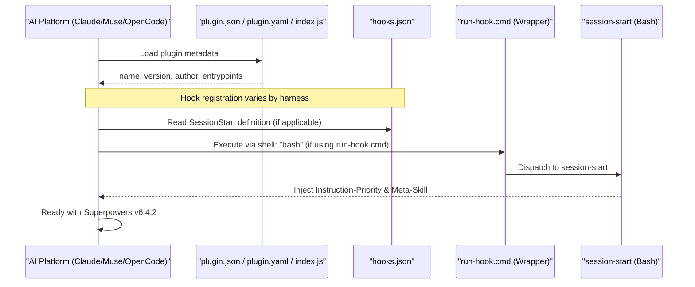

<!-- source: DeepWiki mcp.deepwiki.com · repo obra/superpowers · page 10 Technical Reference · fetched 2026-10-27 -->

# Technical Reference

<details>
<summary>Relevant source files</summary>

The following files were used as context for generating this wiki page:

- [.claude-plugin/plugin.json](.claude-plugin/plugin.json)
- [RELEASE-NOTES.md](RELEASE-NOTES.md)

</details>


This section provides low-level technical documentation for the Superpowers plugin infrastructure. It covers file system layout, configuration file formats, integration mechanisms, and version history. This material is intended for plugin developers, contributors implementing platform integrations, and users troubleshooting installation issues.

For information about the skills content and workflows, see [Core Concepts](#3). For platform-specific integration details, see [Platform-Specific Features](#5). For testing infrastructure, see [Testing Infrastructure](#9).

---

## Purpose and Scope

The Technical Reference documents the mechanical implementation of the Superpowers plugin system. This includes:

- **Directory structure** and file organization ([Directory Structure](#10.1))
- **Configuration file formats** for plugin metadata, hooks, and commands ([Configuration Files](#10.2))
- **Hook execution system** for session initialization ([Hooks System](#10.3))
- **Porting to a new harness** guide ([Porting to a New Harness](#10.4))
- **Environment variables** used across platforms ([Environment Variables](#10.5))
- **Maintainer scripts** for versioning and packaging ([Maintainer Scripts](#10.6))
- **Release history** and release notes ([Release History](#10.7))
- **Design specifications and plans archive** ([Design Specs and Plans Archive](#10.8))

This page serves as a navigational overview. Individual subsections provide detailed specifications for each component.

---

## Repository Architecture

The Superpowers system is designed as a multi-platform plugin that bridges a single skills library across various AI environments. It utilizes a shared `skills/` directory and platform-specific entry points. As of v6.4.1, the architecture has expanded to include native support for OpenCode 2.0, Muse, and Qwen Code.

### Diagram: File System Layout and Technical Components

```mermaid
graph TB
    subgraph "Plugin_Repository [obra/superpowers]"
        ClaudePluginJson[".claude-plugin/plugin.json"]
        ClaudeMarketplaceJson[".claude-plugin/marketplace.json"]
        HooksJson["hooks/hooks.json"]
        RunHook["hooks/run-hook.cmd"]
        SessionStart["hooks/session-start"]
        MuseManifest[".muse-plugin/plugin.json"]
        GeminiExt["gemini-extension.json"]
        DevinConfig[".devin-plugin/plugin.json"]
        OpenCodeIndexJs["opencode-plugin/index.js"]
    end
    
    subgraph "Platform_Entry_Points"
        ClaudeCode["Claude Code (Marketplace)"]
        DevinCLI["Devin CLI (plugins install)"]
        Muse["Muse (plugins install)"]
        GeminiCLI["Gemini CLI (Extensions)"]
        OpenCode["OpenCode (Native API)"]
        QwenCode["Qwen Code (extensions install)"]
    end
    
    ClaudePluginJson -->|"Metadata_For"| ClaudeCode
    ClaudeMarketplaceJson -->|"Registration_For"| ClaudeCode
    HooksJson -->|"Registered_With"| ClaudeCode
    RunHook -->|"Executes"| SessionStart
    SessionStart -->|"Injects"| MetaSkill["skills/using-superpowers/SKILL.md"]
    
    MuseManifest -->|"Metadata_For"| Muse
    DevinConfig -->|"Metadata_For"| DevinCLI
    GeminiExt -->|"Extension_For"| GeminiCLI
    OpenCodeIndexJs -->|"Plugin_Entrypoint_For"| OpenCode
    QwenCode -->|"Install_Via"| QwenCode
```



**Sources:** [.claude-plugin/plugin.json:1-20](), [RELEASE-NOTES.md:61-64](), [RELEASE-NOTES.md:66-68]()

---

## Configuration File Relationships

The plugin uses multiple configuration files that interact to provide cross-platform functionality. Recent versions have focused on scaling ceremony to task size and plan-scoped workspaces to prevent cross-session contamination.

### Diagram: Configuration Loading and Integration Flow



**Sources:** [RELEASE-NOTES.md:61-64](), [RELEASE-NOTES.md:66-68](), [hooks/hooks.json:1-17](), [hooks/run-hook.cmd:1-46]()

---

## Key Directories and Their Purposes

The repository layout organizes platform-specific integrations and shared skill logic. Note that SDD workspaces are now plan-scoped to prevent contamination.

| Directory | Purpose | Key Files |
|-----------|---------|-----------|
| `.claude-plugin/` | Claude Code plugin metadata and marketplace info | `plugin.json`, `marketplace.json` |
| `.superpowers/sdd/` | SDD plan-scoped scratch files | `<plan-basename>/ledger` |
| `hooks/` | Session lifecycle hooks and cross-platform wrappers | `hooks.json`, `run-hook.cmd`, `session-start` |
| `skills/` | The core library of AI workflows and task templates | `using-superpowers/`, `brainstorming/` |
| `tests/` | Test suites for skills and infrastructure | `run-skill-tests.sh`, `test-helpers.sh` |
| `scripts/` | Maintenance and packaging utilities | `bump-version.sh`, `lint-shell.sh` |
| `docs/superpowers/specs/` | Archived design specifications and plans | `sdd-design-spec.md`, `visual-companion-plan.md` |

For a full breakdown of the repository layout, see [Directory Structure](#10.1).

**Sources:** [RELEASE-NOTES.md:55-57](), [RELEASE-NOTES.md:36-37](), [hooks/hooks.json:1-17](), [.claude-plugin/plugin.json:1-20]()

---

## Plugin Metadata and Versioning

The `plugin.json` file provides essential metadata for marketplace integration. Superpowers follows semantic versioning, with `bump-version.sh` handling synchronized updates across multiple harness manifests (Claude, Muse, etc.).

```json
{
  "name": "superpowers",
  "description": "Core skills library for Claude Code...",
  "version": "6.4.2",
  "author": { "name": "Jesse Vincent", ... }
}
```

For details on configuration schemas, see [Configuration Files](#10.2). For the full evolution of the project, see [Release History](#10.7).

**Sources:** [.claude-plugin/plugin.json:1-20](), [RELEASE-NOTES.md:3-4]()

---

## Hooks and Session Lifecycle

The `SessionStart` hook is the primary entry point for context injection. v6.4.1 improved script execution robustness by ensuring bundled scripts are invoked through their interpreter (e.g., `bash scripts/foo.sh`) rather than relying on executable bits, which can be stripped by packagers ([RELEASE-NOTES.md:66-68]()).

- **Triggering:** Fires on `startup`, `clear`, or `compact` to inject the `using-superpowers` bootstrap ([hooks/hooks.json:3-5]()).
- **Polyglot Wrapper:** `run-hook.cmd` acts as a cross-platform bridge, finding `bash.exe` on Windows or executing directly on Unix ([hooks/run-hook.cmd:1-12]()).
- **Harness Support:** OpenCode 2.0, Muse, and Qwen Code now have integrated session start mechanisms ([RELEASE-NOTES.md:61-64]()).
- **SDD Workspaces:** Plans with the same basename no longer share a workspace; each workspace now records its owning plan to prevent collisions ([RELEASE-NOTES.md:55-57]()).

For a deep dive into the hook lifecycle, see [Hooks System](#10.3).

**Sources:** [hooks/hooks.json:1-17](), [hooks/run-hook.cmd:1-46](), [RELEASE-NOTES.md:61-64](), [RELEASE-NOTES.md:66-68](), [RELEASE-NOTES.md:55-57]()

---

## Environment Variables

The plugin relies on environment variables for path resolution and platform-specific logic:

| Variable | Purpose |
|----------|---------|
| `CLAUDE_PLUGIN_ROOT` | Root directory of the installed plugin in Claude Code. |
| `SUPERPOWERS_SKILLS_ROOT` | Path to the core skills library used for discovery. |
| `BRAINSTORM_SERVER_PORT` | Port for the visual brainstorming companion server. |

For a complete reference, see [Environment Variables](#10.5).

**Sources:** [hooks/hooks.json:9-9]()

---

## Release History Overview

The project has evolved through several major architectural phases:

- **v6.4.2**: `writing-plans` skill refined to produce leaner, decision-focused plans, reducing token usage and time ([RELEASE-NOTES.md:3-14]()).
- **v6.4.1**: Introduced `diagnosing-superpowers` skill, rebuilt `executing-plans` for native (inline) execution, and added support for OpenCode 2.0, Muse, and Qwen Code ([RELEASE-NOTES.md:23-25](), [RELEASE-NOTES.md:30-34](), [RELEASE-NOTES.md:61-64]()).
- **v6.4.0**: Never shipped, changes rolled into v6.4.1 ([RELEASE-NOTES.md:20-21]()).

For the comprehensive log of changes, see [Release History](#10.7).

**Sources:** [RELEASE-NOTES.md:1-68](), [.claude-plugin/plugin.json:4-4]()

---

