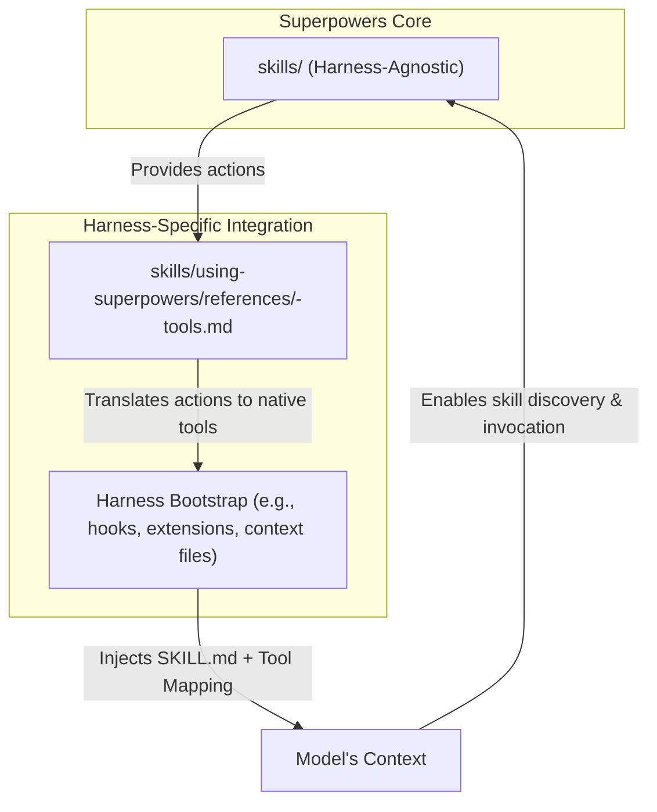
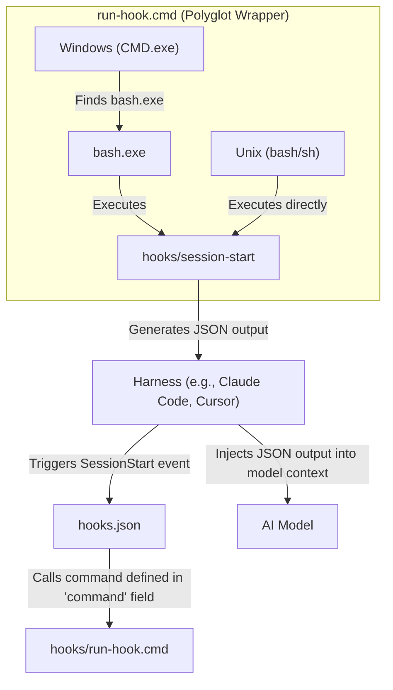

<!-- source: DeepWiki mcp.deepwiki.com · repo obra/superpowers · page 10.4 Porting to a New Harness · fetched 2026-10-27 -->

# Porting to a New Harness

<details>
<summary>Relevant source files</summary>

The following files were used as context for generating this wiki page:

- [docs/porting-to-a-new-harness.md](docs/porting-to-a-new-harness.md)
- [docs/superpowers/specs/2026-05-05-platform-neutral-readme-design.md](docs/superpowers/specs/2026-05-05-platform-neutral-readme-design.md)
- [docs/windows/polyglot-hooks.md](docs/windows/polyglot-hooks.md)
- [tests/hooks/test-session-start.sh](tests/hooks/test-session-start.sh)

</details>


This guide explains how to add support for a new harness — an IDE, CLI, or agent runner that isn't Claude Code — so that Superpowers skills auto-trigger there the same way they do natively [docs/porting-to-a-new-harness.md:3-5]().

It is written in two layers. **Part 1–3** explain how the system works and how to tell whether a harness can be supported at all; read these before you touch anything. **Part 4–8** are a prescriptive procedure for an agent (supervised by a human partner) to execute the port end to end, through distribution. An appendix indexes the current reference integrations so you can copy the closest one [docs/porting-to-a-new-harness.md:7-12]().

The integration mechanism differs across harnesses, and it will keep changing. This guide deliberately teaches the **invariants** — the things that must be true no matter the mechanism — and points you at a live reference implementation to copy. When this guide and the code disagree, the code wins; fix the guide [docs/porting-to-a-new-harness.md:14-17]().

## Before you start

Adding a harness is the highest-stakes contribution type in this repo. Before writing anything:
* Read `CLAUDE.md` and `.github/PULL_REQUEST_TEMPLATE.md` in full — the contributor rules and the new-harness PR requirements are not optional [docs/porting-to-a-new-harness.md:23-24]().
* Search open **and closed** PRs for a prior attempt at this harness. If one exists, understand why it stalled before starting your own [docs/porting-to-a-new-harness.md:25-27]().

Sources: [docs/porting-to-a-new-harness.md:20-27]()

---

## Part 1 — How Superpowers works across harnesses

Superpowers is the same content everywhere. What changes per harness is the thin layer that delivers that content to the model and translates its instructions into the harness's native tools [docs/porting-to-a-new-harness.md:33-35]().

### Three Core Components

1.  **Skills (harness-agnostic).** Everything in `skills/` is the source of truth, shared verbatim by every harness. Skills are written to describe *actions* — "invoke a skill", "read a file", "dispatch a subagent", "create a todo" — and never name a specific tool. This is what lets one skill body run on Claude Code, Codex, Gemini, pi, and the rest without edits [docs/porting-to-a-new-harness.md:37-43]().
2.  **Tool mapping (per-harness).** Each harness needs the action vocabulary translated into its real tool names. That translation lives in `skills/using-superpowers/references/<harness>-tools.md` and/or inline in the harness's bootstrap injector (see Part 5). It says, e.g., "*dispatch a subagent* → call `task` with `subagent_type`" [docs/porting-to-a-new-harness.md:45-48]().
3.  **Bootstrap (per-harness).** At the start of every session, the full `skills/using-superpowers/SKILL.md` is injected into the model's context, wrapped in `<EXTREMELY_IMPORTANT>` tags, with the tool mapping appended. That injected skill is what teaches the model that skills exist and that it must check for a relevant skill before acting. **The bootstrap is the entire integration.** Without it, the skill files are inert — present on disk, never invoked [docs/porting-to-a-new-harness.md:50-56]().

### Diagram: Superpowers Integration Architecture


**Diagram: Superpowers Integration Architecture**

### Two Rules for Integration

1.  **Skills name actions, not tools.** Do **not** edit skill bodies to fit your harness. Porting adds a tool-mapping reference and a bootstrap injector; it never reaches into `skills/*/SKILL.md` to swap tool names. (The project's contributor guidelines treat skill content as carefully-tuned behavior-shaping code; rewording it for "compliance" is rejected on sight.) [docs/porting-to-a-new-harness.md:59-64]()
2.  **Everything ships through the harness's own install mechanism. Never edit the user's files.** The bootstrap, the skills, and the tool mapping all get delivered *as part of what the harness installs* — a plugin, an extension, a marketplace entry, an extension-bundled context file. A port **must not** reach into a user's global or personal config (`~/.gemini/config/AGENTS.md`, `settings.json`, `trustedFolders.json`, a hand-edited `~/.bashrc`, etc.) to inject anything. The harness owns what it loads; your install artifact is the only thing you get to write. If the install mechanism genuinely can't carry the bootstrap, that is a limitation to surface (Part 6) — never a license to hand-edit the user's config. (Shape C is *not* an exception: Gemini's context file is fine because it ships *inside the installed extension* and is declared by the manifest's `contextFileName` — the harness loads the extension's own file, not a file you edited in the user's home.) [docs/porting-to-a-new-harness.md:66-78]()

Sources: [docs/porting-to-a-new-harness.md:33-78]()

---

## Part 2 — Can this harness be supported?

A harness can support Superpowers only if it can do all of the following. Check these before writing code — if the first one fails, stop [docs/porting-to-a-new-harness.md:83-84]().

### Hard requirement: automatic session-start injection

The harness must let you inject text into the model's context **at the start of every session, with no per-session opt-in by your human partner.** This is the one non-negotiable capability [docs/porting-to-a-new-harness.md:87-89](). It can take any form:

*   a **hook/event system** that runs a shell command at session start and reads its stdout (Claude Code, Cursor, Copilot CLI) [docs/porting-to-a-new-harness.md:91-92](), or
*   an **in-process plugin/extension** with a session-start or message lifecycle callback that can mutate the message array (OpenCode, pi) [docs/porting-to-a-new-harness.md:93-95](), or
*   an **instructions-file** convention where the harness loads a context file that *your installed extension ships and declares* (e.g. Gemini's `contextFileName` pointing at the extension's own `GEMINI.md`) — not a file you edit in the user's home [docs/porting-to-a-new-harness.md:96-99]().

If the only way to get Superpowers in front of the model is for your human partner to opt in each session (paste a prompt, run a command, enable a mode), the harness **cannot** be properly supported. The acceptance test in Part 3 will fail, and the PR will be closed. This is the single most common reason a "port" isn't a real port [docs/porting-to-a-new-harness.md:101-105]().

### The rest of the capability checklist

| Capability | Why it's needed | If absent |
|:---|:---|:---|
| **Skill discovery + invocation** | The model must be able to load a skill's full content on demand | If there's no native skill tool, the sanctioned fallback is to `read` the relevant `SKILL.md` directly — see Part 5. A harness with neither a skill tool nor file-read cannot work. |
| **File read / write / edit** | Nearly every skill manipulates files | Essential. No workaround. |
| **Run shell commands** | TDD, verification, git workflows | Essential. |
| **Subagent / task dispatch** | `dispatching-parallel-agents`, `subagent-driven-development` | Degradable: if unavailable, those specific skills tell the model to do the work inline or report the missing capability — *never* to invent a `Task` call. Some harnesses gate this behind a config flag (e.g. Codex needs multi-agent enabled). |
| **Todo / task tracking** | Progress tracking in several skills | Degradable: fall back to a plan file or `TODO.md`. |
| **Web fetch / search** | A few skills | Degradable. |
| **Shell or polyglot script execution (Windows)** | Only for the shell-hook shape, only if you want Windows support | See Part 7. In-process-plugin harnesses sidestep this entirely. |

"Degradable" means: the skill already has fallback wording for the missing tool. Your job in the tool mapping is to point at the real tool when it exists and reuse that fallback wording when it doesn't [docs/porting-to-a-new-harness.md:120-122]().

### You may not need a new directory at all

Some "new harnesses" are really existing integrations under a different name [docs/porting-to-a-new-harness.md:125-126](). For example, Cursor uses the same `session-start` hook as Claude Code, but expects a different JSON output format [tests/hooks/test-session-start.sh:93-102](). Copilot CLI also uses a similar hook but with its own JSON output format [tests/hooks/test-session-start.sh:103-113]().

Sources: [docs/porting-to-a-new-harness.md:83-126](), [tests/hooks/test-session-start.sh:93-113]()

---

## Part 3 — Required Hooks and Bootstrap Injection

The core of porting involves ensuring the harness can execute the `session-start` hook and correctly inject the bootstrap context.

### The `session-start` Hook

The `session-start` hook is responsible for generating the initial context that Superpowers injects into the model. This context includes the `skills/using-superpowers/SKILL.md` content and the harness-specific tool mappings.

The `session-start` script is located at `hooks/session-start` [tests/hooks/test-session-start.sh:6](). It is designed to be polyglot, working across Windows, macOS, and Linux.

#### Polyglot Hook Execution

For shell-based hooks, the `hooks/run-hook.cmd` wrapper handles cross-platform execution [docs/windows/polyglot-hooks.md:3]().


**Diagram: Polyglot Hook Execution Flow**

*   **`hooks.json`**: This file defines how the harness triggers the `session-start` hook. For Claude Code, it specifies `command: "${CLAUDE_PLUGIN_ROOT}/hooks/run-hook.cmd" session-start` and `shell: "bash"` [docs/windows/polyglot-hooks.md:45-57]().
*   **`run-hook.cmd`**: This script acts as a dispatcher. On Windows, it attempts to find and execute `bash.exe` to run the actual `session-start` script. On Unix-like systems, it directly executes the `session-start` script [docs/windows/polyglot-hooks.md:68-96]().
*   **`session-start`**: This is the actual bash script that generates the JSON output containing the bootstrap context. It needs to be extensionless to prevent issues with Claude Code's Windows auto-detection [docs/windows/polyglot-hooks.md:39]().

#### Output Formats

The `session-start` hook must produce JSON output that the harness can consume. Different harnesses expect different JSON structures:

*   **Claude Code**: Expects a "nested" format with `hookSpecificOutput.additionalContext` [tests/hooks/test-session-start.sh:168-176]().
*   **Cursor**: Expects a top-level `additional_context` field [tests/hooks/test-session-start.sh:187-195]().
*   **Copilot CLI**: Expects a top-level `additionalContext` field [tests/hooks/test-session-start.sh:198-206]().

The `assert_command_output` function in `tests/hooks/test-session-start.sh` validates these different output shapes [tests/hooks/test-session-start.sh:33-142]().

### Bootstrap Injection

The `session-start` hook's output is the "bootstrap" that teaches the model about Superpowers. This output includes:

1.  The content of `skills/using-superpowers/SKILL.md`, wrapped in `<EXTREMELY_IMPORTANT>` tags.
2.  The harness-specific tool mapping.

This combined content is injected into the model's context at the beginning of every session [docs/porting-to-a-new-harness.md:50-56]().

Sources: [docs/porting-to-a-new-harness.md:50-56](), [docs/windows/polyglot-hooks.md:3-96](), [tests/hooks/test-session-start.sh:6](), [tests/hooks/test-session-start.sh:33-142](), [tests/hooks/test-session-start.sh:168-206]()

---

## Part 4 — Tool Mapping Reference

Each harness requires a specific mapping from Superpowers' abstract actions (e.g., "dispatch a subagent") to its concrete native tools (e.g., `task` with `subagent_type`) [docs/porting-to-a-new-harness.md:45-48](). This mapping is crucial for the AI model to correctly translate its intentions into executable commands within the harness.

### Location of Tool Mappings

Tool mappings are typically defined in one of two places:

1.  **Dedicated Markdown files**: `skills/using-superpowers/references/<harness>-tools.md` [docs/porting-to-a-new-harness.md:46-47](). This is the preferred method for clarity and discoverability.
2.  **Inline in the harness's bootstrap injector**: For simpler integrations or when the harness's mechanism makes a separate file impractical [docs/porting-to-a-new-harness.md:47]().

### Example Tool Mapping (Conceptual)

```markdown
# <Harness Name> Tool Mapping Reference

This document translates Superpowers actions into native <Harness Name> tools.

## Core Actions

*   **Invoke a skill**:
    *   Superpowers Action: `Skill(<skill_name>, <args>)`
    *   <Harness Name> Tool: `call_tool("execute_skill", {"skill_name": "<skill_name>", "args": <args>})`
*   **Read a file**:
    *   Superpowers Action: `read_file(<path>)`
    *   <Harness Name> Tool: `read_file_tool({"path": "<path>"})`
*   **Write to a file**:
    *   Superpowers Action: `write_file(<path>, <content>)`
    *   <Harness Name> Tool: `write_file_tool({"path": "<path>", "content": "<content>"})`

## Advanced Actions

*   **Dispatch a subagent**:
    *   Superpowers Action: `dispatch_subagent(<type>, <instructions>)`
    *   <Harness Name> Tool: `task({"type": "<type>", "instructions": "<instructions>"})`
*   **Create a todo**:
    *   Superpowers Action: `create_todo(<description>)`
    *   <Harness Name> Tool: `add_todo({"description": "<description>"})`
```

### Degradable Capabilities

For "degradable" capabilities (e.g., subagent dispatch, todo tracking, web fetch), the skill itself contains fallback wording for when the corresponding tool is unavailable [docs/porting-to-a-new-harness.md:120-122](). Your tool mapping should point to the real tool if it exists, and allow the skill's fallback to be used otherwise.

Sources: [docs/porting-to-a-new-harness.md:45-48](), [docs/porting-to-a-new-harness.md:120-122]()

---

## Part 5 — Testing the New Harness Integration

Thorough testing is essential to ensure the new harness integration works as expected. This involves verifying the `session-start` hook output and the overall skill invocation flow.

### `test-session-start.sh`

The `tests/hooks/test-session-start.sh` script is the primary tool for verifying the `session-start` hook's output [tests/hooks/test-session-start.sh:145](). It checks:

*   **`hooks.json` registration**: Ensures the `SessionStart` hook is registered with `shell:bash` and the correct command format [tests/hooks/test-session-start.sh:150-165]().
*   **Output shape**: Verifies that the `session-start` script produces JSON in the expected format for different harnesses (e.g., "nested" for Claude Code, "cursor" for Cursor, "sdk" for Copilot CLI) [tests/hooks/test-session-start.sh:167-207]().
*   **Content**: Can assert that the output contains or does not contain specific text, ensuring the correct bootstrap context is injected [tests/hooks/test-session-start.sh:122-134]().

#### Example Test Invocation

To test the `session-start` hook for a new harness, you would typically invoke `test-session-start.sh` with environment variables mimicking the harness's environment.

```bash
# Example for a hypothetical 'NewHarness'
NEW_HARNESS_ROOT="/path/to/new-harness-plugin" \
NEW_HARNESS_ENV_VAR="1" \
bash tests/hooks/test-session-start.sh
```

You would then extend `tests/hooks/test-session-start.sh` to include an `assert_command_output` call for your new harness's expected output shape.

```javascript
// Excerpt from tests/hooks/test-session-start.sh:54-116
// This Node.js snippet is used by assert_command_output to validate JSON output
if (shape === "new_harness") { // Add a new shape for your harness
  if (hasOwn(payload, "hookSpecificOutput")) {
    fail("new_harness output included hookSpecificOutput");
  }
  if (!hasOwn(payload, "myCustomContextField")) { // Check for your harness's specific context field
    fail("new_harness output missing myCustomContextField");
  }
  context = payload.myCustomContextField; // Assign the correct context field
}
```
Sources: [tests/hooks/test-session-start.sh:33-142](), [tests/hooks/test-session-start.sh:145](), [tests/hooks/test-session-start.sh:150-165](), [tests/hooks/test-session-start.sh:167-207]()

---

