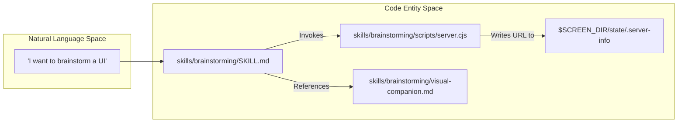
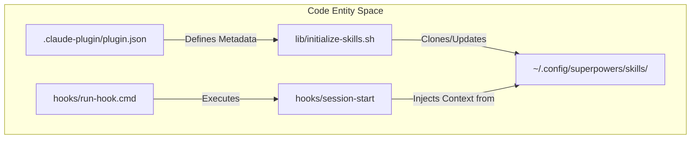

<!-- source: DeepWiki mcp.deepwiki.com · repo obra/superpowers · page 10.7 Release History · fetched 2026-10-27 -->

# Release History

Relevant source files

The following files were used as context for generating this wiki page:

- [.claude-plugin/plugin.json](.claude-plugin/plugin.json)
- [RELEASE-NOTES.md](RELEASE-NOTES.md)

This page documents the complete version history of the Superpowers plugin from v1.0.0 through v6.4.x. Each release includes breaking changes, new features, architectural shifts, and technical bug fixes.

**Sources:** [RELEASE-NOTES.md:1-68](), [.claude-plugin/plugin.json:4-4]()

---

## v6.4.x Series (September 2026)

The v6.4.x series introduces a new diagnostic skill, re-architects `executing-plans` for native execution, and refines the `writing-plans` skill for leaner, more focused plans. It also expands harness support to OpenCode 2.0, Muse, and Qwen Code.

### v6.4.2 (2026-09-25)

This release focuses on refining the `writing-plans` skill to produce leaner, more decision-oriented plans, reducing token usage and planning time.

**Writing Plans Improvements:**
- **Decision-Oriented Plans**: Plans now record decisions (signatures, test assertions, spec values) rather than attempting to implement code. The "What a Step Contains" section replaces "No Placeholders." Test steps name tests and assertions, code steps provide exact signatures and files, and verification steps give commands and expected output. [RELEASE-NOTES.md:9-9]()
- **Self-Review for Proportion**: The skill now compares the plan's length to the spec's. Overly long plans or those dominated by code blocks are flagged for revision, with bodies replaced by signatures and test assertions. [RELEASE-NOTES.md:10-10]()
- **Capable Reader Assumption**: The plan's reader is described as a capable engineer who writes idiomatic code given exact interfaces and tests, replacing the "zero context, questionable taste" assumption. Task sizing is now "one action with a checkable result" instead of time estimates. [RELEASE-NOTES.md:11-11]()
- **Evaluation Results**: Plans generated by the new skill executed 9/9 against planted-defect probes on Sonnet 5, matching full-code plans. [RELEASE-NOTES.md:12-12]()
- **Removed `plan-document-reviewer-prompt.md`**: This prompt was unused and has been removed. [RELEASE-NOTES.md:13-13]()

**Documentation:**
- **Removed `CLAUDE.md`**: Claude Code now directly reads `AGENTS.md` if `CLAUDE.md` is absent. The one-line pointer in `CLAUDE.md` was removed to ensure the correct guidelines are exposed. [RELEASE-NOTES.md:17-17]()

**Sources:** [RELEASE-NOTES.md:3-18]()

### v6.4.1 (2026-09-18)

This release introduces the `diagnosing-superpowers` skill, re-architects `executing-plans` for native execution, and adds support for OpenCode 2.0, Muse, and Qwen Code. Note that v6.4.0 was not shipped.

**New Skills:**
- **`diagnosing-superpowers`**: A new skill to analyze session failures (e.g., repeated work, ignored plans, skill invocation issues, surprising costs). It reads transcripts, reports findings with `path:line` evidence, and can generate scrubbed bundles or GitHub issues. [RELEASE-NOTES.md:27-27]()

**Executing Plans (Native Execution):**
- **Rebuilt Native Mode**: `executing-plans` is no longer a stub. It now runs the entire plan inline within the session, using the same workspace, ledger, and stopping rules as SDD. It concludes with a single, fresh whole-branch review. This is the cheapest execution method and performs well on mid-tier models. [RELEASE-NOTES.md:33-33]()
- **Handoff Options**: The plan handoff now explicitly offers "Subagent-driven" and "Native" approaches, detailing costs and recommending one based on the plan. [RELEASE-NOTES.md:35-35]()
- **Breaking Change**: `executing-plans` no longer stops for user checks after every few tasks; it performs one review at the end. [RELEASE-NOTES.md:31-31]()

**Writing Plans:**
- **Mandatory Plan Review**: Users must now review and approve the saved plan before any execution begins, ensuring alignment with the actual plan, not just the idea or scope. [RELEASE-NOTES.md:38-38]()
- **Review Focus Section**: Plans now include a "Review Focus" section, highlighting up to five inputs or failure modes implied by the spec but not covered by task tests. This aims to catch edge cases missed in initial testing. [RELEASE-NOTES.md:39-39]()

**Brainstorming:**
- **Intent-Driven Brainstorming**: Brainstorming now prioritizes understanding user intent before proposing features, reflecting it back for correction. Approval is tied to the actual design and planning stages, preventing premature scaffolding. [RELEASE-NOTES.md:43-43]()

**Code Review:**
- **Behavioral Judgment**: Reviewers now judge behavior not explicitly mentioned in the spec based on reasonable user expectations, preventing "Minor" classifications for crashes on unnamed inputs. A "Declined to judge" list allows the session to decide on skipped items. [RELEASE-NOTES.md:47-47]()
- **`BASE_SHA` Alternative**: The multi-commit `BASE_SHA` now uses `git merge-base origin/main HEAD` to correctly identify the branch point, avoiding phantom deletions. [RELEASE-NOTES.md:48-48]()

**Test-Driven Development:**
- **Project-Wide Test Suite**: The skill now mandates running the project's full test command and reporting all failures by name, including those not directly caused by the current task. This prevents isolated test files from hiding broader issues. [RELEASE-NOTES.md:52-52]()

**Subagent-Driven Development:**
- **Plan-Specific Workspaces**: Workspaces are no longer shared by plans with the same basename (e.g., `docs/alpha/plan.md` and `docs/beta/plan.md`). Each workspace now records its owning plan, and collisions result in a new directory. Existing workspaces are adopted in place. [RELEASE-NOTES.md:56-56]()
- **`review-package` Validation**: `review-package` now rejects empty or non-descendant `BASE..HEAD` ranges (exit 3), preventing "clean" reviews of nothing. [RELEASE-NOTES.md:58-58]()
- **Nested Subagent Controller (Claude Code)**: On Claude Code, the controller can optionally run as a nested subagent on a mid-tier model, reducing cost and wall clock time. This is opt-in. [RELEASE-NOTES.md:59-59]()

**New Harness Support:**
- **OpenCode 2.0.4+**: Supported alongside V1. Skills register via V2's native API, and the bootstrap persists across continuations, restarts, forks, and compaction. Child sessions no longer receive the controller's bootstrap. [RELEASE-NOTES.md:62-62]()
- **Muse**: Added native plugin manifest and `SessionStart` hook. Installation via `muse plugins install ./` and `muse plugins approve superpowers`. [RELEASE-NOTES.md:63-63]()
- **Qwen Code**: Added to install documentation: `qwen extensions install obra/superpowers`. [RELEASE-NOTES.md:64-64]()

**Fixes:**
- **Executable Bits Stripping**: Skills now invoke bundled scripts through their interpreter (e.g., `bash scripts/foo.sh`, `node render-graphs.js`) to ensure functionality even when packagers strip executable bits. SDD helpers also use this method. [RELEASE-NOTES.md:67-67]()

**Sources:** [RELEASE-NOTES.md:20-68]()

---

## v6.3.x Series (August 2026)

The v6.3.x series focuses on expanding the harness ecosystem and refining the efficiency of the Subagent-Driven Development (SDD) and Brainstorming workflows.

### v6.3.0 (2026-08-12)

**Harness Support Expansion:**
- **Devin CLI**: Native support via `devin plugins install obra/superpowers`. Skills now auto-trigger at session start. [RELEASE-NOTES.md:7-7]()
- **Hermes Agent**: Skills register with Hermes' native loader, with the bootstrap loading on the first turn. [RELEASE-NOTES.md:8-8]()
- **Grok Build CLI**: Added to official installation documentation. [RELEASE-NOTES.md:9-9]()

**Brainstorming Scalability:**
- **Tiered Ceremony**: Brainstorming now classifies requests as **spike**, **bounded**, or **architectural**. Small tasks skip the two-document ritual (Design + Spec) while maintaining a mandatory human approval gate before implementation. [RELEASE-NOTES.md:13-13]()

**Subagent-Driven Development (SDD) Refinements:**
- **Conflict Resolution**: Controllers no longer stall on non-catastrophic plan conflicts or ambiguities. They record a ruling in the ledger and continue; only destructive or irreversible actions trigger a human stop. [RELEASE-NOTES.md:17-17]()
- **Batch Dispatching**: Small tasks of similar shape are now batched into a single subagent dispatch, significantly reducing costs for micro-task plans. [RELEASE-NOTES.md:19-19]()
- **Spec-Aware SDD**: Plans now carry a `Spec:` pointer. SDD reads the design specification at setup to resolve conflicts against the original intent rather than guessing. [RELEASE-NOTES.md:21-21]()
- **Subagent Recursion Prevention**: Implementers and reviewers are now restricted from spawning their own subagents to prevent duplicate review loops. [RELEASE-NOTES.md:20-20]()

**Codex Enhancements:**
- **Event-Driven Waits**: Subagent waits in Codex are now event-driven instead of poll-heavy. [RELEASE-NOTES.md:26-26]()
- **Model Pinning**: Spawns now explicitly pin the model and reasoning effort. [RELEASE-NOTES.md:26-26]()

**Safety & Fixes:**
- **Worktree Safety**: `git worktree remove` no longer uses `--force` by default. If untracked files exist, the skill stops and identifies the files for the user. [RELEASE-NOTES.md:30-30]()
- **Cross-Platform Fixes**: `render-graphs.js` fixed for Windows; Hermes manifest added to `bump-version.sh`. [RELEASE-NOTES.md:34-36]()

**Sources:** [RELEASE-NOTES.md:3-38]()

---

## v6.2.x Series (July 2026)

### v6.2.0 (2026-07-23)

**Plan-Scoped Workspaces:**
- **Isolation**: The SDD workspace moved from a generic `.superpowers/sdd/` to a plan-specific directory: `.superpowers/sdd/<plan-basename>/`. This prevents "ledger contamination" where a new plan might read the progress of a previous one. [RELEASE-NOTES.md:48-48]()
- **Lifecycle Management**: Workspaces are now deleted once the final review is clean, relying on Git history as the durable record. [RELEASE-NOTES.md:48-48]()

**Review-Fix Loop Redesign:**
- **Resume Semantics**: Fix rounds now use "resume-the-implementer" semantics rather than fresh dispatches. [RELEASE-NOTES.md:49-49]()
- **Scoped Re-review**: Introduced `re-review-prompt.md` to ensure reviewers focus only on the fixes rather than re-evaluating the entire task. [RELEASE-NOTES.md:49-49]()

**Skill Compression Campaign:**
- **Prose Removal**: Removed "Bottom Line," "Key Principles," and persuasive prose across the library to reduce token overhead. Load-bearing arguments were moved into "Common Rationalizations" tables. [RELEASE-NOTES.md:53-59]()
- **TDD Evolution**: `testing-anti-patterns.md` was renamed to `writing-good-tests.md`, focusing on falsifiability and behavior-based testing over text-matching. [RELEASE-NOTES.md:55-55]()

**Windows Session Bootstrapping:**
- **Git Bash Dispatch**: The `SessionStart` hook now explicitly declares `shell: "bash"`. This allows Claude Code (≥ 2.1.81) to resolve Git for Windows directly, bypassing PowerShell and `cmd.exe` quoting issues. [RELEASE-NOTES.md:62-62]()

**Sources:** [RELEASE-NOTES.md:42-66]()

---

## v6.1.x Series (July 2026)

### v6.1.1 (2026-07-02)

**Codex Hook Resolution:**
- **Explicit Hook Declaration**: The Codex manifest now explicitly declares `hooks: {}` to prevent auto-discovery from falling back to Claude Code's `hooks.json`. [RELEASE-NOTES.md:7-7]()
- **Dead Code Removal**: Deleted `hooks/session-start-codex` as Codex transitioned to native skill discovery. [RELEASE-NOTES.md:8-8]()

**Packaging Automation:**
- **`package-codex-plugin.sh`**: A new maintainer script for building deterministic Codex "portal" archives, normalizing timestamps and OpenAI metadata. [RELEASE-NOTES.md:12-12]()

**Sources:** [RELEASE-NOTES.md:3-13]()

### v6.1.0 (2026-06-30)

**Token Cost Optimization:**
- **Bootstrap Compression**: The `using-superpowers` bootstrap was trimmed. Graphviz diagrams were replaced with prose to save tokens. [RELEASE-NOTES.md:20-20]()

**Harness Changes:**
- **Gemini CLI EOL**: Support for Gemini CLI was removed following its end-of-life. [RELEASE-NOTES.md:30-31]()
- **Codex Marketplace**: Added `.agents/plugins/marketplace.json` for direct Codex installation. [RELEASE-NOTES.md:25-25]()

**Sources:** [RELEASE-NOTES.md:14-31]()

---

## v6.0.x Series (June 2026)

### v6.0.0 (2026-06-16)

**SDD Rewrite:**
- **Consolidated Reviewers**: Merged `spec-reviewer-prompt.md` and `code-quality-reviewer-prompt.md` into `task-reviewer-prompt.md`. [RELEASE-NOTES.md:53-56]()
- **New Harnesses**: Added support for Kimi Code, Pi, and Antigravity (`agy`). [RELEASE-NOTES.md:68-70]()

**Sources:** [RELEASE-NOTES.md:32-71]()

---

## v5.0.0 (2026-03-09)

### Visual Brainstorming Companion
Introduced a browser-based companion for brainstorming sessions to display mockups and diagrams.

**Visual Companion Architecture:**

**Sources:** [RELEASE-NOTES.md:137-145](), [RELEASE-NOTES.md:29-29]()

---

## v2.0.0 (2025-10-12)

### Repository Separation
Transformed Superpowers into a lightweight shim that clones a dedicated skills repository into `~/.config/superpowers/skills/`.

**Plugin Bootstrapping Flow:**

**Sources:** [RELEASE-NOTES.md:774-915](), [.claude-plugin/plugin.json:1-13](), [hooks/run-hook.cmd:1-46]()

---

## Version Metadata Summary

| Version | Release Date | Primary Focus |
|---------|--------------|---------------|
| v6.4.2  | 2026-09-25   | Leaner Writing Plans |
| v6.4.1  | 2026-09-18   | Diagnosing Superpowers, Native Execution, OpenCode/Muse/Qwen Support |
| v6.3.0  | 2026-08-12   | Devin/Hermes Support & SDD Efficiency |
| v6.2.0  | 2026-07-23   | Plan-Scoped Workspaces & Windows Fixes |
| v6.1.1  | 2026-07-02   | Codex Hook Fixes & Packaging |
| v6.1.0  | 2026-06-30   | Token Optimization & Gemini EOL |
| v6.0.0  | 2026-06-16   | SDD Rewrite & New Harnesses |
| v5.1.0  | 2026-04-30   | Legacy Removal & Worktree Safety |
| v5.0.0  | 2026-03-09   | Visual Companion & Review Loops |
| v2.0.0  | 2025-10-12   | Repository Separation |

**Sources:** [RELEASE-NOTES.md:1-68](), [.claude-plugin/plugin.json:4-4]()

---

