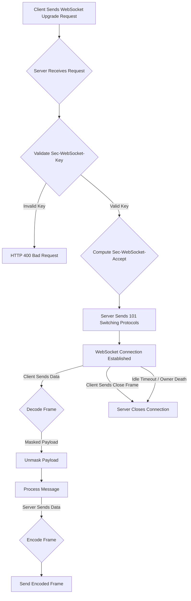

<!-- source: DeepWiki mcp.deepwiki.com · repo obra/superpowers · page 11 Visual Companion Server Internals · fetched 2026-10-27 -->

# Visual Companion Server Internals

Relevant source files

The following files were used as context for generating this wiki page:

- [skills/brainstorming/scripts/server.cjs](skills/brainstorming/scripts/server.cjs)
- [skills/brainstorming/scripts/start-server.sh](skills/brainstorming/scripts/start-server.sh)
- [tests/brainstorm-server/branding.test.js](tests/brainstorm-server/branding.test.js)

This page provides a high-level overview of the Visual Companion Server, a zero-dependency Node.js server that powers the brainstorming skill's interactive UI. It details the server's architecture, its communication protocols, and how it manages content and user interaction. For in-depth technical specifications, refer to the linked child pages.

The server is designed to be lightweight and self-contained, providing a robust and secure environment for displaying dynamic content and receiving feedback from the user. It handles its own HTTP and WebSocket communication, session management, and content rendering without relying on external frameworks.

## Server Startup and Shutdown

The Visual Companion Server is launched and managed by shell scripts, primarily `start-server.sh` and `stop-server.sh`. These scripts handle the server's lifecycle, including setting up session directories, managing port binding, and ensuring proper shutdown.

The `start-server.sh` script [skills/brainstorming/scripts/start-server.sh:1-209]() parses command-line arguments to configure the server, such as specifying a project directory for persistent session files, binding host, and idle timeout. It determines whether to run the server in the foreground or background, adapting to different environments like Codex CI or Windows-like shells [skills/brainstorming/scripts/start-server.sh:97-107](). It also sets up a unique session directory [skills/brainstorming/scripts/start-server.sh:114-124]() and creates a `server-info` file [skills/brainstorming/scripts/start-server.sh:129]() containing details about the running server. The server attempts to reuse a previously bound port and session key if available, ensuring continuity across restarts [skills/brainstorming/scripts/server.cjs:89-98]().

For a detailed explanation of CLI flags, session directories, port binding, and background/foreground operation, see [Server Startup and Shutdown](#11.1).

Sources:
- skills/brainstorming/scripts/start-server.sh
- skills/brainstorming/scripts/server.cjs

## HTTP, WebSocket, and Auth Layer

The Visual Companion Server implements its own HTTP and WebSocket communication layers. It does not rely on external libraries for these protocols, instead providing a hand-rolled implementation of RFC 6455 for WebSocket framing [skills/brainstorming/scripts/server.cjs:6-81]().

### WebSocket Protocol Implementation

Title: WebSocket Connection Flow
Sources:
- skills/brainstorming/scripts/server.cjs

The server handles various HTTP endpoints for serving static assets and the main companion page. Authentication is managed through a session key, which is passed as a query parameter (`?key=`) in the initial URL and then mirrored into a cookie for subsequent requests and WebSocket communication [skills/brainstorming/scripts/server.cjs:115-122](). This mechanism ensures secure communication and defeats DNS rebinding attacks. The server also includes idle and owner-death watchdogs to automatically shut down the server when it's no longer needed [skills/brainstorming/scripts/server.cjs:113-114]().

For a deep dive into the RFC 6455 framing, endpoints, session key/cookie authentication, origin checks, and watchdog mechanisms, see [HTTP, WebSocket, and Auth Layer](#11.2).

Sources:
- skills/brainstorming/scripts/server.cjs

## Content Rendering and Event Feedback

The server is responsible for rendering the visual companion's UI and providing a feedback mechanism for events. It uses `frame-template.html` and `helper.js` to construct the user interface.

The server watches for changes in content fragments within the session directory [skills/brainstorming/scripts/server.cjs:103-104](). When changes are detected, it debounces updates and broadcasts a reload signal to connected WebSocket clients, ensuring the UI is always up-to-date. User interactions and other events from the client are sent back to the server via a JSONL (JSON Lines) feedback loop, which is written to an `events.jsonl` file within the session's state directory.

For more details on `frame-template.html`, `helper.js`, content watching, debouncing, reload broadcasts, and the `events.jsonl` feedback loop, see [Content Rendering and Event Feedback](#11.3).

Sources:
- skills/brainstorming/scripts/server.cjs
- tests/brainstorm-server/branding.test.js

---

