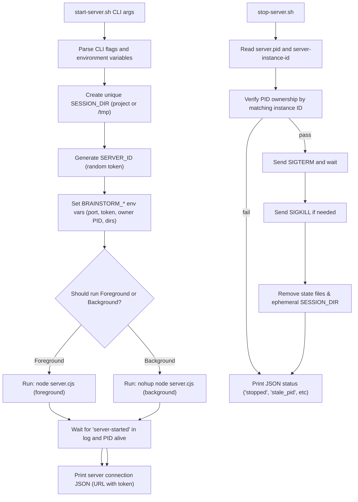
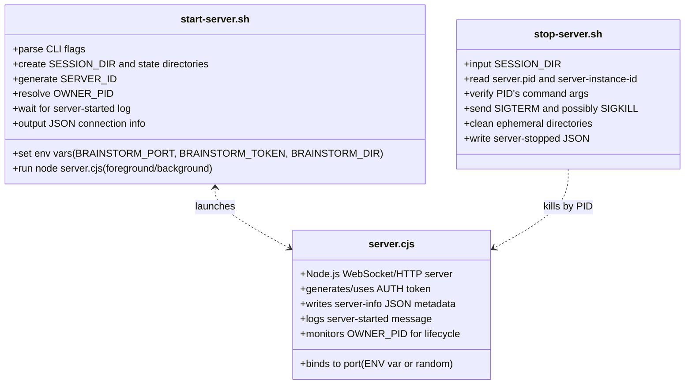

<!-- source: DeepWiki mcp.deepwiki.com · repo obra/superpowers · page 11.1 Server Startup and Shutdown · fetched 2026-10-27 -->

# Server Startup and Shutdown

Relevant source files

The following files were used as context for generating this wiki page:

- [docs/superpowers/plans/2026-06-09-visual-companion-issues.md](docs/superpowers/plans/2026-06-09-visual-companion-issues.md)
- [skills/brainstorming/scripts/server.cjs](skills/brainstorming/scripts/server.cjs)
- [skills/brainstorming/scripts/start-server.sh](skills/brainstorming/scripts/start-server.sh)
- [skills/brainstorming/scripts/stop-server.sh](skills/brainstorming/scripts/stop-server.sh)
- [tests/brainstorm-server/branding.test.js](tests/brainstorm-server/branding.test.js)
- [tests/brainstorm-server/stop-server.test.sh](tests/brainstorm-server/stop-server.test.sh)

This page provides a comprehensive technical overview of the startup and shutdown mechanisms for the Superpowers visual brainstorming companion server. It documents the two primary shell scripts, `start-server.sh` and `stop-server.sh`, explaining their command-line flags, how they manage session directories, port binding and fallback strategies, the creation and use of server-info metadata files, and how the server is run either in background or foreground modes depending on environment constraints.

---

## 1. Introduction to Server Startup and Shutdown

The brainstorming visual companion runs as a local Node.js HTTP + WebSocket server implemented in `server.cjs`. Server lifecycle management is handled by wrapper scripts in `skills/brainstorming/scripts`:

- `start-server.sh`: to initialize and launch a new server instance for a brainstorming session.
- `stop-server.sh`: to cleanly terminate a running server and optionally remove ephemeral session state.

Each brainstorm session uses a unique directory to store runtime state and content, avoiding conflicts and enabling persistence where desired. Ports and authentication tokens may be reused across restarts to support session continuity.

This page details how these scripts function, their parameterization, the data flow of state files, and decisions around foreground/background process execution.

---

## 2. `start-server.sh` — Launching the Brainstorm Server

### 2.1. Purpose and Overview

`start-server.sh` is a shell script that boots the brainstorming server process and outputs JSON describing how clients can connect.

- It spawns the `server.cjs` Node.js server.
- Chooses a session directory to isolate state.
- Handles port binding, including reading a last-used port or choosing a random high port.
- Emits connection info including URL with an embedded session secret key for authentication.
- Supports both background and foreground execution, adapting to environment constraints such as CI or Windows shell behavior.
- Can optionally auto-open a browser to the session.

### 2.2. Command-Line Flags and Environment Variables

`start-server.sh` accepts these flags:

| Flag                      | Description                                                                                                    |
|---------------------------|----------------------------------------------------------------------------------------------------------------|
| `--project-dir <path>`    | Use `<path>/.superpowers/brainstorm/` for session persistence instead of a temporary `/tmp` directory.          |
| `--host <bind-host>`      | Host/IP to bind the server to. Defaults to `127.0.0.1`. Use `0.0.0.0` to allow remote/container access.          |
| `--url-host <host>`       | Hostname shown in the returned URL JSON for clients to use. Defaults to bind-host or localhost.                 |
| `--idle-timeout-minutes`  | Automatically shut down the server after this many idle minutes (default 240).                                 |
| `--open`                  | Auto-open the browser to the initial screen (after explicit user approval).                                    |
| `--foreground`            | Force running the server in the current terminal foreground (no backgrounding).                               |
| `--background`            | Force background execution, overriding automatic foreground detection.                                         |

These flags set or export corresponding environment variables used by the Node.js server and by script logic.

### 2.3. Session Directory Creation and File Layout

- A unique session ID is generated from PID and timestamp to create an isolated session directory.
- If `--project-dir` is specified, the session directory is placed under `<project-dir>/.superpowers/brainstorm/<session_id>`. This persists after the server stops.
- Otherwise, it creates `/tmp/brainstorm-<session_id>` for an ephemeral session.
- Inside the session directory:

  - `content/`: server-served content directory.
  - `state/`: stores runtime server information and logs.
  
  Files in the `state/` directory include:

  - `server.pid`: the PID of the running server process.
  - `server-instance-id`: a random string serving as a per-startup unique ID.
  - `server.log`: server console output.
  - `server-info`: JSON metadata including bound port, URL, and token (created by `server.cjs`).
  - `.last-port` and `.last-token` in persistent `.superpowers/brainstorm` to keep stable port/token across restarts.

### 2.4. Port Binding and Fallback Logic

- Default binding host: `127.0.0.1`.
- The preferred port is chosen by the function `preferredPort()`:

  1. If `BRAINSTORM_PORT` environment variable is set, use it.
  2. Else if `.last-port` file exists, reuse the port recorded from the last session.
  3. Else pick a random high port between 49152 and 65535.

- The server exposes this port, and the startup script waits and verifies the server has successfully bound by monitoring logs.

### 2.5. Foreground vs Background Execution

Superpowers auto-detects environments where backgrounding is problematic (e.g., Windows Git Bash, CI environments like Codex) and runs the server in the foreground by default unless overridden.

- If in foreground mode:
  - The script runs `node server.cjs` inline, passes environment variables including `BRAINSTORM_OWNER_PID` (harness PID), and waits for process completion.
- Otherwise, it starts the process with `nohup` and redirects logs to the session's `server.log` file, disowning the process to allow the shell to exit.
- This ensures the server process can survive shell or parent process exit.

### 2.6. Owner PID Resolution

- The harness PID (parent process) is resolved through `ps` by walking the process tree.
- On Windows and MSYS shells, PID visibility is unreliable, so the owner PID variable is cleared to disable owner-pid lifecycle watchdogs in the Node.js server.

### 2.7. Output

- `start-server.sh` prints to stdout a JSON string containing the server URL with embedded secret key for client authentication.
- This JSON is parsed by higher-level tools to direct users or agents to connect securely.

---

## 3. `stop-server.sh` — Stopping the Brainstorm Server

### 3.1. Purpose and Overview

`stop-server.sh` takes a session directory argument and attempts to cleanly terminate the associated brainstorming server instance.

- It reads the `server.pid` file under `<session_dir>/state/`.
- Verifies the PID actually corresponds to the running server instance by matching the per-startup `server-instance-id`.
- Sends signals to kill the server gracefully and escalates to SIGKILL if necessary.
- Cleans up server state files and optionally deletes the session directory if ephemeral (i.e., under `/tmp`).
- For persistent sessions (`.superpowers` directory), it preserves session files to allow later review.

### 3.2. PID Ownership Verification

To prevent signaling unrelated processes due to PID reuse or stale PID files:

- Reads the expected instance ID from `server-instance-id`.
- Checks the command line of the PID process to confirm it is the `node server.cjs` with the matching `--brainstorm-server-id=<id>` argument.
- This ensures the signal is sent only to the correct process.

### 3.3. Shutdown Procedure

- Sends `SIGTERM`.
- Waits up to approximately 2 seconds for graceful shutdown (polling PID).
- If still alive, sends `SIGKILL`.
- Reports failure if the process does not terminate.
- Removes pid, instance id, and log files.
- Writes a JSON `server-stopped` file recording the stop reason and timestamp.
- Deletes the session directory only if ephemeral (path under `/tmp`).

### 3.4. Return Values and Output

- On success, prints `{"status": "stopped"}`.
- If the server is not running or PID stale, prints `{"status": "not_running"}` or `{"status": "stale_pid"}`.
- Detailed error JSON on failure.

---

## 4. Data Flow and File Interactions

### 4.1. Session State Artifacts

The startup script manages these files in the session directory to coordinate server lifecycle:

| File Path                          | Purpose                                                      |
|----------------------------------|--------------------------------------------------------------|
| `${SESSION_DIR}/content/`          | Directory for server-served content (HTML fragments)         |
| `${SESSION_DIR}/state/server.pid` | PID of current server process                                 |
| `${SESSION_DIR}/state/server-instance-id` | Unique ID per server start, used for PID verification  |
| `${SESSION_DIR}/state/server-info` | JSON file with server metadata including `url` and `token`   |
| `${SESSION_DIR}/state/server-stopped` | JSON file indicating server stop reason and timestamp      |
| `${SESSION_DIR}/state/server.log` | Server stdout/stderr log                                      |
| `.last-port` (persistent sessions) | Last bound port to enable reuse on restart                  |
| `.last-token` (persistent sessions) | Authentication token persisted between runs                 |

### 4.2. Authentication Token and URL

- The server generates a 32-byte random session token (`token`) used to authenticate clients.
- The server includes `?key=<token>` in the served URL.
- This URL is reflected in `server-info` JSON to clients.
- The token is also stored in `.last-token` in persistent sessions for reuse.

### 4.3. Startup Waiting and Health Check

- After launching the server process, `start-server.sh` tails the log to detect the "server-started" message.
- It then polls the server PID to verify the process did not die prematurely.
- On failure, it outputs error JSON.

---

## 5. Background vs. Foreground Execution Decision Logic

The startup script automatically detects if it is running in certain environments where backgrounding is unsafe:

- CI environments (identified by environment variables like `CODEX_CI`).
- Windows-based shells like Git Bash, MSYS, Cygwin.

In these cases, it forces foreground mode to avoid detached processes being "reaped" or killed unexpectedly.

Otherwise, by default (or if forced by `--background`), it runs the server detached with `nohup` and redirects output.

---

## 6. Mermaid Diagrams for Startup and Shutdown Flow

### 6.1. Overview: Start and Stop Commands to Server Lifecycle

### 6.2. Key Code and Script Entity Mapping Diagram

---

## 7. Additional Details and Best Practices

### 7.1. Security: Session Key Authentication

The server implements a per-session secret key authentication carried in the URL query string `?key=` and mirrored to an HttpOnly SameSite cookie. This authenticates browser clients and WebSocket handshakes, defending against remote unauthorized access and DNS rebinding attacks.

The startup script ensures token stability across restarts when using persistent project directories, improving usability and security.

### 7.2. Port Reuse Behavior

When using persistent sessions, ports and tokens are reused across restarts by reading `.last-port` and `.last-token`. This avoids invalidating already opened browser tabs or sessions upon server restarts.

### 7.3. Session Directory Lifetime

Ephemeral sessions (in `/tmp`) are removed automatically on server stop to avoid clutter. Persistent sessions inside a project directory are preserved, allowing mockups and logs to be reviewed later.

---

## 8. Summary

The `start-server.sh` and `stop-server.sh` scripts provide robust, configurable lifecycle management of the brainstorming visual companion server for Superpowers. With intelligent CLI options, environment detection, session isolation, and authentication token handling, they enable seamless local or remote use in diverse environments, supporting both ephemeral and persistent data lifecycles.

---

## Sources

- `skills/brainstorming/scripts/start-server.sh`: Lines 1-197
- `skills/brainstorming/scripts/stop-server.sh`: Lines 1-121
- `skills/brainstorming/scripts/server.cjs`: Lines 1-179 (for configuration and token details)
- `docs/superpowers/plans/2026-06-09-visual-companion-issues.md`: Lines 1-114

---

