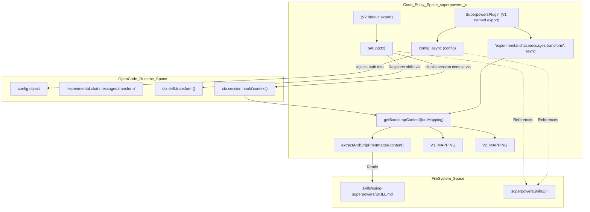
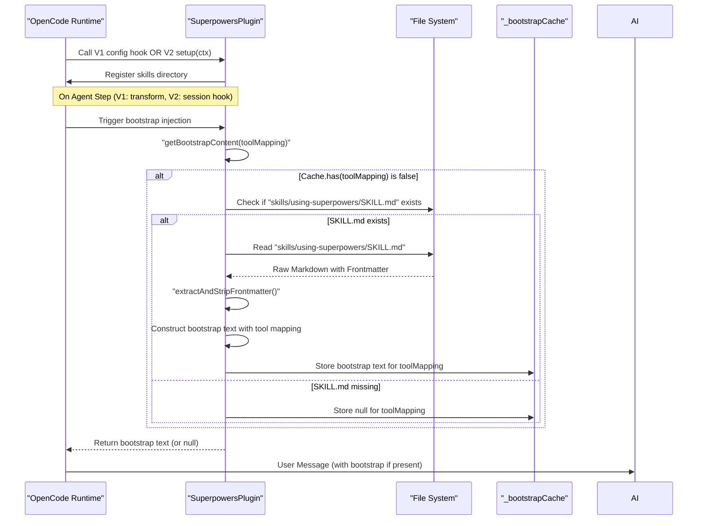

<!-- source: DeepWiki mcp.deepwiki.com · repo obra/superpowers · page 2.3 Installing on OpenCode · fetched 2026-10-27 -->

# Installing on OpenCode

<details>
<summary>Relevant source files</summary>

The following files were used as context for generating this wiki page:

- [.opencode/INSTALL.md](.opencode/INSTALL.md)
- [.opencode/plugins/superpowers.js](.opencode/plugins/superpowers.js)
- [docs/README.opencode.md](docs/README.opencode.md)
- [docs/testing.md](docs/testing.md)
- [tests/opencode/test-bootstrap-caching.mjs](tests/opencode/test-bootstrap-caching.mjs)

</details>


This page documents the installation process for Superpowers on [OpenCode.ai](https://opencode.ai). It covers the modern one-line configuration method, the underlying plugin implementation, and the automatic skill discovery mechanism.

## Installation Overview

Superpowers integrates with OpenCode via a JavaScript plugin that automates environment setup. Unlike previous versions that required manual symlinks, the current installation is handled by adding a single entry to your `opencode.json` configuration file. The plugin auto-installs via OpenCode's plugin manager and registers all skills automatically upon restart.

**Sources:** [.opencode/INSTALL.md:1-18](), [docs/README.opencode.md:1-17]()

---

## One-Line Installation

To install Superpowers, add the repository URL to the `plugin` or `plugins` array in your global or project-level `opencode.json` file, depending on your OpenCode version.

### OpenCode V1

For OpenCode V1, use the `plugin` key:
```json
{
  "plugin": ["superpowers@git+https://github.com/obra/superpowers.git"]
}
```
**Sources:** [.opencode/INSTALL.md:11-15](), [docs/README.opencode.md:9-13]()

### OpenCode V2 (2.0.4 or later)

For OpenCode V2 (version 2.0.4 or later), use the `plugins` key:
```json
{
  "plugins": ["superpowers@git+https://github.com/obra/superpowers.git"]
}
```
For local V2 installations, configure the repository directory containing `index.js`. Direct JavaScript file paths are rejected by OpenCode 2.0.4 and 2.0.7, but symlinks remain supported.
**Sources:** [.opencode/INSTALL.md:22-32](), [docs/README.opencode.md:20-32]()

### Pinning Versions
To use a specific release or commit, add a tag or commit hash to the spec (this form works for both V1 `plugin` and V2 `plugins` keys):

```json
{
  "plugin": ["superpowers@git+https://github.com/obra/superpowers.git#v6.4.2"]
}
```
For V2, pin `v6.4.1` or later; `v6.3.0` and earlier releases are only compatible with V1.

After modifying the file, **restart OpenCode**. V2 uses the `opencode` command; `opencode2` may be available as an alias. The plugin installs through OpenCode's plugin manager and registers all skills.
**Sources:** [.opencode/INSTALL.md:33-38](), [.opencode/INSTALL.md:79-87](), [docs/README.opencode.md:109-119]()

### Windows Installation Issues

Some Windows OpenCode builds may have issues with git-backed plugin specs, including cache paths for `git+https` URLs and `Bun` not finding `git.exe`. If direct installation fails, you can install the plugin using system `npm` and then point OpenCode to the local package.

First, install the package:
```powershell
npm install superpowers@git+https://github.com/obra/superpowers.git --prefix "$HOME\.config\opencode"
```
Then, update your `opencode.json` with the absolute path to the installed package. OpenCode does not expand `~`.

**V1:**
```json
{
  "plugin": ["C:\\Users\\<you>\\.config\\opencode\\node_modules\\superpowers"]
}
```

**V2 (2.0.4 or later):**
```json
{
  "plugins": ["C:\\Users\\<you>\\.config\\opencode\\node_modules\\superpowers"]
}
```
**Sources:** [.opencode/INSTALL.md:99-130]()

---

## Migration from Legacy Setup

If you previously installed Superpowers using the manual `git clone` and symlink method, you must remove the old files to avoid conflicts with the new automated plugin.

```bash
# Remove old symlinks
rm -f ~/.config/opencode/plugins/superpowers.js
rm -rf ~/.config/opencode/skills/superpowers

# Optionally remove the cloned repo
rm -rf ~/.config/opencode/superpowers

# Remove skills.paths from opencode.json if you added one for superpowers
```
**Sources:** [.opencode/INSTALL.md:45-57](), [docs/README.opencode.md:39-52]()

---

## Plugin Implementation and Data Flow

The OpenCode integration is powered by `.opencode/plugins/superpowers.js` [superpowers.js](). This plugin is dual-compatible with OpenCode V1 and V2. It performs two primary functions:
1.  **Skill Registration**: Registers the `superpowersSkillsDir` [superpowers.js:25]() so OpenCode discovers all Superpowers skills without symlinks or manual configuration.
    *   **V1**: via the `config` hook, injecting into `config.skills.paths`.
    *   **V2**: via the `setup()` function using `ctx.skill.transform()` [superpowers.js:11]().
2.  **Bootstrap Context Injection**: Injects bootstrap context with a flavor-specific tool mapping.
    *   **V1**: via `experimental.chat.messages.transform` hook [superpowers.js:8]().
    *   **V2**: via `ctx.session.hook("context")` [superpowers.js:12]().

### System Architecture Diagram

The following diagram maps the Natural Language requirements of the plugin to the specific code entities in the `superpowers.js` plugin.

Title: "OpenCode Plugin Architecture and Entity Mapping"

**Sources:** [.opencode/plugins/superpowers.js:1-12](), [.opencode/plugins/superpowers.js:25](), [.opencode/plugins/superpowers.js:33-68](), [.opencode/plugins/superpowers.js:70-107](), [.opencode/plugins/superpowers.js:115-141]()

### Logic Flow: Session Initialization

When a session starts, the plugin ensures the AI is aware of its "Superpowers" by reading the core meta-skill and prepending it to the first user message. This avoids token bloat associated with repeating system messages and prevents breaking models that only support a single system message. The plugin uses a module-level cache `_bootstrapCache` [superpowers.js:113]() to eliminate redundant disk I/O on every agent step.

Title: "Session Initialization and Bootstrap Injection Flow"

**Sources:** [.opencode/plugins/superpowers.js:49-141](), [docs/README.opencode.md:120-138]()

---

## Tool Mapping Layer

Skills speak in actions rather than naming any one runtime's tools. The plugin injects a flavor-specific mapping to ensure compatibility with native OpenCode tools.

### OpenCode V1 Tool Mapping

| Superpowers Action | OpenCode V1 Tool | Implementation Detail |
| :--- | :--- | :--- |
| Create or update todos | `todowrite` | Direct mapping [[.opencode/plugins/superpowers.js:79]()] |
| Subagent (general-purpose) | `task` | Uses `subagent_type: "general"` [[.opencode/plugins/superpowers.js:80]()] |
| Invoke a skill | `skill` | Uses OpenCode's native `skill` tool [[.opencode/plugins/superpowers.js:81]()] |
| Read files | `read` | Standard filesystem tool [[.opencode/plugins/superpowers.js:82]()] |
| Create, edit, or delete files | `apply_patch` | Standard file modification tool [[.opencode/plugins/plugins/superpowers.js:83]()] |
| Run shell commands | `bash` | Standard shell tool [[.opencode/plugins/superpowers.js:84]()] |
| Search files | `grep`, `glob` | Standard search tools [[.opencode/plugins/superpowers.js:85]()] |
| Fetch a URL | `webfetch` | Standard web fetch tool [[.opencode/plugins/superpowers.js:86]()]

**Sources:** [.opencode/INSTALL.md:147-156](), [docs/README.opencode.md:147-156](), [.opencode/plugins/superpowers.js:70-87]()

### OpenCode V2 Tool Mapping

| Superpowers Action | OpenCode V2 Tool | Implementation Detail |
| :--- | :--- | :--- |
| Create or update todos | *No direct tool* | Model is instructed to track plans in markdown files or harness's plan facility [[.opencode/plugins/superpowers.js:97]()] |
| Subagent (general-purpose) | `subagent` | Uses `agent: "general"`; continuation via `sessionID` [[.opencode/plugins/superpowers.js:98]()] |
| Invoke a skill | `skill` | Uses OpenCode's native `skill` tool [[.opencode/plugins/superpowers.js:99]()] |
| Read files | `read` | Standard filesystem tool [[.opencode/plugins/superpowers.js:100]()] |
| Create, edit, or delete files | `patch`, `write`, `edit`, `shell` | `patch` with `patchText` when available; otherwise `write` (create/overwrite), `edit` (targeted changes), `shell` (deletion) [[.opencode/plugins/superpowers.js:101]()] |
| Run shell commands | `shell` | Supports `command`, `workdir`, `timeout`, `background` [[.opencode/plugins/superpowers.js:102]()] |
| Search files | `grep`, `glob` | Standard search tools [[.opencode/plugins/superpowers.js:103]()] |
| Fetch a URL | `webfetch` | Standard web fetch tool [[.opencode/plugins/superpowers.js:104]()]
| Search the web | `websearch` | Standard web search tool [[.opencode/plugins/superpowers.js:105]()]

**Sources:** [.opencode/INSTALL.md:158-166](), [docs/README.opencode.md:158-169](), [.opencode/plugins/superpowers.js:95-107]()

---

## Verification

After installation and restart, verify the setup by interacting with the agent:

1.  **Check Bootstrap**: Ask "Tell me about your superpowers". The agent should describe the workflow (brainstorming, writing-plans, etc.) because the `using-superpowers` content is injected into the session via `getBootstrapContent` [superpowers.js:115]().
2.  **List Skills**: Run the command `use skill tool to list skills`. You should see `superpowers/brainstorming` and other library skills in the list.
3.  **Check Logs**: If the plugin fails to load, check OpenCode logs.
    *   **V1**: `opencode run --print-logs "hello" 2>&1 | grep -i superpowers` [.opencode/INSTALL.md:92]().
    *   **V2**: `opencode run --standalone --print-logs "hello" 2>&1 | grep -i superpowers` [.opencode/INSTALL.md:94](), or inspect `~/.local/share/opencode/log/opencode.log` filtering for `role=server`.

**Sources:** [.opencode/INSTALL.md:39-40](), [.opencode/INSTALL.md:65-68](), [.opencode/INSTALL.md:90-96](), [docs/README.opencode.md:37-37](), [docs/README.opencode.md:58-62](), [docs/README.opencode.md:174-185]()

---

## Skill Priority

OpenCode resolves skills using a tiered priority system. If a skill name exists in multiple locations, the higher priority one is used:

1.  **Project Skills**: `.opencode/skills/` (Highest Priority) [docs/README.opencode.md:94]()
2.  **Personal Skills**: `~/.config/opencode/skills/` [docs/README.opencode.md:74]()
3.  **Superpowers Skills**: The plugin's internal library (Lowest Priority) [docs/README.opencode.md:94]()

This allows users to "shadow" or override standard Superpowers skills by placing a modified `SKILL.md` in their project or personal config directory.
**Sources:** [docs/README.opencode.md:72-100]()

---

