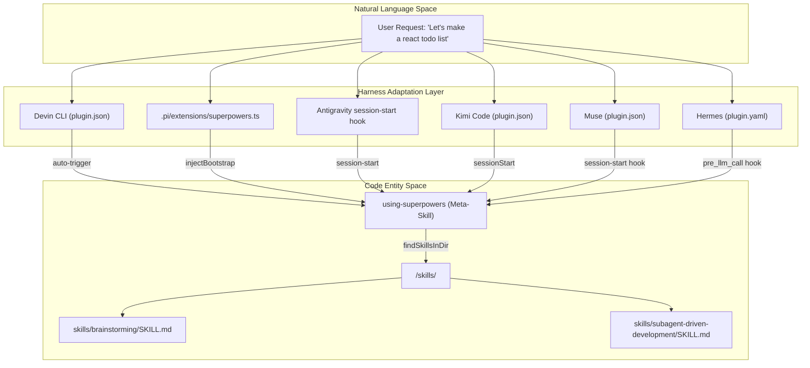
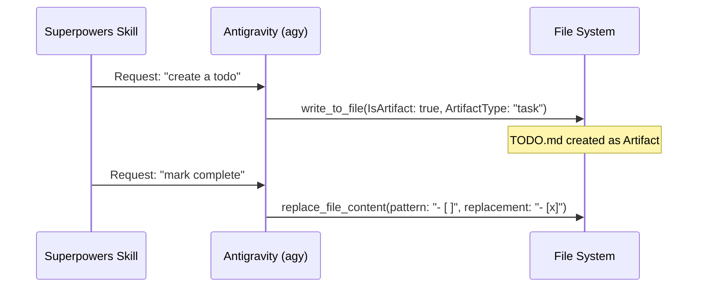

<!-- source: DeepWiki mcp.deepwiki.com · repo obra/superpowers · page 2.6 Installing on Additional Harnesses · fetched 2026-10-27 -->

# Installing on Additional Harnesses

<details>
<summary>Relevant source files</summary>

The following files were used as context for generating this wiki page:

- [.devin-plugin/plugin.json](.devin-plugin/plugin.json)
- [.hermes-plugin/plugin.yaml](.hermes-plugin/plugin.yaml)
- [.kimi-plugin/plugin.json](.kimi-plugin/plugin.json)
- [.muse-plugin/marketplace.json](.muse-plugin/marketplace.json)
- [.muse-plugin/plugin.json](.muse-plugin/plugin.json)
- [docs/README.kimi.md](docs/README.kimi.md)
- [tests/kimi/run-tests.sh](tests/kimi/run-tests.sh)
- [tests/kimi/test-plugin-manifest.sh](tests/kimi/test-plugin-manifest.sh)

</details>


This page provides technical installation and implementation details for the newer AI harnesses added to the Superpowers ecosystem in v6.x releases [RELEASE-NOTES.md:3-9](). These integrations extend the core development methodology to Devin, Hermes, Pi, Antigravity, Kimi Code, and various CLI-based agents.

## Overview of Harness Integration

Superpowers uses a unified skills library that is adapted to different harnesses via platform-specific bootstrap mechanisms and tool mapping layers. A valid integration must load the `using-superpowers` bootstrap at session start to ensure skills auto-trigger during the development lifecycle [AGENTS.md:76-82]().

### Data Flow: Harness to Skills
The following diagram illustrates how different harnesses bridge the "Natural Language Space" of user requests to the "Code Entity Space" of the Superpowers skills library.

**Harness-to-Skill Resolution**

**Sources:** [README.md:128-250](), [.pi/extensions/superpowers.ts:16-57](), [.kimi-plugin/plugin.json:22-24](), [RELEASE-NOTES.md:7-9](), [.muse-plugin/plugin.json:75-84](), [.hermes-plugin/plugin.yaml:6]()

---

## Devin CLI

Devin CLI support was introduced in v6.3.0, allowing skills to auto-trigger at the start of every session [RELEASE-NOTES.md:7]().

### Installation
```bash
devin plugins install obra/superpowers
```
To update the plugin to the latest version:
```bash
devin plugins update superpowers
```

### Implementation Details
The Devin integration relies on the `.devin-plugin/plugin.json` configuration to register the skills directory and the initialization hooks.
*   **Auto-triggering**: Skills are registered with Devin's native loader.
*   **Persistence**: The plugin maintains the methodology across session restarts within the same workspace.

**Sources:** [README.md:128-140](), [RELEASE-NOTES.md:7](), [.devin-plugin/plugin.json:1-22]()

---

## Pi

The Pi integration uses a specialized TypeScript extension to handle session lifecycles, specifically managing context injection after "compaction" events (where the LLM context window is summarized).

### Installation
```bash
pi install git:github.com/obra/superpowers
```

### Implementation: `superpowersPiExtension`
The extension located at `.pi/extensions/superpowers.ts` manages the `using-superpowers` bootstrap injection [tests/pi/test-pi-extension.mjs:50-52]().

*   **`session_start`**: Sets `injectBootstrap = true` to trigger the initial methodology injection [.pi/extensions/superpowers.ts:23-25]().
*   **`session_compact`**: Re-triggers injection after Pi performs a context compaction, ensuring the agent does not "forget" its instructions [.pi/extensions/superpowers.ts:27-29]().
*   **`context` Hook**: Injects the bootstrap message at the `firstNonCompactionSummaryIndex` of the message array [.pi/extensions/superpowers.ts:35-56]().

### Pi Tool Mapping
Since Pi does not ship with a standard `Skill` or `Subagent` tool, Superpowers maps these actions to Pi-specific equivalents:

| Action | Pi Equivalent |
| :--- | :--- |
| Invoke Skill | Native skill system or `read` the `SKILL.md` file directly [.pi/extensions/superpowers.ts:91-92]() |
| Dispatch Subagent | `subagent` from `pi-subagents` (if available) [.pi/extensions/superpowers.ts:95]() |
| Task Tracking | Repo-local `TODO.md` or plan files [.pi/extensions/superpowers.ts:97]() |

**Sources:** [.pi/extensions/superpowers.ts:1-121](), [skills/using-superpowers/references/pi-tools.md:1-16](), [tests/pi/test-pi-extension.mjs:1-137]()

---

## Antigravity (`agy`)

Antigravity installs the plugin directly from the repository and executes the `session-start` hook to activate the methodology [README.md:85-90]().

### Installation
```bash
agy plugin install https://github.com/obra/superpowers
```

### Implementation: Task Artifacts
Antigravity lacks a native `TodoWrite` tool. Instead, it implements task tracking via **Task Artifacts** [skills/using-superpowers/references/antigravity-tools.md:10-17]().

**Antigravity Tool Interaction**


### Key Tool Mappings
*   **Subagent**: Uses `invoke_subagent` with `TypeName: "self"` (full) or `"research"` (read-only) [skills/using-superpowers/references/antigravity-tools.md:7]().
*   **Task Tracking**: Uses `write_to_file` and `replace_file_content` with artifact metadata [skills/using-superpowers/references/antigravity-tools.md:8]().

**Sources:** [README.md:81-91](), [skills/using-superpowers/references/antigravity-tools.md:1-23](), [tests/antigravity/test-antigravity-tools.sh:1-46]()

---

## Kimi Code

Kimi Code integration utilizes a comprehensive `plugin.json` to map Superpowers actions to Kimi's specific toolset, including `AskUserQuestion` and the `Agent` tool.

### Installation
Superpowers is available in Kimi Code's plugin marketplace [docs/README.kimi.md:7-8]().
Open the plugin manager:
```text
/plugins
```
Go to `Marketplace` > `Superpowers` and install it [docs/README.kimi.md:12-15]().

Alternatively, install directly from the repository:
```text
/plugins install https://github.com/obra/superpowers
```
For unreleased validation against the `dev` branch:
```text
/plugins install https://github.com/obra/superpowers/tree/dev
```
After installation or updates, start a fresh session with `/new` [docs/README.kimi.md:29]().

### Implementation Details
The Kimi plugin manifest is located at `.kimi-plugin/plugin.json` [docs/README.kimi.md:32]().
It performs three main functions:
1.  Points Kimi Code to the `skills/` directory [docs/README.kimi.md:35]().
2.  Loads `using-superpowers` at session start via `sessionStart.skill` [.kimi-plugin/plugin.json:22-24]().
3.  Provides Kimi-specific tool mapping through `skillInstructions` [.kimi-plugin/plugin.json:25]().

### Tool Mapping Configuration
The mapping is defined in `.kimi-plugin/plugin.json` [line 25]:
*   **`AskUserQuestion`**: Replaces standard terminal prompts for interactive choices [.kimi-plugin/plugin.json:25]().
*   **`Agent` Tool**: Maps Superpowers subagent types to Kimi subagent types:
    *   Implementation/Review -> `subagent_type: "coder"` [.kimi-plugin/plugin.json:25]().
    *   Exploration -> `subagent_type: "explore"` [.kimi-plugin/plugin.json:25]().
    *   Architecture -> `subagent_type: "plan"` [.kimi-plugin/plugin.json:25]().
*   **`TodoList`**: Native replacement for `TodoWrite` [.kimi-plugin/plugin.json:25]().
*   **Native Kimi Tools**: `Read`, `Write`, `Edit`, `Bash`, `Grep`, `Glob`, `FetchURL`, `WebSearch`, and MCP tools are used by their exposed names [.kimi-plugin/plugin.json:25]().

**Sources:** [.kimi-plugin/plugin.json:1-38](), [docs/README.kimi.md:1-66](), [tests/kimi/test-plugin-manifest.sh:1-86]()

---

## Other v6.x Harnesses

### Hermes Agent
Hermes uses a native loader. Installation is performed via a git clone, and skills are registered through `.hermes-plugin/plugin.yaml` [RELEASE-NOTES.md:8](). The `pre_llm_call` hook is used to bootstrap the Superpowers methodology [hermes-plugin/plugin.yaml:6-7]().

### Muse
Muse integrates Superpowers through a `plugin.json` manifest and a `marketplace.json` for distribution.

#### Installation
Muse plugins can be installed from a marketplace. The `marketplace.json` defines the `superpowers` plugin [muse-plugin/marketplace.json:1-20]().
The `plugin.json` specifies the skills and hooks available [muse-plugin/plugin.json:1-89]().
The `session-start` hook is configured to run `hooks/session-start` [muse-plugin/plugin.json:75-84]().

#### Implementation Details
The `.muse-plugin/plugin.json` explicitly lists all Superpowers skills with their `id` and `path` [muse-plugin/plugin.json:14-72](). This allows Muse to discover and invoke skills directly. The `session-start` hook ensures the `using-superpowers` meta-skill is loaded at the beginning of a session.

### Qwen Code
Qwen Code is mentioned as a supported harness in the overview [1. Overview](). Specific installation details are not provided in the current codebase, implying a similar plugin or marketplace integration as other harnesses.

### Grok Build CLI
Superpowers is available via the official Grok marketplace [README.md:186]().
```bash
grok plugin install superpowers@xai-official --trust
```

### GitHub Copilot CLI
Requires marketplace registration before installation [README.md:172-183]().
```bash
copilot plugin marketplace add obra/superpowers-marketplace
copilot plugin install superpowers@superpowers-marketplace
```

### Factory Droid
Similar to Copilot CLI, it uses a marketplace registration workflow [README.md:144-154]().
```bash
droid plugin marketplace add https://github.com/obra/superpowers
droid plugin install superpowers@superpowers
```

**Sources:** [README.md:142-200](), [RELEASE-NOTES.md:8-9](), [.hermes-plugin/plugin.yaml:1-6](), [.muse-plugin/plugin.json:1-89](), [.muse-plugin/marketplace.json:1-20]()

---

