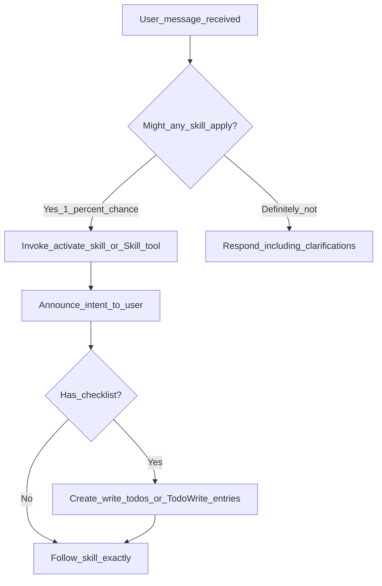

<!-- source: DeepWiki mcp.deepwiki.com · repo obra/superpowers · page 3.1 What Are Skills · fetched 2026-10-27 -->

# What Are Skills

<details>
<summary>Relevant source files</summary>

The following files were used as context for generating this wiki page:

- [skills/executing-plans/SKILL.md](skills/executing-plans/SKILL.md)
- [skills/using-superpowers/SKILL.md](skills/using-superpowers/SKILL.md)
- [skills/using-superpowers/references/claude-code-tools.md](skills/using-superpowers/references/claude-code-tools.md)
- [skills/using-superpowers/references/codex-tools.md](skills/using-superpowers/references/codex-tools.md)
- [skills/using-superpowers/references/gemini-tools.md](skills/using-superpowers/references/gemini-tools.md)
- [skills/writing-skills/SKILL.md](skills/writing-skills/SKILL.md)
- [skills/writing-skills/anthropic-best-practices.md](skills/writing-skills/anthropic-best-practices.md)

</details>


This page defines skills as a technical construct within the Superpowers system, explaining their structure, discovery mechanisms, and how they differ from conventional documentation. For information about how agents are required to use skills, see [3.2. The Mandatory Skill Check Protocol](). For practical guidance on discovering and invoking skills, see [3.3. Finding and Invoking Skills]().

## Definition

A **skill** is a structured markdown document that defines a reusable capability for AI coding assistants. Skills are stored as `SKILL.md` files with YAML frontmatter metadata and follow a standardized format designed for machine discovery and human readability [skills/writing-skills/SKILL.md:22-26]().

Skills are not passive reference documentation. They are active process definitions that agents must check for and invoke before performing related tasks. The system enforces this through the `using-superpowers` meta-skill loaded at session start [skills/using-superpowers/SKILL.md:1-4]().

**Key distinguishing characteristics:**

| Characteristic | Skills | Regular Documentation |
|---------------|--------|---------------------|
| Discovery | Searchable via tool calls | Manual browsing required |
| Invocation | Platform-native tool integration | Read tool or direct file access |
| Optimization | Claude Search Optimization (CSO) | Standard technical writing |
| Validation | Pressure-tested with TDD methodology | Typically untested |
| Enforcement | Mandatory checking protocol (1% rule) | Optional reference |
| Structure | Strict YAML frontmatter + sections | Freeform markdown |

**Sources:** [skills/using-superpowers/SKILL.md:1-16](), [skills/writing-skills/SKILL.md:10-18](), [skills/writing-skills/SKILL.md:140-143]()

## File Structure

### SKILL.md Format

Every skill must contain a `SKILL.md` file as its primary definition. Skills are stored in flat namespaces within the `skills/` directory [skills/writing-skills/SKILL.md:72-82](). The file consists of two parts:

**YAML Frontmatter:**
```yaml
---
name: using-superpowers
description: Use when starting any conversation - establishes how to find and use skills, requiring skill invocation before ANY response including clarifying questions
---
```

**Required frontmatter fields:**
- `name`: Lowercase kebab-case matching directory name. Use letters, numbers, and hyphens only [skills/writing-skills/SKILL.md:98]().
- `description`: CSO-optimized trigger description. It must be third-person and describe ONLY when to use (triggering conditions), never summarizing the workflow [skills/writing-skills/SKILL.md:99-103](), [skills/writing-skills/SKILL.md:150-158]().

**Standard sections defined in the library:**
1. **Overview** - Core principle in 1-2 sentences [skills/writing-skills/SKILL.md:113-114]().
2. **When to Use** - Symptoms and use cases, often including a flowchart [skills/writing-skills/SKILL.md:116-120]().
3. **Core Pattern** - Before/after code comparisons for techniques [skills/writing-skills/SKILL.md:122-123]().
4. **Implementation** - Inline code for simple patterns or links to heavy reference files [skills/writing-skills/SKILL.md:128-130]().
5. **Common Mistakes** - Loopholes and fixes [skills/writing-skills/SKILL.md:132-133]().

**Sources:** [skills/writing-skills/SKILL.md:93-137](), [skills/writing-skills/SKILL.md:150-158]()

### Directory Structure

```mermaid
graph TB
    subgraph "skills_Repository_Root"
        ["using-superpowers/SKILL.md"]
        ["writing-skills/SKILL.md"]
        ["test-driven-development/SKILL.md"]
        ["using-superpowers/references/gemini-tools.md"]
        ["using-superpowers/references/codex-tools.md"]
        ["executing-plans/SKILL.md"]
    end
    
    ["writing-skills/SKILL.md"] -->|"REQUIRED BACKGROUND"| ["test-driven-development/SKILL.md"]
    ["using-superpowers/SKILL.md"] -->|"PLATFORM ADAPTATION"| ["using-superpowers/references/gemini-tools.md"]
    ["using-superpowers/SKILL.md"] -->|"PLATFORM ADAPTATION"| ["using-superpowers/references/codex-tools.md"]
    ["executing-plans/SKILL.md"] -->|"Setup: worktree, workspace + ledger"| ["using-git-worktrees"]
    ["executing-plans/SKILL.md"] -->|"Code wrong?"| ["systematic-debugging"]
    ["executing-plans/SKILL.md"] -->|"Final review clean"| ["finishing-a-development-branch"]
```

**Diagram: Actual Skill Directory Structure and Dependencies**

Supporting files and platform-specific mappings are bundled within the skill directory. For example, `writing-skills` explicitly requires understanding `test-driven-development` [skills/writing-skills/SKILL.md:18](). Platform mappings like `gemini-tools.md` and `codex-tools.md` ensure tool names are translated correctly for different harnesses [skills/using-superpowers/references/gemini-tools.md:1-21](), [skills/using-superpowers/references/codex-tools.md:1-3](). Skills like `executing-plans` also reference other skills for setup and error handling, such as `using-git-worktrees`, `systematic-debugging`, and `finishing-a-development-branch` [skills/executing-plans/SKILL.md:110-111](), [skills/executing-plans/SKILL.md:92](), [skills/executing-plans/SKILL.md:104]().

**Sources:** [skills/writing-skills/SKILL.md:18](), [skills/writing-skills/SKILL.md:72-80](), [skills/using-superpowers/references/gemini-tools.md:1-21](), [skills/using-superpowers/references/codex-tools.md:1-3](), [skills/executing-plans/SKILL.md:92](), [skills/executing-plans/SKILL.md:104](), [skills/executing-plans/SKILL.md:110-111]()

## Claude Search Optimization (CSO)

Skills use **Claude Search Optimization** to ensure agents discover them through semantic search. The `description` field is the primary CSO surface and is critical because Claude uses it to decide whether to load the full `SKILL.md` [skills/writing-skills/SKILL.md:140-146]().

**CSO Requirements:**
1. **Trigger-focused** - Start with "Use when..." to focus on conditions [skills/writing-skills/SKILL.md:148]().
2. **Third Person** - Descriptions are injected into the system prompt; consistent POV prevents discovery issues [skills/writing-skills/anthropic-best-practices.md:189-195]().
3. **No workflow details** - If the description summarizes the process, Claude may follow the summary instead of reading the full skill content, leading to skipped steps [skills/writing-skills/SKILL.md:150-158]().

**Sources:** [skills/writing-skills/SKILL.md:140-158](), [skills/writing-skills/anthropic-best-practices.md:185-200]()

## Skill Types and Categories

Skills are categorized by their role and flexibility [skills/writing-skills/SKILL.md:61-71]():

### Technique
A concrete method with specific steps to follow, such as `root-cause-tracing` [skills/writing-skills/SKILL.md:63-64]().

### Pattern
A way of thinking about problems or code organization, such as `test-invariants` [skills/writing-skills/SKILL.md:66-67]().

### Reference
Static information including API docs, syntax guides, or tool documentation [skills/writing-skills/SKILL.md:69-70]().

### Flexibility Levels
As defined in authoring best practices [skills/writing-skills/anthropic-best-practices.md:59-131]():
- **Low Freedom**: Fragile operations like database migrations that must follow an exact sequence [skills/writing-skills/anthropic-best-practices.md:105-125]().
- **Medium Freedom**: Preferred patterns where some variation is acceptable [skills/writing-skills/anthropic-best-practices.md:82-89]().
- **High Freedom**: Context-dependent tasks like code reviews where multiple approaches are valid [skills/writing-skills/anthropic-best-practices.md:63-71]().

**Sources:** [skills/writing-skills/SKILL.md:61-71](), [skills/writing-skills/anthropic-best-practices.md:59-131]()

## Platform Adaptation and Tool Mapping

Skills are authored using Claude Code tool names. To maintain modularity, Superpowers provides a mapping layer for other platforms like Gemini CLI and Codex [skills/using-superpowers/references/gemini-tools.md:1-3](), [skills/using-superpowers/references/codex-tools.md:1-3]().

### Tool Mapping Implementation

| Claude Code Tool | Gemini CLI Equivalent | Codex Equivalent | Purpose |
|------------------|-----------------------|------------------|---------|
| `Skill` | `activate_skill` [skills/using-superpowers/references/gemini-tools.md:17]() | N/A (native skill discovery) | Invoke a skill |
| `TodoWrite` | `write_todos` [skills/using-superpowers/references/gemini-tools.md:20]() | N/A (native todo management) | Task tracking |
| `Agent` | `invoke_agent` [skills/using-superpowers/references/gemini-tools.md:18]() | `spawn_agent`, `followup_task` [skills/using-superpowers/references/codex-tools.md:16-28]() | Dispatch subagent |
| `Bash` | `run_shell_command` [skills/using-superpowers/references/gemini-tools.md:11]() | `run_shell_command` | Run commands |
| `Edit` | `replace` [skills/using-superpowers/references/gemini-tools.md:10]() | `replace` | File editing |
| `Read` | `read_file` [skills/using-superpowers/references/gemini-tools.md:7]() | `read_file` | Read a file |
| `ReadMany` | `read_many_files` [skills/using-superpowers/references/gemini-tools.md:8]() | `read_many_files` | Read multiple files |
| `Write` | `write_file` [skills/using-superpowers/references/gemini-tools.md:9]() | `write_file` | Create a new file |
| `Search` | `grep_search` [skills/using-superpowers/references/gemini-tools.md:12]() | `grep_search` | Search file contents |
| `FindFiles` | `glob` [skills/using-superpowers/references/gemini-tools.md:13]() | `glob` | Find files by name |
| `ListDir` | `list_directory` [skills/using-superpowers/references/gemini-tools.md:14]() | `list_directory` | List files and subdirectories |
| `WebFetch` | `web_fetch` [skills/using-superpowers/references/gemini-tools.md:15]() | `web_fetch` | Fetch a URL |
| `WebSearch` | `google_web_search` [skills/using-superpowers/references/gemini-tools.md:16]() | `google_web_search` | Search the web |

**Sources:** [skills/using-superpowers/references/gemini-tools.md:1-21](), [skills/using-superpowers/references/codex-tools.md:1-3](), [skills/using-superpowers/references/codex-tools.md:16-28]()

## Enforcement Mechanisms

### The 1% Rule
The core enforcement mechanism: if there is even a 1% chance a skill applies, the agent **must** invoke it [skills/using-superpowers/SKILL.md:10-16]().



**Diagram: Skill Invocation Logic Flow (bridging `activate_skill` and `write_todos` tool equivalents)**

### TDD for Skills
Skills are developed using a RED-GREEN-REFACTOR cycle adapted for documentation [skills/writing-skills/SKILL.md:10-14]():
1. **RED**: Create a "pressure scenario" and watch the agent fail or violate rules without the skill [skills/writing-skills/SKILL.md:36-40]().
2. **GREEN**: Write the minimal `SKILL.md` content required to make the agent comply [skills/writing-skills/SKILL.md:37-42]().
3. **REFACTOR**: Close loopholes and find new ways the agent might rationalize ignoring the instructions [skills/writing-skills/SKILL.md:38-43]().

**Sources:** [skills/writing-skills/SKILL.md:10-45](), [skills/using-superpowers/SKILL.md:10-16]()

---

