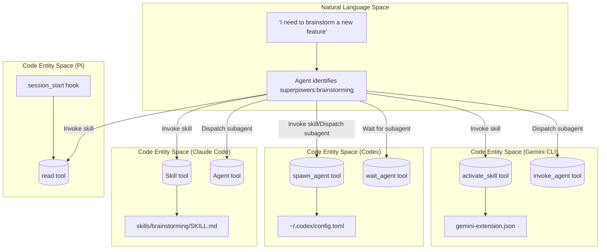
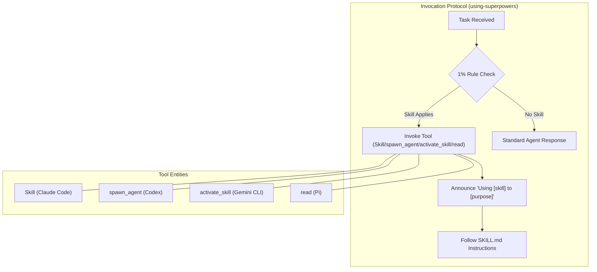

<!-- source: DeepWiki mcp.deepwiki.com · repo obra/superpowers · page 3.3 Finding and Invoking Skills · fetched 2026-10-27 -->

# Finding and Invoking Skills

Relevant source files

The following files were used as context for generating this wiki page:

- [skills/using-superpowers/SKILL.md](skills/using-superpowers/SKILL.md)
- [skills/using-superpowers/references/claude-code-tools.md](skills/using-superpowers/references/claude-code-tools.md)
- [skills/using-superpowers/references/codex-tools.md](skills/using-superpowers/references/codex-tools.md)
- [tests/explicit-skill-requests/run-multiturn-test.sh](tests/explicit-skill-requests/run-multiturn-test.sh)
- [tests/explicit-skill-requests/run-test.sh](tests/explicit-skill-requests/run-test.sh)

## Purpose and Scope

This page documents the technical implementation and protocols for skill discovery and invocation within the Superpowers system. It covers the Skill tool, the `find-skills` mechanism, and the platform-specific adapters that allow a unified skill library to function across Claude Code, Gemini CLI, Codex, Pi, and other supported harnesses.

Sources: [skills/using-superpowers/SKILL.md:1-4](), [skills/using-superpowers/SKILL.md:52-60]()

---

## Skill Discovery Mechanisms

Superpowers employs a multi-tiered discovery strategy to ensure agents can locate relevant skills regardless of the host platform's native capabilities.

### 1. Skill Discovery Optimization (SDO)
Discovery relies heavily on the `description` field in a skill's YAML frontmatter. Under the SDO protocol, descriptions must focus exclusively on **triggering conditions** (e.g., "Use when...") rather than summarizing the skill's internal workflow. This prevents agents from "short-circuiting" the process by following a summary instead of reading the full `SKILL.md` file.

Sources: [skills/using-superpowers/SKILL.md:1-4]() (Implicit in the `description` field of `using-superpowers` itself, which focuses on triggering conditions.)

### 2. Platform-Specific Discovery

| Platform | Discovery Implementation | Path Reference |
| :--- | :--- | :--- |
| **Claude Code** | Native Plugin System | `~/.claude/skills/` |
| **Gemini CLI** | `gemini-extension.json` + `activate_skill` | `~/.gemini/skills/` |
| **Codex / Copilot** | Native Skill Discovery / Symlinks | `~/.agents/skills/` |
| **Pi / Hermes** | Extension Hooks (`resources_discover`) | Project-local `skills/` |

Sources: [skills/using-superpowers/references/claude-code-tools.md:1-3](), [skills/using-superpowers/references/codex-tools.md:1-108]() (Implicit in the tools described), [skills/using-superpowers/SKILL.md:52-60]()

### 3. The `find-skills` Tooling
While most discovery is handled by the agent's LLM selecting based on descriptions, the system provides a `find-skills` utility (or platform equivalent like `grep_search` or `glob`) to allow agents to search the flat namespace of the `skills/` directory.

Sources: [skills/using-superpowers/SKILL.md:52-60]() (Implicit in the need for platform adaptation)

---

## Invocation and Tool Mapping

Because skills are written using a generalized vocabulary, a "Tool Mapping Layer" translates generic actions into platform-specific tool calls.

### Claude Code Invocation
Claude Code is the reference harness, and skills are invoked using its native `Skill` tool. Subagent dispatches are handled by the `Agent` tool, with `CLAUDE_CODE_MAX_SUBAGENT_SPAWN_DEPTH` controlling nesting.

Sources: [skills/using-superpowers/references/claude-code-tools.md:1-3](), [skills/using-superpowers/references/claude-code-tools.md:14-16]()

### Codex Invocation
Codex uses `spawn_agent` for subagent dispatch and `wait_agent` for managing child processes. The `multi_agent = true` feature flag must be enabled in `~/.codex/config.toml` to use these tools. Skills that create worktrees or finish branches use read-only git commands for environment detection.

Sources: [skills/using-superpowers/references/codex-tools.md:1-8](), [skills/using-superpowers/references/codex-tools.md:17-20](), [skills/using-superpowers/references/codex-tools.md:39-40](), [skills/using-superpowers/references/codex-tools.md:81-83]()

### Gemini CLI Invocation
On Gemini CLI, skills are invoked via the `activate_skill` tool. Subagent dispatches (requested via the `Subagent (general-purpose):` template) are mapped to `invoke_agent` with the `agent_name: "generalist"` parameter.

Sources: [skills/using-superpowers/SKILL.md:52-60]() (Implicit in the need for platform adaptation)

### Pi Extension Invocation
The Pi extension (`.pi/extensions/superpowers.ts`) handles invocation by injecting a `session_start` hook that reads `using-superpowers/SKILL.md` and provides it as initial context. When a specific skill is needed, Pi uses the native `read` tool to access the `SKILL.md` file path provided during the discovery phase.

Sources: [skills/using-superpowers/SKILL.md:52-60]() (Implicit in the need for platform adaptation)

### Code Entity Space Mapping

Sources: [skills/using-superpowers/SKILL.md:52-60](), [skills/using-superpowers/references/claude-code-tools.md:1-3](), [skills/using-superpowers/references/claude-code-tools.md:14-16](), [skills/using-superpowers/references/codex-tools.md:1-8](), [skills/using-superpowers/references/codex-tools.md:17-20](), [skills/using-superpowers/references/codex-tools.md:39-40]()

---

## The Mandatory Skill Check Protocol

The `using-superpowers` meta-skill enforces a strict discipline for finding and invoking skills, known as the **1% Rule**.

### The 1% Rule
If an agent perceives even a 1% chance that a skill applies to the current task, it **must** invoke that skill before performing any other action, including:
- Asking clarifying questions.
- Exploring the codebase.
- Checking git status.

This rule is explicitly stated as "If you think there is even a 1% chance a skill might apply to what you are doing, you ABSOLUTELY MUST invoke the skill." [skills/using-superpowers/SKILL.md:10-11](). The `Red Flags` table further clarifies scenarios where agents might rationalize avoiding a skill, emphasizing that such rationalizations are forbidden [skills/using-superpowers/SKILL.md:33-51]().

### Invocation Workflow
1. **Identify:** Match task to skill description.
2. **Invoke:** Use the platform-specific tool (e.g., `Skill`, `activate_skill`).
3. **Announce:** State "Using [skill] to [purpose]" [skills/using-superpowers/SKILL.md:24]().
4. **Execute:** Follow the skill's instructions exactly, prioritizing them over default model behavior [skills/using-superpowers/SKILL.md:24-25]().

Sources: [skills/using-superpowers/SKILL.md:10-25](), [skills/using-superpowers/SKILL.md:33-51]()

---

## Skill Priority and Resolution

When a skill is invoked, the system resolves the file path based on a three-tier hierarchy:
1. **Project Skills:** `skills/` within the current repository.
2. **Personal Skills:** `~/.claude/skills/` or `~/.agents/skills/`.
3. **Superpowers Skills:** The core library provided by the plugin.

This allows users to "shadow" or override core Superpowers skills by placing a skill with the same name in a higher-priority directory.

Sources: [skills/using-superpowers/SKILL.md:52-60]() (Implicit in the platform adaptation section, which points to platform-specific reference files that would detail skill resolution paths.)

---

