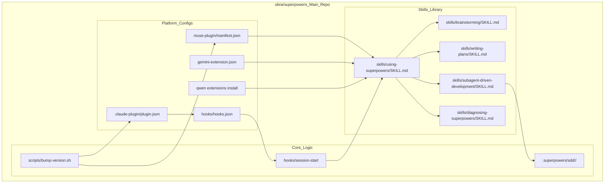
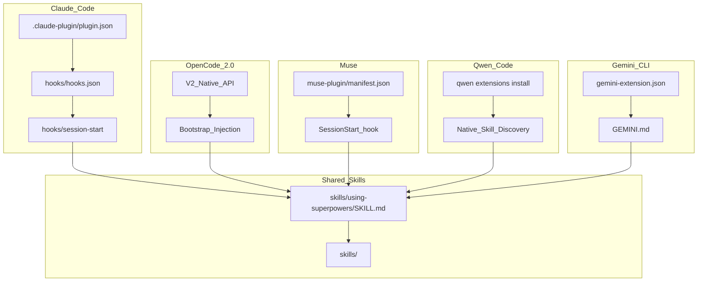

<!-- source: DeepWiki mcp.deepwiki.com · repo obra/superpowers · page 4 Architecture · fetched 2026-10-27 -->

# Architecture

Relevant source files

The following files were used as context for generating this wiki page:

- [.claude-plugin/plugin.json](.claude-plugin/plugin.json)
- [README.md](README.md)
- [RELEASE-NOTES.md](RELEASE-NOTES.md)
- [skills/brainstorming/visual-companion.md](skills/brainstorming/visual-companion.md)

This page describes the overall structure of `obra/superpowers`, its major components, and how it integrates with multiple AI coding platforms. It covers scope at the system level; see child pages for subsystem detail: [Dual Repository Design](#4.1), [Skills Repository Management](#4.2), [Multi-Platform Integration](#4.3), [Session Lifecycle and Bootstrap](#4.4), [Skills Discovery and Resolution](#4.5), and [Tool Mapping Layer](#4.6).

---

## System Overview

Superpowers uses a **unified repository architecture** to consolidate platform shims and the skills library into a single codebase, simplifying installation and versioning.

The system consists of:

- **Platform Manifests**: Configuration files like `.claude-plugin/plugin.json`, `hooks/hooks.json`, and `.codex-plugin/plugin.json` that register Superpowers with various AI environments. [[.claude-plugin/plugin.json:1-20]()]
- **Session Hooks**: Scripts in `hooks/` (e.g., `hooks/session-start`) that inject bootstrap context and the `using-superpowers` meta-skill at the start of every session. [[RELEASE-NOTES.md:62-63]()]
- **Skills Library**: A collection of modular markdown files in `skills/` that define workflows like `brainstorming`, `writing-plans`, and `subagent-driven-development`. [[README.md:3-4]()] [[.claude-plugin/plugin.json:3-4]()]
- **Tool Mapping Layer**: Logic and documentation that translates platform-specific tools into a consistent interface. This includes mapping Claude Code tools to Gemini CLI, Codex, and others. [[README.md:247-248]()] [[RELEASE-NOTES.md:66-68]()]

The central design goal is that agents automatically discover and invoke skills. By providing a `using-superpowers` skill as the entry point, the agent is instructed to check the `skills/` directory before performing any task.

Sources: [.claude-plugin/plugin.json:1-20](), [RELEASE-NOTES.md:62-68](), [README.md:3-4](), [README.md:247-248]()

---

## Repository Architecture

**Diagram: Repository Structure and Platform Entry Points**

Sources: [.claude-plugin/plugin.json:1-20](), [RELEASE-NOTES.md:27-28](), [RELEASE-NOTES.md:48-49](), [RELEASE-NOTES.md:63-64](), [README.md:23-24](), [README.md:205-206]()

---

## Multi-Platform Integration Architecture

Each platform has a different plugin API. Superpowers abstracts these differences so core skills remain portable. Recent updates include support for OpenCode 2.0, Muse, and Qwen Code.

**Diagram: Platform Integration Points and Code Entities**

Sources: [.claude-plugin/plugin.json:1-20](), [RELEASE-NOTES.md:62-64](), [README.md:205-206](), [README.md:161-168]()

---

## Platform Integration Summary

| Platform | Entry point | Hook mechanism | Bootstrap delivery | Special requirements |
|----------|-------------|----------------|-------------------|---------------------|
| **Claude Code** | `.claude-plugin/plugin.json` | SessionStart Hook | `hooks/session-start` | Dispatches via Git Bash on Windows [[skills/brainstorming/visual-companion.md:68-69]()] |
| **Codex** | `.codex-plugin/plugin.json` | Native Discovery | Manifest `hooks: {}` | Event-driven subagent waits [[skills/brainstorming/visual-companion.md:71-74]()] |
| **OpenCode 2.0** | Native API | V2's native API | Bootstrap survives continuation, restart, forks, compaction [[RELEASE-NOTES.md:62-63]()] |
| **Muse** | `muse-plugin/manifest.json` | SessionStart hook | Native plugin manifest | `muse plugins install ./` then `muse plugins approve superpowers` [[RELEASE-NOTES.md:63-64]()] |
| **Qwen Code** | `qwen extensions install` | Native skill discovery | `qwen extensions install obra/superpowers` | Added to install docs [[RELEASE-NOTES.md:64-65]()] |
| **Gemini CLI** | `gemini-extension.json` | `GEMINI.md` context | `activate_skill` tool | Uses `save_memory` and `enter_plan_mode` [[README.md:161-168]()] |

Sources: [RELEASE-NOTES.md:62-65](), [README.md:161-168](), [skills/brainstorming/visual-companion.md:68-74]()

---

## Key Architectural Components

### 1. The `using-superpowers` Bootstrap
The `using-superpowers` skill is injected into every session. It enforces the "1% rule" and instruction priority hierarchy, ensuring the agent checks the `skills/` directory before proceeding. [[README.md:247-248]()]

### 2. Plan-Scoped SDD Workspace
Subagent-Driven Development (SDD) uses a plan-scoped directory `.superpowers/sdd/<plan-basename>/`. This architecture prevents cross-plan contamination and ensures the ledger accurately reflects the progress of a specific implementation plan. [[RELEASE-NOTES.md:55-56]()]

### 3. Scalable Brainstorming Ceremony
The brainstorming architecture now scales to the task. Requests are classified as **spike**, **bounded**, or **architectural**. Small tasks skip the full two-document ritual while maintaining a mandatory approval gate before implementation. [[RELEASE-NOTES.md:41-44]()]

### 4. Resumable Review-Fix Loop
The SDD architecture treats fix rounds as "resume-the-implementer" events rather than fresh dispatches. It includes a scoped `re-review-prompt.md` and a five-round circuit breaker with controller adjudication.

### 5. Native Execution for Plans
`executing-plans` has been rebuilt as a native (inline) execution mode. It runs the entire plan, implementing each task itself under the same workspace, ledger, and stopping rules as subagent-driven development, followed by a single whole-branch review. This is the cheapest way to run a plan. [[RELEASE-NOTES.md:31-34]()]

Sources: [README.md:247-248](), [RELEASE-NOTES.md:31-34](), [RELEASE-NOTES.md:41-44](), [RELEASE-NOTES.md:55-56]()

---

## Architectural Decisions

**Unified Repository.** Consolidation ensures platform manifests and skill logic never drift. The repository serves as the source of truth for all supported harnesses. [[README.md:51-52]()]

**Harness-Agnostic Skills.** Skills are written in markdown to be vendor-neutral. Platform-specific nuances are handled by a mapping layer that translates tools like `Task` and `Skill` to their equivalents (e.g., `activate_skill` on Gemini). [[README.md:247-248]()] [[RELEASE-NOTES.md:66-68]()]

**Worktree Isolation.** The system enforces the use of git worktrees for development to ensure a clean baseline. The `finishing-a-development-branch` skill now includes safety checks to prevent destroying untracked files during worktree removal.

**Strict Contributor Protocol.** To maintain architectural integrity, the repo enforces a high PR rejection rate, requiring human review of all diffs and session transcripts for new harness integrations.

Sources: [README.md:51-52](), [README.md:247-248](), [RELEASE-NOTES.md:66-68]()

---

