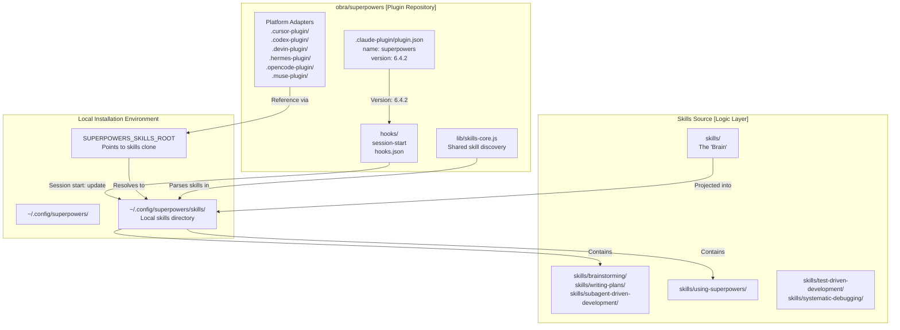
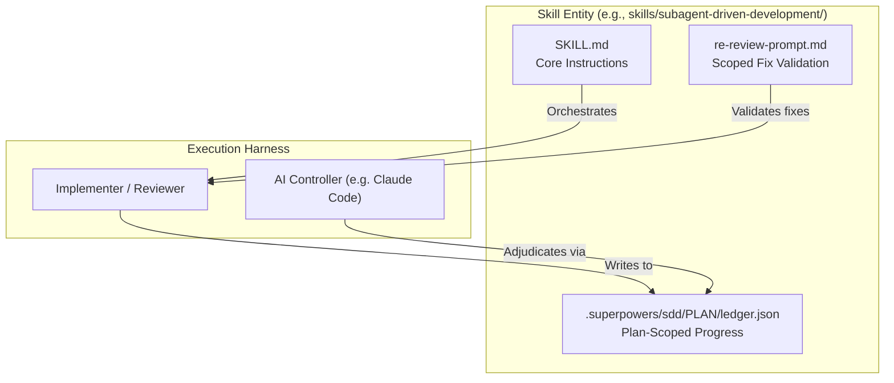

<!-- source: DeepWiki mcp.deepwiki.com · repo obra/superpowers · page 4.1 Dual Repository Design · fetched 2026-10-27 -->

# Dual Repository Design

Relevant source files

The following files were used as context for generating this wiki page:

- [.claude-plugin/marketplace.json](.claude-plugin/marketplace.json)
- [.claude-plugin/plugin.json](.claude-plugin/plugin.json)
- [RELEASE-NOTES.md](RELEASE-NOTES.md)

## Purpose and Scope

This document explains the dual repository architecture introduced in v2.0.0 and refined through v6.4.2, which separates the Superpowers system into two components: a lightweight plugin shim (the primary repository `obra/superpowers`) and a separate skills repository (referenced via `SUPERPOWERS_SKILLS_ROOT`). This separation enables independent versioning, multi-platform support across Claude Code, Codex, Cursor, Devin, Gemini CLI, OpenCode, Muse, Qwen Code, and others, and automatic skill updates without requiring a full plugin reinstallation for every prompt refinement.

## Architectural Separation

The Superpowers system is structured as a two-component system. The plugin repository contains the infrastructure, platform-specific manifests, and session-start hooks, while the skills repository contains the actual logic, prompts, and behavioral guidance.

**Repository Separation Architecture**

**Sources:** [RELEASE-NOTES.md:3-4](), [.claude-plugin/plugin.json:1-4]()

## Plugin Repository (obra/superpowers)

The plugin repository acts as the entry point for AI assistants. It contains the metadata and hooks required to bootstrap the environment and map platform-specific tools to Superpowers logic.

### Plugin Contents

| Component | Path | Purpose |
|-----------|------|---------|
| Plugin manifest | `.claude-plugin/plugin.json` | Core metadata and version (v6.4.2) [[.claude-plugin/plugin.json:1-4]()] |
| Marketplace Config | `.claude-plugin/marketplace.json` | Development marketplace metadata [[.claude-plugin/marketplace.json:1-20]()] |
| Codex Sync Script | `scripts/sync-to-codex-plugin.sh` | Deterministic rsync to Codex repository |
| SDD Workspace | `.superpowers/sdd/<plan-basename>/` | Plan-scoped scratch space for subagent ledgers [[RELEASE-NOTES.md:56-57]()] |

The plugin manifest defines the plugin identity and versioning:
[[.claude-plugin/plugin.json:1-20]()]

### Shared Logic and SDD Management
To support multiple platforms, the system uses shared logic for skill discovery and state management. The `subagent-driven-development` (SDD) workspace is **plan-scoped** [[RELEASE-NOTES.md:56-57]()]. Instead of a global `.superpowers/sdd/` directory, it now resolves to `.superpowers/sdd/<plan-basename>/` to prevent contamination between different implementation plans in the same working tree [[RELEASE-NOTES.md:56-57]()].

**Sources:** [RELEASE-NOTES.md:56-57](), [.claude-plugin/plugin.json:1-20](), [.claude-plugin/marketplace.json:1-20]()

## Skills Repository Logic

The skills repository is the "brain" of the system. As of v6.4.1, `executing-plans` was rebuilt as Native execution, offering a cheaper alternative to subagent-driven development [[RELEASE-NOTES.md:30-34]()].

### Consolidation and Scaling Logic
The system has moved away from rigid rituals toward scaling ceremony to the task size:
- **Brainstorming**: Brainstorming now finds out the user's intent before proposing features, reflecting it back for correction, and tying approval to actual design and planning stages [[RELEASE-NOTES.md:43-44]()].
- **Native (inline) execution**: `executing-plans` now runs the whole plan, then gets one review at the end, making it the cheapest way to run a plan [[RELEASE-NOTES.md:30-34]()].
- **SDD Controller**: On Claude Code, the controller can run one layer down, as a nested subagent on a mid-tier model, reducing cost and wall clock time [[RELEASE-NOTES.md:58-59]()].

**Skill Execution and Code Entity Mapping**

**Sources:** [RELEASE-NOTES.md:30-34](), [RELEASE-NOTES.md:43-44](), [RELEASE-NOTES.md:58-59]()

## Versioning Strategy

The dual repository design uses a decoupled versioning strategy to balance platform stability with rapid skill improvement. The `scripts/bump-version.sh` tool ensures all harness manifests remain in sync.

| Aspect | Plugin Repository (`obra/superpowers`) | Skills Layer |
|--------|---------------------------------------|---------------------------------------------|
| **Version** | Semantic (e.g., `6.4.2`) [[.claude-plugin/plugin.json:4-4]()] | Rolling / Commit-based |
| **Release** | Infrastructure changes (e.g., new harness support) | Continuous (Skill refinements) |
| **Update** | Manual/Marketplace update | Automatic (Git pull or session-start hook) |
| **Harnesses** | Claude, Codex, Cursor, Devin, Grok, OpenCode, Muse, Qwen Code, etc. | Unified across all harnesses |

### Multi-Harness Version Syncing
The `bump-version.sh` script reads `.version-bump.json` to update versions across a wide array of manifests, including `.hermes-plugin/plugin.yaml`, `gemini-extension.json`, and `.devin-plugin/plugin.json`.

**Sources:** [.claude-plugin/plugin.json:4-4]()

## Multi-Platform Integration

The design allows a single set of skills to be projected into multiple AI environments. v6.4.1 expanded this to several new agents, including OpenCode 2.0, Muse, and Qwen Code.

**Platform Entry Points and Hooks**

| Platform | Entry Point | Integration Mechanism |
|----------|-------------|-----------------------|
| **Claude Code** | `/plugin install` | Official Marketplace or local dev install [[.claude-plugin/marketplace.json:1-18]()] |
| **OpenCode 2.0.4+** | Native API | Skills register through V2's native API; bootstrap survives continuation, restart, forks, and compaction [[RELEASE-NOTES.md:61-62]()] |
| **Muse** | `muse plugins install ./` | Native plugin manifest and SessionStart hook [[RELEASE-NOTES.md:63-63]()] |
| **Qwen Code** | `qwen extensions install obra/superpowers` | Added to install docs [[RELEASE-NOTES.md:64-64]()] |
| **Codex** | `.codex-plugin/` | Deterministic sync via `sync-to-codex-plugin.sh` |

### Cross-Platform Deployment Scripts
The `scripts/sync-to-codex-plugin.sh` script manages the complexity of embedding Superpowers into the OpenAI Codex environment. It uses `rsync` with a specific `EXCLUDES` list to strip out harness-specific dotfiles (like `.claude-plugin/` or `.cursor-plugin/`) while preserving the core skills and Codex-specific metadata.

**Sources:** [RELEASE-NOTES.md:61-64](), [.claude-plugin/marketplace.json:1-18]()

---

