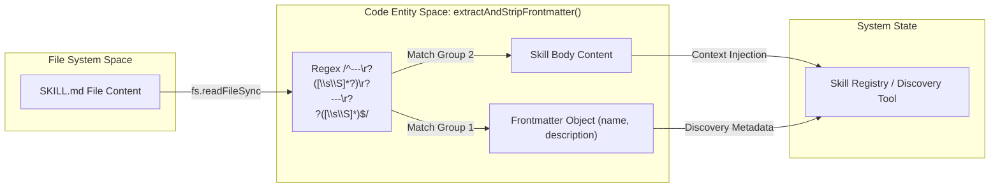
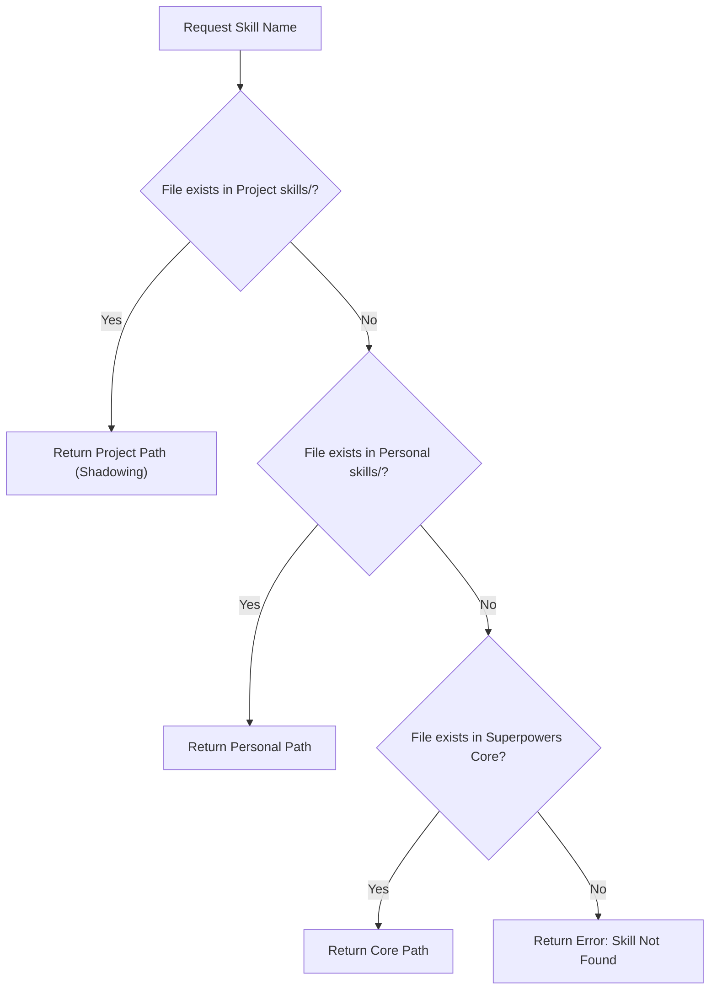
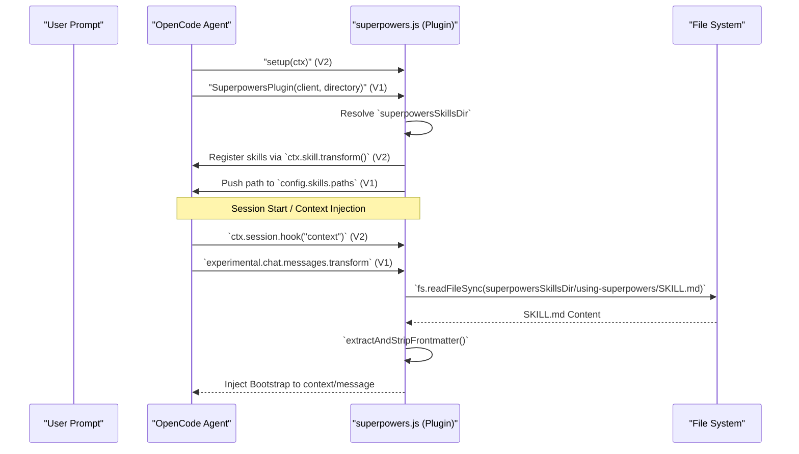

<!-- source: DeepWiki mcp.deepwiki.com · repo obra/superpowers · page 4.5 Skills Discovery and Resolution · fetched 2026-10-27 -->

# Skills Discovery and Resolution

Relevant source files

The following files were used as context for generating this wiki page:

- [.opencode/INSTALL.md](.opencode/INSTALL.md)
- [.opencode/plugins/superpowers.js](.opencode/plugins/superpowers.js)
- [docs/README.opencode.md](docs/README.opencode.md)
- [docs/testing.md](docs/testing.md)
- [index.js](index.js)
- [tests/opencode/test-bootstrap-caching.mjs](tests/opencode/test-bootstrap-caching.mjs)

This page documents the technical implementation of how skills are discovered on disk, how their metadata is parsed from frontmatter, and the algorithm used to resolve a skill name to a specific file path across multiple priority tiers.

## Overview

The Superpowers system treats skills as modular directories containing a `SKILL.md` file. The discovery and resolution engine must perform three primary tasks:
1.  **Scanning**: Recursively or iteratively searching root directories to find all available skill definitions.
2.  **Parsing**: Extracting YAML frontmatter from `SKILL.md` to identify the skill's `name` and `description` for tool-based discovery.
3.  **Resolving**: Determining which version of a skill to load when a name collision occurs across Project, Personal, and Superpowers tiers.

Sources: [skills/writing-skills/SKILL.md:72-82](), [skills/writing-skills/SKILL.md:93-96](), [.opencode/plugins/superpowers.js:33-65]()

---

## Skill File Structure and Parsing

Every skill is a self-contained directory. The core of the skill is the `SKILL.md` file, which uses a specific structure to facilitate machine discovery.

### Frontmatter Specification
The system identifies skills by parsing the YAML block at the top of `SKILL.md`. This block is delimited by triple dashes (`---`) [skills/writing-skills/SKILL.md:95-96]().

| Field | Purpose | Requirement |
| :--- | :--- | :--- |
| `name` | Unique identifier used for invocation (e.g., `Skill(name="brainstorming")`) | Required. Letters, numbers, and hyphens only [skills/writing-skills/SKILL.md:98-98](). |
| `description` | Semantic description used by LLMs to find relevant skills via discovery tools | Required. Max 1024 characters [skills/writing-skills/SKILL.md:97-97](). |

### Parsing Logic
Implementations like the OpenCode plugin use regular expressions to extract frontmatter. The `extractAndStripFrontmatter` function isolates the YAML block from the Markdown body [.opencode/plugins/superpowers.js:33-65](). The description is critical for Skill Discovery Optimization (SDO); it must focus on triggering conditions ("Use when...") rather than summarizing the workflow to prevent agents from taking "shortcuts" and skipping the full skill content [skills/writing-skills/SKILL.md:140-160]().

**Frontmatter Extraction Data Flow:**

Sources: [.opencode/plugins/superpowers.js:33-65](), [skills/writing-skills/SKILL.md:93-104](), [skills/writing-skills/SKILL.md:140-160]()

---

## The Resolution Algorithm

Superpowers implements a hierarchical shadowing system. This allows users to override global library skills with project-specific instructions without modifying the core repository.

### Priority Tiers
The resolution logic searches directories in a strict descending order of priority:

1.  **Project Skills**: Located in `.opencode/skills/` or equivalent project-specific directories [docs/README.opencode.md:93-95]().
2.  **Personal Skills**: Located in `~/.config/opencode/skills/`, `~/.claude/skills/`, or the cross-runtime alias `~/.agents/skills/` [skills/writing-skills/SKILL.md:12-12](), [docs/README.opencode.md:73-75]().
3.  **Superpowers Core**: The bundled skills directory within the plugin installation path [docs/README.opencode.md:95-100](), [.opencode/plugins/superpowers.js:25-25]().

### Invocation Rules
The `using-superpowers` meta-skill enforces that if there is even a "1% chance" a skill applies, it must be invoked. Resolution happens either at the moment of a tool call (e.g., `activate_skill` on Gemini CLI) or via bootstrap injection at session start [skills/using-superpowers/references/gemini-tools.md:17-17](), [.opencode/plugins/superpowers.js:127-138]() (for OpenCode V2).

**Skill Resolution Logic (Conceptual):**

Sources: [docs/README.opencode.md:73-100](), [skills/writing-skills/SKILL.md:12-12](), [.opencode/plugins/superpowers.js:25-25]()

---

## Platform-Specific Discovery Implementation

Integration points vary by platform to utilize native hooks and avoid manual configuration.

### OpenCode Plugin Discovery
The OpenCode plugin (`superpowers.js`) implements discovery. For OpenCode V1, it uses the `config` hook to inject `superpowersSkillsDir` into `config.skills.paths`. For OpenCode V2, it uses the `setup()` function and `ctx.skill.transform()` to register skills natively [.opencode/plugins/superpowers.js:10-12](), [docs/README.opencode.md:121-124](). This allows OpenCode's native `skill` tool to discover Superpowers skills automatically. It also handles session-level injection by transforming the first user message to include the `using-superpowers` bootstrap content [.opencode/plugins/superpowers.js:127-138]() (for V2).

**Discovery Architecture (Natural Language to Code Entities):**

Sources: [.opencode/plugins/superpowers.js:10-12](), [.opencode/plugins/superpowers.js:25-25](), [.opencode/plugins/superpowers.js:33-65](), [.opencode/plugins/superpowers.js:127-138](), [docs/README.opencode.md:121-124]()

---

## Tool Mapping and Adaptation

During resolution and loading, skills written for Claude Code are adapted to the local environment. This is handled by a bootstrap injection explaining the mapping.

| Platform | Mapping Mechanism | Key Tool Translation |
| :--- | :--- | :--- |
| **OpenCode V1** | `V1_MAPPING` string injection | `todowrite`, `task` (with `subagent_type`), `apply_patch`, `bash` [.opencode/plugins/superpowers.js:77-88]() |
| **OpenCode V2** | `V2_MAPPING` string injection | `subagent` (with `agent`), `patch` (with `patchText`), `shell` [.opencode/plugins/superpowers.js:95-106]() |
| **Gemini CLI** | `GEMINI.md` / `gemini-tools.md` | `Skill` → `activate_skill`, `Task` → `invoke_agent` [skills/using-superpowers/references/gemini-tools.md:5-20]() |
| **Claude Code** | Native | `Skill`, `Task`, `TodoWrite` [skills/executing-plans/SKILL.md:14-14]() |

### Bootstrap Caching
To avoid redundant disk I/O during the agent's multi-step execution loop, the OpenCode plugin caches the parsed bootstrap content in `_bootstrapCache` [.opencode/plugins/superpowers.js:113-113](). This cache is populated on the first call to `getBootstrapContent()` and reused for all subsequent message transformations in the session [.opencode/plugins/superpowers.js:116-141](). This caching mechanism is verified by tests such as `tests/opencode/test-bootstrap-caching.mjs` which asserts that `fs.readFileSync` and `fs.existsSync` are called only once for the bootstrap skill during multiple transformations [tests/opencode/test-bootstrap-caching.mjs:125-132](), [tests/opencode/test-bootstrap-caching.mjs:163-165]().

Sources: [.opencode/plugins/superpowers.js:77-106](), [.opencode/plugins/superpowers.js:113-141](), [skills/using-superpowers/references/gemini-tools.md:1-20](), [tests/opencode/test-bootstrap-caching.mjs:125-132](), [tests/opencode/test-bootstrap-caching.mjs:163-165]()

---

