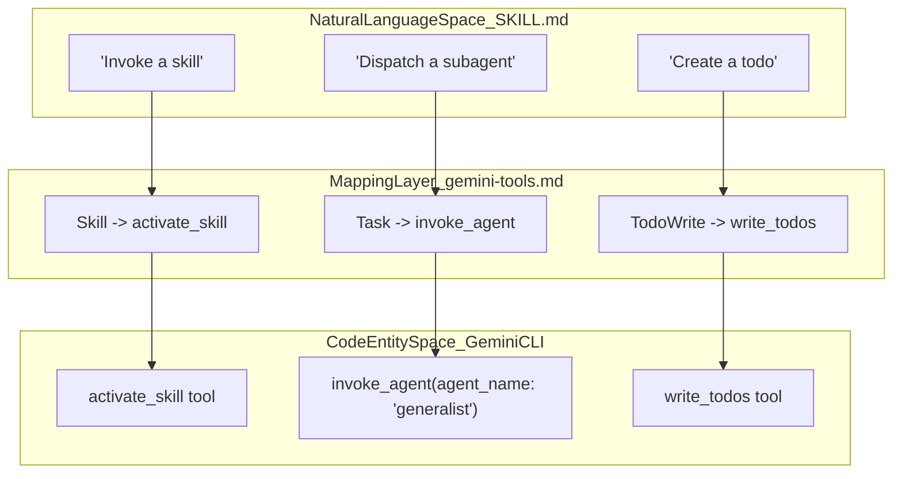
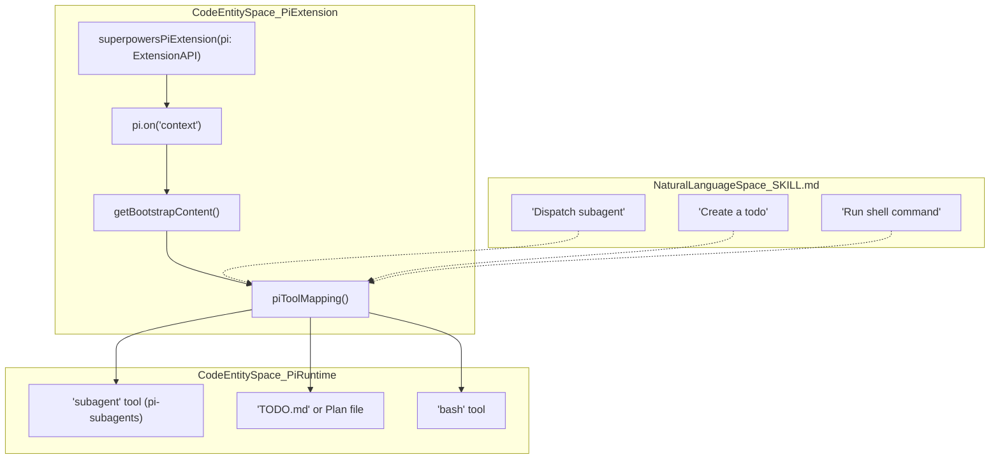

<!-- source: DeepWiki mcp.deepwiki.com · repo obra/superpowers · page 4.6 Tool Mapping Layer · fetched 2026-10-27 -->

# Tool Mapping Layer

Relevant source files

The following files were used as context for generating this wiki page:

- [.pi/extensions/superpowers.ts](.pi/extensions/superpowers.ts)
- [skills/executing-plans/SKILL.md](skills/executing-plans/SKILL.md)
- [skills/using-superpowers/SKILL.md](skills/using-superpowers/SKILL.md)
- [skills/using-superpowers/references/antigravity-tools.md](skills/using-superpowers/references/antigravity-tools.md)
- [skills/using-superpowers/references/claude-code-tools.md](skills/using-superpowers/references/claude-code-tools.md)
- [skills/using-superpowers/references/codex-tools.md](skills/using-superpowers/references/codex-tools.md)
- [skills/using-superpowers/references/gemini-tools.md](skills/using-superpowers/references/gemini-tools.md)
- [skills/using-superpowers/references/pi-tools.md](skills/using-superpowers/references/pi-tools.md)
- [skills/writing-skills/SKILL.md](skills/writing-skills/SKILL.md)
- [skills/writing-skills/anthropic-best-practices.md](skills/writing-skills/anthropic-best-practices.md)
- [tests/antigravity/run-tests.sh](tests/antigravity/run-tests.sh)
- [tests/antigravity/test-antigravity-tools.sh](tests/antigravity/test-antigravity-tools.sh)
- [tests/pi/test-pi-extension.mjs](tests/pi/test-pi-extension.mjs)

The Tool Mapping Layer is a conceptual and technical bridge that allows Superpowers skills—written using Claude Code's tool vocabulary (e.g., `Skill`, `TodoWrite`)—to function across different platforms like Claude Code, Codex, Pi, Gemini CLI, Antigravity, and OpenCode. Instead of rewriting skills for every environment, Superpowers provides a translation map that instructs the AI agent on how to substitute its native tools for the ones referenced in the skill files.

---

## The Problem: Tool Vocabulary Mismatch

Superpowers skills are authored as Markdown files. They frequently instruct the agent to perform specific actions using a common set of conceptual tools:

- **Skill Invocation**: To load and follow another skill.
- **Task Tracking**: To track progress against a checklist or manage tasks.
- **Subagent Dispatch**: To dispatch a subagent for parallel or isolated work.

When these skills are loaded into other harnesses, the agent sees instructions for tools it does not technically possess. The Tool Mapping Layer resolves this by providing platform-specific reference files in `skills/using-superpowers/references/` [skills/using-superpowers/SKILL.md:52-60]().

---

## Platform Mapping Reference

The system maps common Superpowers actions to the native toolsets of various CLI harnesses.

| Superpowers Action | Claude Code Equivalent | Codex Equivalent | Gemini CLI Equivalent | Antigravity CLI (`agy`) | Pi Equivalent |
|:---|:---|:---|:---|:---|:---|
| Skill Invocation | `Skill` | Native discovery | `activate_skill` | Native discovery | Native discovery |
| Task Tracking | `TodoWrite` | Native `todo` tool | `write_todos` | Task Artifact (`write_to_file`) | `TODO.md` or Plan file |
| Subagent Dispatch | `Agent` | `spawn_agent` / `followup_task` | `invoke_agent` | `invoke_subagent` | `subagent` (via `pi-subagents`) |
| Read File | `read_file` | `read_file` | `read_file` | `read_file` | `read` |
| Write File | `write_file` | `write_file` | `write_file` | `write_to_file` | `write` |
| Edit File | `replace` | `replace` | `replace` | `replace_file_content` | `edit` |
| Run Shell Command | `run_shell_command` | `run_shell_command` | `run_shell_command` | `run_shell_command` | `bash` |
| Search File Contents | `grep` | `grep` | `grep_search` | `grep` | `grep` (optional) |
| Find Files by Name | `find` | `find` | `glob` | `find` | `find` (optional) |
| List Directory | `ls` | `ls` | `list_directory` | `ls` | `ls` (optional) |

**Sources:** [skills/using-superpowers/references/gemini-tools.md:5-20](), [skills/using-superpowers/references/antigravity-tools.md:5-8](), [skills/using-superpowers/references/pi-tools.md:5-8](), [.pi/extensions/superpowers.ts:88-97](), [skills/using-superpowers/references/codex-tools.md:1-38]()

---

## Implementation by Platform

### 1. Claude Code: Reference Harness
Claude Code is the reference harness for Superpowers. Skills are authored using its native tool vocabulary. The `using-superpowers` skill itself points to platform-specific reference files for other harnesses [skills/using-superpowers/SKILL.md:52-60](). Claude Code supports nested subagents, allowing for cheaper orchestration of `subagent-driven-development` by dispatching an orchestrator subagent on a mid-tier model [skills/using-superpowers/references/claude-code-tools.md:9-29]().

**Sources:** [skills/using-superpowers/references/claude-code-tools.md:1-29]()

### 2. Codex: Multi-Agent Configuration
Codex requires `multi_agent = true` in its `config.toml` to enable subagent dispatch [skills/using-superpowers/references/codex-tools.md:3-8]().

- **Subagent Support**: Uses `spawn_agent` for new subagents and `followup_task` to resume implementers. It emphasizes using `fork_turns: "none"` for clean contexts [skills/using-superpowers/references/codex-tools.md:17-23]().
- **Waiting on Children**: `wait_agent` is an event subscription, not a poll, and should be used with bounded stretches (5-10 minutes) to avoid unnecessary tool calls and context rebills [skills/using-superpowers/references/codex-tools.md:40-61]().
- **Model Routing**: `spawn_agent` calls should explicitly set `model` and `reasoning_effort` to prevent silent resets to expensive models [skills/using-superpowers/references/codex-tools.md:65-79]().
- **Environment Detection**: Skills like `using-git-worktrees` and `finishing-a-development-branch` use read-only git commands (`git rev-parse --git-dir`, `git branch --show-current`) to detect the environment (e.g., linked worktree, detached HEAD) [skills/using-superpowers/references/codex-tools.md:82-96]().
- **Codex App Finishing**: When in a sandbox (detached HEAD), the agent commits work and informs the user to use the App's native controls for "Create branch" or "Hand off to local" [skills/using-superpowers/references/codex-tools.md:99-108]().

**Sources:** [skills/using-superpowers/references/codex-tools.md:1-108]()

### 3. Gemini CLI: Comprehensive Toolset
Gemini CLI provides a rich set of native tools that map closely to Superpowers workflows. It uses `GEMINI.md` as its primary instructions file [skills/using-superpowers/references/gemini-tools.md:24]().

- **Subagent Support**: Uses `invoke_agent` with an `agent_name` (e.g., `generalist`). It supports parallel dispatch by issuing multiple tool calls in a single response [skills/using-superpowers/references/gemini-tools.md:32-48]().
- **Unique Tools**: Includes `enter_plan_mode` for read-only planning and `save_memory` for persistence [skills/using-superpowers/references/gemini-tools.md:54-63]().

**Sources:** [skills/using-superpowers/references/gemini-tools.md:1-63]()

### 4. Antigravity CLI (`agy`): Artifact-Based Tracking
Antigravity has no native "todo" tool. Instead, it uses **task artifacts** to maintain state [skills/using-superpowers/references/antigravity-tools.md:12-14]().

- **Task Tracking**: Skills requesting `TodoWrite` are mapped to `write_to_file` with `IsArtifact: true` and `ArtifactType: "task"` [skills/using-superpowers/references/antigravity-tools.md:8]().
- **Subagent Support**: Uses `invoke_subagent` with a `TypeName`. The value `self` is used for full-capability work, while `research` is used for read-only tasks [skills/using-superpowers/references/antigravity-tools.md:7]().

**Sources:** [skills/using-superpowers/references/antigravity-tools.md:1-23](), [tests/antigravity/test-antigravity-tools.sh:5-7]()

### 5. Pi: Extension-Based Injection
Pi uses a TypeScript extension (`.pi/extensions/superpowers.ts`) to manage the session lifecycle and tool mapping [tests/pi/test-pi-extension.mjs:54-61]().

- **Bootstrap Injection**: The extension injects a "You have superpowers" bootstrap message at the start of sessions and after compaction events [tests/pi/test-pi-extension.mjs:72-119]().
- **Tool Mapping Logic**: The `piToolMapping()` function explicitly instructs the agent to map `TodoWrite` to `TODO.md` and use `bash`/`read`/`write` for file operations [.pi/extensions/superpowers.ts:88-97]().
- **Subagents and Task Lists**: Pi core does not ship standard subagent or task-list tools. It relies on optional companion packages like `pi-subagents` for `subagent` functionality. If these are not available, the agent is instructed to perform the work in the current session or use plan files/`TODO.md` for task tracking [skills/using-superpowers/references/pi-tools.md:10-16]().

**Sources:** [.pi/extensions/superpowers.ts:1-121](), [skills/using-superpowers/references/pi-tools.md:1-16]()

---

## Tool Mapping Architecture

The following diagrams illustrate how the system bridges "Natural Language Space" (the instructions in the skill) to "Code Entity Space" (the actual tools available in the runtime).

### Diagram: Gemini CLI Tool Resolution

**Sources:** [skills/using-superpowers/references/gemini-tools.md:1-63]()

### Diagram: Pi Extension Lifecycle and Mapping

**Sources:** [.pi/extensions/superpowers.ts:16-98](), [tests/pi/test-pi-extension.mjs:72-101]()

---

## Instruction Priority

The Tool Mapping Layer respects the following hierarchy for instructions:
1.  **User Instructions**: Explicit files like `CLAUDE.md`, `AGENTS.md`, or `GEMINI.md` take top precedence [skills/using-superpowers/SKILL.md:63]().
2.  **Superpowers Skills**: Override default model behaviors [skills/using-superpowers/SKILL.md:63]().
3.  **Harness Defaults**: The base capabilities of the AI environment.

**Sources:** [skills/using-superpowers/SKILL.md:61-63](), [skills/using-superpowers/references/gemini-tools.md:22-24]()

---

