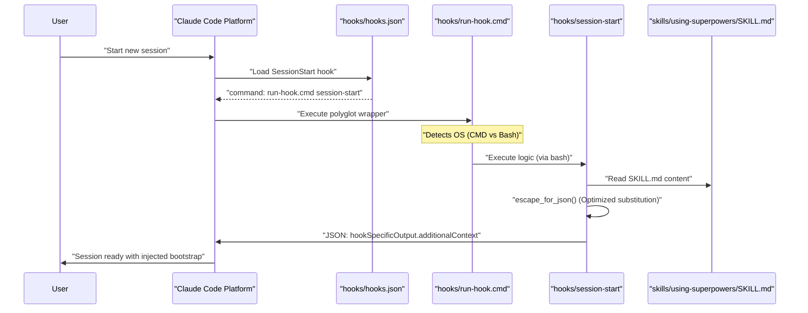

<!-- source: DeepWiki mcp.deepwiki.com · repo obra/superpowers · page 5.1 Claude Code Integration · fetched 2026-10-27 -->

# Claude Code Integration

<details>
<summary>Relevant source files</summary>

The following files were used as context for generating this wiki page:

- [.claude-plugin/marketplace.json](.claude-plugin/marketplace.json)
- [skills/using-superpowers/SKILL.md](skills/using-superpowers/SKILL.md)
- [skills/using-superpowers/references/claude-code-tools.md](skills/using-superpowers/references/claude-code-tools.md)
- [skills/using-superpowers/references/codex-tools.md](skills/using-superpowers/references/codex-tools.md)

</details>


Claude Code integration for Superpowers utilizes a native plugin manifest system with marketplace-based installation. The integration centers on a synchronous `SessionStart` hook that injects the `using-superpowers` skill content as bootstrap context before the agent's first turn.

## Overview

Claude Code provides native support for plugins through its manifest system. The Superpowers integration consists of:

**Core components:**
- **Plugin manifest**: `.claude-plugin/plugin.json` and `.claude-plugin/marketplace.json` define the plugin metadata and marketplace configuration for Claude Code [[.claude-plugin/marketplace.json:1-20]()].
- **Hooks configuration**: `hooks/hooks.json` registers lifecycle hooks using a cross-platform polyglot wrapper [[hooks/hooks.json:1-16]()].
- **Bootstrap injection**: `hooks/session-start` is an extensionless bash script that injects context into the session [[hooks/session-start:1-49]()].
- **Skills directory**: `skills/` contains skill definitions in `SKILL.md` format, which Claude Code discovers natively.

**Native tools Claude Code provides:**
- `Skill` tool: Browse, search, and invoke skills.
- `Task` tool: Dispatch subagents for parallel work.
- `TodoWrite` tool: Track implementation progress.

Sources: [[.claude-plugin/marketplace.json:1-20](), [hooks/hooks.json:1-16](), [hooks/session-start:1-49]()]

## Plugin Manifest Structure

The plugin is defined in the marketplace manifest at [[.claude-plugin/marketplace.json:1-20]()]:

```json
{
  "name": "superpowers-dev",
  "description": "Development marketplace for Superpowers core skills library",
  "plugins": [
    {
      "name": "superpowers",
      "description": "Core skills library for Claude Code: TDD, debugging, collaboration patterns, and proven techniques",
      "version": "6.4.2",
      "source": "./"
    }
  ]
}
```

**Convention-based discovery:**
Claude Code automatically detects plugin resources by directory name:
- `skills/`: Skill definitions (`SKILL.md` files with frontmatter).
- `hooks/hooks.json`: Lifecycle hook registration [[hooks/hooks.json:1-16]()].

Sources: [[.claude-plugin/marketplace.json:1-20](), [hooks/hooks.json:1-16]()]

## Installation and Discovery Flow

**Title: Plugin Registration and Discovery Flow**

```mermaid
graph TB
    subgraph "Plugin_Definition_Space"
        [".claude-plugin/marketplace.json"] -- "Metadata" --> ["name: superpowers-dev"]
        ["name: superpowers-dev"] -- "plugins[0].name" --> ["superpowers"]
        ["superpowers"] -- "plugins[0].version" --> ["6.4.2"]
    end
    
    subgraph "User_Command_Space"
        ["claude plugin add"] -- "Link" --> ["obra/superpowers"]
    end
    
    subgraph "Claude_Code_Loading_Space"
        ["~/.claude/plugins/superpowers/"] -- "Read" --> ["hooks/hooks.json"]
        ["hooks/hooks.json"] -- "Register" --> ["SessionStart_Hook"]
        ["~/.claude/plugins/superpowers/"] -- "Discover" --> ["skills/"]
    end
```

The manifest at [[.claude-plugin/marketplace.json:1-20]()] defines plugin metadata. When installed, Claude Code monitors the `skills/` directory for any `SKILL.md` files to populate its internal `Skill` tool.

Sources: [[.claude-plugin/marketplace.json:1-20]()]

## Hooks System Configuration

### hooks.json Structure

Claude Code requires a `hooks.json` file to register lifecycle hooks. The `SessionStart` hook runs **synchronously** (`"async": false`) to ensure bootstrap context is injected before the agent's first response [[hooks/hooks.json:11-11]()].

```json
{
  "hooks": {
    "SessionStart": [
      {
        "matcher": "startup|clear|compact",
        "hooks": [
          {
            "type": "command",
            "command": "\"${CLAUDE_PLUGIN_ROOT}/hooks/run-hook.cmd\" session-start",
            "shell": "bash",
            "async": false
          }
        ]
      }
    ]
  }
}
```

The hook fires on `startup`, `clear`, and `compact` events [[hooks/hooks.json:5-5]()]. It uses a polyglot wrapper `run-hook.cmd` to handle cross-platform execution, specifically declaring `shell: "bash"` for compatibility with Git for Windows in Claude Code ≥ 2.1.81 [[hooks/hooks.json:9-10](); [RELEASE-NOTES.md:62-63]()].

Sources: [[hooks/hooks.json:1-16](), [RELEASE-NOTES.md:62-63]()]

### Hook Execution Flow

**Title: SessionStart Hook Execution Sequence**



Sources: [[hooks/hooks.json:1-16](), [hooks/session-start:1-49](), [hooks/run-hook.cmd:1-46]()]

## Bootstrap Injection Mechanism

### session-start Script Implementation

The hook script `hooks/session-start` performs bootstrap injection. It is extensionless to prevent Windows from attempting to open it in a text editor [[hooks/run-hook.cmd:7-9]()].

**Path Resolution and Environment Detection:**
The script determines the `PLUGIN_ROOT` [[hooks/session-start:7-8]()] and reads the `using-superpowers` skill content [[hooks/session-start:11-11]()].

**JSON Escaping Optimization:**
The `escape_for_json()` function uses bash parameter substitution (`${s//old/new}`) instead of character-by-character loops, which is significantly faster for large skill files [[hooks/session-start:16-24]()].

**Platform-Specific Output:**
The script detects the environment via variables like `CLAUDE_PLUGIN_ROOT` and `CURSOR_PLUGIN_ROOT` to emit the correct JSON structure:
- **Claude Code**: Expects `hookSpecificOutput.additionalContext` [[hooks/session-start:41-43]()].
- **Cursor**: Expects `additional_context` [[hooks/session-start:38-40]()].
- **Copilot CLI**: Expects `additionalContext` at the top level [[hooks/session-start:44-46]()].

Sources: [[hooks/session-start:1-49](), [hooks/run-hook.cmd:7-9]()]

### Polyglot Hook Wrapper

To support Windows, macOS, and Linux, Superpowers uses a polyglot wrapper `hooks/run-hook.cmd`.

**Title: Cross-Platform Hook Resolution (run-hook.cmd)**

```mermaid
graph TD
    subgraph "Windows_Execution_Space"
        ["run-hook.cmd"] -- "CMD Label" --> [": << 'CMDBLOCK'"]
        [": << 'CMDBLOCK'"] -- "Find" --> ["bash.exe"]
        ["bash.exe"] -- "Execute" --> ["hooks/session-start"]
    end
    
    subgraph "Unix_Execution_Space"
        ["run-hook.cmd"] -- "Heredoc" --> ["Bash_ignores_CMDBLOCK"]
        ["Bash_ignores_CMDBLOCK"] -- "Execute" --> ["hooks/session-start"]
    end
    
    ["Claude_Code_Platform"] -- "Calls" --> ["run-hook.cmd"]
```

This wrapper ensures that even on Windows, the bash-based `session-start` logic executes correctly by locating a `bash.exe` instance from Git for Windows standard locations [[hooks/run-hook.cmd:21-28]()] or the system `PATH` [[hooks/run-hook.cmd:31-35]()].

Sources: [[hooks/run-hook.cmd:1-46]()]

## Subagent Depth and Orchestration

Claude Code supports nested subagents, allowing for more complex orchestration patterns. By default, it supports three layers of subagents below the main conversation. This depth can be adjusted via the `CLAUDE_CODE_MAX_SUBAGENT_SPAWN_DEPTH` environment variable [[skills/using-superpowers/references/claude-code-tools.md:14-15]()].

For `subagent-driven-development` (SDD) workflows, the controller session can be expensive. Claude Code allows dispatching an orchestrator subagent one layer down to manage the SDD process, reducing the cost of the top-level session. This orchestrator then dispatches its own implementers and reviewers as per the `subagent-driven-development` skill's Model Selection rules. This approach is recommended for whole plans, not single tasks, to maximize cost savings [[skills/using-superpowers/references/claude-code-tools.md:9-29]()].

The orchestrator subagent must relay the "Rulings I made" list verbatim to the human partner, ensuring decisions are communicated accurately [[skills/using-superpowers/references/claude-code-tools.md:25-27]()].

Sources: [[skills/using-superpowers/references/claude-code-tools.md:9-29]()]

## Compatibility and Line Endings

- **Line Endings**: `.gitattributes` enforces `eol=lf` for all shell and polyglot scripts to prevent execution errors on Windows when CMD or Bash parses them [[.gitattributes:1-6]()].
- **Bash Hang Prevention**: The `session-start` hook uses `printf` instead of heredocs (`cat <<EOF`) to avoid a known hang in bash 5.3+ when expanding large variables [[hooks/session-start:36-37]()].

Sources: [[.gitattributes:1-18](), [hooks/session-start:36-37]()]

---

