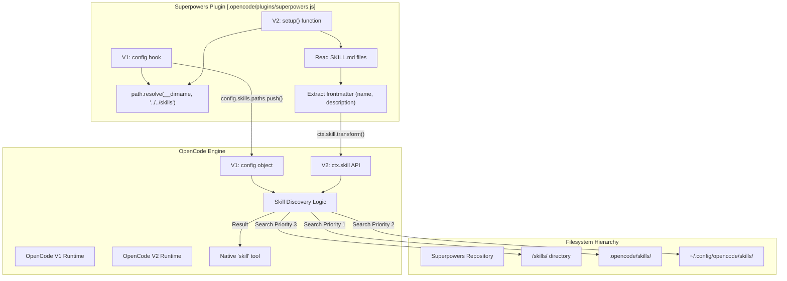
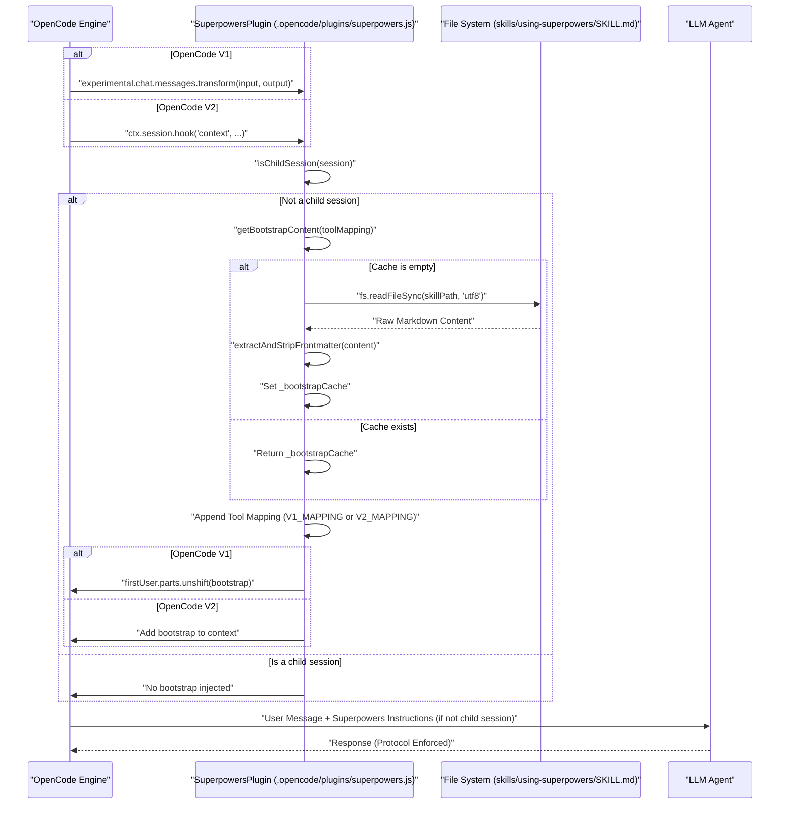

<!-- source: DeepWiki mcp.deepwiki.com · repo obra/superpowers · page 5.3 OpenCode Integration · fetched 2026-10-27 -->

# OpenCode Integration

Relevant source files

The following files were used as context for generating this wiki page:

- [.opencode/INSTALL.md](.opencode/INSTALL.md)
- [.opencode/plugins/superpowers.js](.opencode/plugins/superpowers.js)
- [docs/README.opencode.md](docs/README.opencode.md)
- [docs/testing.md](docs/testing.md)
- [tests/opencode/run-tests.sh](tests/opencode/run-tests.sh)
- [tests/opencode/setup.sh](tests/opencode/setup.sh)
- [tests/opencode/test-bootstrap-caching.mjs](tests/opencode/test-bootstrap-caching.mjs)
- [tests/opencode/test-plugin-loading.sh](tests/opencode/test-plugin-loading.sh)
- [tests/opencode/test-priority.sh](tests/opencode/test-priority.sh)
- [tests/opencode/test-tools.sh](tests/opencode/test-tools.sh)

## Purpose and Scope

This page documents the technical implementation of Superpowers integration with [OpenCode.ai](https://opencode.ai). It covers the JavaScript plugin architecture, the V1/V2 dual entrypoints, bootstrap caching, child-session detection, and custom tools.

For installation instructions, see [Installing on OpenCode (2.3)](). For the shared skill resolution logic used across platforms, see [Shared Skill Discovery Module (5.5)]().

Sources: [.opencode/INSTALL.md:1-166](), [docs/README.opencode.md:1-172]()

---

## Plugin Architecture Overview

The OpenCode integration is implemented as a native JavaScript plugin located at [.opencode/plugins/superpowers.js:1-383](). It is designed for dual compatibility with OpenCode V1 and V2.

### Core Components

| Component | Location | Purpose |
|-----------|----------|---------|
| `SuperpowersPlugin` (V1) | [.opencode/plugins/superpowers.js:300-383]() | V1 entry point via named export. Provides `config` hook for skill registration and `experimental.chat.messages.transform` for bootstrap injection. |
| `default export { id, setup }` (V2) | [.opencode/plugins/superpowers.js:250-298]() | V2 entry point via default export. `setup()` registers skills natively via `ctx.skill.transform()` and injects bootstrap context via `ctx.session.hook("context")`. |
| `getBootstrapContent` | [.opencode/plugins/superpowers.js:116-141]() | Generates the system context by reading the `using-superpowers` skill and appending tool mappings. Includes a module-level cache `_bootstrapCache` [.opencode/plugins/superpowers.js:113]() to eliminate redundant disk I/O. |
| `extractAndStripFrontmatter` | [.opencode/plugins/superpowers.js:33-68]() | Internal utility to parse `SKILL.md` files without external dependencies. |
| `V1_MAPPING` / `V2_MAPPING` | [.opencode/plugins/superpowers.js:77-88](), [.opencode/plugins/superpowers.js:95-107]() | Constants defining tool mappings specific to OpenCode V1 and V2. |
| `isChildSession` | [.opencode/plugins/superpowers.js:150-247]() | Logic to detect if the current session is a delegated child session (subagent) to prevent redundant bootstrap injection. |

**Key Architecture Decision:** The plugin uses distinct entry points and APIs for OpenCode V1 and V2 to ensure compatibility and leverage native V2 features like `ctx.skill.transform()` and `ctx.session.hook("context")` [.opencode/plugins/superpowers.js:1-16]().

Sources: [.opencode/plugins/superpowers.js:1-383](), [docs/README.opencode.md:120-130]()

---

## Skill Discovery and Registration

OpenCode maintains a list of directories where it searches for skills. The Superpowers plugin automates this registration during the initialization phase, with different mechanisms for V1 and V2.

### Automated Path Injection

- **OpenCode V1:** The plugin implements the `config` hook [.opencode/plugins/superpowers.js:300-306](). When OpenCode loads the plugin, it passes the current configuration object to this function. The plugin then appends the absolute path of the Superpowers `skills/` directory to `config.skills.paths`.
- **OpenCode V2:** The `setup()` function, which is the V2 entry point, uses `ctx.skill.transform()` to register skills natively [.opencode/plugins/superpowers.js:250-259](). This API allows the plugin to provide skill metadata directly to OpenCode's skill system.

**Diagram: Skill Discovery Architecture**

Sources: [.opencode/plugins/superpowers.js:250-259](), [.opencode/plugins/superpowers.js:300-306](), [docs/README.opencode.md:123-125](), [tests/opencode/test-priority.sh:20-63]()

---

## Bootstrap Injection Mechanism

To ensure the AI agent follows the "Superpowers Protocol" from the first message, the plugin injects the `using-superpowers` meta-skill directly into the conversation stream. This mechanism also differs between V1 and V2.

### Message Transform Hooks

- **OpenCode V1:** The plugin utilizes the `experimental.chat.messages.transform` hook [.opencode/plugins/superpowers.js:308-383](). This hook is called before LLM requests, allowing the plugin to modify the message history.
- **OpenCode V2:** The `setup()` function registers a session hook using `ctx.session.hook("context")` [.opencode/plugins/superpowers.js:261-298](). This is the V2 equivalent for injecting transient context.

**Implementation Details (Common to V1/V2):**
1.  **Targeting:** For V1, it finds the first message where `role === 'user'` [.opencode/plugins/superpowers.js:311](). For V2, the `context` hook directly provides a mechanism to add context.
2.  **Idempotency:** It checks for the string `EXTREMELY_IMPORTANT` to ensure it only injects once per session [.opencode/plugins/superpowers.js:317]().
3.  **Model Compatibility:** Using a user message transform (V1) or context hook (V2) avoids token bloat from repeated system messages and prevents breaking models like Qwen that struggle with multiple system messages [docs/README.opencode.md:131-138]().
4.  **Caching:** The `_bootstrapCache` variable [.opencode/plugins/superpowers.js:113]() ensures that `getBootstrapContent()` [.opencode/plugins/superpowers.js:116]() does not perform redundant disk reads on every agent step [.opencode/plugins/superpowers.js:116-119]().
5.  **Child Session Detection:** The `isChildSession` function [.opencode/plugins/superpowers.js:150-247]() prevents injecting the bootstrap into subagent sessions. This ensures that subagents focus on their delegated tasks without restarting controller workflows [docs/README.opencode.md:131-132]().

**Diagram: Bootstrap Data Flow**

Sources: [.opencode/plugins/superpowers.js:116-141](), [.opencode/plugins/superpowers.js:150-247](), [.opencode/plugins/superpowers.js:261-298](), [.opencode/plugins/superpowers.js:308-383](), [docs/README.opencode.md:131-138](), [tests/opencode/test-bootstrap-caching.mjs:1-268]()

---

## Tool Mapping Layer

Since Superpowers skills are primarily authored for Claude Code, they often reference generic actions. The OpenCode integration provides a translation layer via the bootstrap instructions to map these to native OpenCode capabilities, with distinct mappings for V1 and V2.

### Tool Substitution Reference

| Generic Action | OpenCode V1 Equivalent | OpenCode V2 Equivalent | Implementation Note |
|----------------|------------------------|------------------------|---------------------|
| Create/Update Todos | `todowrite` | Track in markdown file (no native tool) | V2 explicitly states no todo tool [.opencode/plugins/superpowers.js:97](). |
| Subagent (general-purpose) | `task` with `subagent_type: "general"` | `subagent` with `agent: "general"` | V2 uses `sessionID` for continuation [.opencode/plugins/superpowers.js:98](). |
| Invoke a skill | `skill` | `skill` | Native OpenCode tool [.opencode/plugins/superpowers.js:80](), [.opencode/plugins/superpowers.js:99](). |
| Read files | `read` | `read` | Native file reading [.opencode/plugins/superpowers.js:81](), [.opencode/plugins/superpowers.js:100](). |
| Create, edit, delete files | `apply_patch` | `patch` (with `patchText`), `write`, `edit`, `shell` | V2 offers more granular file mutation tools depending on model capabilities [.opencode/plugins/superpowers.js:101](). |
| Run shell commands | `bash` | `shell` | V2 `shell` tool has `command`, `workdir`, `timeout`, `background` options [.opencode/plugins/superpowers.js:102](). |
| Search files | `grep`, `glob` | `grep`, `glob` | Native search tools [.opencode/plugins/superpowers.js:84](), [.opencode/plugins/superpowers.js:103](). |
| Fetch a URL | `webfetch` | `webfetch` | Native web fetching [.opencode/plugins/superpowers.js:85](), [.opencode/plugins/superpowers.js:104](). |
| Search the web | N/A | `websearch` | V2 introduces a dedicated web search tool [.opencode/plugins/superpowers.js:105](). |

These mappings are explicitly defined in `V1_MAPPING` [.opencode/plugins/superpowers.js:77-88]() and `V2_MAPPING` [.opencode/plugins/superpowers.js:95-107]() constants and injected into the first user message of every session via `getBootstrapContent` [.opencode/plugins/superpowers.js:116-141]().

Sources: [.opencode/plugins/superpowers.js:77-88](), [.opencode/plugins/superpowers.js:95-107](), [docs/README.opencode.md:147-168](), [.opencode/INSTALL.md:147-162]()

---

## Testing and Verification

The repository includes a dedicated test runner for verifying the OpenCode integration.

### Test Runner

The `run-tests.sh` script [tests/opencode/run-tests.sh:1-169]() coordinates the execution of the OpenCode test suite. It supports both unit-style checks and full integration tests.

-   **Plugin Loading:** `test-plugin-loading.sh` verifies the plugin installation and internal structure [tests/opencode/run-tests.sh:64](). It specifically checks for valid JavaScript syntax [tests/opencode/test-plugin-loading.sh:56-61]() and the existence of the critical `using-superpowers` skill [tests/opencode/test-plugin-loading.sh:47-52]().
-   **Bootstrap Caching:** `test-bootstrap-caching.mjs` verifies that the bootstrap content is cached after the first read, preventing redundant file system operations [tests/opencode/run-tests.sh:65](). It also asserts the correctness of V1 and V2 tool mappings within the bootstrap [tests/opencode/test-bootstrap-caching.mjs:36-37]().
-   **Session Bootstrap:** `test-session-bootstrap.sh` verifies session classification and lookup recovery for bootstrap injection [tests/opencode/run-tests.sh:66]().
-   **Skill Registration:** `test-skill-registration.sh` verifies the V2 skill registration contract, specifically the `path` field [tests/opencode/run-tests.sh:67]().
-   **Integration Tests:** When run with the `--integration` flag, it executes tests that require a functional `opencode` environment [tests/opencode/run-tests.sh:25-28]().
    -   `test-tools.sh`: Verifies the native `skill` tool functionality across personal, project, and bundled skills [tests/opencode/test-tools.sh:1-95]().
    -   `test-priority.sh`: Validates the skill priority resolution (Project > Personal > Superpowers) [tests/opencode/test-priority.sh:1-217](). Note that current OpenCode behavior may load bundled versions over local versions for duplicate native names [tests/opencode/test-priority.sh:163-164]().

### Verification Commands
Users can manually verify the integration by checking logs or listing skills:
-   **Log Check (V1):** `opencode run --print-logs "hello" 2>&1 | grep -i superpowers` [.opencode/INSTALL.md:92]().
-   **Log Check (V2):** `opencode run --standalone --print-logs "hello" 2>&1 | grep -i superpowers` or inspect `~/.local/share/opencode/log/opencode.log` [.opencode/INSTALL.md:93-94]().
-   **Skill Discovery:** `use skill tool to list skills` [.opencode/INSTALL.md:63]().

Sources: [tests/opencode/run-tests.sh:1-169](), [.opencode/INSTALL.md:91-94](), [tests/opencode/setup.sh:1-88](), [tests/opencode/test-priority.sh:162-170](), [tests/opencode/test-bootstrap-caching.mjs:1-268]()

---

