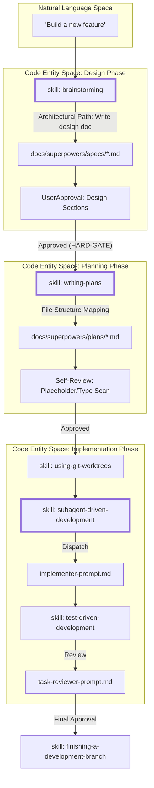
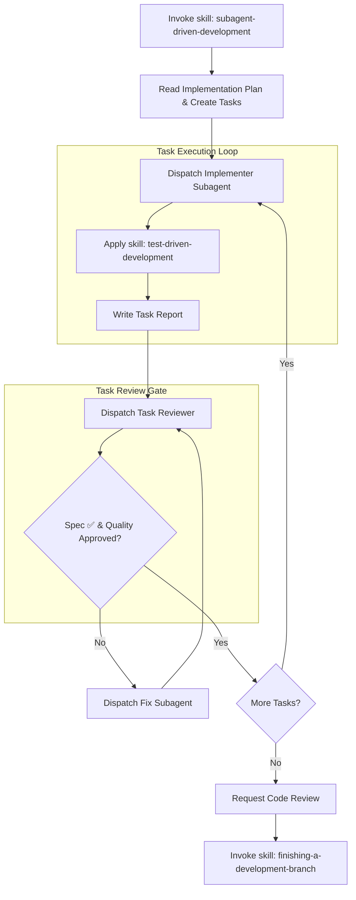
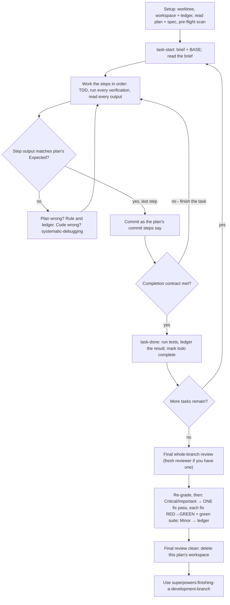

<!-- source: DeepWiki mcp.deepwiki.com · repo obra/superpowers · page 6.1 Complete Workflow Pipeline · fetched 2026-10-27 -->

# Complete Workflow Pipeline

Relevant source files

The following files were used as context for generating this wiki page:

- [skills/brainstorming/SKILL.md](skills/brainstorming/SKILL.md)
- [skills/executing-plans/SKILL.md](skills/executing-plans/SKILL.md)
- [skills/using-superpowers/references/gemini-tools.md](skills/using-superpowers/references/gemini-tools.md)
- [skills/writing-plans/SKILL.md](skills/writing-plans/SKILL.md)
- [skills/writing-skills/SKILL.md](skills/writing-skills/SKILL.md)
- [skills/writing-skills/anthropic-best-practices.md](skills/writing-skills/anthropic-best-practices.md)

This document provides a comprehensive overview of the three-phase development workflow enforced by Superpowers: **brainstorming → writing-plans → subagent-driven-development**. Each phase has mandatory checkpoints, review loops, and hard gates that prevent premature advancement.

## Workflow Overview

The Superpowers workflow enforces structured development through three mandatory phases, each with distinct outputs and validation gates:

| Phase | Skill | Input | Output | Gate |
|-------|-------|-------|--------|------|
| **Design** | `brainstorming` | User request | `docs/superpowers/specs/YYYY-MM-DD-<topic>-design.md` | **HARD-GATE**: No implementation until design approved [skills/brainstorming/SKILL.md:38-56]() |
| **Planning** | `writing-plans` | Design spec | `docs/superpowers/plans/YYYY-MM-DD-<feature-name>.md` | **Scope Check**: Decompose multi-subsystem projects [skills/writing-plans/SKILL.md:20-23]() |
| **Implementation** | `subagent-driven-development` | Implementation plan | Working code in isolated worktree | **Two-stage review** (Spec Compliance + Code Quality) [README.md:41-41]() |

**Sources:** [README.md:33-43](), [skills/brainstorming/SKILL.md:1-56](), [skills/writing-plans/SKILL.md:1-23]()

## Complete Workflow Pipeline Diagram

The following diagram bridges the Natural Language intent of the user to the specific Code Entities (skills and prompts) that manage the state transition.

**Sources:** [skills/brainstorming/SKILL.md:110-130](), [skills/writing-plans/SKILL.md:25-34](), [README.md:41-43]()

---

## Phase 1: Design (`brainstorming` skill)

The `brainstorming` phase transforms raw ideas into validated design specifications. It is protected by a **HARD-GATE** that forbids implementation until approval is granted [skills/brainstorming/SKILL.md:38-56](). The `brainstorming` skill itself is described as a mandatory prerequisite for any creative work [skills/brainstorming/SKILL.md:2-3]().

### Mandatory Checklist
The agent must complete these tasks in order for Architectural paths:
1. **Explore project context** — enough to frame the probe [skills/brainstorming/SKILL.md:130-130]().
2. **Ask clarifying questions** — one at a time, the ones that matter [skills/brainstorming/SKILL.md:124-124]().
3. **Present design sections** — get user approval incrementally [skills/brainstorming/SKILL.md:99-99]().
4. **Write design doc** — Save to `docs/superpowers/specs/YYYY-MM-DD-<topic>-design.md` [skills/brainstorming/SKILL.md:100-100]().
5. **Spec self-review** — Scan for placeholders, contradictions, and ambiguity [skills/brainstorming/SKILL.md:101-101]().
6. **User reviews written spec** — Final confirmation before proceeding [skills/brainstorming/SKILL.md:102-102]().

### Decomposition Strategy
If the spec covers multiple independent subsystems, it should have been broken into sub-project specs during brainstorming [skills/writing-plans/SKILL.md:20-23](). If hidden complexity is discovered mid-task, the path is upgraded (e.g., Bounded to Architectural) [skills/brainstorming/SKILL.md:86-88]().

**Sources:** [skills/brainstorming/SKILL.md:1-130](), [skills/writing-plans/SKILL.md:20-23]()

---

## Phase 2: Planning (`writing-plans` skill)

Once the spec is approved, the `writing-plans` skill breaks the work into bite-sized tasks. The skill emphasizes writing plans for an engineer unfamiliar with the codebase or spec, focusing on exact interfaces, tests, and decisions [skills/writing-plans/SKILL.md:10-11]().

### Plan Structure and Requirements
Every plan must follow a strict schema:
- **File Structure Mapping**: Map out all files to be created or modified before defining tasks to lock in decomposition decisions [skills/writing-plans/SKILL.md:25-34]().
- **Standardized Header**: Every plan must start with a header including the goal, architecture, tech stack, and **Global Constraints** copied verbatim from the spec [skills/writing-plans/SKILL.md:54-80]().
- **No Placeholders**: Patterns like "TBD", "TODO", or "add appropriate error handling" are considered plan failures [skills/writing-plans/SKILL.md:157-159]().
- **Task Granularity**: A task is the smallest unit that carries its own test cycle and is worth a fresh reviewer's gate [skills/writing-plans/SKILL.md:35-37](). Each task includes exact file paths, interfaces (Consumes/Produces), and a step-by-step implementation cycle (Test → Fail → Implement → Pass → Commit) [skills/writing-plans/SKILL.md:93-138]().

### Plan Review Loop
After writing, the agent performs a self-review against the spec:
1. **Spec coverage**: Ensure every requirement in the spec has a corresponding task [skills/writing-plans/SKILL.md:145-145]().
2. **Placeholder scan**: Search for red flags like "TODO" or vague steps [skills/writing-plans/SKILL.md:147-147]().
3. **Type consistency**: Verify method signatures and property names match across all tasks [skills/writing-plans/SKILL.md:149-150]().

**Sources:** [skills/writing-plans/SKILL.md:1-159]()

---

## Phase 3: Implementation (SDD or Executing Plans)

The final phase involves the actual code changes. Superpowers emphasizes using isolated worktrees to ensure a clean baseline.

### Subagent-Driven Development (SDD)
This is the recommended approach. The controller agent dispatches fresh subagents for every task in the plan, inspecting and reviewing their work [README.md:41-41]().

**Implementation Logic Flow:**

**Sources:** [README.md:41-41]()

### Execution Handoff
After the plan is saved, the user is offered two execution options:
1. **Subagent-Driven (recommended)**: Fresh subagent per task with two-stage review [skills/writing-plans/SKILL.md:159-160]().
2. **Inline Execution**: Batch execution in the current session using `executing-plans` [skills/writing-plans/SKILL.md:161-162](). This approach is used when no subagent tool is available or when the human partner explicitly chooses inline execution [skills/executing-plans/SKILL.md:3-4](). The `executing-plans` skill emphasizes executing the plan exactly, proving each step with a test, and recording decisions in a ledger [skills/executing-plans/SKILL.md:11-13]().

#### Inline Execution Process
The `executing-plans` skill follows a detailed process for inline execution:

**Sources:** [skills/executing-plans/SKILL.md:68-105]()

**Sources:** [skills/writing-plans/SKILL.md:154-171](), [skills/executing-plans/SKILL.md:1-128](), [skills/using-superpowers/references/gemini-tools.md:18-18]()

---

