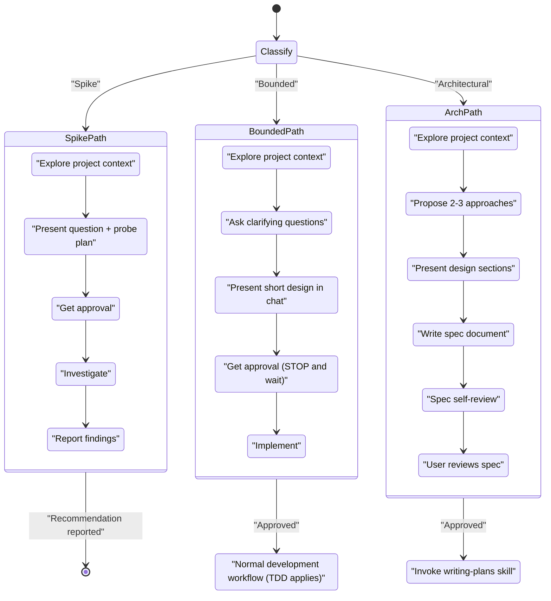

<!-- source: DeepWiki mcp.deepwiki.com · repo obra/superpowers · page 6.2 Brainstorming and Design · fetched 2026-10-27 -->

# Brainstorming and Design

<details>
<summary>Relevant source files</summary>

The following files were used as context for generating this wiki page:

- [docs/superpowers/specs/2026-06-09-sdd-task-scoped-review-dispatch-design.md](docs/superpowers/specs/2026-06-09-sdd-task-scoped-review-dispatch-design.md)
- [skills/brainstorming/SKILL.md](skills/brainstorming/SKILL.md)
- [skills/brainstorming/spec-document-reviewer-prompt.md](skills/brainstorming/spec-document-reviewer-prompt.md)
- [skills/subagent-driven-development/SKILL.md](skills/subagent-driven-development/SKILL.md)
- [skills/subagent-driven-development/implementer-prompt.md](skills/subagent-driven-development/implementer-prompt.md)
- [skills/subagent-driven-development/re-review-prompt.md](skills/subagent-driven-development/re-review-prompt.md)
- [skills/subagent-driven-development/task-reviewer-prompt.md](skills/subagent-driven-development/task-reviewer-prompt.md)
- [skills/writing-plans/SKILL.md](skills/writing-plans/SKILL.md)

</details>


## Purpose and Scope

The brainstorming phase is the mandatory first stage of any development workflow in Superpowers. It enforces a design-before-implementation discipline by requiring user approval of a design specification or intent before any code is written, scaffolding is created, or implementation skills are invoked. 

In version 6.3.0, the ceremony scales to the task: requests are classified into three distinct paths (**Spike**, **Bounded**, or **Architectural**) to ensure that small changes skip unnecessary documentation rituals while maintaining a strict approval gate.

Sources: [skills/brainstorming/SKILL.md:1-12]()

---

## The HARD-GATE Constraint

The `brainstorming` skill implements a hard gate that blocks all implementation activity until approval:

```markdown
<HARD-GATE>
Before taking any implementation action, including invoking an
implementation skill, writing product code, scaffolding, installing
product dependencies, or creating an external project, complete the
selected path's prerequisites:

- Spike: the human partner approves the question and probe.
- Bounded: the human partner approves the short in-chat design.
- Architectural: the human partner reviews and approves the written spec,
  then reviews the written implementation plan and selects its execution
  method. Conversational design approval only permits writing the spec;
  written-spec approval only permits invoking writing-plans.

A reply approves the stage actually presented. Approval of an idea or
feature scope does not approve artifacts that do not exist yet. Resume
at the earliest incomplete stage; do not turn one approval into permission
to skip the rest of the selected path. Read-only project exploration is
allowed while those prerequisites remain incomplete.
</HARD-GATE>
```

This gate prevents the following actions until approval:
- Invoking implementation skills (e.g., `writing-plans`). [skills/brainstorming/SKILL.md:48-49]()
- Writing any product code, scaffolding, installing product dependencies, or creating an external project. [skills/brainstorming/SKILL.md:40-43]()

Sources: [skills/brainstorming/SKILL.md:38-56]()

---

## Three-Path Classification

Before starting work, the agent must classify the request. The "ratchet" is one-way: hidden complexity discovered mid-task upgrades the path, but nothing downgrades.

| Path | Criteria | Process | Output |
| :--- | :--- | :--- | :--- |
| **Spike** | Feasibility questions ("can we...", "is it possible...", "quick and dirty is fine") whose output is an answer, not code you keep. [skills/brainstorming/SKILL.md:65-67]() | Present the question and what you'll try in 2-3 sentences, get a nod, then find out as cheaply as correctness allows. [skills/brainstorming/SKILL.md:67-69]() | Recommendation; anything built stays labeled throwaway. [skills/brainstorming/SKILL.md:69-70]() |
| **Bounded** | A well-scoped change to code that already exists in this repo: a new flag, a small endpoint, a one-file fix. [skills/brainstorming/SKILL.md:71-73]() | Ask clarifying questions, present a short design IN CHAT (a few sentences to a few short paragraphs), and STOP. [skills/brainstorming/SKILL.md:75-77]() | In-chat design; no spec file, no implementation plan document. [skills/brainstorming/SKILL.md:78-78]() |
| **Architectural** | New projects, new subsystems, changes that restructure how components fit together or alter interfaces others depend on. [skills/brainstorming/SKILL.md:81-83]() | Follow the full process: questions, approaches, sectioned design, written spec, then the `writing-plans` skill. [skills/brainstorming/SKILL.md:83-85]() | Written spec, then implementation plan. [skills/brainstorming/SKILL.md:84-85]() |

Sources: [skills/brainstorming/SKILL.md:58-88]()

---

## Process State Machine

The following diagram illustrates the internal logic and transitions within the `brainstorming` skill across the three paths.



Sources: [skills/brainstorming/SKILL.md:115-137]()

---

## Spec Review and Verification

For **Architectural** tasks, the system provides two verification layers for the design specification.

### Spec Self-Review (Inline)
The agent performs a "fresh eyes" check before presenting the final spec:
1.  **Spec coverage**: Can every requirement be traced to a design section? [skills/writing-plans/SKILL.md:145-145]()
2.  **Placeholder scan**: Search for "TBD", "TODO", or vague requirements. [skills/brainstorming/spec-document-reviewer-prompt.md:21-21]()
3.  **Type consistency**: Ensure method signatures and property names match across sections. [skills/writing-plans/SKILL.md:149-149]()

### Spec Document Reviewer Subagent
For complex designs, a subagent can be dispatched using `spec-document-reviewer-prompt.md`.
- **Purpose**: Verify the spec is complete, consistent, and ready for implementation planning. [skills/brainstorming/spec-document-reviewer-prompt.md:5-5]()
- **Calibration**: Reviewers only flag issues that would cause real problems during implementation planning (e.g., ambiguity that leads to building the wrong thing). [skills/brainstorming/spec-document-reviewer-prompt.md:29-32]()
- **Scope Check**: Verifies the spec is focused enough for a single plan and doesn't cover multiple independent subsystems. [skills/brainstorming/spec-document-reviewer-prompt.md:24-24]()

Sources: [skills/brainstorming/spec-document-reviewer-prompt.md:1-49](), [skills/writing-plans/SKILL.md:143-152]()

---

## Transition to Implementation Planning

Once the design is approved, the workflow transitions to the `writing-plans` skill.

### Implementation Data Flow

This diagram bridges the conceptual design approval to the technical execution entities in the codebase.

```mermaid
graph TD
    subgraph "Natural Language Space"
        "UserApproval"["User Approval (Yes/Nod)"]
        "SpecDoc"["docs/superpowers/specs/YYYY-MM-DD-<feature-name>.md"]
    end

    subgraph "Code Entity Space"
        "BrainstormSkill"["skills/brainstorming/SKILL.md"]
        "SpecReviewerPrompt"["skills/brainstorming/spec-document-reviewer-prompt.md"]
        "WritingPlansSkill"["skills/writing-plans/SKILL.md"]
        "PlanDoc"["docs/superpowers/plans/YYYY-MM-DD-<feature-name>.md"]
        "SDD_Skill"["skills/subagent-driven-development/SKILL.md"]
    end

    "UserApproval" -- "Triggers" --> "BrainstormSkill"
    "BrainstormSkill" -- "Path: Architectural" --> "SpecDoc"
    "SpecDoc" -- "Reviewed by" --> "SpecReviewerPrompt"
    "SpecReviewerPrompt" -- "Approval" --> "WritingPlansSkill"
    "WritingPlansSkill" -- "Generates" --> "PlanDoc"
    "PlanDoc" -- "Implemented by" --> "SDD_Skill"
```

Sources: [skills/brainstorming/SKILL.md:83-85](), [skills/brainstorming/spec-document-reviewer-prompt.md:5-5](), [skills/writing-plans/SKILL.md:1-18](), [skills/writing-plans/SKILL.md:16-18](), [skills/subagent-driven-development/SKILL.md:1-4]()

### Key Differences in Planning
While Brainstorming focuses on *intent*, `writing-plans` focuses on *execution*:
- **Bite-Sized Tasks**: A task is the smallest unit that carries its own test cycle and is worth a fresh reviewer's gate. Each step is one action with a checkable result. [skills/writing-plans/SKILL.md:35-41](), [skills/writing-plans/SKILL.md:44-51]()
- **Spec Pointers**: Plans carry a `Spec:` pointer to the original design document. This ensures that executors (like `subagent-driven-development`) can refer to the authoritative design for conflict resolution. [skills/writing-plans/SKILL.md:67-68](), [skills/subagent-driven-development/SKILL.md:19-20]()
- **TDD Requirement**: Each task in a plan explicitly includes steps for Test-Driven Development (TDD), detailing how to write failing tests, run them, implement minimal code, and verify passing tests. [skills/writing-plans/SKILL.md:108-137]()

Sources: [skills/writing-plans/SKILL.md:1-159](), [skills/subagent-driven-development/SKILL.md:19-20]()

---

