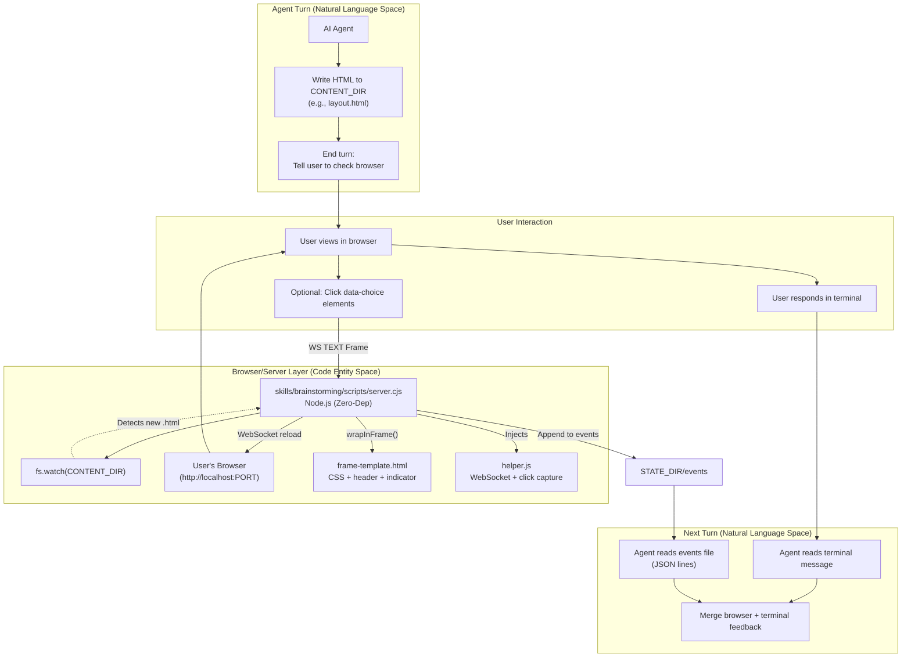
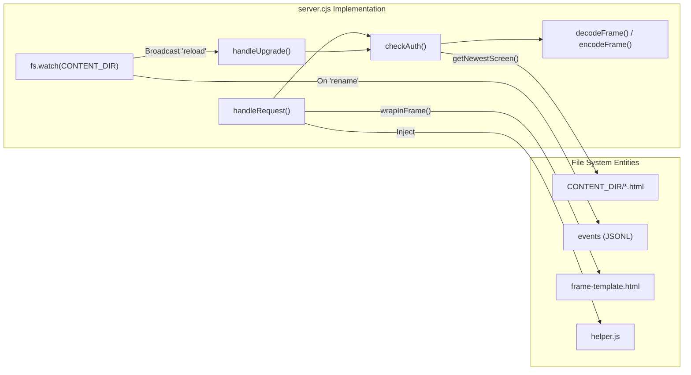
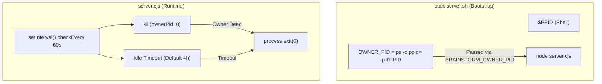

<!-- source: DeepWiki mcp.deepwiki.com · repo obra/superpowers · page 6.3 Visual Brainstorming Companion · fetched 2026-10-27 -->

# Visual Brainstorming Companion

Relevant source files

The following files were used as context for generating this wiki page:

- [README.md](README.md)
- [skills/brainstorming/scripts/server.cjs](skills/brainstorming/scripts/server.cjs)
- [skills/brainstorming/scripts/start-server.sh](skills/brainstorming/scripts/start-server.sh)
- [skills/brainstorming/visual-companion.md](skills/brainstorming/visual-companion.md)
- [tests/brainstorm-server/branding.test.js](tests/brainstorm-server/branding.test.js)

## Purpose and Scope

The Visual Brainstorming Companion is a browser-based tool for showing mockups, diagrams, and interactive visual options during brainstorming sessions. It implements a non-blocking architecture where the browser serves as an interactive display while the terminal remains the primary conversation channel. This document covers the `.events` file architecture, server components, interaction model, and security hardening. For the broader brainstorming workflow and design process, see [Brainstorming and Design]().

**Sources:** [skills/brainstorming/visual-companion.md:1-32](), [skills/brainstorming/scripts/server.cjs:1-5]()

---

## Architecture Overview

The visual companion uses a watch-and-serve pattern: the AI agent writes HTML fragments to a session directory, a zero-dependency Node.js server watches for new files and serves them to the browser, and user interactions are recorded to an `events` file in the state directory that the agent reads on subsequent turns.

### System Data Flow

**Key architectural principles:**

| Principle | Implementation |
|-----------|----------------|
| **Non-blocking** | Agent ends turn after writing HTML; no tool output blocking [skills/brainstorming/visual-companion.md:106-111]() |
| **Terminal primacy** | Terminal remains available for user input during visual sessions [skills/brainstorming/visual-companion.md:118-119]() |
| **Zero Dependencies** | Server uses only Node.js built-ins (`http`, `crypto`, `fs`, `path`) [skills/brainstorming/scripts/server.cjs:1-5]() |
| **Auto-refresh** | Browser reloads via WebSocket when new HTML files are detected |
| **Fragment-based** | Agent writes content fragments; server wraps in frame template [skills/brainstorming/visual-companion.md:31-32]() |

**Sources:** [skills/brainstorming/visual-companion.md:27-32](), [skills/brainstorming/scripts/server.cjs:1-125]()

---

## Core Components

### Server: `skills/brainstorming/scripts/server.cjs`

The server is a single-file CommonJS module that handles HTTP serving, WebSocket protocol implementation (RFC 6455), and file watching.

**Security and Configuration:**
- **Per-Session Secret Key**: The server generates a random 32-byte token [skills/brainstorming/scripts/server.cjs:124-126](). Access requires this token via `?key=` URL parameter or a `brainstorm-key-<PORT>` cookie [skills/brainstorming/scripts/server.cjs:148-152]().
- `BRAINSTORM_PORT`: Port to bind. Reuses the last bound port from `PORT_FILE` if available to support browser reconnection [skills/brainstorming/scripts/server.cjs:89-98]().
- `BRAINSTORM_DIR`: Root directory for session files, containing `content/` and `state/` [skills/brainstorming/scripts/server.cjs:102-104]().
- `BRAINSTORM_OWNER_PID`: Parent process PID for lifecycle monitoring. The server exits if this process is no longer alive [skills/brainstorming/scripts/server.cjs:113]().

**Sources:** [skills/brainstorming/scripts/server.cjs:83-152]()

### Helper Script: `helper.js`

Injected into every page to provide interactivity without requiring the agent to write complex scripts.

- **WebSocket Connection**: Automatically connects to the server using the `sessionKey` and handles `reload` messages.
- **Click Capture**: Listens for clicks on any element with a `data-choice` attribute.
- **Selection Logic**: Manages the `.selected` CSS class via `window.toggleSelect` and sends interaction data back to the server via WebSocket.
- **Reconnection Logic**: Implements exponential backoff via `nextReconnectDelay` and shows a "Companion paused" tombstone if disconnected longer than `TOMBSTONE_AFTER_MS`.

**Sources:** [skills/brainstorming/scripts/server.cjs:290-300]()

---

## The `events` File Architecture

The server records browser interactions to an `events` file in the session's state directory as a series of JSON objects (JSON Lines format).

### Event Lifecycle

1. **Creation**: When a user clicks a `data-choice` element, the browser helper sends a WebSocket message.
2. **Persistence**: `server.cjs` appends the event to `state/events` using `fs.appendFileSync` after verifying the session key.
3. **Consumption**: On the next turn, the agent reads the file to determine user preference [skills/brainstorming/visual-companion.md:121-123]().
4. **Cleanup**: When a new HTML file is added (a new "screen"), the server typically serves the newest file, and the agent is instructed to merge terminal and event feedback [skills/brainstorming/visual-companion.md:120-123]().

**Sources:** [skills/brainstorming/scripts/server.cjs:1-5](), [skills/brainstorming/visual-companion.md:29-32]()

---

## Interaction Loop

The brainstorming process follows a specific loop when the visual companion is active.

### Turn Sequence
1. **Agent Turn**:
   - Check if server is alive by verifying `$STATE_DIR/server-info` exists and `$STATE_DIR/server-stopped` does not [skills/brainstorming/visual-companion.md:109-109]().
   - Write a new HTML file with a unique name to `screen_dir` [skills/brainstorming/visual-companion.md:110-111]().
   - Inform the user of the full URL (including the security key) and summarize the content [skills/brainstorming/visual-companion.md:115-118]().
2. **User Interaction**:
   - User views the screen in the browser.
   - User may click options (recorded to `events`).
   - User responds in the terminal with textual feedback [skills/brainstorming/visual-companion.md:118-119]().
3. **Next Agent Turn**:
   - Agent reads `$STATE_DIR/events` for structured data [skills/brainstorming/visual-companion.md:121-122]().
   - Agent merges browser events with terminal text to decide next steps [skills/brainstorming/visual-companion.md:122-123]().

**Sources:** [skills/brainstorming/visual-companion.md:106-123]()

---

## Session Management

### Server Startup
The `start-server.sh` script handles process backgrounding and environment detection.

- **Persistence**: Using `--project-dir` stores session files in `.superpowers/brainstorm/${SESSION_ID}` within the project. It also persists the bound port and key in `.last-port` and `.last-token` [skills/brainstorming/scripts/start-server.sh:116-121]().
- **Foreground Mode**: Auto-detected on Windows/MSYS2 or when `CODEX_CI` is set to ensure the server survives environments that reap background processes [skills/brainstorming/scripts/start-server.sh:97-107]().
- **Owner Monitoring**: The server resolves the harness PID (`OWNER_PID`) and monitors it. On Windows, this is disabled to avoid PID namespace conflicts [skills/brainstorming/scripts/start-server.sh:153-167]().

### Lifecycle Monitoring Implementation

**Sources:** [skills/brainstorming/scripts/start-server.sh:153-167](), [skills/brainstorming/scripts/server.cjs:113](), [skills/brainstorming/scripts/start-server.sh:14-14]()

### Server Shutdown
The `stop-server.sh` script reads the `server.pid` file and performs a safety check to verify the PID actually belongs to a brainstorm server instance by checking the `server-instance-id`. It attempts a graceful shutdown, escalating to `SIGKILL` if necessary.

**Sources:** [skills/brainstorming/scripts/stop-server.sh:1-110]()

---

## Testing

The brainstorming server is verified through both unit and integration tests.

- **Server Integration Tests**: `tests/brainstorm-server/branding.test.js` verifies dynamic package version branding and theme support [tests/brainstorm-server/branding.test.js:122-155]().
- **Browser Helper Tests**: `tests/brainstorm-server/helper.test.js` unit-tests the reconnection backoff logic and exercises the status state machine.
- **PID Safety Tests**: `tests/brainstorm-server/stop-server.test.sh` ensures that `stop-server.sh` does not kill unrelated processes that have reused a stale PID.

**Sources:** [tests/brainstorm-server/branding.test.js:1-207](), [tests/brainstorm-server/stop-server.test.sh:1-182]()

---

