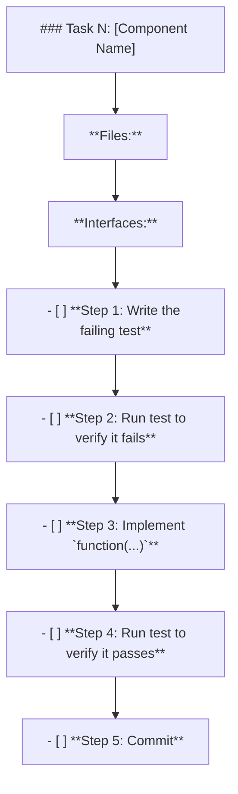

<!-- source: DeepWiki mcp.deepwiki.com · repo obra/superpowers · page 6.5 Writing Implementation Plans · fetched 2026-10-27 -->

# Writing Implementation Plans

<details>
<summary>Relevant source files</summary>

The following files were used as context for generating this wiki page:

- [skills/brainstorming/SKILL.md](skills/brainstorming/SKILL.md)
- [skills/writing-plans/SKILL.md](skills/writing-plans/SKILL.md)

</details>


This page documents the `writing-plans` skill: what it produces, how plans are structured, how TDD steps are embedded in each task, and how execution is handed off after planning. This skill operates within the middle of the development pipeline — after brainstorming and worktree setup, and before execution. For the full pipeline sequence, see [6.1 Complete Workflow Pipeline](). For the upstream brainstorming step, see [6.2 Brainstorming and Design](). For execution options after planning, see [6.6 Subagent-Driven Development]() and [6.7 Executing Plans in Batches]().

---

## Role in the Workflow

The `writing-plans` skill is invoked after a design document (spec) exists and a git worktree has been created. It converts a design into a concrete, file-by-file, step-by-step implementation plan that any skilled developer — with no codebase familiarity — can follow.

**Workflow Position Diagram**

```mermaid
flowchart LR
  subgraph "NaturalLanguageSpace"
    ["brainstorming"]
  end

  subgraph "CodeEntitySpace"
    ["using-git-worktrees"]
    ["writing-plans"]
    ["subagent-driven-development"]
    ["executing-plans"]
  end

  ["brainstorming"] --> ["using-git-worktrees"]
  ["using-git-worktrees"] --> ["writing-plans"]
  ["writing-plans"] --> D{"ExecutionChoice"}
  D -->|"Subagent-Driven"| ["subagent-driven-development"]
  D -->|"InlineExecution"| ["executing-plans"]
```

**Sources:** [skills/writing-plans/SKILL.md:1-171](), [skills/brainstorming/SKILL.md:48-49](), [skills/brainstorming/SKILL.md:103-103]()

---

## Invoking the Skill

The skill is invoked directly by name or as the terminal state of an **Architectural** brainstorming session [skills/brainstorming/SKILL.md:48-49]().

| Invocation method | Context |
|---|---|
| Direct skill name | `superpowers:writing-plans` |
| Brainstorming transition | Automated after spec approval for Architectural paths [skills/brainstorming/SKILL.md:103-103]() |

**Announcement:** Upon invocation, the agent must announce: _"I'm using the writing-plans skill to create the implementation plan."_ [skills/writing-plans/SKILL.md:14-14]()

**Sources:** [skills/writing-plans/SKILL.md:14-14](), [skills/brainstorming/SKILL.md:48-49](), [skills/brainstorming/SKILL.md:103-103]()

---

## Plan File Location and Naming

Plans are saved to a fixed directory relative to the project root:

```
docs/superpowers/plans/YYYY-MM-DD-<feature-name>.md
```

**Note:** User preferences for plan location override this default [skills/writing-plans/SKILL.md:19-19](). This process should be run in a dedicated worktree created by the `superpowers:using-git-worktrees` skill [skills/writing-plans/SKILL.md:16-16]().

**Sources:** [skills/writing-plans/SKILL.md:16-19]()

---

## Plan Document Header

Every plan file must begin with a fixed header block [skills/writing-plans/SKILL.md:56-56](). This header is required to guide future agents and includes global constraints from the spec [skills/writing-plans/SKILL.md:72-77]().

```markdown
# [Feature Name] Implementation Plan

> **For agentic workers:** REQUIRED SUB-SKILL: Use superpowers:subagent-driven-development (recommended) or superpowers:executing-plans to implement this plan task-by-task. Steps use checkbox (`- [ ]`) syntax for tracking.

**Goal:** [One sentence describing what this builds]

**Architecture:** [2-3 sentences about approach]

**Tech Stack:** [Key technologies/libraries]

**Spec:** [path to the spec/design doc this plan implements — the plan
argues from the spec, so the spec travels with it; executors read both]

## Global Constraints

[The spec's project-wide requirements — version floors, dependency limits,
naming and copy rules, platform requirements — one line each, with exact
values copied verbatim from the spec. Every task's requirements implicitly
include this section.]
```

The embedded instruction ensures that a future agent opening this plan file knows to load the appropriate execution skill before proceeding [skills/writing-plans/SKILL.md:61-61]().

**Sources:** [skills/writing-plans/SKILL.md:56-80]()

---

## Review Focus Section

The `Review Focus` section is a critical part of the plan header [skills/writing-plans/SKILL.md:78-87](). It lists the five most likely failure modes or input classes implied by the spec that are *not* explicitly covered by task-specific tests. This section ensures that the implementer and subsequent reviewers pay special attention to these areas.

```markdown
## Review Focus

[The five input classes or failure modes the spec implies but no task's
tests exercise that are most likely to bite a person using this software
— one line each, naming the input or condition and the behavior a
reasonable person would expect, most likely first. The spec is a vision
document: it says what the software must do, not everything it will
meet, and its silence on an input is not permission for that input to
break the program. Write the list here, once, with the spec in front of
you. Then, for each line, add the test that pins it to the task that
owns the code, in that task's own step style.]
```

For each item in the `Review Focus`, a corresponding test must be added to the relevant task to explicitly address it [skills/writing-plans/SKILL.md:85-87](). This bridges the gap between high-level spec requirements and concrete test cases.

**Sources:** [skills/writing-plans/SKILL.md:78-87]()

---

## File Structure Mapping

Before defining tasks, the planner must map out which files will be created or modified [skills/writing-plans/SKILL.md:25-27](). This is where decomposition decisions are locked in.

*   **Isolation:** Design units with clear boundaries and well-defined interfaces [skills/writing-plans/SKILL.md:29-29]().
*   **Focus:** Prefer smaller, focused files over large ones that do too much [skills/writing-plans/SKILL.md:30-30]().
*   **Locality:** Files that change together should live together (split by responsibility, not technical layer) [skills/writing-plans/SKILL.md:31-31]().
*   **Patterns:** In existing codebases, follow established patterns unless a file has grown unwieldy and requires a split [skills/writing-plans/SKILL.md:32-32]().

This structure directly informs task decomposition, ensuring each task produces self-contained and independently testable changes [skills/writing-plans/SKILL.md:34-35]().

**Sources:** [skills/writing-plans/SKILL.md:25-35]()

---

## Task Right-Sizing

A task is defined as the smallest unit that carries its own test cycle and is worth a fresh reviewer's gate [skills/writing-plans/SKILL.md:37-38](). When drawing task boundaries:
*   Fold setup, configuration, scaffolding, and documentation steps into the task whose deliverable needs them [skills/writing-plans/SKILL.md:38-40]().
*   Split only where a reviewer could meaningfully reject one task while approving its neighbor [skills/writing-plans/SKILL.md:40-41]().
*   Each task must end with an independently testable deliverable [skills/writing-plans/SKILL.md:41-41]().

**Sources:** [skills/writing-plans/SKILL.md:37-41]()

---

## Bite-Sized Step Granularity

Each step in a task must represent a single, concrete action with a checkable result [skills/writing-plans/SKILL.md:45-45](). The skill enforces granularity at the action level, not the task level.

**Step granularity examples:**

| What feels like one step | How the skill breaks it down |
|---|---|
| "Add a test and make it pass" | Step 1: Write the failing test; Step 2: Run it to confirm failure; Step 3: Write minimal implementation; Step 4: Run tests to confirm pass; Step 5: Commit [skills/writing-plans/SKILL.md:48-52]() |
| "Implement the parser" | Multiple tasks, each with their own TDD cycle |

The writing philosophy: assume the implementer is a skilled developer who knows almost nothing about this codebase or problem domain [skills/writing-plans/SKILL.md:10-12]().

**Sources:** [skills/writing-plans/SKILL.md:10-13](), [skills/writing-plans/SKILL.md:45-53]()

---

## Task Structure and TDD Embedding

Each task follows a fixed structure [skills/writing-plans/SKILL.md:93-94](). TDD is embedded directly into each task's steps.

**Task Structure Diagram**



**Task template fields:**

| Field | Requirement |
|---|---|
| `### Task N:` | Numbered sequentially; name describes the component [skills/writing-plans/SKILL.md:95-95]() |
| `**Files:**` | Exact paths: `Create:`, `Modify: path:line-line`, `Test:` [skills/writing-plans/SKILL.md:97-100]() |
| `**Interfaces:**` | Exact signatures for `Consumes` and `Produces` [skills/writing-plans/SKILL.md:102-106]() |
| `Step 1` | Complete test code block [skills/writing-plans/SKILL.md:108-114]() |
| `Step 2` | Exact run command + expected failure message [skills/writing-plans/SKILL.md:116-119]() |
| `Step 3` | Complete implementation code block [skills/writing-plans/SKILL.md:121-125]() |
| `Step 4` | Exact run command + expected pass output [skills/writing-plans/SKILL.md:127-130]() |
| `Step 5` | Exact `git add` and `git commit -m` commands [skills/writing-plans/SKILL.md:132-137]() |

A step is considered complete when the implementer can write exactly one reasonable thing from it, making it unambiguous but not necessarily complete [skills/writing-plans/SKILL.md:141-142](). The plan should only contain decisions the implementer cannot make alone [skills/writing-plans/SKILL.md:157-157]().

**Sources:** [skills/writing-plans/SKILL.md:93-159]()

---

## Plan Review Loops

After writing the complete plan, the agent must perform a self-review or dispatch a specialized subagent to verify quality before any code is touched. This ensures the plan is complete, accurate, and adheres to the specified format.

The `writing-plans` skill implicitly requires a review loop to ensure plan quality. While the provided `SKILL.md` does not explicitly detail a `plan-document-reviewer-prompt.md` or a formal subagent dispatch for review, the expectation is that the agent will critically evaluate its own plan against the skill's requirements. This includes checking for:
*   **Completeness:** All parts of the spec are covered.
*   **Clarity:** Each step is unambiguous.
*   **TDD Adherence:** Every task includes the full TDD cycle.
*   **Format Compliance:** The plan adheres to the specified header and task structure.
*   **No Placeholders:** Absence of "TBD", "TODO", or "Add validation" [skills/writing-plans/SKILL.md:159-159]().

If issues are found during this review, the agent is expected to fix them inline before proceeding.

**Sources:** [skills/writing-plans/SKILL.md:159-159]()

---

## Execution Handoff

After saving and approving the plan, the agent offers an execution choice to the human [skills/writing-plans/SKILL.md:161-171]():

> "Plan complete and saved to `docs/superpowers/plans/<filename>.md`. Two execution options:
>
> **1. Subagent-Driven (recommended)** - I dispatch a fresh subagent per task, review between tasks, fast iteration
>
> **2. Inline Execution** - Execute tasks in this session using executing-plans, batch execution with checkpoints
>
> **Which approach?"**

**Handoff decision matrix:**

| Choice | Skill loaded | Session behavior |
|---|---|---|
| Subagent-Driven | `superpowers:subagent-driven-development` | Fresh subagent per task + two-stage review [skills/writing-plans/SKILL.md:165-167]() |
| Inline Execution | `superpowers:executing-plans` | Batch execution with checkpoints for review [skills/writing-plans/SKILL.md:169-171]() |

**Sources:** [skills/writing-plans/SKILL.md:161-171]()

---

## Summary of Constraints

| Constraint | Rule |
|---|---|
| File save location | `docs/superpowers/plans/YYYY-MM-DD-<feature-name>.md` [skills/writing-plans/SKILL.md:18-18]() |
| Header | Required; includes Goal, Architecture, Tech Stack, Spec path, Global Constraints, and Review Focus [skills/writing-plans/SKILL.md:56-87]() |
| Task step size | One action with a checkable result [skills/writing-plans/SKILL.md:45-45]() |
| TDD | Mandatory — every task has failing test before implementation [skills/writing-plans/SKILL.md:48-52]() |
| Review Loop | Mandatory self-review for spec coverage, placeholders, and type consistency |
| No Placeholders | "TBD", "TODO", or "Add validation" are considered plan failures [skills/writing-plans/SKILL.md:159-159]() |

**Sources:** [skills/writing-plans/SKILL.md:1-171]()

---

