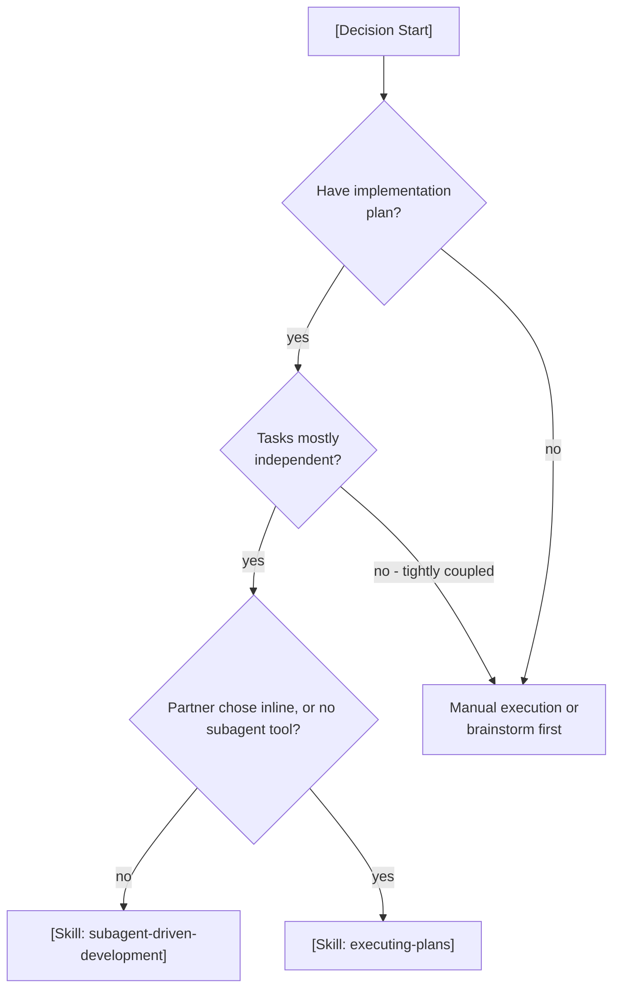
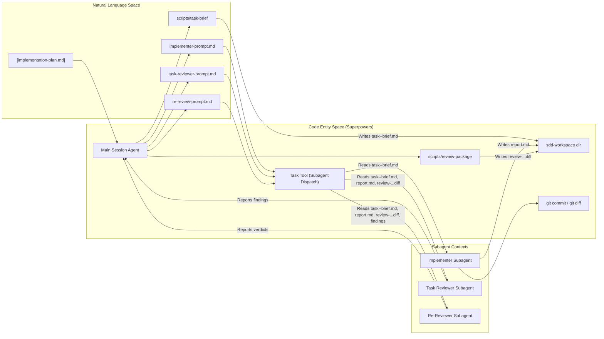

<!-- source: DeepWiki mcp.deepwiki.com · repo obra/superpowers · page 7.4 subagent-driven-development · fetched 2026-10-27 -->

# subagent-driven-development

Relevant source files

The following files were used as context for generating this wiki page:

- [docs/superpowers/specs/2026-06-09-sdd-task-scoped-review-dispatch-design.md](docs/superpowers/specs/2026-06-09-sdd-task-scoped-review-dispatch-design.md)
- [skills/brainstorming/spec-document-reviewer-prompt.md](skills/brainstorming/spec-document-reviewer-prompt.md)
- [skills/subagent-driven-development/SKILL.md](skills/subagent-driven-development/SKILL.md)
- [skills/subagent-driven-development/implementer-prompt.md](skills/subagent-driven-development/implementer-prompt.md)
- [skills/subagent-driven-development/re-review-prompt.md](skills/subagent-driven-development/re-review-prompt.md)
- [skills/subagent-driven-development/task-reviewer-prompt.md](skills/subagent-driven-development/task-reviewer-prompt.md)

## Purpose and Scope

This page documents the `subagent-driven-development` (SDD) skill, a structured workflow for executing implementation plans by dispatching fresh subagents per task with a mandatory two-stage review protocol. This skill is designed for use in environments that support subagent dispatch (Claude Code, Codex, OpenCode, Gemini CLI, Devin, etc.).

For creating the implementation plans that this skill executes, see [writing-plans](7.3). For executing plans in environments without subagent support, see [Executing Plans in Batches](6.7).

**Sources:** [skills/subagent-driven-development/SKILL.md:1-9]()

---

## Core Principle

The SDD workflow is governed by a specific quality formula:

**Fresh subagent per task + Task review (Spec Compliance + Code Quality) + Broad final review = High Quality, Fast Iteration**

By precisely crafting instructions and context for specialized agents, the system ensures they stay focused. Subagents should never inherit the main session's history; instead, the controller constructs exactly what they need, preserving the controller's own context for coordination work. [skills/subagent-driven-development/SKILL.md:10-12]()

**Continuous execution:** The controller is instructed to execute all tasks from the plan without stopping to check in with the human partner unless a `BLOCKED` status occurs, ambiguity genuinely prevents progress, or all tasks are complete. [skills/subagent-driven-development/SKILL.md:17-18]()

**Rulings, not stalls:** A running plan does not wait on a human. The controller must decide on conflicts, ambiguities, or plan defects and record the decision in a ledger as a `Ruling`. [skills/subagent-driven-development/SKILL.md:19-26]()

**Sources:** [skills/subagent-driven-development/SKILL.md:10-26]()

---

## When to Use

The system uses a decision matrix to determine if SDD is appropriate for the current task.

**Comparison with executing-plans:**

| Feature | subagent-driven-development | executing-plans |
| :--- | :--- | :--- |
| **Context** | Fresh subagent per task (no pollution) | Single session history |
| **Review** | Task-scoped (Spec + Quality) | Single review or batch review |
| **Cost** | Costs a fresh context per task and per review | Costs one context plus one final reviewer |
| **Session** | Both run in this session, share the same plan workspace and ledger, and never pause between tasks | Both run in this session, share the same plan workspace and ledger, and never pause between tasks |

**Sources:** [skills/subagent-driven-development/SKILL.md:33-58]()

---

## Execution Process Flow

The SDD process follows a strict loop for every task. To optimize for cost, spec and quality reviews are merged into a single subagent dispatch. [docs/superpowers/specs/2026-06-09-sdd-task-scoped-review-dispatch-design.md:54-59]()

```mermaid
graph TB
    subgraph "Preparation"
        Setup["Setup: worktree, ledger check, read plan, pre-flight review"]
    end

    subgraph "Per-Task Loop"
        DispatchImpl["Dispatch implementer subagent (./implementer-prompt.md)"]
        Questions{"Implementer asks questions?"}
        Answer["Answer questions, provide context"]
        Implement["Implementer implements, tests, commits, self-reviews"]
        GenerateReviewPackage["Generate review package, dispatch task reviewer (./task-reviewer-prompt.md)"]
        ReviewApproved{"Spec ✅ and quality approved?"}
        FindingConflicts{"Finding conflicts with plan text?"}
        RuleConflict["Rule on the conflict, ledger the ruling"]
        FixRound["Fix round R of 5: R≤3 resume implementer; R≥4 fresh implementer, more capable model"]
        DispatchReReview["Dispatch scoped re-review (./re-review-prompt.md)"]
        AllFindingsAddressed{"All findings addressed?"}
        RIs5{"R = 5?"}
        AdjudicateFindings["Adjudicate each open finding"]
        AnyLoadBearing{"Any load-bearing finding?"}
        RuleAndContinue["Rule and continue; stop only if every path forward is a guess"]
        ParkFindings["Park findings in ledger with rulings"]
        AppendCompletion["Append completion to ledger, mark todo complete"]
    end

    subgraph "Completion"
        MoreTasks{"More tasks remain?"}
        DispatchFinalReviewer["Dispatch final code reviewer (../requesting-code-review/code-reviewer.md)"]
        FinalFindings["Final findings? ONE fix dispatch, one scoped re-review, adjudicate residuals"]
        FinalReviewClean["Final review clean: delete this plan's workspace"]
        FinishingSkill["Use superpowers:finishing-a-development-branch"]
    end

    Setup --> DispatchImpl
    DispatchImpl --> Questions
    Questions -->|"yes"| Answer
    Answer --> Implement
    Questions -->|"no"| Implement
    Implement --> GenerateReviewPackage
    GenerateReviewPackage --> ReviewApproved
    ReviewApproved -->|"yes"| AppendCompletion
    ReviewApproved -->|"no"| FindingConflicts
    FindingConflicts -->|"yes"| RuleConflict
    RuleConflict --> FixRound
    FindingConflicts -->|"no"| FixRound
    FixRound --> DispatchReReview
    DispatchReReview --> AllFindingsAddressed
    AllFindingsAddressed -->|"yes"| AppendCompletion
    AllFindingsAddressed -->|"no"| RIs5
    RIs5 -->|"no - next round"| FixRound
    RIs5 -->|"yes - breaker trips"| AdjudicateFindings
    AdjudicateFindings --> AnyLoadBearing
    AnyLoadBearing -->|"yes"| RuleAndContinue
    RuleAndContinue --> ParkFindings
    AnyLoadBearing -->|"no"| ParkFindings
    ParkFindings --> AppendCompletion

    AppendCompletion --> MoreTasks
    MoreTasks -->|"yes"| DispatchImpl
    MoreTasks -->|"no"| DispatchFinalReviewer
    DispatchFinalReviewer --> FinalFindings
    FinalFindings --> FinalReviewClean
    FinalReviewClean --> FinishingSkill
```

**Sources:** [skills/subagent-driven-development/SKILL.md:61-117](), [docs/superpowers/specs/2026-06-09-sdd-task-scoped-review-dispatch-design.md:54-59]()

---

## Workspace Architecture

SDD uses a plan-scoped workspace to prevent context leakage and artifact collisions.

| Script | Purpose | Path |
| :--- | :--- | :--- |
| `sdd-workspace` | Resolves the absolute path for plan artifacts. | `.superpowers/sdd/<plan-slug>/` [skills/subagent-driven-development/scripts/sdd-workspace:1-18]() |
| `task-brief` | Extracts task text to a file for the subagent to read. | `<workspace>/task-<N>-brief.md` [skills/subagent-driven-development/scripts/task-brief:1-9]() |
| `review-package` | Generates a net diff with extended context (U10). | `<workspace>/review-<base>..<head>.diff` [skills/subagent-driven-development/scripts/review-package:1-9]() |

The workspace is kept out of `git status` via a self-ignoring `*` pattern in `.superpowers/sdd/.gitignore`. [tests/claude-code/test-sdd-workspace.sh:93-97]()

**Sources:** [skills/subagent-driven-development/scripts/sdd-workspace:1-40](), [skills/subagent-driven-development/scripts/task-brief:1-41](), [skills/subagent-driven-development/scripts/review-package:1-46]()

---

## Model Selection Strategy

The system selects models based on the nature of the turn to balance cost and capability. [skills/subagent-driven-development/SKILL.md:162-164]()

*   **Mechanical Tasks (isolated functions, clear specs):** Use a fast, cheap model. [skills/subagent-driven-development/SKILL.md:166-166]()
*   **Integration Tasks (multi-file coordination):** Use a standard mid-tier model. [skills/subagent-driven-development/SKILL.md:168-168]()
*   **Architecture and Final Review:** Use the most capable model available. [skills/subagent-driven-development/SKILL.md:170-172]()
*   **Review tasks:** Choose a model scaled to the diff's size. [skills/subagent-driven-development/SKILL.md:174-177]()

**Crucial:** Turn count beats token price. A mid-tier model is the recommended floor for reviewers to avoid 2-3x turn counts caused by cheap models struggling with multi-step logic. [docs/superpowers/specs/2026-06-09-sdd-task-scoped-review-dispatch-design.md:48-53]()

**Sources:** [skills/subagent-driven-development/SKILL.md:162-189](), [docs/superpowers/specs/2026-06-09-sdd-task-scoped-review-dispatch-design.md:48-53]()

---

## Implementer Status Protocol

Implementer subagents report their status using specific tokens.

| Status | Meaning | Controller Action |
| :--- | :--- | :--- |
| **DONE** | Work finished confidently. | Proceed to Task Review. [skills/subagent-driven-development/implementer-prompt.md:142-142]() |
| **DONE_WITH_CONCERNS** | Finished, but flagged doubts (e.g., file growth). | Read concerns. Address before review. [skills/subagent-driven-development/implementer-prompt.md:151-151]() |
| **NEEDS_CONTEXT** | Information missing. | Provide context and re-dispatch. [skills/subagent-driven-development/implementer-prompt.md:152-152]() |
| **BLOCKED** | Cannot complete task. | Escalate to human or upgrade model. [skills/subagent-driven-development/implementer-prompt.md:151-152]() |

**Sources:** [skills/subagent-driven-development/implementer-prompt.md:142-153]()

---

## Role Definitions and Templates

### 1. Implementer Subagent
Dispatched via `implementer-prompt.md`.
*   **Responsibility:** Implement task, write tests (TDD evidence required), and commit. [skills/subagent-driven-development/implementer-prompt.md:32-41]()
*   **Self-Review:** Must verify completeness and quality before reporting. [skills/subagent-driven-development/implementer-prompt.md:92-117]()
*   **Testing:** Run focused tests during iteration; full suite once before commit. [skills/subagent-driven-development/implementer-prompt.md:47-49]()

### 2. Task Reviewer
Dispatched via `task-reviewer-prompt.md`.
*   **Responsibility:** Verify spec compliance and code quality in one pass. [skills/subagent-driven-development/task-reviewer-prompt.md:3-8]()
*   **Scoping:** Restricted to the diff file provided by `review-package`. Do not crawl the broader codebase unless a concrete risk is named. [skills/subagent-driven-development/task-reviewer-prompt.md:38-50]()
*   **Calibration:** Categorize issues as Critical, Important (merge-blocking), or Minor. [skills/subagent-driven-development/task-reviewer-prompt.md:145-157]()

### 3. Re-Reviewer
Dispatched via `re-review-prompt.md`.
*   **Responsibility:** Verify findings from the previous review were addressed and check the fix diff for new breakage. [skills/subagent-driven-development/re-review-prompt.md:7-8]()
*   **Scoping:** Limited to the findings list and the fix diff. Does not re-review code the fix did not touch. [skills/subagent-driven-development/re-review-prompt.md:56-62]()
*   **Output Format:** Provides per-finding verdicts (ADDRESSED/NOT ADDRESSED), new breakage in the fix diff, out-of-scope observations, and a round verdict. [skills/subagent-driven-development/re-review-prompt.md:74-101]()

**Sources:** [skills/subagent-driven-development/implementer-prompt.md:1-154](), [skills/subagent-driven-development/task-reviewer-prompt.md:1-166](), [skills/subagent-driven-development/re-review-prompt.md:1-115]()

---

## Technical Data Flow

The SDD skill bridges Natural Language requirements to Code Entities through structured tool calls and temporary workspace files.

**Key Data Flow Elements:**
*   **Task Briefs:** Generated via `scripts/task-brief` to provide high-fidelity context without polluting the controller's context. [docs/superpowers/specs/2026-06-09-sdd-task-scoped-review-dispatch-design.md:89-91]()
*   **Diff Files:** The controller uses `scripts/review-package` to create a context-rich diff file (`-U10`) that the reviewer reads once. [skills/subagent-driven-development/scripts/review-package:42-42]()
*   **Progress Ledger:** Maintained in the plan's workspace to track state across session resumes. [skills/subagent-driven-development/scripts/sdd-workspace:1-9]()

**Sources:** [docs/superpowers/specs/2026-06-09-sdd-task-scoped-review-dispatch-design.md:54-92](), [skills/subagent-driven-development/scripts/review-package:1-46]()

---

## Platform-Specific Implementation (Codex)

For Codex, SDD requires the `multi_agent` feature flag. [skills/using-superpowers/references/codex-tools.md:1-8]()

*   **Spawning:** Use `spawn_agent {fork_turns: "none"}` for isolated context hygiene. [skills/using-superpowers/references/codex-tools.md:17-23]()
*   **Waiting:** Use `wait_agent` with long timeouts (5-10 minutes) as it is an event subscription, not a poll. [skills/using-superpowers/references/codex-tools.md:41-55]()
*   **Model Routing:** Every `spawn_agent` must set both `model` and `reasoning_effort` explicitly. [skills/using-superpowers/references/codex-tools.md:62-68]()

**Sources:** [skills/using-superpowers/references/codex-tools.md:1-80]()

---

