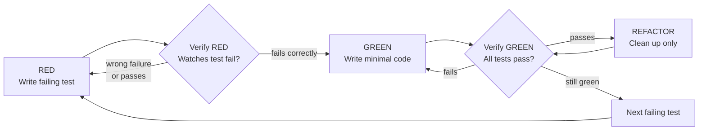
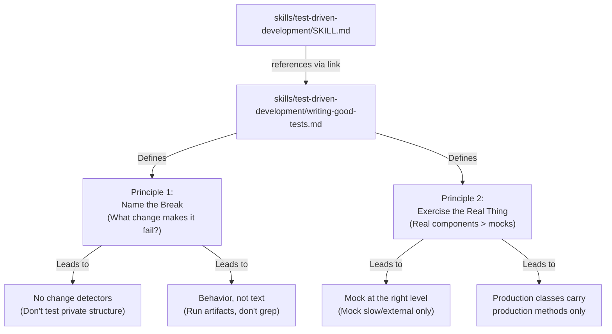
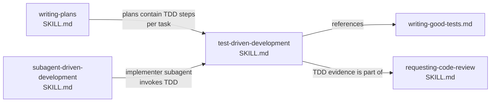

<!-- source: DeepWiki mcp.deepwiki.com · repo obra/superpowers · page 7.5 test-driven-development · fetched 2026-10-27 -->

# test-driven-development

<details>
<summary>Relevant source files</summary>

The following files were used as context for generating this wiki page:

- [skills/requesting-code-review/SKILL.md](skills/requesting-code-review/SKILL.md)
- [skills/test-driven-development/SKILL.md](skills/test-driven-development/SKILL.md)
- [skills/test-driven-development/writing-good-tests.md](skills/test-driven-development/writing-good-tests.md)

</details>


This page documents the `test-driven-development` skill: its Iron Law, the RED/GREEN/REFACTOR cycle with mandatory verification gates, rationalization patterns to reject, and the companion `writing-good-tests.md` reference. This skill governs how agents write code during plan execution.

For how TDD fits into the broader development pipeline, see the **Complete Workflow Pipeline (6.1)**. For applying TDD when authoring new skills (not production code), see **Test-Driven Development for Skills (8.1)**. For the debugging counterpart, see **systematic-debugging (7.6)**.

---

## Skill Metadata

| Field | Value |
|---|---|
| **File** | `skills/test-driven-development/SKILL.md` |
| **Name** | `test-driven-development` |
| **Description trigger** | `Use when implementing any feature or bugfix, before writing implementation code` |
| **Companion reference** | `skills/test-driven-development/writing-good-tests.md` |

Sources: [skills/test-driven-development/SKILL.md:1-4]()

---

## The Iron Law

[skills/test-driven-development/SKILL.md:31-45]()

```
NO PRODUCTION CODE WITHOUT A FAILING TEST FIRST
```

If production code was written before its test exists and was observed failing, the code must be deleted. There are no exceptions:

- Do not keep it as a "reference" [skills/test-driven-development/SKILL.md:40-40]()
- Do not "adapt" it while writing tests alongside [skills/test-driven-development/SKILL.md:41-41]()
- Do not look at it while writing the test [skills/test-driven-development/SKILL.md:42-42]()
- **Delete means delete.** Implement fresh from the tests only. [skills/test-driven-development/SKILL.md:43-45]()

---

## RED / GREEN / REFACTOR Cycle

The three phases form a strict loop. Each phase has a mandatory verification step that must not be skipped.

**Diagram: RED/GREEN/REFACTOR Cycle with Verification Gates**



Sources: [skills/test-driven-development/SKILL.md:47-68]()

---

### Phase 1 — RED: Write the Failing Test

[skills/test-driven-development/SKILL.md:71-112]()

Write one minimal test that describes the expected behavior. Requirements:

| Requirement | Good | Bad |
|---|---|---|
| **One behavior per test** | Single `expect` on one outcome [skills/test-driven-development/SKILL.md:87-88]() | Test verifies email AND domain AND whitespace [skills/test-driven-development/SKILL.md:212-212]() |
| **Clear name** | `'retries failed operations 3 times'` [skills/test-driven-development/SKILL.md:77-77]() | `'retry works'` [skills/test-driven-development/SKILL.md:96-106]() or `'test1'` [skills/test-driven-development/SKILL.md:213-213]() |
| **Real code, not mocks** | Calls the real function under test [skills/test-driven-development/SKILL.md:85-85]() | Asserts that a mock was called N times [skills/test-driven-development/SKILL.md:102-102]() |

Tests should demonstrate the desired API as if writing a usage example. The name should describe behavior, not the mechanism.

---

### Phase 2 — Verify RED (Mandatory)

[skills/test-driven-development/SKILL.md:113-129]()

Run the test suite and confirm three things:

1. The test **fails** (not errors out due to a typo or missing import) [skills/test-driven-development/SKILL.md:122-122]()
2. The failure message is the **expected** one [skills/test-driven-development/SKILL.md:123-123]()
3. The test fails because the **feature is missing**, not because of a test bug [skills/test-driven-development/SKILL.md:124-124]()

```bash
npm test path/to/test.test.ts
```

| Outcome | Action |
|---|---|
| Test passes immediately | You are testing existing behavior. Fix the test. [skills/test-driven-development/SKILL.md:126-126]() |
| Test errors (syntax/import) | Fix the error, re-run. Do not proceed to GREEN. [skills/test-driven-development/SKILL.md:128-128]() |
| Test fails correctly | Proceed to GREEN. |

---

### Phase 3 — GREEN: Minimal Code

[skills/test-driven-development/SKILL.md:130-166]()

Write the **simplest code** that makes the test pass. Do not:

- Add optional parameters or configuration not required by the test [skills/test-driven-development/SKILL.md:152-164]()
- Refactor other code [skills/test-driven-development/SKILL.md:166-166]()
- Implement features the test does not yet demand (YAGNI) [skills/test-driven-development/SKILL.md:160-160]()

The implementation exists only to pass the current test. Nothing more.

---

### Phase 4 — Verify GREEN (Mandatory)

[skills/test-driven-development/SKILL.md:168-184]()

Run the full test suite:

```bash
npm test path/to/test.test.ts
```

Confirm:

- The new test passes [skills/test-driven-development/SKILL.md:177-177]()
- All previously passing tests still pass [skills/test-driven-development/SKILL.md:178-178]()
- Output is pristine: no errors, no warnings [skills/test-driven-development/SKILL.md:179-179]()

| Outcome | Action |
|---|---|
| New test fails | Fix code, not test [skills/test-driven-development/SKILL.md:181-181]() |
| Other tests fail | Fix regressions before continuing [skills/test-driven-development/SKILL.md:183-183]() |
| All pass, clean output | Proceed to REFACTOR |

---

### Phase 5 — REFACTOR: Clean Up

[skills/test-driven-development/SKILL.md:185-196]()

Only after GREEN, improve the code's internal quality:

- Remove duplication [skills/test-driven-development/SKILL.md:188-188]()
- Improve names [skills/test-driven-development/SKILL.md:189-189]()
- Extract helpers [skills/test-driven-development/SKILL.md:190-190]()

**Do not add behavior.** After every change, re-run the suite to confirm all tests remain green [skills/test-driven-development/SKILL.md:192-192]().

---

## Scope: When TDD Applies

[skills/test-driven-development/SKILL.md:16-30]()

| Category | TDD Required |
|---|---|
| New features | Always [skills/test-driven-development/SKILL.md:19-19]() |
| Bug fixes | Always [skills/test-driven-development/SKILL.md:20-20]() |
| Refactoring | Always [skills/test-driven-development/SKILL.md:21-21]() |
| Behavior changes | Always [skills/test-driven-development/SKILL.md:22-22]() |
| Throwaway prototypes | Ask human partner [skills/test-driven-development/SKILL.md:25-25]() |
| Generated code | Ask human partner [skills/test-driven-development/SKILL.md:26-26]() |
| Configuration files | Ask human partner [skills/test-driven-development/SKILL.md:27-27]() |

The urge to skip TDD "just this once" is a rationalization signal, not a legitimate exception [skills/test-driven-development/SKILL.md:29-29]().

---

## Rationalization Table

[skills/test-driven-development/SKILL.md:223-229]()

The skill explicitly catalogs common rationalizations and their rebuttals:

| Rationalization | Reality |
|---|---|
| "Too simple to test" | Simple code breaks. Test takes 30 seconds. [skills/test-driven-development/SKILL.md:225-225]() |
| "I'll test after" | Tests written after pass immediately — which proves nothing. They may test the wrong thing, test the implementation instead of the behavior, or miss the edge case you forgot. You never watched it fail, so you never proved it can catch the bug. Test-first forces that failure. [skills/test-driven-development/SKILL.md:226-226]() |
| "Tests after achieve same goals (spirit not ritual)" | Tests-after answer "what does this do?"; tests-first answer "what should this do?" Tests written after are biased by the code you already wrote — you verify the cases you remembered, not the ones you'd have discovered. Coverage without proof the tests work. [skills/test-driven-development/SKILL.md:227-227]() |
| "Already manually tested" | Manual testing is ad-hoc: no record of what you covered, no way to re-run it when the code changes, easy to forget cases under pressure. "Worked when I tried it" ≠ comprehensive. Automated tests run the same way every time. [skills/test-driven-development/SKILL.md:228-228]() |

---

## Writing Good Tests Reference

[skills/test-driven-development/writing-good-tests.md:1-20]()

The companion file `writing-good-tests.md` provides critical guardrails to keep tests honest and effective. It focuses on two core principles: naming the specific break and exercising the real code.

**Diagram: Test Quality Principles — Code Entity Map**



Sources: [skills/test-driven-development/writing-good-tests.md:1-20](), [skills/test-driven-development/SKILL.md:206-211]()

### Core Principles Summary

| Principle | Description | Violation Example |
|---|---|---|
| **Name the Break** | Every test must name the production change that should make it fail [skills/test-driven-development/writing-good-tests.md:22-25]() | Mirror assertions where same builder computes both sides [skills/test-driven-development/writing-good-tests.md:33-35]() |
| **Exercise the Real Thing** | Mocks earn no assertions; assert the real component's behavior [skills/test-driven-development/writing-good-tests.md:83-86]() | `expect(screen.getByTestId('sidebar-mock')).toBeInTheDocument()` [skills/test-driven-development/writing-good-tests.md:93-93]() |
| **Mock at Right Level** | Keep side effects real; mock only the slow/external level below them [skills/test-driven-development/writing-good-tests.md:99-102]() | Swallowing config writes that duplicate detection needs [skills/test-driven-development/writing-good-tests.md:105-108]() |
| **No Test-Only Code** | Cleanup/helpers live in test utilities, never in production classes [skills/test-driven-development/writing-good-tests.md:124-127]() | `destroy()` method on production class used only by tests [skills/test-driven-development/writing-good-tests.md:126-127]() |

### The Mutation Check

[skills/test-driven-development/writing-good-tests.md:157-169]()

Before finishing, mentally mutate the production code to ensure at least one test fails for:
- Wrong constants or arguments [skills/test-driven-development/writing-good-tests.md:162-162]()
- Wrong branch handlers [skills/test-driven-development/writing-good-tests.md:163-163]()
- Missing state changes or side effects [skills/test-driven-development/writing-good-tests.md:164-164]()
- Missing validation for edge cases (zero, empty, nil) [skills/test-driven-development/writing-good-tests.md:166-166]()

---

## Relationship to Other Skills

**Diagram: TDD Skill in the Development Pipeline**



Sources: [skills/test-driven-development/SKILL.md:320](), [skills/test-driven-development/SKILL.md:206-211](), [skills/requesting-code-review/SKILL.md:66-66]()

---

