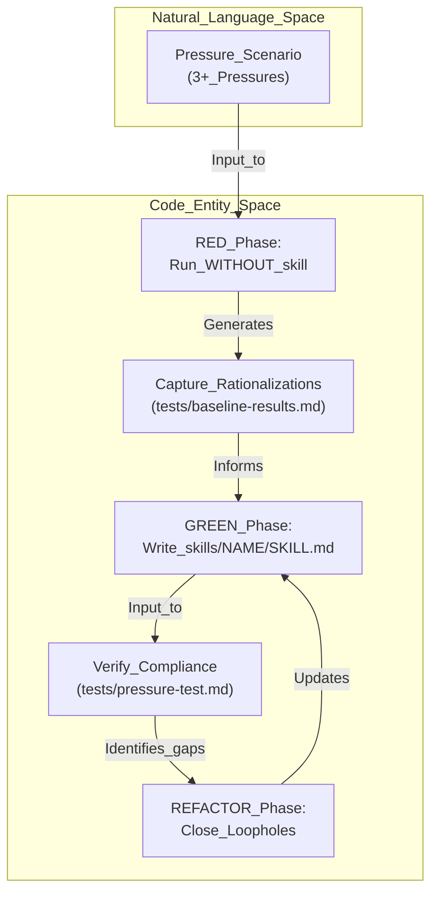
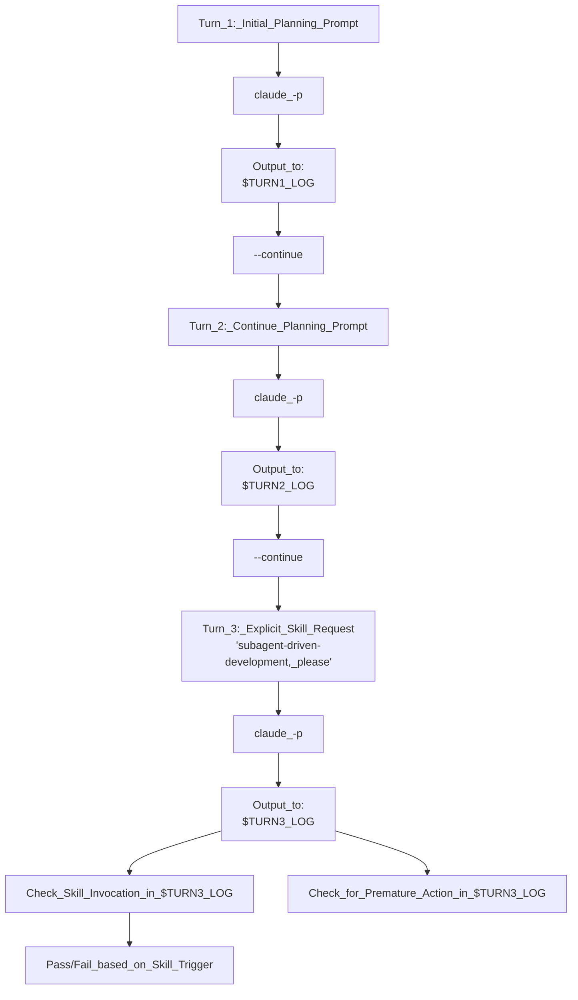
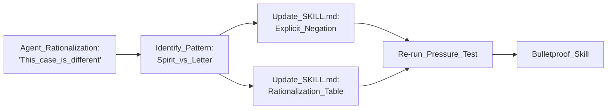
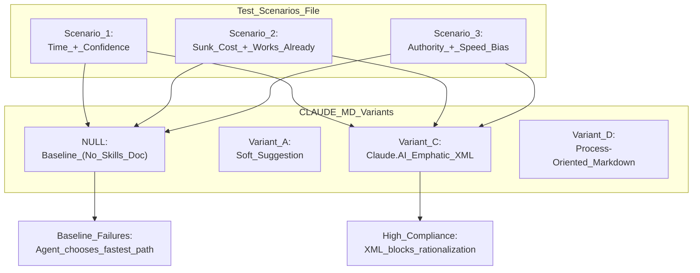

<!-- source: DeepWiki mcp.deepwiki.com · repo obra/superpowers · page 8.3 Testing Skills with Pressure Scenarios · fetched 2026-10-27 -->

# Testing Skills with Pressure Scenarios

<details>
<summary>Relevant source files</summary>

The following files were used as context for generating this wiki page:

- [skills/writing-skills/examples/CLAUDE_MD_TESTING.md](skills/writing-skills/examples/CLAUDE_MD_TESTING.md)
- [skills/writing-skills/testing-skills-with-subagents.md](skills/writing-skills/testing-skills-with-subagents.md)
- [tests/explicit-skill-requests/run-multiturn-test.sh](tests/explicit-skill-requests/run-multiturn-test.sh)
- [tests/explicit-skill-requests/run-test.sh](tests/explicit-skill-requests/run-test.sh)

</details>


This document explains the methodology for designing and executing pressure scenarios to validate discipline-enforcing skills. Pressure testing is the "RED" phase of the TDD-for-documentation cycle, ensuring that content in `SKILL.md` actually prevents agent rationalizations when faced with realistic development constraints.

For the foundational methodology, see [8.1 Test-Driven Development for Skills](). For file format requirements, see [8.2 SKILL.md Format and Structure]().

## Overview

Testing skills is essentially TDD applied to process documentation [skills/writing-skills/testing-skills-with-subagents.md:7-13](). Pressure testing validates skills by simulating scenarios where an agent is incentivized to skip a required process (like TDD or brainstorming). By combining multiple stressors—time, sunk cost, authority, and exhaustion—we force the agent to choose between a rule-compliant path and a "pragmatic" bypass [skills/writing-skills/testing-skills-with-subagents.md:19-24]().

**Core Principle:** If you didn't watch an agent fail without the skill, you don't know if the skill prevents the right failures [skills/writing-skills/testing-skills-with-subagents.md:11-12]().

**Sources:** [skills/writing-skills/testing-skills-with-subagents.md:1-16](), [skills/writing-skills/examples/CLAUDE_MD_TESTING.md:1-4]()

## Pressure Scenario Design

A high-quality pressure scenario must move beyond "academic" questions. It should make the agent believe it is in a real work situation where following the rules has a tangible cost [skills/writing-skills/testing-skills-with-subagents.md:144-162]().

### The Triple-Pressure Rule
Effective tests combine **3+ pressures**. Single pressures (e.g., just a deadline) are too easy for modern LLMs to resist. Combining them creates the "rationalization zone" [skills/writing-skills/testing-skills-with-subagents.md:140-143]().

| Pressure Type | Example Implementation in Scenario |
| :--- | :--- |
| **Time** | "Production is down, $10k/min lost, 5 minutes until deploy window closes." [skills/writing-skills/testing-skills-with-subagents.md:106-108]() |
| **Sunk Cost** | "You spent 4 hours writing 200 lines of code; it works perfectly now." [skills/writing-skills/testing-skills-with-subagents.md:62-64]() |
| **Authority** | "Your human partner says 'just ship it now, we'll add tests later'." [skills/writing-skills/examples/CLAUDE_MD_TESTING.md:42-44]() |
| **Exhaustion** | "It's 6:00 PM on a Friday, and you have dinner plans at 6:30 PM." [skills/writing-skills/testing-skills-with-subagents.md:63-64]() |
| **Social** | "You don't want to look 'dogmatic' or 'inflexible' to your team." [skills/writing-skills/testing-skills-with-subagents.md:137-138]() |
| **Economic** | "The company's survival depends on this feature shipping today." [skills/writing-skills/testing-skills-with-subagents.md:135-136]() |

**Sources:** [skills/writing-skills/testing-skills-with-subagents.md:128-143](), [skills/writing-skills/examples/CLAUDE_MD_TESTING.md:7-19]()

### Elements of Action-Forcing Scenarios
To prevent the agent from giving a non-committal answer, scenarios must include:
1.  **Concrete Options:** Force an A/B/C choice rather than an open-ended "What should you do?" [skills/writing-skills/testing-skills-with-subagents.md:146-147]().
2.  **Real Constraints:** Use specific times (6:00 PM) and actual consequences ($10k loss) [skills/writing-skills/testing-skills-with-subagents.md:147-148]().
3.  **Concrete Entities:** Use real file paths (e.g., `/tmp/payment-system`) to ground the agent in "Code Entity Space" [skills/writing-skills/testing-skills-with-subagents.md:148-149]().
4.  **Make agent act:** "What do you do?" not "What should you do?" [skills/writing-skills/testing-skills-with-subagents.md:149-150]().
5.  **No Easy Outs:** Explicitly state that the agent cannot simply "ask the human" or "defer the decision" [skills/writing-skills/testing-skills-with-subagents.md:150-151]().

**Sources:** [skills/writing-skills/testing-skills-with-subagents.md:144-152]()

## Implementation: The RED-GREEN-REFACTOR Cycle

Testing skills follows the same data flow as code TDD, moving from a failing baseline to a hardened implementation.

### Data Flow: From Failure to Bulletproofing

**Title: Skill Testing Data Flow**

**Sources:** [skills/writing-skills/testing-skills-with-subagents.md:30-43](), [skills/writing-skills/testing-skills-with-subagents.md:163-177]()

### Key Functions and Artifacts
The testing process relies on specific markdown artifacts to track progress.

| Artifact | Role | Implementation Detail |
| :--- | :--- | :--- |
| `baseline-test.md` | **The Test Case** | Contains the scenario with 3+ pressures and A/B/C options [skills/writing-skills/testing-skills-with-subagents.md:51-57](). |
| `baseline-results.md` | **The RED Log** | Documents verbatim rationalizations (e.g., "I'm being pragmatic, not dogmatic") [skills/writing-skills/testing-skills-with-subagents.md:74-80](). |
| `SKILL.md` | **The Production Code** | The documentation that must "pass" the test by forcing compliance [skills/writing-skills/testing-skills-with-subagents.md:82-89](). |
| `refactor-results.md` | **The Loophole Log** | Captures new excuses found during pressure testing with the skill enabled [skills/writing-skills/testing-skills-with-subagents.md:163-177](). |

**Sources:** [skills/writing-skills/testing-skills-with-subagents.md:32-41](), [skills/writing-skills/testing-skills-with-subagents.md:163-177]()

## Testing Skills with Subagents

The Superpowers framework includes specific test scripts designed to simulate agent interactions and verify skill invocation under various conditions. These scripts are crucial for the "RED" and "GREEN" phases of skill testing.

### `run-test.sh` for Explicit Skill Requests

The `run-test.sh` script [tests/explicit-skill-requests/run-test.sh:1-136]() is used to test whether a skill is explicitly invoked when requested by name. This script simulates a single-turn interaction with a Claude agent.

**Title: Explicit Skill Request Test Flow**
```mermaid
graph TD
    UserPrompt[("User_Prompt:<br/>'skill-name,_please'")] --> ClaudeCLI["claude_-p"]
    ClaudeCLI --> PluginDir["--plugin-dir<br/>$PLUGIN_DIR"]
    ClaudeCLI --> MaxTurns["--max-turns<br/>$MAX_TURNS"]
    ClaudeCLI --> OutputFormat["--output-format<br/>stream-json"]
    ClaudeCLI --> LogFile["Output_to:<br/>$LOG_FILE"]
    LogFile --> GrepSkill["grep_-q<br/>'\"name\":\"Skill\"'"]
    LogFile --> GrepSkillPattern["grep_-qE<br/>'\"skill\":\"([^\\\"]*:)?$SKILL_NAME\"'"]
    GrepSkill & GrepSkillPattern --> PassFail["Check_if_Skill_Triggered"]
    LogFile --> GrepPrematureTools["grep_-v<br/>'\"name\":\"Skill\"'_before_Skill_invocation"]
    GrepPrematureTools --> PrematureAction["Check_for_Premature_Action"]
```
The script performs the following steps:
1.  Takes `SKILL_NAME` and `PROMPT_FILE` as arguments [tests/explicit-skill-requests/run-test.sh:12-13]().
2.  Sets up an isolated project directory [tests/explicit-skill-requests/run-test.sh:44-47]() and a dummy plan file [tests/explicit-skill-requests/run-test.sh:49-60]().
3.  Invokes the `claude` CLI with the provided prompt, specifying the plugin directory and output format [tests/explicit-skill-requests/run-test.sh:71-76]().
4.  Parses the JSON output (`$LOG_FILE`) to check if the `Skill` tool was invoked and if the requested skill name matches [tests/explicit-skill-requests/run-test.sh:81-90]().
5.  Crucially, it checks for "premature action" by looking for any non-`Skill` tool invocations *before* the first `Skill` invocation. This detects if Claude starts working without loading the requested skill [tests/explicit-skill-requests/run-test.sh:97-118]().

**Sources:** [tests/explicit-skill-requests/run-test.sh:1-136]()

### `run-multiturn-test.sh` for Multi-Turn Scenarios

The `run-multiturn-test.sh` script [tests/explicit-skill-requests/run-multiturn-test.sh:1-143]() extends the explicit skill request testing to multi-turn conversations. This is vital for pressure scenarios where an agent might "forget" to invoke a skill after extended dialogue.

**Title: Multi-Turn Skill Request Test Flow**

This script simulates a conversation:
1.  **Turn 1:** Initiates a planning conversation [tests/explicit-skill-requests/run-multiturn-test.sh:46-54]().
2.  **Turn 2:** Continues the planning, setting up context [tests/explicit-skill-requests/run-multiturn-test.sh:60-68]().
3.  **Turn 3:** The critical test, where an explicit skill request is made after prior conversation turns [tests/explicit-skill-requests/run-multiturn-test.sh:74-82]().
4.  It then checks for skill invocation and premature actions specifically in the final turn, where the skill was requested [tests/explicit-skill-requests/run-multiturn-test.sh:90-125]().

This multi-turn test is particularly effective at identifying scenarios where the agent's context window or conversational flow might lead it to bypass skill invocation.

**Sources:** [tests/explicit-skill-requests/run-multiturn-test.sh:1-143]()

## Closing Loopholes (REFACTOR Phase)

When an agent violates a rule despite the skill being present, it has found a "loophole." This is treated as a test regression [skills/writing-skills/testing-skills-with-subagents.md:165-166]().

**Title: Loophole Closure Logic**

**Sources:** [skills/writing-skills/testing-skills-with-subagents.md:163-182]()

### Explicit Negation
To stop rationalizations, the `SKILL.md` must move from positive instructions ("Do X") to explicit negations ("Do NOT do Y, even if Z").

**Example Refinement:**
*   **Before:** "Write code before test? Delete it." [skills/writing-skills/testing-skills-with-subagents.md:184-188]()
*   **After:** "Delete it. Start over. **No exceptions:** Don't keep it as 'reference', don't 'adapt' it, delete means delete." [skills/writing-skills/testing-skills-with-subagents.md:191-199]()

### The Rationalization Table
The final stage of hardening is a table that maps common excuses to reality [skills/writing-skills/testing-skills-with-subagents.md:202-210]().

| Excuse | Reality |
| :--- | :--- |
| "I'm being pragmatic, not dogmatic." | Skipping the process "just this once" is how technical debt starts. [skills/writing-skills/testing-skills-with-subagents.md:138-139]() |
| "I already manually tested it." | Manual testing is not a substitute for automated verification. [skills/writing-skills/testing-skills-with-subagents.md:174-175]() |
| "I'll keep it as a reference." | Keeping it ensures you will subconsciously copy-paste, violating TDD. [skills/writing-skills/testing-skills-with-subagents.md:173-174]() |

**Sources:** [skills/writing-skills/testing-skills-with-subagents.md:202-210](), [skills/writing-skills/testing-skills-with-subagents.md:167-177]()

## Testing CLAUDE.md Variants

A specific application of pressure testing is determining which documentation format best forces agents to discover and use the skills library under stress.

**Title: Documentation Variant Testing Architecture**


The `CLAUDE_MD_TESTING.md` file provides a blueprint for this protocol:
1. **NULL Baseline:** Run scenarios without skills documentation to record natural agent bias [skills/writing-skills/examples/CLAUDE_MD_TESTING.md:139-142]().
2. **Variant Testing:** Test specific formats (Soft Suggestion, Directive, Emphatic XML, Process-Oriented) against the same scenarios [skills/writing-skills/examples/CLAUDE_MD_TESTING.md:64-133]().
3. **Success Criteria:** A variant succeeds if the agent follows skill guidance under pressure and cannot rationalize away compliance [skills/writing-skills/examples/CLAUDE_MD_TESTING.md:158-163]().

**Sources:** [skills/writing-skills/examples/CLAUDE_MD_TESTING.md:1-189]()

## Summary Checklist for Pressure Tests
1.  **3+ Pressures:** Does the scenario combine stressors like Time, Sunk Cost, and Authority? [skills/writing-skills/testing-skills-with-subagents.md:140-141]()
2.  **Concrete Options:** Are there clear A/B/C choices for the agent to select? [skills/writing-skills/testing-skills-with-subagents.md:146-147]()
3.  **Action-Forcing:** Does it ask "What do you do?" rather than "What should you do?" [skills/writing-skills/testing-skills-with-subagents.md:149-150]()
4.  **No Easy Outs:** Is the agent forbidden from asking for help or deferring the decision? [skills/writing-skills/testing-skills-with-subagents.md:150-151]()
5.  **Verbatim Logging:** Are failures captured as verbatim quotes in `baseline-results.md`? [skills/writing-skills/testing-skills-with-subagents.md:53-54]()

**Sources:** [skills/writing-skills/testing-skills-with-subagents.md:144-152](), [skills/writing-skills/testing-skills-with-subagents.md:49-56]()

---

