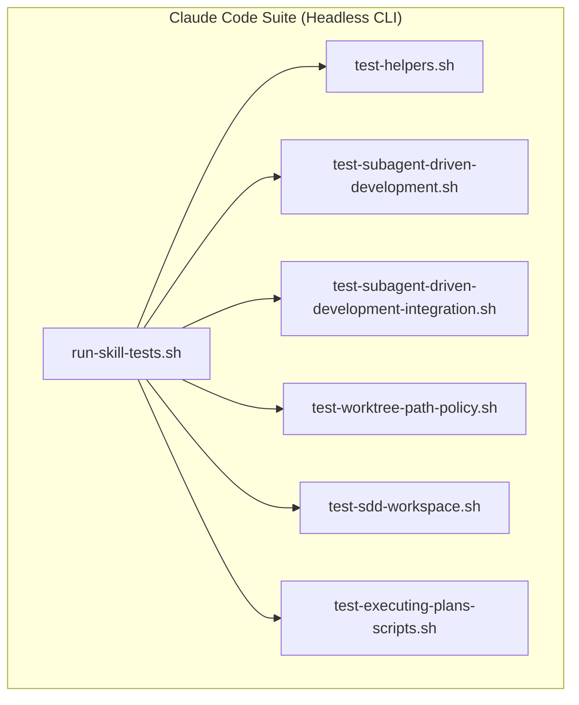

<!-- source: DeepWiki mcp.deepwiki.com · repo obra/superpowers · page 9 Testing Infrastructure · fetched 2026-10-27 -->

# Testing Infrastructure

<details>
<summary>Relevant source files</summary>

The following files were used as context for generating this wiki page:

- [tests/claude-code/README.md](tests/claude-code/README.md)
- [tests/claude-code/run-skill-tests.sh](tests/claude-code/run-skill-tests.sh)
- [tests/claude-code/test-helpers.sh](tests/claude-code/test-helpers.sh)
- [tests/claude-code/test-subagent-driven-development.sh](tests/claude-code/test-subagent-driven-development.sh)

</details>


This page describes the automated test suites and supporting tooling used to verify Superpowers behavior. The infrastructure validates that skills are correctly loaded, instructions are followed by the AI, and complex multi-agent workflows execute successfully across different platforms.

For background on what skills contain and how they are loaded, see [Core Concepts](#3).

---

## Test Suite Organization

The tests are located in the `tests/` directory and are categorized by testing methodology. The suite distinguishes between "fast" unit-like tests that query the AI about its instructions and "integration" tests that perform full file-system operations and real tool execution.

```
tests/
└── claude-code/
    ├── run-skill-tests.sh                             # Main test runner for Claude Code
    ├── test-helpers.sh                                # Shared Bash utilities and assertions
    ├── test-subagent-driven-development.sh            # Fast skill verification
    ├── test-subagent-driven-development-integration.sh # Full workflow execution
    ├── test-worktree-path-policy.sh                   # Fast policy check
    ├── test-sdd-workspace.sh                          # Fast workspace check
    └── test-executing-plans-scripts.sh                # Fast script execution check
```

**Test Infrastructure Overview:**



Sources: [tests/claude-code/run-skill-tests.sh:75-81](), [tests/claude-code/README.md:81-124]()

---

## Test Suite Overview

This section provides a high-level overview of the test infrastructure, including the main test runner, per-harness test directories, test categories, and execution flow. For details, see [Test Suite Overview](#9.1).

The primary test runner for Claude Code is `run-skill-tests.sh` [tests/claude-code/run-skill-tests.sh:2](). It orchestrates the execution of various test scripts, categorizing them into fast skill-behavior tests and slower integration tests. Each harness (e.g., Claude Code, Pi, Kimi) has its own dedicated test directory containing its specific runner and test files.

**Test Execution Flow:**

```mermaid
graph TD
    A[User Invokes Test Runner] --> B{run-skill-tests.sh};
    B --> C{Parse Arguments};
    C --> D{Select Tests (Fast/Integration/Specific)};
    D --> E[Loop Through Selected Tests];
    E --> F[Execute Test Script (e.g., test-subagent-driven-development.sh)];
    F --> G[Source test-helpers.sh];
    G --> H[Call run_claude "Prompt"];
    H --> I[Claude Code CLI];
    I --> J[AI Response];
    J --> K[Assertions (assert_contains, assert_order)];
    K --> L{Test Result (Pass/Fail)};
    L --> E;
    E --> M[Generate Summary Report];
```

Sources: [tests/claude-code/run-skill-tests.sh:1-191]()

---

## Fast Skill-Behavior Tests

Fast skill-behavior tests verify skill instructions and invocation behavior through model queries. These tests typically involve asking the AI about the skill's protocol or expected steps and then asserting that the response contains specific keywords or follows a particular order. For details, see [Fast Skill-Behavior Tests](#9.2).

An example is `test-subagent-driven-development.sh`, which queries Claude about the `subagent-driven-development` skill's requirements, such as the order of reviews or the need for self-review [tests/claude-code/test-subagent-driven-development.sh:20-177](). These tests are designed to be quick, focusing on the AI's understanding of the skill's documentation rather than its ability to execute complex code.

**Fast Test Mapping:**

```mermaid
graph TD
    A["run_claude()"] --> B["claude -p 'prompt'"]
    B --> C["Skill Discovery"]
    C --> D["SKILL.md Logic"]
    D --> E["Response Text"]
    E --> F["assert_contains()"]
    E --> G["assert_order()"]
    
    subgraph "Code Entity Space"
    A --- [tests/claude-code/test-helpers.sh:6]()
    F --- [tests/claude-code/test-helpers.sh:35]()
    G --- [tests/claude-code/test-helpers.sh:96]()
    C --- [skills/SKILL.md]()
    end
```

Sources: [tests/claude-code/test-subagent-driven-development.sh:1-179](), [tests/claude-code/README.md:85-94]()

---

## Integration Tests

Integration tests execute full workflows with real projects, including SDD integration and token-usage analysis. These tests are significantly slower as they involve the AI performing actual file system operations, running tools, and potentially interacting with subagents. For details, see [Integration Tests](#9.3).

An example is `test-subagent-driven-development-integration.sh`, which creates a temporary project, generates an implementation plan, and then uses the `subagent-driven-development` skill to execute the plan. It verifies that the AI correctly creates files, runs tests, and adheres to the SDD protocol, such as performing self-reviews and independent spec compliance reviews [tests/claude-code/README.md:98-115]().

**Integration Test Workflow:**

```mermaid
graph TD
    A[run-skill-tests.sh --integration] --> B[create_test_project()];
    B --> C[create_test_plan()];
    C --> D[run_claude "Use subagent-driven-development"];
    D --> E[AI Executes Workflow];
    E --> F[File System Changes];
    E --> G[Tool Execution (e.g., git, npm)];
    E --> H[Subagent Interactions];
    H --> I[Assertions on Project State];
    I --> J[cleanup_test_project()];

    subgraph "Code Entity Space"
    B --- [tests/claude-code/test-helpers.sh:133]()
    C --- [tests/claude-code/test-helpers.sh:149]()
    D --- [tests/claude-code/test-helpers.sh:6]()
    end
```

Sources: [tests/claude-code/README.md:97-124]()

---

## Brainstorm Server Test Suite

The Brainstorm Server, a visual companion for brainstorming, has its own dedicated Node.js test suite. This suite covers various aspects of the server, including its lifecycle, authentication, WebSocket protocol, branding, and helper functions. For details, see [Brainstorm Server Test Suite](#9.4).

These tests ensure the server starts and stops correctly, handles client connections and disconnections, enforces authentication policies, and correctly processes WebSocket messages. Specific tests also cover Windows lifecycle scenarios to ensure cross-platform compatibility.

---

## Testing Tools, Helpers, and Lint

This section provides a reference for the various testing tools, helper scripts, and linting mechanisms used across the Superpowers codebase. For details, see [Testing Tools, Helpers, and Lint](#9.5).

### Shared Helpers: `test-helpers.sh`

All Claude Code tests source `test-helpers.sh` to access standardized execution and assertion logic [tests/claude-code/test-helpers.sh:2]().

**Core Functions:**

*   **`run_claude`**: Invokes the `claude` CLI with specific prompts and captures the session transcript [tests/claude-code/test-helpers.sh:6-29]().
*   **`assert_contains` / `assert_not_contains`**: Validates presence or absence of strings in the AI's output [tests/claude-code/test-helpers.sh:35-69]().
*   **`assert_count`**: Verifies the exact number of occurrences of a pattern in the output [tests/claude-code/test-helpers.sh:73-91]().
*   **`assert_order`**: Ensures the AI performs actions in the correct sequence (e.g., spec compliance review before code quality review) [tests/claude-code/test-helpers.sh:96-129]().
*   **`create_test_project`**: Generates a temporary directory for integration testing [tests/claude-code/test-helpers.sh:133-136]().
*   **`create_test_plan`**: Generates a sample implementation plan file for workflow tests [tests/claude-code/test-helpers.sh:149-198]().

Sources: [tests/claude-code/test-helpers.sh:1-208](), [tests/claude-code/README.md:43-51]()

### Per-Harness Runners

Each harness (e.g., Pi, Kimi, Hermes, Codex, Devin) has its own test runner script, similar to `run-skill-tests.sh` for Claude Code. These runners adapt the testing methodology to the specific CLI or API of the respective harness.

### Shell Linting

The codebase includes shell linting to maintain code quality and consistency across all Bash scripts, including test runners and helper scripts. This ensures that scripts adhere to best practices and are less prone to errors.

### Version-Bump Tests

Specific tests are in place to validate the version bumping process, ensuring that `bump-version.sh` correctly updates all relevant version files and manifests across the repository.

---

