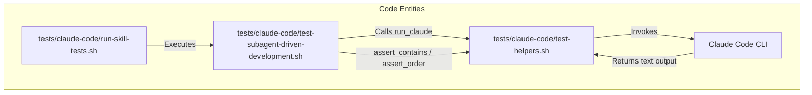
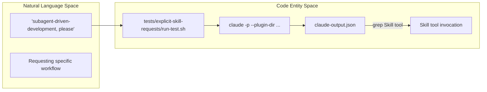

<!-- source: DeepWiki mcp.deepwiki.com · repo obra/superpowers · page 9.2 Fast Skill-Behavior Tests · fetched 2026-10-27 -->

# Fast Skill-Behavior Tests

<details>
<summary>Relevant source files</summary>

The following files were used as context for generating this wiki page:

- [tests/explicit-skill-requests/prompts/i-know-what-sdd-means.txt](tests/explicit-skill-requests/prompts/i-know-what-sdd-means.txt)
- [tests/explicit-skill-requests/prompts/mid-conversation-execute-plan.txt](tests/explicit-skill-requests/prompts/mid-conversation-execute-plan.txt)
- [tests/explicit-skill-requests/prompts/skip-formalities.txt](tests/explicit-skill-requests/prompts/skip-formalities.txt)
- [tests/explicit-skill-requests/run-all.sh](tests/explicit-skill-requests/run-all.sh)
- [tests/explicit-skill-requests/run-extended-multiturn-test.sh](tests/explicit-skill-requests/run-extended-multiturn-test.sh)
- [tests/explicit-skill-requests/run-haiku-test.sh](tests/explicit-skill-requests/run-haiku-test.sh)
- [tests/explicit-skill-requests/run-multiturn-test.sh](tests/explicit-skill-requests/run-multiturn-test.sh)
- [tests/explicit-skill-requests/run-test.sh](tests/explicit-skill-requests/run-test.sh)

</details>


## Purpose and Scope

Fast tests verify that skills are properly loaded and contain correct instructions by querying Claude Code CLI in headless mode. These tests run in approximately 2 minutes and focus on validating skill content, instruction ordering, and triggering behavior, rather than full workflow execution. For end-to-end workflow validation involving file system changes and multi-agent coordination, see [Integration Tests](9.3). For the overall test infrastructure, see [Test Suite Overview](9.1).

Fast tests address several critical verification requirements:
- **Skill Accessibility**: Is the skill recognized and can Claude describe its purpose? [tests/claude-code/test-subagent-driven-development.sh:20-29]()
- **Trigger Reliability**: Does Claude invoke the correct skill when requested by name or triggered by natural language intent? [tests/explicit-skill-requests/run-test.sh:81-90]()
- **Protocol Adherence**: Does the model attempt to perform work (premature action) before loading the required skill? [tests/explicit-skill-requests/run-test.sh:98-118]()
- **Instructional Accuracy**: Does Claude correctly recall the workflow steps, such as performing spec compliance review before code quality review? [tests/claude-code/test-subagent-driven-development.sh:42-50]()

**Sources:** [tests/claude-code/README.md:83-94](), [tests/claude-code/test-subagent-driven-development.sh:1-179](), [tests/claude-code/run-skill-tests.sh:75-80]()

---

## Fast Test Architecture

Fast tests utilize the Claude Code CLI (`claude -p`) to query skills and verify JSON or text responses. The architecture is split into logic verification (content checks) and trigger verification (behavioral checks).

### Logic Verification Flow

This flow verifies that the internal logic and requirements of a skill are correctly understood and reported by the model. It uses a helper library `test-helpers.sh` to provide standardized assertions.

Title: Logic Verification Sequence


**Sources:** [tests/claude-code/run-skill-tests.sh:74-79](), [tests/claude-code/test-helpers.sh:6-29](), [tests/claude-code/test-subagent-driven-development.sh:12-15]()

### Trigger Verification Pipeline

This pipeline verifies that specific natural language prompts correctly trigger the `Skill` tool without premature execution of implementation tools, even across multi-turn conversations.

Title: Trigger Verification Pipeline


**Sources:** [tests/explicit-skill-requests/run-test.sh:71-86](), [tests/explicit-skill-requests/run-multiturn-test.sh:89-97]()

---

## Trigger Testing Categories

The suite distinguishes between **Explicit Requests** (where the user names a skill) and **Multi-Turn Reliability** (ensuring skills trigger after long context).

### Explicit Skill Request Testing

A specialized subset of fast tests ensures that Claude honors direct requests for skills without reverting to generic behavior. The `run-test.sh` script facilitates these checks by wrapping `claude -p` with plugin context. [tests/explicit-skill-requests/run-test.sh:12-25]()

| Test Component | Purpose | Source |
|----------------|---------|--------|
| `SKILL_PATTERN` | Regex to match skill tool calls in JSON output | [tests/explicit-skill-requests/run-test.sh:83]() |
| `PREMATURE_TOOLS` | Greps for tool use before the first `Skill` call | [tests/explicit-skill-requests/run-test.sh:107-110]() |
| `Isolated HOME` | Avoids user context interference | [tests/explicit-skill-requests/run-test.sh:8-9]() |

The `run-all.sh` script orchestrates multiple explicit skill request tests using various prompts:
- `subagent-driven-development-please.txt` [tests/explicit-skill-requests/run-all.sh:18-26]()
- `use-systematic-debugging.txt` [tests/explicit-skill-requests/run-all.sh:29-37]()
- `please-use-brainstorming.txt` [tests/explicit-skill-requests/run-all.sh:40-48]()
- `mid-conversation-execute-plan.txt` [tests/explicit-skill-requests/run-all.sh:51-59]()

**Sources:** [tests/explicit-skill-requests/run-test.sh:1-136](), [tests/explicit-skill-requests/run-all.sh:1-70]()

### Multi-Turn Reliability Testing

Advanced fast tests simulate real-world usage where skills might be requested after several turns of conversation. The `run-multiturn-test.sh` script builds actual conversation history using the `--continue` flag to see if Claude "forgets" to use the Skill tool after extended context. [tests/explicit-skill-requests/run-multiturn-test.sh:46-82]()

- **Turn 1**: Starts a planning conversation. [tests/explicit-skill-requests/run-multiturn-test.sh:47-54]()
- **Turn 2**: Continues with implementation options. [tests/explicit-skill-requests/run-multiturn-test.sh:60-68]()
- **Turn 3**: Requests `subagent-driven-development` to verify the trigger. [tests/explicit-skill-requests/run-multiturn-test.sh:74-82]()

An extended version, `run-extended-multiturn-test.sh`, further stresses the model with more turns of conversation before the critical skill request. [tests/explicit-skill-requests/run-extended-multiturn-test.sh:24-76]()
Additionally, `run-haiku-test.sh` evaluates reliability with the `haiku` model and user-specific `CLAUDE.md` context to identify potential regressions with cheaper models or custom configurations. [tests/explicit-skill-requests/run-haiku-test.sh:53-110]()

**Sources:** [tests/explicit-skill-requests/run-multiturn-test.sh:1-143](), [tests/explicit-skill-requests/run-extended-multiturn-test.sh:1-113](), [tests/explicit-skill-requests/run-haiku-test.sh:1-144]()

---

## Implementation Details

### The test-helpers.sh Library

The `test-helpers.sh` script provides the foundation for logic verification through shared bash functions.

| Function | Purpose |
|----------|---------|
| `run_claude` | Invokes `claude -p` with a timeout and optional tool restrictions. [tests/claude-code/test-helpers.sh:6-29]() |
| `assert_contains` | Verifies a string or regex exists in the output (case-insensitive). [tests/claude-code/test-helpers.sh:33-48]() |
| `assert_order` | Ensures pattern A appears before pattern B (critical for workflow steps). [tests/claude-code/test-helpers.sh:94-123]() |
| `assert_count` | Verifies the exact number of occurrences of a pattern. [tests/claude-code/test-helpers.sh:71-90]() |
| `create_test_plan` | Generates a standard plan file at `docs/superpowers/plans/` for testing. [tests/claude-code/test-helpers.sh:149-198]() |

**Sources:** [tests/claude-code/test-helpers.sh:1-208]()

### Premature Action Detection

A critical component of the `run-test.sh` logic is detecting if Claude starts performing implementation tasks (like `WriteFile`) before invoking the requested `Skill`. It identifies the line number of the first `Skill` tool call and checks for `tool_use` entries appearing earlier in the JSON stream, excluding non-action tools like `TaskGet` or `TaskList`. [tests/explicit-skill-requests/run-test.sh:98-121]()

---

## Running the Suite

### Run All Fast Logic Tests
```bash
cd tests/claude-code
./run-skill-tests.sh
```
The runner supports filtering via `--test` and adjusting timeouts via `--timeout`. [tests/claude-code/run-skill-tests.sh:51-66]()

### Run All Explicit Skill Request Tests
```bash
cd tests/explicit-skill-requests
./run-all.sh
```
[tests/explicit-skill-requests/run-all.sh:1-6]()

### Run Multi-Turn Trigger Tests
```bash
cd tests/explicit-skill-requests
./run-multiturn-test.sh
```
[tests/explicit-skill-requests/run-multiturn-test.sh:1-6]()

**Sources:** [tests/claude-code/README.md:16-19](), [tests/claude-code/run-skill-tests.sh:1-190](), [tests/explicit-skill-requests/run-multiturn-test.sh:1-8](), [tests/explicit-skill-requests/run-all.sh:1-8]()

---

