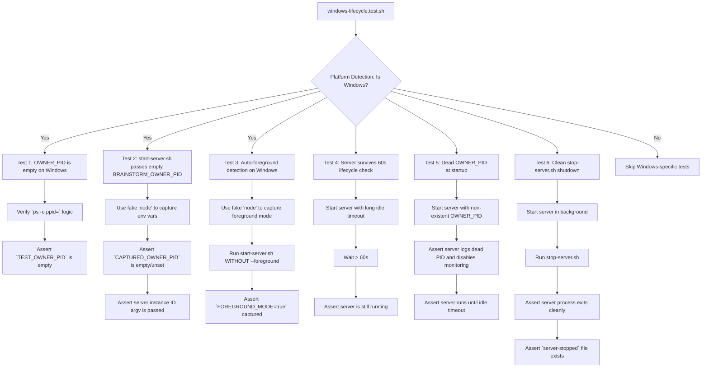

<!-- source: DeepWiki mcp.deepwiki.com · repo obra/superpowers · page 9.4 Brainstorm Server Test Suite · fetched 2026-10-27 -->

# Brainstorm Server Test Suite

<details>
<summary>Relevant source files</summary>

The following files were used as context for generating this wiki page:

- [docs/superpowers/specs/2026-03-11-zero-dep-brainstorm-server-design.md](docs/superpowers/specs/2026-03-11-zero-dep-brainstorm-server-design.md)
- [tests/brainstorm-server/auth.test.js](tests/brainstorm-server/auth.test.js)
- [tests/brainstorm-server/browser-launcher.test.js](tests/brainstorm-server/browser-launcher.test.js)
- [tests/brainstorm-server/lifecycle.test.js](tests/brainstorm-server/lifecycle.test.js)
- [tests/brainstorm-server/package-lock.json](tests/brainstorm-server/package-lock.json)
- [tests/brainstorm-server/package.json](tests/brainstorm-server/package.json)
- [tests/brainstorm-server/server.test.js](tests/brainstorm-server/server.test.js)
- [tests/brainstorm-server/start-server.test.sh](tests/brainstorm-server/start-server.test.sh)
- [tests/brainstorm-server/windows-lifecycle.test.sh](tests/brainstorm-server/windows-lifecycle.test.sh)
- [tests/brainstorm-server/ws-protocol.test.js](tests/brainstorm-server/ws-protocol.test.js)

</details>


This page documents the Node.js test suite for the Brainstorm Visual Companion Server. The tests cover various aspects of the server's functionality, including its core server behavior, authentication mechanisms, lifecycle management, WebSocket protocol implementation, branding, helper script injection, and Windows-specific lifecycle considerations. The primary goal of these tests is to ensure the server's robustness, security, and correct operation across different environments, especially after the transition to a zero-dependency architecture.

Sources:
- [tests/brainstorm-server/package.json:1-10]()
- [docs/superpowers/specs/2026-03-11-zero-dep-brainstorm-server-design.md:1-9]()

## Test Suite Structure

The Brainstorm Server test suite is located in the `tests/brainstorm-server/` directory. It consists of several JavaScript and shell scripts, each focusing on a specific area of the server's functionality. The `package.json` file in this directory defines the `test` script, which orchestrates the execution of all individual test files.

```json
{
  "name": "brainstorm-server-tests",
  "version": "1.0.0",
  "scripts": {
    "test": "node ws-protocol.test.js && node helper.test.js && node browser-launcher.test.js && node auth.test.js && node branding.test.js && node server.test.js && node lifecycle.test.js && bash start-server.test.sh && bash stop-server.test.sh"
  },
  "dependencies": {
    "ws": "^8.21.0"
  }
}
```

The `ws` npm package is listed as a dependency [tests/brainstorm-server/package.json:7-9]() and is used as a test client for WebSocket communication in integration tests. It is a test-only dependency and not shipped to end-users [docs/superpowers/specs/2026-03-11-zero-dep-brainstorm-server-design.md:117-118]().

Sources:
- [tests/brainstorm-server/package.json:1-10]()
- [docs/superpowers/specs/2026-03-11-zero-dep-brainstorm-server-design.md:117-118]()

### Test Execution Flow

The `npm test` command executes the following sequence of tests:

1.  `ws-protocol.test.js`: Unit tests for the WebSocket protocol.
2.  `helper.test.js`: Tests related to the `helper.js` injection.
3.  `browser-launcher.test.js`: Tests for the browser launcher logic.
4.  `auth.test.js`: Security tests for authentication.
5.  `branding.test.js`: Tests for branding elements.
6.  `server.test.js`: Comprehensive integration tests for the server.
7.  `lifecycle.test.js`: Tests for server idle timeout and shutdown.
8.  `start-server.test.sh`: Shell-only tests for `start-server.sh`.
9.  `stop-server.test.sh`: Shell-only tests for `stop-server.sh`.
10. `windows-lifecycle.test.sh`: Windows-specific lifecycle tests.

Sources:
- [tests/brainstorm-server/package.json:5-6]()

## Core Server Integration Tests (`server.test.js`)

The `server.test.js` file contains integration tests that validate the full behavior of the Brainstorm server, including HTTP serving, WebSocket communication, file watching, and the overall brainstorming workflow [tests/brainstorm-server/server.test.js:1-5]().

### Setup and Teardown

Each test run involves:
*   **Cleanup**: The `cleanup()` function removes the temporary `TEST_DIR` to ensure a clean state for each test run [tests/brainstorm-server/server.test.js:27-30]().
*   **Server Startup**: The `startServer()` function spawns a new Node.js process running `server.cjs` with specific environment variables for `BRAINSTORM_PORT`, `BRAINSTORM_DIR`, and `BRAINSTORM_TOKEN` [tests/brainstorm-server/server.test.js:52-55]().
*   **Waiting for Server**: `waitForServer()` monitors the server's stdout for the `server-started` JSON message, indicating that the server is ready [tests/brainstorm-server/server.test.js:58-74]().
*   **Fixed Port Assertion**: `assertStartedOnExpectedPort()` verifies that the server starts on the `TEST_PORT` (3334) as expected, ensuring that fixed-port tests do not fall back to random ports [tests/brainstorm-server/server.test.js:93-101]().

### Key Test Areas

#### Server Startup
*   **`server-started` JSON Output**: Verifies that the server outputs a `server-started` JSON object to stdout upon successful startup, containing `type`, `port`, `url`, and `screen_dir` [tests/brainstorm-server/server.test.js:150-157]().
*   **`server-info` File**: Checks that the server writes the same `server-started` JSON information to a `server-info` file within the `state/` directory, which is crucial for agents to discover connection details when the server runs in the background [tests/brainstorm-server/server.test.js:159-167]().

#### HTTP Serving
*   **Waiting Page**: Asserts that the server serves a "Waiting for the agent" page when no HTML screens are present in the `content` directory [tests/brainstorm-server/server.test.js:173-177]().
*   **`helper.js` Injection**: Confirms that `helper.js` is injected into the served HTML, providing client-side WebSocket functionality and the `brainstorm` API [tests/brainstorm-server/server.test.js:179-183]().
*   **Content-Type Header**: Verifies that HTML responses have the `Content-Type: text/html` header [tests/brainstorm-server/server.test.js:185-188]().
*   **Full HTML Document Handling**: Tests that full HTML documents are served as-is without being wrapped in the frame template, while still injecting `helper.js` [tests/brainstorm-server/server.test.js:190-199]().
*   **HTML Fragment Wrapping**: Ensures that HTML fragments are correctly wrapped within the `frame-template.html` and `helper.js` is injected [tests/brainstorm-server/server.test.js:201-210]().
*   **Static File Serving**: Validates that static files (e.g., `asset.txt`) are served correctly from the `content` directory with appropriate MIME types [tests/brainstorm-server/server.test.js:212-220]().
*   **404 for Missing Files**: Confirms that requests for non-existent files return a 404 status [tests/brainstorm-server/server.test.js:222-225]().

#### WebSocket Communication
*   **Connection and Reload**: Tests that a WebSocket client can connect and receive `reload` messages when content files are updated [tests/brainstorm-server/server.test.js:229-247]().
*   **Event Logging**: Verifies that events sent from the WebSocket client are logged to stdout as `user-event` JSON objects [tests/brainstorm-server/server.test.js:249-263]().
*   **`events` File**: Asserts that events containing a `choice` property are appended to the `.events` file in the `state` directory [tests/brainstorm-server/server.test.js:265-278]().

#### File Watching
*   **`screen-added` Event**: Checks that creating a new HTML file triggers a `screen-added` event in stdout and a `reload` message to WebSocket clients [tests/brainstorm-server/server.test.js:282-300]().
*   **`screen-updated` Event**: Verifies that modifying an existing HTML file triggers a `screen-updated` event and a `reload` message [tests/brainstorm-server/server.test.js:302-318]().
*   **`.events` File Management**: Confirms that the `.events` file is cleared when a new screen is added, but not when an existing screen is updated [tests/brainstorm-server/server.test.js:293-294]().
*   **Debouncing**: Tests that rapid file changes are debounced, resulting in a single `reload` message [tests/brainstorm-server/server.test.js:320-335]().

#### Browser Launcher
*   **`browserLauncherForPlatform`**: Tests the `browserLauncherForPlatform` function, ensuring it returns the correct command and arguments for opening a URL on different platforms (Windows, WSL, Linux) [tests/brainstorm-server/browser-launcher.test.js:24-51](). It specifically checks that URLs are not routed through `cmd.exe` on Windows/WSL to prevent injection vulnerabilities [tests/brainstorm-server/browser-launcher.test.js:25-37]().
*   **Headless Linux**: Verifies that on Linux without a display, the launcher returns `null`, indicating no browser should be launched [tests/brainstorm-server/browser-launcher.test.js:53-61]().

Sources:
- [tests/brainstorm-server/server.test.js:1-592]()
- [tests/brainstorm-server/browser-launcher.test.js:1-66]()
- [docs/superpowers/specs/2026-03-11-zero-dep-brainstorm-server-design.md:61-62]()

### Diagram: Server Integration Test Flow

```mermaid
graph TD
    subgraph "Test Environment Setup"
        A[Cleanup TEST_DIR] --> B{Spawn server.cjs process};
        B --> C{Set BRAINSTORM_PORT, BRAINSTORM_DIR, BRAINSTORM_TOKEN};
        C --> D[Monitor stdout for "server-started"];
        D --> E[Assert server started on TEST_PORT];
    end

    subgraph "HTTP Serving Tests"
        E --> F[GET / (no screens)] --> F1["Waiting for agent" page];
        F1 --> F2[helper.js injected];
        F2 --> F3[Content-Type: text/html];
        E --> G[GET / (full HTML)] --> G1[HTML served as-is];
        G1 --> G2[helper.js injected];
        E --> H[GET / (HTML fragment)] --> H1[Wrapped in frame-template];
        H1 --> H2[helper.js injected];
        E --> I[GET /files/asset.txt] --> I1[Static file served];
        E --> J[GET /non-existent] --> J1[404 Not Found];
    end

    subgraph "WebSocket & File Watching Tests"
        E --> K[WS Connect];
        K --> L[Modify content.html];
        L --> M[Receive "reload" WS message];
        K --> N[Send WS event with "choice"];
        N --> O[Event logged to stdout];
        N --> P[Event appended to .events file];
        E --> Q[Create new screen.html];
        Q --> R[stdout: "screen-added"];
        R --> S[WS: "reload"];
        S --> T[.events file cleared];
        E --> U[Modify existing screen.html];
        U --> V[stdout: "screen-updated"];
        V --> W[WS: "reload"];
        W --> X[Debouncing multiple changes];
    end

    subgraph "Browser Launcher Tests"
        E --> Y[Call browserLauncherForPlatform];
        Y --> Y1[Windows: rundll32.exe, no /c];
        Y --> Y2[WSL: rundll32.exe, no /c];
        Y --> Y3[Linux (no display): null];
    end
```
Title: "Brainstorm Server Integration Test Flow"

Sources:
- [tests/brainstorm-server/server.test.js:1-592]()
- [tests/brainstorm-server/browser-launcher.test.js:1-66]()

## Authentication Tests (`auth.test.js`)

The `auth.test.js` file focuses on the security aspects of the Brainstorm server, specifically testing the per-session secret key mechanism. This key gates all endpoints (HTTP and WebSocket) to prevent unauthorized access and potential prompt injection into the agent session [tests/brainstorm-server/auth.test.js:1-9]().

### Authentication Mechanism

*   **Session Key**: A `BRAINSTORM_TOKEN` environment variable is used to set a fixed session key for testing [tests/brainstorm-server/auth.test.js:26]().
*   **Authentication Methods**: Authentication can be achieved either by providing a valid `?key=<token>` query parameter or by setting a valid session cookie (`brainstorm-key-<port>=<token>`) [tests/brainstorm-server/auth.test.js:10-11]().

### Key Test Scenarios

*   **Startup URL**: Verifies that the `server-started` URL includes the session key [tests/brainstorm-server/auth.test.js:148-151]().
*   **HTTP Access Control**:
    *   Requests to `/` without a key are rejected with a 403 status code [tests/brainstorm-server/auth.test.js:155-158]().
    *   The 403 page content mentions the "coding agent" and the "key" [tests/brainstorm-server/auth.test.js:160-164]().
    *   403 responses include essential security headers like `referrer-policy`, `cache-control`, `x-frame-options`, `content-security-policy`, and `cross-origin-resource-policy` to prevent information leakage and framing attacks [tests/brainstorm-server/auth.test.js:28-34, 166-170]().
    *   Requests with an incorrect key are also rejected with 403, even if a valid cookie is present [tests/brainstorm-server/auth.test.js:172-178]().
    *   Valid key in query parameter grants access [tests/brainstorm-server/auth.test.js:180-183]().
    *   Valid key in cookie grants access [tests/brainstorm-server/auth.test.js:185-188]().
    *   Valid key in both query and cookie grants access [tests/brainstorm-server/auth.test.js:190-193]().
    *   The bootstrap script injected into the HTML correctly sets the session cookie [tests/brainstorm-server/auth.test.js:195-206]().
*   **WebSocket Access Control**:
    *   WebSocket connections without a key are rejected [tests/brainstorm-server/auth.test.js:210-213]().
    *   Connections with an incorrect key are rejected [tests/brainstorm-server/auth.test.js:215-218]().
    *   Connections with a valid key in the query parameter are accepted [tests/brainstorm-server/auth.test.js:220-223]().
    *   Connections with a valid key in the cookie are accepted [tests/brainstorm-server/auth.test.js:225-228]().
    *   Connections with a valid key in both query and cookie are accepted [tests/brainstorm-server/auth.test.js:230-233]().
    *   Origin header validation: WebSocket connections from a disallowed origin are rejected [tests/brainstorm-server/auth.test.js:235-240]().

Sources:
- [tests/brainstorm-server/auth.test.js:1-312]()

## Lifecycle Tests (`lifecycle.test.js`)

The `lifecycle.test.js` file verifies the server's lifecycle management, specifically focusing on the idle timeout and graceful shutdown mechanisms [tests/brainstorm-server/lifecycle.test.js:1-4]().

### Key Lifecycle Features

*   **Idle Timeout Configuration**: The server's idle timeout is configurable via `BRAINSTORM_IDLE_TIMEOUT_MS` environment variable and is reported in the `server-info` output [tests/brainstorm-server/lifecycle.test.js:130-142]().
*   **Idle Shutdown with Open WebSocket**: A critical test ensures that the server correctly shuts down after its idle timeout, even if a WebSocket connection is still open. This verifies that the `shutdown()` function properly closes client sockets to prevent the process from hanging [tests/brainstorm-server/lifecycle.test.js:144-167]().
*   **`server-stopped` File**: Upon clean shutdown, the server should write a `server-stopped` file in the `state` directory [tests/brainstorm-server/lifecycle.test.js:161]().
*   **`start-server.sh` Idle Timeout**: Tests that the `start-server.sh` script correctly passes the `--idle-timeout-minutes` argument to the Node.js server, influencing the `idle_timeout_ms` reported in `server-info` [tests/brainstorm-server/lifecycle.test.js:169-175]().

### Helper Functions

*   `waitForExit(child, timeoutMs)`: Waits for a child process to exit within a given timeout [tests/brainstorm-server/lifecycle.test.js:23-35]().
*   `killAndWait(child, timeoutMs)`: Attempts to gracefully kill a child process, then forcefully if necessary, and waits for its exit [tests/brainstorm-server/lifecycle.test.js:37-45]().
*   `waitForFile(file, timeoutMs)`: Polls for the existence of a file within a timeout [tests/brainstorm-server/lifecycle.test.js:47-54]().
*   `httpStatus(port, key)`: Checks the HTTP status code of a given port, optionally with a key [tests/brainstorm-server/lifecycle.test.js:69-79]().
*   `makeShellTempDir(prefix)` and `removeShellPath(p)`: Utility functions for creating and cleaning up temporary directories using shell commands [tests/brainstorm-server/lifecycle.test.js:104-110]().

Sources:
- [tests/brainstorm-server/lifecycle.test.js:1-515]()

## WebSocket Protocol Unit Tests (`ws-protocol.test.js`)

The `ws-protocol.test.js` file contains unit tests for the zero-dependency WebSocket protocol implementation within `server.cjs`. These tests validate the frame encoding/decoding, handshake computation, and protocol-level behavior independently of the HTTP server [tests/brainstorm-server/ws-protocol.test.js:1-6]().

### Module Under Test

The tests directly `require` the `server.cjs` file and access its exported WebSocket functions, such as `computeAcceptKey`, `encodeFrame`, `decodeFrame`, and `OPCODES` [tests/brainstorm-server/ws-protocol.test.js:19-21](). This allows for isolated testing of the protocol logic.

### Key Test Areas

*   **Handshake**:
    *   `computeAcceptKey`: Verifies that the `computeAcceptKey` function correctly generates the `Sec-WebSocket-Accept` header value according to RFC 6455, using the specified magic GUID and SHA-1 hashing [tests/brainstorm-server/ws-protocol.test.js:50-67]().
*   **Frame Encoding (Server to Client)**:
    *   Tests `encodeFrame` for various payload sizes: small (<126 bytes), medium (126-65535 bytes), and large (>65535 bytes) [tests/brainstorm-server/ws-protocol.test.js:70-123]().
    *   Verifies correct opcode (TEXT, CLOSE, PONG) and FIN bit settings [tests/brainstorm-server/ws-protocol.test.js:76-77, 127, 133]().
    *   Ensures server-sent frames are never masked, as per RFC 6455 [tests/brainstorm-server/ws-protocol.test.js:139-143]().
*   **Frame Decoding (Client to Server)**:
    *   Tests `decodeFrame` for small, medium, and large masked text frames sent from a client [tests/brainstorm-server/ws-protocol.test.js:181-209]().
    *   Verifies correct handling of fragmented messages (continuation frames) [tests/brainstorm-server/ws-protocol.test.js:211-237]().
    *   Tests decoding of control frames like PING and CLOSE [tests/brainstorm-server/ws-protocol.test.js:239-259]().
    *   Ensures that unmasked client frames are rejected [tests/brainstorm-server/ws-protocol.test.js:261-264]().
    *   Tests handling of incomplete frames and buffer accumulation [tests/brainstorm-server/ws-protocol.test.js:266-300]().
    *   Verifies that unknown opcodes result in a close frame with status 1003 (Unsupported Data) [tests/brainstorm-server/ws-protocol.test.js:302-310]().

Sources:
- [tests/brainstorm-server/ws-protocol.test.js:1-407]()
- [docs/superpowers/specs/2026-03-11-zero-dep-brainstorm-server-design.md:19-33]()

### Diagram: WebSocket Protocol Test Coverage

```mermaid
graph TD
    A[ws-protocol.test.js] --> B{Require server.cjs exports};
    B --> C[ws.computeAcceptKey];
    C --> C1[RFC 6455 Handshake];
    C1 --> C2[Random Key Base64];

    B --> D[ws.encodeFrame];
    D --> D1[Small Text Frame];
    D1 --> D2[Empty Text Frame];
    D2 --> D3[Medium Text Frame];
    D3 --> D4[Large Text Frame];
    D4 --> D5[Close Frame];
    D5 --> D6[Pong Frame];
    D6 --> D7[Server Frames Unmasked];

    B --> E[ws.decodeFrame];
    E --> E1[Small Masked Text Frame];
    E1 --> E2[Medium Masked Text Frame];
    E2 --> E3[Large Masked Text Frame];
    E3 --> E4[Fragmented Messages];
    E4 --> E5[Ping Frame];
    E5 --> E6[Close Frame];
    E6 --> E7[Reject Unmasked Client Frames];
    E7 --> E8[Incomplete Frames];
    E8 --> E9[Unknown Opcodes (1003)];

    style A fill:#ace,stroke:#333,stroke-width:2px
    style B fill:#f9f,stroke:#333,stroke-width:2px
```
Title: "WebSocket Protocol Unit Test Coverage"

Sources:
- [tests/brainstorm-server/ws-protocol.test.js:1-407]()
- [docs/superpowers/specs/2026-03-11-zero-dep-brainstorm-server-design.md:19-33]()

## Branding Tests (`branding.test.js`)

The `branding.test.js` file is responsible for verifying that the Brainstorm server correctly applies branding elements to the served HTML content. This includes ensuring that the `SUPERPOWERS_BRANDING_HTML` environment variable is respected and its content is injected into the `frame-template.html`.

### Test Scenarios

*   **No Branding**: Tests that if `SUPERPOWERS_BRANDING_HTML` is not set, the branding placeholder in `frame-template.html` remains empty [tests/brainstorm-server/branding.test.js:39-46]().
*   **Branding Injection**: Verifies that when `SUPERPOWERS_BRANDING_HTML` is set, its value is correctly injected into the `frame-template.html` at the designated placeholder [tests/brainstorm-server/branding.test.js:48-60]().
*   **HTML Escaping**: Ensures that the injected branding HTML is not double-escaped, allowing raw HTML to be rendered correctly [tests/brainstorm-server/branding.test.js:62-74]().

Sources:
- [tests/brainstorm-server/branding.test.js:1-74]()

## Helper Tests (`helper.test.js`)

The `helper.test.js` file tests the functionality of the `helper.js` script, which is injected into the client-side HTML by the Brainstorm server. This script provides client-side utilities for interacting with the server via WebSockets.

### Test Scenarios

*   **`brainstorm.send()`**: Verifies that the `brainstorm.send()` function correctly sends messages over the WebSocket connection [tests/brainstorm-server/helper.test.js:39-54]().
*   **`brainstorm.onReload()`**: Tests that the `brainstorm.onReload()` callback is invoked when the server sends a `reload` message [tests/brainstorm-server/helper.test.js:56-71]().
*   **`toggleSelect()`**: Asserts that the `toggleSelect()` function correctly manipulates the `selected` class on HTML elements, simulating UI interaction [tests/brainstorm-server/helper.test.js:73-90]().

Sources:
- [tests/brainstorm-server/helper.test.js:1-90]()

## Windows Lifecycle Tests (`windows-lifecycle.test.sh`)

The `windows-lifecycle.test.sh` script is a Bash script specifically designed to test the Brainstorm server's lifecycle behavior on Windows-like environments (MSYS2, Cygwin, MinGW). It addresses platform-specific nuances related to process management and environment variable handling.

### Platform Detection

The script includes logic to detect if it's running on a Windows-like shell (`msys*`, `cygwin*`, `mingw*` or `MSYSTEM` environment variable) [tests/brainstorm-server/windows-lifecycle.test.sh:111-117](). Tests specific to Windows are skipped if not on the target platform [tests/brainstorm-server/windows-lifecycle.test.sh:119-123]().

### Key Test Areas

*   **`OWNER_PID` Resolution**:
    *   Verifies that the `OWNER_PID` environment variable, which is used for process monitoring, is correctly cleared (set to empty) on Windows-like shells. This is a fix to prevent issues with PID resolution on these platforms [tests/brainstorm-server/windows-lifecycle.test.sh:135-154]().
    *   Confirms that `start-server.sh` passes an empty `BRAINSTORM_OWNER_PID` to the Node.js server on Windows [tests/brainstorm-server/windows-lifecycle.test.sh:158-178]().
    *   Checks that `start-server.sh` passes a shell-safe server instance ID as an argument [tests/brainstorm-server/windows-lifecycle.test.sh:180-185]().
*   **Auto-Foreground Detection**: Tests that `start-server.sh` automatically detects and runs the server in foreground mode on Windows, even if the `--foreground` flag is not explicitly provided [tests/brainstorm-server/windows-lifecycle.test.sh:197-220]().
*   **Server Survival**: Ensures that the server process survives past the initial 60-second lifecycle check window, indicating that the owner PID monitoring is not prematurely terminating it [tests/brainstorm-server/windows-lifecycle.test.sh:222-259]().
*   **Dead `OWNER_PID` Handling**: Verifies that if `BRAINSTORM_OWNER_PID` points to a non-existent process at startup, the server logs this condition and disables owner PID monitoring, but continues to run based on idle timeout [tests/brainstorm-server/windows-lifecycle.test.sh:261-309]().
*   **`stop-server.sh` Shutdown**: Tests the `stop-server.sh` script's ability to cleanly shut down a running Brainstorm server process on Windows [tests/brainstorm-server/windows-lifecycle.test.sh:311-380](). This includes verifying that the `server-stopped` file is created and the process exits cleanly.

Sources:
- [tests/brainstorm-server/windows-lifecycle.test.sh:1-394]()
- [tests/brainstorm-server/start-server.test.sh:1-115]()

### Diagram: Windows Lifecycle Test Flow


Title: "Brainstorm Server Windows Lifecycle Test Flow"

Sources:
- [tests/brainstorm-server/windows-lifecycle.test.sh:1-394]()
- [tests/brainstorm-server/start-server.test.sh:1-115]()

---

