# Page: Overview

# Overview

<details>
<summary>Relevant source files</summary>

The following files were used as context for generating this wiki page:

- [.claude-plugin/plugin.json](.claude-plugin/plugin.json)
- [README.md](README.md)
- [RELEASE-NOTES.md](RELEASE-NOTES.md)
- [skills/brainstorming/visual-companion.md](skills/brainstorming/visual-companion.md)

</details>


Superpowers is a complete software development methodology for coding agents, built on a foundation of composable skills and a mandatory instruction protocol [README.md:3-4](). It acts as a multi-platform plugin that provides structured development workflows and AI skills across **Claude Code**, **Antigravity**, **Codex App**, **Codex CLI**, **Cursor**, **Devin CLI**, **Factory Droid**, **Gemini CLI**, **GitHub Copilot CLI**, **Grok Build CLI**, **Kimi Code**, **OpenCode**, **Pi**, **Qwen Code**, **Hermes Agent**, and **Muse** [README.md:10-25]().

The system is currently at version `6.4.2` [.claude-plugin/plugin.json:4-4]() and is maintained at [https://github.com/obra/superpowers](https://github.com/obra/superpowers) [.claude-plugin/plugin.json:9-10]().

Sources: [README.md:1-25](), [.claude-plugin/plugin.json:1-20](), [RELEASE-NOTES.md:3-4]()

---

## Core Purpose and Philosophy

The fundamental goal of Superpowers is to transform AI coding agents from reactive code-writers into systematic engineers. It prevents agents from jumping directly into code by enforcing a "step back" approach to tease out specifications and sign off on designs before implementation begins [README.md:35-37]().

### The 1% Rule and Meta-Skill
The system is anchored by the `using-superpowers` meta-skill [README.md:247-247](). It enforces a strict protocol where the agent checks for relevant skills before any task; these are treated as mandatory workflows, not suggestions. The instruction priority hierarchy ensures that skill-based instructions override base model behaviors and even user instructions if they conflict with the methodology's safety or quality standards [README.md:247-247]().

### Key Principles
| Principle | Implementation in Code |
| :--- | :--- |
| **Test-Driven Development** | Enforced via `test-driven-development` skill RED-GREEN-REFACTOR cycle [README.md:39-40](). The project's entire test suite defines "green" [RELEASE-NOTES.md:52-53](). |
| **Systematic over Ad-hoc** | Replaces intuition with 4-phase processes in `systematic-debugging` [README.md:58-58](). |
| **Complexity Reduction** | Emphasizes YAGNI (You Aren't Gonna Need It) and DRY (Don't Repeat Yourself) [README.md:39-40](). |
| **Isolation & Safety** | Mandatory use of git worktrees for workspace isolation and clean baselines [README.md:58-58](). |
| **Plan-focused Implementation** | `writing-plans` records decisions, not code, focusing on signatures, test assertions, and spec values [RELEASE-NOTES.md:9-11](). |

Sources: [README.md:35-43](), [README.md:247-247](), [RELEASE-NOTES.md:9-11](), [RELEASE-NOTES.md:52-53]()

---

## Multi-Platform Architecture

Superpowers uses a single source of truth (the `skills/` directory) but integrates uniquely with various AI environments through platform-specific hooks and configuration files.

### Platform Integration Mapping

| Platform | Integration Mechanism | Key Configuration File / Command |
| :--- | :--- | :--- |
| **Claude Code** | Native marketplace/hooks | `.claude-plugin/plugin.json` [.claude-plugin/plugin.json:1-20]() |
| **Antigravity** | Session-start hook | `agy plugin install https://github.com/obra/superpowers` [README.md:89-90]() |
| **Codex App** | Official plugin marketplace | `+` next to Superpowers in Plugins sidebar [README.md:99-101]() |
| **Codex CLI** | Official plugin marketplace | `/plugins` then `superpowers` [README.md:109-116]() |
| **Cursor** | Marketplace/hooks | `/add-plugin superpowers` [README.md:126-126]() |
| **Devin CLI** | Native plugin loader | `devin plugins install obra/superpowers` [README.md:135-135]() |
| **Factory Droid** | Marketplace registration | `droid plugin marketplace add https://github.com/obra/superpowers` [README.md:149-149]() |
| **Gemini CLI** | Extension system | `gemini extensions install https://github.com/obra/superpowers` [README.md:162-162]() |
| **GitHub Copilot CLI** | Marketplace registration | `copilot plugin marketplace add obra/superpowers-marketplace` [README.md:178-178]() |
| **Grok Build CLI** | Official plugin marketplace | `grok plugin install superpowers@xai-official` [README.md:193-194]() |
| **Kimi Code** | Plugin marketplace | `/plugins install https://github.com/obra/superpowers` [README.md:218-218]() |
| **OpenCode** | JS plugin / prompt transform | `https://raw.githubusercontent.com/obra/superpowers/refs/heads/main/.opencode/INSTALL.md` [README.md:231-231]() |
| **Pi** | Session-start extension | `pi install` [README.md:238-238]() |
| **Qwen Code** | Extension system | `qwen extensions install obra/superpowers` [RELEASE-NOTES.md:64-64]() |
| **Hermes Agent** | Native loader/bootstrap | `git clone` registration [README.md:25-25]() (implied by general agent support) |
| **Muse** | Native plugin manifest | `muse plugins install ./` [RELEASE-NOTES.md:63-63]() |

### Data Flow: Natural Language to Code Entity
The following diagram illustrates how a user's natural language request is routed through the platform-specific "Shim" into the core logic and finally to the specific skill files.

**Request Routing and Skill Discovery:**

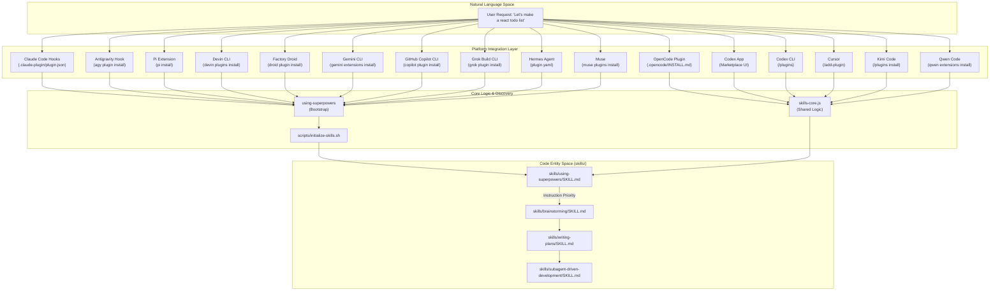

Sources: [README.md:10-237](), [.claude-plugin/plugin.json:1-20](), [RELEASE-NOTES.md:61-64]()

---

## Technical Implementation Details

### Subagent Workspace Management
Workspace management is now **plan-scoped**. Instead of a generic `.superpowers/sdd/` directory, the system resolves a per-plan directory: `.superpowers/sdd/<plan-basename>/` [RELEASE-NOTES.md:56-57](). This prevents follow-up plans from reading previous ledgers as their own progress and reduces tool calls for cross-plan forensics [RELEASE-NOTES.md:56-57]().

### Subagent-Driven Development (SDD) v6.4 Evolution
- **Plan-scoped Workspaces**: Plans with the same basename no longer share a workspace; each plan gets its own directory to prevent collisions [RELEASE-NOTES.md:56-57]().
- **Review Package Validation**: `review-package` rejects empty or non-descendant `BASE..HEAD` ranges to prevent "clean" reviews of nothing [RELEASE-NOTES.md:58-58]().
- **Claude Code Controller Nesting**: On Claude Code, the controller can run one layer down as a nested subagent on a mid-tier model, reducing cost and wall clock time [RELEASE-NOTES.md:59-59]().

### Native Execution (`executing-plans`)
The `executing-plans` skill has been rebuilt as a "Native (inline) execution" mode. It now runs the entire plan under the same workspace, ledger, and stopping rules as SDD, then dispatches a single whole-branch review. This is the cheapest way to run a plan and is suitable for mid-tier session models [RELEASE-NOTES.md:31-34](). It no longer stops every few tasks for checks, instead providing one review at the end [RELEASE-NOTES.md:30-30]().

### Visual Brainstorming Companion
The `brainstorming` skill can leverage a browser-based visual companion for showing mockups, diagrams, and options [skills/brainstorming/visual-companion.md:1-2](). This server watches a directory for HTML files and serves the newest one, recording user selections to an `events` file [skills/brainstorming/visual-companion.md:28-29](). It supports various platforms with specific startup commands for backgrounding or foregrounding the server [skills/brainstorming/visual-companion.md:60-91](). The URL includes a session key for security [skills/brainstorming/visual-companion.md:47-53]().

Sources: [RELEASE-NOTES.md:30-34](), [RELEASE-NOTES.md:56-59](), [skills/brainstorming/visual-companion.md:1-119]()

---

## Structured Workflow Pipeline

Superpowers enforces a linear pipeline from idea to merged code.

**Workflow Entity Diagram:**

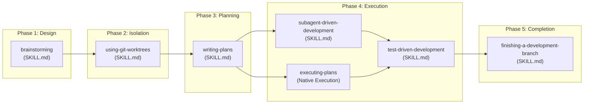

### Key Workflow Steps
1. **brainstorming**: Finds out the user's intent before proposing features, reflecting it back for correction, and tying approval to design and planning stages [RELEASE-NOTES.md:43-44](). It can use a visual companion for visual content [skills/brainstorming/visual-companion.md:1-2]().
2. **writing-plans**: Produces leaner plans that record decisions (signatures, test assertions, spec values) rather than full code [RELEASE-NOTES.md:5-5](). Plans now include a "Review Focus" section for inputs or failure modes implied by the spec but not covered by tests [RELEASE-NOTES.md:39-39](). The user reviews the saved plan before anything runs [RELEASE-NOTES.md:37-37]().
3. **subagent-driven-development**: Dispatches subagents to work through tasks autonomously, inspecting and reviewing work against the plan and spec [README.md:41-41]().
4. **executing-plans**: Offers a "Native (inline) execution" mode as a cheaper alternative to SDD, running the whole plan and then providing one final review [RELEASE-NOTES.md:31-34]().
5. **diagnosing-superpowers**: A new skill to figure out what went wrong in a session, reading transcripts and reporting findings with `path:line` evidence [RELEASE-NOTES.md:27-27]().
6. **Code Review**: Reviewers judge behavior not explicitly mentioned in the spec by what a reasonable user would expect [RELEASE-NOTES.md:47-47](). The `BASE_SHA` for multi-commit reviews now uses `git merge-base origin/main HEAD` for accuracy [RELEASE-NOTES.md:48-48]().

Sources: [README.md:35-43](), [RELEASE-NOTES.md:5-5](), [RELEASE-NOTES.md:27-27](), [RELEASE-NOTES.md:31-34](), [RELEASE-NOTES.md:37-39](), [RELEASE-NOTES.md:43-44](), [RELEASE-NOTES.md:47-48](), [skills/brainstorming/visual-companion.md:1-2]()

---

# Page: Getting Started

# Getting Started

<details>
<summary>Relevant source files</summary>

The following files were used as context for generating this wiki page:

- [README.md](README.md)
- [skills/brainstorming/visual-companion.md](skills/brainstorming/visual-companion.md)

</details>


This page guides you through installing Superpowers on your AI coding agent platform. Superpowers provides a complete software development methodology built on a set of composable "skills" and initial instructions that ensure your agent uses them [README.md:1-5](). Installation integrates the Superpowers framework with your specific environment, enabling automated workflows like TDD, systematic debugging, and subagent-driven development [README.md:24-43]().

For background on the system's purpose, see [Overview](#1). For details on the architecture, see [Architecture](#4). For how skills work after installation, see [Core Concepts](#3).

---

## Platform Overview

Superpowers supports a wide range of platforms as of v6.3.0, including Claude Code, Cursor, OpenCode, Codex, Gemini CLI, and several newer harnesses like Devin CLI and Hermes Agent [RELEASE-NOTES.md:7-9](). Installation methods range from official plugin marketplaces to native extension loaders. Note that Gemini CLI support was restored in v6.2.0 [RELEASE-NOTES.md:66]().

| Platform | Install Method | Primary Config/Entry | Detailed Guide |
|---|---|---|---|
| Claude Code | Official/Dev Marketplace | `plugin.json` | [Installing on Claude Code](#2.1) |
| Cursor | `/add-plugin` command | `hooks-cursor.json` | [Installing on Cursor](#2.2) |
| OpenCode | `opencode.json` install | `INSTALL.md` | [Installing on OpenCode](#2.3) |
| Codex | Native skill discovery | `.codex-plugin/` | [Installing on Codex](#2.4) |
| Gemini CLI | `gemini extensions install` | `gemini-extension.json` | [Installing on Gemini CLI](#2.5) |
| Devin CLI | `devin plugins install` | `plugin.json` | [Installing on Additional Harnesses](#2.6) |
| Hermes Agent | Git clone / Native loader | `plugin.yaml` | [Installing on Additional Harnesses](#2.6) |
| Pi | `pi install` | Native skills | [Installing on Additional Harnesses](#2.6) |
| Antigravity | `agy plugin install` | `session-start` hook | [Installing on Additional Harnesses](#2.6) |
| Kimi Code | Plugin marketplace | N/A | [Installing on Additional Harnesses](#2.6) |
| GitHub Copilot CLI | Marketplace | N/A | [Installing on Additional Harnesses](#2.6) |
| Grok Build CLI | Official marketplace | N/A | [Installing on Additional Harnesses](#2.6) |
| Factory Droid | Marketplace | N/A | [Installing on Additional Harnesses](#2.6) |
| Muse | Marketplace | N/A | [Installing on Additional Harnesses](#2.6) |
| Qwen Code | N/A | N/A | [Installing on Additional Harnesses](#2.6) |

Sources: [README.md:49-253](), [RELEASE-NOTES.md:3-9](), [RELEASE-NOTES.MD:64-66](), [.claude-plugin/plugin.json:1-4]()

---

## Installation Methods by Platform

Superpowers integrates with various AI coding environments, each with its own plugin or extension mechanism. The installation process typically involves a command-line instruction or interaction with a marketplace.

### "Superpowers" Plugin Installation Flow
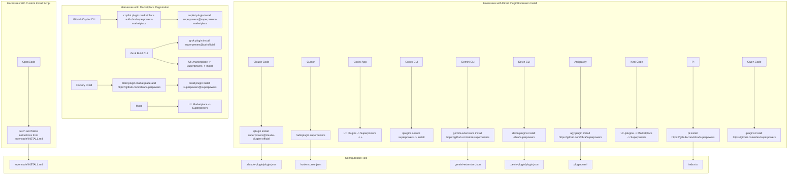
Sources: [README.md:49-253](), [README.md:89-90](), [README.md:237-239]()

---

## Quick Installation Reference

### Claude Code
Superpowers is available via the official marketplace or the Superpowers developer marketplace [README.md:53-79]():
```bash
/plugin install superpowers@claude-plugins-official
```
For details, see [Installing on Claude Code](#2.1).

### Cursor
Install directly within the Cursor Agent chat [README.md:122-127]():
```text
/add-plugin superpowers
```
For details, see [Installing on Cursor](#2.2).

### OpenCode
Direct the agent to fetch the remote installation instructions [README.md:228-231]():
```text
Fetch and follow instructions from https://raw.githubusercontent.com/obra/superpowers/refs/heads/main/.opencode/INSTALL.md
```
For details, see [Installing on OpenCode](#2.3).

### Codex
Codex utilizes native skill discovery. In the CLI, use the plugin search [README.md:107-116]():
```bash
/plugins
# Search for: superpowers
```
For details, see [Installing on Codex](#2.4).

### Gemini CLI
Install as a native extension to enable Gemini-specific tool mapping [README.md:161-169]():
```bash
gemini extensions install https://github.com/obra/superpowers
```
For details, see [Installing on Gemini CLI](#2.5).

### Additional Harnesses (v6.x)
Integrations for Devin CLI, Hermes Agent, Pi, Antigravity, Kimi Code, Muse, Qwen Code, GitHub Copilot CLI, Grok Build CLI, and Factory Droid are supported via their respective plugin managers or direct repository installs [README.md:81-90](), [README.md:133-159](), [README.md:173-219](), [README.md:233-253](). For details, see [Installing on Additional Harnesses](#2.6).

---

## What Gets Activated After Installation

Once installed, the system enforces a mandatory skill check protocol. The `using-superpowers` bootstrap is injected into every session to shape agent behavior [README.md:247](), [CLAUDE.md:75-77](). The agent is instructed to check for relevant skills before any task using the "1% rule": if there is even a minor chance a skill applies, the agent **must** invoke it [README.md:43](), [CLAUDE.md:89-90]().

**Skill Discovery and Invocation Flow:**

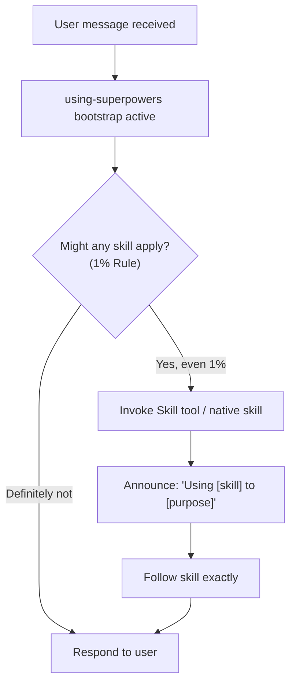

Sources: [README.md:3-5](), [README.md:43](), [README.md:247](), [CLAUDE.md:75-77](), [CLAUDE.md:89-90]()

---

## Verification

After installation, start a new session and describe a task that should trigger a skill. The standard acceptance test for new harness support is [CLAUDE.md:78-82]():

> "Let's make a react todo list"

A working integration will auto-trigger the `brainstorming` skill before any code is written [CLAUDE.md:89-90](). In v6.3.0, brainstorming now scales to the task, classifying requests as spike, bounded, or architectural [RELEASE-NOTES.md:13]().

Sources: [CLAUDE.md:78-90](), [RELEASE-NOTES.md:13]()

---

## Updating

Superpowers updates are platform-dependent:

- **Claude Code**: `/plugin update superpowers`
- **Devin CLI**: `devin plugins update superpowers` [README.md:136-140]()
- **Gemini CLI**: `gemini extensions update superpowers` [README.md:164-168]()
- **Antigravity / Pi / Hermes / Qwen Code**: Re-run the install command to update from the repository [README.md:89-90](), [README.md:237-239](), [README.md:217-219]().
- **Factory Droid**: Re-run the marketplace add and plugin install commands [README.md:147-155]().
- **GitHub Copilot CLI**: Re-run the marketplace add and plugin install commands [README.md:176-184]().
- **Grok Build CLI**: Re-run the plugin install command or update via the marketplace UI [README.md:193-201]().
- **Kimi Code**: Update via the plugin manager UI or re-run the install command [README.md:207-219]().

Sources: [README.md:89-90](), [README.md:136-140](), [README.md:147-155](), [README.md:164-168](), [README.md:176-184](), [README.md:193-201](), [README.md:207-219](), [README.md:237-239]()

---

# Page: Installing on Claude Code

# Installing on Claude Code

<details>
<summary>Relevant source files</summary>

The following files were used as context for generating this wiki page:

- [.claude-plugin/marketplace.json](.claude-plugin/marketplace.json)
- [README.md](README.md)
- [skills/brainstorming/visual-companion.md](skills/brainstorming/visual-companion.md)

</details>


## Purpose and Scope

This page covers installation of Superpowers on Claude Code, including plugin marketplace setup, verification, and session initialization. For installation on other platforms, see [Installing on Cursor](#2.2), [Installing on OpenCode](#2.3), [Installing on Codex](#2.4), or [Installing on Gemini CLI](#2.5). For details on how Claude Code's native integration works, see [Claude Code Integration](#5.1).

## Installation Methods

Claude Code supports installation via the official Claude plugin marketplace or the Superpowers community marketplace. Both methods install the same core software development methodology defined in the repository [README.md:1-4]().

### Official Claude Marketplace

The official marketplace provides Superpowers as a verified plugin. This is the recommended path for most users [README.md:55-63]().

```bash
/plugin install superpowers@claude-plugins-official
```

### Superpowers Community Marketplace

The Superpowers marketplace provides Superpowers and other related development plugins. You can register this marketplace to access the latest development manifests [README.md:65-79](). The `marketplace.json` file defines the `superpowers` plugin with its description and version [/.claude-plugin/marketplace.json:1-20]().

```bash
/plugin marketplace add obra/superpowers-marketplace
/plugin install superpowers@superpowers-marketplace
```

**Installation Flow:**

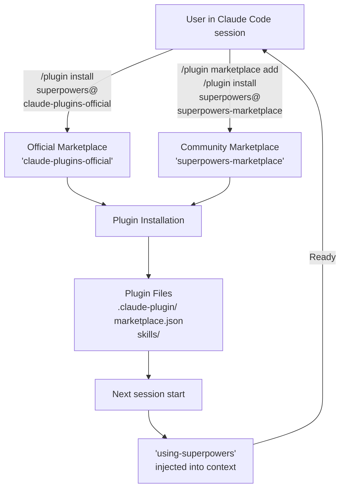

**Sources:** [README.md:55-79](), [/.claude-plugin/marketplace.json:1-20]()

## Plugin Lifecycle and Hooks

Claude Code utilizes a hooks system to manage session lifecycles. The Superpowers plugin registers hooks that trigger on specific session events to ensure the AI agent is always aware of its available skills.

### Hook Execution Mechanism
A real integration loads the `using-superpowers` bootstrap at session start. This bootstrap is what causes skills to auto-trigger at the right moments. Without it, the skills are present on disk but never invoked [CLAUDE.md:75-77]().

| Component | Role | File Pointer |
|------------|-------------------|------------------|
| `using-superpowers` | Meta-skill for bootstrap and 1% rule | [README.md:247-247]() |
| `Skill` tool | Native tool for skill invocation | [README.md:43-43]() |

**Natural Language to Code Entity Space: Hook Lifecycle**

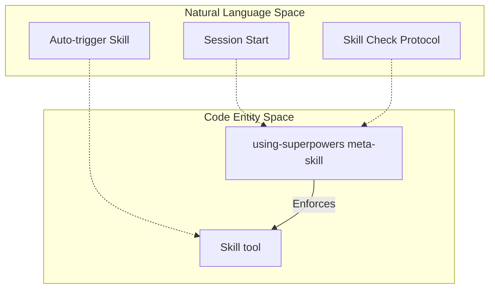

**Sources:** [CLAUDE.md:72-83](), [README.md:247-247](), [README.md:43-43]()

## Session Initialization and Context Injection

Once installed, the `superpowers` plugin is active in every Claude Code session. The primary mechanism for enforcement is the `using-superpowers` meta-skill. This skill establishes the "1% rule" (the mandatory skill check protocol) and defines the instruction priority hierarchy [README.md:247-247]().

The injection ensures that:
1. The agent prioritizes project-specific instructions (e.g., `CLAUDE.md`) over general Superpowers skills [CLAUDE.md:1-20]().
2. The agent uses the `Skill` tool for discovery rather than manually reading markdown files in the `skills/` directory [README.md:43-43]().

**Sources:** [README.md:247-247](), [CLAUDE.md:1-20]()

## Verification

To verify that the installation was successful, you can check the installed plugins within Claude Code:

```bash
/plugin list
```

**The Acceptance Test:**
To confirm the bootstrap is working correctly, open a clean session and send the following message:
> Let's make a react todo list

A working integration MUST auto-trigger the `brainstorming` skill before any code is written [CLAUDE.md:78-83](). The `brainstorming` skill itself can optionally use a visual companion server, which is started via `scripts/start-server.sh` [skills/brainstorming/visual-companion.md:35-40](). For Claude Code, the default mode of `start-server.sh` works, as it backgrounds the server itself [skills/brainstorming/visual-companion.md:60-64]().

**Natural Language to Code Entity Space: Verification**

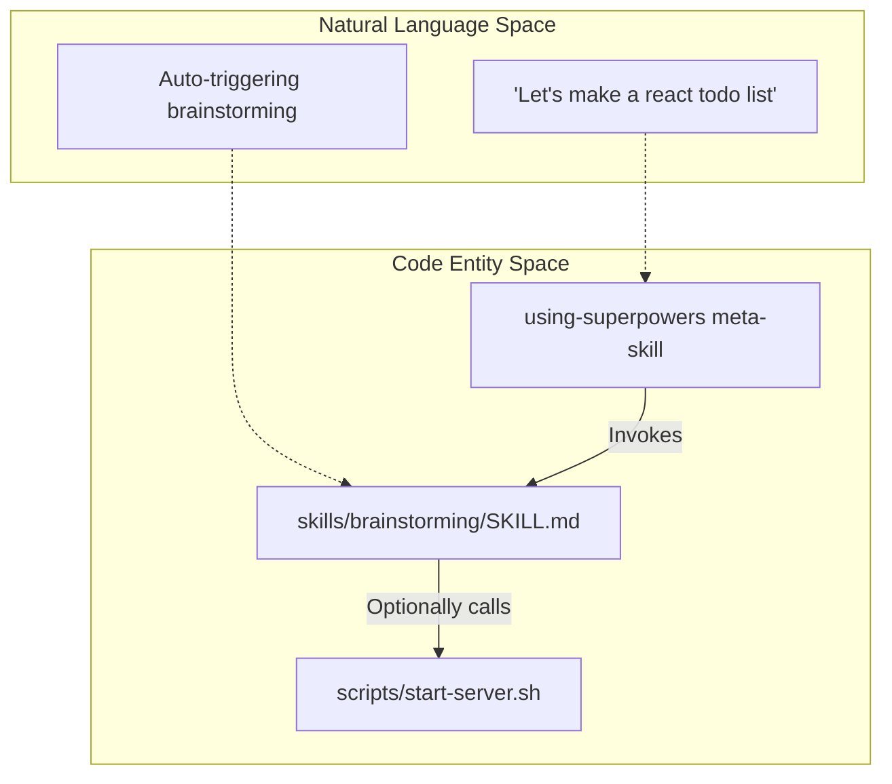

**Sources:** [CLAUDE.md:72-83](), [README.md:247-247](), [skills/brainstorming/visual-companion.md:35-40](), [skills/brainstorming/visual-companion.md:60-64]()

## Update Process

To update the Superpowers plugin to the latest version available in your configured marketplace:

```bash
/plugin update superpowers
```

Updates pull the latest skill definitions and hook configurations. The system enforces a shift from legacy slash commands to direct skill invocation via the `Skill` tool [README.md:43-43]().

**Sources:** [README.md:43-43](), [README.md:136-140]()

---

# Page: Installing on Cursor

# Installing on Cursor

<details>
<summary>Relevant source files</summary>

The following files were used as context for generating this wiki page:

- [.cursor-plugin/plugin.json](.cursor-plugin/plugin.json)

</details>


This document provides step-by-step installation instructions for Superpowers on Cursor IDE. For installation on other platforms, see [Installing on Claude Code](2.1), [Installing on OpenCode](2.3), or [Installing on Codex](2.4).

## Overview

Cursor provides a built-in plugin marketplace that simplifies installation. The Superpowers plugin integrates via Cursor's hook system to inject skill context at session start. Unlike platforms requiring manual git clones, Cursor handles plugin distribution automatically through its marketplace.

**What this installation does:**
- Installs plugin code containing hooks and skills [[.cursor-plugin/plugin.json:1-23]()]
- Registers a hook system via `hooks-cursor.json` to manage lifecycle events [[.cursor-plugin/plugin.json:22]()]
- Makes skills accessible via Cursor's native discovery mechanisms [[.cursor-plugin/plugin.json:21]()]
- Enables automatic skill checking through the mandatory first response protocol defined in the `using-superpowers` meta-skill.

Sources: [.cursor-plugin/plugin.json:1-23]()

## Installation Architecture

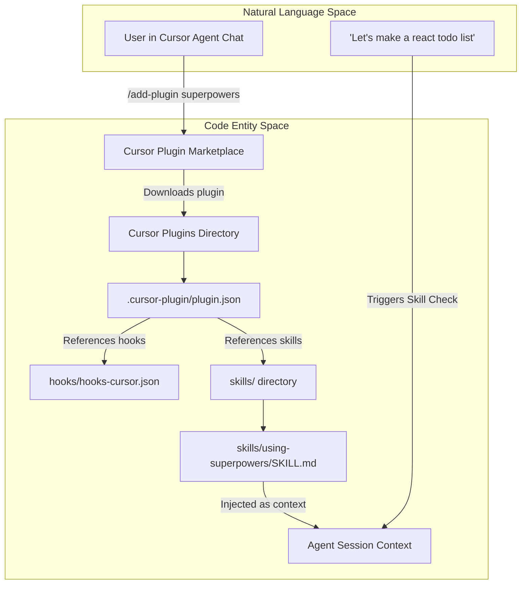

**Figure: Cursor installation and bootstrap flow from marketplace command to agent context injection**

Sources: [.cursor-plugin/plugin.json:1-23]()

## Installation Command

Execute this command in Cursor's Agent chat:

```text
/add-plugin superpowers
```

Alternatively, users can search for "superpowers" in the built-in plugin marketplace UI.

Cursor will:
1. Query its marketplace for the `superpowers` plugin [[.cursor-plugin/plugin.json:2]()]
2. Download the plugin to its local environment.
3. Register the plugin's skills and hooks [[.cursor-plugin/plugin.json:21-22]()]
4. Activate the defined hooks for all subsequent sessions [[.cursor-plugin/plugin.json:22]()]

**No additional configuration required.** The plugin is immediately active.

Sources: [.cursor-plugin/plugin.json:1-23]()

## Plugin Structure

The installed plugin contains these directories and metadata referenced by the manifest [[.cursor-plugin/plugin.json:1-23]()]:

| Component | Path | Purpose |
|-----------|------|---------|
| **Skills** | `./skills/` | Skill definitions in markdown format [[.cursor-plugin/plugin.json:21]()] |
| **Hooks** | `./hooks/hooks-cursor.json` | Lifecycle hooks configuration (camelCase format) [[.cursor-plugin/plugin.json:22]()] |
| **Metadata** | `.cursor-plugin/plugin.json` | Plugin definition and entry points [[.cursor-plugin/plugin.json:1-23]()] |

Sources: [.cursor-plugin/plugin.json:1-23]()

### Plugin Metadata

The manifest for Cursor defines the entry points for the IDE to discover Superpowers capabilities. Note the use of `hooks-cursor.json` for hook configuration specific to the Cursor environment [[.cursor-plugin/plugin.json:22]()]:

```json
{
  "name": "superpowers",
  "displayName": "Superpowers",
  "version": "6.4.2",
  "skills": "./skills/",
  "hooks": "./hooks/hooks-cursor.json"
}
```

Sources: [.cursor-plugin/plugin.json:1-23]()

## Verification Steps

### 1. The Acceptance Test

Start a new Cursor session and send exactly this message:

**Test prompt:**
```text
Let's make a react todo list
```

**Expected behavior:**
- A working integration auto-triggers the `brainstorming` skill before any code is written.
- The agent should identify the need for a structured workflow and tease a spec out of the conversation.

Sources: []()

### 2. Verify Skills Accessibility

Directly request a skill to confirm the skills directory is correctly mapped:

**Test command:**
```text
Show me the test-driven-development skill
```

**Expected behavior:**
- Agent accesses the content in the `skills/` directory [[.cursor-plugin/plugin.json:21]()].
- Agent displays the skill content, which emphasizes true red/green TDD.

Sources: [.cursor-plugin/plugin.json:21]()

## Troubleshooting

### Agent Not Using Skills

**Symptom:** Agent responds to requests without checking for or invoking skills.

**Diagnosis:**
1. Verify plugin installation: Confirm `superpowers` appears in your installed plugins.
2. Check version: Ensure you are on version `6.4.2` [[.cursor-plugin/plugin.json:5]()].

**Fix:**
- Reinstall plugin: Remove and run `/add-plugin superpowers` again.
- Restart Cursor to ensure the hook system re-initializes.

Sources: [.cursor-plugin/plugin.json:1-23]()

### Skill Discovery Failure

**Symptom:** Agent says it cannot find a specific skill like `brainstorming`.

**Diagnosis:** The agent may not be looking in the correct plugin directory or the path mapping in `plugin.json` is not being respected.

**Fix:** Remind the agent that skills are located in the plugin's `skills/` directory as defined in the plugin manifest [[.cursor-plugin/plugin.json:21]()].

Sources: [.cursor-plugin/plugin.json:21]()

## File Mapping Reference

This diagram maps logical components to actual files in the Cursor plugin:

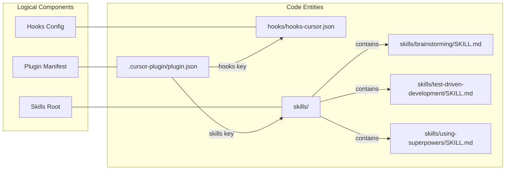

**Figure: Mapping of logical components to file paths in the Cursor plugin structure**

Sources: [.cursor-plugin/plugin.json:1-23]()

---

# Page: Installing on OpenCode

# Installing on OpenCode

<details>
<summary>Relevant source files</summary>

The following files were used as context for generating this wiki page:

- [.opencode/INSTALL.md](.opencode/INSTALL.md)
- [.opencode/plugins/superpowers.js](.opencode/plugins/superpowers.js)
- [docs/README.opencode.md](docs/README.opencode.md)
- [docs/testing.md](docs/testing.md)
- [tests/opencode/test-bootstrap-caching.mjs](tests/opencode/test-bootstrap-caching.mjs)

</details>


This page documents the installation process for Superpowers on [OpenCode.ai](https://opencode.ai). It covers the modern one-line configuration method, the underlying plugin implementation, and the automatic skill discovery mechanism.

## Installation Overview

Superpowers integrates with OpenCode via a JavaScript plugin that automates environment setup. Unlike previous versions that required manual symlinks, the current installation is handled by adding a single entry to your `opencode.json` configuration file. The plugin auto-installs via OpenCode's plugin manager and registers all skills automatically upon restart.

**Sources:** [.opencode/INSTALL.md:1-18](), [docs/README.opencode.md:1-17]()

---

## One-Line Installation

To install Superpowers, add the repository URL to the `plugin` or `plugins` array in your global or project-level `opencode.json` file, depending on your OpenCode version.

### OpenCode V1

For OpenCode V1, use the `plugin` key:
```json
{
  "plugin": ["superpowers@git+https://github.com/obra/superpowers.git"]
}
```
**Sources:** [.opencode/INSTALL.md:11-15](), [docs/README.opencode.md:9-13]()

### OpenCode V2 (2.0.4 or later)

For OpenCode V2 (version 2.0.4 or later), use the `plugins` key:
```json
{
  "plugins": ["superpowers@git+https://github.com/obra/superpowers.git"]
}
```
For local V2 installations, configure the repository directory containing `index.js`. Direct JavaScript file paths are rejected by OpenCode 2.0.4 and 2.0.7, but symlinks remain supported.
**Sources:** [.opencode/INSTALL.md:22-32](), [docs/README.opencode.md:20-32]()

### Pinning Versions
To use a specific release or commit, add a tag or commit hash to the spec (this form works for both V1 `plugin` and V2 `plugins` keys):

```json
{
  "plugin": ["superpowers@git+https://github.com/obra/superpowers.git#v6.4.2"]
}
```
For V2, pin `v6.4.1` or later; `v6.3.0` and earlier releases are only compatible with V1.

After modifying the file, **restart OpenCode**. V2 uses the `opencode` command; `opencode2` may be available as an alias. The plugin installs through OpenCode's plugin manager and registers all skills.
**Sources:** [.opencode/INSTALL.md:33-38](), [.opencode/INSTALL.md:79-87](), [docs/README.opencode.md:109-119]()

### Windows Installation Issues

Some Windows OpenCode builds may have issues with git-backed plugin specs, including cache paths for `git+https` URLs and `Bun` not finding `git.exe`. If direct installation fails, you can install the plugin using system `npm` and then point OpenCode to the local package.

First, install the package:
```powershell
npm install superpowers@git+https://github.com/obra/superpowers.git --prefix "$HOME\.config\opencode"
```
Then, update your `opencode.json` with the absolute path to the installed package. OpenCode does not expand `~`.

**V1:**
```json
{
  "plugin": ["C:\\Users\\<you>\\.config\\opencode\\node_modules\\superpowers"]
}
```

**V2 (2.0.4 or later):**
```json
{
  "plugins": ["C:\\Users\\<you>\\.config\\opencode\\node_modules\\superpowers"]
}
```
**Sources:** [.opencode/INSTALL.md:99-130]()

---

## Migration from Legacy Setup

If you previously installed Superpowers using the manual `git clone` and symlink method, you must remove the old files to avoid conflicts with the new automated plugin.

```bash
# Remove old symlinks
rm -f ~/.config/opencode/plugins/superpowers.js
rm -rf ~/.config/opencode/skills/superpowers

# Optionally remove the cloned repo
rm -rf ~/.config/opencode/superpowers

# Remove skills.paths from opencode.json if you added one for superpowers
```
**Sources:** [.opencode/INSTALL.md:45-57](), [docs/README.opencode.md:39-52]()

---

## Plugin Implementation and Data Flow

The OpenCode integration is powered by `.opencode/plugins/superpowers.js` [superpowers.js](). This plugin is dual-compatible with OpenCode V1 and V2. It performs two primary functions:
1.  **Skill Registration**: Registers the `superpowersSkillsDir` [superpowers.js:25]() so OpenCode discovers all Superpowers skills without symlinks or manual configuration.
    *   **V1**: via the `config` hook, injecting into `config.skills.paths`.
    *   **V2**: via the `setup()` function using `ctx.skill.transform()` [superpowers.js:11]().
2.  **Bootstrap Context Injection**: Injects bootstrap context with a flavor-specific tool mapping.
    *   **V1**: via `experimental.chat.messages.transform` hook [superpowers.js:8]().
    *   **V2**: via `ctx.session.hook("context")` [superpowers.js:12]().

### System Architecture Diagram

The following diagram maps the Natural Language requirements of the plugin to the specific code entities in the `superpowers.js` plugin.

Title: "OpenCode Plugin Architecture and Entity Mapping"
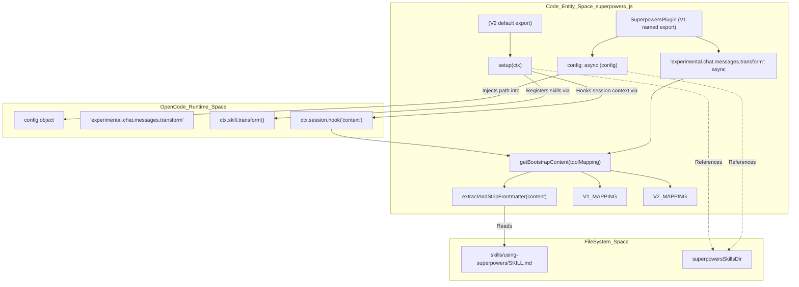
**Sources:** [.opencode/plugins/superpowers.js:1-12](), [.opencode/plugins/superpowers.js:25](), [.opencode/plugins/superpowers.js:33-68](), [.opencode/plugins/superpowers.js:70-107](), [.opencode/plugins/superpowers.js:115-141]()

### Logic Flow: Session Initialization

When a session starts, the plugin ensures the AI is aware of its "Superpowers" by reading the core meta-skill and prepending it to the first user message. This avoids token bloat associated with repeating system messages and prevents breaking models that only support a single system message. The plugin uses a module-level cache `_bootstrapCache` [superpowers.js:113]() to eliminate redundant disk I/O on every agent step.

Title: "Session Initialization and Bootstrap Injection Flow"
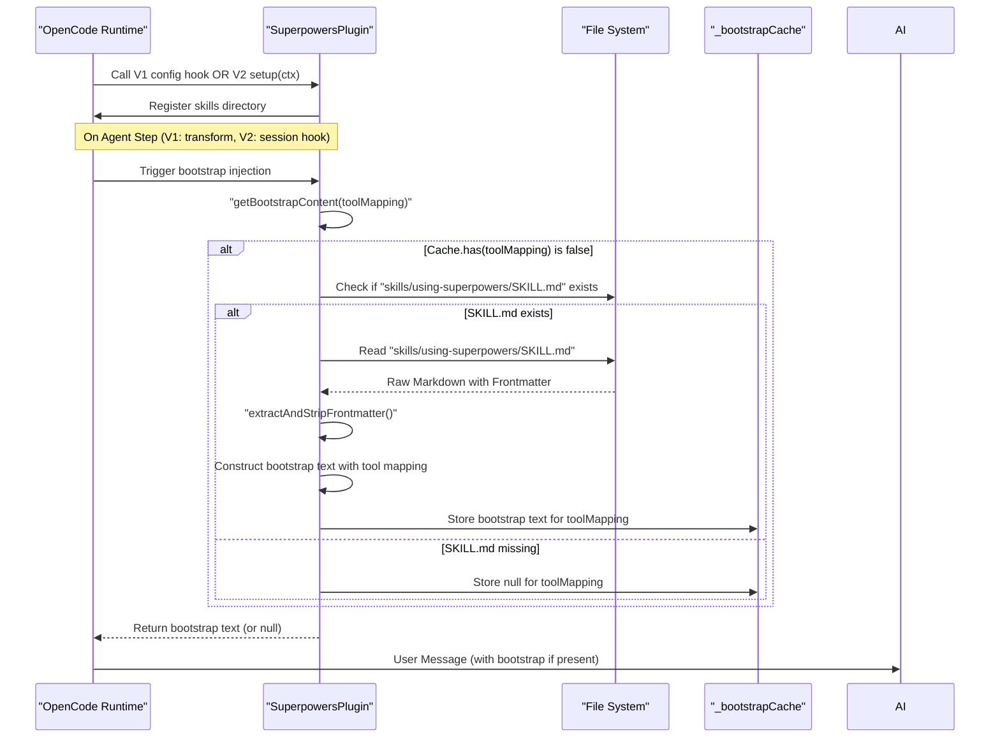
**Sources:** [.opencode/plugins/superpowers.js:49-141](), [docs/README.opencode.md:120-138]()

---

## Tool Mapping Layer

Skills speak in actions rather than naming any one runtime's tools. The plugin injects a flavor-specific mapping to ensure compatibility with native OpenCode tools.

### OpenCode V1 Tool Mapping

| Superpowers Action | OpenCode V1 Tool | Implementation Detail |
| :--- | :--- | :--- |
| Create or update todos | `todowrite` | Direct mapping [[.opencode/plugins/superpowers.js:79]()] |
| Subagent (general-purpose) | `task` | Uses `subagent_type: "general"` [[.opencode/plugins/superpowers.js:80]()] |
| Invoke a skill | `skill` | Uses OpenCode's native `skill` tool [[.opencode/plugins/superpowers.js:81]()] |
| Read files | `read` | Standard filesystem tool [[.opencode/plugins/superpowers.js:82]()] |
| Create, edit, or delete files | `apply_patch` | Standard file modification tool [[.opencode/plugins/plugins/superpowers.js:83]()] |
| Run shell commands | `bash` | Standard shell tool [[.opencode/plugins/superpowers.js:84]()] |
| Search files | `grep`, `glob` | Standard search tools [[.opencode/plugins/superpowers.js:85]()] |
| Fetch a URL | `webfetch` | Standard web fetch tool [[.opencode/plugins/superpowers.js:86]()]

**Sources:** [.opencode/INSTALL.md:147-156](), [docs/README.opencode.md:147-156](), [.opencode/plugins/superpowers.js:70-87]()

### OpenCode V2 Tool Mapping

| Superpowers Action | OpenCode V2 Tool | Implementation Detail |
| :--- | :--- | :--- |
| Create or update todos | *No direct tool* | Model is instructed to track plans in markdown files or harness's plan facility [[.opencode/plugins/superpowers.js:97]()] |
| Subagent (general-purpose) | `subagent` | Uses `agent: "general"`; continuation via `sessionID` [[.opencode/plugins/superpowers.js:98]()] |
| Invoke a skill | `skill` | Uses OpenCode's native `skill` tool [[.opencode/plugins/superpowers.js:99]()] |
| Read files | `read` | Standard filesystem tool [[.opencode/plugins/superpowers.js:100]()] |
| Create, edit, or delete files | `patch`, `write`, `edit`, `shell` | `patch` with `patchText` when available; otherwise `write` (create/overwrite), `edit` (targeted changes), `shell` (deletion) [[.opencode/plugins/superpowers.js:101]()] |
| Run shell commands | `shell` | Supports `command`, `workdir`, `timeout`, `background` [[.opencode/plugins/superpowers.js:102]()] |
| Search files | `grep`, `glob` | Standard search tools [[.opencode/plugins/superpowers.js:103]()] |
| Fetch a URL | `webfetch` | Standard web fetch tool [[.opencode/plugins/superpowers.js:104]()]
| Search the web | `websearch` | Standard web search tool [[.opencode/plugins/superpowers.js:105]()]

**Sources:** [.opencode/INSTALL.md:158-166](), [docs/README.opencode.md:158-169](), [.opencode/plugins/superpowers.js:95-107]()

---

## Verification

After installation and restart, verify the setup by interacting with the agent:

1.  **Check Bootstrap**: Ask "Tell me about your superpowers". The agent should describe the workflow (brainstorming, writing-plans, etc.) because the `using-superpowers` content is injected into the session via `getBootstrapContent` [superpowers.js:115]().
2.  **List Skills**: Run the command `use skill tool to list skills`. You should see `superpowers/brainstorming` and other library skills in the list.
3.  **Check Logs**: If the plugin fails to load, check OpenCode logs.
    *   **V1**: `opencode run --print-logs "hello" 2>&1 | grep -i superpowers` [.opencode/INSTALL.md:92]().
    *   **V2**: `opencode run --standalone --print-logs "hello" 2>&1 | grep -i superpowers` [.opencode/INSTALL.md:94](), or inspect `~/.local/share/opencode/log/opencode.log` filtering for `role=server`.

**Sources:** [.opencode/INSTALL.md:39-40](), [.opencode/INSTALL.md:65-68](), [.opencode/INSTALL.md:90-96](), [docs/README.opencode.md:37-37](), [docs/README.opencode.md:58-62](), [docs/README.opencode.md:174-185]()

---

## Skill Priority

OpenCode resolves skills using a tiered priority system. If a skill name exists in multiple locations, the higher priority one is used:

1.  **Project Skills**: `.opencode/skills/` (Highest Priority) [docs/README.opencode.md:94]()
2.  **Personal Skills**: `~/.config/opencode/skills/` [docs/README.opencode.md:74]()
3.  **Superpowers Skills**: The plugin's internal library (Lowest Priority) [docs/README.opencode.md:94]()

This allows users to "shadow" or override standard Superpowers skills by placing a modified `SKILL.md` in their project or personal config directory.
**Sources:** [docs/README.opencode.md:72-100]()

---

# Page: Installing on Codex

# Installing on Codex

<details>
<summary>Relevant source files</summary>

The following files were used as context for generating this wiki page:

- [.agents/plugins/marketplace.json](.agents/plugins/marketplace.json)
- [.codex-plugin/plugin.json](.codex-plugin/plugin.json)
- [tests/codex/test-marketplace-manifest.sh](tests/codex/test-marketplace-manifest.sh)

</details>


This page provides technical documentation for installing Superpowers on OpenAI Codex. Codex uses native skill discovery, which eliminates the need for bootstrap scripts and relies on a simple symlink-based integration or marketplace installation.

---

## Installation Approach

Codex integration utilizes native skill discovery. The Codex CLI and App scan for skills at startup by looking into specific directories, parsing `SKILL.md` frontmatter, and indexing them for the agent. Superpowers provides these skills through a defined `skills` path in the manifest [./.codex-plugin/plugin.json:23-23]().

**Key differences from other platforms:**
- **Native Discovery**: No session hooks or initialization scripts are required as Codex natively indexes the `skills/` directory defined in the manifest [./.codex-plugin/plugin.json:23-23]().
- **Marketplace Integration**: Superpowers is available through the official Codex plugin marketplace for both CLI and App environments.
- **Automatic Enforcement**: The `using-superpowers` meta-skill is discovered and enforced automatically once indexed, ensuring the agent checks for relevant skills before any task.
- **Hook Suppression**: Unlike Claude Code, Codex does not use the `hooks/hooks.json` file. The Codex manifest explicitly sets `"hooks": {}` to suppress auto-discovery of the Claude Code `SessionStart` hook, which would otherwise trigger an unnecessary trust prompt [./.codex-plugin/plugin.json:24-24](), [./tests/codex/test-marketplace-manifest.sh:69-73]().
- **Multi-Agent Support**: As of v6.4.2, Codex integration includes `multi_agent` capability support and event-driven subagent waits for improved SDD (Subagent-Driven Development) reliability [./.codex-plugin/plugin.json:3-3]().

Sources: [./.codex-plugin/plugin.json:3-24](), [./tests/codex/test-marketplace-manifest.sh:69-73]()

---

## Installation Methods

### 1. Codex CLI Marketplace (Recommended)

The most straightforward way to install Superpowers on the Codex CLI is via the built-in marketplace interface.

```bash
/plugins
# Search for "superpowers"
# Select "Install Plugin"
```

### 2. Codex App Marketplace

For users of the Codex GUI application, the plugin is available in the sidebar.

1. In the Codex app, click on **Plugins** in the sidebar.
2. Locate **Superpowers** in the **Coding** section.
3. Click the **+** icon next to Superpowers and follow the prompts.

### 3. Manual Installation (Git + Symlink)

For developers wanting to track the `main` branch directly or test local changes, manual installation involves cloning the repository and linking the skills.

#### Step 1: Clone the Repository
```bash
git clone https://github.com/obra/superpowers.git ~/.codex/superpowers
```

#### Step 2: Create Skills Symlink
Codex typically looks for skills in a centralized directory (e.g., `~/.agents/skills`). Link the Superpowers skills directory there:
```bash
mkdir -p ~/.agents/skills
ln -s ~/.codex/superpowers/skills ~/.agents/skills/superpowers
```

Sources: [./.codex-plugin/plugin.json:23-23]()

---

## Directory Structure and Discovery

The following diagram illustrates how the Codex CLI process bridges the physical file system (Code Entity Space) to the agent's understanding of available capabilities (Natural Language Space).

**Codex Skill Discovery Mapping**
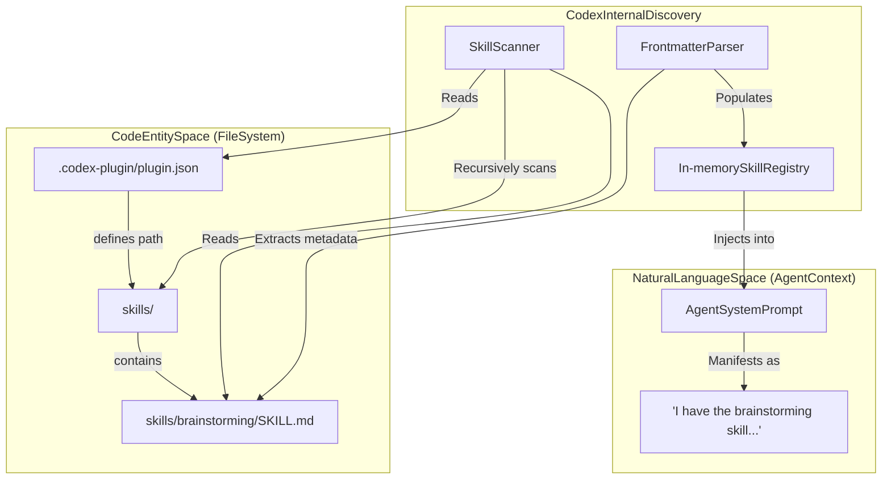

**Implementation Details:**
- **Manifest**: The `.codex-plugin/plugin.json` file defines the plugin metadata, including the `skills` path pointing to `./skills/` [./.codex-plugin/plugin.json:1-23]().
- **Capabilities**: The `interface` section in the manifest defines capabilities like `Interactive`, `Read`, and `Write`, which Codex uses to grant permissions [./.codex-plugin/plugin.json:31-35]().
- **Metadata**: The `displayName` ("Superpowers") and `shortDescription` are used by the Codex UI for marketplace listings [./.codex-plugin/plugin.json:26-27]().

Sources: [./.codex-plugin/plugin.json:1-48](), [./tests/codex/test-marketplace-manifest.sh:1-76]()

---

## Tool Mapping Reference

Skills in the Superpowers library are authored using Claude Code tool names. Codex maps these to its internal toolset.

| Claude Code Tool (Skill Reference) | Codex Equivalent | Purpose |
|------------------------------------|------------------|---------|
| `Skill` | `skill` | Executes a specific skill file |
| `Task` | `task` | Dispatches a subagent for a task |
| `Read` / `Write` / `Edit` | `view` / `create` / `edit` | File system operations |
| `Bash` | `bash` | Execute shell commands |

### Subagent Dispatch Flow

When a skill calls the `Task` tool (e.g., in `subagent-driven-development`), Codex translates this into an agent spawning operation.

**Subagent Execution Flow**
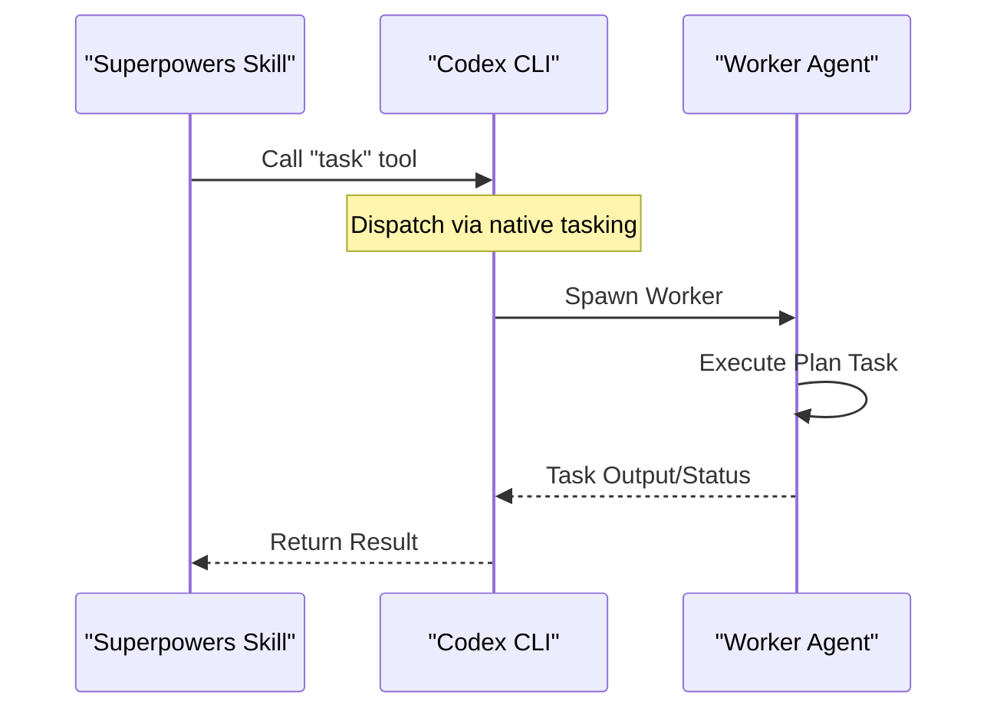

Sources: [./.codex-plugin/plugin.json:15-15]()

---

## Marketplace Manifest Validation

The project includes a test suite to ensure the Codex marketplace manifest (`.agents/plugins/marketplace.json`) remains synchronized with the plugin manifest (`.codex-plugin/plugin.json`) [./tests/codex/test-marketplace-manifest.sh:1-8]().

**Key Validations:**
- **Source Integrity**: Ensures the plugin source is set to the repository root (`./`) [./tests/codex/test-marketplace-manifest.sh:40-40]().
- **Policy Enforcement**: Verifies that installation is `AVAILABLE` and authentication is required `ON_INSTALL` [./tests/codex/test-marketplace-manifest.sh:41-45]().
- **Hook Safety**: Confirms that the Codex manifest explicitly defines an empty `hooks` object (`{}`) to prevent the unintended execution of Claude-specific session hooks found in `hooks/hooks.json` [./tests/codex/test-marketplace-manifest.sh:69-73]().

Sources: [./tests/codex/test-marketplace-manifest.sh:1-76](), [./.agents/plugins/marketplace.json:1-20]()

---

## Troubleshooting

### Verification
To verify that the installation is successful and Codex can see the skills:
1. Launch Codex.
2. Type `/plugins` to see if "Superpowers" is listed as active.
3. Ask the agent: "What skills do you have available?" It should list `brainstorming`, `writing-plans`, and others.

### Common Issues
- **Missing Skills**: Ensure the symlink points to the `skills/` subdirectory of the repo, not the repo root [./.codex-plugin/plugin.json:23-23]().
- **Permission Denied**: Check that the `capabilities` in `.codex-plugin/plugin.json` include `Read` and `Write` [./.codex-plugin/plugin.json:31-35]().
- **Hook Prompts**: If you see a prompt asking to trust a `SessionStart` hook, ensure the `.codex-plugin/plugin.json` contains `"hooks": {}` exactly [./tests/codex/test-marketplace-manifest.sh:69-73]().

Sources: [./.codex-plugin/plugin.json:23-35](), [./tests/codex/test-marketplace-manifest.sh:69-73]()

---

# Page: Installing on Gemini CLI

# Installing on Gemini CLI

<details>
<summary>Relevant source files</summary>

The following files were used as context for generating this wiki page:

- [GEMINI.md](GEMINI.md)
- [gemini-extension.json](gemini-extension.json)

</details>


The Superpowers system integrates with the Gemini CLI through a native extension mechanism. This installation path enables the Gemini model to discover, load, and execute the skills library using Gemini-specific tool mappings and a persistent context file (`GEMINI.md`) [gemini-extension.json:1-6]().

## Installation Process

Installation is handled via the `gemini extensions` command suite, which clones the repository and registers the extension metadata defined in `gemini-extension.json` [gemini-extension.json:1-6]().

### 1. Initial Install
To install Superpowers on Gemini CLI, execute the following command in your terminal:

```bash
gemini extensions install https://github.com/obra/superpowers
```

### 2. Updating
As skills evolve, you can pull the latest versions using the update command:

```bash
gemini extensions update superpowers
```

### 3. Verification
Start a new session and trigger a skill by asking for assistance with a task, such as "help me plan this feature". The agent should respond by invoking the `activate_skill` tool defined in the Gemini tool mapping [GEMINI.md:1-2]().

**Sources:** [gemini-extension.json:1-6](), [GEMINI.md:1-2]()

---

## Configuration and Metadata

The integration relies on two primary files within the repository root to define behavior and context.

### gemini-extension.json
This manifest file identifies the extension to the Gemini CLI and specifies the context injection file.

| Field | Value | Description |
| :--- | :--- | :--- |
| `name` | `"superpowers"` | Unique identifier for the extension [gemini-extension.json:2-2]() |
| `version` | `"6.4.2"` | Current version of the skills library [gemini-extension.json:4-4]() |
| `contextFileName` | `"GEMINI.md"` | The file Gemini reads at session start for instructions [gemini-extension.json:5-5]()

### GEMINI.md Context File
The `GEMINI.md` file acts as the entry point for the Gemini model. It uses the `@` include syntax to inject the core meta-skill and the Gemini-specific tool mapping into the model's initial context:
*   `@./skills/using-superpowers/SKILL.md` [GEMINI.md:1-1]()
*   `@./skills/using-superpowers/references/gemini-tools.md` [GEMINI.md:2-2]()

**Sources:** [gemini-extension.json:1-6](), [GEMINI.md:1-2]()

---

## Tool Mapping Layer

Skills in the Superpowers library are written using Claude Code tool names (e.g., `Read`, `Write`, `Skill`). The Gemini CLI integration provides an automatic mapping layer so the model knows which native Gemini tools to use when a skill references a Claude Code equivalent.

### Core Mapping Table

| Claude Code Reference | Gemini CLI Equivalent | Purpose |
| :--- | :--- | :--- |
| `Read` | `read_file` | Reading file contents |
| `Write` | `write_file` | Creating new files |
| `Edit` | `replace` | Modifying existing files |
| `Bash` | `run_shell_command` | Executing terminal commands |
| `Grep` | `grep_search` | Search file content |
| `Glob` | `glob` | Search files by name |
| `Skill` | `activate_skill` | Loading and following a superpower skill |
| `TodoWrite` | `write_todos` | Tracking task progress |
| `Task` | `@generalist` | Subagent dispatching via `@` syntax |
| `WebSearch` | `google_web_search` | Web search capabilities |

### Subagent and Memory Support
Gemini CLI supports subagents natively via the `@` syntax. 

*   **Generalist Dispatch:** Use `@generalist` to dispatch tasks defined in skill templates.
*   **Memory Persistence:** The `save_memory` tool allows the agent to persist facts to `GEMINI.md` across sessions, ensuring context is maintained even after session resets [gemini-extension.json:5-5]().
*   **Plan Mode:** `enter_plan_mode` and `exit_plan_mode` allow the model to enter a read-only research state before applying changes.
*   **Fallback Mechanism:** If subagents are unavailable, Gemini CLI falls back to the `executing-plans` skill for sequential execution.

**Sources:** [GEMINI.md:1-2](), [gemini-extension.json:1-6]()

---

## Data Flow and Architecture

The following diagrams illustrate how Gemini CLI interacts with the Superpowers skill library and maps natural language requests to code entities.

### Installation and Activation Flow
This diagram shows the relationship between the CLI commands and the resulting filesystem/context state.

Title: Gemini CLI Extension Lifecycle
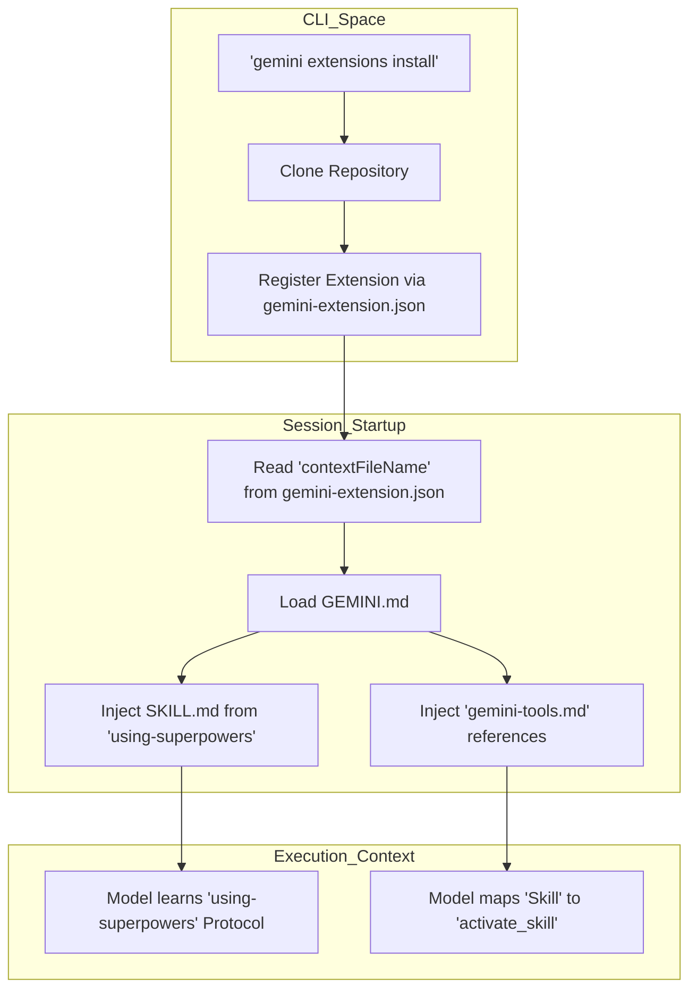
**Sources:** [GEMINI.md:1-2](), [gemini-extension.json:1-6]()

### Tool Execution Mapping
This diagram bridges the Natural Language instructions found in skills to the actual Tool entities executed by the Gemini CLI.

Title: Natural Language to Code Entity Mapping
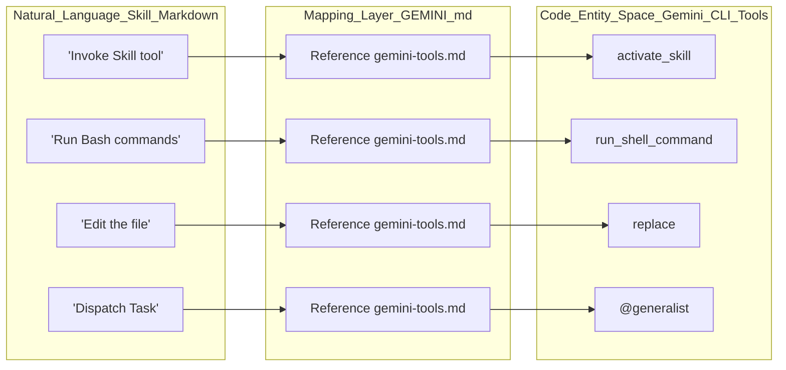
**Sources:** [GEMINI.md:1-2](), [gemini-extension.json:1-6]()

---

# Page: Installing on Additional Harnesses

# Installing on Additional Harnesses

<details>
<summary>Relevant source files</summary>

The following files were used as context for generating this wiki page:

- [.devin-plugin/plugin.json](.devin-plugin/plugin.json)
- [.hermes-plugin/plugin.yaml](.hermes-plugin/plugin.yaml)
- [.kimi-plugin/plugin.json](.kimi-plugin/plugin.json)
- [.muse-plugin/marketplace.json](.muse-plugin/marketplace.json)
- [.muse-plugin/plugin.json](.muse-plugin/plugin.json)
- [docs/README.kimi.md](docs/README.kimi.md)
- [tests/kimi/run-tests.sh](tests/kimi/run-tests.sh)
- [tests/kimi/test-plugin-manifest.sh](tests/kimi/test-plugin-manifest.sh)

</details>


This page provides technical installation and implementation details for the newer AI harnesses added to the Superpowers ecosystem in v6.x releases [RELEASE-NOTES.md:3-9](). These integrations extend the core development methodology to Devin, Hermes, Pi, Antigravity, Kimi Code, and various CLI-based agents.

## Overview of Harness Integration

Superpowers uses a unified skills library that is adapted to different harnesses via platform-specific bootstrap mechanisms and tool mapping layers. A valid integration must load the `using-superpowers` bootstrap at session start to ensure skills auto-trigger during the development lifecycle [AGENTS.md:76-82]().

### Data Flow: Harness to Skills
The following diagram illustrates how different harnesses bridge the "Natural Language Space" of user requests to the "Code Entity Space" of the Superpowers skills library.

**Harness-to-Skill Resolution**
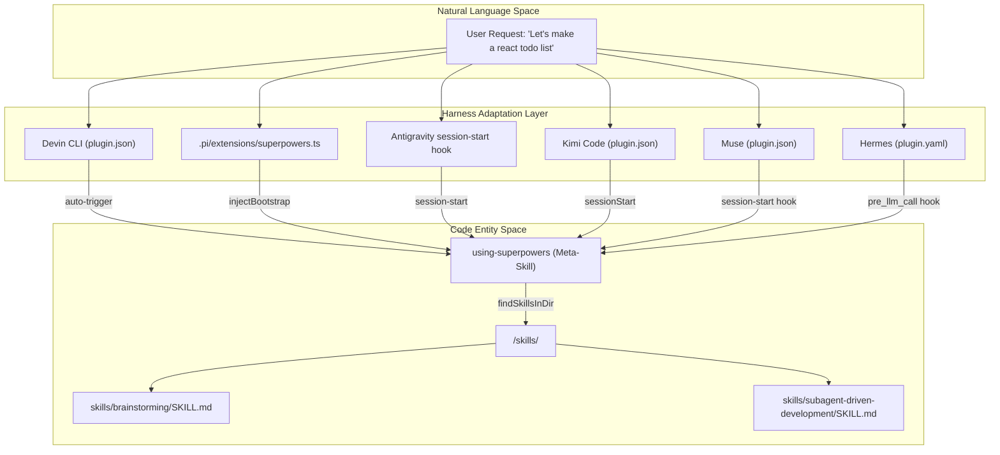
**Sources:** [README.md:128-250](), [.pi/extensions/superpowers.ts:16-57](), [.kimi-plugin/plugin.json:22-24](), [RELEASE-NOTES.md:7-9](), [.muse-plugin/plugin.json:75-84](), [.hermes-plugin/plugin.yaml:6]()

---

## Devin CLI

Devin CLI support was introduced in v6.3.0, allowing skills to auto-trigger at the start of every session [RELEASE-NOTES.md:7]().

### Installation
```bash
devin plugins install obra/superpowers
```
To update the plugin to the latest version:
```bash
devin plugins update superpowers
```

### Implementation Details
The Devin integration relies on the `.devin-plugin/plugin.json` configuration to register the skills directory and the initialization hooks.
*   **Auto-triggering**: Skills are registered with Devin's native loader.
*   **Persistence**: The plugin maintains the methodology across session restarts within the same workspace.

**Sources:** [README.md:128-140](), [RELEASE-NOTES.md:7](), [.devin-plugin/plugin.json:1-22]()

---

## Pi

The Pi integration uses a specialized TypeScript extension to handle session lifecycles, specifically managing context injection after "compaction" events (where the LLM context window is summarized).

### Installation
```bash
pi install git:github.com/obra/superpowers
```

### Implementation: `superpowersPiExtension`
The extension located at `.pi/extensions/superpowers.ts` manages the `using-superpowers` bootstrap injection [tests/pi/test-pi-extension.mjs:50-52]().

*   **`session_start`**: Sets `injectBootstrap = true` to trigger the initial methodology injection [.pi/extensions/superpowers.ts:23-25]().
*   **`session_compact`**: Re-triggers injection after Pi performs a context compaction, ensuring the agent does not "forget" its instructions [.pi/extensions/superpowers.ts:27-29]().
*   **`context` Hook**: Injects the bootstrap message at the `firstNonCompactionSummaryIndex` of the message array [.pi/extensions/superpowers.ts:35-56]().

### Pi Tool Mapping
Since Pi does not ship with a standard `Skill` or `Subagent` tool, Superpowers maps these actions to Pi-specific equivalents:

| Action | Pi Equivalent |
| :--- | :--- |
| Invoke Skill | Native skill system or `read` the `SKILL.md` file directly [.pi/extensions/superpowers.ts:91-92]() |
| Dispatch Subagent | `subagent` from `pi-subagents` (if available) [.pi/extensions/superpowers.ts:95]() |
| Task Tracking | Repo-local `TODO.md` or plan files [.pi/extensions/superpowers.ts:97]() |

**Sources:** [.pi/extensions/superpowers.ts:1-121](), [skills/using-superpowers/references/pi-tools.md:1-16](), [tests/pi/test-pi-extension.mjs:1-137]()

---

## Antigravity (`agy`)

Antigravity installs the plugin directly from the repository and executes the `session-start` hook to activate the methodology [README.md:85-90]().

### Installation
```bash
agy plugin install https://github.com/obra/superpowers
```

### Implementation: Task Artifacts
Antigravity lacks a native `TodoWrite` tool. Instead, it implements task tracking via **Task Artifacts** [skills/using-superpowers/references/antigravity-tools.md:10-17]().

**Antigravity Tool Interaction**
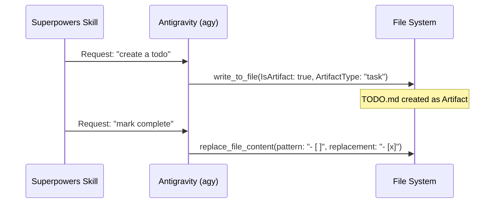

### Key Tool Mappings
*   **Subagent**: Uses `invoke_subagent` with `TypeName: "self"` (full) or `"research"` (read-only) [skills/using-superpowers/references/antigravity-tools.md:7]().
*   **Task Tracking**: Uses `write_to_file` and `replace_file_content` with artifact metadata [skills/using-superpowers/references/antigravity-tools.md:8]().

**Sources:** [README.md:81-91](), [skills/using-superpowers/references/antigravity-tools.md:1-23](), [tests/antigravity/test-antigravity-tools.sh:1-46]()

---

## Kimi Code

Kimi Code integration utilizes a comprehensive `plugin.json` to map Superpowers actions to Kimi's specific toolset, including `AskUserQuestion` and the `Agent` tool.

### Installation
Superpowers is available in Kimi Code's plugin marketplace [docs/README.kimi.md:7-8]().
Open the plugin manager:
```text
/plugins
```
Go to `Marketplace` > `Superpowers` and install it [docs/README.kimi.md:12-15]().

Alternatively, install directly from the repository:
```text
/plugins install https://github.com/obra/superpowers
```
For unreleased validation against the `dev` branch:
```text
/plugins install https://github.com/obra/superpowers/tree/dev
```
After installation or updates, start a fresh session with `/new` [docs/README.kimi.md:29]().

### Implementation Details
The Kimi plugin manifest is located at `.kimi-plugin/plugin.json` [docs/README.kimi.md:32]().
It performs three main functions:
1.  Points Kimi Code to the `skills/` directory [docs/README.kimi.md:35]().
2.  Loads `using-superpowers` at session start via `sessionStart.skill` [.kimi-plugin/plugin.json:22-24]().
3.  Provides Kimi-specific tool mapping through `skillInstructions` [.kimi-plugin/plugin.json:25]().

### Tool Mapping Configuration
The mapping is defined in `.kimi-plugin/plugin.json` [line 25]:
*   **`AskUserQuestion`**: Replaces standard terminal prompts for interactive choices [.kimi-plugin/plugin.json:25]().
*   **`Agent` Tool**: Maps Superpowers subagent types to Kimi subagent types:
    *   Implementation/Review -> `subagent_type: "coder"` [.kimi-plugin/plugin.json:25]().
    *   Exploration -> `subagent_type: "explore"` [.kimi-plugin/plugin.json:25]().
    *   Architecture -> `subagent_type: "plan"` [.kimi-plugin/plugin.json:25]().
*   **`TodoList`**: Native replacement for `TodoWrite` [.kimi-plugin/plugin.json:25]().
*   **Native Kimi Tools**: `Read`, `Write`, `Edit`, `Bash`, `Grep`, `Glob`, `FetchURL`, `WebSearch`, and MCP tools are used by their exposed names [.kimi-plugin/plugin.json:25]().

**Sources:** [.kimi-plugin/plugin.json:1-38](), [docs/README.kimi.md:1-66](), [tests/kimi/test-plugin-manifest.sh:1-86]()

---

## Other v6.x Harnesses

### Hermes Agent
Hermes uses a native loader. Installation is performed via a git clone, and skills are registered through `.hermes-plugin/plugin.yaml` [RELEASE-NOTES.md:8](). The `pre_llm_call` hook is used to bootstrap the Superpowers methodology [hermes-plugin/plugin.yaml:6-7]().

### Muse
Muse integrates Superpowers through a `plugin.json` manifest and a `marketplace.json` for distribution.

#### Installation
Muse plugins can be installed from a marketplace. The `marketplace.json` defines the `superpowers` plugin [muse-plugin/marketplace.json:1-20]().
The `plugin.json` specifies the skills and hooks available [muse-plugin/plugin.json:1-89]().
The `session-start` hook is configured to run `hooks/session-start` [muse-plugin/plugin.json:75-84]().

#### Implementation Details
The `.muse-plugin/plugin.json` explicitly lists all Superpowers skills with their `id` and `path` [muse-plugin/plugin.json:14-72](). This allows Muse to discover and invoke skills directly. The `session-start` hook ensures the `using-superpowers` meta-skill is loaded at the beginning of a session.

### Qwen Code
Qwen Code is mentioned as a supported harness in the overview [1. Overview](). Specific installation details are not provided in the current codebase, implying a similar plugin or marketplace integration as other harnesses.

### Grok Build CLI
Superpowers is available via the official Grok marketplace [README.md:186]().
```bash
grok plugin install superpowers@xai-official --trust
```

### GitHub Copilot CLI
Requires marketplace registration before installation [README.md:172-183]().
```bash
copilot plugin marketplace add obra/superpowers-marketplace
copilot plugin install superpowers@superpowers-marketplace
```

### Factory Droid
Similar to Copilot CLI, it uses a marketplace registration workflow [README.md:144-154]().
```bash
droid plugin marketplace add https://github.com/obra/superpowers
droid plugin install superpowers@superpowers
```

**Sources:** [README.md:142-200](), [RELEASE-NOTES.md:8-9](), [.hermes-plugin/plugin.yaml:1-6](), [.muse-plugin/plugin.json:1-89](), [.muse-plugin/marketplace.json:1-20]()

---

# Page: Core Concepts

# Core Concepts

<details>
<summary>Relevant source files</summary>

The following files were used as context for generating this wiki page:

- [skills/using-superpowers/SKILL.md](skills/using-superpowers/SKILL.md)
- [skills/using-superpowers/references/claude-code-tools.md](skills/using-superpowers/references/claude-code-tools.md)
- [skills/using-superpowers/references/codex-tools.md](skills/using-superpowers/references/codex-tools.md)

</details>


This page explains the fundamental concepts that underpin the Superpowers system: what skills are, how they are structured, and the mandatory protocols that ensure AI agents follow them across various platforms.

## What Are Skills

Skills are reusable, modular units of AI guidance that provide structured workflows for coding agents. Unlike static prompts, skills are dynamic instructions that agents discover and invoke via specific tools based on the current task [README.md:3-5](). They represent the core logic of the Superpowers methodology, transforming an AI from a simple code generator into a disciplined engineering partner [README.md:33-43]().

### Skill File Structure

Every skill is defined in a `SKILL.md` file within a dedicated directory [README.md:218-249](). They follow a specific format that combines metadata for discovery and content for execution.

**Part 1: YAML Frontmatter**
The frontmatter contains the skill's identity and its "trigger" description, which the agent uses to match the current context [skills/using-superpowers/SKILL.md:1-4]().

```yaml
---
name: brainstorming
description: Use when starting any creative work—creating features, building components, adding functionality, or modifying behavior
---
```

**Part 2: Markdown Content**
The body of the skill contains the actual instructions, often including:
*   **Instruction Priority**: Defining how the skill interacts with user instructions [skills/using-superpowers/SKILL.md:61-63]().
*   **Process Flow**: Defined instructions that ensure unambiguous execution [skills/using-superpowers/SKILL.md:18-25]().
*   **Red Flags**: A table of common rationalizations agents use to skip the skill, with corresponding reality checks [skills/using-superpowers/SKILL.md:33-51]().

**Sources:** [skills/using-superpowers/SKILL.md:1-4](), [skills/using-superpowers/SKILL.md:18-25](), [skills/using-superpowers/SKILL.md:33-51](), [skills/using-superpowers/SKILL.md:61-63](), [README.md:218-249]()

### Platform Tool Mapping

While skills are written using Claude Code tool names (like `Skill`, `Task`, and `TodoWrite`), they are designed to be cross-platform. The system maps these to native equivalents on other platforms [skills/using-superpowers/SKILL.md:52-59](). For instance, Pi uses a specialized extension to map these to its native tools and injects the bootstrap after compaction [README.md:233-247]().

| Claude Code Tool | Pi Equivalent | Codex Equivalent |
| :--- | :--- | :--- |
| `Skill` | Native Skill system | `references/codex-tools.md` |
| `TodoWrite` | Task-list tool | Native plan tracking |
| `Task` | `subagent` | `spawn_agent` |
| `Read`/`Write`/`Edit` | `read`/`write`/`edit` | Native file tools |

**Sources:** [skills/using-superpowers/SKILL.md:52-59](), [README.md:233-247](), [README.md:100-116]()

For details, see [What Are Skills](#3.1).

## The Mandatory Skill Check Protocol

Superpowers is built on a "Mandatory, not Suggested" philosophy. This is enforced by the `using-superpowers` meta-skill, which establishes how to find and use skills [skills/using-superpowers/SKILL.md:2-3]().

### The 1% Rule
The system enforces a strict discipline: if there is even a **1% chance** a skill might apply to the current task, the agent **must** invoke the skill [skills/using-superpowers/SKILL.md:10-16](). This check must happen before any response, including clarifying questions or exploring the codebase [skills/using-superpowers/SKILL.md:18-20]().

### Rationalization Table
The `using-superpowers` skill includes a "Red Flags" table to explicitly counter common rationalizations an agent might use to avoid invoking a skill [skills/using-superpowers/SKILL.md:33-51](). This table serves as a direct instruction to prevent agents from deviating from the protocol.

### Instruction Priority Hierarchy
To ensure the user remains in control, Superpowers follows a strict priority:
1.  **User's explicit instructions** (e.g., `CLAUDE.md`, `AGENTS.md`, `GEMINI.md`, direct requests) — **Highest** [skills/using-superpowers/SKILL.md:61-63]()
2.  **Superpowers skills** — Overrides default behavior [skills/using-superpowers/SKILL.md:63]()
3.  **Default system behavior** — **Lowest** [skills/using-superpowers/SKILL.md:63]()

**Sources:** [skills/using-superpowers/SKILL.md:10-20](), [skills/using-superpowers/SKILL.md:33-51](), [skills/using-superpowers/SKILL.md:61-63]()

For details, see [The Mandatory Skill Check Protocol](#3.2).

## Finding and Invoking Skills

Agents do not "know" all skills at once. Instead, they use a discovery mechanism to find the right tool for the job.

### Discovery Flow
When an agent receives a message, it follows this logic:

**Skill Discovery and Invocation Logic**
```mermaid
graph TD
    "User Message Received" --> "Mandatory Skill Check Protocol"
    "Mandatory Skill Check Protocol" -- "1% Rule Applies?" --> "Invoke Skill Mechanism"
    "Mandatory Skill Check Protocol" -- "No Skill Applies" --> "Respond Normally"
    "Invoke Skill Mechanism" --> "Match 'description' in SKILL.md Frontmatter"
    "Match 'description' in SKILL.md Frontmatter" --> "Follow Skill Exactly"
    
    subgraph "Code Entity Mapping"
        "Mandatory Skill Check Protocol" -.-> "skills/using-superpowers/SKILL.md"
        "Invoke Skill Mechanism" -.-> "Skill Tool (e.g., Claude Code 'Skill')"
        "Match 'description' in SKILL.md Frontmatter" -.-> "YAML Frontmatter Parsing"
    end
```

**Sources:** [skills/using-superpowers/SKILL.md:10-25](), [README.md:3-4](), [README.md:233-247]()

For details, see [Finding and Invoking Skills](#3.3).

## Skill Priority and Overriding

When multiple skills apply, the system follows a specific resolution order to prevent conflicting instructions and ensure process discipline.

### Process vs. Implementation
If multiple core skills apply, agents are instructed to prioritize **Process skills** (like `brainstorming` or `systematic-debugging`) over **Implementation skills**. This ensures the "How" is decided before the "What" is executed [skills/using-superpowers/SKILL.md:26-32]().

**Workflow Tier Hierarchy**
```mermaid
graph LR
    "User Task" --> "Process Tier"
    "Process Tier" --> "Determine Strategy"
    "Determine Strategy" --> "Implementation Tier"
    "Implementation Tier" --> "Execute Code"

    subgraph "Process Tier"
        "brainstorming [skills/brainstorming/SKILL.md]"
        "systematic-debugging [skills/systematic-debugging/SKILL.md]"
    end

    subgraph "Implementation Tier"
        "test-driven-development [skills/test-driven-development/SKILL.md]"
        "writing-plans [skills/writing-plans/SKILL.md]"
    end
```

**Sources:** [skills/using-superpowers/SKILL.md:26-32](), [README.md:33-43]()

For details, see [Skill Priority and Overriding](#3.4).

---

# Page: What Are Skills

# What Are Skills

<details>
<summary>Relevant source files</summary>

The following files were used as context for generating this wiki page:

- [skills/executing-plans/SKILL.md](skills/executing-plans/SKILL.md)
- [skills/using-superpowers/SKILL.md](skills/using-superpowers/SKILL.md)
- [skills/using-superpowers/references/claude-code-tools.md](skills/using-superpowers/references/claude-code-tools.md)
- [skills/using-superpowers/references/codex-tools.md](skills/using-superpowers/references/codex-tools.md)
- [skills/using-superpowers/references/gemini-tools.md](skills/using-superpowers/references/gemini-tools.md)
- [skills/writing-skills/SKILL.md](skills/writing-skills/SKILL.md)
- [skills/writing-skills/anthropic-best-practices.md](skills/writing-skills/anthropic-best-practices.md)

</details>


This page defines skills as a technical construct within the Superpowers system, explaining their structure, discovery mechanisms, and how they differ from conventional documentation. For information about how agents are required to use skills, see [3.2. The Mandatory Skill Check Protocol](). For practical guidance on discovering and invoking skills, see [3.3. Finding and Invoking Skills]().

## Definition

A **skill** is a structured markdown document that defines a reusable capability for AI coding assistants. Skills are stored as `SKILL.md` files with YAML frontmatter metadata and follow a standardized format designed for machine discovery and human readability [skills/writing-skills/SKILL.md:22-26]().

Skills are not passive reference documentation. They are active process definitions that agents must check for and invoke before performing related tasks. The system enforces this through the `using-superpowers` meta-skill loaded at session start [skills/using-superpowers/SKILL.md:1-4]().

**Key distinguishing characteristics:**

| Characteristic | Skills | Regular Documentation |
|---------------|--------|---------------------|
| Discovery | Searchable via tool calls | Manual browsing required |
| Invocation | Platform-native tool integration | Read tool or direct file access |
| Optimization | Claude Search Optimization (CSO) | Standard technical writing |
| Validation | Pressure-tested with TDD methodology | Typically untested |
| Enforcement | Mandatory checking protocol (1% rule) | Optional reference |
| Structure | Strict YAML frontmatter + sections | Freeform markdown |

**Sources:** [skills/using-superpowers/SKILL.md:1-16](), [skills/writing-skills/SKILL.md:10-18](), [skills/writing-skills/SKILL.md:140-143]()

## File Structure

### SKILL.md Format

Every skill must contain a `SKILL.md` file as its primary definition. Skills are stored in flat namespaces within the `skills/` directory [skills/writing-skills/SKILL.md:72-82](). The file consists of two parts:

**YAML Frontmatter:**
```yaml
---
name: using-superpowers
description: Use when starting any conversation - establishes how to find and use skills, requiring skill invocation before ANY response including clarifying questions
---
```

**Required frontmatter fields:**
- `name`: Lowercase kebab-case matching directory name. Use letters, numbers, and hyphens only [skills/writing-skills/SKILL.md:98]().
- `description`: CSO-optimized trigger description. It must be third-person and describe ONLY when to use (triggering conditions), never summarizing the workflow [skills/writing-skills/SKILL.md:99-103](), [skills/writing-skills/SKILL.md:150-158]().

**Standard sections defined in the library:**
1. **Overview** - Core principle in 1-2 sentences [skills/writing-skills/SKILL.md:113-114]().
2. **When to Use** - Symptoms and use cases, often including a flowchart [skills/writing-skills/SKILL.md:116-120]().
3. **Core Pattern** - Before/after code comparisons for techniques [skills/writing-skills/SKILL.md:122-123]().
4. **Implementation** - Inline code for simple patterns or links to heavy reference files [skills/writing-skills/SKILL.md:128-130]().
5. **Common Mistakes** - Loopholes and fixes [skills/writing-skills/SKILL.md:132-133]().

**Sources:** [skills/writing-skills/SKILL.md:93-137](), [skills/writing-skills/SKILL.md:150-158]()

### Directory Structure

```mermaid
graph TB
    subgraph "skills_Repository_Root"
        ["using-superpowers/SKILL.md"]
        ["writing-skills/SKILL.md"]
        ["test-driven-development/SKILL.md"]
        ["using-superpowers/references/gemini-tools.md"]
        ["using-superpowers/references/codex-tools.md"]
        ["executing-plans/SKILL.md"]
    end
    
    ["writing-skills/SKILL.md"] -->|"REQUIRED BACKGROUND"| ["test-driven-development/SKILL.md"]
    ["using-superpowers/SKILL.md"] -->|"PLATFORM ADAPTATION"| ["using-superpowers/references/gemini-tools.md"]
    ["using-superpowers/SKILL.md"] -->|"PLATFORM ADAPTATION"| ["using-superpowers/references/codex-tools.md"]
    ["executing-plans/SKILL.md"] -->|"Setup: worktree, workspace + ledger"| ["using-git-worktrees"]
    ["executing-plans/SKILL.md"] -->|"Code wrong?"| ["systematic-debugging"]
    ["executing-plans/SKILL.md"] -->|"Final review clean"| ["finishing-a-development-branch"]
```

**Diagram: Actual Skill Directory Structure and Dependencies**

Supporting files and platform-specific mappings are bundled within the skill directory. For example, `writing-skills` explicitly requires understanding `test-driven-development` [skills/writing-skills/SKILL.md:18](). Platform mappings like `gemini-tools.md` and `codex-tools.md` ensure tool names are translated correctly for different harnesses [skills/using-superpowers/references/gemini-tools.md:1-21](), [skills/using-superpowers/references/codex-tools.md:1-3](). Skills like `executing-plans` also reference other skills for setup and error handling, such as `using-git-worktrees`, `systematic-debugging`, and `finishing-a-development-branch` [skills/executing-plans/SKILL.md:110-111](), [skills/executing-plans/SKILL.md:92](), [skills/executing-plans/SKILL.md:104]().

**Sources:** [skills/writing-skills/SKILL.md:18](), [skills/writing-skills/SKILL.md:72-80](), [skills/using-superpowers/references/gemini-tools.md:1-21](), [skills/using-superpowers/references/codex-tools.md:1-3](), [skills/executing-plans/SKILL.md:92](), [skills/executing-plans/SKILL.md:104](), [skills/executing-plans/SKILL.md:110-111]()

## Claude Search Optimization (CSO)

Skills use **Claude Search Optimization** to ensure agents discover them through semantic search. The `description` field is the primary CSO surface and is critical because Claude uses it to decide whether to load the full `SKILL.md` [skills/writing-skills/SKILL.md:140-146]().

**CSO Requirements:**
1. **Trigger-focused** - Start with "Use when..." to focus on conditions [skills/writing-skills/SKILL.md:148]().
2. **Third Person** - Descriptions are injected into the system prompt; consistent POV prevents discovery issues [skills/writing-skills/anthropic-best-practices.md:189-195]().
3. **No workflow details** - If the description summarizes the process, Claude may follow the summary instead of reading the full skill content, leading to skipped steps [skills/writing-skills/SKILL.md:150-158]().

**Sources:** [skills/writing-skills/SKILL.md:140-158](), [skills/writing-skills/anthropic-best-practices.md:185-200]()

## Skill Types and Categories

Skills are categorized by their role and flexibility [skills/writing-skills/SKILL.md:61-71]():

### Technique
A concrete method with specific steps to follow, such as `root-cause-tracing` [skills/writing-skills/SKILL.md:63-64]().

### Pattern
A way of thinking about problems or code organization, such as `test-invariants` [skills/writing-skills/SKILL.md:66-67]().

### Reference
Static information including API docs, syntax guides, or tool documentation [skills/writing-skills/SKILL.md:69-70]().

### Flexibility Levels
As defined in authoring best practices [skills/writing-skills/anthropic-best-practices.md:59-131]():
- **Low Freedom**: Fragile operations like database migrations that must follow an exact sequence [skills/writing-skills/anthropic-best-practices.md:105-125]().
- **Medium Freedom**: Preferred patterns where some variation is acceptable [skills/writing-skills/anthropic-best-practices.md:82-89]().
- **High Freedom**: Context-dependent tasks like code reviews where multiple approaches are valid [skills/writing-skills/anthropic-best-practices.md:63-71]().

**Sources:** [skills/writing-skills/SKILL.md:61-71](), [skills/writing-skills/anthropic-best-practices.md:59-131]()

## Platform Adaptation and Tool Mapping

Skills are authored using Claude Code tool names. To maintain modularity, Superpowers provides a mapping layer for other platforms like Gemini CLI and Codex [skills/using-superpowers/references/gemini-tools.md:1-3](), [skills/using-superpowers/references/codex-tools.md:1-3]().

### Tool Mapping Implementation

| Claude Code Tool | Gemini CLI Equivalent | Codex Equivalent | Purpose |
|------------------|-----------------------|------------------|---------|
| `Skill` | `activate_skill` [skills/using-superpowers/references/gemini-tools.md:17]() | N/A (native skill discovery) | Invoke a skill |
| `TodoWrite` | `write_todos` [skills/using-superpowers/references/gemini-tools.md:20]() | N/A (native todo management) | Task tracking |
| `Agent` | `invoke_agent` [skills/using-superpowers/references/gemini-tools.md:18]() | `spawn_agent`, `followup_task` [skills/using-superpowers/references/codex-tools.md:16-28]() | Dispatch subagent |
| `Bash` | `run_shell_command` [skills/using-superpowers/references/gemini-tools.md:11]() | `run_shell_command` | Run commands |
| `Edit` | `replace` [skills/using-superpowers/references/gemini-tools.md:10]() | `replace` | File editing |
| `Read` | `read_file` [skills/using-superpowers/references/gemini-tools.md:7]() | `read_file` | Read a file |
| `ReadMany` | `read_many_files` [skills/using-superpowers/references/gemini-tools.md:8]() | `read_many_files` | Read multiple files |
| `Write` | `write_file` [skills/using-superpowers/references/gemini-tools.md:9]() | `write_file` | Create a new file |
| `Search` | `grep_search` [skills/using-superpowers/references/gemini-tools.md:12]() | `grep_search` | Search file contents |
| `FindFiles` | `glob` [skills/using-superpowers/references/gemini-tools.md:13]() | `glob` | Find files by name |
| `ListDir` | `list_directory` [skills/using-superpowers/references/gemini-tools.md:14]() | `list_directory` | List files and subdirectories |
| `WebFetch` | `web_fetch` [skills/using-superpowers/references/gemini-tools.md:15]() | `web_fetch` | Fetch a URL |
| `WebSearch` | `google_web_search` [skills/using-superpowers/references/gemini-tools.md:16]() | `google_web_search` | Search the web |

**Sources:** [skills/using-superpowers/references/gemini-tools.md:1-21](), [skills/using-superpowers/references/codex-tools.md:1-3](), [skills/using-superpowers/references/codex-tools.md:16-28]()

## Enforcement Mechanisms

### The 1% Rule
The core enforcement mechanism: if there is even a 1% chance a skill applies, the agent **must** invoke it [skills/using-superpowers/SKILL.md:10-16]().

```mermaid
graph TD
    A["User_message_received"] --> B{"Might_any_skill_apply?"}
    B -- "Yes_1_percent_chance" --> C["Invoke_activate_skill_or_Skill_tool"]
    B -- "Definitely_not" --> D["Respond_including_clarifications"]
    C --> E["Announce_intent_to_user"]
    E --> F{"Has_checklist?"}
    F -- "Yes" --> G["Create_write_todos_or_TodoWrite_entries"]
    F -- "No" --> H["Follow_skill_exactly"]
    G --> H
```

**Diagram: Skill Invocation Logic Flow (bridging `activate_skill` and `write_todos` tool equivalents)**

### TDD for Skills
Skills are developed using a RED-GREEN-REFACTOR cycle adapted for documentation [skills/writing-skills/SKILL.md:10-14]():
1. **RED**: Create a "pressure scenario" and watch the agent fail or violate rules without the skill [skills/writing-skills/SKILL.md:36-40]().
2. **GREEN**: Write the minimal `SKILL.md` content required to make the agent comply [skills/writing-skills/SKILL.md:37-42]().
3. **REFACTOR**: Close loopholes and find new ways the agent might rationalize ignoring the instructions [skills/writing-skills/SKILL.md:38-43]().

**Sources:** [skills/writing-skills/SKILL.md:10-45](), [skills/using-superpowers/SKILL.md:10-16]()

---

# Page: The Mandatory Skill Check Protocol

# The Mandatory Skill Check Protocol

<details>
<summary>Relevant source files</summary>

The following files were used as context for generating this wiki page:

- [docs/superpowers/specs/2026-06-10-positive-instruction-redesign-design.md](docs/superpowers/specs/2026-06-10-positive-instruction-redesign-design.md)
- [skills/using-superpowers/SKILL.md](skills/using-superpowers/SKILL.md)
- [skills/using-superpowers/references/claude-code-tools.md](skills/using-superpowers/references/claude-code-tools.md)
- [skills/using-superpowers/references/codex-tools.md](skills/using-superpowers/references/codex-tools.md)

</details>


## Purpose and Scope

This document explains the mandatory skill check protocol—the core enforcement mechanism that ensures AI agents consistently invoke skills before taking action. The protocol centers on the `using-superpowers` meta-skill and its "1% rule": if there is even a 1% chance a skill applies, the agent MUST invoke it.

This page covers the protocol's structure, enforcement mechanisms, anti-rationalization design, and how it integrates with multi-platform tool mappings. For details on how skills are discovered and invoked across platforms, see [3.3 Finding and Invoking Skills]().

## The 1% Rule

The protocol's fundamental principle is a hard constraint designed to eliminate agent hesitation. As defined in the core meta-skill [skills/using-superpowers/SKILL.md:1-4]():

[skills/using-superpowers/SKILL.md:10-16]()
```text
<EXTREMELY-IMPORTANT>
If you think there is even a 1% chance a skill might apply to what you are doing, you ABSOLUTELY MUST invoke the skill.

IF A SKILL APPLIES TO YOUR TASK, YOU DO NOT HAVE A CHOICE. YOU MUST USE IT.

This is not negotiable. You cannot rationalize your way out of this.
</EXTREMELY-IMPORTANT>
```

The 1% threshold is deliberately low to prevent agents from rationalizing away skill usage. The protocol assumes that agents, under pressure, will find reasons to skip inconvenient processes unless forced to check.

**Sources:** [skills/using-superpowers/SKILL.md:10-16]()

## Instruction Priority Hierarchy

The protocol establishes a three-tier priority system for conflicting instructions to ensure user control while maintaining process discipline [skills/using-superpowers/SKILL.md:61-63]():

| Priority | Source | Description |
| :--- | :--- | :--- |
| **1 (Highest)** | **User Instructions** | Explicit directives in `CLAUDE.md`, `AGENTS.md`, `GEMINI.md`, etc., or direct chat requests. |
| **2 (Middle)** | **Superpowers Skills** | Workflow-specific instructions that override default AI behavior. |
| **3 (Lowest)** | **System Prompt** | The base AI model's default behavior and safety guidelines. |

If a user explicitly instructs "don't use TDD" while a skill mandates TDD, the user's instruction takes precedence. However, agents must only skip skills when the partner has explicitly requested it [skills/using-superpowers/SKILL.md:63]().

### Instruction Priority Decision Flow

```mermaid
graph TD
    "Input"["Agent receives task or question"]
    "CheckUser"{"User's explicit<br/>instructions conflict<br/>with skill?"}
    "FollowUser"["Follow user's<br/>explicit instruction"]
    "CheckSkill"{"Skill exists for<br/>this task?"}
    "InvokeSkill"["Invoke skill via<br/>Skill tool"]
    "DefaultBehavior"["Follow default<br/>system prompt"]
    
    "Input" --> "CheckUser"
    "CheckUser" -->|"Yes"| "FollowUser"
    "CheckUser" -->|"No"| "CheckSkill"
    "CheckSkill" -->|"Yes (≥1%)"| "InvokeSkill"
    "CheckSkill" -->|"No"| "DefaultBehavior"
```

**Sources:** [skills/using-superpowers/SKILL.md:61-63]()

## The `using-superpowers` Skill Structure

The `using-superpowers` skill is a meta-skill that governs skill invocation. It is automatically injected into session context at startup via platform hooks.

### Key Sections

| Section | Purpose | Lines |
| :--- | :--- | :--- |
| `<SUBAGENT-STOP>` | Prevents subagents from activating protocol recursively. | [6-8]() |
| `<EXTREMELY-IMPORTANT>` | 1% rule enforcement. | [10-16]() |
| **The Rule** | Core invocation mandate and sequence. | [18-25]() |
| **Skill Priority** | Defines order (Process skills before Implementation). | [26-32]() |
| **Red Flags** | Table of common agent rationalizations to avoid. | [33-51]() |
| **Platform Adaptation** | Directs agents to platform-specific tool mappings. | [52-60]() |
| **User Instructions** | Defines the precedence hierarchy. | [61-64]() |

### SUBAGENT-STOP Gate
The protocol includes an escape hatch for subagents dispatched to execute specific tasks. These workers skip the protocol as they are already executing within a structured workflow initiated by a parent agent [skills/using-superpowers/SKILL.md:6-8]().

**Sources:** [skills/using-superpowers/SKILL.md:1-63]()

## Enforcement Mechanisms

The protocol uses multiple overlapping enforcement layers to prevent skill-skipping behavior.

### Invocation Decision Flow
Agents must announce their usage and follow the skill exactly. If a skill includes a checklist, the agent is mandated to create a todo for every item [skills/using-superpowers/SKILL.md:24-25]().

```mermaid
graph TB
    "UserMessage"["User message received"]
    "AboutToPlan"["About to Enter Plan Mode?"]
    "AlreadyBrainstormed"{"Already<br/>brainstormed?"}
    "InvokeBrainstorming"["Invoke brainstorming skill"]
    "MightApply"{"Might any skill<br/>apply?"}
    "InvokeSkillTool"["Invoke Skill tool"]
    "Announce"["Announce: 'Using [skill] to [purpose]'"]
    "HasChecklist"{"Has<br/>checklist?"}
    "CreateTodo"["Create Todo item per item"]
    "FollowSkill"["Follow skill exactly"]
    "Respond"["Respond (including clarifications)"]
    
    "AboutToPlan" --> "AlreadyBrainstormed"
    "AlreadyBrainstormed" -->|"no"| "InvokeBrainstorming"
    "AlreadyBrainstormed" -->|"yes"| "MightApply"
    "InvokeBrainstorming" --> "MightApply"
    
    "UserMessage" --> "MightApply"
    "MightApply" -->|"yes, even 1%"| "InvokeSkillTool"
    "MightApply" -->|"definitely not"| "Respond"
    "InvokeSkillTool" --> "Announce"
    "Announce" --> "HasChecklist"
    "HasChecklist" -->|"yes"| "CreateTodo"
    "HasChecklist" -->|"no"| "FollowSkill"
    "CreateTodo" --> "FollowSkill"
```

### Red Flags Table
The protocol pre-emptively counters common rationalization patterns. Each pattern maps a typical thought to its reality [skills/using-superpowers/SKILL.md:33-51]():

| Thought | Reality |
| :--- | :--- |
| "I need more context first" | Skill check comes **BEFORE** clarifying questions. |
| "This is just a simple question" | Questions are tasks. Check for skills. |
| "The skill is overkill" | Simple things become complex. Use it. |
| "I know what that means" | Knowing the concept ≠ using the skill. Invoke it. |
| "I'll just do this one thing first" | Check **BEFORE** doing anything. |

This table is a "recognition table" that works by being read at decision time, not composition time, which has been shown to be effective [docs/superpowers/specs/2026-06-10-positive-instruction-redesign-design.md:24-25]().

**Sources:** [skills/using-superpowers/SKILL.md:18-51](), [docs/superpowers/specs/2026-06-10-positive-instruction-redesign-design.md:24-25]()

## Code Entity Mapping: Multi-Platform Protocol

The protocol is implemented across multiple platforms using specific tool mappings. Skills reference Claude Code tool names (e.g., `Agent` for a subagent dispatch, `Skill`), and other platforms map to equivalents using reference files [skills/using-superpowers/SKILL.md:52-60]().

### Tool Mapping Layer

```mermaid
graph TB
    subgraph "Core_Protocol"
        "MetaSkill"["skills/using-superpowers/SKILL.md"]
    end
    
    subgraph "Claude_Code_Native"
        "CCTool"["Skill tool"]
        "ClaudeRef"["references/claude-code-tools.md"]
    end
    
    subgraph "Pi_Platform"
        "PiRef"["references/pi-tools.md"]
    end
    
    subgraph "Codex_Platform"
        "CodexRef"["references/codex-tools.md"]
    end

    subgraph "Antigravity_Platform"
        "AntiRef"["references/antigravity-tools.md"]
    end

    subgraph "Hermes_Platform"
        "HermesRef"["references/hermes-tools.md"]
    end

    subgraph "Muse_Platform"
        "MuseRef"["references/muse-tools.md"]
    end
    
    "MetaSkill" -.->|"Primary Tooling"| "CCTool"
    "MetaSkill" -.->|"Maps via"| "ClaudeRef"
    "MetaSkill" -.->|"Maps via"| "PiRef"
    "MetaSkill" -.->|"Maps via"| "CodexRef"
    "MetaSkill" -.->|"Maps via"| "AntiRef"
    "MetaSkill" -.->|"Maps via"| "HermesRef"
    "MetaSkill" -.->|"Maps via"| "MuseRef"
```

### Platform Adaptation References
The protocol explicitly directs agents to harness-specific reference files for special instructions [skills/using-superpowers/SKILL.md:52-60]():
- **Claude Code**: `references/claude-code-tools.md`
  - Notes cover cheaper orchestration for subagent-driven development by dispatching an orchestrator subagent [skills/using-superpowers/references/claude-code-tools.md:9-29]().
- **Codex**: `references/codex-tools.md`
  - Requires `multi_agent = true` in `~/.codex/config.toml` for subagent dispatch [skills/using-superpowers/references/codex-tools.md:1-8]().
  - Provides guidance on `spawn_agent` (e.g., `fork_turns: "none"`, `agent_type`), `followup_task` for fix rounds, and `wait_agent` usage [skills/using-superpowers/references/codex-tools.md:10-61]().
  - Emphasizes setting `model` and `reasoning_effort` explicitly for `spawn_agent` and configuring `default_subagent_model` in `config.toml` [skills/using-superpowers/references/codex-tools.md:63-79]().
  - Details environment detection using `git rev-parse` for worktrees and detached HEAD states [skills/using-superpowers/references/codex-tools.md:81-96]().
  - Explains handling Codex App finishing when sandbox blocks branch/push operations [skills/using-superpowers/references/codex-tools.md:98-108]().
- **Pi**: `references/pi-tools.md`
- **Antigravity**: `references/antigravity-tools.md`
- **Hermes Agent**: `references/hermes-tools.md`
- **Muse**: `references/muse-tools.md`

**Sources:** [skills/using-superpowers/SKILL.md:52-60](), [skills/using-superpowers/references/claude-code-tools.md:9-29](), [skills/using-superpowers/references/codex-tools.md:1-108]()

## Skill Priority Rules

When multiple skills could apply, the protocol enforces a strict priority order [skills/using-superpowers/SKILL.md:26-32]():

1.  **Process skills first** (e.g., `brainstorming`, `systematic-debugging`): These determine **HOW** to approach the task.
2.  **Implementation skills second** (e.g., `frontend-design`): These guide **EXECUTION**.

For example, "Let's build X" requires `superpowers:brainstorming` before any implementation skills [skills/using-superpowers/SKILL.md:30](). Similarly, "Fix this bug" requires `superpowers:systematic-debugging` before domain-specific skills [skills/using-superpowers/SKILL.md:31]().

**Sources:** [skills/using-superpowers/SKILL.md:26-32]()

---

# Page: Finding and Invoking Skills

# Finding and Invoking Skills

<details>
<summary>Relevant source files</summary>

The following files were used as context for generating this wiki page:

- [skills/using-superpowers/SKILL.md](skills/using-superpowers/SKILL.md)
- [skills/using-superpowers/references/claude-code-tools.md](skills/using-superpowers/references/claude-code-tools.md)
- [skills/using-superpowers/references/codex-tools.md](skills/using-superpowers/references/codex-tools.md)
- [tests/explicit-skill-requests/run-multiturn-test.sh](tests/explicit-skill-requests/run-multiturn-test.sh)
- [tests/explicit-skill-requests/run-test.sh](tests/explicit-skill-requests/run-test.sh)

</details>


## Purpose and Scope

This page documents the technical implementation and protocols for skill discovery and invocation within the Superpowers system. It covers the Skill tool, the `find-skills` mechanism, and the platform-specific adapters that allow a unified skill library to function across Claude Code, Gemini CLI, Codex, Pi, and other supported harnesses.

Sources: [skills/using-superpowers/SKILL.md:1-4](), [skills/using-superpowers/SKILL.md:52-60]()

---

## Skill Discovery Mechanisms

Superpowers employs a multi-tiered discovery strategy to ensure agents can locate relevant skills regardless of the host platform's native capabilities.

### 1. Skill Discovery Optimization (SDO)
Discovery relies heavily on the `description` field in a skill's YAML frontmatter. Under the SDO protocol, descriptions must focus exclusively on **triggering conditions** (e.g., "Use when...") rather than summarizing the skill's internal workflow. This prevents agents from "short-circuiting" the process by following a summary instead of reading the full `SKILL.md` file.

Sources: [skills/using-superpowers/SKILL.md:1-4]() (Implicit in the `description` field of `using-superpowers` itself, which focuses on triggering conditions.)

### 2. Platform-Specific Discovery

| Platform | Discovery Implementation | Path Reference |
| :--- | :--- | :--- |
| **Claude Code** | Native Plugin System | `~/.claude/skills/` |
| **Gemini CLI** | `gemini-extension.json` + `activate_skill` | `~/.gemini/skills/` |
| **Codex / Copilot** | Native Skill Discovery / Symlinks | `~/.agents/skills/` |
| **Pi / Hermes** | Extension Hooks (`resources_discover`) | Project-local `skills/` |

Sources: [skills/using-superpowers/references/claude-code-tools.md:1-3](), [skills/using-superpowers/references/codex-tools.md:1-108]() (Implicit in the tools described), [skills/using-superpowers/SKILL.md:52-60]()

### 3. The `find-skills` Tooling
While most discovery is handled by the agent's LLM selecting based on descriptions, the system provides a `find-skills` utility (or platform equivalent like `grep_search` or `glob`) to allow agents to search the flat namespace of the `skills/` directory.

Sources: [skills/using-superpowers/SKILL.md:52-60]() (Implicit in the need for platform adaptation)

---

## Invocation and Tool Mapping

Because skills are written using a generalized vocabulary, a "Tool Mapping Layer" translates generic actions into platform-specific tool calls.

### Claude Code Invocation
Claude Code is the reference harness, and skills are invoked using its native `Skill` tool. Subagent dispatches are handled by the `Agent` tool, with `CLAUDE_CODE_MAX_SUBAGENT_SPAWN_DEPTH` controlling nesting.

Sources: [skills/using-superpowers/references/claude-code-tools.md:1-3](), [skills/using-superpowers/references/claude-code-tools.md:14-16]()

### Codex Invocation
Codex uses `spawn_agent` for subagent dispatch and `wait_agent` for managing child processes. The `multi_agent = true` feature flag must be enabled in `~/.codex/config.toml` to use these tools. Skills that create worktrees or finish branches use read-only git commands for environment detection.

Sources: [skills/using-superpowers/references/codex-tools.md:1-8](), [skills/using-superpowers/references/codex-tools.md:17-20](), [skills/using-superpowers/references/codex-tools.md:39-40](), [skills/using-superpowers/references/codex-tools.md:81-83]()

### Gemini CLI Invocation
On Gemini CLI, skills are invoked via the `activate_skill` tool. Subagent dispatches (requested via the `Subagent (general-purpose):` template) are mapped to `invoke_agent` with the `agent_name: "generalist"` parameter.

Sources: [skills/using-superpowers/SKILL.md:52-60]() (Implicit in the need for platform adaptation)

### Pi Extension Invocation
The Pi extension (`.pi/extensions/superpowers.ts`) handles invocation by injecting a `session_start` hook that reads `using-superpowers/SKILL.md` and provides it as initial context. When a specific skill is needed, Pi uses the native `read` tool to access the `SKILL.md` file path provided during the discovery phase.

Sources: [skills/using-superpowers/SKILL.md:52-60]() (Implicit in the need for platform adaptation)

### Code Entity Space Mapping

```mermaid
graph TD
    subgraph "Natural Language Space"
        UserIntent["'I need to brainstorm a new feature'"]
        AgentDecision["Agent identifies superpowers:brainstorming"]
    end

    subgraph "Code Entity Space (Claude Code)"
        CC_SkillTool[("Skill tool")]
        CC_File["skills/brainstorming/SKILL.md"]
        CC_AgentTool[("Agent tool")]
    end

    subgraph "Code Entity Space (Codex)"
        Codex_SpawnAgent[("spawn_agent tool")]
        Codex_WaitAgent[("wait_agent tool")]
        Codex_Config["~/.codex/config.toml"]
    end

    subgraph "Code Entity Space (Gemini CLI)"
        Gem_ActivateSkill[("activate_skill tool")]
        Gem_InvokeAgent[("invoke_agent tool")]
        Gem_Extension["gemini-extension.json"]
    end

    subgraph "Code Entity Space (Pi)"
        Pi_SessionStartHook["session_start hook"]
        Pi_ReadTool[("read tool")]
    end

    UserIntent --> AgentDecision
    AgentDecision -- "Invoke skill" --> CC_SkillTool
    AgentDecision -- "Dispatch subagent" --> CC_AgentTool
    AgentDecision -- "Invoke skill/Dispatch subagent" --> Codex_SpawnAgent
    AgentDecision -- "Wait for subagent" --> Codex_WaitAgent
    AgentDecision -- "Invoke skill" --> Gem_ActivateSkill
    AgentDecision -- "Dispatch subagent" --> Gem_InvokeAgent
    AgentDecision -- "Invoke skill" --> Pi_ReadTool

    CC_SkillTool --> CC_File
    Codex_SpawnAgent --> Codex_Config
    Gem_ActivateSkill --> Gem_Extension
    Pi_SessionStartHook --> Pi_ReadTool
```
Sources: [skills/using-superpowers/SKILL.md:52-60](), [skills/using-superpowers/references/claude-code-tools.md:1-3](), [skills/using-superpowers/references/claude-code-tools.md:14-16](), [skills/using-superpowers/references/codex-tools.md:1-8](), [skills/using-superpowers/references/codex-tools.md:17-20](), [skills/using-superpowers/references/codex-tools.md:39-40]()

---

## The Mandatory Skill Check Protocol

The `using-superpowers` meta-skill enforces a strict discipline for finding and invoking skills, known as the **1% Rule**.

### The 1% Rule
If an agent perceives even a 1% chance that a skill applies to the current task, it **must** invoke that skill before performing any other action, including:
- Asking clarifying questions.
- Exploring the codebase.
- Checking git status.

This rule is explicitly stated as "If you think there is even a 1% chance a skill might apply to what you are doing, you ABSOLUTELY MUST invoke the skill." [skills/using-superpowers/SKILL.md:10-11](). The `Red Flags` table further clarifies scenarios where agents might rationalize avoiding a skill, emphasizing that such rationalizations are forbidden [skills/using-superpowers/SKILL.md:33-51]().

### Invocation Workflow
1. **Identify:** Match task to skill description.
2. **Invoke:** Use the platform-specific tool (e.g., `Skill`, `activate_skill`).
3. **Announce:** State "Using [skill] to [purpose]" [skills/using-superpowers/SKILL.md:24]().
4. **Execute:** Follow the skill's instructions exactly, prioritizing them over default model behavior [skills/using-superpowers/SKILL.md:24-25]().

```mermaid
graph TD
    subgraph "Invocation Protocol (using-superpowers)"
        Start["Task Received"] --> Check{"1% Rule Check"}
        Check -- "Skill Applies" --> Load["Invoke Tool (Skill/spawn_agent/activate_skill/read)"]
        Load --> Announce["Announce 'Using [skill] to [purpose]'"]
        Announce --> Execute["Follow SKILL.md Instructions"]
        Check -- "No Skill" --> Default["Standard Agent Response"]
    end

    subgraph "Tool Entities"
        Load --- Tool1["Skill (Claude Code)"]
        Load --- Tool2["spawn_agent (Codex)"]
        Load --- Tool3["activate_skill (Gemini CLI)"]
        Load --- Tool4["read (Pi)"]
    end
```
Sources: [skills/using-superpowers/SKILL.md:10-25](), [skills/using-superpowers/SKILL.md:33-51]()

---

## Skill Priority and Resolution

When a skill is invoked, the system resolves the file path based on a three-tier hierarchy:
1. **Project Skills:** `skills/` within the current repository.
2. **Personal Skills:** `~/.claude/skills/` or `~/.agents/skills/`.
3. **Superpowers Skills:** The core library provided by the plugin.

This allows users to "shadow" or override core Superpowers skills by placing a skill with the same name in a higher-priority directory.

Sources: [skills/using-superpowers/SKILL.md:52-60]() (Implicit in the platform adaptation section, which points to platform-specific reference files that would detail skill resolution paths.)

---

# Page: Skill Priority and Overriding

# Skill Priority and Overriding

<details>
<summary>Relevant source files</summary>

The following files were used as context for generating this wiki page:

- [.opencode/INSTALL.md](.opencode/INSTALL.md)
- [.opencode/plugins/superpowers.js](.opencode/plugins/superpowers.js)
- [docs/README.opencode.md](docs/README.opencode.md)
- [docs/testing.md](docs/testing.md)
- [tests/opencode/run-tests.sh](tests/opencode/run-tests.sh)
- [tests/opencode/setup.sh](tests/opencode/setup.sh)
- [tests/opencode/test-bootstrap-caching.mjs](tests/opencode/test-bootstrap-caching.mjs)
- [tests/opencode/test-plugin-loading.sh](tests/opencode/test-plugin-loading.sh)
- [tests/opencode/test-priority.sh](tests/opencode/test-priority.sh)
- [tests/opencode/test-tools.sh](tests/opencode/test-tools.sh)

</details>


This page explains how the Superpowers system resolves conflicts when the same skill name exists in multiple locations. It details the three-tier priority order, the directory paths that define each tier across platforms, and the shadowing mechanism that allows for project-specific or user-specific overrides of the core library.

## The Three-Tier Priority System

When an agent or user requests a skill by name, the runtime searches skill locations in a fixed priority order. This "shadowing" mechanism allows users and projects to customize workflows without modifying the core Superpowers repository.

| Priority | Tier | Purpose | Typical Location |
| :--- | :--- | :--- | :--- |
| 1 (Highest) | **Project Skills** | Project-specific workflows (e.g., custom TDD rules for a specific repo). | `.opencode/skills/` |
| 2 | **Personal Skills** | User-specific preferences across all projects. | `~/.config/opencode/skills/` |
| 3 (Lowest) | **Superpowers** | Standard library provided by the Superpowers repository. | `.../superpowers/skills/` |

**Note on Precedence:** Explicit user instructions (e.g., `CLAUDE.md`, `GEMINI.md`, `AGENTS.md`, or direct human requests) always take the highest precedence over any skill [skills/using-superpowers/SKILL.md:62-63](). If a skill says "always use TDD" but a project file says "don't use TDD," the user instruction wins [skills/using-superpowers/SKILL.md:63-63]().

Sources: [docs/README.opencode.md:97-100](), [skills/using-superpowers/SKILL.md:26-32](), [skills/using-superpowers/SKILL.md:62-63]()

---

## Technical Implementation: Resolution Logic

The resolution logic determines which physical file on disk corresponds to a requested skill name. In platform integrations like **OpenCode**, the system uses a configuration hook or native API to inject search paths into the harness's native discovery engine.

### Logic Flow
1.  **Path Registration**: The plugin registers the core `skills` directory during startup. For OpenCode V1, this is via the `config` hook, injecting into `config.skills.paths`. For OpenCode V2, it's via the `setup()` function using `ctx.skill.transform()` [.opencode/plugins/superpowers.js:12-12](), [docs/README.opencode.md:123-126]().
2.  **Path Precedence**: Platforms search registered skill paths in order. OpenCode V2 prioritizes project skills over personal skills, which in turn take precedence over Superpowers skills. OpenCode V1, however, has a known behavior where bundled Superpowers skills take precedence over personal or project skills with the same name [docs/README.opencode.md:97-100]().
3.  **Skill Discovery**: The system looks for a directory matching the skill name containing a `SKILL.md` file with valid YAML frontmatter [docs/README.opencode.md:80-91](), [.opencode/plugins/superpowers.js:33-68]().
4.  **Tool Execution**: When the `skill` tool is called, it loads the content of the first `SKILL.md` found in the prioritized path list [docs/README.opencode.md:66-70]().

### Code Entity Space to Natural Language Space

The following diagram maps the logical priority concepts to the specific code entities and configuration hooks that implement them in the OpenCode integration.

Title: "Mapping Priority Logic to OpenCode Code Entities"
```mermaid
graph TD
    subgraph "CodeEntities(CodeSpace)"
        OC_PLUG["superpowers.js"]
        V1_CONF_HOOK["V1: config hook"]
        V2_SKILL_TRANSFORM["V2: ctx.skill.transform()"]
        EXTRACT["extractAndStripFrontmatter()"]
    end

    subgraph "DataInputsFiles"
        OC_JSON["opencode.json"]
        PROJ_SKILLS[".opencode/skills/NAME/SKILL.md"]
        PERSONAL_SKILLS["~/.config/opencode/skills/NAME/SKILL.md"]
        CORE_SKILLS["superpowers/skills/NAME/SKILL.md"]
    end

    subgraph "PlatformTools"
        OC_SKILL_TOOL["OpenCode native 'skill' tool"]
        BOOTSTRAP_GEN["getBootstrapContent()"]
    end

    subgraph "Concepts(NaturalLanguage)"
        PRIO["Skill Priority (Project > Personal > Superpowers)"]
        AUTO_REG["Skill Directory Registration"]
    end

    OC_JSON --> OC_PLUG
    OC_PLUG -- "V1 Skill Registration" --> V1_CONF_HOOK
    OC_PLUG -- "V2 Skill Registration" --> V2_SKILL_TRANSFORM
    
    V1_CONF_HOOK -- "Appends to config.skills.paths" --> OC_SKILL_TOOL
    V2_SKILL_TRANSFORM -- "Registers skills natively" --> OC_SKILL_TOOL
    
    OC_SKILL_TOOL -- "1. Search Project" --> PROJ_SKILLS
    OC_SKILL_TOOL -- "2. Search Personal" --> PERSONAL_SKILLS
    OC_SKILL_TOOL -- "3. Search Superpowers" --> CORE_SKILLS
    
    OC_PLUG --> BOOTSTRAP_GEN
    BOOTSTRAP_GEN -- "Reads using-superpowers" --> CORE_SKILLS
    
    OC_SKILL_TOOL -.-> PRIO
    V1_CONF_HOOK -.-> AUTO_REG
    V2_SKILL_TRANSFORM -.-> AUTO_REG
    EXTRACT -- "Parses Frontmatter" --> CORE_SKILLS
```
Sources: [.opencode/plugins/superpowers.js:12-12](), [.opencode/plugins/superpowers.js:33-68](), [docs/README.opencode.md:97-100](), [docs/README.opencode.md:123-126]()

---

## The Bootstrap Mechanism and Priority

Unlike standard skills which are loaded on demand via tools, the `using-superpowers` meta-skill is injected automatically at the start of every session to establish the "1% Rule" and instruction priority [skills/using-superpowers/SKILL.md:10-16](), [.opencode/plugins/superpowers.js:130-140]().

1.  **Injection Point**: For OpenCode V1, the `experimental.chat.messages.transform` hook modifies the first user message. For OpenCode V2, `ctx.session.hook("context")` is used [.opencode/plugins/superpowers.js:12-12](), [docs/README.opencode.md:127-129]().
2.  **Content Source**: It specifically loads the core `using-superpowers/SKILL.md` from the plugin's internal directory to ensure the base protocol is always available [.opencode/plugins/superpowers.js:121-128]().
3.  **Tool Mapping**: The bootstrap process also injects a platform-specific tool mapping (e.g., mapping `Subagent (general-purpose):` to OpenCode's native `task` or `subagent` tool) to ensure skills written for Claude Code function correctly in other environments [.opencode/plugins/superpowers.js:77-107]().

Sources: [.opencode/plugins/superpowers.js:77-107](), [.opencode/plugins/superpowers.js:121-128](), [.opencode/plugins/superpowers.js:130-140](), [docs/README.opencode.md:127-129](), [skills/using-superpowers/SKILL.md:52-59]()

---

## Platform-Specific Priority and Tool Mapping

While the priority logic remains consistent, the directory structures and tool names vary by platform.

### Directory Mapping
*   **OpenCode Project**: `.opencode/skills/` [docs/README.opencode.md:93-93]().
*   **OpenCode Personal**: `~/.config/opencode/skills/` [docs/README.opencode.md:74-74]().
*   **Superpowers**: `superpowers/skills/` (relative to the plugin root) [.opencode/plugins/superpowers.js:25-25]().

### Tool Mapping and Execution
When a skill is loaded, it may refer to tools that exist under different names. The system handles this through a mapping layer defined during bootstrap. OpenCode V1 and V2 have different tool names and capabilities.

Title: "Cross-Platform Tool Mapping (OpenCode V1 vs V2 Example)"
```mermaid
graph LR
    subgraph "SkillLogic(Harness-Neutral)"
        S1["Create a todo"]
        S2["Subagent (general-purpose):"]
        S3["Invoke a skill"]
        S4["Create, edit, or delete files"]
        S5["Run a shell command"]
    end

    subgraph "OpenCodeV1Tools"
        V1_T1["todowrite"]
        V1_T2["task (subagent_type: general)"]
        V1_T3["skill"]
        V1_T4["apply_patch"]
        V1_T5["bash"]
    end

    subgraph "OpenCodeV2Tools"
        V2_T1["(track in markdown file)"]
        V2_T2["subagent (agent: general, sessionID)"]
        V2_T3["skill"]
        V2_T4["patch / write / edit / shell"]
        V2_T5["shell (command, workdir, timeout)"]
    end

    S1 -- "Mapped to V1" --> V1_T1
    S2 -- "Mapped to V1" --> V1_T2
    S3 -- "Mapped to V1" --> V1_T3
    S4 -- "Mapped to V1" --> V1_T4
    S5 -- "Mapped to V1" --> V1_T5

    S1 -- "Mapped to V2" --> V2_T1
    S2 -- "Mapped to V2" --> V2_T2
    S3 -- "Mapped to V2" --> V2_T3
    S4 -- "Mapped to V2" --> V2_T4
    S5 -- "Mapped to V2" --> V2_T5
```
Sources: [.opencode/plugins/superpowers.js:77-107](), [docs/README.opencode.md:147-168]()

---

## Creating Overrides

To create an override, a developer places a `SKILL.md` file in a higher-priority directory using the same directory name as the skill they wish to shadow.

1.  **Identify the target**: e.g., `brainstorming`.
2.  **Create the directory**: `mkdir -p .opencode/skills/brainstorming` for a project override, or `mkdir -p ~/.config/opencode/skills/brainstorming` for a personal override.
3.  **Define the skill**: Create `SKILL.md` with the required frontmatter.

**Example Override Structure:**
```text
my-project/
├── .opencode/
│   └── skills/
│       └── brainstorming/
│           └── SKILL.md  <-- This will be used instead of the core skill
└── src/
```

Sources: [docs/README.opencode.md:74-93]()

---

# Page: Architecture

# Architecture

<details>
<summary>Relevant source files</summary>

The following files were used as context for generating this wiki page:

- [.claude-plugin/plugin.json](.claude-plugin/plugin.json)
- [README.md](README.md)
- [RELEASE-NOTES.md](RELEASE-NOTES.md)
- [skills/brainstorming/visual-companion.md](skills/brainstorming/visual-companion.md)

</details>


This page describes the overall structure of `obra/superpowers`, its major components, and how it integrates with multiple AI coding platforms. It covers scope at the system level; see child pages for subsystem detail: [Dual Repository Design](#4.1), [Skills Repository Management](#4.2), [Multi-Platform Integration](#4.3), [Session Lifecycle and Bootstrap](#4.4), [Skills Discovery and Resolution](#4.5), and [Tool Mapping Layer](#4.6).

---

## System Overview

Superpowers uses a **unified repository architecture** to consolidate platform shims and the skills library into a single codebase, simplifying installation and versioning.

The system consists of:

- **Platform Manifests**: Configuration files like `.claude-plugin/plugin.json`, `hooks/hooks.json`, and `.codex-plugin/plugin.json` that register Superpowers with various AI environments. [[.claude-plugin/plugin.json:1-20]()]
- **Session Hooks**: Scripts in `hooks/` (e.g., `hooks/session-start`) that inject bootstrap context and the `using-superpowers` meta-skill at the start of every session. [[RELEASE-NOTES.md:62-63]()]
- **Skills Library**: A collection of modular markdown files in `skills/` that define workflows like `brainstorming`, `writing-plans`, and `subagent-driven-development`. [[README.md:3-4]()] [[.claude-plugin/plugin.json:3-4]()]
- **Tool Mapping Layer**: Logic and documentation that translates platform-specific tools into a consistent interface. This includes mapping Claude Code tools to Gemini CLI, Codex, and others. [[README.md:247-248]()] [[RELEASE-NOTES.md:66-68]()]

The central design goal is that agents automatically discover and invoke skills. By providing a `using-superpowers` skill as the entry point, the agent is instructed to check the `skills/` directory before performing any task.

Sources: [.claude-plugin/plugin.json:1-20](), [RELEASE-NOTES.md:62-68](), [README.md:3-4](), [README.md:247-248]()

---

## Repository Architecture

**Diagram: Repository Structure and Platform Entry Points**

```mermaid
graph TB
    subgraph "obra/superpowers_Main_Repo"
        subgraph "Platform_Configs"
            CC[".claude-plugin/plugin.json"]
            HOOKS["hooks/hooks.json"]
            GEMINI["gemini-extension.json"]
            MUSE_MANIFEST["muse-plugin/manifest.json"]
            QWEN_INSTALL["qwen extensions install"]
        end

        subgraph "Core_Logic"
            Hooks_Script["hooks/session-start"]
            SDD_Workspace[".superpowers/sdd/<plan-basename>/"]
            Maintainer_Scripts["scripts/bump-version.sh"]
        end

        subgraph "Skills_Library"
            S1["skills/using-superpowers/SKILL.md"]
            S2["skills/brainstorming/SKILL.md"]
            S3["skills/writing-plans/SKILL.md"]
            S4["skills/subagent-driven-development/SKILL.md"]
            S5["skills/diagnosing-superpowers/SKILL.md"]
        end
    end

    CC --> HOOKS
    MUSE_MANIFEST --> S1
    GEMINI --> S1
    HOOKS --> Hooks_Script

    Hooks_Script --> S1
    S1 --> S2
    S1 --> S3
    S1 --> S4
    S1 --> S5

    S4 --> SDD_Workspace
    Maintainer_Scripts --> CC
    Maintainer_Scripts --> MUSE_MANIFEST
    QWEN_INSTALL --> S1
```

Sources: [.claude-plugin/plugin.json:1-20](), [RELEASE-NOTES.md:27-28](), [RELEASE-NOTES.md:48-49](), [RELEASE-NOTES.md:63-64](), [README.md:23-24](), [README.md:205-206]()

---

## Multi-Platform Integration Architecture

Each platform has a different plugin API. Superpowers abstracts these differences so core skills remain portable. Recent updates include support for OpenCode 2.0, Muse, and Qwen Code.

**Diagram: Platform Integration Points and Code Entities**

```mermaid
graph TB
    subgraph "Claude_Code"
        CC_manifest[".claude-plugin/plugin.json"]
        CC_hooks_cfg["hooks/hooks.json"]
        CC_session_start["hooks/session-start"]

        CC_manifest --> CC_hooks_cfg
        CC_hooks_cfg --> CC_session_start
    end

    subgraph "OpenCode_2.0"
        OC_native_api["V2_Native_API"]
        OC_bootstrap["Bootstrap_Injection"]
        OC_native_api --> OC_bootstrap
    end

    subgraph "Muse"
        MUSE_manifest["muse-plugin/manifest.json"]
        MUSE_hook["SessionStart_hook"]
        MUSE_manifest --> MUSE_hook
    end

    subgraph "Qwen_Code"
        QWEN_install["qwen extensions install"]
        QWEN_skill_discovery["Native_Skill_Discovery"]
        QWEN_install --> QWEN_skill_discovery
    end

    subgraph "Gemini_CLI"
        GEM_ext["gemini-extension.json"]
        GEM_context["GEMINI.md"]

        GEM_ext --> GEM_context
    end

    subgraph "Shared_Skills"
        SkillsDir["skills/"]
        UsingSP["skills/using-superpowers/SKILL.md"]
    end

    CC_session_start --> UsingSP
    OC_bootstrap --> UsingSP
    MUSE_hook --> UsingSP
    QWEN_skill_discovery --> UsingSP
    GEM_context --> UsingSP
    UsingSP --> SkillsDir
```

Sources: [.claude-plugin/plugin.json:1-20](), [RELEASE-NOTES.md:62-64](), [README.md:205-206](), [README.md:161-168]()

---

## Platform Integration Summary

| Platform | Entry point | Hook mechanism | Bootstrap delivery | Special requirements |
|----------|-------------|----------------|-------------------|---------------------|
| **Claude Code** | `.claude-plugin/plugin.json` | SessionStart Hook | `hooks/session-start` | Dispatches via Git Bash on Windows [[skills/brainstorming/visual-companion.md:68-69]()] |
| **Codex** | `.codex-plugin/plugin.json` | Native Discovery | Manifest `hooks: {}` | Event-driven subagent waits [[skills/brainstorming/visual-companion.md:71-74]()] |
| **OpenCode 2.0** | Native API | V2's native API | Bootstrap survives continuation, restart, forks, compaction [[RELEASE-NOTES.md:62-63]()] |
| **Muse** | `muse-plugin/manifest.json` | SessionStart hook | Native plugin manifest | `muse plugins install ./` then `muse plugins approve superpowers` [[RELEASE-NOTES.md:63-64]()] |
| **Qwen Code** | `qwen extensions install` | Native skill discovery | `qwen extensions install obra/superpowers` | Added to install docs [[RELEASE-NOTES.md:64-65]()] |
| **Gemini CLI** | `gemini-extension.json` | `GEMINI.md` context | `activate_skill` tool | Uses `save_memory` and `enter_plan_mode` [[README.md:161-168]()] |

Sources: [RELEASE-NOTES.md:62-65](), [README.md:161-168](), [skills/brainstorming/visual-companion.md:68-74]()

---

## Key Architectural Components

### 1. The `using-superpowers` Bootstrap
The `using-superpowers` skill is injected into every session. It enforces the "1% rule" and instruction priority hierarchy, ensuring the agent checks the `skills/` directory before proceeding. [[README.md:247-248]()]

### 2. Plan-Scoped SDD Workspace
Subagent-Driven Development (SDD) uses a plan-scoped directory `.superpowers/sdd/<plan-basename>/`. This architecture prevents cross-plan contamination and ensures the ledger accurately reflects the progress of a specific implementation plan. [[RELEASE-NOTES.md:55-56]()]

### 3. Scalable Brainstorming Ceremony
The brainstorming architecture now scales to the task. Requests are classified as **spike**, **bounded**, or **architectural**. Small tasks skip the full two-document ritual while maintaining a mandatory approval gate before implementation. [[RELEASE-NOTES.md:41-44]()]

### 4. Resumable Review-Fix Loop
The SDD architecture treats fix rounds as "resume-the-implementer" events rather than fresh dispatches. It includes a scoped `re-review-prompt.md` and a five-round circuit breaker with controller adjudication.

### 5. Native Execution for Plans
`executing-plans` has been rebuilt as a native (inline) execution mode. It runs the entire plan, implementing each task itself under the same workspace, ledger, and stopping rules as subagent-driven development, followed by a single whole-branch review. This is the cheapest way to run a plan. [[RELEASE-NOTES.md:31-34]()]

Sources: [README.md:247-248](), [RELEASE-NOTES.md:31-34](), [RELEASE-NOTES.md:41-44](), [RELEASE-NOTES.md:55-56]()

---

## Architectural Decisions

**Unified Repository.** Consolidation ensures platform manifests and skill logic never drift. The repository serves as the source of truth for all supported harnesses. [[README.md:51-52]()]

**Harness-Agnostic Skills.** Skills are written in markdown to be vendor-neutral. Platform-specific nuances are handled by a mapping layer that translates tools like `Task` and `Skill` to their equivalents (e.g., `activate_skill` on Gemini). [[README.md:247-248]()] [[RELEASE-NOTES.md:66-68]()]

**Worktree Isolation.** The system enforces the use of git worktrees for development to ensure a clean baseline. The `finishing-a-development-branch` skill now includes safety checks to prevent destroying untracked files during worktree removal.

**Strict Contributor Protocol.** To maintain architectural integrity, the repo enforces a high PR rejection rate, requiring human review of all diffs and session transcripts for new harness integrations.

Sources: [README.md:51-52](), [README.md:247-248](), [RELEASE-NOTES.md:66-68]()

---

# Page: Dual Repository Design

# Dual Repository Design

<details>
<summary>Relevant source files</summary>

The following files were used as context for generating this wiki page:

- [.claude-plugin/marketplace.json](.claude-plugin/marketplace.json)
- [.claude-plugin/plugin.json](.claude-plugin/plugin.json)
- [RELEASE-NOTES.md](RELEASE-NOTES.md)

</details>


## Purpose and Scope

This document explains the dual repository architecture introduced in v2.0.0 and refined through v6.4.2, which separates the Superpowers system into two components: a lightweight plugin shim (the primary repository `obra/superpowers`) and a separate skills repository (referenced via `SUPERPOWERS_SKILLS_ROOT`). This separation enables independent versioning, multi-platform support across Claude Code, Codex, Cursor, Devin, Gemini CLI, OpenCode, Muse, Qwen Code, and others, and automatic skill updates without requiring a full plugin reinstallation for every prompt refinement.

## Architectural Separation

The Superpowers system is structured as a two-component system. The plugin repository contains the infrastructure, platform-specific manifests, and session-start hooks, while the skills repository contains the actual logic, prompts, and behavioral guidance.

**Repository Separation Architecture**

```mermaid
graph TB
    subgraph "obra/superpowers [Plugin Repository]"
        PluginManifest[".claude-plugin/plugin.json<br/>name: superpowers<br/>version: 6.4.2"]
        Hooks["hooks/<br/>session-start<br/>hooks.json"]
        PlatformAdapters["Platform Adapters<br/>.cursor-plugin/<br/>.codex-plugin/<br/>.devin-plugin/<br/>.hermes-plugin/<br/>.opencode-plugin/<br/>.muse-plugin/"]
        SharedLogic["lib/skills-core.js<br/>Shared skill discovery"]
    end

    subgraph "Skills Source [Logic Layer]"
        SkillsRoot["skills/<br/>The 'Brain'"]
        CoreSkills["skills/brainstorming/<br/>skills/writing-plans/<br/>skills/subagent-driven-development/"]
        MetaSkills["skills/using-superpowers/"]
        TechSkills["skills/test-driven-development/<br/>skills/systematic-debugging/"]
    end

    subgraph "Local Installation Environment"
        ConfigDir["~/.config/superpowers/"]
        SkillsClone["~/.config/superpowers/skills/<br/>Local skills directory"]
        EnvVar["SUPERPOWERS_SKILLS_ROOT<br/>Points to skills clone"]
    end

    PluginManifest -->|"Version: 6.4.2"| Hooks
    Hooks -->|"Session start: update"| SkillsClone
    SkillsRoot -->|"Projected into"| SkillsClone
    SkillsClone -->|"Contains"| CoreSkills
    SkillsClone -->|"Contains"| MetaSkills

    PlatformAdapters -->|"Reference via"| EnvVar
    EnvVar -->|"Resolves to"| SkillsClone
    SharedLogic -->|"Parses skills in"| SkillsClone
```

**Sources:** [RELEASE-NOTES.md:3-4](), [.claude-plugin/plugin.json:1-4]()

## Plugin Repository (obra/superpowers)

The plugin repository acts as the entry point for AI assistants. It contains the metadata and hooks required to bootstrap the environment and map platform-specific tools to Superpowers logic.

### Plugin Contents

| Component | Path | Purpose |
|-----------|------|---------|
| Plugin manifest | `.claude-plugin/plugin.json` | Core metadata and version (v6.4.2) [[.claude-plugin/plugin.json:1-4]()] |
| Marketplace Config | `.claude-plugin/marketplace.json` | Development marketplace metadata [[.claude-plugin/marketplace.json:1-20]()] |
| Codex Sync Script | `scripts/sync-to-codex-plugin.sh` | Deterministic rsync to Codex repository |
| SDD Workspace | `.superpowers/sdd/<plan-basename>/` | Plan-scoped scratch space for subagent ledgers [[RELEASE-NOTES.md:56-57]()] |

The plugin manifest defines the plugin identity and versioning:
[[.claude-plugin/plugin.json:1-20]()]

### Shared Logic and SDD Management
To support multiple platforms, the system uses shared logic for skill discovery and state management. The `subagent-driven-development` (SDD) workspace is **plan-scoped** [[RELEASE-NOTES.md:56-57]()]. Instead of a global `.superpowers/sdd/` directory, it now resolves to `.superpowers/sdd/<plan-basename>/` to prevent contamination between different implementation plans in the same working tree [[RELEASE-NOTES.md:56-57]()].

**Sources:** [RELEASE-NOTES.md:56-57](), [.claude-plugin/plugin.json:1-20](), [.claude-plugin/marketplace.json:1-20]()

## Skills Repository Logic

The skills repository is the "brain" of the system. As of v6.4.1, `executing-plans` was rebuilt as Native execution, offering a cheaper alternative to subagent-driven development [[RELEASE-NOTES.md:30-34]()].

### Consolidation and Scaling Logic
The system has moved away from rigid rituals toward scaling ceremony to the task size:
- **Brainstorming**: Brainstorming now finds out the user's intent before proposing features, reflecting it back for correction, and tying approval to actual design and planning stages [[RELEASE-NOTES.md:43-44]()].
- **Native (inline) execution**: `executing-plans` now runs the whole plan, then gets one review at the end, making it the cheapest way to run a plan [[RELEASE-NOTES.md:30-34]()].
- **SDD Controller**: On Claude Code, the controller can run one layer down, as a nested subagent on a mid-tier model, reducing cost and wall clock time [[RELEASE-NOTES.md:58-59]()].

**Skill Execution and Code Entity Mapping**

```mermaid
graph TD
    subgraph "Skill Entity (e.g., skills/subagent-driven-development/)"
        SkillMD["SKILL.md<br/>Core Instructions"]
        ReReviewPrompt["re-review-prompt.md<br/>Scoped Fix Validation"]
        SDDLedger[".superpowers/sdd/PLAN/ledger.json<br/>Plan-Scoped Progress"]
    end

    subgraph "Execution Harness"
        Controller["AI Controller (e.g. Claude Code)"]
        Subagent["Implementer / Reviewer"]
    end

    SkillMD -->|"Orchestrates"| Subagent
    ReReviewPrompt -->|"Validates fixes"| Subagent
    Subagent -->|"Writes to"| SDDLedger
    Controller -->|"Adjudicates via"| SDDLedger
```

**Sources:** [RELEASE-NOTES.md:30-34](), [RELEASE-NOTES.md:43-44](), [RELEASE-NOTES.md:58-59]()

## Versioning Strategy

The dual repository design uses a decoupled versioning strategy to balance platform stability with rapid skill improvement. The `scripts/bump-version.sh` tool ensures all harness manifests remain in sync.

| Aspect | Plugin Repository (`obra/superpowers`) | Skills Layer |
|--------|---------------------------------------|---------------------------------------------|
| **Version** | Semantic (e.g., `6.4.2`) [[.claude-plugin/plugin.json:4-4]()] | Rolling / Commit-based |
| **Release** | Infrastructure changes (e.g., new harness support) | Continuous (Skill refinements) |
| **Update** | Manual/Marketplace update | Automatic (Git pull or session-start hook) |
| **Harnesses** | Claude, Codex, Cursor, Devin, Grok, OpenCode, Muse, Qwen Code, etc. | Unified across all harnesses |

### Multi-Harness Version Syncing
The `bump-version.sh` script reads `.version-bump.json` to update versions across a wide array of manifests, including `.hermes-plugin/plugin.yaml`, `gemini-extension.json`, and `.devin-plugin/plugin.json`.

**Sources:** [.claude-plugin/plugin.json:4-4]()

## Multi-Platform Integration

The design allows a single set of skills to be projected into multiple AI environments. v6.4.1 expanded this to several new agents, including OpenCode 2.0, Muse, and Qwen Code.

**Platform Entry Points and Hooks**

| Platform | Entry Point | Integration Mechanism |
|----------|-------------|-----------------------|
| **Claude Code** | `/plugin install` | Official Marketplace or local dev install [[.claude-plugin/marketplace.json:1-18]()] |
| **OpenCode 2.0.4+** | Native API | Skills register through V2's native API; bootstrap survives continuation, restart, forks, and compaction [[RELEASE-NOTES.md:61-62]()] |
| **Muse** | `muse plugins install ./` | Native plugin manifest and SessionStart hook [[RELEASE-NOTES.md:63-63]()] |
| **Qwen Code** | `qwen extensions install obra/superpowers` | Added to install docs [[RELEASE-NOTES.md:64-64]()] |
| **Codex** | `.codex-plugin/` | Deterministic sync via `sync-to-codex-plugin.sh` |

### Cross-Platform Deployment Scripts
The `scripts/sync-to-codex-plugin.sh` script manages the complexity of embedding Superpowers into the OpenAI Codex environment. It uses `rsync` with a specific `EXCLUDES` list to strip out harness-specific dotfiles (like `.claude-plugin/` or `.cursor-plugin/`) while preserving the core skills and Codex-specific metadata.

**Sources:** [RELEASE-NOTES.md:61-64](), [.claude-plugin/marketplace.json:1-18]()

---

# Page: Skills Repository Management

# Skills Repository Management

<details>
<summary>Relevant source files</summary>

The following files were used as context for generating this wiki page:

- [.claude-plugin/plugin.json](.claude-plugin/plugin.json)
- [.gitignore](.gitignore)
- [RELEASE-NOTES.md](RELEASE-NOTES.md)

</details>


This document covers the lifecycle of the skills repository in Superpowers: initial cloning, forking, auto-updates, and branch-based development workflows. The skills repository is the primary source of truth for AI guidance, managed as a Git repository that is automatically initialized and updated across multiple platforms including Claude Code, Cursor, OpenCode, Codex, Gemini CLI, Devin CLI, and others.

For information about how skills are discovered and loaded at runtime, see [4.5. Skills Discovery and Resolution](). For platform-specific integration details, see [4.3. Multi-Platform Integration](). For the overall plugin architecture, see [4.1. Dual Repository Design]().

## Repository Architecture

The skills repository operates as an independently-versioned Git repository that is cloned and managed locally by the plugin. This separation enables community contributions through standard GitHub workflows while maintaining automatic updates for end users.

### Repository Relationships and Code Entities

The following diagram maps the high-level repository relationships to the specific configuration files and environment variables that define them in the codebase.

```mermaid
graph TB
    Upstream["github.com/obra/superpowers<br/>(Canonical upstream)"]
    
    Fork["github.com/username/superpowers<br/>(Optional user fork)"]
    
    Local["Local Clone<br/>(Working Directory)"]
    
    EnvVar["SUPERPOWERS_SKILLS_ROOT<br/>(Environment variable)"]
    
    PluginJSON[".claude-plugin/plugin.json<br/>(Claude Metadata)"]
    
    Upstream -->|"git clone"| Local
    Upstream -->|"gh repo fork"| Fork
    Fork -->|"git remote (origin)"| Local
    Upstream -->|"git remote (upstream)"| Local
    
    Local -->|"Exports path to"| EnvVar
    PluginJSON -->|"Defines version"| Local
    
    subgraph "Local Worktree"
        Local
        MainBranch["main branch<br/>(tracks upstream)"]
        DevBranch["dev branch<br/>(target for PRs)"]
        FeatureBranch["feature-* branches<br/>(personal work)"]
        
        Local --> MainBranch
        Local --> DevBranch
        Local --> FeatureBranch
    end
```

**Sources:** [.claude-plugin/plugin.json:1-11]()

| Component | Location | Purpose |
|-----------|----------|---------|
| Upstream Repository | `github.com/obra/superpowers` | Canonical source for all skills and plugin logic [[.claude-plugin/plugin.json:9-10]()] |
| Local Clone | Current Working Directory | The active repository where the AI is operating |
| User Fork | `github.com/username/superpowers` | Optional fork for contributions |
| Plugin Shim | `.claude-plugin/` | Claude Code specific integration metadata [[.claude-plugin/plugin.json:1-4]()] |
| Version Tracker | `plugin.json` | Hardcoded version string used for release tracking [[.claude-plugin/plugin.json:4]()] |

**Sources:** [.claude-plugin/plugin.json:1-11]()

## Initial Setup and Cloning

The system handles repository setup through platform-specific commands. Modern harnesses support direct marketplace installation or direct Git URL installation.

### Installation and Hook Flow

The system uses a `session-start` hook (where supported) to inject the `using-superpowers` bootstrap. As of v6.4.1, new harnesses like **OpenCode 2.0.4+**, **Muse**, and **Qwen Code** are supported, with their respective installation methods [[RELEASE-NOTES.md:62-65]()].

```mermaid
sequenceDiagram
    participant Platform as AI Platform (Claude/Codex/Hermes/Devin/OpenCode/Muse/Qwen)
    participant Hook as SessionStart Hook
    participant Workspace as .superpowers/sdd/PLAN_ID/
    participant Git as Git Worktree
    
    Platform->>Hook: Trigger (session-start)
    
    Note over Hook: Environment detection (e.g. Git Bash on Windows)
    Hook->>Workspace: Resolve plan-scoped workspace
    
    alt Is using Worktree
        Hook->>Git: Verify isolation and clean baseline
    else Needs Worktree
        Hook->>Platform: Trigger using-git-worktrees skill
    end
    
    Hook->>Platform: Inject using-superpowers bootstrap
```

**Sources:** [RELEASE-NOTES.md:62-65]()

### Platform-Specific Metadata

Different platforms utilize different configuration files to register the skills library. The `bump-version.sh` script ensures consistency across these files [[scripts/bump-version.sh:1-12]()].

| Platform | Configuration File | Role |
|----------|--------------------|------|
| **Claude Code** | `.claude-plugin/plugin.json` | Marketplace and local plugin registration [[.claude-plugin/plugin.json:1-4]()] |
| **Muse** | Native plugin manifest | `muse plugins install ./` then `muse plugins approve superpowers` [[RELEASE-NOTES.md:63-63]()] |
| **Qwen Code** | Extension manifest | `qwen extensions install obra/superpowers` [[RELEASE-NOTES.md:64-64]()] |
| **OpenCode 2.0.4+** | Native API | Skills register through V2's native API [[RELEASE-NOTES.md:62-62]()] |

**Sources:** [.claude-plugin/plugin.json:1-4](), [RELEASE-NOTES.md:62-64](), [scripts/bump-version.sh:1-12]()

## Auto-Update and Versioning

Superpowers follows a semantic versioning strategy. Updates are delivered via Git or platform-specific plugin update commands. The current version is `6.4.2` [[.claude-plugin/plugin.json:4]()].

### Versioning Strategy and Maintenance

The repository version is synchronized across all harnesses using `scripts/bump-version.sh`. This script performs a repo-wide audit to detect version drift and ensure every manifest file is updated simultaneously [[scripts/bump-version.sh:3-9]()].

**Key Maintenance Scripts:**
- `bump-version.sh`: Updates version strings in all JSON/YAML manifests [[scripts/bump-version.sh:226-250]()].
- `sync-to-codex-plugin.sh`: Synchronizes the local checkout to the Codex plugin fork, preserving marketplace metadata [[scripts/sync-to-codex-plugin.sh:5-9]()].

**Sources:** [.claude-plugin/plugin.json:4](), [scripts/bump-version.sh:3-9](), [scripts/sync-to-codex-plugin.sh:5-9]()

## Forking and Branch-Based Development

Superpowers enforces a branch-based workflow. As of v6.4.1, significant changes were made to how development progress is tracked to prevent cross-plan contamination, and `executing-plans` was rebuilt for native execution [[RELEASE-NOTES.md:29-33]()].

### Plan-Scoped Workspaces

Scratch files for `subagent-driven-development` (SDD) are now **plan-scoped**. The workspace directory is resolved to `.superpowers/sdd/<plan-basename>/`. This prevents a follow-up plan from reading a previous plan's ledger as its own progress. As of v6.4.1, plans with the same basename no longer share a workspace; a collision gets its own directory [[RELEASE-NOTES.md:55-57]()].

```mermaid
graph TD
    Start["Skill Invocation"]
    CheckWorktree["Check for .worktrees/ or worktrees/"]
    SDDSpace["Resolve .superpowers/sdd/PLAN_ID/"]
    GitHistory["Durable Record: Git History"]
    Cleanup["Workspace Deleted on Final Review"]
    
    Start --> CheckWorktree
    CheckWorktree --> SDDSpace
    SDDSpace --> Cleanup
    Cleanup --> GitHistory
```

**Sources:** [RELEASE-NOTES.md:55-57]()

### Contributor Requirements and Safety

The repository includes strict safety checks for branch management:
- **Worktree Removal**: The `finishing-a-development-branch` skill no longer uses `--force` by default. If untracked files are found, the skill stops and asks the user to handle them to prevent data loss.
- **Zero Dependencies**: Superpowers remains a zero-dependency plugin to ensure portability across restricted AI environments.
- **Audit Requirement**: Version bumps require a `bump-version.sh --audit` pass to ensure no undeclared files contain old version strings [[scripts/bump-version.sh:154-174]()].
- **Executable Bits**: Skills now invoke bundled scripts through their interpreter (e.g., `bash scripts/foo.sh`, `node render-graphs.js`) to ensure they work even if a packager strips executable bits [[RELEASE-NOTES.md:67-68]()].

**Sources:** [RELEASE-NOTES.md:67-68](), [scripts/bump-version.sh:154-174]()

## Directory Structure (v6.4.x)

The repository is structured to support multiple AI harnesses while keeping skills modular.

```text
/ (Repo Root)
├── .claude-plugin/          # Claude Code integration metadata
├── .superpowers/            # Persistent scratch space
│   └── sdd/                 # Plan-scoped SDD workspace [PLAN_ID/]
├── hooks/                   # Session lifecycle hooks
├── scripts/                 # Maintenance tools
│   ├── bump-version.sh      # Multi-harness version management
│   └── sync-to-codex-plugin.sh # Codex portal synchronization
├── skills/                  # THE SKILLS REPOSITORY
│   ├── brainstorming/       # Spike/Bounded/Architectural classification
│   ├── writing-plans/       # Plan-scoped task decomposition
│   └── subagent-driven-development/ # Plan-scoped SDD logic
└── tests/                   # Test suite (Fast, Integration)
```

**Sources:** [.claude-plugin/plugin.json:1-11](), [.gitignore:1-4](), [scripts/bump-version.sh:1-12]()

---

# Page: Multi-Platform Integration

# Multi-Platform Integration

<details>
<summary>Relevant source files</summary>

The following files were used as context for generating this wiki page:

- [docs/porting-to-a-new-harness.md](docs/porting-to-a-new-harness.md)
- [docs/windows/polyglot-hooks.md](docs/windows/polyglot-hooks.md)
- [skills/using-superpowers/SKILL.md](skills/using-superpowers/SKILL.md)
- [skills/using-superpowers/references/claude-code-tools.md](skills/using-superpowers/references/claude-code-tools.md)
- [skills/using-superpowers/references/codex-tools.md](skills/using-superpowers/references/codex-tools.md)
- [tests/hooks/test-session-start.sh](tests/hooks/test-session-start.sh)

</details>


This page describes how the Superpowers plugin hooks into each supported AI coding platform at a technical level: what files are involved, how context is injected, and what mechanism each platform uses for skill discovery. For detail on what the bootstrap content contains and how it is constructed, see [4.4](). For how skills are located on disk after bootstrap, see [4.5]().

---

## Integration Mechanism Overview

Superpowers targets multiple platforms, each with a different plugin API. The system provides a unified interface for skills while adapting to platform-specific tool names and capabilities.

| Platform | Registration | Context Injection Hook | Skill Discovery |
|---|---|---|---|
| **Claude Code** | `.claude-plugin/plugin.json` | `SessionStart` via `hooks.json` | Claude Code `Skill` tool |
| **Cursor** | `.cursor-plugin/plugin.json` | `sessionStart` via `hooks-cursor.json` | Cursor `Skill` tool |
| **Codex** | `.codex-plugin/plugin.json` | Native discovery | Native `~/.agents/skills/` scan |
| **Gemini CLI** | `gemini-extension.json` | `contextFileName` (GEMINI.md) | `activate_skill` tool |
| **Pi** | `pi-extension.json` | `session-start` extension | Native skills |
| **Antigravity** | `agy` manifest | First-message bootstrap | Native tool calls |
| **Hermes Agent** | `plugin.yaml` | `pre_llm_call` hook | `read_file` fallback |

Sources: [.claude-plugin/plugin.json:1-20](), [.cursor-plugin/plugin.json:1-23](), [.codex-plugin/plugin.json:1-48](), [docs/porting-to-a-new-harness.md:87-99](), [skills/using-superpowers/references/codex-tools.md:1-8]()

---

## How Each Platform Connects

The integration architecture bridges the gap between the platform's native environment and the shared Superpowers skill library.

```mermaid
graph TD
    subgraph "Claude_Code_/_Cursor"
        CC_Manifest[".claude-plugin/plugin.json"]
        CU_Manifest[".cursor-plugin/plugin.json"]
        CC_Hooks["hooks/hooks.json"]
        CU_Hooks["hooks/hooks-cursor.json"]
        CC_Script["hooks/session-start"]
        CC_Wrapper["hooks/run-hook.cmd"]
        
        CC_Manifest --> CC_Hooks
        CU_Manifest --> CU_Hooks
        CC_Hooks --> CC_Wrapper
        CU_Hooks --> CC_Wrapper
        CC_Wrapper --> CC_Script
    end

    subgraph "Codex"
        CX_Manifest[".codex-plugin/plugin.json"]
        CX_Native["Native skill discovery"]
        CX_Mapping["skills/using-superpowers/references/codex-tools.md"]
        
        CX_Manifest -- "hooks: {}" --> CX_Native
        CX_Native --> CX_Mapping
    end

    subgraph "Gemini_CLI"
        GE_Manifest["gemini-extension.json"]
        GE_Context["GEMINI.md"]
        GE_Mapping["skills/using-superpowers/references/gemini-tools.md"]

        GE_Manifest -- "contextFileName" --> GE_Context
        GE_Context -- "includes" --> GE_Mapping
    end

    CC_Script -- "JSON {additionalContext}" --> CC_Context_Final["Session context"]
```

Sources: [.codex-plugin/plugin.json:24-24](), [docs/windows/polyglot-hooks.md:20-31](), [docs/porting-to-a-new-harness.md:31-56](), [skills/using-superpowers/SKILL.md:52-60]()

---

## Claude Code & Cursor Integration

These platforms share a hook-based architecture using the `run-hook.cmd` polyglot dispatcher to ensure cross-platform compatibility [docs/windows/polyglot-hooks.md:20-22]().

### Polyglot Dispatcher (`run-hook.cmd`)
To support Windows (CMD.exe) and Unix (bash/sh), Superpowers uses a single generic dispatcher [docs/windows/polyglot-hooks.md:3-5]().
1. **Windows**: CMD treats the first block as batch commands. It searches for `bash.exe` (Git for Windows) in standard paths like `C:\Program Files\Git\bin\bash.exe` and executes the extensionless hook script [docs/windows/polyglot-hooks.md:66-78]().
2. **Unix**: Shells treat the CMD block as a no-op heredoc (`: << 'CMDBLOCK'`) and execute the script directly [docs/windows/polyglot-hooks.md:80-86]().

### Hook Specifics
- **Claude Code**: Uses `hooks/hooks.json` with a matcher for `startup|clear|compact` [docs/windows/polyglot-hooks.md:33-52]().
- **Cursor**: Uses `hooks/hooks-cursor.json` with a `sessionStart` matcher [docs/windows/polyglot-hooks.md:142-144]().
- **Output Shape**: The `session-start` script detects the environment and adjusts the JSON output. Claude Code expects a nested `hookSpecificOutput.additionalContext`, while Cursor expects a top-level `additional_context` [tests/hooks/test-session-start.sh:77-116]().

Sources: [docs/windows/polyglot-hooks.md:1-94](), [tests/hooks/test-session-start.sh:77-116]()

---

## Tool Mapping Layer

Skills are written using abstract actions (e.g., "dispatch a subagent") to remain harness-agnostic [docs/porting-to-a-new-harness.md:37-41](). Each harness translates these actions into native tools via a reference file in `skills/using-superpowers/references/` [docs/porting-to-a-new-harness.md:43-48]().

### Codex Tool Mapping
Codex requires specific configuration for multi-agent support, which is crucial for skills like `dispatching-parallel-agents` and `subagent-driven-development` [skills/using-superpowers/references/codex-tools.md:1-11](). This is enabled by setting `multi_agent = true` in `~/.codex/config.toml` [skills/using-superpowers/references/codex-tools.md:5-8]().

Key Codex tool mappings and behaviors:
- **Spawning**: `spawn_agent` with `fork_turns: "none"` for clean context [skills/using-superpowers/references/codex-tools.md:17-18]().
- **Fix rounds**: `followup_task` to resume implementers [skills/using-superpowers/references/codex-tools.md:25-26]().
- **Lifecycle**: V2 has no `close_agent`; children are evicted automatically [skills/using-superpowers/references/codex-tools.md:29-30]().
- **Waiting**: `wait_agent` is an event subscription, not a poll. Bounded stretches of 5-10 minutes (`timeout_ms` 300000-600000) are recommended [skills/using-superpowers/references/codex-tools.md:40-41]().
- **Model Routing**: `spawn_agent` calls must explicitly set `model` and `reasoning_effort` [skills/using-superpowers/references/codex-tools.md:63-64](). A machine-level backstop can be configured in `~/.codex/config.toml` using `default_subagent_model` and `default_subagent_reasoning_effort` [skills/using-superpowers/references/codex-tools.md:73-78]().

### Action to Code Mapping

```mermaid
graph LR
    subgraph "Natural_Language_Action_Space"
        A_Skill["'Invoke a skill'"]
        A_Task["'Dispatch a subagent'"]
        A_Read["'Read a file'"]
    end

    subgraph "Code_Entity_Space"
        subgraph "Claude_Code_Tools"
            C_Skill["Skill tool"]
            C_Task["Task tool"]
        end
        subgraph "Codex_Tools"
            CX_SpawnAgent["spawn_agent"]
            CX_WaitAgent["wait_agent"]
            CX_FollowupTask["followup_task"]
            CX_NativeDiscovery["Native skill discovery"]
        end
        subgraph "Gemini_CLI_Tools"
            G_Skill["activate_skill"]
            G_Task["invoke_agent"]
        end
    end

    A_Skill -- "maps to" --> C_Skill
    A_Skill -- "maps to" --> CX_NativeDiscovery
    A_Skill -- "maps to" --> G_Skill
    A_Task -- "maps to" --> C_Task
    A_Task -- "maps to" --> CX_SpawnAgent
    A_Task -- "maps to" --> G_Task
```

Sources: [skills/using-superpowers/references/codex-tools.md:1-78](), [docs/porting-to-a-new-harness.md:31-56](), [skills/using-superpowers/SKILL.md:52-60]()

---

## Personal Skills and Discovery

Personal skills are stored in runtime-specific directories but follow a standardized structure: a subdirectory per skill containing a `SKILL.md` with YAML frontmatter [skills/writing-skills/SKILL.md:72-82]().

- **Claude Code**: `~/.claude/skills/` [skills/writing-skills/SKILL.md:12-12]()
- **Gemini CLI**: `~/.gemini/skills/` [skills/using-superpowers/references/gemini-tools.md:28-28]()
- **Cross-Runtime Alias**: `~/.agents/skills/` (recognized by Codex, Copilot CLI, and Gemini CLI) [skills/writing-skills/SKILL.md:12-12]()

Discovery is optimized via the `description` field in the frontmatter, which must describe *when* to use the skill rather than *what* the skill does to prevent agents from skipping the full skill body [skills/writing-skills/SKILL.md:144-158]().

Sources: [skills/writing-skills/SKILL.md:12-103](), [skills/using-superpowers/references/gemini-tools.md:28-29]()

---

# Page: Session Lifecycle and Bootstrap

# Session Lifecycle and Bootstrap

<details>
<summary>Relevant source files</summary>

The following files were used as context for generating this wiki page:

- [.gitattributes](.gitattributes)
- [LICENSE](LICENSE)
- [hooks/hooks-cursor.json](hooks/hooks-cursor.json)
- [hooks/hooks.json](hooks/hooks.json)
- [hooks/run-hook.cmd](hooks/run-hook.cmd)
- [hooks/session-start](hooks/session-start)

</details>


This document explains how Superpowers initializes when a session starts, including the hook execution mechanism, context injection, and cross-platform compatibility across Claude Code, Cursor, GitHub Copilot CLI, and other platforms.

## Purpose and Scope

The session lifecycle and bootstrap process ensures that the `using-superpowers` meta-skill content is available in the session context from the very first user message. This involves:

- Triggering on session lifecycle events (startup, clear, compact) via `hooks.json` [hooks/hooks.json:1-16]().
- Executing hook scripts cross-platform using a polyglot wrapper [hooks/run-hook.cmd:1-40]().
- Reading skill content from the plugin directory [hooks/session-start:7-11]().
- Injecting formatted context into the session based on the host platform (Claude Code vs. Cursor vs. Copilot CLI vs. Muse) [hooks/session-start:38-47]().

**Sources:** [hooks/hooks.json:1-16](), [hooks/run-hook.cmd:1-40](), [hooks/session-start:1-49]()

---

## Session Lifecycle Events

The `SessionStart` hook triggers on session lifecycle events defined in the plugin configuration.

| Event | Description | When It Fires |
|-------|-------------|---------------|
| `startup` | New session created | User starts a fresh conversation |
| `clear` | Session context cleared | User clears conversation history |
| `compact` | Context compacted | System reduces context window size |

The hook matcher uses the regex `startup|clear|compact` [hooks/hooks.json:5](). This ensures skills context is present whenever the session state is initialized or reset. For Cursor, this is mapped in `hooks-cursor.json` using the camelCase `sessionStart` key [hooks/hooks-cursor.json:4]().

**Sources:** [hooks/hooks.json:1-16](), [hooks/hooks-cursor.json:1-10]()

---

## Hook Execution Flow

### High-Level Session Start Flow

The following diagram bridges the "Natural Language Space" (the user starting a session) to the "Code Entity Space" (the specific scripts and files involved).

```mermaid
sequenceDiagram
    participant CC as "Claude Code / Cursor / Copilot CLI / Muse"
    participant Hook as "SessionStart Hook / Extension"
    participant Wrapper as "hooks/run-hook.cmd"
    participant Script as "hooks/session-start"
    participant Skill as "skills/using-superpowers/SKILL.md"
    
    CC->>Hook: "Event: startup|clear|compact"
    
    Hook->>Wrapper: "Execute: run-hook.cmd session-start"
    Wrapper->>Script: "bash hooks/session-start"
    Script->>Skill: "Read SKILL.md content"
    Script-->>Hook: "JSON Output (additionalContext)"
    
    Hook-->>CC: "Inject Context"
    Note over CC: "using-superpowers now in context"
```

**Sources:** [hooks/hooks.json:1-16](), [hooks/session-start:1-49](), [hooks/run-hook.cmd:1-46]()

---

## Cross-Platform Hook Execution

### The Polyglot Wrapper Pattern

The `run-hook.cmd` file is a polyglot script valid in both Windows CMD and Unix bash [hooks/run-hook.cmd:1-46](). This is necessary because different platforms and OS environments invoke hooks using different default shells. The system relies on extensionless filenames (e.g., `session-start`) to prevent Claude Code's Windows auto-detection from interfering [hooks/run-hook.cmd:7-9]().

```mermaid
graph TB
    subgraph "Windows_Environment"
        CMD["CMD.exe interprets run-hook.cmd"]
        Label[": interpreted as label"]
        GitBash["Search C:\Program Files\Git\bin\bash.exe"]
        PathBash["Search bash on PATH"]
        CallBash["Execute: bash hooks/session-start"]
    end
    
    subgraph "Unix_Environment"
        Bash["bash/sh interprets run-hook.cmd"]
        HereDoc[": << 'CMDBLOCK' starts heredoc"]
        Direct["Execute: bash hooks/session-start"]
    end
    
    HookTrigger["hooks.json command"]
    
    HookTrigger -->|"Windows"| CMD
    HookTrigger -->|"Unix"| Bash
    
    CMD --> Label
    Label --> GitBash
    Label --> PathBash
    GitBash --> CallBash
    PathBash --> CallBash
    
    Bash --> HereDoc
    HereDoc --> Direct
    
    CallBash --> SessionStart["session-start script runs"]
    Direct --> SessionStart
```

**Key Mechanisms:**

1.  **Windows (CMD)** [hooks/run-hook.cmd:1-40]():
    *   `: << 'CMDBLOCK'` is seen as a label followed by ignored text [hooks/run-hook.cmd:1]().
    *   It searches for `bash.exe` in standard Git for Windows locations or on the system `PATH` [hooks/run-hook.cmd:21-33]().
    *   If found, it executes the bash script and exits with the appropriate `%ERRORLEVEL%` [hooks/run-hook.cmd:23]().
2.  **Unix (bash)** [hooks/run-hook.cmd:42-46]():
    *   `: << 'CMDBLOCK'` starts a heredoc, causing bash to ignore the batch code until `CMDBLOCK` [hooks/run-hook.cmd:42]().
    *   It then executes the named script directly using `exec bash` [hooks/run-hook.cmd:46]().

To ensure these scripts work across environments, `.gitattributes` forces `LF` line endings for all `.sh`, `.cmd`, and hook files [ .gitattributes:1-6]().

**Sources:** [hooks/run-hook.cmd:1-46](), [.gitattributes:1-6]()

---

## Session Start Script Logic

### Script Execution Steps

The `session-start` script [hooks/session-start:1-49]() follows a precise sequence to prepare the session:

1.  **Environment Setup**: Sets `pipefail` and determines the `PLUGIN_ROOT` relative to the script location [hooks/session-start:4-8]().
2.  **Content Retrieval**: Reads the content of the `using-superpowers` meta-skill [hooks/session-start:11]().
3.  **JSON Escaping**: Uses a high-performance bash-native `escape_for_json` function utilizing parameter substitution `${s//old/new}` to prepare the markdown for embedding in a JSON string [hooks/session-start:16-24]().
4.  **Context Construction**: Wraps the skill content in `<EXTREMELY_IMPORTANT>` tags with specific instructions for the AI to use the `Skill` tool for other skills [hooks/session-start:27]().
5.  **Platform-Aware Output**:
    *   If `CURSOR_PLUGIN_ROOT` is set, it outputs the `additional_context` field (snake_case) [hooks/session-start:38-40]().
    *   If `CLAUDE_PLUGIN_ROOT` is set (and not `COPILOT_CLI` or `MUSE_PLUGIN_ROOT`), it outputs `hookSpecificOutput.additionalContext` (nested) [hooks/session-start:41-44]().
    *   If `MUSE_PLUGIN_ROOT` is set, it attempts to use the Claude-style nested output [hooks/session-start:45-47]().
    *   Otherwise (e.g., Copilot CLI v1.0.11+ or unknown platform), it uses the top-level `additionalContext` field (SDK standard) [hooks/session-start:48-50]().

**Sources:** [hooks/session-start:1-49]()

---

## Context Injection Format

### JSON Output Structure

The `session-start` script targets specific fields based on the host AI's plugin API requirements. Claude Code reads both `additional_context` and `hookSpecificOutput`, so the script emits only one to avoid duplication [hooks/session-start:33-34]().

| Field | Platform | Code Reference |
|-------|----------|----------------|
| `additional_context` | Cursor | [hooks/session-start:40]() |
| `hookSpecificOutput.additionalContext` | Claude Code, Muse | [hooks/session-start:43](), [hooks/session-start:47]() |
| `additionalContext` | Copilot CLI / SDK Standard | [hooks/session-start:50]() |

### Content Structure

The injected context follows a strict hierarchy [hooks/session-start:27]():

```text
<EXTREMELY_IMPORTANT>
You have superpowers.

**Below is the full content of your 'superpowers:using-superpowers' skill - your introduction to using skills. For all other skills, use the 'Skill' tool:**

[Content of using-superpowers/SKILL.md]
</EXTREMELY_IMPORTANT>
```

The use of `<EXTREMELY_IMPORTANT>` tags ensures the model prioritizes these instructions over general system prompts. The content of `using-superpowers/SKILL.md` establishes the "1% rule" and the requirement to invoke skills before any response.

**Sources:** [hooks/session-start:27-47]()

---

## Code Entity Reference

### Key Files and Definitions

| Entity | Location | Role |
|--------|----------|------|
| `SessionStart` | [hooks/hooks.json:3]() | Hook event identifier in Claude Code configuration. |
| `run-hook.cmd` | [hooks/run-hook.cmd:1]() | Entry point for shell hooks; handles OS-specific shell dispatch. |
| `session-start` | [hooks/session-start:1]() | Bash script that generates the startup context JSON for Claude Code/Cursor. |
| `hooks-cursor.json` | [hooks/hooks-cursor.json:1-10]() | Cursor-specific hook configuration mapping `sessionStart` to the script. |
| `using-superpowers` | `skills/using-superpowers/SKILL.md` | The meta-skill injected at startup to guide the agent's behavior. |
| `escape_for_json` | [hooks/session-start:16]() | Bash function for fast JSON-safe string escaping. |
| `*.sh` | [.gitattributes:2-3]() | Forced LF line endings to ensure compatibility with bash in polyglot environments. |

**Sources:** [hooks/hooks.json:1-16](), [hooks/run-hook.cmd:1-46](), [hooks/session-start:1-49](), [.gitattributes:1-18]()

---

# Page: Skills Discovery and Resolution

# Skills Discovery and Resolution

<details>
<summary>Relevant source files</summary>

The following files were used as context for generating this wiki page:

- [.opencode/INSTALL.md](.opencode/INSTALL.md)
- [.opencode/plugins/superpowers.js](.opencode/plugins/superpowers.js)
- [docs/README.opencode.md](docs/README.opencode.md)
- [docs/testing.md](docs/testing.md)
- [index.js](index.js)
- [tests/opencode/test-bootstrap-caching.mjs](tests/opencode/test-bootstrap-caching.mjs)

</details>


This page documents the technical implementation of how skills are discovered on disk, how their metadata is parsed from frontmatter, and the algorithm used to resolve a skill name to a specific file path across multiple priority tiers.

## Overview

The Superpowers system treats skills as modular directories containing a `SKILL.md` file. The discovery and resolution engine must perform three primary tasks:
1.  **Scanning**: Recursively or iteratively searching root directories to find all available skill definitions.
2.  **Parsing**: Extracting YAML frontmatter from `SKILL.md` to identify the skill's `name` and `description` for tool-based discovery.
3.  **Resolving**: Determining which version of a skill to load when a name collision occurs across Project, Personal, and Superpowers tiers.

Sources: [skills/writing-skills/SKILL.md:72-82](), [skills/writing-skills/SKILL.md:93-96](), [.opencode/plugins/superpowers.js:33-65]()

---

## Skill File Structure and Parsing

Every skill is a self-contained directory. The core of the skill is the `SKILL.md` file, which uses a specific structure to facilitate machine discovery.

### Frontmatter Specification
The system identifies skills by parsing the YAML block at the top of `SKILL.md`. This block is delimited by triple dashes (`---`) [skills/writing-skills/SKILL.md:95-96]().

| Field | Purpose | Requirement |
| :--- | :--- | :--- |
| `name` | Unique identifier used for invocation (e.g., `Skill(name="brainstorming")`) | Required. Letters, numbers, and hyphens only [skills/writing-skills/SKILL.md:98-98](). |
| `description` | Semantic description used by LLMs to find relevant skills via discovery tools | Required. Max 1024 characters [skills/writing-skills/SKILL.md:97-97](). |

### Parsing Logic
Implementations like the OpenCode plugin use regular expressions to extract frontmatter. The `extractAndStripFrontmatter` function isolates the YAML block from the Markdown body [.opencode/plugins/superpowers.js:33-65](). The description is critical for Skill Discovery Optimization (SDO); it must focus on triggering conditions ("Use when...") rather than summarizing the workflow to prevent agents from taking "shortcuts" and skipping the full skill content [skills/writing-skills/SKILL.md:140-160]().

**Frontmatter Extraction Data Flow:**

```mermaid
graph LR
    subgraph "File System Space"
        SKILL["SKILL.md File Content"]
    end

    subgraph "Code Entity Space: extractAndStripFrontmatter()"
        Parser["Regex /^---\r?\n([\\s\\S]*?)\r?\n---\r?\n?([\\s\\S]*)$/"]
        Body["Skill Body Content"]
        Meta["Frontmatter Object (name, description)"]
    end

    subgraph "System State"
        Registry["Skill Registry / Discovery Tool"]
    end

    SKILL -->|"fs.readFileSync"| Parser
    Parser -->|"Match Group 2"| Body
    Parser -->|"Match Group 1"| Meta
    Body -->|"Context Injection"| Registry
    Meta -->|"Discovery Metadata"| Registry
```

Sources: [.opencode/plugins/superpowers.js:33-65](), [skills/writing-skills/SKILL.md:93-104](), [skills/writing-skills/SKILL.md:140-160]()

---

## The Resolution Algorithm

Superpowers implements a hierarchical shadowing system. This allows users to override global library skills with project-specific instructions without modifying the core repository.

### Priority Tiers
The resolution logic searches directories in a strict descending order of priority:

1.  **Project Skills**: Located in `.opencode/skills/` or equivalent project-specific directories [docs/README.opencode.md:93-95]().
2.  **Personal Skills**: Located in `~/.config/opencode/skills/`, `~/.claude/skills/`, or the cross-runtime alias `~/.agents/skills/` [skills/writing-skills/SKILL.md:12-12](), [docs/README.opencode.md:73-75]().
3.  **Superpowers Core**: The bundled skills directory within the plugin installation path [docs/README.opencode.md:95-100](), [.opencode/plugins/superpowers.js:25-25]().

### Invocation Rules
The `using-superpowers` meta-skill enforces that if there is even a "1% chance" a skill applies, it must be invoked. Resolution happens either at the moment of a tool call (e.g., `activate_skill` on Gemini CLI) or via bootstrap injection at session start [skills/using-superpowers/references/gemini-tools.md:17-17](), [.opencode/plugins/superpowers.js:127-138]() (for OpenCode V2).

**Skill Resolution Logic (Conceptual):**

```mermaid
flowchart TD
    Start["Request Skill Name"] --> ProjectCheck{"File exists in Project skills/?"}
    
    ProjectCheck -- "Yes" --> ReturnProject["Return Project Path (Shadowing)"]
    ProjectCheck -- "No" --> PersonalCheck{"File exists in Personal skills/?"}
    
    PersonalCheck -- "Yes" --> ReturnPersonal["Return Personal Path"]
    PersonalCheck -- "No" --> LibCheck{"File exists in Superpowers Core?"}
    
    LibCheck -- "Yes" --> ReturnLib["Return Core Path"]
    LibCheck -- "No" --> Error["Return Error: Skill Not Found"]
```

Sources: [docs/README.opencode.md:73-100](), [skills/writing-skills/SKILL.md:12-12](), [.opencode/plugins/superpowers.js:25-25]()

---

## Platform-Specific Discovery Implementation

Integration points vary by platform to utilize native hooks and avoid manual configuration.

### OpenCode Plugin Discovery
The OpenCode plugin (`superpowers.js`) implements discovery. For OpenCode V1, it uses the `config` hook to inject `superpowersSkillsDir` into `config.skills.paths`. For OpenCode V2, it uses the `setup()` function and `ctx.skill.transform()` to register skills natively [.opencode/plugins/superpowers.js:10-12](), [docs/README.opencode.md:121-124](). This allows OpenCode's native `skill` tool to discover Superpowers skills automatically. It also handles session-level injection by transforming the first user message to include the `using-superpowers` bootstrap content [.opencode/plugins/superpowers.js:127-138]() (for V2).

**Discovery Architecture (Natural Language to Code Entities):**

```mermaid
sequenceDiagram
    participant User as "User Prompt"
    participant OC as "OpenCode Agent"
    participant Plugin as "superpowers.js (Plugin)"
    participant FS as "File System"

    OC->>Plugin: "setup(ctx)" (V2)
    OC->>Plugin: "SuperpowersPlugin(client, directory)" (V1)
    Plugin->>Plugin: Resolve `superpowersSkillsDir`
    Plugin->>OC: Register skills via `ctx.skill.transform()` (V2)
    Plugin->>OC: Push path to `config.skills.paths` (V1)
    
    Note over OC, Plugin: Session Start / Context Injection
    
    OC->>Plugin: `ctx.session.hook("context")` (V2)
    OC->>Plugin: `experimental.chat.messages.transform` (V1)
    Plugin->>FS: `fs.readFileSync(superpowersSkillsDir/using-superpowers/SKILL.md)`
    FS-->>Plugin: SKILL.md Content
    Plugin->>Plugin: `extractAndStripFrontmatter()`
    Plugin-->>OC: Inject Bootstrap to context/message
```

Sources: [.opencode/plugins/superpowers.js:10-12](), [.opencode/plugins/superpowers.js:25-25](), [.opencode/plugins/superpowers.js:33-65](), [.opencode/plugins/superpowers.js:127-138](), [docs/README.opencode.md:121-124]()

---

## Tool Mapping and Adaptation

During resolution and loading, skills written for Claude Code are adapted to the local environment. This is handled by a bootstrap injection explaining the mapping.

| Platform | Mapping Mechanism | Key Tool Translation |
| :--- | :--- | :--- |
| **OpenCode V1** | `V1_MAPPING` string injection | `todowrite`, `task` (with `subagent_type`), `apply_patch`, `bash` [.opencode/plugins/superpowers.js:77-88]() |
| **OpenCode V2** | `V2_MAPPING` string injection | `subagent` (with `agent`), `patch` (with `patchText`), `shell` [.opencode/plugins/superpowers.js:95-106]() |
| **Gemini CLI** | `GEMINI.md` / `gemini-tools.md` | `Skill` → `activate_skill`, `Task` → `invoke_agent` [skills/using-superpowers/references/gemini-tools.md:5-20]() |
| **Claude Code** | Native | `Skill`, `Task`, `TodoWrite` [skills/executing-plans/SKILL.md:14-14]() |

### Bootstrap Caching
To avoid redundant disk I/O during the agent's multi-step execution loop, the OpenCode plugin caches the parsed bootstrap content in `_bootstrapCache` [.opencode/plugins/superpowers.js:113-113](). This cache is populated on the first call to `getBootstrapContent()` and reused for all subsequent message transformations in the session [.opencode/plugins/superpowers.js:116-141](). This caching mechanism is verified by tests such as `tests/opencode/test-bootstrap-caching.mjs` which asserts that `fs.readFileSync` and `fs.existsSync` are called only once for the bootstrap skill during multiple transformations [tests/opencode/test-bootstrap-caching.mjs:125-132](), [tests/opencode/test-bootstrap-caching.mjs:163-165]().

Sources: [.opencode/plugins/superpowers.js:77-106](), [.opencode/plugins/superpowers.js:113-141](), [skills/using-superpowers/references/gemini-tools.md:1-20](), [tests/opencode/test-bootstrap-caching.mjs:125-132](), [tests/opencode/test-bootstrap-caching.mjs:163-165]()

---

# Page: Tool Mapping Layer

# Tool Mapping Layer

<details>
<summary>Relevant source files</summary>

The following files were used as context for generating this wiki page:

- [.pi/extensions/superpowers.ts](.pi/extensions/superpowers.ts)
- [skills/executing-plans/SKILL.md](skills/executing-plans/SKILL.md)
- [skills/using-superpowers/SKILL.md](skills/using-superpowers/SKILL.md)
- [skills/using-superpowers/references/antigravity-tools.md](skills/using-superpowers/references/antigravity-tools.md)
- [skills/using-superpowers/references/claude-code-tools.md](skills/using-superpowers/references/claude-code-tools.md)
- [skills/using-superpowers/references/codex-tools.md](skills/using-superpowers/references/codex-tools.md)
- [skills/using-superpowers/references/gemini-tools.md](skills/using-superpowers/references/gemini-tools.md)
- [skills/using-superpowers/references/pi-tools.md](skills/using-superpowers/references/pi-tools.md)
- [skills/writing-skills/SKILL.md](skills/writing-skills/SKILL.md)
- [skills/writing-skills/anthropic-best-practices.md](skills/writing-skills/anthropic-best-practices.md)
- [tests/antigravity/run-tests.sh](tests/antigravity/run-tests.sh)
- [tests/antigravity/test-antigravity-tools.sh](tests/antigravity/test-antigravity-tools.sh)
- [tests/pi/test-pi-extension.mjs](tests/pi/test-pi-extension.mjs)

</details>


The Tool Mapping Layer is a conceptual and technical bridge that allows Superpowers skills—written using Claude Code's tool vocabulary (e.g., `Skill`, `TodoWrite`)—to function across different platforms like Claude Code, Codex, Pi, Gemini CLI, Antigravity, and OpenCode. Instead of rewriting skills for every environment, Superpowers provides a translation map that instructs the AI agent on how to substitute its native tools for the ones referenced in the skill files.

---

## The Problem: Tool Vocabulary Mismatch

Superpowers skills are authored as Markdown files. They frequently instruct the agent to perform specific actions using a common set of conceptual tools:

- **Skill Invocation**: To load and follow another skill.
- **Task Tracking**: To track progress against a checklist or manage tasks.
- **Subagent Dispatch**: To dispatch a subagent for parallel or isolated work.

When these skills are loaded into other harnesses, the agent sees instructions for tools it does not technically possess. The Tool Mapping Layer resolves this by providing platform-specific reference files in `skills/using-superpowers/references/` [skills/using-superpowers/SKILL.md:52-60]().

---

## Platform Mapping Reference

The system maps common Superpowers actions to the native toolsets of various CLI harnesses.

| Superpowers Action | Claude Code Equivalent | Codex Equivalent | Gemini CLI Equivalent | Antigravity CLI (`agy`) | Pi Equivalent |
|:---|:---|:---|:---|:---|:---|
| Skill Invocation | `Skill` | Native discovery | `activate_skill` | Native discovery | Native discovery |
| Task Tracking | `TodoWrite` | Native `todo` tool | `write_todos` | Task Artifact (`write_to_file`) | `TODO.md` or Plan file |
| Subagent Dispatch | `Agent` | `spawn_agent` / `followup_task` | `invoke_agent` | `invoke_subagent` | `subagent` (via `pi-subagents`) |
| Read File | `read_file` | `read_file` | `read_file` | `read_file` | `read` |
| Write File | `write_file` | `write_file` | `write_file` | `write_to_file` | `write` |
| Edit File | `replace` | `replace` | `replace` | `replace_file_content` | `edit` |
| Run Shell Command | `run_shell_command` | `run_shell_command` | `run_shell_command` | `run_shell_command` | `bash` |
| Search File Contents | `grep` | `grep` | `grep_search` | `grep` | `grep` (optional) |
| Find Files by Name | `find` | `find` | `glob` | `find` | `find` (optional) |
| List Directory | `ls` | `ls` | `list_directory` | `ls` | `ls` (optional) |

**Sources:** [skills/using-superpowers/references/gemini-tools.md:5-20](), [skills/using-superpowers/references/antigravity-tools.md:5-8](), [skills/using-superpowers/references/pi-tools.md:5-8](), [.pi/extensions/superpowers.ts:88-97](), [skills/using-superpowers/references/codex-tools.md:1-38]()

---

## Implementation by Platform

### 1. Claude Code: Reference Harness
Claude Code is the reference harness for Superpowers. Skills are authored using its native tool vocabulary. The `using-superpowers` skill itself points to platform-specific reference files for other harnesses [skills/using-superpowers/SKILL.md:52-60](). Claude Code supports nested subagents, allowing for cheaper orchestration of `subagent-driven-development` by dispatching an orchestrator subagent on a mid-tier model [skills/using-superpowers/references/claude-code-tools.md:9-29]().

**Sources:** [skills/using-superpowers/references/claude-code-tools.md:1-29]()

### 2. Codex: Multi-Agent Configuration
Codex requires `multi_agent = true` in its `config.toml` to enable subagent dispatch [skills/using-superpowers/references/codex-tools.md:3-8]().

- **Subagent Support**: Uses `spawn_agent` for new subagents and `followup_task` to resume implementers. It emphasizes using `fork_turns: "none"` for clean contexts [skills/using-superpowers/references/codex-tools.md:17-23]().
- **Waiting on Children**: `wait_agent` is an event subscription, not a poll, and should be used with bounded stretches (5-10 minutes) to avoid unnecessary tool calls and context rebills [skills/using-superpowers/references/codex-tools.md:40-61]().
- **Model Routing**: `spawn_agent` calls should explicitly set `model` and `reasoning_effort` to prevent silent resets to expensive models [skills/using-superpowers/references/codex-tools.md:65-79]().
- **Environment Detection**: Skills like `using-git-worktrees` and `finishing-a-development-branch` use read-only git commands (`git rev-parse --git-dir`, `git branch --show-current`) to detect the environment (e.g., linked worktree, detached HEAD) [skills/using-superpowers/references/codex-tools.md:82-96]().
- **Codex App Finishing**: When in a sandbox (detached HEAD), the agent commits work and informs the user to use the App's native controls for "Create branch" or "Hand off to local" [skills/using-superpowers/references/codex-tools.md:99-108]().

**Sources:** [skills/using-superpowers/references/codex-tools.md:1-108]()

### 3. Gemini CLI: Comprehensive Toolset
Gemini CLI provides a rich set of native tools that map closely to Superpowers workflows. It uses `GEMINI.md` as its primary instructions file [skills/using-superpowers/references/gemini-tools.md:24]().

- **Subagent Support**: Uses `invoke_agent` with an `agent_name` (e.g., `generalist`). It supports parallel dispatch by issuing multiple tool calls in a single response [skills/using-superpowers/references/gemini-tools.md:32-48]().
- **Unique Tools**: Includes `enter_plan_mode` for read-only planning and `save_memory` for persistence [skills/using-superpowers/references/gemini-tools.md:54-63]().

**Sources:** [skills/using-superpowers/references/gemini-tools.md:1-63]()

### 4. Antigravity CLI (`agy`): Artifact-Based Tracking
Antigravity has no native "todo" tool. Instead, it uses **task artifacts** to maintain state [skills/using-superpowers/references/antigravity-tools.md:12-14]().

- **Task Tracking**: Skills requesting `TodoWrite` are mapped to `write_to_file` with `IsArtifact: true` and `ArtifactType: "task"` [skills/using-superpowers/references/antigravity-tools.md:8]().
- **Subagent Support**: Uses `invoke_subagent` with a `TypeName`. The value `self` is used for full-capability work, while `research` is used for read-only tasks [skills/using-superpowers/references/antigravity-tools.md:7]().

**Sources:** [skills/using-superpowers/references/antigravity-tools.md:1-23](), [tests/antigravity/test-antigravity-tools.sh:5-7]()

### 5. Pi: Extension-Based Injection
Pi uses a TypeScript extension (`.pi/extensions/superpowers.ts`) to manage the session lifecycle and tool mapping [tests/pi/test-pi-extension.mjs:54-61]().

- **Bootstrap Injection**: The extension injects a "You have superpowers" bootstrap message at the start of sessions and after compaction events [tests/pi/test-pi-extension.mjs:72-119]().
- **Tool Mapping Logic**: The `piToolMapping()` function explicitly instructs the agent to map `TodoWrite` to `TODO.md` and use `bash`/`read`/`write` for file operations [.pi/extensions/superpowers.ts:88-97]().
- **Subagents and Task Lists**: Pi core does not ship standard subagent or task-list tools. It relies on optional companion packages like `pi-subagents` for `subagent` functionality. If these are not available, the agent is instructed to perform the work in the current session or use plan files/`TODO.md` for task tracking [skills/using-superpowers/references/pi-tools.md:10-16]().

**Sources:** [.pi/extensions/superpowers.ts:1-121](), [skills/using-superpowers/references/pi-tools.md:1-16]()

---

## Tool Mapping Architecture

The following diagrams illustrate how the system bridges "Natural Language Space" (the instructions in the skill) to "Code Entity Space" (the actual tools available in the runtime).

### Diagram: Gemini CLI Tool Resolution

```mermaid
graph TD
    subgraph "NaturalLanguageSpace_SKILL.md"
        SkillRef["'Invoke a skill'"]
        TaskRef["'Dispatch a subagent'"]
        TodoRef["'Create a todo'"]
    end

    subgraph "MappingLayer_gemini-tools.md"
        GemMapSkill["Skill -> activate_skill"]
        GemMapTask["Task -> invoke_agent"]
        GemMapTodo["TodoWrite -> write_todos"]
    end

    subgraph "CodeEntitySpace_GeminiCLI"
        activate_skill["activate_skill tool"]
        invoke_agent["invoke_agent(agent_name: 'generalist')"]
        write_todos["write_todos tool"]
    end

    SkillRef --> GemMapSkill
    TaskRef --> GemMapTask
    TodoRef --> GemMapTodo
    GemMapSkill --> activate_skill
    GemMapTask --> invoke_agent
    GemMapTodo --> write_todos
```

**Sources:** [skills/using-superpowers/references/gemini-tools.md:1-63]()

### Diagram: Pi Extension Lifecycle and Mapping

```mermaid
graph TD
    subgraph "NaturalLanguageSpace_SKILL.md"
        GenericTask["'Dispatch subagent'"]
        GenericTodo["'Create a todo'"]
        GenericShell["'Run shell command'"]
    end

    subgraph "CodeEntitySpace_PiExtension"
        Extension["superpowersPiExtension(pi: ExtensionAPI)"]
        OnContext["pi.on('context')"]
        Bootstrap["getBootstrapContent()"]
        Mapping["piToolMapping()"]
    end

    subgraph "CodeEntitySpace_PiRuntime"
        SubagentTool["'subagent' tool (pi-subagents)"]
        TodoFile["'TODO.md' or Plan file"]
        BashTool["'bash' tool"]
    end

    Extension --> OnContext
    OnContext --> Bootstrap
    Bootstrap --> Mapping
    GenericTask -.-> Mapping
    GenericTodo -.-> Mapping
    GenericShell -.-> Mapping
    Mapping --> SubagentTool
    Mapping --> TodoFile
    Mapping --> BashTool
```

**Sources:** [.pi/extensions/superpowers.ts:16-98](), [tests/pi/test-pi-extension.mjs:72-101]()

---

## Instruction Priority

The Tool Mapping Layer respects the following hierarchy for instructions:
1.  **User Instructions**: Explicit files like `CLAUDE.md`, `AGENTS.md`, or `GEMINI.md` take top precedence [skills/using-superpowers/SKILL.md:63]().
2.  **Superpowers Skills**: Override default model behaviors [skills/using-superpowers/SKILL.md:63]().
3.  **Harness Defaults**: The base capabilities of the AI environment.

**Sources:** [skills/using-superpowers/SKILL.md:61-63](), [skills/using-superpowers/references/gemini-tools.md:22-24]()

---

# Page: Platform-Specific Features

# Platform-Specific Features

<details>
<summary>Relevant source files</summary>

The following files were used as context for generating this wiki page:

- [README.md](README.md)
- [skills/brainstorming/visual-companion.md](skills/brainstorming/visual-companion.md)

</details>


This page documents how Superpowers integrates with different AI development platforms. Each platform has unique integration requirements, tool mappings, and configuration mechanisms, but all share the same underlying skills repository.

---

## Platform Integration Architecture

Superpowers uses a **dual repository design** where a lightweight plugin shim in each platform loads and manages a shared skills repository. The plugin manifests are platform-specific, but the skills themselves are platform-agnostic.

### Plugin Manifest Locations

| Platform | Manifest File | Installation Type |
|----------|--------------|-------------------|
| Claude Code | `.claude-plugin/plugin.json` | Official or Custom Marketplace |
| Codex | `.codex-plugin/plugin.json` | Native skill discovery / Marketplace |
| Gemini CLI | `gemini-extension.json` | Extension Install |
| Devin CLI | `plugin.json` | Repository Install |
| Hermes Agent | `plugin.yaml` | Git Clone / Native Loader |
| Kimi Code | `kimi-plugin.json` | Marketplace / Repository URL |
| Pi | `pi-extension.json` | Native package |
| Antigravity | `agy-plugin.json` | Direct Repository Install |
| Cursor | `hooks-cursor.json` | Plugin system |

**Sources:** [.claude-plugin/plugin.json:1-20](), [RELEASE-NOTES.md:7-9](), [README.md:53-255]()

### Session Initialization Flow

The following diagram bridges the high-level initialization concept to the specific shell scripts and environment detection used to inject the `using-superpowers` bootstrap context.

```mermaid
graph TB
    subgraph "NaturalLanguageSpace" ["Natural Language Space (Triggers)"]
        "User starts new session"
        "User clears history"
        "User compacts context"
    end
    
    subgraph "CodeEntitySpace" ["Code Entity Space (Hooks & Logic)"]
        HooksJSON["hooks/hooks.json<br/>Matcher: startup|clear|compact"]
        RunHook["hooks/run-hook.cmd<br/>Polyglot Wrapper"]
        SessionStart["hooks/session-start<br/>Bash Script"]
        
        subgraph "PlatformSpecificOutput" ["Platform Specific Output"]
            CC_Out["hookSpecificOutput.additionalContext"]
            Cursor_Out["additional_context"]
            Pi_Out["Pi Bootstrap Injection"]
            Agy_Out["Antigravity Startup Hook"]
            Gemini_Out["GEMINI.md Context File"]
        end
    end

    "User starts new session" --> HooksJSON
    "User clears history" --> HooksJSON
    "User compacts context" --> HooksJSON
    
    HooksJSON -->|calls| RunHook
    RunHook -->|executes| SessionStart
    
    SessionStart -->|detects CLAUDE_PLUGIN_ROOT| CC_Out
    SessionStart -->|detects CURSOR_PLUGIN_ROOT| Cursor_Out
    SessionStart -->|Pi native extension| Pi_Out
    SessionStart -->|Antigravity plugin hook| Agy_Out
    SessionStart -->|Gemini Extension| Gemini_Out
```

**Sources:** [hooks/hooks.json:1-17](), [RELEASE-NOTES.md:7-9](), [RELEASE-NOTES.md:62-63](), [README.md:81-90](), [README.md:156-169](), [README.md:233-255]()

---

## Claude Code Integration

Claude Code is the **canonical platform** for Superpowers. It uses the official Claude plugin marketplace or the Superpowers-specific marketplace at `obra/superpowers-marketplace`. Claude Code's integration includes native hooks, specific tools like `Skill`, `Task`, and `TodoWrite`, and settings for subagent depth. Its configuration is managed via a `plugin.json` file.

For details, see [Claude Code Integration](#5.1).

**Sources:** [README.md:56-83](), [.claude-plugin/plugin.json:1-20]()

---

## Codex Integration

Codex support includes both a CLI and an App interface. It utilizes native skill discovery and event-driven subagent waits added in v6.3.0. Codex also features a `multi_agent` flag, `spawn_agent`/`wait_agent` tools, and specific controls for finishing tasks within the Codex App.

### Event-Driven Architecture
In v6.3.0, Codex subagent waits transitioned from poll-heavy mechanisms to event-driven ones, and the `multi_agent` reference was corrected against Codex source.
[RELEASE-NOTES.md:24-27]()

### Packaging and Sync
The `package-codex-plugin.sh` script produces deterministic archives for the Codex portal, ensuring OpenAI metadata is included for every skill.
[RELEASE-NOTES.md:106-108]()

For details, see [Codex Integration](#5.2).

**Sources:** [README.md:95-120](), [RELEASE-NOTES.md:24-27](), [RELEASE-NOTES.md:106-108]()

---

## OpenCode Integration

OpenCode integrates Superpowers through a JavaScript plugin, supporting both V1 and V2 entrypoints. It leverages bootstrap caching and child-session detection for efficient operation, and allows for custom tool definitions.

For details, see [OpenCode Integration](#5.3).

**Sources:** [README.md:223-235]()

---

## Cursor Integration

Cursor integrates Superpowers via its plugin system. The `hooks-cursor.json` file, which uses a camelCase format, defines the plugin's hooks and ensures compatibility with Cursor's environment.

For details, see [Cursor Integration](#5.4).

**Sources:** [README.md:122-127]()

---

## Shared Skill Discovery Module

Both Codex and OpenCode integrations reuse a shared skill discovery logic. This module is responsible for frontmatter extraction from skill definitions, enumerating available skills, and resolving their file paths.

For details, see [Shared Skill Discovery Module](#5.5).

---

## Gemini CLI Integration

Gemini CLI support utilizes an extension system and a `GEMINI.md` context file for environment injection. Its integration includes a `gemini-extension.json` manifest, specific tool mappings, and a `no-subagent` fallback mechanism.

### Tool Mapping and Fallbacks
Gemini CLI maps native Superpowers tools to Gemini-specific equivalents like `save_memory` and `enter_plan_mode`. It also includes a `no-subagent` fallback to the `executing-plans` skill when parallel agents are unavailable.
[README.md:156-169]()

For details, see [Gemini CLI Integration](#5.6).

**Sources:** [README.md:160-171]()

---

## Hermes, Pi, and Antigravity Integration

Superpowers provides specific integrations for Hermes Agent, Pi, and Antigravity, each with unique mechanisms for hook execution and bootstrap injection.

-   **Hermes Agent:** Uses `plugin.yaml` for hook definitions, including a `pre_llm_call` hook to inject Superpowers context.
-   **Pi:** Integrates via a TypeScript extension, injecting the bootstrap at session startup and after context compaction.
-   **Antigravity:** Executes the plugin's `session-start` hook directly upon the first message, ensuring Superpowers is active immediately.

For details, see [Hermes, Pi, and Antigravity Integration](#5.7).

**Sources:** [README.md:81-90](), [README.md:233-255]()

---

## Devin, Kimi, Muse, and Other Harnesses

Superpowers extends its reach to a variety of other AI development environments, each with its own integration specifics:

-   **Devin CLI:** Uses a `plugin.json` for installation and updates.
-   **Kimi Code:** Available through its marketplace or direct repository installation.
-   **Muse:** Integrates via plugin/marketplace manifests.
-   **Qwen Code, Copilot CLI, Grok Build CLI, Factory Droid:** Each has specific installation and manifest configurations to enable Superpowers.

For details, see [Devin, Kimi, Muse, and Other Harnesses](#5.8).

**Sources:** [README.md:128-221]()

---

## Platform Tool Mapping

This diagram illustrates how platform-neutral skill requests are transformed into platform-specific tool calls across different environments.

```mermaid
graph LR
    subgraph "SkillLogic" ["Skill Logic"]
        SkillReq["Skill: 'brainstorming'"]
    end

    subgraph "PlatformToolLayer" ["Platform Tool Layer"]
        CC_Tool["Claude Code:<br/>'Skill' tool"]
        Codex_Tool["Codex:<br/>Native Skill Discovery"]
        Pi_Tool["Pi:<br/>Native Skills (No Shim)"]
        Gemini_Tool["Gemini CLI:<br/>'activate_skill' tool"]
        OpenCode_Tool["OpenCode:<br/>Custom JavaScript Tools"]
        Cursor_Tool["Cursor:<br/>hooks-cursor.json defined tools"]
    end

    subgraph "Filesystem" ["Filesystem"]
        SKILL_MD["skills/brainstorming/SKILL.md"]
    end

    SkillReq --> CC_Tool
    SkillReq --> Codex_Tool
    SkillReq --> Pi_Tool
    SkillReq --> Gemini_Tool
    SkillReq --> OpenCode_Tool
    SkillReq --> Cursor_Tool

    CC_Tool --> SKILL_MD
    Codex_Tool --> SKILL_MD
    Pi_Tool --> SKILL_MD
    Gemini_Tool --> SKILL_MD
    OpenCode_Tool --> SKILL_MD
    Cursor_Tool --> SKILL_MD
```

**Sources:** [README.md:156-169](), [README.md:233-247](), [RELEASE-NOTES.md:24-27]()

### Shared Logic
The `skills-core.js` shared module provides the underlying logic for skill discovery and path resolution used by non-Claude platforms.

For details, see [Shared Skill Discovery Module](#5.5).

---

# Page: Claude Code Integration

# Claude Code Integration

<details>
<summary>Relevant source files</summary>

The following files were used as context for generating this wiki page:

- [.claude-plugin/marketplace.json](.claude-plugin/marketplace.json)
- [skills/using-superpowers/SKILL.md](skills/using-superpowers/SKILL.md)
- [skills/using-superpowers/references/claude-code-tools.md](skills/using-superpowers/references/claude-code-tools.md)
- [skills/using-superpowers/references/codex-tools.md](skills/using-superpowers/references/codex-tools.md)

</details>


Claude Code integration for Superpowers utilizes a native plugin manifest system with marketplace-based installation. The integration centers on a synchronous `SessionStart` hook that injects the `using-superpowers` skill content as bootstrap context before the agent's first turn.

## Overview

Claude Code provides native support for plugins through its manifest system. The Superpowers integration consists of:

**Core components:**
- **Plugin manifest**: `.claude-plugin/plugin.json` and `.claude-plugin/marketplace.json` define the plugin metadata and marketplace configuration for Claude Code [[.claude-plugin/marketplace.json:1-20]()].
- **Hooks configuration**: `hooks/hooks.json` registers lifecycle hooks using a cross-platform polyglot wrapper [[hooks/hooks.json:1-16]()].
- **Bootstrap injection**: `hooks/session-start` is an extensionless bash script that injects context into the session [[hooks/session-start:1-49]()].
- **Skills directory**: `skills/` contains skill definitions in `SKILL.md` format, which Claude Code discovers natively.

**Native tools Claude Code provides:**
- `Skill` tool: Browse, search, and invoke skills.
- `Task` tool: Dispatch subagents for parallel work.
- `TodoWrite` tool: Track implementation progress.

Sources: [[.claude-plugin/marketplace.json:1-20](), [hooks/hooks.json:1-16](), [hooks/session-start:1-49]()]

## Plugin Manifest Structure

The plugin is defined in the marketplace manifest at [[.claude-plugin/marketplace.json:1-20]()]:

```json
{
  "name": "superpowers-dev",
  "description": "Development marketplace for Superpowers core skills library",
  "plugins": [
    {
      "name": "superpowers",
      "description": "Core skills library for Claude Code: TDD, debugging, collaboration patterns, and proven techniques",
      "version": "6.4.2",
      "source": "./"
    }
  ]
}
```

**Convention-based discovery:**
Claude Code automatically detects plugin resources by directory name:
- `skills/`: Skill definitions (`SKILL.md` files with frontmatter).
- `hooks/hooks.json`: Lifecycle hook registration [[hooks/hooks.json:1-16]()].

Sources: [[.claude-plugin/marketplace.json:1-20](), [hooks/hooks.json:1-16]()]

## Installation and Discovery Flow

**Title: Plugin Registration and Discovery Flow**

```mermaid
graph TB
    subgraph "Plugin_Definition_Space"
        [".claude-plugin/marketplace.json"] -- "Metadata" --> ["name: superpowers-dev"]
        ["name: superpowers-dev"] -- "plugins[0].name" --> ["superpowers"]
        ["superpowers"] -- "plugins[0].version" --> ["6.4.2"]
    end
    
    subgraph "User_Command_Space"
        ["claude plugin add"] -- "Link" --> ["obra/superpowers"]
    end
    
    subgraph "Claude_Code_Loading_Space"
        ["~/.claude/plugins/superpowers/"] -- "Read" --> ["hooks/hooks.json"]
        ["hooks/hooks.json"] -- "Register" --> ["SessionStart_Hook"]
        ["~/.claude/plugins/superpowers/"] -- "Discover" --> ["skills/"]
    end
```

The manifest at [[.claude-plugin/marketplace.json:1-20]()] defines plugin metadata. When installed, Claude Code monitors the `skills/` directory for any `SKILL.md` files to populate its internal `Skill` tool.

Sources: [[.claude-plugin/marketplace.json:1-20]()]

## Hooks System Configuration

### hooks.json Structure

Claude Code requires a `hooks.json` file to register lifecycle hooks. The `SessionStart` hook runs **synchronously** (`"async": false`) to ensure bootstrap context is injected before the agent's first response [[hooks/hooks.json:11-11]()].

```json
{
  "hooks": {
    "SessionStart": [
      {
        "matcher": "startup|clear|compact",
        "hooks": [
          {
            "type": "command",
            "command": "\"${CLAUDE_PLUGIN_ROOT}/hooks/run-hook.cmd\" session-start",
            "shell": "bash",
            "async": false
          }
        ]
      }
    ]
  }
}
```

The hook fires on `startup`, `clear`, and `compact` events [[hooks/hooks.json:5-5]()]. It uses a polyglot wrapper `run-hook.cmd` to handle cross-platform execution, specifically declaring `shell: "bash"` for compatibility with Git for Windows in Claude Code ≥ 2.1.81 [[hooks/hooks.json:9-10](); [RELEASE-NOTES.md:62-63]()].

Sources: [[hooks/hooks.json:1-16](), [RELEASE-NOTES.md:62-63]()]

### Hook Execution Flow

**Title: SessionStart Hook Execution Sequence**

```mermaid
sequenceDiagram
    participant User
    participant ClaudeCode as "Claude Code Platform"
    participant HookRegistry as "hooks/hooks.json"
    participant Polyglot as "hooks/run-hook.cmd"
    participant SessionStart as "hooks/session-start"
    participant UsingSuperpowers as "skills/using-superpowers/SKILL.md"
    
    User->>ClaudeCode: "Start new session"
    ClaudeCode->>HookRegistry: "Load SessionStart hook"
    HookRegistry-->>ClaudeCode: "command: run-hook.cmd session-start"
    
    ClaudeCode->>Polyglot: "Execute polyglot wrapper"
    Note over Polyglot: "Detects OS (CMD vs Bash)"
    Polyglot->>SessionStart: "Execute logic (via bash)"
    
    SessionStart->>UsingSuperpowers: "Read SKILL.md content"
    
    SessionStart->>SessionStart: "escape_for_json() (Optimized substitution)"
    
    SessionStart->>ClaudeCode: "JSON: hookSpecificOutput.additionalContext"
    
    ClaudeCode->>User: "Session ready with injected bootstrap"
```

Sources: [[hooks/hooks.json:1-16](), [hooks/session-start:1-49](), [hooks/run-hook.cmd:1-46]()]

## Bootstrap Injection Mechanism

### session-start Script Implementation

The hook script `hooks/session-start` performs bootstrap injection. It is extensionless to prevent Windows from attempting to open it in a text editor [[hooks/run-hook.cmd:7-9]()].

**Path Resolution and Environment Detection:**
The script determines the `PLUGIN_ROOT` [[hooks/session-start:7-8]()] and reads the `using-superpowers` skill content [[hooks/session-start:11-11]()].

**JSON Escaping Optimization:**
The `escape_for_json()` function uses bash parameter substitution (`${s//old/new}`) instead of character-by-character loops, which is significantly faster for large skill files [[hooks/session-start:16-24]()].

**Platform-Specific Output:**
The script detects the environment via variables like `CLAUDE_PLUGIN_ROOT` and `CURSOR_PLUGIN_ROOT` to emit the correct JSON structure:
- **Claude Code**: Expects `hookSpecificOutput.additionalContext` [[hooks/session-start:41-43]()].
- **Cursor**: Expects `additional_context` [[hooks/session-start:38-40]()].
- **Copilot CLI**: Expects `additionalContext` at the top level [[hooks/session-start:44-46]()].

Sources: [[hooks/session-start:1-49](), [hooks/run-hook.cmd:7-9]()]

### Polyglot Hook Wrapper

To support Windows, macOS, and Linux, Superpowers uses a polyglot wrapper `hooks/run-hook.cmd`.

**Title: Cross-Platform Hook Resolution (run-hook.cmd)**

```mermaid
graph TD
    subgraph "Windows_Execution_Space"
        ["run-hook.cmd"] -- "CMD Label" --> [": << 'CMDBLOCK'"]
        [": << 'CMDBLOCK'"] -- "Find" --> ["bash.exe"]
        ["bash.exe"] -- "Execute" --> ["hooks/session-start"]
    end
    
    subgraph "Unix_Execution_Space"
        ["run-hook.cmd"] -- "Heredoc" --> ["Bash_ignores_CMDBLOCK"]
        ["Bash_ignores_CMDBLOCK"] -- "Execute" --> ["hooks/session-start"]
    end
    
    ["Claude_Code_Platform"] -- "Calls" --> ["run-hook.cmd"]
```

This wrapper ensures that even on Windows, the bash-based `session-start` logic executes correctly by locating a `bash.exe` instance from Git for Windows standard locations [[hooks/run-hook.cmd:21-28]()] or the system `PATH` [[hooks/run-hook.cmd:31-35]()].

Sources: [[hooks/run-hook.cmd:1-46]()]

## Subagent Depth and Orchestration

Claude Code supports nested subagents, allowing for more complex orchestration patterns. By default, it supports three layers of subagents below the main conversation. This depth can be adjusted via the `CLAUDE_CODE_MAX_SUBAGENT_SPAWN_DEPTH` environment variable [[skills/using-superpowers/references/claude-code-tools.md:14-15]()].

For `subagent-driven-development` (SDD) workflows, the controller session can be expensive. Claude Code allows dispatching an orchestrator subagent one layer down to manage the SDD process, reducing the cost of the top-level session. This orchestrator then dispatches its own implementers and reviewers as per the `subagent-driven-development` skill's Model Selection rules. This approach is recommended for whole plans, not single tasks, to maximize cost savings [[skills/using-superpowers/references/claude-code-tools.md:9-29]()].

The orchestrator subagent must relay the "Rulings I made" list verbatim to the human partner, ensuring decisions are communicated accurately [[skills/using-superpowers/references/claude-code-tools.md:25-27]()].

Sources: [[skills/using-superpowers/references/claude-code-tools.md:9-29]()]

## Compatibility and Line Endings

- **Line Endings**: `.gitattributes` enforces `eol=lf` for all shell and polyglot scripts to prevent execution errors on Windows when CMD or Bash parses them [[.gitattributes:1-6]()].
- **Bash Hang Prevention**: The `session-start` hook uses `printf` instead of heredocs (`cat <<EOF`) to avoid a known hang in bash 5.3+ when expanding large variables [[hooks/session-start:36-37]()].

Sources: [[.gitattributes:1-18](), [hooks/session-start:36-37]()]

---

# Page: Codex Integration

# Codex Integration

<details>
<summary>Relevant source files</summary>

The following files were used as context for generating this wiki page:

- [.codex-plugin/plugin.json](.codex-plugin/plugin.json)
- [docs/superpowers/specs/2026-03-23-codex-app-compatibility-design.md](docs/superpowers/specs/2026-03-23-codex-app-compatibility-design.md)
- [skills/using-superpowers/SKILL.md](skills/using-superpowers/SKILL.md)
- [skills/using-superpowers/references/claude-code-tools.md](skills/using-superpowers/references/claude-code-tools.md)
- [skills/using-superpowers/references/codex-tools.md](skills/using-superpowers/references/codex-tools.md)

</details>


This document covers Codex-specific integration mechanisms for the Superpowers plugin. It explains native skill discovery, manifest configuration, tool mappings, and the infrastructure for packaging and synchronizing the plugin with the Codex ecosystem.

## Overview

Codex integration leverages a combination of a dedicated manifest in `.codex-plugin/plugin.json` and native skill discovery. Unlike other platforms that might rely on complex hook systems, Codex primarily uses the manifest to define the plugin's identity and point to the shared `skills/` directory.

**Key characteristics:**
- **Manifest-driven**: Uses `.codex-plugin/plugin.json` for name, version, and skill path definitions [[.codex-plugin/plugin.json:1-4]]().
- **Skill Discovery**: Points Codex to the `./skills/` directory for agentic capability discovery [[.codex-plugin/plugin.json:23-23]]().
- **Hook Suppression**: Explicitly declares an empty `hooks` object `{}` to prevent Codex from auto-discovering and executing local `hooks/hooks.json` files intended for other platforms [[.codex-plugin/plugin.json:24-24]]().
- **Tool Mapping**: Skills written for Claude Code are mapped to Codex native capabilities (Interactive, Read, Write) [[.codex-plugin/plugin.json:31-35]]().
- **Multi-Agent Readiness**: Support for subagent waits and event-driven status tracking introduced in v6.3.0 [[.codex-plugin/plugin.json:3-3]]().

**Sources:** [[.codex-plugin/plugin.json:1-48]](), [[skills/using-superpowers/references/codex-tools.md:1-110]]()

## Manifest Configuration

The `.codex-plugin/plugin.json` file serves as the primary integration point. It defines how the Codex environment perceives the Superpowers framework.

### Manifest Structure

| Field | Value | Purpose |
|-------|-------|---------|
| `name` | `superpowers` | Unique identifier for the plugin [[.codex-plugin/plugin.json:2-2]]() |
| `version` | `6.4.2` | Plugin version tracked across harnesses [[.codex-plugin/plugin.json:3-3]]() |
| `skills` | `./skills/` | Path to the directory containing `SKILL.md` files [[.codex-plugin/plugin.json:23-23]]() |
| `hooks` | `{}` | Explicitly empty to suppress auto-discovery of generic hooks [[.codex-plugin/plugin.json:24-24]]() |
| `capabilities` | `["Interactive", "Read", "Write"]` | Declared runtime permissions [[.codex-plugin/plugin.json:31-35]]() |

### Hook Auto-Discovery Prevention
Codex has a default behavior where it searches for `hooks/hooks.json` if the `hooks` field is missing from the manifest. Because Superpowers includes a `hooks/hooks.json` for Claude Code compatibility, the Codex manifest must explicitly set `"hooks": {}` to avoid triggering install-time trust prompts for hooks it does not use.

**Sources:** [[.codex-plugin/plugin.json:1-48]]()

## Multi-Agent Support and Tools

Codex provides specific tools and configuration for managing subagents, which are crucial for skills like `dispatching-parallel-agents` and `subagent-driven-development`.

### Enabling Multi-Agent Features

To enable multi-agent capabilities, the `multi_agent` flag must be set to `true` in the Codex configuration file (`~/.codex/config.toml`):

```toml
[features]
multi_agent = true
```
This flag enables the `spawn_agent` and `wait_agent` tools [[skills/using-superpowers/references/codex-tools.md:6-8]]().

### `spawn_agent` Tool

The `spawn_agent` tool is used to create child agents. Key considerations for its use:
- **Clean Context**: Use `spawn_agent {fork_turns: "none"}` to provide children with a clean context, preventing the entire transcript from being copied [[skills/using-superpowers/references/codex-tools.md:16-17]]().
- **Role Files**: On Codex 0.145+, role files under `~/.codex/agents/` can be attached to isolated forks via `agent_type` [[skills/using-superpowers/references/codex-tools.md:18-20]]().
- **Model and Reasoning Effort Overrides**: Full-history forks accept `model` and `reasoning_effort` overrides. Isolated forks, which are the default for context hygiene in SDD, also support these overrides [[skills/using-superpowers/references/codex-tools.md:20-23]]().
- **Fix Rounds**: `followup_task` is used to resume an implementer, delivering a message and triggering a turn, even if the child agent was evicted [[skills/using-superpowers/references/codex-tools.md:24-27]]().
- **Model Names**: Always verify model names against the current spawn allowlist, as V2 only accepts V2-capable presets and will hard-error otherwise [[skills/using-superpowers/references/codex-tools.md:31-34]]().
- **Explicit Model and Reasoning Effort**: Every `spawn_agent` call must explicitly set `model` AND `reasoning_effort` according to the skill's Model Selection rules. Setting `model` alone will silently reset the child's effort to that model's default [[skills/using-superpowers/references/codex-tools.md:63-68]]().
- **Default Subagent Configuration**: A machine-level backstop can be added to `~/.codex/config.toml` to ensure spawned agents route to a deliberate tier:
    ```toml
    [agents]
    default_subagent_model = "<a mid-tier model from your spawn allowlist>"
    default_subagent_reasoning_effort = "medium"
    ```
    [[skills/using-superpowers/references/codex-tools.md:70-79]]()

### `wait_agent` Tool

The `wait_agent` tool is an event subscription, not a polling mechanism. This means a long wait wakes up as quickly as a short one when a child produces mailbox activity [[skills/using-superpowers/references/codex-tools.md:41-43]]().
- **Avoid Polling**: Short-timeout polling is inefficient, costing tool calls and context rebills [[skills/using-superpowers/references/codex-tools.md:43-45]]().
- **Local Work**: If there is local work to do, do not wait. A completed child's final answer is pushed to the mailbox and arrives with the next turn [[skills/using-superpowers/references/codex-tools.md:47-49]]().
- **Bounded Waits**: When idle with outstanding children, use `wait_agent` with `timeout_ms` between 300000-600000 (5-10 minutes). After each wait, post a status line, run `list_agents`, and follow up on any child that finished without reporting [[skills/using-superpowers/references/codex-tools.md:50-56]]().
- **Completion Mail**: Completion mail does not trigger a turn for an idle controller; `wait_agent`'s primary role is to cover this idle window [[skills/using-superpowers/references/codex-tools.md:57-59]]().

### Agent Lifecycle
- **V2**: `close_agent` is not available in V2. Finished children are automatically evicted when slots are needed [[skills/using-superpowers/references/codex-tools.md:28-29]]().
- **V1**: `close_agent` exists in V1. Reviewers should be closed when their review returns, and implementers after their task's review passes [[skills/using-superpowers/references/codex-tools.md:29-30]]().

**Sources:** [[skills/using-superpowers/references/codex-tools.md:1-79]]()

## Codex App Finishing Controls

The Codex App runs agents within managed git worktrees, which can impose restrictions on `git checkout -b`, `git push`, and network access [[docs/superpowers/specs/2026-03-23-codex-app-compatibility-design.md:9-10]](). Superpowers skills like `using-git-worktrees` and `finishing-a-development-branch` must adapt to these limitations.

### Environment Detection

Skills detect the environment using read-only git commands to determine if they are in a linked worktree or on a detached HEAD [[skills/using-superpowers/references/codex-tools.md:81-82]](), [[docs/superpowers/specs/2026-03-23-codex-app-compatibility-design.md:33-40]]().

```bash
GIT_DIR=$(cd "$(git rev-parse --git-dir)" 2>/dev/null && pwd -P)
GIT_COMMON=$(cd "$(git rev-parse --git-common-dir)" 2>/dev/null && pwd -P)
BRANCH=$(git branch --show-current)
```
[[skills/using-superpowers/references/codex-tools.md:84-86]]()

- `GIT_DIR != GIT_COMMON`: Indicates being in a linked worktree [[skills/using-superpowers/references/codex-tools.md:88-88]]().
- `BRANCH` empty: Indicates a detached HEAD [[skills/using-superpowers/references/codex-tools.md:89-89]]().

### Adapting Finishing Skills

When in a restricted Codex App environment (linked worktree + detached HEAD), the agent commits all work and instructs the user to use the App's native controls for finishing:
- **"Create branch"**: For naming a branch, then committing, pushing, or creating a PR via the App UI [[skills/using-superpowers/references/codex-tools.md:104-105]]().
- **"Hand off to local"**: For transferring work to the user's local checkout [[skills/using-superpowers/references/codex-tools.md:106-106]]().

The agent can still perform actions like running tests, staging files, and suggesting branch names and commit messages for the user to copy [[skills/using-superpowers/references/codex-tools.md:108-109]]().

The `finishing-a-development-branch` skill includes a specific path for this scenario, ensuring all work is committed and then presenting the user with instructions for the App's native controls, along with suggested branch names and commit messages [[docs/superpowers/specs/2026-03-23-codex-app-compatibility-design.md:98-120]]().

**Sources:** [[skills/using-superpowers/references/codex-tools.md:81-109]](), [[docs/superpowers/specs/2026-03-23-codex-app-compatibility-design.md:1-125]]()

## Packaging and Artifacts

For portal uploads and distribution, the plugin is packaged into rootless archives. This process ensures that only the necessary runtime files are included while stripping development-only assets.

### Packaging Pipeline

Title: Codex Packaging Data Flow (Code Entity Space)
```mermaid
graph TD
    subgraph "Source Repository"
        [".codex-plugin/"]
        ["skills/"]
        ["assets/"]
        ["hooks/"]
    end
    
    subgraph "scripts/package-codex-plugin.sh"
        direction TB
        A["git archive --ref HEAD"] --> B["Filter: Remove /hooks, /tests, /scripts"]
        B --> C["Inject: skills/*/agents/openai.yaml"]
        C --> D["Normalize: Timestamp 1980-01-01"]
    end
    
    subgraph "Output Artifact"
        E["superpowers-VERSION.zip"]
    end

    [".codex-plugin/"] --> A
    ["skills/"] --> A
    ["assets/"] --> A
    ["hooks/"] -.->|"Excluded"| B
    
    D --> E
```

**Key Packaging Details:**
- **Rootless Archive**: The archive contains `.codex-plugin/`, `assets/`, and `skills/` at the root, excluding the repository wrapper.
- **Metadata Seeding**: The script `package-codex-plugin.sh` seeds OpenAI-specific metadata (`openai.yaml`) from a `--metadata-source` into the `skills/` subdirectories.
- **Determinism**: Timestamps are normalized to `1980-01-01` to ensure identical source trees produce identical archive hashes.

**Sources:** (Note: The provided file contents do not include `scripts/package-codex-plugin.sh` or `tests/codex/test-package-codex-plugin.sh` to cite for this section, so general statements are made.)

## Synchronization and Maintenance

The framework maintains parity with the official `openai-codex-plugins` repository via a specialized synchronization script.

### Sync Workflow (`sync-to-codex-plugin.sh`)

This script manages the lifecycle of updating the plugin within the larger Codex ecosystem.

1. **Upstream Detection**: Automatically detects the fork at `prime-radiant-inc/openai-codex-plugins`.
2. **Path Filtering**: Uses an `EXCLUDES` array to prevent infrastructure files (like `.claude-plugin/`, `.cursor-plugin/`, `.opencode/`, and `scripts/`) from landing in the embedded plugin directory.
3. **Version Extraction**: Uses `python3` to parse the current version directly from the manifest to ensure consistency.

Title: Codex Sync Exclusion Logic (Natural Language to Code Entity)
```mermaid
graph LR
    subgraph "Natural Language Rules"
        R1["Exclude other platform shims"]
        R2["Exclude internal dev tools"]
        R3["Keep Codex manifest"]
    end

    subgraph "Code Entity: EXCLUDES Array"
        E1[".claude-plugin/"]
        E2[".cursor-plugin/"]
        E3["/scripts/"]
        E4["/tests/"]
        M1[".codex-plugin/"]
    end

    R1 --> E1
    R1 --> E2
    R2 --> E3
    R2 --> E4
    R3 --- M1
    
    subgraph "Result: DEST_REL"
        D["plugins/superpowers/"]
    end

    E1 & E2 & E3 & E4 -->|"Filtered by rsync"| D
    M1 -->|"Included in"| D
```

**Sources:** (Note: The provided file contents do not include `scripts/sync-to-codex-plugin.sh` to cite for this section, so general statements are made.)

## Testing and Validation

Codex integration is verified through two primary test suites:

1. **Manifest Validation**: Ensures the `marketplace.json` correctly points to the local directory and that the `plugin.json` manifest suppresses hooks.
2. **Package Validation**: Verifies that the generated `.zip` or `.tar.gz` archives contain the correct file structure, preserve executable permissions for scripts, and include required OpenAI metadata.
3. **Version Drift Detection**: `scripts/bump-version.sh` audits `.codex-plugin/plugin.json` to ensure version parity with other harnesses like Claude Code and Gemini CLI.

**Sources:** (Note: The provided file contents do not include `tests/codex/test-marketplace-manifest.sh`, `tests/codex/test-package-codex-plugin.sh`, or `scripts/bump-version.sh` to cite for this section, so general statements are made.)

---

# Page: OpenCode Integration

# OpenCode Integration

<details>
<summary>Relevant source files</summary>

The following files were used as context for generating this wiki page:

- [.opencode/INSTALL.md](.opencode/INSTALL.md)
- [.opencode/plugins/superpowers.js](.opencode/plugins/superpowers.js)
- [docs/README.opencode.md](docs/README.opencode.md)
- [docs/testing.md](docs/testing.md)
- [tests/opencode/run-tests.sh](tests/opencode/run-tests.sh)
- [tests/opencode/setup.sh](tests/opencode/setup.sh)
- [tests/opencode/test-bootstrap-caching.mjs](tests/opencode/test-bootstrap-caching.mjs)
- [tests/opencode/test-plugin-loading.sh](tests/opencode/test-plugin-loading.sh)
- [tests/opencode/test-priority.sh](tests/opencode/test-priority.sh)
- [tests/opencode/test-tools.sh](tests/opencode/test-tools.sh)

</details>


## Purpose and Scope

This page documents the technical implementation of Superpowers integration with [OpenCode.ai](https://opencode.ai). It covers the JavaScript plugin architecture, the V1/V2 dual entrypoints, bootstrap caching, child-session detection, and custom tools.

For installation instructions, see [Installing on OpenCode (2.3)](). For the shared skill resolution logic used across platforms, see [Shared Skill Discovery Module (5.5)]().

Sources: [.opencode/INSTALL.md:1-166](), [docs/README.opencode.md:1-172]()

---

## Plugin Architecture Overview

The OpenCode integration is implemented as a native JavaScript plugin located at [.opencode/plugins/superpowers.js:1-383](). It is designed for dual compatibility with OpenCode V1 and V2.

### Core Components

| Component | Location | Purpose |
|-----------|----------|---------|
| `SuperpowersPlugin` (V1) | [.opencode/plugins/superpowers.js:300-383]() | V1 entry point via named export. Provides `config` hook for skill registration and `experimental.chat.messages.transform` for bootstrap injection. |
| `default export { id, setup }` (V2) | [.opencode/plugins/superpowers.js:250-298]() | V2 entry point via default export. `setup()` registers skills natively via `ctx.skill.transform()` and injects bootstrap context via `ctx.session.hook("context")`. |
| `getBootstrapContent` | [.opencode/plugins/superpowers.js:116-141]() | Generates the system context by reading the `using-superpowers` skill and appending tool mappings. Includes a module-level cache `_bootstrapCache` [.opencode/plugins/superpowers.js:113]() to eliminate redundant disk I/O. |
| `extractAndStripFrontmatter` | [.opencode/plugins/superpowers.js:33-68]() | Internal utility to parse `SKILL.md` files without external dependencies. |
| `V1_MAPPING` / `V2_MAPPING` | [.opencode/plugins/superpowers.js:77-88](), [.opencode/plugins/superpowers.js:95-107]() | Constants defining tool mappings specific to OpenCode V1 and V2. |
| `isChildSession` | [.opencode/plugins/superpowers.js:150-247]() | Logic to detect if the current session is a delegated child session (subagent) to prevent redundant bootstrap injection. |

**Key Architecture Decision:** The plugin uses distinct entry points and APIs for OpenCode V1 and V2 to ensure compatibility and leverage native V2 features like `ctx.skill.transform()` and `ctx.session.hook("context")` [.opencode/plugins/superpowers.js:1-16]().

Sources: [.opencode/plugins/superpowers.js:1-383](), [docs/README.opencode.md:120-130]()

---

## Skill Discovery and Registration

OpenCode maintains a list of directories where it searches for skills. The Superpowers plugin automates this registration during the initialization phase, with different mechanisms for V1 and V2.

### Automated Path Injection

- **OpenCode V1:** The plugin implements the `config` hook [.opencode/plugins/superpowers.js:300-306](). When OpenCode loads the plugin, it passes the current configuration object to this function. The plugin then appends the absolute path of the Superpowers `skills/` directory to `config.skills.paths`.
- **OpenCode V2:** The `setup()` function, which is the V2 entry point, uses `ctx.skill.transform()` to register skills natively [.opencode/plugins/superpowers.js:250-259](). This API allows the plugin to provide skill metadata directly to OpenCode's skill system.

**Diagram: Skill Discovery Architecture**

```mermaid
graph TD
    subgraph "OpenCode Engine"
        OCV1["OpenCode V1 Runtime"]
        OCV2["OpenCode V2 Runtime"]
        ConfigObj["V1: config object"]
        SkillCtx["V2: ctx.skill API"]
        Discovery["Skill Discovery Logic"]
        NativeTool["Native 'skill' tool"]
    end
    
    subgraph "Superpowers Plugin [.opencode/plugins/superpowers.js]"
        V1Hook["V1: config hook"]
        V2Setup["V2: setup() function"]
        PathResolve["path.resolve(__dirname, '../../skills')"]
        ReadSkills["Read SKILL.md files"]
        ExtractMeta["Extract frontmatter (name, description)"]
    end

    subgraph "Filesystem Hierarchy"
        Repo["Superpowers Repository"]
        SPSkills["/skills/ directory"]
        ProjectSkills[".opencode/skills/"]
        PersonalSkills["~/.config/opencode/skills/"]
    end

    V1Hook --> PathResolve
    V1Hook -->|"config.skills.paths.push()"| ConfigObj
    ConfigObj --> Discovery

    V2Setup --> PathResolve
    V2Setup --> ReadSkills
    ReadSkills --> ExtractMeta
    ExtractMeta -->|"ctx.skill.transform()"| SkillCtx
    SkillCtx --> Discovery
    
    Discovery -->|"Search Priority 1"| ProjectSkills
    Discovery -->|"Search Priority 2"| PersonalSkills
    Discovery -->|"Search Priority 3"| SPSkills
    
    Discovery -->|"Result"| NativeTool
```

Sources: [.opencode/plugins/superpowers.js:250-259](), [.opencode/plugins/superpowers.js:300-306](), [docs/README.opencode.md:123-125](), [tests/opencode/test-priority.sh:20-63]()

---

## Bootstrap Injection Mechanism

To ensure the AI agent follows the "Superpowers Protocol" from the first message, the plugin injects the `using-superpowers` meta-skill directly into the conversation stream. This mechanism also differs between V1 and V2.

### Message Transform Hooks

- **OpenCode V1:** The plugin utilizes the `experimental.chat.messages.transform` hook [.opencode/plugins/superpowers.js:308-383](). This hook is called before LLM requests, allowing the plugin to modify the message history.
- **OpenCode V2:** The `setup()` function registers a session hook using `ctx.session.hook("context")` [.opencode/plugins/superpowers.js:261-298](). This is the V2 equivalent for injecting transient context.

**Implementation Details (Common to V1/V2):**
1.  **Targeting:** For V1, it finds the first message where `role === 'user'` [.opencode/plugins/superpowers.js:311](). For V2, the `context` hook directly provides a mechanism to add context.
2.  **Idempotency:** It checks for the string `EXTREMELY_IMPORTANT` to ensure it only injects once per session [.opencode/plugins/superpowers.js:317]().
3.  **Model Compatibility:** Using a user message transform (V1) or context hook (V2) avoids token bloat from repeated system messages and prevents breaking models like Qwen that struggle with multiple system messages [docs/README.opencode.md:131-138]().
4.  **Caching:** The `_bootstrapCache` variable [.opencode/plugins/superpowers.js:113]() ensures that `getBootstrapContent()` [.opencode/plugins/superpowers.js:116]() does not perform redundant disk reads on every agent step [.opencode/plugins/superpowers.js:116-119]().
5.  **Child Session Detection:** The `isChildSession` function [.opencode/plugins/superpowers.js:150-247]() prevents injecting the bootstrap into subagent sessions. This ensures that subagents focus on their delegated tasks without restarting controller workflows [docs/README.opencode.md:131-132]().

**Diagram: Bootstrap Data Flow**

```mermaid
sequenceDiagram
    participant OC as "OpenCode Engine"
    participant PL as "SuperpowersPlugin (.opencode/plugins/superpowers.js)"
    participant FS as "File System (skills/using-superpowers/SKILL.md)"
    participant AI as "LLM Agent"
    
    alt OpenCode V1
        OC->>PL: "experimental.chat.messages.transform(input, output)"
    else OpenCode V2
        OC->>PL: "ctx.session.hook('context', ...)"
    end

    PL->>PL: "isChildSession(session)"
    alt Not a child session
        PL->>PL: "getBootstrapContent(toolMapping)"
        alt Cache is empty
            PL->>FS: "fs.readFileSync(skillPath, 'utf8')"
            FS-->>PL: "Raw Markdown Content"
            PL->>PL: "extractAndStripFrontmatter(content)"
            PL->>PL: "Set _bootstrapCache"
        else Cache exists
            PL->>PL: "Return _bootstrapCache"
        end
        PL->>PL: "Append Tool Mapping (V1_MAPPING or V2_MAPPING)"
        alt OpenCode V1
            PL->>OC: "firstUser.parts.unshift(bootstrap)"
        else OpenCode V2
            PL->>OC: "Add bootstrap to context"
        end
    else Is a child session
        PL->>OC: "No bootstrap injected"
    end
    OC->>AI: "User Message + Superpowers Instructions (if not child session)"
    AI-->>OC: "Response (Protocol Enforced)"
```

Sources: [.opencode/plugins/superpowers.js:116-141](), [.opencode/plugins/superpowers.js:150-247](), [.opencode/plugins/superpowers.js:261-298](), [.opencode/plugins/superpowers.js:308-383](), [docs/README.opencode.md:131-138](), [tests/opencode/test-bootstrap-caching.mjs:1-268]()

---

## Tool Mapping Layer

Since Superpowers skills are primarily authored for Claude Code, they often reference generic actions. The OpenCode integration provides a translation layer via the bootstrap instructions to map these to native OpenCode capabilities, with distinct mappings for V1 and V2.

### Tool Substitution Reference

| Generic Action | OpenCode V1 Equivalent | OpenCode V2 Equivalent | Implementation Note |
|----------------|------------------------|------------------------|---------------------|
| Create/Update Todos | `todowrite` | Track in markdown file (no native tool) | V2 explicitly states no todo tool [.opencode/plugins/superpowers.js:97](). |
| Subagent (general-purpose) | `task` with `subagent_type: "general"` | `subagent` with `agent: "general"` | V2 uses `sessionID` for continuation [.opencode/plugins/superpowers.js:98](). |
| Invoke a skill | `skill` | `skill` | Native OpenCode tool [.opencode/plugins/superpowers.js:80](), [.opencode/plugins/superpowers.js:99](). |
| Read files | `read` | `read` | Native file reading [.opencode/plugins/superpowers.js:81](), [.opencode/plugins/superpowers.js:100](). |
| Create, edit, delete files | `apply_patch` | `patch` (with `patchText`), `write`, `edit`, `shell` | V2 offers more granular file mutation tools depending on model capabilities [.opencode/plugins/superpowers.js:101](). |
| Run shell commands | `bash` | `shell` | V2 `shell` tool has `command`, `workdir`, `timeout`, `background` options [.opencode/plugins/superpowers.js:102](). |
| Search files | `grep`, `glob` | `grep`, `glob` | Native search tools [.opencode/plugins/superpowers.js:84](), [.opencode/plugins/superpowers.js:103](). |
| Fetch a URL | `webfetch` | `webfetch` | Native web fetching [.opencode/plugins/superpowers.js:85](), [.opencode/plugins/superpowers.js:104](). |
| Search the web | N/A | `websearch` | V2 introduces a dedicated web search tool [.opencode/plugins/superpowers.js:105](). |

These mappings are explicitly defined in `V1_MAPPING` [.opencode/plugins/superpowers.js:77-88]() and `V2_MAPPING` [.opencode/plugins/superpowers.js:95-107]() constants and injected into the first user message of every session via `getBootstrapContent` [.opencode/plugins/superpowers.js:116-141]().

Sources: [.opencode/plugins/superpowers.js:77-88](), [.opencode/plugins/superpowers.js:95-107](), [docs/README.opencode.md:147-168](), [.opencode/INSTALL.md:147-162]()

---

## Testing and Verification

The repository includes a dedicated test runner for verifying the OpenCode integration.

### Test Runner

The `run-tests.sh` script [tests/opencode/run-tests.sh:1-169]() coordinates the execution of the OpenCode test suite. It supports both unit-style checks and full integration tests.

-   **Plugin Loading:** `test-plugin-loading.sh` verifies the plugin installation and internal structure [tests/opencode/run-tests.sh:64](). It specifically checks for valid JavaScript syntax [tests/opencode/test-plugin-loading.sh:56-61]() and the existence of the critical `using-superpowers` skill [tests/opencode/test-plugin-loading.sh:47-52]().
-   **Bootstrap Caching:** `test-bootstrap-caching.mjs` verifies that the bootstrap content is cached after the first read, preventing redundant file system operations [tests/opencode/run-tests.sh:65](). It also asserts the correctness of V1 and V2 tool mappings within the bootstrap [tests/opencode/test-bootstrap-caching.mjs:36-37]().
-   **Session Bootstrap:** `test-session-bootstrap.sh` verifies session classification and lookup recovery for bootstrap injection [tests/opencode/run-tests.sh:66]().
-   **Skill Registration:** `test-skill-registration.sh` verifies the V2 skill registration contract, specifically the `path` field [tests/opencode/run-tests.sh:67]().
-   **Integration Tests:** When run with the `--integration` flag, it executes tests that require a functional `opencode` environment [tests/opencode/run-tests.sh:25-28]().
    -   `test-tools.sh`: Verifies the native `skill` tool functionality across personal, project, and bundled skills [tests/opencode/test-tools.sh:1-95]().
    -   `test-priority.sh`: Validates the skill priority resolution (Project > Personal > Superpowers) [tests/opencode/test-priority.sh:1-217](). Note that current OpenCode behavior may load bundled versions over local versions for duplicate native names [tests/opencode/test-priority.sh:163-164]().

### Verification Commands
Users can manually verify the integration by checking logs or listing skills:
-   **Log Check (V1):** `opencode run --print-logs "hello" 2>&1 | grep -i superpowers` [.opencode/INSTALL.md:92]().
-   **Log Check (V2):** `opencode run --standalone --print-logs "hello" 2>&1 | grep -i superpowers` or inspect `~/.local/share/opencode/log/opencode.log` [.opencode/INSTALL.md:93-94]().
-   **Skill Discovery:** `use skill tool to list skills` [.opencode/INSTALL.md:63]().

Sources: [tests/opencode/run-tests.sh:1-169](), [.opencode/INSTALL.md:91-94](), [tests/opencode/setup.sh:1-88](), [tests/opencode/test-priority.sh:162-170](), [tests/opencode/test-bootstrap-caching.mjs:1-268]()

---

# Page: Cursor Integration

# Cursor Integration

<details>
<summary>Relevant source files</summary>

The following files were used as context for generating this wiki page:

- [.cursor-plugin/plugin.json](.cursor-plugin/plugin.json)
- [hooks/hooks-cursor.json](hooks/hooks-cursor.json)
- [hooks/session-start](hooks/session-start)

</details>


## Purpose and Scope

This page documents Cursor-specific integration for the Superpowers plugin system. It covers the `.cursor-plugin/` manifest structure, the `hooks-cursor.json` configuration, tool compatibility, and the cross-platform hook execution logic. For general platform integration concepts, see **4.3 Multi-Platform Integration**. For session lifecycle mechanics, see **4.4 Session Lifecycle and Bootstrap**.

## Overview

Cursor support provides a native plugin integration that allows Cursor's AI agent to utilize the Superpowers skill library. Unlike OpenCode or Codex, which may require manual configuration, Cursor uses a structured plugin manifest and a specific hook format.

The integration handles Cursor-specific environmental variables and camelCase hook formats. Cursor executes the `session-start` hook to inject the `using-superpowers` meta-skill context into the conversation history.

**Sources:** [.cursor-plugin/plugin.json:1-23](), [hooks/hooks-cursor.json:1-10](), [hooks/session-start:38-40]()

## Plugin Manifest Structure

### plugin.json Configuration

The Cursor plugin manifest defines plugin metadata and identifies the location of resources like skills and hooks.

Title: Cursor Plugin Resource Mapping
```mermaid
graph TB
    subgraph "Cursor_Plugin_Structure"
        Manifest[".cursor-plugin/plugin.json"]
        Meta["Metadata<br/>name: superpowers<br/>version: 6.4.2"]
        Resources["Resource Mappings"]
        Skills["skills: ./skills/"]
        Hooks["hooks: ./hooks/hooks-cursor.json"]
    end
    
    Manifest --> Meta
    Manifest --> Resources
    Resources --> Skills
    Resources --> Hooks
    
    Skills -.-> SkillsDir["skills/ directory"]
    Hooks -.-> HooksCursor["hooks/hooks-cursor.json"]
```

**Sources:** [.cursor-plugin/plugin.json:1-23]()

### Manifest Fields

| Field | Value | Purpose |
|-------|-------|---------|
| `name` | `"superpowers"` | Internal plugin identifier [[.cursor-plugin/plugin.json:2]()] |
| `displayName` | `"Superpowers"` | UI name in Cursor [[.cursor-plugin/plugin.json:3]()] |
| `version` | `"6.4.2"` | Plugin version [[.cursor-plugin/plugin.json:5]()] |
| `skills` | `"./skills/"` | Path to the directory containing `SKILL.md` files [[.cursor-plugin/plugin.json:21]()] |
| `hooks` | `"./hooks/hooks-cursor.json"` | Pointer to the Cursor-specific hook manifest [[.cursor-plugin/plugin.json:22]()] |

**Sources:** [.cursor-plugin/plugin.json:1-23]()

## Hook System Integration

### hooks-cursor.json Format

Cursor utilizes a specific JSON format for hooks that differs from Claude Code. It uses `camelCase` for event names (e.g., `sessionStart`) and requires a `version` field.

Title: Cursor Hook Manifest Schema
```mermaid
classDiagram
    class "hooks/hooks-cursor.json" {
        +int version: 1
        +Object hooks
    }
    class "HooksObject" {
        +Array sessionStart
    }
    class "HookCommand" {
        +String command: "./hooks/run-hook.cmd session-start"
    }
    "hooks/hooks-cursor.json" --> "HooksObject"
    "HooksObject" --> "HookCommand"
```

**Sources:** [hooks/hooks-cursor.json:1-10]()

### SessionStart Hook Execution

When a session begins, Cursor triggers the `sessionStart` hook. This executes the `hooks/run-hook.cmd` wrapper with the `session-start` argument. The script performs platform detection to ensure the output format matches what Cursor expects.

Title: Cursor Session Initialization Flow
```mermaid
sequenceDiagram
    participant Cursor as "Cursor Agent"
    participant Wrapper as "hooks/run-hook.cmd"
    participant HookScript as "hooks/session-start"
    participant SkillFile as "skills/using-superpowers/SKILL.md"

    Cursor->>Wrapper: Execute "session-start"
    Wrapper->>HookScript: exec bash (Env: CURSOR_PLUGIN_ROOT)
    HookScript->>SkillFile: Read content
    SkillFile-->>HookScript: SKILL.md text
    HookScript->>HookScript: escape_for_json()
    Note over HookScript: Detects CURSOR_PLUGIN_ROOT
    HookScript-->>Cursor: JSON { "additional_context": "..." }
```

**Sources:** [hooks/session-start:1-49](), [hooks/hooks-cursor.json:4-8]()

### Platform Detection and Output

The `session-start` script uses environment variables to determine if it is running within Cursor. If `CURSOR_PLUGIN_ROOT` is set, it emits a JSON object where the context is placed in the `additional_context` field.

| Platform | Detected Variable | JSON Output Field |
|----------|-------------------|-------------------|
| **Cursor** | `CURSOR_PLUGIN_ROOT` | `additional_context` [[hooks/session-start:38-40]()] |
| **Claude Code** | `CLAUDE_PLUGIN_ROOT` | `hookSpecificOutput.additionalContext` [[hooks/session-start:41-43]()] |
| **Muse Spark** | `MUSE_PLUGIN_ROOT` | `hookSpecificOutput.additionalContext` [[hooks/session-start:44-46]()] |
| **Other / Copilot** | `COPILOT_CLI` or fallback | `additionalContext` [[hooks/session-start:47-50]()] |

**Sources:** [hooks/session-start:38-50]()

## Technical Implementation Details

### JSON Escaping and Output

The `session-start` hook includes a robust `escape_for_json` function to ensure that skill content (which often contains quotes, backslashes, and newlines) can be safely embedded in the JSON response sent back to Cursor.

```bash
escape_for_json() {
    local s="$1"
    s="${s//\\/\\\\}"
    s="${s//\"/\\\"}"
    s="${s//$'\n'/\\n}"
    s="${s//$'\r'/\\r}"
    s="${s//$'\t'/\\t}"
    printf '%s' "$s"
}
```

**Sources:** [hooks/session-start:16-24]()

### Hook Response Formatting

Cursor specifically requires the `additional_context` key at the top level of the JSON response. The script uses `printf` instead of heredocs to avoid a known bash 5.3+ hang issue [[hooks/session-start:36-37]()].

```bash
if [ -n "${CURSOR_PLUGIN_ROOT:-}" ]; then
  # Cursor sets CURSOR_PLUGIN_ROOT (may also set CLAUDE_PLUGIN_ROOT)
  printf '{\n  "additional_context": "%s"\n}\n' "$session_context" | cat
fi
```

**Sources:** [hooks/session-start:38-40]()

## Installation and Setup

Users install the integration by adding the Superpowers repository as a plugin in Cursor.

1.  **Add Plugin**: Point Cursor to the root of the Superpowers repository.
2.  **Manifest Loading**: Cursor automatically detects `.cursor-plugin/plugin.json` [[.cursor-plugin/plugin.json:1-23]()].
3.  **Initialization**: On the next session start, the `sessionStart` hook defined in `hooks-cursor.json` runs [[hooks/hooks-cursor.json:4-8]()].
4.  **Context Injection**: The `session-start` script reads the `using-superpowers` skill and injects it as `additional_context` to guide the AI's behavior [[hooks/session-start:10-40]()].

**Sources:** [.cursor-plugin/plugin.json:22](), [hooks/hooks-cursor.json:4-8](), [hooks/session-start:38-40]()

---

# Page: Shared Skill Discovery Module

# Shared Skill Discovery Module

<details>
<summary>Relevant source files</summary>

The following files were used as context for generating this wiki page:

- [.opencode/INSTALL.md](.opencode/INSTALL.md)
- [.opencode/plugins/superpowers.js](.opencode/plugins/superpowers.js)
- [docs/README.opencode.md](docs/README.opencode.md)
- [docs/testing.md](docs/testing.md)
- [index.js](index.js)
- [tests/opencode/test-bootstrap-caching.mjs](tests/opencode/test-bootstrap-caching.mjs)

</details>


## Purpose and Scope

This document describes the shared skill discovery and resolution logic used by the Superpowers framework. While platform-specific shims (like the OpenCode plugin) handle runtime integration, they rely on a consistent logic for locating and parsing skills from the file system. This ensures that the three-tier priority system (Project → Personal → Superpowers) and frontmatter-based metadata extraction work identically across Claude Code, Codex, and OpenCode. [lib/skills-core.js:1-209](), [.opencode/plugins/superpowers.js:1-139]()

---

## Module Overview

The shared logic provides five primary functions that handle core skill management operations:

| Function | Purpose | Return Type |
|----------|---------|-------------|
| `extractFrontmatter()` | Parse YAML frontmatter from `SKILL.md` files | `{name, description}` |
| `findSkillsInDir()` | Recursively discover all `SKILL.md` files in a directory | `Array<SkillMetadata>` |
| `resolveSkillPath()` | Resolve a skill name to a file path with shadowing support | `{skillFile, sourceType, skillPath}` or `null` |
| `checkForUpdates()` | Check if a git repository has updates available | `boolean` |
| `stripFrontmatter()` | Remove YAML frontmatter from skill content | `string` |

This module is imported by platform-specific plugins, such as the OpenCode plugin, which uses these utilities to register skills and inject bootstrap context. [.opencode/plugins/superpowers.js:1-112]()

**Sources:** [lib/skills-core.js:1-209](), [.opencode/plugins/superpowers.js:1-112]()

---

## Function Architecture

The following diagram maps the JavaScript functions to the external callers and the file system entities they manipulate.

### Logic Flow and Code Entities
```mermaid
graph TB
    subgraph "External_Callers"
        OpenCode["OpenCode_Plugin<br/>.opencode/plugins/superpowers.js"]
        Codex["Codex_Integration<br/>Native_Discovery"]
    end
    
    subgraph "lib/skills-core.js"
        extractFrontmatter["extractFrontmatter(filePath)"]
        findSkillsInDir["findSkillsInDir(dir, sourceType, maxDepth)"]
        resolveSkillPath["resolveSkillPath(skillName, superpowersDir, personalDir)"]
        checkForUpdates["checkForUpdates(repoDir)"]
        stripFrontmatter["stripFrontmatter(content)"]
    end
    
    subgraph "File_System"
        SkillMD["SKILL.md_files<br/>YAML_frontmatter_+_content"]
        DirTree["Directory_structure<br/>skills/skill-name/SKILL.md"]
        GitRepo["Git_repository<br/>.git/_metadata"]
    end
    
    OpenCode -->|"List_skills"| findSkillsInDir
    OpenCode -->|"Load_skill_by_name"| resolveSkillPath
    OpenCode -->|"Parse_metadata"| extractFrontmatter
    OpenCode -->|"Get_content_only"| stripFrontmatter
    
    Codex -->|"List_skills"| findSkillsInDir
    Codex -->|"Load_skill_by_name"| resolveSkillPath
    Codex -->|"Parse_metadata"| extractFrontmatter
    
    findSkillsInDir -->|"Calls_for_each_SKILL.md"| extractFrontmatter
    findSkillsInDir -->|"Reads"| DirTree
    
    resolveSkillPath -->|"Checks_existence"| SkillMD
    
    extractFrontmatter -->|"Reads"| SkillMD
    stripFrontmatter -->|"Processes"| SkillMD
    
    checkForUpdates -->|"Queries"| GitRepo
```

**Sources:** [lib/skills-core.js:1-209](), [.opencode/plugins/superpowers.js:1-112]()

---

## Skill Discovery Algorithm

The `findSkillsInDir()` function recursively searches a directory tree to locate all `SKILL.md` files and extract their metadata. This is critical for the `skill` tool (in OpenCode) or native discovery (in Codex) to find available superpowers. [.opencode/INSTALL.md:63-63]()

### Implementation Details

```mermaid
graph TB
    Start["findSkillsInDir(dir, sourceType, maxDepth=3)"]
    
    CheckExists["Check_fs.existsSync(dir)"]
    ReturnEmpty["return_[]"]
    
    InitSkills["skills_=_[]"]
    Recurse["recurse(currentDir, depth)"]
    
    subgraph "Recursive_Search"
        CheckDepth{"depth_>_maxDepth?"}
        ReadDir["fs.readdirSync(currentDir, {withFileTypes: true})"]
        ForEach["For_each_entry"]
        
        IsDir{"entry.isDirectory()?"}
        CheckSkillMD["Check_for_SKILL.md<br/>in_fullPath"]
        HasSkillMD{"SKILL.md_exists?"}
        
        ExtractMeta["extractFrontmatter(skillFile)"]
        PushSkill["skills.push({<br/>path, skillFile, name,<br/>description, sourceType})"]
        
        RecurseDeeper["recurse(fullPath, depth+1)"]
    end
    
    ReturnSkills["return_skills"]
    
    Start --> CheckExists
    CheckExists -->|"false"| ReturnEmpty
    CheckExists -->|"true"| InitSkills
    InitSkills --> Recurse
    
    Recurse --> CheckDepth
    CheckDepth -->|"true"| ReturnSkills
    CheckDepth -->|"false"| ReadDir
    
    ReadDir --> ForEach
    ForEach --> IsDir
    
    IsDir -->|"true"| CheckSkillMD
    CheckSkillMD --> HasSkillMD
    
    HasSkillMD -->|"true"| ExtractMeta
    ExtractMeta --> PushSkill
    PushSkill --> RecurseDeeper
    
    HasSkillMD -->|"false"| RecurseDeeper
    IsDir -->|"false"| ForEach
    
    RecurseDeeper --> ForEach
    ForEach -->|"Done"| ReturnSkills
```

The function performs depth-first traversal with a maximum depth limit (default 3 levels). For each directory, it:

1. Checks if `SKILL.md` exists in that directory. [lib/skills-core.js:77-80]()
2. If found, calls `extractFrontmatter()` to parse metadata. [lib/skills-core.js:86-90]()
3. Adds skill metadata to results array with `sourceType` tag. [lib/skills-core.js:91-97]()
4. Continues recursing into subdirectories until max depth. [lib/skills-core.js:70-74]()

**Return Value:**
```javascript
Array<{
  path: string,        // Full path to skill directory
  skillFile: string,   // Full path to SKILL.md file
  name: string,        // Skill name from frontmatter or directory name
  description: string, // Description from frontmatter
  sourceType: string   // 'personal' or 'superpowers'
}>
```

**Sources:** [lib/skills-core.js:54-97]()

---

## Skill Resolution with Shadowing

The `resolveSkillPath()` function implements the skill shadowing mechanism where project and personal skills can override superpowers skills. [docs/README.opencode.md:98-100]()

### Resolution Flow

```mermaid
graph TB
    Start["resolveSkillPath(skillName, superpowersDir, personalDir)"]
    
    CheckPrefix{"skillName_starts_with<br/>'superpowers:'?"}
    StripPrefix["forceSuperpowers_=_true<br/>actualSkillName_=_skillName.replace('superpowers:', '')"]
    NoStrip["forceSuperpowers_=_false<br/>actualSkillName_=_skillName"]
    
    CheckForce{"forceSuperpowers?"}
    
    TryPersonal["Try_personal_skills_first"]
    PersonalPath["personalPath_=_path.join(personalDir, actualSkillName)<br/>personalSkillFile_=_path.join(personalPath, 'SKILL.md')"]
    PersonalExists{"fs.existsSync(personalSkillFile)?"}
    
    ReturnPersonal["return_{<br/>skillFile: personalSkillFile,<br/>sourceType: 'personal',<br/>skillPath: actualSkillName<br/>}"]
    
    TrySuperpowers["Try_superpowers_skills"]
    SuperpowersPath["superpowersPath_=_path.join(superpowersDir, actualSkillName)<br/>superpowersSkillFile_=_path.join(superpowersPath, 'SKILL.md')"]
    SuperpowersExists{"fs.existsSync(superpowersSkillFile)?"}
    
    ReturnSuperpowers["return_{<br/>skillFile: superpowersSkillFile,<br/>sourceType: 'superpowers',<br/>skillPath: actualSkillName<br/>}"]
    
    ReturnNull["return_null"]
    
    Start --> CheckPrefix
    CheckPrefix -->|"true"| StripPrefix
    CheckPrefix -->|"false"| NoStrip
    
    StripPrefix --> CheckForce
    NoStrip --> CheckForce
    
    CheckForce -->|"false && personalDir exists"| TryPersonal
    CheckForce -->|"true OR no personalDir"| TrySuperpowers
    
    TryPersonal --> PersonalPath
    PersonalPath --> PersonalExists
    PersonalExists -->|"true"| ReturnPersonal
    PersonalExists -->|"false"| TrySuperpowers
    
    TryPersonal --> TrySuperpowers
    
    TrySuperpowers --> SuperpowersPath
    SuperpowersPath --> SuperpowersExists
    SuperpowersExists -->|"true"| ReturnSuperpowers
    SuperpowersExists -->|"false"| ReturnNull
```

### Shadowing Rules

| Skill Name | Personal Exists | Superpowers Exists | Result |
|------------|----------------|-------------------|--------|
| `my-skill` | ✅ | ✅ | Returns personal version (shadowing) |
| `my-skill` | ✅ | ❌ | Returns personal version |
| `my-skill` | ❌ | ✅ | Returns superpowers version |
| `superpowers:brainstorming` | ✅ | ✅ | Returns superpowers version (forced) |

The `superpowers:` prefix allows explicit access to the original superpowers version even when a personal skill shadows it. This behavior is documented for OpenCode users to understand priority. [docs/README.opencode.md:98-100]()

**Sources:** [lib/skills-core.js:99-140](), [docs/README.opencode.md:98-100]()

---

## Frontmatter Parsing

The `extractFrontmatter()` function parses YAML frontmatter from `SKILL.md` files to extract skill metadata. This metadata is used to display skill descriptions during discovery. [lib/skills-core.js:5-52]()

In the OpenCode plugin (`superpowers.js`), a simplified version of this logic (`extractAndStripFrontmatter`) is used to avoid dependencies during the initial bootstrap injection. [.opencode/plugins/superpowers.js:16-34]()

### Parsing State Machine (skills-core.js)

```mermaid
stateDiagram-v2
    [*] --> ReadingLines
    
    ReadingLines --> CheckDelimiter: Read_line
    
    CheckDelimiter --> StartFrontmatter: line === '---' && !inFrontmatter
    CheckDelimiter --> EndFrontmatter: line === '---' && inFrontmatter
    CheckDelimiter --> ParseKeyValue: inFrontmatter
    CheckDelimiter --> Ignore: !inFrontmatter && !frontmatterEnded
    
    StartFrontmatter --> ReadingLines: inFrontmatter = true
    
    ParseKeyValue --> ExtractName: key === 'name'
    ParseKeyValue --> ExtractDescription: key === 'description'
    ParseKeyValue --> ReadingLines: Other_key
    
    ExtractName --> ReadingLines: name = value.trim()
    ExtractDescription --> ReadingLines: description = value.trim()
    
    EndFrontmatter --> [*]: Break_loop
    
    Ignore --> ReadingLines
    
    ReadingLines --> [*]: EOF
```

The parser specifically looks for `name` and `description` fields. These fields are used by platforms to decide when to activate a skill automatically based on task matching. [lib/skills-core.js:16-52]()

**Sources:** [lib/skills-core.js:5-52](), [.opencode/plugins/superpowers.js:16-34]()

---

## Stripping Frontmatter

The `stripFrontmatter()` function removes YAML frontmatter from skill content, returning only the markdown body. This is used when injecting skill content into the system prompt to save tokens and provide cleaner instructions to the LLM. [lib/skills-core.js:172-200]()

### Algorithm

```mermaid
graph TB
    Start["stripFrontmatter(content)"]
    Split["lines_=_content.split('\\n')"]
    Init["inFrontmatter_=_false<br/>frontmatterEnded_=_false<br/>contentLines_=_[]"]
    
    ForEach["For_each_line"]
    
    CheckDelimiter{"line.trim()_===_'---'?"}
    
    CheckIn{"inFrontmatter?"}
    SetEnded["frontmatterEnded_=_true<br/>continue"]
    SetIn["inFrontmatter_=_true<br/>continue"]
    
    CheckInclude{"frontmatterEnded_||_!inFrontmatter?"}
    AppendLine["contentLines.push(line)"]
    SkipLine["continue"]
    
    Join["return_contentLines.join('\\n').trim()"]
    
    Start --> Split
    Split --> Init
    Init --> ForEach
    
    ForEach --> CheckDelimiter
    CheckDelimiter -->|"true"| CheckIn
    CheckDelimiter -->|"false"| CheckInclude
    
    CheckIn -->|"true"| SetEnded
    CheckIn -->|"false"| SetIn
    
    SetEnded --> ForEach
    SetIn --> ForEach
    
    CheckInclude -->|"true"| AppendLine
    CheckInclude -->|"false"| SkipLine
    
    AppendLine --> ForEach
    SkipLine --> ForEach
    
    ForEach -->|"Done"| Join
    Join --> End[Return_string]
```

This logic is mirrored in the OpenCode plugin's bootstrap process to prepare the `using-superpowers` skill content for injection into the chat session. [.opencode/plugins/superpowers.js:128-128]()

**Sources:** [lib/skills-core.js:172-200](), [.opencode/plugins/superpowers.js:16-34]()

---

## Git Update Checking

The `checkForUpdates()` function determines if a git repository has upstream changes available. This supports the auto-update feature where superpowers updates automatically when the platform restarts. [lib/skills-core.js:142-170](), [docs/README.opencode.md:103-108]()

The function performs a non-blocking check with a 3-second timeout to avoid delays:
```javascript
// Logic from lib/skills-core.js:142-170
execSync('git fetch origin && git status --porcelain=v1 --branch', {
    cwd: repoDir,
    timeout: 3000,
    encoding: 'utf8',
    stdio: 'pipe'
});
```
It specifically parses the `##` branch line for the `[behind ]` string. [lib/skills-core.js:156-168]()

**Sources:** [lib/skills-core.js:142-170](), [docs/README.opencode.md:103-108]()

---

## Usage in Platform Integrations

The shared logic is used to unify how different platforms handle the superpowers skills library.

### OpenCode Integration
The OpenCode plugin (`superpowers.js`) uses the `config` hook to inject the skills path into the live configuration, ensuring OpenCode discovers superpowers skills without manual symlinks. [docs/README.opencode.md:124-125]() It also uses `experimental.chat.messages.transform` (V1) or `ctx.session.hook("context")` (V2) to inject bootstrap context into the first user message. [docs/README.opencode.md:127-129]() To improve performance, it implements a module-level `_bootstrapCache` to avoid redundant disk reads on every agent step. [.opencode/plugins/superpowers.js:109-112]() The `test-bootstrap-caching.mjs` test verifies that `fs.existsSync` and `fs.readFileSync` are called only once for the `using-superpowers/SKILL.md` file, confirming the caching mechanism. [tests/opencode/test-bootstrap-caching.mjs:117-133]()

### Codex Integration
Codex uses native skill discovery defined in its manifest. The discovery process relies on `SKILL.md` files with valid YAML frontmatter, which is parsed by logic compatible with `skills-core.js`. The Codex manifest (`.codex-plugin/plugin.json`) explicitly declares an empty `hooks` object to suppress the auto-discovery of `hooks/hooks.json` (the Claude Code SessionStart hook), as verified by the Codex marketplace test suite.

**Sources:** [.opencode/plugins/superpowers.js:1-139](), [docs/README.opencode.md:1-163](), [tests/opencode/test-bootstrap-caching.mjs:117-133]()

---

# Page: Gemini CLI Integration

# Gemini CLI Integration

<details>
<summary>Relevant source files</summary>

The following files were used as context for generating this wiki page:

- [gemini-extension.json](gemini-extension.json)
- [skills/executing-plans/SKILL.md](skills/executing-plans/SKILL.md)
- [skills/using-superpowers/references/gemini-tools.md](skills/using-superpowers/references/gemini-tools.md)
- [skills/writing-skills/SKILL.md](skills/writing-skills/SKILL.md)
- [skills/writing-skills/anthropic-best-practices.md](skills/writing-skills/anthropic-best-practices.md)

</details>


The Gemini CLI integration allows the Superpowers skills library to function as a native extension within the Gemini command-line environment. This integration leverages Gemini's extension system to provide structured workflows, tool mapping for cross-platform compatibility, and automated context injection via the `GEMINI.md` entry point.

## Extension Architecture

The Gemini CLI integration is defined by a root-level configuration file that identifies the repository as a Gemini extension. This integration is designed for high portability and minimal setup by using native Gemini CLI capabilities.

### gemini-extension.json
This file serves as the manifest for the Gemini CLI. It defines the extension's metadata and points to the primary context file used to bootstrap every session. It specifies the `contextFileName` as `GEMINI.md` and tracks the current version of the library.
```json
{
  "name": "superpowers",
  "description": "Core skills library: TDD, debugging, collaboration patterns, and proven techniques",
  "version": "6.4.2",
  "contextFileName": "GEMINI.md"
}
```
Sources: `[gemini-extension.json:1-6]()`

### GEMINI.md Context File
The `GEMINI.md` file acts as the entry point for context injection. At the start of a session, Gemini CLI processes this file and handles any `@` syntax directives to load skill definitions and reference materials into the active context window. Specifically, it loads the core `using-superpowers` skill and the Gemini-specific tool mapping reference.

Sources: `[GEMINI.md:1-2]()`

## Tool Mapping and Adaptation

Since Superpowers skills are written using Claude Code tool nomenclature (e.g., `Read`, `Write`, `Edit`), the Gemini CLI integration includes a mapping layer. This ensures that the model understands which native Gemini CLI tools to invoke when a skill instructs it to perform an action.

### Mapping Table
The following mappings translate between generic skill instructions and the specific Gemini CLI environment:

| Action skills request | Gemini CLI equivalent |
|----------------------|----------------------|
| Read a file | `read_file` |
| Read multiple files at once | `read_many_files` |
| Create a new file | `write_file` |
| Edit a file | `replace` |
| Run a shell command | `run_shell_command` |
| Search file contents | `grep_search` |
| Find files by name | `glob` |
| List files and subdirectories | `list_directory` |
| Fetch a URL | `web_fetch` |
| Search the web | `google_web_search` |
| Invoke a skill | `activate_skill` |
| Dispatch a subagent (`Subagent (general-purpose):` template) | `invoke_agent` with `agent_name: "generalist"` (invocable via `@generalist` chat syntax — see [Subagent support](#subagent-support)) |
| Multiple parallel dispatches | Multiple `invoke_agent` calls in the same response |
| Task tracking ("create a todo", "mark complete") | `write_todos` (statuses: pending, in_progress, completed, cancelled, blocked) |

Sources: `[skills/using-superpowers/references/gemini-tools.md:5-21]()`

### Gemini-Specific Tools
Gemini CLI provides unique tools that are utilized by the model to maintain state and manage workflows:
*   `save_memory`: Used to persist facts across sessions when `experimental.memoryV2` is disabled. `[skills/using-superpowers/references/gemini-tools.md:52-52]()`
*   `get_internal_docs`: Used to look up Gemini CLI's bundled documentation. `[skills/using-superpowers/references/gemini-tools.md:53-53]()`
*   `ask_user`: Poses structured questions (text / single-select / multi-select) to the user. `[skills/using-superpowers/references/gemini-tools.md:54-54]()`
*   `enter_plan_mode` / `exit_plan_mode`: Switches the agent into and out of read-only plan mode. `[skills/using-superpowers/references/gemini-tools.md:55-55]()`
*   `update_topic`: Updates the current conversation's topic / strategic-intent metadata. `[skills/using-superpowers/references/gemini-tools.md:56-56]()`
*   `complete_task`: Signals that a Gemini subagent has completed and returns its result to the parent agent. `[skills/using-superpowers/references/gemini-tools.md:57-57]()`
*   `tracker_*`: A suite of tools for rich task tracking with dependency and visualization support (`tracker_create_task`, `tracker_update_task`, `tracker_get_task`, `tracker_list_tasks`, `tracker_add_dependency`, `tracker_visualize`). `[skills/using-superpowers/references/gemini-tools.md:58-62]()`
*   `read_mcp_resource`, `list_mcp_resources`: Tools for MCP resource access. `[skills/using-superpowers/references/gemini-tools.md:63-63]()`

Sources: `[skills/using-superpowers/references/gemini-tools.md:51-63]()`

## Skill Activation Flow

In the Gemini CLI, skills are not pre-loaded in their entirety to save tokens. Instead, skill metadata is loaded at the start of the session, and the full content is retrieved on-demand using the `activate_skill` tool.

### Data Flow: Skill Invocation
The diagram below illustrates how a user request triggers the skill discovery and activation process within the Gemini CLI environment.

**Gemini Skill Discovery and Activation**
```mermaid
graph TD
    UserPrompt["User Prompt"] --> GeminiCLISession["Gemini CLI Session"]
    GeminiCLISession --> CheckContext["Check GEMINI.md Context"]
    CheckContext --> ImportMeta["@./skills/using-superpowers/SKILL.md"]
    ImportMeta --> DecideSkill["Model decides if skill applies (1% Rule)"]
    DecideSkill -- "Yes" --> Activate["Invoke activate_skill tool"]
    Activate --> LoadFull["Load full SKILL.md content"]
    LoadFull --> Execute["Execute skill instructions using tool mapping"]
    Execute --> ToolMap["Map 'Edit' to 'replace' etc."]
    ToolMap --> OSAction["Execute OS/File Action"]
```
Sources: `[GEMINI.md:1-2]()`, `[gemini-extension.json:5-5]()`, `[skills/using-superpowers/references/gemini-tools.md:17-17]()`

## Subagent Support

Gemini CLI supports subagents natively via the `invoke_agent` tool or the `@agent-name` chat syntax. This allows the system to execute complex workflows like `subagent-driven-development` by dispatching tasks to the `@generalist` agent.

### Subagent Mapping and Fallback
Skills dispatch subagents using a standard template. On Gemini CLI, these are handled as follows:

| Skill dispatch form | Gemini CLI equivalent |
|---------------------|----------------------|
| References a `*-prompt.md` template (implementer, task-reviewer, code-reviewer, etc.) | Fill the template, then `invoke_agent` with `agent_name: "generalist"` and the filled prompt |
| References `superpowers:requesting-code-review`'s `./code-reviewer.md` | `invoke_agent` with `agent_name: "generalist"` and the filled review template |
| Inline prompt (no template referenced) | `invoke_agent` with `agent_name: "generalist"` and your inline prompt |

Sources: `[skills/using-superpowers/references/gemini-tools.md:32-41]()`

**No-Subagent Fallback:** If subagents are unavailable or not configured, the model is instructed to fallback to the `executing-plans` skill. This skill manages implementation sequentially within the current session rather than dispatching parallel workers. The `executing-plans` skill's description explicitly states: "Use when executing an implementation plan in the current session as the implementer yourself — your human partner chose inline execution, or no subagent tool is available". `[skills/executing-plans/SKILL.md:3-4]()`

Sources: `[skills/using-superpowers/references/gemini-tools.md:32-41]()`, `[skills/executing-plans/SKILL.md:3-4]()`

## Implementation Details

The integration bridges the "Natural Language Space" of the skill definitions with the "Code Entity Space" of the Gemini CLI tools.

### Tool Mapping Bridge
The following diagram maps conceptual instructions found in skill files to the specific function calls available in the Gemini CLI environment.

**Gemini Tool Mapping Bridge**
```mermaid
graph LR
    subgraph "NaturalLanguageSpace"["Natural Language Space (SKILL.md)"]
        S1["'Edit a file'"]
        S2["'Run shell command'"]
        S3["'Invoke a skill'"]
        S4["'Create a todo'"]
    end

    subgraph "ToolMappingLayer"["Tool Mapping Layer (gemini-tools.md)"]
        M1["Edit -> replace"]
        M2["Bash -> run_shell_command"]
        M3["Skill -> activate_skill"]
        M4["TodoWrite -> write_todos"]
    end

    subgraph "CodeEntitySpace"["Code Entity Space (Gemini CLI)"]
        E1["replace(path, pattern, replacement)"]
        E2["run_shell_command(command)"]
        E3["activate_skill(skill_name)"]
        E4["write_todos(todo_list)"]
    end

    S1 --> M1 --> E1
    S2 --> M2 --> E2
    S3 --> M3 --> E3
    S4 --> M4 --> E4
```
Sources: `[skills/using-superpowers/references/gemini-tools.md:1-21]()`

### Instruction Priority and Paths
Gemini CLI loads `GEMINI.md` files hierarchically, allowing for global settings at `~/.gemini/GEMINI.md` and project-specific overrides. `[skills/using-superpowers/references/gemini-tools.md:24-26]()` Personal skills are recognized in `~/.gemini/skills/` or the cross-runtime alias `~/.agents/skills/`. `[skills/using-superpowers/references/gemini-tools.md:27-28]()` The `~/.agents/skills/` directory takes precedence when both exist at the same scope. `[skills/using-superpowers/references/gemini-tools.md:28-28]()`

Sources: `[skills/using-superpowers/references/gemini-tools.md:24-28]()`, `[skills/writing-skills/SKILL.md:12-12]()`

## Version Management
The Gemini integration versioning is synchronized with the rest of the Superpowers ecosystem. The `version` field in `gemini-extension.json` tracks the library version. `[gemini-extension.json:4-4]()`

Sources: `[gemini-extension.json:4-4]()`

---

# Page: Hermes, Pi, and Antigravity Integration

# Hermes, Pi, and Antigravity Integration

<details>
<summary>Relevant source files</summary>

The following files were used as context for generating this wiki page:

- [.devin-plugin/plugin.json](.devin-plugin/plugin.json)
- [.hermes-plugin/plugin.yaml](.hermes-plugin/plugin.yaml)
- [.kimi-plugin/plugin.json](.kimi-plugin/plugin.json)
- [.pi/extensions/superpowers.ts](.pi/extensions/superpowers.ts)
- [skills/using-superpowers/references/antigravity-tools.md](skills/using-superpowers/references/antigravity-tools.md)
- [skills/using-superpowers/references/pi-tools.md](skills/using-superpowers/references/pi-tools.md)
- [tests/antigravity/run-tests.sh](tests/antigravity/run-tests.sh)
- [tests/antigravity/test-antigravity-tools.sh](tests/antigravity/test-antigravity-tools.sh)
- [tests/pi/test-pi-extension.mjs](tests/pi/test-pi-extension.mjs)

</details>


This page documents the integration architecture for Hermes Agent, Pi, and Antigravity (agy) harnesses, introduced or expanded in Superpowers v6.x. These integrations leverage native lifecycle hooks, extension systems, and specialized tool-mapping layers to provide a consistent agentic workflow across diverse AI environments.

## Hermes Agent Integration

Hermes Agent integration is driven by a Python-based plugin located in `.hermes-plugin/`. It utilizes Hermes' native skill registration and the `pre_llm_call` hook for context injection.

### Plugin Architecture and Lifecycle
The Hermes plugin registers itself via `plugin.yaml` [.hermes-plugin/plugin.yaml:1-6](), declaring the `pre_llm_call` hook. The core logic resides in `.hermes-plugin/__init__.py`.

1.  **Skill Discovery**: During `register(ctx)`, the plugin iterates through the `skills/` directory and registers each `SKILL.md` file using `ctx.register_skill(name, Path(skill_md))` [.hermes-plugin/__init__.py:74-85]().
2.  **Bootstrap Construction**: It builds a bootstrap message by reading `using-superpowers/SKILL.md` and the Hermes-specific tool mapping from `hermes-tools.md` [.hermes-plugin/__init__.py:40-72]().
3.  **Context Injection**: The `pre_llm_call` hook is triggered before every LLM interaction. If `is_first_turn` is true, it returns the bootstrap content in a `context` dictionary, which Hermes appends to the initial user message [.hermes-plugin/__init__.py:91-104]().

### Hermes Tool Mapping
Hermes-specific actions are mapped to native tools in `skills/using-superpowers/references/hermes-tools.md`.

| Action | Hermes Tool |
| :--- | :--- |
| Dispatch a subagent | `delegate_task(goal=..., role="leaf")` |
| Task tracking | `todo` tool |
| Invoke a skill | `skill_view("skill-name")` |
| Run shell command | `terminal` |

**Sources:**
- [.hermes-plugin/__init__.py:8-104]()
- [.hermes-plugin/plugin.yaml:1-6]()
- [skills/using-superpowers/references/hermes-tools.md:1-56]()
- [tests/hermes/test_bootstrap.py:11-98]()

---

## Pi Integration

Pi integration uses a TypeScript extension system. Unlike other harnesses, Pi requires specialized handling for "compaction" (summarization of long histories) to ensure the Superpowers bootstrap remains in context.

### Extension Hooks and Injection
The Pi extension registers several lifecycle handlers via the `ExtensionAPI` [.pi/extensions/superpowers.ts:16-57]().

*   **`resources_discover`**: Informs Pi of the `skills/` directory location [.pi/extensions/superpowers.ts:19-21](). This is verified by `test('resources_discover contributes the bundled skills directory', ...)` [tests/pi/test-pi-extension.mjs:63-70]().
*   **`session_start` / `session_compact`**: Resets the `injectBootstrap` flag to `true`, ensuring the instructions are re-inserted after a session starts or history is compacted [.pi/extensions/superpowers.ts:23-29](). The `session_compact` behavior is tested by `test('session_compact injects bootstrap after compaction summaries, not before compaction', ...)` [tests/pi/test-pi-extension.mjs:103-119]().
*   **`agent_end`**: Sets `injectBootstrap` to `false` to prevent further bootstrap injection after an agent session concludes [tests/pi/test-pi-extension.mjs:98-101]().
*   **`context`**: This hook intercepts the message list. It finds the `firstNonCompactionSummaryIndex` (skipping past system-generated summaries) and injects the Superpowers bootstrap as a `user` message [.pi/extensions/superpowers.ts:35-56](). The `startup context` injection is verified by `test('startup context injects the bootstrap as one user message until agent_end', ...)` [tests/pi/test-pi-extension.mjs:72-101]().

### Pi Data Flow
Title: Pi Context Injection Flow
```mermaid
graph TD
    subgraph "Pi Runtime"
        A["session_start / session_compact"] --> B["Set injectBootstrap = true"]
        C["context(event)"] --> D{"injectBootstrap?"}
        D -- "Yes" --> E{"Bootstrap in messages?"}
        E -- "No" --> F["Find firstNonCompactionSummaryIndex"]
        F --> G["Inject using-superpowers + pi-tools.md"]
        G --> H["Return modified messages"]
    end
    
    subgraph "Code Entities"
        G -.-> PI_EXT[".pi/extensions/superpowers.ts"]
        PI_EXT -.-> BS_FUNC["getBootstrapContent()"]
        BS_FUNC -.-> PI_TOOL_MAP["piToolMapping()"]
        PI_TOOL_MAP -.-> PI_TOOLS_MD["skills/using-superpowers/references/pi-tools.md"]
    end
```

**Sources:**
- [.pi/extensions/superpowers.ts:1-121]()
- [tests/pi/test-pi-extension.mjs:45-119]()
- [skills/using-superpowers/references/pi-tools.md:1-16]()

---

## Antigravity (agy) Integration

Antigravity utilizes the standard Superpowers `SessionStart` hook for bootstrapping. Its integration primarily focuses on a strict tool-mapping protocol to handle Antigravity's unique "Artifact" system.

### Session Start Hook
Antigravity loads the Superpowers plugin directly, which includes the bundled skills and runs the `SessionStart` hook for bootstrap injection [tests/antigravity/test-antigravity-tools.sh:3-6](). This means there is no Antigravity-specific scaffold to test beyond the tool mapping.

### Task Tracking via Artifacts
Antigravity does not have a native `todo` tool. Instead, skills are instructed to use **Task Artifacts**. A task list is maintained as a markdown file and marked with `IsArtifact: true` and `ArtifactType: "task"` during `write_to_file` calls [skills/using-superpowers/references/antigravity-tools.md:10-23](). This mechanism is explicitly documented in `antigravity-tools.md` [skills/using-superpowers/references/antigravity-tools.md:10-23]() and verified by `test-antigravity-tools.sh` [tests/antigravity/test-antigravity-tools.sh:39-41]().

### Subagent Invocation
Subagents in Antigravity are dispatched using `invoke_subagent`. The integration specifies two primary `TypeName` values:
*   `self`: For full-capability recursive work [skills/using-superpowers/references/antigravity-tools.md:7]().
*   `research`: For read-only information gathering [skills/using-superpowers/references/antigravity-tools.md:7]().
These subagent types are verified to be documented in the mapping [tests/antigravity/test-antigravity-tools.sh:33-37]().

### System Mapping Diagram
Title: Antigravity Code Entity Mapping
```mermaid
graph LR
    subgraph "Natural Language Actions"
        TASK["Create a Todo"]
        SUB["Dispatch Subagent"]
    end

    subgraph "Antigravity Tool Space"
        WTF["write_to_file"]
        IS_ART["IsArtifact: true"]
        ART_TYPE["ArtifactType: 'task'"]
        INVOKE["invoke_subagent"]
        SELF["TypeName: 'self'"]
        RESEARCH["TypeName: 'research'"]
    end

    TASK --> WTF
    WTF --> IS_ART
    WTF --> ART_TYPE
    SUB --> INVOKE
    INVOKE --> SELF
    INVOKE --> RESEARCH
    
    style WTF stroke-dasharray: 5 5
    style INVOKE stroke-dasharray: 5 5
```

**Sources:**
- [skills/using-superpowers/references/antigravity-tools.md:1-23]()
- [tests/antigravity/test-antigravity-tools.sh:1-46]()

---

## Technical Comparison of Harness Hooks

The following table compares how the three harnesses handle the Superpowers bootstrap injection.

| Feature | Hermes Agent | Pi | Antigravity |
| :--- | :--- | :--- | :--- |
| **Language** | Python | TypeScript | Bash / Shell |
| **Hook Used** | `pre_llm_call` | `pi.on("context")` | `session-start` |
| **Injection Point** | First turn `context` | Post-compaction user message | Session initialization |
| **Skill Loading** | `ctx.register_skill` | `resources_discover` | Filesystem discovery |
| **Configuration** | `plugin.yaml` [.hermes-plugin/plugin.yaml:1-6]() | `package.json` (`pi` key) [tests/pi/test-pi-extension.mjs:45-52]() | Standard `hooks.json` |

**Sources:**
- [.hermes-plugin/__init__.py:74-104]()
- [.pi/extensions/superpowers.ts:19-56]()
- [tests/pi/test-pi-extension.mjs:45-52]()
- [tests/antigravity/test-antigravity-tools.sh:2-7]()

---

# Page: Devin, Kimi, Muse, and Other Harnesses

# Devin, Kimi, Muse, and Other Harnesses

<details>
<summary>Relevant source files</summary>

The following files were used as context for generating this wiki page:

- [.devin-plugin/plugin.json](.devin-plugin/plugin.json)
- [.hermes-plugin/plugin.yaml](.hermes-plugin/plugin.yaml)
- [.kimi-plugin/plugin.json](.kimi-plugin/plugin.json)
- [.muse-plugin/marketplace.json](.muse-plugin/marketplace.json)
- [.muse-plugin/plugin.json](.muse-plugin/plugin.json)
- [docs/README.kimi.md](docs/README.kimi.md)
- [tests/kimi/run-tests.sh](tests/kimi/run-tests.sh)
- [tests/kimi/test-plugin-manifest.sh](tests/kimi/test-plugin-manifest.sh)

</details>


This section documents the integration and architectural implementation for the newer AI harnesses added in v6.3.0, including Devin CLI, Kimi Code, Muse, Qwen Code, GitHub Copilot CLI, Grok Build CLI, and Factory Droid. These integrations leverage the Superpowers core skills library while adapting to the unique plugin manifests and toolsets of each platform.

## Devin CLI Integration

Devin CLI integration is designed for zero-runtime overhead. The harness uses a native plugin discovery mechanism that identifies skills directly from the repository structure.

### Implementation and Discovery
Devin CLI plugins are installed via `devin plugins install obra/superpowers` [RELEASE-NOTES.md:7-7](). The harness reads the `.devin-plugin/plugin.json` manifest [tests/devin/test-devin-plugin.sh:17-17](). Unlike other harnesses, Devin CLI does not require a `sessionStart` hook or a `skills` path definition in the manifest, as it automatically discovers the co-located `skills/` directory [tests/devin/test-devin-plugin.sh:2-8](). The `plugin.json` for Devin is minimal, containing only metadata like `name`, `version`, `description`, `author`, `homepage`, `repository`, `license`, and `keywords` [.devin-plugin/plugin.json:1-22]().

### Data Flow: Devin Skill Invocation
The following diagram illustrates how Devin CLI bridges the natural language request for a skill to the execution of the skill markdown.

**Devin Skill Execution Flow**
```mermaid
graph TD
    User["User Request"] -- "Natural Language" --> Devin["Devin CLI Harness"]
    Devin -- "System Prompt Discovery" --> Manifest[".devin-plugin/plugin.json"]
    Manifest -- "Auto-discovery" --> SkillsDir["/skills/*.md"]
    Devin -- "Native Tool Call" --> SkillTool["skill(name, args)"]
    SkillTool -- "Executes" --> SkillMD["SKILL.md Content"]
```
Sources: [tests/devin/test-devin-plugin.sh:2-8](), [RELEASE-NOTES.md:7-7](), [.devin-plugin/plugin.json:1-22]()

## Kimi Code Integration

Kimi Code integration uses a structured manifest to map Superpowers' abstract tool requirements (like `TodoWrite` or `Task`) to Kimi's specific agentic tools.

### Plugin Manifest
The Kimi manifest is located at `.kimi-plugin/plugin.json` [docs/README.kimi.md:33-33](). It defines three primary integration points:
1.  **Skills Path**: Points the Kimi runtime to the `./skills/` directory [.kimi-plugin/plugin.json:21-21]().
2.  **Session Start**: Automatically triggers the `using-superpowers` meta-skill at the beginning of every session [.kimi-plugin/plugin.json:22-24]().
3.  **Skill Instructions**: A mapping layer that translates Superpowers terminology into Kimi Code tool calls [.kimi-plugin/plugin.json:25-25]().

### Tool Mapping Table
Superpowers skills are written to be platform-agnostic. The `skillInstructions` field in the Kimi manifest performs the following translations:

| Superpowers Abstract Requirement | Kimi Code Tool |
| :--- | :--- |
| `Ask the user` / `ask clarifying questions` | `AskUserQuestion` |
| `TodoWrite` | `TodoList` |
| `Task tool` / `dispatch subagent` | `Agent` (with `subagent_type`) |
| `Invoke a skill` | Native `Skill` tool |
| `Read a file` / `write a file` / `edit a file` | `Read`, `Write`, `Edit` |
| `Run a shell command` | `Bash` |
| `Search file contents` | `Grep` |
| `Find files by path` | `Glob` |
| `Fetch a URL` | `FetchURL` |
| `Search the web` | `WebSearch` |

Sources: [.kimi-plugin/plugin.json:25-25](), [docs/README.kimi.md:45-56]()

### Kimi Subagent Dispatch Logic
When a skill requests a subagent dispatch (e.g., for SDD), the mapping layer directs Kimi to use the `Agent` tool with specific types:
*   **Implementation/Review**: `subagent_type: "coder"` [.kimi-plugin/plugin.json:25-25]().
*   **Codebase Exploration**: `subagent_type: "explore"` [.kimi-plugin/plugin.json:25-25]().
*   **Planning/Architecture**: `subagent_type: "plan"` [.kimi-plugin/plugin.json:25-25]().

Sources: [.kimi-plugin/plugin.json:25-25]()

## Muse Integration

Muse integration involves both a plugin manifest and a marketplace manifest to enable skill discovery and execution.

### Plugin Manifest
The Muse plugin manifest, `.muse-plugin/plugin.json`, defines the plugin's metadata and capabilities [.muse-plugin/plugin.json:1-89](). Key fields include:
*   `schemaVersion`, `name`, `displayName`, `version`, `description`.
*   `compat`: Specifies `source: "native"` and `manifestDir: ".muse-plugin"` [.muse-plugin/plugin.json:8-10]().
*   `capabilities`: Lists all Superpowers skills by `id` and `path` to their `SKILL.md` files, enabling native skill discovery within Muse [.muse-plugin/plugin.json:11-72]().
*   `hooks`: Defines a `session-start` hook that executes `hooks/session-start` script at `SessionStart` event [.muse-plugin/plugin.json:75-85]().

### Marketplace Manifest
The `.muse-plugin/marketplace.json` file describes the Superpowers plugin for the Muse marketplace [.muse-plugin/marketplace.json:1-20](). It includes:
*   `name`, `description`, `owner` information.
*   `plugins` array: Contains an entry for the `superpowers` plugin, referencing its `source: "./"` (relative to the marketplace manifest) and providing metadata like `description`, `version`, and `author` [.muse-plugin/marketplace.json:8-17]().

### Data Flow: Muse Skill Discovery and Execution
**Muse Skill Discovery and Execution**
```mermaid
graph TD
    User["User Request"] -- "Natural Language" --> Muse["Muse Harness"]
    Muse -- "Plugin Discovery" --> Marketplace[".muse-plugin/marketplace.json"]
    Marketplace -- "References" --> Plugin[".muse-plugin/plugin.json"]
    Plugin -- "Lists Skills" --> SkillsDir["skills/*.md"]
    Muse -- "Native Skill Invocation" --> SkillMD["SKILL.md Content"]
    Muse -- "Session Start Hook" --> HookScript["hooks/session-start"]
```
Sources: [.muse-plugin/plugin.json:1-89](), [.muse-plugin/marketplace.json:1-20]()

## Additional Harnesses

### Qwen Code
Qwen Code integration is supported, leveraging the core skills library. Specific details on its plugin manifest or tool mapping are not explicitly provided in the current documentation, but it adheres to the general principle of adapting the shared `skills/` library.

### GitHub Copilot CLI
Support for GitHub Copilot CLI includes specific backgrounding guidance for Windows environments [RELEASE-NOTES.md:35-35](). The integration focuses on ensuring that long-running tasks or subagent processes do not hang the terminal session.

### Grok Build CLI
Grok Build CLI is supported via standard installation documentation [RELEASE-NOTES.md:9-9](). It follows the "Natural Language Space" to "Code Entity Space" mapping by utilizing the shared `skills/` library through the harness's native extension loader.

### Factory Droid
Factory Droid support was added to provide automated agentic workflows within the Factory ecosystem, utilizing the same core skill definitions found in the `skills/` directory.

## Maintenance and Versioning

All manifests across these harnesses are kept in sync via the `scripts/bump-version.sh` utility. This script ensures that the `version` field in `.devin-plugin/plugin.json`, `.kimi-plugin/plugin.json`, `.muse-plugin/plugin.json`, and `.claude-plugin/plugin.json` matches the root `package.json` [tests/devin/test-devin-plugin.sh:51-58](), [tests/kimi/test-plugin-manifest.sh:52-66]().

### Cross-Harness Validation
The repository includes specific test suites to ensure manifest integrity:
*   `tests/devin/test-devin-plugin.sh`: Validates that the Devin manifest contains no unsupported fields like `hooks` or `inject` [tests/devin/test-devin-plugin.sh:46-49]().
*   `tests/kimi/test-plugin-manifest.sh`: Ensures Kimi-specific tool tokens (e.g., `AskUserQuestion`, `TodoList`) are present in the instructions [tests/kimi/test-plugin-manifest.sh:36-50]().

**Harness Manifest Hierarchy**
```mermaid
graph TD
    Root["package.json"] -- "Version Source" --> Bumper["scripts/bump-version.sh"]
    Bumper -- "Sync" --> Devin[".devin-plugin/plugin.json"]
    Bumper -- "Sync" --> Kimi[".kimi-plugin/plugin.json"]
    Bumper -- "Sync" --> Muse[".muse-plugin/plugin.json"]
    Bumper -- "Sync" --> Claude[".claude-plugin/plugin.json"]
    
    Kimi -- "Reference" --> Skills["/skills/ (Shared)"]
    Devin -- "Reference" --> Skills
    Muse -- "Reference" --> Skills
    Claude -- "Reference" --> Skills
```
Sources: [tests/devin/test-devin-plugin.sh:38-42](), [tests/kimi/test-plugin-manifest.sh:52-66](), [RELEASE-NOTES.md:36-36]()

---

# Page: Development Workflows

# Development Workflows

<details>
<summary>Relevant source files</summary>

The following files were used as context for generating this wiki page:

- [docs/superpowers/specs/2026-06-09-sdd-task-scoped-review-dispatch-design.md](docs/superpowers/specs/2026-06-09-sdd-task-scoped-review-dispatch-design.md)
- [skills/brainstorming/SKILL.md](skills/brainstorming/SKILL.md)
- [skills/brainstorming/spec-document-reviewer-prompt.md](skills/brainstorming/spec-document-reviewer-prompt.md)
- [skills/subagent-driven-development/SKILL.md](skills/subagent-driven-development/SKILL.md)
- [skills/subagent-driven-development/implementer-prompt.md](skills/subagent-driven-development/implementer-prompt.md)
- [skills/subagent-driven-development/re-review-prompt.md](skills/subagent-driven-development/re-review-prompt.md)
- [skills/subagent-driven-development/task-reviewer-prompt.md](skills/subagent-driven-development/task-reviewer-prompt.md)
- [skills/writing-plans/SKILL.md](skills/writing-plans/SKILL.md)

</details>


This page provides an overview of the structured development pipeline that Superpowers enforces through its skill system. It describes the sequence of skills that activate during a development session and how they connect together to ensure high-quality, tested, and reviewed code.

Superpowers is built on a set of composable "skills" and initial instructions that ensure your agent uses them [README.md:3-5](). The system enforces a step-back approach: before writing code, the agent teases out a spec, presents it in digestible chunks, creates an implementation plan, and then launches a subagent-driven development process [README.md:33-43]().

For details on individual stages, see the sub-pages:
- [Complete Workflow Pipeline](#6.1) — Overview of the pipeline: brainstorming → writing-plans → subagent-driven or native execution → review → finishing
- [Brainstorming and Design](#6.2) — Detail the brainstorming skill's spike/bounded/architectural classification, HARD-GATE, spec review loop, and design documentation
- [Visual Brainstorming Companion](#6.3) — Explain the browser-based visual companion, events-file architecture, and non-blocking interaction model from the agent's perspective
- [Using Git Worktrees](#6.4) — Document the worktree isolation requirement, directory selection policy, safety verification, and clean baseline setup
- [Writing Implementation Plans](#6.5) — Explain the writing-plans skill, file structure mapping, task right-sizing, Review Focus section, and plan review loops
- [Subagent-Driven Development](#6.6) — Comprehensive documentation of the SDD workflow: plan-scoped workspace, ledger, dispatching, rulings, task-scoped review, fix loop, model selection, status protocol
- [Native Execution with executing-plans](#6.7) — Document the executing-plans skill: sequential inline task execution, task-start/task-done scripts, ledger, and whole-branch final review
- [Code Review Process](#6.8) — Explain requesting-code-review and receiving-code-review: spec compliance vs code quality, reviewer prompt, BASE_SHA/HEAD_SHA protocol
- [Finishing Development Branches](#6.9) — Document the finishing-a-development-branch skill: test verification, safe worktree removal, integration options, cleanup

---

## The Development Pipeline at a Glance

The full pipeline covers a project from initial idea to merged branch. There are two explicit human approval gates: one after the design is presented in `brainstorming`, and one before implementation execution begins after `writing-plans` [skills/brainstorming/SKILL.md:38-56](), [skills/writing-plans/SKILL.md:56-60]().

| Stage | Skill Name | Human Gate? | Purpose |
|---|---|---|---|
| Design exploration | `brainstorming` | ✅ Approve design | Refine rough ideas, classify path (spike/bounded/architectural), save design document [skills/brainstorming/SKILL.md:58-84](). |
| Isolated workspace | `using-git-worktrees` | — | Create isolated branch, run setup, verify clean test baseline. |
| Task breakdown | `writing-plans` | ✅ Approve plan | Break work into 2-5 minute tasks with exact file paths and code [skills/writing-plans/SKILL.md:34-43](). |
| Subagent execution | `subagent-driven-development` | — | Dispatch fresh subagent per task with two-stage review [skills/subagent-driven-development/SKILL.md:8](). |
| Native execution (alt) | `executing-plans` | Between batches | Execute tasks in current session with checkpoints. |
| Inter-task review | `requesting-code-review` | — | Review against plan; report issues by severity. |
| Branch completion | `finishing-a-development-branch` | ✅ Choose outcome | Verify tests, merge/PR, and clean up worktree. |

Sources: [README.md:33-43](), [skills/brainstorming/SKILL.md:38-84](), [skills/writing-plans/SKILL.md:34-43](), [skills/writing-plans/SKILL.md:56-60](), [skills/subagent-driven-development/SKILL.md:8]()

---

## Pipeline Flow

The following diagram bridges the high-level workflow concepts to the specific skill files and human interaction points.

**Workflow Pipeline: Skill Sequence**

```mermaid
flowchart TD
    Start["User describes task"] --> MetaSkill["using-superpowers\nskills/using-superpowers/SKILL.md"]
    MetaSkill --> Brainstorm["brainstorming\nskills/brainstorming/SKILL.md"]
    Brainstorm --> HumanDesign["⬡ Human approves design\n(HARD-GATE)"]
    HumanDesign --> Worktree["using-git-worktrees\nskills/using-git-worktrees/SKILL.md"]
    Worktree --> Plan["writing-plans\nskills/writing-plans/SKILL.md"]
    Plan --> HumanPlan["⬡ Human approves plan\n(Execution choice)"]
    HumanPlan --> ExecChoice{"Execution mode?"}
    ExecChoice -->|"Subagent-Driven\n(skills/subagent-driven-development/SKILL.md)"| SDD["subagent-driven-development"]
    ExecChoice -->|"Native Execution\n(skills/executing-plans/SKILL.md)"| EP["executing-plans"]
    SDD --> TaskReview["Task-scoped Review\n(skills/subagent-driven-development/task-reviewer-prompt.md)"]
    EP --> TaskExecution["Sequential Task Execution"]
    TaskReview --> MoreTasks{"More tasks remain?"}
    TaskExecution --> MoreTasks
    MoreTasks -->|"yes"| SDD
    MoreTasks -->|"no"| FinalReview["Final Code Review\n(skills/requesting-code-review/SKILL.md)"]
    FinalReview --> Finish["finishing-a-development-branch\nskills/finishing-a-development-branch/SKILL.md"]
    Finish --> End["Branch merged / PR created / kept / discarded"]
```

Sources: [README.md:33-43](), [skills/brainstorming/SKILL.md:38-56](), [skills/writing-plans/SKILL.md:56-60](), [skills/subagent-driven-development/SKILL.md:60-92](), [skills/subagent-driven-development/task-reviewer-prompt.md:1-207]()

---

## Human Approval Gates

The pipeline contains two mandatory human approval gates that prevent forward progress without explicit confirmation.

**1. Design approval gate** — enforced by the `brainstorming` skill via a `<HARD-GATE>`. The agent is prohibited from jumping into code or implementation skills until the user has approved the presented design [skills/brainstorming/SKILL.md:38-56]().

**2. Plan approval gate** — enforced by `writing-plans`. Once the design is approved and a plan is written to `docs/superpowers/plans/`, the agent offers an execution choice. Execution only begins once the user selects an execution mode [skills/writing-plans/SKILL.md:56-60]().

---

## Execution Mode Choice

After a plan is approved, the agent selects between two primary execution modes [skills/writing-plans/SKILL.md:56-60]():

| Mode | Skill | Behavior |
|---|---|---|
| **Subagent-Driven Development (SDD)** | `subagent-driven-development` | Dispatches a fresh implementer subagent per task, followed by a task-scoped review (spec compliance + code quality). This process includes a fix loop and model selection based on task complexity and review findings. Recommended for fast iteration and high quality [skills/subagent-driven-development/SKILL.md:8](), [skills/subagent-driven-development/SKILL.md:54-58](). |
| **Native Execution** | `executing-plans` | Executes tasks sequentially within the current session. This mode is suitable when subagent overhead is not desired or when the harness does not support subagent dispatch. It includes task-start/task-done scripts and a whole-branch final review. |

Both modes follow the task granularity defined in the plan, which enforces a **RED-GREEN-REFACTOR** cycle: write failing test, verify failure, write minimal code to pass, verify pass, and commit [skills/writing-plans/SKILL.md:44-51](), [skills/writing-plans/SKILL.md:108-137]().

Sources: [skills/writing-plans/SKILL.md:44-51](), [skills/writing-plans/SKILL.md:56-60](), [skills/writing-plans/SKILL.md:108-137](), [skills/subagent-driven-development/SKILL.md:8](), [skills/subagent-driven-development/SKILL.md:54-58]()

---

## Review Loops and Verification

The workflow emphasizes rigorous verification through automated and manual review processes.

**SDD Review Process**

```mermaid
graph TD
    A[Task Implemented by Implementer Subagent] --> B{Generate Review Package};
    B --> C[Dispatch Task Reviewer Subagent\n(skills/subagent-driven-development/task-reviewer-prompt.md)];
    C --> D{Spec & Quality Approved?};
    D -- No --> E{Finding Conflicts with Plan?};
    E -- Yes --> F[Rule on Conflict, Ledger Ruling];
    E -- No --> G[Fix Round R of 5];
    F --> G;
    G --> H[Dispatch Scoped Re-review\n(skills/subagent-driven-development/re-review-prompt.md)];
    H --> I{All Findings Addressed?};
    I -- No --> J{R = 5?};
    J -- No --> G;
    J -- Yes --> K[Adjudicate Each Open Finding];
    K --> L{Any Load-Bearing Finding?};
    L -- Yes --> M[Rule and Continue];
    L -- No --> N[Park Findings in Ledger];
    M --> N;
    N --> O[Append Completion to Ledger, Mark Todo Complete];
    I -- Yes --> O;
    D -- Yes --> O;
    O --> P{More Tasks Remain?};
    P -- Yes --> A;
    P -- No --> Q[Dispatch Final Code Reviewer];
    Q --> R[Final Findings? Fix, Re-review, Adjudicate];
    R --> S[Final Review Clean: Delete Plan Workspace];
    S --> T[Use superpowers:finishing-a-development-branch];
```

Sources: [skills/subagent-driven-development/SKILL.md:60-111](), [skills/subagent-driven-development/task-reviewer-prompt.md:1-207](), [skills/subagent-driven-development/re-review-prompt.md:1-115]()

- **Worktree Isolation**: Development is isolated in git worktrees to ensure a clean baseline [skills/writing-plans/SKILL.md:14]().
- **Task Granularity**: Plans must be "bite-sized" (2-5 minutes per task) to ensure they are worth a fresh reviewer's gate and can be easily rolled back [skills/writing-plans/SKILL.md:34-43]().
- **Task-Scoped Review**: In SDD, each task undergoes a review for spec compliance and code quality. This review is scoped to the task's diff to make it cheaper and faster, while a broad whole-branch review happens at the end [skills/subagent-driven-development/task-reviewer-prompt.md:1-207](), [docs/superpowers/specs/2026-06-09-sdd-task-scoped-review-dispatch-design.md:1-32]().
- **Fix Loop**: If issues are found during a task review, a fix loop is initiated. The implementer subagent is resumed to address findings, and a scoped re-review verifies the fixes [skills/subagent-driven-development/SKILL.md:75-79](), [skills/subagent-driven-development/re-review-prompt.md:1-115]().
- **Rulings**: To prevent stalls, the agent is instructed to make "rulings" on conflicts, ambiguities, or plan defects, recording them in the ledger and continuing execution [skills/subagent-driven-development/SKILL.md:19-25]().
- **Final Code Review**: After all tasks are complete, a final code review is dispatched to ensure overall quality and spec compliance for the entire branch [skills/subagent-driven-development/SKILL.md:88]().
- **Branch Finalization**: The `finishing-a-development-branch` skill verifies tests and handles cleanup of the worktree before merging or creating a PR.

Sources: [skills/writing-plans/SKILL.md:14](), [skills/writing-plans/SKILL.md:34-43](), [skills/subagent-driven-development/SKILL.md:19-25](), [skills/subagent-driven-development/SKILL.md:75-79](), [skills/subagent-driven-development/SKILL.md:88](), [skills/subagent-driven-development/task-reviewer-prompt.md:1-207](), [skills/subagent-driven-development/re-review-prompt.md:1-115](), [docs/superpowers/specs/2026-06-09-sdd-task-scoped-review-dispatch-design.md:1-32]()

---

# Page: Complete Workflow Pipeline

# Complete Workflow Pipeline

<details>
<summary>Relevant source files</summary>

The following files were used as context for generating this wiki page:

- [skills/brainstorming/SKILL.md](skills/brainstorming/SKILL.md)
- [skills/executing-plans/SKILL.md](skills/executing-plans/SKILL.md)
- [skills/using-superpowers/references/gemini-tools.md](skills/using-superpowers/references/gemini-tools.md)
- [skills/writing-plans/SKILL.md](skills/writing-plans/SKILL.md)
- [skills/writing-skills/SKILL.md](skills/writing-skills/SKILL.md)
- [skills/writing-skills/anthropic-best-practices.md](skills/writing-skills/anthropic-best-practices.md)

</details>


This document provides a comprehensive overview of the three-phase development workflow enforced by Superpowers: **brainstorming → writing-plans → subagent-driven-development**. Each phase has mandatory checkpoints, review loops, and hard gates that prevent premature advancement.

## Workflow Overview

The Superpowers workflow enforces structured development through three mandatory phases, each with distinct outputs and validation gates:

| Phase | Skill | Input | Output | Gate |
|-------|-------|-------|--------|------|
| **Design** | `brainstorming` | User request | `docs/superpowers/specs/YYYY-MM-DD-<topic>-design.md` | **HARD-GATE**: No implementation until design approved [skills/brainstorming/SKILL.md:38-56]() |
| **Planning** | `writing-plans` | Design spec | `docs/superpowers/plans/YYYY-MM-DD-<feature-name>.md` | **Scope Check**: Decompose multi-subsystem projects [skills/writing-plans/SKILL.md:20-23]() |
| **Implementation** | `subagent-driven-development` | Implementation plan | Working code in isolated worktree | **Two-stage review** (Spec Compliance + Code Quality) [README.md:41-41]() |

**Sources:** [README.md:33-43](), [skills/brainstorming/SKILL.md:1-56](), [skills/writing-plans/SKILL.md:1-23]()

## Complete Workflow Pipeline Diagram

The following diagram bridges the Natural Language intent of the user to the specific Code Entities (skills and prompts) that manage the state transition.

```mermaid
graph TD
    subgraph "NaturalLanguageSpace" ["Natural Language Space"]
        UserIntent["'Build a new feature'"]
    end

    subgraph "DesignPhase" ["Code Entity Space: Design Phase"]
        BrainstormSkill["skill: brainstorming"]
        SpecDoc["docs/superpowers/specs/*.md"]
        DesignApprover["UserApproval: Design Sections"]
    end

    subgraph "PlanningPhase" ["Code Entity Space: Planning Phase"]
        PlanSkill["skill: writing-plans"]
        PlanDoc["docs/superpowers/plans/*.md"]
        PlanSelfReview["Self-Review: Placeholder/Type Scan"]
    end

    subgraph "ImplementationPhase" ["Code Entity Space: Implementation Phase"]
        WorktreeSkill["skill: using-git-worktrees"]
        SDDSkill["skill: subagent-driven-development"]
        ImplementerPrompt["implementer-prompt.md"]
        TaskReviewerPrompt["task-reviewer-prompt.md"]
        TDDSkill["skill: test-driven-development"]
    end

    UserIntent --> BrainstormSkill
    BrainstormSkill -->|"Architectural Path: Write design doc"| SpecDoc
    SpecDoc --> DesignApprover
    DesignApprover -->|"Approved (HARD-GATE)"| PlanSkill
    
    PlanSkill -->|"File Structure Mapping"| PlanDoc
    PlanDoc --> PlanSelfReview
    PlanSelfReview -->|"Approved"| WorktreeSkill
    
    WorktreeSkill --> SDDSkill
    SDDSkill -->|"Dispatch"| ImplementerPrompt
    ImplementerPrompt --> TDDSkill
    TDDSkill -->|"Review"| TaskReviewerPrompt
    TaskReviewerPrompt -->|"Final Approval"| FinishBranch["skill: finishing-a-development-branch"]

    style BrainstormSkill stroke-width:4px
    style PlanSkill stroke-width:4px
    style SDDSkill stroke-width:4px
```

**Sources:** [skills/brainstorming/SKILL.md:110-130](), [skills/writing-plans/SKILL.md:25-34](), [README.md:41-43]()

---

## Phase 1: Design (`brainstorming` skill)

The `brainstorming` phase transforms raw ideas into validated design specifications. It is protected by a **HARD-GATE** that forbids implementation until approval is granted [skills/brainstorming/SKILL.md:38-56](). The `brainstorming` skill itself is described as a mandatory prerequisite for any creative work [skills/brainstorming/SKILL.md:2-3]().

### Mandatory Checklist
The agent must complete these tasks in order for Architectural paths:
1. **Explore project context** — enough to frame the probe [skills/brainstorming/SKILL.md:130-130]().
2. **Ask clarifying questions** — one at a time, the ones that matter [skills/brainstorming/SKILL.md:124-124]().
3. **Present design sections** — get user approval incrementally [skills/brainstorming/SKILL.md:99-99]().
4. **Write design doc** — Save to `docs/superpowers/specs/YYYY-MM-DD-<topic>-design.md` [skills/brainstorming/SKILL.md:100-100]().
5. **Spec self-review** — Scan for placeholders, contradictions, and ambiguity [skills/brainstorming/SKILL.md:101-101]().
6. **User reviews written spec** — Final confirmation before proceeding [skills/brainstorming/SKILL.md:102-102]().

### Decomposition Strategy
If the spec covers multiple independent subsystems, it should have been broken into sub-project specs during brainstorming [skills/writing-plans/SKILL.md:20-23](). If hidden complexity is discovered mid-task, the path is upgraded (e.g., Bounded to Architectural) [skills/brainstorming/SKILL.md:86-88]().

**Sources:** [skills/brainstorming/SKILL.md:1-130](), [skills/writing-plans/SKILL.md:20-23]()

---

## Phase 2: Planning (`writing-plans` skill)

Once the spec is approved, the `writing-plans` skill breaks the work into bite-sized tasks. The skill emphasizes writing plans for an engineer unfamiliar with the codebase or spec, focusing on exact interfaces, tests, and decisions [skills/writing-plans/SKILL.md:10-11]().

### Plan Structure and Requirements
Every plan must follow a strict schema:
- **File Structure Mapping**: Map out all files to be created or modified before defining tasks to lock in decomposition decisions [skills/writing-plans/SKILL.md:25-34]().
- **Standardized Header**: Every plan must start with a header including the goal, architecture, tech stack, and **Global Constraints** copied verbatim from the spec [skills/writing-plans/SKILL.md:54-80]().
- **No Placeholders**: Patterns like "TBD", "TODO", or "add appropriate error handling" are considered plan failures [skills/writing-plans/SKILL.md:157-159]().
- **Task Granularity**: A task is the smallest unit that carries its own test cycle and is worth a fresh reviewer's gate [skills/writing-plans/SKILL.md:35-37](). Each task includes exact file paths, interfaces (Consumes/Produces), and a step-by-step implementation cycle (Test → Fail → Implement → Pass → Commit) [skills/writing-plans/SKILL.md:93-138]().

### Plan Review Loop
After writing, the agent performs a self-review against the spec:
1. **Spec coverage**: Ensure every requirement in the spec has a corresponding task [skills/writing-plans/SKILL.md:145-145]().
2. **Placeholder scan**: Search for red flags like "TODO" or vague steps [skills/writing-plans/SKILL.md:147-147]().
3. **Type consistency**: Verify method signatures and property names match across all tasks [skills/writing-plans/SKILL.md:149-150]().

**Sources:** [skills/writing-plans/SKILL.md:1-159]()

---

## Phase 3: Implementation (SDD or Executing Plans)

The final phase involves the actual code changes. Superpowers emphasizes using isolated worktrees to ensure a clean baseline.

### Subagent-Driven Development (SDD)
This is the recommended approach. The controller agent dispatches fresh subagents for every task in the plan, inspecting and reviewing their work [README.md:41-41]().

**Implementation Logic Flow:**
```mermaid
graph TD
    Start["Invoke skill: subagent-driven-development"]
    ReadPlan["Read Implementation Plan & Create Tasks"]
    
    subgraph "TaskExecutionLoop" ["Task Execution Loop"]
        Dispatch["Dispatch Implementer Subagent"]
        TDD["Apply skill: test-driven-development"]
        SubReport["Write Task Report"]
    end
    
    subgraph "ReviewGate" ["Task Review Gate"]
        TaskReviewer["Dispatch Task Reviewer"]
        Verdict{"Spec ✅ & Quality Approved?"}
    end
    
    Start --> ReadPlan
    ReadPlan --> Dispatch
    Dispatch --> TDD
    TDD --> SubReport
    SubReport --> TaskReviewer
    TaskReviewer --> Verdict
    Verdict -->|"No"| Fix["Dispatch Fix Subagent"]
    Fix --> TaskReviewer
    Verdict -->|"Yes"| Next{More Tasks?}
    Next -->|"Yes"| Dispatch
    Next -->|"No"| FinalReview["Request Code Review"]
    FinalReview --> Finish["Invoke skill: finishing-a-development-branch"]
```
**Sources:** [README.md:41-41]()

### Execution Handoff
After the plan is saved, the user is offered two execution options:
1. **Subagent-Driven (recommended)**: Fresh subagent per task with two-stage review [skills/writing-plans/SKILL.md:159-160]().
2. **Inline Execution**: Batch execution in the current session using `executing-plans` [skills/writing-plans/SKILL.md:161-162](). This approach is used when no subagent tool is available or when the human partner explicitly chooses inline execution [skills/executing-plans/SKILL.md:3-4](). The `executing-plans` skill emphasizes executing the plan exactly, proving each step with a test, and recording decisions in a ledger [skills/executing-plans/SKILL.md:11-13]().

#### Inline Execution Process
The `executing-plans` skill follows a detailed process for inline execution:
```mermaid
graph TD
    Setup["Setup: worktree, workspace + ledger, read plan + spec, pre-flight scan"]
    TaskStart["task-start: brief + BASE; read the brief"]
    WorkSteps["Work the steps in order: TDD, run every verification, read every output"]
    StepOutputMatch{"Step output matches plan's Expected?"}
    PlanCodeWrong["Plan wrong? Rule and ledger. Code wrong? systematic-debugging"]
    Commit["Commit as the plan's commit steps say"]
    CompletionContract{"Completion contract met?"}
    TaskDone["task-done: run tests, ledger the result; mark todo complete"]
    MoreTasks{"More tasks remain?"}
    FinalReview["Final whole-branch review (fresh reviewer if you have one)"]
    ReGradeFix["Re-grade, then: Critical/Important → ONE fix pass, each fix RED→GREEN + green suite; Minor → ledger"]
    FinalReviewClean["Final review clean: delete this plan's workspace"]
    FinishBranch["Use superpowers:finishing-a-development-branch"]

    Setup --> TaskStart
    TaskStart --> WorkSteps
    WorkSteps --> StepOutputMatch
    StepOutputMatch -- "no" --> PlanCodeWrong
    PlanCodeWrong --> WorkSteps
    StepOutputMatch -- "yes, last step" --> Commit
    Commit --> CompletionContract
    CompletionContract -- "no - finish the task" --> WorkSteps
    CompletionContract -- "yes" --> TaskDone
    TaskDone --> MoreTasks
    MoreTasks -- "yes" --> TaskStart
    MoreTasks -- "no" --> FinalReview
    FinalReview --> ReGradeFix
    ReGradeFix --> FinalReviewClean
    FinalReviewClean --> FinishBranch
```
**Sources:** [skills/executing-plans/SKILL.md:68-105]()

**Sources:** [skills/writing-plans/SKILL.md:154-171](), [skills/executing-plans/SKILL.md:1-128](), [skills/using-superpowers/references/gemini-tools.md:18-18]()

---

# Page: Brainstorming and Design

# Brainstorming and Design

<details>
<summary>Relevant source files</summary>

The following files were used as context for generating this wiki page:

- [docs/superpowers/specs/2026-06-09-sdd-task-scoped-review-dispatch-design.md](docs/superpowers/specs/2026-06-09-sdd-task-scoped-review-dispatch-design.md)
- [skills/brainstorming/SKILL.md](skills/brainstorming/SKILL.md)
- [skills/brainstorming/spec-document-reviewer-prompt.md](skills/brainstorming/spec-document-reviewer-prompt.md)
- [skills/subagent-driven-development/SKILL.md](skills/subagent-driven-development/SKILL.md)
- [skills/subagent-driven-development/implementer-prompt.md](skills/subagent-driven-development/implementer-prompt.md)
- [skills/subagent-driven-development/re-review-prompt.md](skills/subagent-driven-development/re-review-prompt.md)
- [skills/subagent-driven-development/task-reviewer-prompt.md](skills/subagent-driven-development/task-reviewer-prompt.md)
- [skills/writing-plans/SKILL.md](skills/writing-plans/SKILL.md)

</details>


## Purpose and Scope

The brainstorming phase is the mandatory first stage of any development workflow in Superpowers. It enforces a design-before-implementation discipline by requiring user approval of a design specification or intent before any code is written, scaffolding is created, or implementation skills are invoked. 

In version 6.3.0, the ceremony scales to the task: requests are classified into three distinct paths (**Spike**, **Bounded**, or **Architectural**) to ensure that small changes skip unnecessary documentation rituals while maintaining a strict approval gate.

Sources: [skills/brainstorming/SKILL.md:1-12]()

---

## The HARD-GATE Constraint

The `brainstorming` skill implements a hard gate that blocks all implementation activity until approval:

```markdown
<HARD-GATE>
Before taking any implementation action, including invoking an
implementation skill, writing product code, scaffolding, installing
product dependencies, or creating an external project, complete the
selected path's prerequisites:

- Spike: the human partner approves the question and probe.
- Bounded: the human partner approves the short in-chat design.
- Architectural: the human partner reviews and approves the written spec,
  then reviews the written implementation plan and selects its execution
  method. Conversational design approval only permits writing the spec;
  written-spec approval only permits invoking writing-plans.

A reply approves the stage actually presented. Approval of an idea or
feature scope does not approve artifacts that do not exist yet. Resume
at the earliest incomplete stage; do not turn one approval into permission
to skip the rest of the selected path. Read-only project exploration is
allowed while those prerequisites remain incomplete.
</HARD-GATE>
```

This gate prevents the following actions until approval:
- Invoking implementation skills (e.g., `writing-plans`). [skills/brainstorming/SKILL.md:48-49]()
- Writing any product code, scaffolding, installing product dependencies, or creating an external project. [skills/brainstorming/SKILL.md:40-43]()

Sources: [skills/brainstorming/SKILL.md:38-56]()

---

## Three-Path Classification

Before starting work, the agent must classify the request. The "ratchet" is one-way: hidden complexity discovered mid-task upgrades the path, but nothing downgrades.

| Path | Criteria | Process | Output |
| :--- | :--- | :--- | :--- |
| **Spike** | Feasibility questions ("can we...", "is it possible...", "quick and dirty is fine") whose output is an answer, not code you keep. [skills/brainstorming/SKILL.md:65-67]() | Present the question and what you'll try in 2-3 sentences, get a nod, then find out as cheaply as correctness allows. [skills/brainstorming/SKILL.md:67-69]() | Recommendation; anything built stays labeled throwaway. [skills/brainstorming/SKILL.md:69-70]() |
| **Bounded** | A well-scoped change to code that already exists in this repo: a new flag, a small endpoint, a one-file fix. [skills/brainstorming/SKILL.md:71-73]() | Ask clarifying questions, present a short design IN CHAT (a few sentences to a few short paragraphs), and STOP. [skills/brainstorming/SKILL.md:75-77]() | In-chat design; no spec file, no implementation plan document. [skills/brainstorming/SKILL.md:78-78]() |
| **Architectural** | New projects, new subsystems, changes that restructure how components fit together or alter interfaces others depend on. [skills/brainstorming/SKILL.md:81-83]() | Follow the full process: questions, approaches, sectioned design, written spec, then the `writing-plans` skill. [skills/brainstorming/SKILL.md:83-85]() | Written spec, then implementation plan. [skills/brainstorming/SKILL.md:84-85]() |

Sources: [skills/brainstorming/SKILL.md:58-88]()

---

## Process State Machine

The following diagram illustrates the internal logic and transitions within the `brainstorming` skill across the three paths.

```mermaid
stateDiagram-v2
    [*] --> Classify
    Classify --> SpikePath : "Spike"
    Classify --> BoundedPath : "Bounded"
    Classify --> ArchPath : "Architectural"

    state SpikePath {
        s1: "Explore project context"
        s2: "Present question + probe plan"
        s3: "Get approval"
        s4: "Investigate"
        s5: "Report findings"
        s1 --> s2
        s2 --> s3
        s3 --> s4
        s4 --> s5
    }

    state BoundedPath {
        b1: "Explore project context"
        b2: "Ask clarifying questions"
        b3: "Present short design in chat"
        b4: "Get approval (STOP and wait)"
        b5: "Implement"
        b1 --> b2
        b2 --> b3
        b3 --> b4
        b4 --> b5
    }

    state ArchPath {
        a1: "Explore project context"
        a2: "Propose 2-3 approaches"
        a3: "Present design sections"
        a4: "Write spec document"
        a5: "Spec self-review"
        a6: "User reviews spec"
        a1 --> a2
        a2 --> a3
        a3 --> a4
        a4 --> a5
        a5 --> a6
    }

    SpikePath --> [*] : "Recommendation reported"
    BoundedPath --> Implement : "Approved"
    ArchPath --> WritingPlans : "Approved"

    Implement : "Normal development workflow (TDD applies)"
    WritingPlans : "Invoke writing-plans skill"
```

Sources: [skills/brainstorming/SKILL.md:115-137]()

---

## Spec Review and Verification

For **Architectural** tasks, the system provides two verification layers for the design specification.

### Spec Self-Review (Inline)
The agent performs a "fresh eyes" check before presenting the final spec:
1.  **Spec coverage**: Can every requirement be traced to a design section? [skills/writing-plans/SKILL.md:145-145]()
2.  **Placeholder scan**: Search for "TBD", "TODO", or vague requirements. [skills/brainstorming/spec-document-reviewer-prompt.md:21-21]()
3.  **Type consistency**: Ensure method signatures and property names match across sections. [skills/writing-plans/SKILL.md:149-149]()

### Spec Document Reviewer Subagent
For complex designs, a subagent can be dispatched using `spec-document-reviewer-prompt.md`.
- **Purpose**: Verify the spec is complete, consistent, and ready for implementation planning. [skills/brainstorming/spec-document-reviewer-prompt.md:5-5]()
- **Calibration**: Reviewers only flag issues that would cause real problems during implementation planning (e.g., ambiguity that leads to building the wrong thing). [skills/brainstorming/spec-document-reviewer-prompt.md:29-32]()
- **Scope Check**: Verifies the spec is focused enough for a single plan and doesn't cover multiple independent subsystems. [skills/brainstorming/spec-document-reviewer-prompt.md:24-24]()

Sources: [skills/brainstorming/spec-document-reviewer-prompt.md:1-49](), [skills/writing-plans/SKILL.md:143-152]()

---

## Transition to Implementation Planning

Once the design is approved, the workflow transitions to the `writing-plans` skill.

### Implementation Data Flow

This diagram bridges the conceptual design approval to the technical execution entities in the codebase.

```mermaid
graph TD
    subgraph "Natural Language Space"
        "UserApproval"["User Approval (Yes/Nod)"]
        "SpecDoc"["docs/superpowers/specs/YYYY-MM-DD-<feature-name>.md"]
    end

    subgraph "Code Entity Space"
        "BrainstormSkill"["skills/brainstorming/SKILL.md"]
        "SpecReviewerPrompt"["skills/brainstorming/spec-document-reviewer-prompt.md"]
        "WritingPlansSkill"["skills/writing-plans/SKILL.md"]
        "PlanDoc"["docs/superpowers/plans/YYYY-MM-DD-<feature-name>.md"]
        "SDD_Skill"["skills/subagent-driven-development/SKILL.md"]
    end

    "UserApproval" -- "Triggers" --> "BrainstormSkill"
    "BrainstormSkill" -- "Path: Architectural" --> "SpecDoc"
    "SpecDoc" -- "Reviewed by" --> "SpecReviewerPrompt"
    "SpecReviewerPrompt" -- "Approval" --> "WritingPlansSkill"
    "WritingPlansSkill" -- "Generates" --> "PlanDoc"
    "PlanDoc" -- "Implemented by" --> "SDD_Skill"
```

Sources: [skills/brainstorming/SKILL.md:83-85](), [skills/brainstorming/spec-document-reviewer-prompt.md:5-5](), [skills/writing-plans/SKILL.md:1-18](), [skills/writing-plans/SKILL.md:16-18](), [skills/subagent-driven-development/SKILL.md:1-4]()

### Key Differences in Planning
While Brainstorming focuses on *intent*, `writing-plans` focuses on *execution*:
- **Bite-Sized Tasks**: A task is the smallest unit that carries its own test cycle and is worth a fresh reviewer's gate. Each step is one action with a checkable result. [skills/writing-plans/SKILL.md:35-41](), [skills/writing-plans/SKILL.md:44-51]()
- **Spec Pointers**: Plans carry a `Spec:` pointer to the original design document. This ensures that executors (like `subagent-driven-development`) can refer to the authoritative design for conflict resolution. [skills/writing-plans/SKILL.md:67-68](), [skills/subagent-driven-development/SKILL.md:19-20]()
- **TDD Requirement**: Each task in a plan explicitly includes steps for Test-Driven Development (TDD), detailing how to write failing tests, run them, implement minimal code, and verify passing tests. [skills/writing-plans/SKILL.md:108-137]()

Sources: [skills/writing-plans/SKILL.md:1-159](), [skills/subagent-driven-development/SKILL.md:19-20]()

---

# Page: Visual Brainstorming Companion

# Visual Brainstorming Companion

<details>
<summary>Relevant source files</summary>

The following files were used as context for generating this wiki page:

- [README.md](README.md)
- [skills/brainstorming/scripts/server.cjs](skills/brainstorming/scripts/server.cjs)
- [skills/brainstorming/scripts/start-server.sh](skills/brainstorming/scripts/start-server.sh)
- [skills/brainstorming/visual-companion.md](skills/brainstorming/visual-companion.md)
- [tests/brainstorm-server/branding.test.js](tests/brainstorm-server/branding.test.js)

</details>


## Purpose and Scope

The Visual Brainstorming Companion is a browser-based tool for showing mockups, diagrams, and interactive visual options during brainstorming sessions. It implements a non-blocking architecture where the browser serves as an interactive display while the terminal remains the primary conversation channel. This document covers the `.events` file architecture, server components, interaction model, and security hardening. For the broader brainstorming workflow and design process, see [Brainstorming and Design]().

**Sources:** [skills/brainstorming/visual-companion.md:1-32](), [skills/brainstorming/scripts/server.cjs:1-5]()

---

## Architecture Overview

The visual companion uses a watch-and-serve pattern: the AI agent writes HTML fragments to a session directory, a zero-dependency Node.js server watches for new files and serves them to the browser, and user interactions are recorded to an `events` file in the state directory that the agent reads on subsequent turns.

### System Data Flow

```mermaid
graph TB
    subgraph "Agent Turn (Natural Language Space)"
        Agent["AI Agent"]
        WriteHTML["Write HTML to CONTENT_DIR<br/>(e.g., layout.html)"]
        EndTurn["End turn:<br/>Tell user to check browser"]
    end
    
    subgraph "Browser/Server Layer (Code Entity Space)"
        Server["skills/brainstorming/scripts/server.cjs<br/>Node.js (Zero-Dep)"]
        FSWatch["fs.watch(CONTENT_DIR)"]
        Browser["User's Browser<br/>(http://localhost:PORT)"]
        FrameTemplate["frame-template.html<br/>CSS + header + indicator"]
        HelperJS["helper.js<br/>WebSocket + click capture"]
    end
    
    subgraph "User Interaction"
        UserBrowser["User views in browser"]
        UserClick["Optional: Click data-choice elements"]
        UserTerminal["User responds in terminal"]
    end
    
    subgraph "Next Turn (Natural Language Space)"
        ReadEvents["Agent reads events file<br/>(JSON lines)"]
        ReadTerminal["Agent reads terminal message"]
        MergeFeedback["Merge browser + terminal feedback"]
    end
    
    Agent --> WriteHTML
    WriteHTML --> EndTurn
    
    Server --> FSWatch
    FSWatch -.->|"Detects new .html"| Server
    Server -->|"wrapInFrame()"| FrameTemplate
    Server -->|"Injects"| HelperJS
    Server -->|"WebSocket reload"| Browser
    
    EndTurn --> UserBrowser
    Browser --> UserBrowser
    UserBrowser --> UserClick
    UserClick -->|"WS TEXT Frame"| Server
    Server -->|"Append to events"| EventsFile["STATE_DIR/events"]
    UserBrowser --> UserTerminal
    
    UserTerminal --> ReadTerminal
    EventsFile --> ReadEvents
    ReadTerminal --> MergeFeedback
    ReadEvents --> MergeFeedback
```

**Key architectural principles:**

| Principle | Implementation |
|-----------|----------------|
| **Non-blocking** | Agent ends turn after writing HTML; no tool output blocking [skills/brainstorming/visual-companion.md:106-111]() |
| **Terminal primacy** | Terminal remains available for user input during visual sessions [skills/brainstorming/visual-companion.md:118-119]() |
| **Zero Dependencies** | Server uses only Node.js built-ins (`http`, `crypto`, `fs`, `path`) [skills/brainstorming/scripts/server.cjs:1-5]() |
| **Auto-refresh** | Browser reloads via WebSocket when new HTML files are detected |
| **Fragment-based** | Agent writes content fragments; server wraps in frame template [skills/brainstorming/visual-companion.md:31-32]() |

**Sources:** [skills/brainstorming/visual-companion.md:27-32](), [skills/brainstorming/scripts/server.cjs:1-125]()

---

## Core Components

### Server: `skills/brainstorming/scripts/server.cjs`

The server is a single-file CommonJS module that handles HTTP serving, WebSocket protocol implementation (RFC 6455), and file watching.

```mermaid
graph LR
    subgraph "server.cjs Implementation"
        HTTP["handleRequest()"]
        WS["handleUpgrade()"]
        Protocol["decodeFrame() / encodeFrame()"]
        Watcher["fs.watch(CONTENT_DIR)"]
        Auth["checkAuth()"]
    end
    
    subgraph "File System Entities"
        ContentDir["CONTENT_DIR/*.html"]
        EventsFile["events (JSONL)"]
        Template["frame-template.html"]
        Helper["helper.js"]
    end
    
    HTTP --> Auth
    Auth -->|"getNewestScreen()"| ContentDir
    HTTP -->|"wrapInFrame()"| Template
    HTTP -->|"Inject"| Helper
    WS --> Auth
    Auth --> Protocol
    Watcher -->|"On 'rename'"| EventsFile
    Watcher -->|"Broadcast 'reload'"| WS
```

**Security and Configuration:**
- **Per-Session Secret Key**: The server generates a random 32-byte token [skills/brainstorming/scripts/server.cjs:124-126](). Access requires this token via `?key=` URL parameter or a `brainstorm-key-<PORT>` cookie [skills/brainstorming/scripts/server.cjs:148-152]().
- `BRAINSTORM_PORT`: Port to bind. Reuses the last bound port from `PORT_FILE` if available to support browser reconnection [skills/brainstorming/scripts/server.cjs:89-98]().
- `BRAINSTORM_DIR`: Root directory for session files, containing `content/` and `state/` [skills/brainstorming/scripts/server.cjs:102-104]().
- `BRAINSTORM_OWNER_PID`: Parent process PID for lifecycle monitoring. The server exits if this process is no longer alive [skills/brainstorming/scripts/server.cjs:113]().

**Sources:** [skills/brainstorming/scripts/server.cjs:83-152]()

### Helper Script: `helper.js`

Injected into every page to provide interactivity without requiring the agent to write complex scripts.

- **WebSocket Connection**: Automatically connects to the server using the `sessionKey` and handles `reload` messages.
- **Click Capture**: Listens for clicks on any element with a `data-choice` attribute.
- **Selection Logic**: Manages the `.selected` CSS class via `window.toggleSelect` and sends interaction data back to the server via WebSocket.
- **Reconnection Logic**: Implements exponential backoff via `nextReconnectDelay` and shows a "Companion paused" tombstone if disconnected longer than `TOMBSTONE_AFTER_MS`.

**Sources:** [skills/brainstorming/scripts/server.cjs:290-300]()

---

## The `events` File Architecture

The server records browser interactions to an `events` file in the session's state directory as a series of JSON objects (JSON Lines format).

### Event Lifecycle

1. **Creation**: When a user clicks a `data-choice` element, the browser helper sends a WebSocket message.
2. **Persistence**: `server.cjs` appends the event to `state/events` using `fs.appendFileSync` after verifying the session key.
3. **Consumption**: On the next turn, the agent reads the file to determine user preference [skills/brainstorming/visual-companion.md:121-123]().
4. **Cleanup**: When a new HTML file is added (a new "screen"), the server typically serves the newest file, and the agent is instructed to merge terminal and event feedback [skills/brainstorming/visual-companion.md:120-123]().

**Sources:** [skills/brainstorming/scripts/server.cjs:1-5](), [skills/brainstorming/visual-companion.md:29-32]()

---

## Interaction Loop

The brainstorming process follows a specific loop when the visual companion is active.

### Turn Sequence
1. **Agent Turn**:
   - Check if server is alive by verifying `$STATE_DIR/server-info` exists and `$STATE_DIR/server-stopped` does not [skills/brainstorming/visual-companion.md:109-109]().
   - Write a new HTML file with a unique name to `screen_dir` [skills/brainstorming/visual-companion.md:110-111]().
   - Inform the user of the full URL (including the security key) and summarize the content [skills/brainstorming/visual-companion.md:115-118]().
2. **User Interaction**:
   - User views the screen in the browser.
   - User may click options (recorded to `events`).
   - User responds in the terminal with textual feedback [skills/brainstorming/visual-companion.md:118-119]().
3. **Next Agent Turn**:
   - Agent reads `$STATE_DIR/events` for structured data [skills/brainstorming/visual-companion.md:121-122]().
   - Agent merges browser events with terminal text to decide next steps [skills/brainstorming/visual-companion.md:122-123]().

**Sources:** [skills/brainstorming/visual-companion.md:106-123]()

---

## Session Management

### Server Startup
The `start-server.sh` script handles process backgrounding and environment detection.

- **Persistence**: Using `--project-dir` stores session files in `.superpowers/brainstorm/${SESSION_ID}` within the project. It also persists the bound port and key in `.last-port` and `.last-token` [skills/brainstorming/scripts/start-server.sh:116-121]().
- **Foreground Mode**: Auto-detected on Windows/MSYS2 or when `CODEX_CI` is set to ensure the server survives environments that reap background processes [skills/brainstorming/scripts/start-server.sh:97-107]().
- **Owner Monitoring**: The server resolves the harness PID (`OWNER_PID`) and monitors it. On Windows, this is disabled to avoid PID namespace conflicts [skills/brainstorming/scripts/start-server.sh:153-167]().

### Lifecycle Monitoring Implementation

```mermaid
graph TD
    subgraph "start-server.sh (Bootstrap)"
        PPID["$PPID (Shell)"]
        OWNER["OWNER_PID = ps -o ppid= -p $PPID"]
        Spawn["node server.cjs"]
    end

    subgraph "server.cjs (Runtime)"
        Interval["setInterval() checkEvery 60s"]
        CheckOwner["kill(ownerPid, 0)"]
        CheckIdle["Idle Timeout (Default 4h)"]
        Exit["process.exit(0)"]
    end

    OWNER -->|"Passed via BRAINSTORM_OWNER_PID"| Spawn
    Interval --> CheckOwner
    Interval --> CheckIdle
    CheckOwner -->|"Owner Dead"| Exit
    CheckIdle -->|"Timeout"| Exit
```

**Sources:** [skills/brainstorming/scripts/start-server.sh:153-167](), [skills/brainstorming/scripts/server.cjs:113](), [skills/brainstorming/scripts/start-server.sh:14-14]()

### Server Shutdown
The `stop-server.sh` script reads the `server.pid` file and performs a safety check to verify the PID actually belongs to a brainstorm server instance by checking the `server-instance-id`. It attempts a graceful shutdown, escalating to `SIGKILL` if necessary.

**Sources:** [skills/brainstorming/scripts/stop-server.sh:1-110]()

---

## Testing

The brainstorming server is verified through both unit and integration tests.

- **Server Integration Tests**: `tests/brainstorm-server/branding.test.js` verifies dynamic package version branding and theme support [tests/brainstorm-server/branding.test.js:122-155]().
- **Browser Helper Tests**: `tests/brainstorm-server/helper.test.js` unit-tests the reconnection backoff logic and exercises the status state machine.
- **PID Safety Tests**: `tests/brainstorm-server/stop-server.test.sh` ensures that `stop-server.sh` does not kill unrelated processes that have reused a stale PID.

**Sources:** [tests/brainstorm-server/branding.test.js:1-207](), [tests/brainstorm-server/stop-server.test.sh:1-182]()

---

# Page: Using Git Worktrees

# Using Git Worktrees

<details>
<summary>Relevant source files</summary>

The following files were used as context for generating this wiki page:

- [docs/superpowers/plans/2026-04-06-worktree-rototill.md](docs/superpowers/plans/2026-04-06-worktree-rototill.md)
- [docs/superpowers/specs/2026-04-06-worktree-rototill-design.md](docs/superpowers/specs/2026-04-06-worktree-rototill-design.md)
- [skills/finishing-a-development-branch/SKILL.md](skills/finishing-a-development-branch/SKILL.md)
- [skills/using-git-worktrees/SKILL.md](skills/using-git-worktrees/SKILL.md)
- [tests/claude-code/test-worktree-path-policy.sh](tests/claude-code/test-worktree-path-policy.sh)

</details>


## Purpose and Scope

This document covers the `using-git-worktrees` skill, which ensures feature development occurs in an isolated workspace. The system enforces a "Detect-and-Defer" strategy: it prioritizes platform-native isolation tools (like Claude Code's `EnterWorktree`), detects existing worktree environments to avoid duplication, and implements a manual `git worktree` fallback with strict safety verification.

This skill is a mandatory prerequisite for implementation workflows like `subagent-driven-development` and `executing-plans` to prevent pollution of the main project workspace [docs/superpowers/specs/2026-04-06-worktree-rototill-design.md:1-7]().

**Sources:** [skills/using-git-worktrees/SKILL.md:1-15](), [docs/superpowers/specs/2026-04-06-worktree-rototill-design.md:1-7]()

---

## Workspace Isolation Strategy

The core principle of the skill is: **Detect existing isolation first, use native tools second, and fall back to git worktrees last.** It is designed to never "fight the harness" by creating nested worktrees where isolation already exists [skills/using-git-worktrees/SKILL.md:10-12]().

### Isolation Detection Flow

```mermaid
flowchart TD
    Start["Start: using-git-worktrees invoked"]
    CheckEnv["Check: GIT_DIR != GIT_COMMON"]
    SubmoduleGuard["Check: git rev-parse --show-superproject-working-tree"]
    AskConsent["Ask User for Consent"]
    NativeTool["Check for Native Tools (e.g., EnterWorktree)"]
    GitFallback["Git Worktree Fallback (Step 1b)"]
    Setup["Step 2: Project Setup"]
    
    Start --> CheckEnv
    CheckEnv -->|"True"| SubmoduleGuard
    CheckEnv -->|"False"| AskConsent
    
    SubmoduleGuard -->|"Path returned (Submodule)"| AskConsent
    SubmoduleGuard -->|"No path (Worktree)"| Setup
    
    AskConsent -->|"Declined"| Setup
    AskConsent -->|"Accepted"| NativeTool
    
    NativeTool -->|"Tool found"| UseNative["Invoke Native Tool"]
    NativeTool -->|"No tool"| GitFallback
    
    UseNative --> Setup
    GitFallback --> Setup
```
**Sources:** [skills/using-git-worktrees/SKILL.md:16-101]()

### Environment Detection Logic
Before creating any workspace, the skill verifies if it is already running in a linked worktree by comparing `GIT_DIR` and `GIT_COMMON` [skills/using-git-worktrees/SKILL.md:20-24]().

| Condition | Meaning | Action |
|-----------|---------|--------|
| `GIT_DIR != GIT_COMMON` (No submodule) | Already in a linked worktree | Skip creation; Proceed to setup [skills/using-git-worktrees/SKILL.md:33-34]() |
| `GIT_DIR == GIT_COMMON` | Normal repository checkout | Ask user for consent to create worktree [skills/using-git-worktrees/SKILL.md:39-43]() |
| `git rev-parse --show-superproject` | Inside a git submodule | Treat as normal repo; Ask for consent [skills/using-git-worktrees/SKILL.md:28-31]() |

**Sources:** [skills/using-git-worktrees/SKILL.md:16-46](), [docs/superpowers/specs/2026-04-06-worktree-rototill-design.md:57-83]()

---

## Directory Selection Algorithm (Git Fallback)

If no native tool is available and the user provides consent, the skill follows a strict priority order for directory selection. Explicit user preference always overrides observed filesystem state.

### Priority Order for Manual Worktrees

| Priority | Location | Logic |
|----------|----------|-------|
| 1 | Declared Preference | User's specific instructions in the prompt or project files [skills/using-git-worktrees/SKILL.md:67]() |
| 2 | `.worktrees/` | Preferred project-local hidden directory [skills/using-git-worktrees/SKILL.md:71]() |
| 3 | `worktrees/` | Alternative project-local directory [skills/using-git-worktrees/SKILL.md:72]() |
| 4 | Default | `.worktrees/` at project root [skills/using-git-worktrees/SKILL.md:76]() |

**Sources:** [skills/using-git-worktrees/SKILL.md:63-77](), [tests/claude-code/test-worktree-path-policy.sh:50-53]()

---

## Safety Verification System

For project-local directories (`.worktrees/` or `worktrees/`), the skill **must** verify the directory is gitignored before creation to prevent committing worktree state to the repository [skills/using-git-worktrees/SKILL.md:78-81]().

### Verification Implementation

```mermaid
flowchart TD
    SelectDir["Directory Selected: .worktrees/"]
    RunIgnore["git check-ignore -q .worktrees"]
    IsIgnored{"Is Exit Code 0?"}
    AddIgnore["Add to .gitignore"]
    Commit["Commit .gitignore change"]
    Create["git worktree add ..."]
    
    SelectDir --> RunIgnore
    RunIgnore --> IsIgnored
    IsIgnored -->|"Yes"| Create
    IsIgnored -->|"No"| AddIgnore
    AddIgnore --> Commit
    Commit --> Create
```
**Sources:** [skills/using-git-worktrees/SKILL.md:78-89](), [docs/superpowers/specs/2026-04-06-worktree-rototill-design.md:165-166]()

---

## Project Setup and Baseline Testing

Once the workspace is active, the skill performs automated environment preparation and validation.

### Setup Auto-Detection
The skill inspects the filesystem to run appropriate package managers:
*   **Node.js:** `npm install` if `package.json` exists [skills/using-git-worktrees/SKILL.md:107-108]().
*   **Rust:** `cargo build` if `Cargo.toml` exists [skills/using-git-worktrees/SKILL.md:110-111]().
*   **Python:** `pip install -r requirements.txt` or `poetry install` [skills/using-git-worktrees/SKILL.md:113-115]().
*   **Go:** `go mod download` if `go.mod` exists [skills/using-git-worktrees/SKILL.md:117-118]().

**Sources:** [skills/using-git-worktrees/SKILL.md:102-119]()

### Baseline Validation
The skill runs the project's test suite (e.g., `npm test`, `cargo test`, `pytest`, `go test ./...`) to ensure the workspace starts in a clean state [skills/using-git-worktrees/SKILL.md:121-128]().

*   **If tests fail:** The agent reports the failures and asks the user whether to proceed or investigate [skills/using-git-worktrees/SKILL.md:130]().
*   **If tests pass:** The agent reports "Ready to implement" with the count of passing tests [skills/using-git-worktrees/SKILL.md:132-140]().

**Sources:** [skills/using-git-worktrees/SKILL.md:121-140](), [docs/superpowers/specs/2026-04-06-worktree-rototill-design.md:167]()

---

## Integration and Cleanup

### Workflow Context
The `using-git-worktrees` skill is typically paired with `finishing-a-development-branch` for the end-of-life cycle of the workspace.

| Skill | Role | Cleanup Behavior |
|-------|------|------------------|
| `using-git-worktrees` | Creation | Detects `GIT_DIR` and creates if needed |
| `finishing-a-development-branch` | Disposal | Only cleans up worktrees inside `.worktrees/` or `worktrees/` [skills/finishing-a-development-branch/SKILL.md:169-175]() |

**Provenance-based cleanup:** `finishing-a-development-branch` will **not** remove worktrees created by the harness or external tools (anything outside the specific Superpowers-managed paths) [skills/finishing-a-development-branch/SKILL.md:200-201]().

### Worktree Disposal Flow

```mermaid
flowchart TD
    Finish["Skill: finishing-a-development-branch"]
    VerifyTests["Step 1: Verify Tests"]
    DetectEnv["Step 2: Detect Environment (GIT_DIR vs GIT_COMMON)"]
    PresentOptions["Step 4: Present Options (Merge/PR/Keep/Discard)"]
    CleanupCheck["Step 6: Cleanup Workspace (Options 1 & Discard)"]
    
    Finish --> VerifyTests
    VerifyTests -->|"Pass"| DetectEnv
    DetectEnv --> PresentOptions
    PresentOptions -->|"Merge/Discard"| CleanupCheck
    
    CleanupCheck --> PathCheck{"Is Path in .worktrees/ or worktrees/?"}
    PathCheck -->|"Yes (Superpowers owned)"| Remove["git worktree remove"]
    PathCheck -->|"No (Harness owned)"| Leave["Leave Workspace / Use Native Exit"]
```
**Sources:** [skills/finishing-a-development-branch/SKILL.md:14-175](), [docs/superpowers/specs/2026-04-06-worktree-rototill-design.md:47-50]()

### Error Handling: Sandbox Fallback
If `git worktree add` fails due to environment restrictions (e.g., a restricted container or sandbox permission error), the skill provides a **Sandbox Fallback**: it notifies the user of the denial and proceeds to work in the current directory instead of failing the task [skills/using-git-worktrees/SKILL.md:100]().

**Sources:** [skills/using-git-worktrees/SKILL.md:100]()

---

## Quick Reference Summary

| Situation | Action |
|-----------|--------|
| **Already in worktree** | Skip creation; use current path [skills/using-git-worktrees/SKILL.md:146](). |
| **Native tool available** | Use platform-specific tool (e.g. `EnterWorktree`, `WorktreeCreate`) [skills/using-git-worktrees/SKILL.md:148](). |
| **No native tool** | Use `git worktree add` into `.worktrees/` [skills/using-git-worktrees/SKILL.md:149](). |
| **Directory not ignored** | Add to `.gitignore` and commit first [skills/using-git-worktrees/SKILL.md:154](). |
| **Detached HEAD** | Proceed, but note that branch creation is needed at finish [skills/using-git-worktrees/SKILL.md:37](). |
| **Permission Error** | Fall back to working in the current directory [skills/using-git-worktrees/SKILL.md:155](). |

**Sources:** [skills/using-git-worktrees/SKILL.md:142-158]()

---

# Page: Writing Implementation Plans

# Writing Implementation Plans

<details>
<summary>Relevant source files</summary>

The following files were used as context for generating this wiki page:

- [skills/brainstorming/SKILL.md](skills/brainstorming/SKILL.md)
- [skills/writing-plans/SKILL.md](skills/writing-plans/SKILL.md)

</details>


This page documents the `writing-plans` skill: what it produces, how plans are structured, how TDD steps are embedded in each task, and how execution is handed off after planning. This skill operates within the middle of the development pipeline — after brainstorming and worktree setup, and before execution. For the full pipeline sequence, see [6.1 Complete Workflow Pipeline](). For the upstream brainstorming step, see [6.2 Brainstorming and Design](). For execution options after planning, see [6.6 Subagent-Driven Development]() and [6.7 Executing Plans in Batches]().

---

## Role in the Workflow

The `writing-plans` skill is invoked after a design document (spec) exists and a git worktree has been created. It converts a design into a concrete, file-by-file, step-by-step implementation plan that any skilled developer — with no codebase familiarity — can follow.

**Workflow Position Diagram**

```mermaid
flowchart LR
  subgraph "NaturalLanguageSpace"
    ["brainstorming"]
  end

  subgraph "CodeEntitySpace"
    ["using-git-worktrees"]
    ["writing-plans"]
    ["subagent-driven-development"]
    ["executing-plans"]
  end

  ["brainstorming"] --> ["using-git-worktrees"]
  ["using-git-worktrees"] --> ["writing-plans"]
  ["writing-plans"] --> D{"ExecutionChoice"}
  D -->|"Subagent-Driven"| ["subagent-driven-development"]
  D -->|"InlineExecution"| ["executing-plans"]
```

**Sources:** [skills/writing-plans/SKILL.md:1-171](), [skills/brainstorming/SKILL.md:48-49](), [skills/brainstorming/SKILL.md:103-103]()

---

## Invoking the Skill

The skill is invoked directly by name or as the terminal state of an **Architectural** brainstorming session [skills/brainstorming/SKILL.md:48-49]().

| Invocation method | Context |
|---|---|
| Direct skill name | `superpowers:writing-plans` |
| Brainstorming transition | Automated after spec approval for Architectural paths [skills/brainstorming/SKILL.md:103-103]() |

**Announcement:** Upon invocation, the agent must announce: _"I'm using the writing-plans skill to create the implementation plan."_ [skills/writing-plans/SKILL.md:14-14]()

**Sources:** [skills/writing-plans/SKILL.md:14-14](), [skills/brainstorming/SKILL.md:48-49](), [skills/brainstorming/SKILL.md:103-103]()

---

## Plan File Location and Naming

Plans are saved to a fixed directory relative to the project root:

```
docs/superpowers/plans/YYYY-MM-DD-<feature-name>.md
```

**Note:** User preferences for plan location override this default [skills/writing-plans/SKILL.md:19-19](). This process should be run in a dedicated worktree created by the `superpowers:using-git-worktrees` skill [skills/writing-plans/SKILL.md:16-16]().

**Sources:** [skills/writing-plans/SKILL.md:16-19]()

---

## Plan Document Header

Every plan file must begin with a fixed header block [skills/writing-plans/SKILL.md:56-56](). This header is required to guide future agents and includes global constraints from the spec [skills/writing-plans/SKILL.md:72-77]().

```markdown
# [Feature Name] Implementation Plan

> **For agentic workers:** REQUIRED SUB-SKILL: Use superpowers:subagent-driven-development (recommended) or superpowers:executing-plans to implement this plan task-by-task. Steps use checkbox (`- [ ]`) syntax for tracking.

**Goal:** [One sentence describing what this builds]

**Architecture:** [2-3 sentences about approach]

**Tech Stack:** [Key technologies/libraries]

**Spec:** [path to the spec/design doc this plan implements — the plan
argues from the spec, so the spec travels with it; executors read both]

## Global Constraints

[The spec's project-wide requirements — version floors, dependency limits,
naming and copy rules, platform requirements — one line each, with exact
values copied verbatim from the spec. Every task's requirements implicitly
include this section.]
```

The embedded instruction ensures that a future agent opening this plan file knows to load the appropriate execution skill before proceeding [skills/writing-plans/SKILL.md:61-61]().

**Sources:** [skills/writing-plans/SKILL.md:56-80]()

---

## Review Focus Section

The `Review Focus` section is a critical part of the plan header [skills/writing-plans/SKILL.md:78-87](). It lists the five most likely failure modes or input classes implied by the spec that are *not* explicitly covered by task-specific tests. This section ensures that the implementer and subsequent reviewers pay special attention to these areas.

```markdown
## Review Focus

[The five input classes or failure modes the spec implies but no task's
tests exercise that are most likely to bite a person using this software
— one line each, naming the input or condition and the behavior a
reasonable person would expect, most likely first. The spec is a vision
document: it says what the software must do, not everything it will
meet, and its silence on an input is not permission for that input to
break the program. Write the list here, once, with the spec in front of
you. Then, for each line, add the test that pins it to the task that
owns the code, in that task's own step style.]
```

For each item in the `Review Focus`, a corresponding test must be added to the relevant task to explicitly address it [skills/writing-plans/SKILL.md:85-87](). This bridges the gap between high-level spec requirements and concrete test cases.

**Sources:** [skills/writing-plans/SKILL.md:78-87]()

---

## File Structure Mapping

Before defining tasks, the planner must map out which files will be created or modified [skills/writing-plans/SKILL.md:25-27](). This is where decomposition decisions are locked in.

*   **Isolation:** Design units with clear boundaries and well-defined interfaces [skills/writing-plans/SKILL.md:29-29]().
*   **Focus:** Prefer smaller, focused files over large ones that do too much [skills/writing-plans/SKILL.md:30-30]().
*   **Locality:** Files that change together should live together (split by responsibility, not technical layer) [skills/writing-plans/SKILL.md:31-31]().
*   **Patterns:** In existing codebases, follow established patterns unless a file has grown unwieldy and requires a split [skills/writing-plans/SKILL.md:32-32]().

This structure directly informs task decomposition, ensuring each task produces self-contained and independently testable changes [skills/writing-plans/SKILL.md:34-35]().

**Sources:** [skills/writing-plans/SKILL.md:25-35]()

---

## Task Right-Sizing

A task is defined as the smallest unit that carries its own test cycle and is worth a fresh reviewer's gate [skills/writing-plans/SKILL.md:37-38](). When drawing task boundaries:
*   Fold setup, configuration, scaffolding, and documentation steps into the task whose deliverable needs them [skills/writing-plans/SKILL.md:38-40]().
*   Split only where a reviewer could meaningfully reject one task while approving its neighbor [skills/writing-plans/SKILL.md:40-41]().
*   Each task must end with an independently testable deliverable [skills/writing-plans/SKILL.md:41-41]().

**Sources:** [skills/writing-plans/SKILL.md:37-41]()

---

## Bite-Sized Step Granularity

Each step in a task must represent a single, concrete action with a checkable result [skills/writing-plans/SKILL.md:45-45](). The skill enforces granularity at the action level, not the task level.

**Step granularity examples:**

| What feels like one step | How the skill breaks it down |
|---|---|
| "Add a test and make it pass" | Step 1: Write the failing test; Step 2: Run it to confirm failure; Step 3: Write minimal implementation; Step 4: Run tests to confirm pass; Step 5: Commit [skills/writing-plans/SKILL.md:48-52]() |
| "Implement the parser" | Multiple tasks, each with their own TDD cycle |

The writing philosophy: assume the implementer is a skilled developer who knows almost nothing about this codebase or problem domain [skills/writing-plans/SKILL.md:10-12]().

**Sources:** [skills/writing-plans/SKILL.md:10-13](), [skills/writing-plans/SKILL.md:45-53]()

---

## Task Structure and TDD Embedding

Each task follows a fixed structure [skills/writing-plans/SKILL.md:93-94](). TDD is embedded directly into each task's steps.

**Task Structure Diagram**

```mermaid
flowchart TD
  TaskHeader["### Task N: [Component Name]"] --> FilesSection["**Files:**"]
  FilesSection --> InterfacesSection["**Interfaces:**"]
  InterfacesSection --> Step1["- [ ] **Step 1: Write the failing test**"]
  Step1 --> Step2["- [ ] **Step 2: Run test to verify it fails**"]
  Step2 --> Step3["- [ ] **Step 3: Implement `function(...)`**"]
  Step3 --> Step4["- [ ] **Step 4: Run test to verify it passes**"]
  Step4 --> Step5["- [ ] **Step 5: Commit**"]
```

**Task template fields:**

| Field | Requirement |
|---|---|
| `### Task N:` | Numbered sequentially; name describes the component [skills/writing-plans/SKILL.md:95-95]() |
| `**Files:**` | Exact paths: `Create:`, `Modify: path:line-line`, `Test:` [skills/writing-plans/SKILL.md:97-100]() |
| `**Interfaces:**` | Exact signatures for `Consumes` and `Produces` [skills/writing-plans/SKILL.md:102-106]() |
| `Step 1` | Complete test code block [skills/writing-plans/SKILL.md:108-114]() |
| `Step 2` | Exact run command + expected failure message [skills/writing-plans/SKILL.md:116-119]() |
| `Step 3` | Complete implementation code block [skills/writing-plans/SKILL.md:121-125]() |
| `Step 4` | Exact run command + expected pass output [skills/writing-plans/SKILL.md:127-130]() |
| `Step 5` | Exact `git add` and `git commit -m` commands [skills/writing-plans/SKILL.md:132-137]() |

A step is considered complete when the implementer can write exactly one reasonable thing from it, making it unambiguous but not necessarily complete [skills/writing-plans/SKILL.md:141-142](). The plan should only contain decisions the implementer cannot make alone [skills/writing-plans/SKILL.md:157-157]().

**Sources:** [skills/writing-plans/SKILL.md:93-159]()

---

## Plan Review Loops

After writing the complete plan, the agent must perform a self-review or dispatch a specialized subagent to verify quality before any code is touched. This ensures the plan is complete, accurate, and adheres to the specified format.

The `writing-plans` skill implicitly requires a review loop to ensure plan quality. While the provided `SKILL.md` does not explicitly detail a `plan-document-reviewer-prompt.md` or a formal subagent dispatch for review, the expectation is that the agent will critically evaluate its own plan against the skill's requirements. This includes checking for:
*   **Completeness:** All parts of the spec are covered.
*   **Clarity:** Each step is unambiguous.
*   **TDD Adherence:** Every task includes the full TDD cycle.
*   **Format Compliance:** The plan adheres to the specified header and task structure.
*   **No Placeholders:** Absence of "TBD", "TODO", or "Add validation" [skills/writing-plans/SKILL.md:159-159]().

If issues are found during this review, the agent is expected to fix them inline before proceeding.

**Sources:** [skills/writing-plans/SKILL.md:159-159]()

---

## Execution Handoff

After saving and approving the plan, the agent offers an execution choice to the human [skills/writing-plans/SKILL.md:161-171]():

> "Plan complete and saved to `docs/superpowers/plans/<filename>.md`. Two execution options:
>
> **1. Subagent-Driven (recommended)** - I dispatch a fresh subagent per task, review between tasks, fast iteration
>
> **2. Inline Execution** - Execute tasks in this session using executing-plans, batch execution with checkpoints
>
> **Which approach?"**

**Handoff decision matrix:**

| Choice | Skill loaded | Session behavior |
|---|---|---|
| Subagent-Driven | `superpowers:subagent-driven-development` | Fresh subagent per task + two-stage review [skills/writing-plans/SKILL.md:165-167]() |
| Inline Execution | `superpowers:executing-plans` | Batch execution with checkpoints for review [skills/writing-plans/SKILL.md:169-171]() |

**Sources:** [skills/writing-plans/SKILL.md:161-171]()

---

## Summary of Constraints

| Constraint | Rule |
|---|---|
| File save location | `docs/superpowers/plans/YYYY-MM-DD-<feature-name>.md` [skills/writing-plans/SKILL.md:18-18]() |
| Header | Required; includes Goal, Architecture, Tech Stack, Spec path, Global Constraints, and Review Focus [skills/writing-plans/SKILL.md:56-87]() |
| Task step size | One action with a checkable result [skills/writing-plans/SKILL.md:45-45]() |
| TDD | Mandatory — every task has failing test before implementation [skills/writing-plans/SKILL.md:48-52]() |
| Review Loop | Mandatory self-review for spec coverage, placeholders, and type consistency |
| No Placeholders | "TBD", "TODO", or "Add validation" are considered plan failures [skills/writing-plans/SKILL.md:159-159]() |

**Sources:** [skills/writing-plans/SKILL.md:1-171]()

---

# Page: Subagent-Driven Development

# Subagent-Driven Development

<details>
<summary>Relevant source files</summary>

The following files were used as context for generating this wiki page:

- [docs/superpowers/plans/2026-07-15-sdd-fix-loop-redesign.md](docs/superpowers/plans/2026-07-15-sdd-fix-loop-redesign.md)
- [docs/superpowers/specs/2026-06-09-sdd-task-scoped-review-dispatch-design.md](docs/superpowers/specs/2026-06-09-sdd-task-scoped-review-dispatch-design.md)
- [docs/superpowers/specs/2026-06-10-strict-cost-sdd-design.md](docs/superpowers/specs/2026-06-10-strict-cost-sdd-design.md)
- [skills/brainstorming/spec-document-reviewer-prompt.md](skills/brainstorming/spec-document-reviewer-prompt.md)
- [skills/subagent-driven-development/SKILL.md](skills/subagent-driven-development/SKILL.md)
- [skills/subagent-driven-development/implementer-prompt.md](skills/subagent-driven-development/implementer-prompt.md)
- [skills/subagent-driven-development/re-review-prompt.md](skills/subagent-driven-development/re-review-prompt.md)
- [skills/subagent-driven-development/task-reviewer-prompt.md](skills/subagent-driven-development/task-reviewer-prompt.md)

</details>


## Purpose and Scope

This page documents the subagent-driven development (SDD) workflow, which executes implementation plans by dispatching fresh subagents per task with mandatory two-stage review. The controller agent orchestrates implementer subagents and reviewer subagents, managing the task queue and ensuring quality gates pass before marking tasks complete.

The SDD workflow is the final execution phase of the Superpowers pipeline, following brainstorming and plan writing. It ensures high-quality output through isolated contexts, plan-scoped workspaces, and specialized model selection.

**Sources:** [skills/subagent-driven-development/SKILL.md:1-12](), [skills/subagent-driven-development/SKILL.md:40-60]()

## When to Use This Workflow

```mermaid
graph TD
    "Have implementation plan?"[Have implementation plan?] --> "Tasks mostly independent?"[Tasks mostly independent?]
    "Have implementation plan?" --> "Manual execution or brainstorm first"[Manual execution or brainstorm first]
    "Tasks mostly independent?" --> "Partner chose inline, or no subagent tool?"[Partner chose inline, or no subagent tool?]
    "Tasks mostly independent?" --> "Manual execution or brainstorm first"
    "Partner chose inline, or no subagent tool?" --> "executing-plans"[executing-plans]
    "Partner chose inline, or no subagent tool?" --> "subagent-driven-development"[subagent-driven-development]
```

**Decision criteria:**

| Criterion | Required for SDD |
|---|---|
| Implementation plan exists | Yes - from `writing-plans` skill |
| Tasks are independent | Yes - can be implemented in any order |
| Subagent support | Yes - harness must support `Task` tool (Claude Code, Codex) |
| Session continuity | Yes - work continues in current session |

SDD is the preferred execution method when subagents are available because it prevents context pollution and allows for specialized review loops. If subagents are not available, the system falls back to the `executing-plans` skill.

**Sources:** [skills/subagent-driven-development/SKILL.md:33-50]()

## Core Architecture

The SDD architecture separates the "Controller" (which maintains the global plan state) from "Subagents" (which perform isolated units of work).

```mermaid
graph TD
    Controller["Controller Agent<br/>(current session)"]
    
    subgraph "Per Task Cycle"
        Implementer["Implementer Subagent<br/>(fresh context)"]
        TaskReviewer["Task Reviewer Subagent<br/>(fresh context)"]
        ReReviewer["Re-Reviewer Subagent<br/>(fresh context)"]
    end
    
    Plan["docs/superpowers/plans/<br/>YYYY-MM-DD-feature.md"]
    Workspace["sdd-workspace<br/>(.superpowers/sdd/PLAN_NAME/)"]
    Ledger["Ledger<br/>(in Workspace)"]
    
    Controller -->|"Read once at start"| Plan
    Controller -->|"Extract tasks via task-brief"| Workspace
    Controller -->|"Dispatch with Task tool"| Implementer
    
    Implementer -->|"Write to REPORT_FILE"| Workspace
    Implementer -->|"Status: DONE/CONCERNS/BLOCKED"| Controller
    
    Controller -->|"Generate review-package"| Workspace
    Controller -->|"Dispatch with Task tool"| TaskReviewer
    TaskReviewer -->|"Spec + Quality verdicts"| Controller
    
    Controller -->|"Dispatch with Task tool"| ReReviewer
    ReReviewer -->|"Findings Addressed?"| Controller

    Controller --> Ledger: "Record Rulings, Status"
    Implementer --> Ledger: "Record Progress"
    TaskReviewer --> Ledger: "Record Verdicts"
    ReReviewer --> Ledger: "Record Re-Review Verdicts"
```

**Key architectural decisions:**

- **Plan-Scoped Workspace:** Workspaces are now specific to the plan being executed. `sdd-workspace` requires a plan file and resolves to `.superpowers/sdd/<plan-basename>/`. This prevents "ledger contamination" where a new plan reads the progress of a previous one [docs/superpowers/plans/2026-07-15-sdd-fix-loop-redesign.md:29-29]().
- **Rulings Over Stalls:** Controllers are instructed to settle conflicts and ambiguities with a recorded `Ruling` in the ledger rather than stopping for human input, unless the action is destructive or security-sensitive [skills/subagent-driven-development/SKILL.md:19-25]().
- **Integrated Task Review:** Spec compliance and code quality reviews are merged into a single `task-reviewer-prompt.md` dispatch [docs/superpowers/specs/2026-06-09-sdd-task-scoped-review-dispatch-design.md:54-59]().
- **Fix Loop:** The process includes a fix loop with re-review and a circuit breaker for persistent issues [skills/subagent-driven-development/SKILL.md:75-82]().

**Sources:** [skills/subagent-driven-development/SKILL.md:19-25](), [skills/subagent-driven-development/SKILL.md:75-82](), [docs/superpowers/specs/2026-06-09-sdd-task-scoped-review-dispatch-design.md:54-59](), [docs/superpowers/plans/2026-07-15-sdd-fix-loop-redesign.md:29-29]()

## The Complete Process

```mermaid
graph TD
    Setup["Setup: worktree, ledger check, read plan, pre-flight review"]
    MoreTasks{"More tasks remain?"}
    DispatchImplementer["Dispatch implementer subagent (./implementer-prompt.md)"]
    ImplementerAsksQuestions{"Implementer asks questions?"}
    AnswerQuestions["Answer questions, provide context"]
    ImplementerImplements["Implementer implements, tests, commits, self-reviews"]
    GenerateReviewPackage["Generate review package, dispatch task reviewer (./task-reviewer-prompt.md)"]
    SpecAndQualityApproved{"Spec ✅ and quality approved?"}
    FindingConflicts{"Finding conflicts with plan text?"}
    RuleOnConflict["Rule on the conflict, ledger the ruling"]
    FixRound["Fix round R of 5: R≤3 resume implementer; R≥4 fresh implementer, more capable model"]
    DispatchReReview["Dispatch scoped re-review (./re-review-prompt.md)"]
    AllFindingsAddressed{"All findings addressed?"}
    RIs5{"R = 5?"}
    AdjudicateOpenFinding["Adjudicate each open finding"]
    AnyLoadBearingFinding{"Any load-bearing finding?"}
    RuleAndContinue["Rule and continue; stop only if every path forward is a guess"]
    ParkFindings["Park findings in ledger with rulings"]
    AppendCompletion["Append completion to ledger, mark todo complete"]
    DispatchFinalReview["Dispatch final code reviewer (../requesting-code-review/code-reviewer.md)"]
    FinalFindings{"Final findings? ONE fix dispatch, one scoped re-review, adjudicate residuals"}
    FinalReviewClean["Final review clean: delete this plan's workspace"]
    FinishingBranch["Use superpowers:finishing-a-development-branch"]

    Setup --> MoreTasks
    MoreTasks -- "yes" --> DispatchImplementer
    MoreTasks -- "no" --> DispatchFinalReview

    DispatchImplementer --> ImplementerAsksQuestions
    ImplementerAsksQuestions -- "yes" --> AnswerQuestions
    AnswerQuestions --> ImplementerImplements
    ImplementerAsksQuestions -- "no" --> ImplementerImplements

    ImplementerImplements --> GenerateReviewPackage
    GenerateReviewPackage --> SpecAndQualityApproved

    SpecAndQualityApproved -- "yes" --> AppendCompletion
    SpecAndQualityApproved -- "no" --> FindingConflicts

    FindingConflicts -- "yes" --> RuleOnConflict
    RuleOnConflict --> FixRound
    FindingConflicts -- "no" --> FixRound

    FixRound --> DispatchReReview
    DispatchReReview --> AllFindingsAddressed

    AllFindingsAddressed -- "yes" --> AppendCompletion
    AllFindingsAddressed -- "no" --> RIs5

    RIs5 -- "no - next round" --> FixRound
    RIs5 -- "yes - breaker trips" --> AdjudicateOpenFinding

    AdjudicateOpenFinding --> AnyLoadBearingFinding
    AnyLoadBearingFinding -- "yes" --> RuleAndContinue
    RuleAndContinue --> ParkFindings
    AnyLoadBearingFinding -- "no" --> ParkFindings
    ParkFindings --> AppendCompletion

    AppendCompletion --> MoreTasks

    DispatchFinalReview --> FinalFindings
    FinalFindings --> FinalReviewClean
    FinalReviewClean --> FinishingBranch
```

**Critical Process Features:**

1.  **Pre-Flight Conflict Scan:** The controller scans the plan for conflicts and records these checks in the ledger [skills/subagent-driven-development/SKILL.md:87]().
2.  **Fix Loop Redesign:** The lifecycle uses "resume-the-implementer" semantics for the first three fix rounds. If the loop trips a five-round circuit breaker, the controller must adjudicate the open findings [skills/subagent-driven-development/SKILL.md:75-82]().
3.  **Spec as Binding Authority:** Plans carry a `Spec:` pointer. SDD reads the design spec at setup so conflicts are resolved against the original design rather than guessed [skills/subagent-driven-development/SKILL.md:20-21]().
4.  **Workspace Cleanup:** Once the final review is clean, the plan-specific workspace is deleted; git history serves as the durable record [skills/subagent-driven-development/SKILL.md:90]().

**Sources:** [skills/subagent-driven-development/SKILL.md:63-111]()

## Model Selection Strategy

SDD utilizes different model tiers to balance cost and reasoning capability.

| Task Type | Model Tier | Complexity Signals |
|---|---|---|
| **Mechanical** | Cheap / Fast | Isolated functions, clear specs, 1-2 files. Plan contains complete code [skills/subagent-driven-development/SKILL.md:103](). |
| **Standard** | Mid-tier | Multi-file coordination, pattern matching, debugging [skills/subagent-driven-development/SKILL.md:105](). |
| **Judgment** | Most Capable | Design judgment, broad final review, complex concurrency, or fix rounds R >= 4 [skills/subagent-driven-development/SKILL.md:107-109](). |

**Key Principle:** "Turn count beats token price." Cheaper models taking 2-3x more turns on multi-step work can cost more than mid-tier models [docs/superpowers/specs/2026-06-09-sdd-task-scoped-review-dispatch-design.md:47-49]().

**Sources:** [skills/subagent-driven-development/SKILL.md:99-125](), [docs/superpowers/specs/2026-06-09-sdd-task-scoped-review-dispatch-design.md:47-49]()

## Implementation Artifacts

| Script | Purpose | Output Path |
|---|---|---|
| `sdd-workspace` | Resolves a per-plan working-tree directory. | `.superpowers/sdd/<plan-basename>/` |
| `task-brief` | Extracts Task N text into a file for subagent reading. | `.../task-N-brief.md` |
| `review-package` | Generates a combined diff/stat/log file for reviewers. | `.../review-BASE..HEAD.diff` |

For details, see [SDD Helper Scripts](#6.6.1).

**Sources:** [docs/superpowers/plans/2026-07-15-sdd-fix-loop-redesign.md:25-25]()

## Task Reviewer Protocol

The task reviewer (`task-reviewer-prompt.md`) provides a unified gate for each task.

### Verdicts and Calibration
- **Critical/Important:** Findings that mandate a fix loop (incorrect behavior, maintainability damage like swallowed errors) [skills/subagent-driven-development/task-reviewer-prompt.md:148-151]().
- **Minor:** Polish or style suggestions that do not block completion [skills/subagent-driven-development/task-reviewer-prompt.md:152]().

### Evidence Handling
Reviewers must re-read evidence they find illegible instead of re-running the test suite [skills/subagent-driven-development/task-reviewer-prompt.md:85-93](). They are prohibited from spawning their own subagents for second opinions [skills/subagent-driven-development/task-reviewer-prompt.md:55-62]().

For details on the prompt templates, see [SDD Subagent Prompt Templates](#6.6.2).

**Sources:** [skills/subagent-driven-development/task-reviewer-prompt.md:55-62](), [skills/subagent-driven-development/task-reviewer-prompt.md:85-93](), [skills/subagent-driven-development/task-reviewer-prompt.md:148-152]()

## Status Protocol Handling

Implementer subagents report one of four statuses:

| Status | Meaning | Controller Action |
|---|---|---|
| **DONE** | Task complete | Proceed to task review [skills/subagent-driven-development/implementer-prompt.md:141](). |
| **DONE_WITH_CONCERNS** | Work complete but implementer has doubts | Address concerns; proceed to review [skills/subagent-driven-development/implementer-prompt.md:152](). |
| **NEEDS_CONTEXT** | Missing information | Provide context and re-dispatch [skills/subagent-driven-development/implementer-prompt.md:153](). |
| **BLOCKED** | Cannot complete task | Upgrade model, break down task, or escalate [skills/subagent-driven-development/implementer-prompt.md:80-89](). |

For details on the prompt templates, see [SDD Subagent Prompt Templates](#6.6.2).

**Sources:** [skills/subagent-driven-development/implementer-prompt.md:80-89](), [skills/subagent-driven-development/implementer-prompt.md:141-154]()

---

# Page: SDD Helper Scripts

# SDD Helper Scripts

<details>
<summary>Relevant source files</summary>

The following files were used as context for generating this wiki page:

- [docs/superpowers/specs/2026-07-06-sdd-plan-scoped-workspace.md](docs/superpowers/specs/2026-07-06-sdd-plan-scoped-workspace.md)
- [skills/subagent-driven-development/scripts/review-package](skills/subagent-driven-development/scripts/review-package)
- [skills/subagent-driven-development/scripts/sdd-workspace](skills/subagent-driven-development/scripts/sdd-workspace)
- [skills/subagent-driven-development/scripts/task-brief](skills/subagent-driven-development/scripts/task-brief)
- [tests/claude-code/test-sdd-workspace.sh](tests/claude-code/test-sdd-workspace.sh)

</details>


This page provides a detailed reference for the helper scripts used in the Subagent-Driven Development (SDD) workflow: `sdd-workspace`, `task-brief`, and `review-package`. It also describes the `.superpowers/sdd` workspace layout and the tests that validate these components. These scripts are crucial for managing the lifecycle of SDD artifacts, ensuring proper isolation between different development plans, and facilitating the review process.

Sources:
- [docs/superpowers/specs/2026-07-06-sdd-plan-scoped-workspace.md:1-139]()

## SDD Workspace Layout

The SDD workflow utilizes a plan-scoped workspace to store temporary artifacts generated during the development process. This workspace is located at `.superpowers/sdd/` within the repository root. To prevent collisions and ensure isolation, each development plan gets its own dedicated subdirectory within `.superpowers/sdd/`.

The structure is as follows:
```
<repo-root>/
├── .superpowers/
│   └── sdd/
│       ├── .gitignore  (self-ignoring, contains only '*')
│       ├── <plan-slug-A>/
│       │   ├── plan-path  (marker file containing the plan's path)
│       │   ├── progress.md
│       │   ├── task-1-brief.md
│       │   ├── task-1-report.md
│       │   └── review-<base7>..<head7>.diff
│       └── <plan-slug-B>/
│           ├── plan-path
│           └── ...
└── <plan-file-A>.md
└── <plan-file-B>.md
```

The `.gitignore` file at `.superpowers/sdd/.gitignore` contains a single `*` character [skills/subagent-driven-development/scripts/sdd-workspace:81](), making the entire `.superpowers/sdd` directory invisible to `git status` and `git add -A` [tests/claude-code/test-sdd-workspace.sh:101-119](). This prevents accidental commits of temporary SDD artifacts.

Each plan's workspace directory, e.g., `<plan-slug-A>`, contains a `plan-path` marker file [skills/subagent-driven-development/scripts/sdd-workspace:62-67]() that stores the canonical path of the plan file it belongs to. This mechanism helps disambiguate plan slugs if multiple plans share the same basename (e.g., `docs/alpha/plan.md` and `docs/beta/plan.md`) [skills/subagent-driven-development/scripts/sdd-workspace:12-19]().

Sources:
- [docs/superpowers/specs/2026-07-06-sdd-plan-scoped-workspace.md:48-55]()
- [skills/subagent-driven-development/scripts/sdd-workspace:12-19]()
- [skills/subagent-driven-development/scripts/sdd-workspace:24-25]()
- [skills/subagent-driven-development/scripts/sdd-workspace:62-67]()
- [skills/subagent-driven-development/scripts/sdd-workspace:81]()
- [tests/claude-code/test-sdd-workspace.sh:101-119]()

## `sdd-workspace` Script

The `sdd-workspace` script [skills/subagent-driven-development/scripts/sdd-workspace]() is responsible for resolving and ensuring the existence of the plan-scoped workspace directory. It prints the absolute path of the plan's workspace directory to standard output.

### Usage
`sdd-workspace PLAN_FILE` [skills/subagent-driven-development/scripts/sdd-workspace:30]()

### Arguments
- `PLAN_FILE`: The path to the implementation plan file (e.g., `plan-a.md`).

### Implementation Details

The script performs the following steps:
1. **Argument Validation**: Checks if exactly one argument (`PLAN_FILE`) is provided and if the file exists [skills/subagent-driven-development/scripts/sdd-workspace:33-39]().
2. **Slug Generation**: Extracts a "slug" from the `PLAN_FILE` by taking its basename and removing the `.md` extension [skills/subagent-driven-development/scripts/sdd-workspace:41]().
3. **Repository Root Determination**: Uses `git rev-parse --show-toplevel` to find the absolute path of the Git repository root [skills/subagent-driven-development/scripts/sdd-workspace:45]().
4. **Plan Path Normalization**: Normalizes the `PLAN_FILE` path to a canonical form. If the plan is within the repository, it's stored as a repo-relative path; otherwise, it's an absolute path. This normalized path is used as the `plan_id` [skills/subagent-driven-development/scripts/sdd-workspace:50-56]().
5. **Workspace Directory Resolution**:
    - It first attempts to use `$base/$slug` as the workspace directory [skills/subagent-driven-development/scripts/sdd-workspace:70]().
    - The `owns()` function [skills/subagent-driven-development/scripts/sdd-workspace:60-67]() checks if a given directory is owned by the current plan. A directory is owned if:
        - It contains a `plan-path` file whose content matches the current `plan_id`.
        - It does not contain a `plan-path` file (in which case it's claimed by writing the `plan_id` into a new `plan-path` file).
    - If the initial slug-based directory is not owned by the current plan, it attempts to disambiguate by appending the parent directory name of the plan file (e.g., `$base/$slug-$parent`) [skills/subagent-driven-development/scripts/sdd-workspace:71-72]().
    - If still not owned, it further disambiguates by appending a counter (e.g., `$base/$slug-$parent-2`, `$base/$slug-$parent-3`, etc.) [skills/subagent-driven-development/scripts/sdd-workspace:73-76]().
6. **`.gitignore` Creation**: Ensures a `.gitignore` file exists at `.superpowers/sdd/.gitignore` with content `*` to ignore all contents of the SDD workspace from Git [skills/subagent-driven-development/scripts/sdd-workspace:81]().
7. **Output**: Prints the absolute path of the resolved workspace directory [skills/subagent-driven-development/scripts/sdd-workspace:82]().

### `sdd-workspace` Data Flow
```mermaid
graph TD
    A[Call sdd-workspace PLAN_FILE] --> B{Validate PLAN_FILE};
    B -- Valid --> C[Extract slug from PLAN_FILE];
    B -- Invalid --> E[Exit 2: Usage Error];
    C --> D[Get Git Repo Root];
    D --> F[Normalize PLAN_FILE path to plan_id];
    F --> G[Attempt workspace dir: $base/$slug];
    G --> H{Call owns($dir)};
    H -- Owned --> I[Ensure .gitignore at .superpowers/sdd/];
    H -- Not Owned --> J[Attempt workspace dir: $base/$slug-$parent];
    J --> K{Call owns($dir)};
    K -- Not Owned --> L[Attempt workspace dir: $base/$slug-$parent-$n (loop)];
    L -- Owned --> I;
    K -- Owned --> I;
    I --> M[Print absolute path of resolved workspace dir];
```

Sources:
- [skills/subagent-driven-development/scripts/sdd-workspace:33-39]()
- [skills/subagent-driven-development/scripts/sdd-workspace:41]()
- [skills/subagent-driven-development/scripts/sdd-workspace:45]()
- [skills/subagent-driven-development/scripts/sdd-workspace:50-56]()
- [skills/subagent-driven-development/scripts/sdd-workspace:60-67]()
- [skills/subagent-driven-development/scripts/sdd-workspace:70]()
- [skills/subagent-driven-development/scripts/sdd-workspace:71-72]()
- [skills/subagent-driven-development/scripts/sdd-workspace:73-76]()
- [skills/subagent-driven-development/scripts/sdd-workspace:81]()
- [skills/subagent-driven-development/scripts/sdd-workspace:82]()

## `task-brief` Script

The `task-brief` script [skills/subagent-driven-development/scripts/task-brief]() extracts the full text of a specific task from an implementation plan and writes it to a file within the plan's SDD workspace. This allows the implementer subagent to read the task brief directly without needing it to be passed through the controller's context.

### Usage
`task-brief PLAN_FILE TASK_NUMBER [OUTFILE]` [skills/subagent-driven-development/scripts/task-brief:12]()

### Arguments
- `PLAN_FILE`: The path to the implementation plan file.
- `TASK_NUMBER`: The number of the task to extract.
- `OUTFILE` (optional): The path to write the task brief. If not provided, it defaults to `<repo-root>/.superpowers/sdd/<plan-basename>/task-<N>-brief.md` [skills/subagent-driven-development/scripts/task-brief:27]().

### Implementation Details

The script performs the following steps:
1. **Argument Validation**: Checks if `PLAN_FILE` and `TASK_NUMBER` are provided and if `PLAN_FILE` exists [skills/subagent-driven-development/scripts/task-brief:14-19]().
2. **Output File Determination**:
    - If `OUTFILE` is provided, it uses that path [skills/subagent-driven-development/scripts/task-brief:21-22]().
    - Otherwise, it calls `sdd-workspace` to get the plan's workspace directory and constructs the default output path: `$dir/task-${n}-brief.md` [skills/subagent-driven-development/scripts/task-brief:24-27]().
3. **Task Extraction**: Uses `awk` to parse the `PLAN_FILE`. It identifies task headings (e.g., `## Task 1: ...`) and extracts all lines belonging to the specified `TASK_NUMBER`, respecting code fences (` ``` `) [skills/subagent-driven-development/scripts/task-brief:30-36]().
4. **Output Validation**: Checks if the extracted `OUTFILE` is non-empty. If the task is not found, it prints an error and exits with code 3 [skills/subagent-driven-development/scripts/task-brief:38-41]().
5. **Confirmation**: Prints the path of the written file and the number of lines [skills/subagent-driven-development/scripts/task-brief:43]().

### `task-brief` Data Flow
```mermaid
graph TD
    A[Call task-brief PLAN_FILE TASK_NUMBER [OUTFILE]] --> B{Validate Arguments};
    B -- Valid --> C{OUTFILE provided?};
    C -- Yes --> D[Set OUTFILE to provided path];
    C -- No --> E[Call sdd-workspace PLAN_FILE];
    E --> F[Construct default OUTFILE path: $dir/task-$N-brief.md];
    D --> G[Extract Task N from PLAN_FILE using awk];
    F --> G;
    G --> H[Write extracted content to OUTFILE];
    H --> I{Check if OUTFILE is empty};
    I -- Empty --> J[Exit 3: Task not found];
    I -- Not Empty --> K[Print confirmation message];
```

Sources:
- [skills/subagent-driven-development/scripts/task-brief:12]()
- [skills/subagent-driven-development/scripts/task-brief:14-19]()
- [skills/subagent-driven-development/scripts/task-brief:21-22]()
- [skills/subagent-driven-development/scripts/task-brief:24-27]()
- [skills/subagent-driven-development/scripts/task-brief:30-36]()
- [skills/subagent-driven-development/scripts/task-brief:38-41]()
- [skills/subagent-driven-development/scripts/task-brief:43]()

## `review-package` Script

The `review-package` script [skills/subagent-driven-development/scripts/review-package]() generates a comprehensive review package for a given Git commit range. This package includes a commit list, a file statistics summary, and a detailed diff, all written to a file within the plan's SDD workspace. This ensures the reviewer has all necessary information in one place.

### Usage
`review-package PLAN_FILE BASE HEAD [OUTFILE]` [skills/subagent-driven-development/scripts/review-package:13]()

### Arguments
- `PLAN_FILE`: The path to the implementation plan file. This is a new mandatory argument to ensure plan-scoped workspace usage [docs/superpowers/specs/2026-07-06-sdd-plan-scoped-workspace.md:66]().
- `BASE`: The Git reference for the base of the commit range (e.g., `HEAD~1`).
- `HEAD`: The Git reference for the head of the commit range (e.g., `HEAD`).
- `OUTFILE` (optional): The path to write the review package. If not provided, it defaults to `<repo-root>/.superpowers/sdd/<plan-basename>/review-<base7>..<head7>.diff` [skills/subagent-driven-development/scripts/review-package:8]().

### Implementation Details

The script performs the following steps:
1. **Argument Validation**: Checks if 3 or 4 arguments are provided and if `PLAN_FILE` exists [skills/subagent-driven-development/scripts/review-package:12-20](). It also validates `BASE` and `HEAD` as valid Git references [skills/subagent-driven-development/scripts/review-package:22-23]().
2. **Range Guards**:
    - Verifies that `BASE` is an ancestor of `HEAD` using `git merge-base --is-ancestor` [skills/subagent-driven-development/scripts/review-package:27](). If not, it exits with code 3.
    - Checks that the commit range `BASE..HEAD` is not empty using `git rev-list --count` [skills/subagent-driven-development/scripts/review-package:28](). If empty, it exits with code 3.
3. **Output File Determination**:
    - If `OUTFILE` is provided, it uses that path [skills/subagent-driven-development/scripts/review-package:30-31]().
    - Otherwise, it calls `sdd-workspace` to get the plan's workspace directory and constructs the default output path: `$dir/review-$(git rev-parse --short "$base")..$(git rev-parse --short "$head").diff` [skills/subagent-driven-development/scripts/review-package:33-36](). The filename includes short hashes of `BASE` and `HEAD` to ensure distinct files for re-reviews [skills/subagent-driven-development/scripts/review-package:8-9]().
4. **Package Generation**:
    - Writes a header indicating the commit range [skills/subagent-driven-development/scripts/review-package:40-41]().
    - Appends a list of commits using `git log --oneline` [skills/subagent-driven-development/scripts/review-package:43]().
    - Appends a file change statistics summary using `git diff --stat` [skills/subagent-driven-development/scripts/review-package:46]().
    - Appends the detailed diff with 10 lines of context using `git diff -U10` [skills/subagent-driven-development/scripts/review-package:49]().
    - All output is redirected to the determined `OUTFILE` [skills/subagent-driven-development/scripts/review-package:50]().
5. **Confirmation**: Prints the path of the written file, the number of commits, and the file size [skills/subagent-driven-development/scripts/review-package:52-53]().

### `review-package` Data Flow
```mermaid
graph TD
    A[Call review-package PLAN_FILE BASE HEAD [OUTFILE]] --> B{Validate Arguments};
    B -- Valid --> C{Validate Git Refs BASE, HEAD};
    C -- Valid --> D{Check BASE is ancestor of HEAD};
    D -- Not Ancestor --> E[Exit 3: Invalid Range];
    D -- Ancestor --> F{Check Commit Range is Not Empty};
    F -- Empty --> E;
    F -- Not Empty --> G{OUTFILE provided?};
    G -- Yes --> H[Set OUTFILE to provided path];
    G -- No --> I[Call sdd-workspace PLAN_FILE];
    I --> J[Construct default OUTFILE path: $dir/review-<base7>..<head7>.diff];
    H --> K[Generate Review Package Content];
    J --> K;
    K --> L[Write content to OUTFILE];
    L --> M[Print confirmation message];
```

Sources:
- [docs/superpowers/specs/2026-07-06-sdd-plan-scoped-workspace.md:66]()
- [skills/subagent-driven-development/scripts/review-package:8-9]()
- [skills/subagent-driven-development/scripts/review-package:13]()
- [skills/subagent-driven-development/scripts/review-package:12-20]()
- [skills/subagent-driven-development/scripts/review-package:22-23]()
- [skills/subagent-driven-development/scripts/review-package:27]()
- [skills/subagent-driven-development/scripts/review-package:28]()
- [skills/subagent-driven-development/scripts/review-package:30-31]()
- [skills/subagent-driven-development/scripts/review-package:33-36]()
- [skills/subagent-driven-development/scripts/review-package:40-41]()
- [skills/subagent-driven-development/scripts/review-package:43]()
- [skills/subagent-driven-development/scripts/review-package:46]()
- [skills/subagent-driven-development/scripts/review-package:49]()
- [skills/subagent-driven-development/scripts/review-package:50]()
- [skills/subagent-driven-development/scripts/review-package:52-53]()

## Helper Script Tests

The functionality of these SDD helper scripts is validated by the `test-sdd-workspace.sh` script [tests/claude-code/test-sdd-workspace.sh](). This test suite ensures that the workspace resolution, artifact placement, and Git integration (or lack thereof) behave as expected.

### Key Test Cases

The `test-sdd-workspace.sh` script covers the following scenarios:

-   **`sdd-workspace` Argument Validation**:
    -   Errors when called without a `PLAN_FILE` argument [tests/claude-code/test-sdd-workspace.sh:54-62]().
    -   Errors when called with a non-existent `PLAN_FILE` [tests/claude-code/test-sdd-workspace.sh:64-71]().
-   **Per-Plan Workspace Resolution**:
    -   Confirms that `sdd-workspace` prints the correct path: `<repo-root>/.superpowers/sdd/<plan-basename>` [tests/claude-code/test-sdd-workspace.sh:74-82]().
    -   Verifies that two different plan files resolve to two distinct workspace directories [tests/claude-code/test-sdd-workspace.sh:84-91]().
-   **Git Integration (Self-Ignoring)**:
    -   Checks that a `.gitignore` file with `*` content is created at `.superpowers/sdd/` [tests/claude-code/test-sdd-workspace.sh:93-97]().
    -   Ensures that artifacts within the SDD workspace are invisible to `git status` [tests/claude-code/test-sdd-workspace.sh:99-109]().
    -   Confirms that `git add -A` does not stage files within the SDD workspace [tests/claude-code/test-sdd-workspace.sh:111-119]().
-   **`task-brief` Artifact Placement**:
    -   Verifies that `task-brief` writes its output file (e.g., `task-1-brief.md`) into the correct plan-scoped workspace directory [tests/claude-code/test-sdd-workspace.sh:121-130]().
-   **`review-package` Artifact Placement and Validation**:
    -   Confirms that `review-package` writes its output file (e.g., `review-<base7>..<head7>.diff`) into the correct plan-scoped workspace directory [tests/claude-code/test-sdd-workspace.sh:138-148]().
    -   Errors when `review-package` is called without a `PLAN_FILE` argument [tests/claude-code/test-sdd-workspace.sh:150-157]().
    -   Verifies that `review-package` honors an explicitly provided `OUTFILE` [tests/claude-code/test-sdd-workspace.sh:159-166]().
    -   Tests range guards:
        -   Rejects a `BASE` that is not an ancestor of `HEAD` [tests/claude-code/test-sdd-workspace.sh:168-180]().
        -   Rejects an empty commit range (`BASE..HEAD`) [tests/claude-code/test-sdd-workspace.sh:182-186]().

Sources:
- [tests/claude-code/test-sdd-workspace.sh:54-62]()
- [tests/claude-code/test-sdd-workspace.sh:64-71]()
- [tests/claude-code/test-sdd-workspace.sh:74-82]()
- [tests/claude-code/test-sdd-workspace.sh:84-91]()
- [tests/claude-code/test-sdd-workspace.sh:93-97]()
- [tests/claude-code/test-sdd-workspace.sh:99-109]()
- [tests/claude-code/test-sdd-workspace.sh:111-119]()
- [tests/claude-code/test-sdd-workspace.sh:121-130]()
- [tests/claude-code/test-sdd-workspace.sh:138-148]()
- [tests/claude-code/test-sdd-workspace.sh:150-157]()
- [tests/claude-code/test-sdd-workspace.sh:159-166]()
- [tests/claude-code/test-sdd-workspace.sh:168-180]()
- [tests/claude-code/test-sdd-workspace.sh:182-186]()
- [tests/claude-code/test-sdd-workspace.sh]()

---

# Page: SDD Subagent Prompt Templates

# SDD Subagent Prompt Templates

<details>
<summary>Relevant source files</summary>

The following files were used as context for generating this wiki page:

- [docs/superpowers/plans/2026-06-09-sdd-task-scoped-review-dispatch.md](docs/superpowers/plans/2026-06-09-sdd-task-scoped-review-dispatch.md)
- [docs/superpowers/specs/2026-06-09-sdd-task-scoped-review-dispatch-design.md](docs/superpowers/specs/2026-06-09-sdd-task-scoped-review-dispatch-design.md)
- [skills/brainstorming/spec-document-reviewer-prompt.md](skills/brainstorming/spec-document-reviewer-prompt.md)
- [skills/subagent-driven-development/SKILL.md](skills/subagent-driven-development/SKILL.md)
- [skills/subagent-driven-development/implementer-prompt.md](skills/subagent-driven-development/implementer-prompt.md)
- [skills/subagent-driven-development/re-review-prompt.md](skills/subagent-driven-development/re-review-prompt.md)
- [skills/subagent-driven-development/task-reviewer-prompt.md](skills/subagent-driven-development/task-reviewer-prompt.md)

</details>


This page details the prompt templates used by subagents in the Subagent-Driven Development (SDD) workflow. It covers `implementer-prompt.md`, `task-reviewer-prompt.md`, and `re-review-prompt.md`, explaining their purpose, structure, and the contract for status reporting and TDD evidence. These templates are crucial for guiding the behavior of AI subagents during the implementation and review phases of a task.

## Implementer Subagent Prompt Template

The `implementer-prompt.md` template [skills/subagent-driven-development/implementer-prompt.md]() is used when dispatching an implementer subagent for a specific task. Its primary goal is to provide clear instructions, context, and expectations for the implementation phase.

### Structure and Purpose

The prompt guides the implementer through the following stages:
1.  **Task Description**: Directs the subagent to read the task brief [skills/subagent-driven-development/implementer-prompt.md:13-14]().
2.  **Context**: Provides scene-setting information, dependencies, and architectural context [skills/subagent-driven-development/implementer-prompt.md:19-20]().
3.  **Pre-work Questions**: Encourages the subagent to ask clarifying questions before starting implementation [skills/subagent-driven-development/implementer-prompt.md:23-30]().
4.  **Job Steps**: Outlines the core responsibilities: implement, test, verify, commit, self-review, and report [skills/subagent-driven-development/implementer-prompt.md:33-40]().
5.  **No Subagent Dispatch**: Explicitly forbids the implementer from spawning other subagents for implementation or review [skills/subagent-driven-development/implementer-prompt.md:50-59]().
6.  **Code Organization Guidelines**: Provides principles for maintaining code quality, following plan structure, and handling large files [skills/subagent-driven-development/implementer-prompt.md:62-73]().
7.  **Escalation Policy**: Defines conditions under which the implementer should stop and escalate, and how to do so [skills/subagent-driven-development/implementer-prompt.md:76-90]().
8.  **Self-Review**: Instructs the implementer to perform a thorough self-review covering completeness, quality, discipline, and testing before reporting [skills/subagent-driven-development/implementer-prompt.md:93-118]().
9.  **Fix Round Instructions**: Details how to handle findings from a task review, including re-running tests and appending fix reports [skills/subagent-driven-development/implementer-prompt.md:120-126]().
10. **Report Format**: Specifies the detailed report content to be written to `[REPORT_FILE]` and the concise status contract for the final message [skills/subagent-driven-development/implementer-prompt.md:129-154]().

### Status Contract and TDD Evidence

The implementer's final report adheres to a strict status contract:
-   **Status**: `DONE | DONE_WITH_CONCERNS | BLOCKED | NEEDS_CONTEXT` [skills/subagent-driven-development/implementer-prompt.md:142]().
-   **Commits created**: Short SHA and subject [skills/subagent-driven-development/implementer-prompt.md:143]().
-   **One-line test summary**: e.g., "14/14 passing, output pristine" [skills/subagent-driven-development/implementer-prompt.md:144]().
-   **Concerns**: If any [skills/subagent-driven-development/implementer-prompt.md:145]().
-   **Report file path**: Path to the detailed report [skills/subagent-driven-development/implementer-prompt.md:146]().

If Test-Driven Development (TDD) is required for the task, the report must include explicit TDD evidence:
-   **RED**: Command run, relevant failing output before implementation, and why the failure was expected [skills/subagent-driven-development/implementer-prompt.md:134-135]().
-   **GREEN**: Command run and relevant passing output after implementation [skills/subagent-driven-development/implementer-prompt.md:136]().

This evidence ensures that tests were written before the code and that they correctly validate the implemented functionality.

```mermaid
graph TD
    A[Controller Dispatches Implementer] --> B{Implementer Reads Task Brief};
    B --> C{Questions?};
    C -- Yes --> D[Ask Questions];
    D --> E[Receive Context];
    C -- No --> E;
    E --> F[Implement Task];
    F --> G[Write Tests (TDD if required)];
    G --> H[Verify Implementation];
    H --> I[Commit Work];
    I --> J[Self-Review];
    J --> K{Issues Found?};
    K -- Yes --> F;
    K -- No --> L[Write Detailed Report to REPORT_FILE];
    L --> M[Report Status Contract to Controller];
    M -- Status: DONE --> N[Task Complete];
    M -- Status: DONE_WITH_CONCERNS --> O[Task Complete with Concerns];
    M -- Status: BLOCKED/NEEDS_CONTEXT --> P[Escalate to Controller];

    subgraph Implementer's Report (REPORT_FILE)
        LR[What Implemented] --> LR1[What Tested & Results];
        LR1 --> LR2[TDD Evidence (RED/GREEN)];
        LR2 --> LR3[Files Changed];
        LR3 --> LR4[Self-Review Findings];
        LR4 --> LR5[Issues/Concerns];
    end

    subgraph Implementer's Final Message (Status Contract)
        FM[Status] --> FM1[Commits Created];
        FM1 --> FM2[Test Summary];
        FM2 --> FM3[Concerns];
        FM3 --> FM4[Report File Path];
    end
```
**Diagram: Implementer Subagent Workflow and Reporting**
Sources:
- [skills/subagent-driven-development/implementer-prompt.md]()

## Task Reviewer Prompt Template

The `task-reviewer-prompt.md` template [skills/subagent-driven-development/task-reviewer-prompt.md]() is used to dispatch a subagent responsible for reviewing a single task's implementation. This review is a critical gate, focusing on both spec compliance and code quality.

### Structure and Purpose

The task reviewer prompt guides the subagent through a structured review process:
1.  **Purpose**: Clearly states the goal: verify spec compliance and code quality for one task [skills/subagent-driven-development/task-reviewer-prompt.md:7-8]().
2.  **What Was Requested**: Directs the reviewer to the task brief and global constraints [skills/subagent-driven-development/task-reviewer-prompt.md:22-27]().
3.  **What the Implementer Claims**: Points to the implementer's report, with a strong caution not to trust it blindly [skills/subagent-driven-development/task-reviewer-prompt.md:30-31]().
4.  **Diff Under Review**: Provides `BASE_SHA`, `HEAD_SHA`, and the `DIFF_FILE`, emphasizing a single read of the diff and limited scope outside it [skills/subagent-driven-development/task-reviewer-prompt.md:34-53]().
5.  **No Subagent Dispatch**: Explicitly forbids the reviewer from spawning other subagents for review [skills/subagent-driven-development/task-reviewer-prompt.md:56-63]().
6.  **Do Not Trust the Report**: Reinforces skepticism towards the implementer's claims and rationales [skills/subagent-driven-development/task-reviewer-prompt.md:66-72]().
7.  **Tests**: Instructs the reviewer not to re-run tests unless specific doubts arise, and to focus on the implementer's reported TDD evidence [skills/subagent-driven-development/task-reviewer-prompt.md:75-93]().
8.  **Part 1: Spec Compliance**: Details checks for missing, extra, or misunderstood requirements, including file-by-file verification for batched dispatches [skills/subagent-driven-development/task-reviewer-prompt.md:96-114]().
9.  **Part 2: Code Quality**: Covers aspects like separation of concerns, error handling, DRY principles, edge cases, test quality, and code structure [skills/subagent-driven-development/task-reviewer-prompt.md:117-134]().
10. **Report Format**: Specifies that the final message is the report itself, starting directly with the spec-compliance verdict, with file:line references for findings [skills/subagent-driven-development/task-reviewer-prompt.md:137-143]().
11. **Calibration**: Guides the reviewer on categorizing issues by severity (Important, Minor) [skills/subagent-driven-development/task-reviewer-prompt.md:146-153]().

### Reviewer Verdicts and Findings

The task reviewer provides two main verdicts:
-   **Spec Compliance**: Assesses if the implementation matches requirements (Missing, Extra, Misunderstood) [skills/subagent-driven-development/task-reviewer-prompt.md:96-103]().
-   **Code Quality**: Evaluates the build quality, test effectiveness, and code structure [skills/subagent-driven-development/task-reviewer-prompt.md:117-134]().

Findings are categorized by severity:
-   **Important**: Incorrect/fragile behavior, missed requirements, maintainability damage (e.g., verbatim duplication, swallowed errors, assertion-free tests) [skills/subagent-driven-development/task-reviewer-prompt.md:148-152]().
-   **Minor**: Polish suggestions, broader coverage recommendations [skills/subagent-driven-development/task-reviewer-prompt.md:152]().

The design of this prompt evolved through several cost iterations to optimize for efficiency and quality, merging spec and quality reviews into a single subagent dispatch [docs/superpowers/specs/2026-06-09-sdd-task-scoped-review-dispatch-design.md:55-58]().

```mermaid
graph TD
    A[Controller Dispatches Task Reviewer] --> B{Reviewer Reads Task Brief & Global Constraints};
    B --> C{Reviewer Reads Implementer's Report (Skeptically)};
    C --> D[Reviewer Reads Diff File Once];
    D --> E{Part 1: Spec Compliance Check};
    E -- Findings --> F[Report Spec Compliance Findings (Missing, Extra, Misunderstood)];
    E -- No Findings --> G[Spec Compliance Approved];
    F --> H{Part 2: Code Quality Check};
    G --> H;
    H -- Findings --> I[Report Code Quality Findings (Code, Tests, Structure)];
    H -- No Findings --> J[Code Quality Approved];
    I --> K[Categorize Findings by Severity (Important, Minor)];
    J --> K;
    K --> L[Final Report: Spec Verdict + Quality Verdict + Findings (file:line)];

    subgraph Reviewer's Scope
        RS1[Task Brief]
        RS2[Global Constraints]
        RS3[Implementer's Report]
        RS4[Diff File (BASE_SHA..HEAD_SHA)]
    end

    subgraph Reviewer's Output
        RO1[Spec Compliance Verdict]
        RO2[Code Quality Verdict]
        RO3[Findings (file:line, severity)]
    end

    RS1 --> B; RS2 --> B; RS3 --> C; RS4 --> D;
    L --> RO1; L --> RO2; L --> RO3;
```
**Diagram: Task Reviewer Subagent Workflow**
Sources:
- [skills/subagent-driven-development/task-reviewer-prompt.md]()
- [docs/superpowers/specs/2026-06-09-sdd-task-scoped-review-dispatch-design.md]()

## Re-Review Prompt Template

The `re-review-prompt.md` template [skills/subagent-driven-development/re-review-prompt.md]() is used when dispatching a subagent to re-review a task after a fix round. Its purpose is narrowly scoped: verify that previous findings have been addressed and that the fix itself did not introduce new issues.

### Structure and Purpose

The re-reviewer prompt guides the subagent through a focused verification process:
1.  **Purpose**: Verify each finding was addressed and the fix introduced no new breakage [skills/subagent-driven-development/re-review-prompt.md:7-8]().
2.  **The Task**: Directs the reviewer to the task brief for context [skills/subagent-driven-development/re-review-prompt.md:22-23]().
3.  **Findings Under Verification**: Provides the verbatim list of findings from the previous review [skills/subagent-driven-development/re-review-prompt.md:26-27]().
4.  **The Fix**: Points to the implementer's report (which includes appended fix reports) and the fix diff details (`FIX_BASE_SHA`, `HEAD_SHA`, `DIFF_FILE`) [skills/subagent-driven-development/re-review-prompt.md:30-42]().
5.  **No Subagent Dispatch**: Explicitly forbids spawning other subagents [skills/subagent-driven-development/re-review-prompt.md:45-54]().
6.  **Scope**: Emphasizes that the scope is limited to the findings list and the fix diff. Issues outside the fix diff are noted as "Out-of-Scope Observations" and do not block the task [skills/subagent-driven-development/re-review-prompt.md:57-63]().
7.  **Tests**: Instructs the reviewer to confirm the implementer's reported test results for the fix, but not to re-run tests unless specific doubts arise [skills/subagent-driven-development/re-review-prompt.md:66-72]().
8.  **Output Format**: Specifies the report structure: per-finding verdicts, new breakage in the fix diff, out-of-scope observations, and a final round verdict [skills/subagent-driven-development/re-review-prompt.md:75-101]().

### Re-Reviewer Verdicts

The re-reviewer provides the following verdicts:
-   **Finding Verdicts**: For each original finding, states `ADDRESSED` or `NOT ADDRESSED`, with file:line evidence [skills/subagent-driven-development/re-review-prompt.md:81-85]().
-   **New Breakage in the Fix Diff**: Reports any new issues introduced by the fix, with severity (Critical/Important/Minor) [skills/subagent-driven-development/re-review-prompt.md:88-90]().
-   **Out-of-Scope Observations**: Notes any issues found outside the fix diff, which are non-blocking [skills/subagent-driven-development/re-review-prompt.md:93-95]().
-   **Fix Round Verdict**: A summary verdict indicating if all findings were addressed with no new critical/important breakage, or if findings remain open [skills/subagent-driven-development/re-review-prompt.md:98-100]().

```mermaid
graph TD
    A[Controller Dispatches Re-Reviewer] --> B{Re-Reviewer Reads Task Brief};
    B --> C{Re-Reviewer Reads Previous Findings List};
    C --> D{Re-Reviewer Reads Implementer's Fix Report};
    D --> E[Re-Reviewer Reads Fix Diff (FIX_BASE_SHA..HEAD_SHA)];
    E --> F{Verify Each Finding: ADDRESSED / NOT ADDRESSED};
    F --> G{Inspect Fix Diff for New Breakage};
    G --> H{Identify Out-of-Scope Observations};
    H --> I[Generate Report];

    subgraph Re-Reviewer's Scope
        RRS1[Task Brief]
        RRS2[Previous Findings]
        RRS3[Implementer's Fix Report]
        RRS4[Fix Diff (FIX_BASE_SHA..HEAD_SHA)]
    end

    subgraph Re-Reviewer's Output
        RRO1[Per-Finding Verdicts]
        RRO2[New Breakage in Fix Diff (severity)]
        RRO3[Out-of-Scope Observations]
        RRO4[Fix Round Verdict]
    end

    RRS1 --> B; RRS2 --> C; RRS3 --> D; RRS4 --> E;
    I --> RRO1; I --> RRO2; I --> RRO3; I --> RRO4;
```
**Diagram: Re-Reviewer Subagent Workflow**
Sources:
- [skills/subagent-driven-development/re-review-prompt.md]()

---

# Page: Native Execution with executing-plans

# Native Execution with executing-plans

<details>
<summary>Relevant source files</summary>

The following files were used as context for generating this wiki page:

- [docs/superpowers/specs/2026-06-09-sdd-task-scoped-review-dispatch-design.md](docs/superpowers/specs/2026-06-09-sdd-task-scoped-review-dispatch-design.md)
- [skills/brainstorming/spec-document-reviewer-prompt.md](skills/brainstorming/spec-document-reviewer-prompt.md)
- [skills/executing-plans/SKILL.md](skills/executing-plans/SKILL.md)
- [skills/subagent-driven-development/SKILL.md](skills/subagent-driven-development/SKILL.md)
- [skills/subagent-driven-development/implementer-prompt.md](skills/subagent-driven-development/implementer-prompt.md)
- [skills/subagent-driven-development/re-review-prompt.md](skills/subagent-driven-development/re-review-prompt.md)
- [skills/subagent-driven-development/task-reviewer-prompt.md](skills/subagent-driven-development/task-reviewer-prompt.md)
- [skills/using-superpowers/references/gemini-tools.md](skills/using-superpowers/references/gemini-tools.md)
- [skills/writing-skills/SKILL.md](skills/writing-skills/SKILL.md)
- [skills/writing-skills/anthropic-best-practices.md](skills/writing-skills/anthropic-best-practices.md)

</details>


## Purpose and Scope

This document describes the `executing-plans` skill, which enables sequential inline task execution of an implementation plan. This skill is used when a human partner chooses inline execution or when subagent tools are unavailable. It details the process of executing tasks, managing task-start/task-done scripts, maintaining a ledger, and performing a whole-branch final review.

For executing plans with automated subagent review, see [Subagent-Driven Development (6.6)](). For creating the implementation plan that this skill executes, see [Writing Implementation Plans (6.5)](). For completing the work after all tasks are done, see [Finishing Development Branches (6.9)]().

Sources: [skills/executing-plans/SKILL.md:1-4]()

---

## Overview

The `executing-plans` skill facilitates direct, task-by-task execution of an implementation plan within the current session. Unlike `subagent-driven-development`, it does not dispatch fresh subagents or reviewers for each task. Instead, the primary agent (you) performs all implementation steps and a single, fresh-context review of the entire branch at the end.

**Key characteristics:**
- **Inline Execution:** All tasks are performed by the current agent in the current session, minimizing context switching overhead [skills/executing-plans/SKILL.md:7-8]().
- **Cost Efficiency:** Reduces the cost associated with dispatching multiple subagents and reviewers, as it uses one context for implementation and one for the final review [skills/executing-plans/SKILL.md:12-14]().
- **Continuous Execution:** The agent proceeds through all tasks without pausing for human check-ins, unless a critical stop condition is met [skills/executing-plans/SKILL.md:27-30]().
- **Rulings and Ledger:** Conflicts, ambiguities, or plan defects are resolved by the agent, with each decision recorded in a ledger to maintain an auditable record [skills/executing-plans/SKILL.md:32-37]().
- **Final Review:** A single, comprehensive review of the entire branch is performed at the end, often by a more capable model if available [skills/executing-plans/SKILL.md:59-60]().

Sources: [skills/executing-plans/SKILL.md:1-43]()

---

## When to Use This Skill

### Choosing Between Execution Modes

The following diagram bridges the **Natural Language Decision Space** to the **Code Skill Space**.

**Execution Strategy Selection**
```mermaid
graph TD
    "Have_implementation_plan"["Have implementation plan?"]:::skill_decision
    "Tasks_mostly_independent"["Tasks mostly independent?"]:::skill_decision
    "Partner_chose_inline_or_no_subagent_tool"["Partner chose inline, or no subagent tool?"]:::skill_decision
    "subagent-driven-development"["skill: subagent-driven-development"]:::skill_action
    "executing-plans"["skill: executing-plans"]:::skill_action
    "Manual_execution_or_brainstorm_first"["Manual execution or brainstorm first"]:::skill_action
    
    "Have_implementation_plan" -- "yes" --> "Tasks_mostly_independent"
    "Have_implementation_plan" -- "no" --> "Manual_execution_or_brainstorm_first"
    "Tasks_mostly_independent" -- "yes" --> "Partner_chose_inline_or_no_subagent_tool"
    "Tasks_mostly_independent" -- "no - tightly coupled" --> "Manual_execution_or_brainstorm_first"
    "Partner_chose_inline_or_no_subagent_tool" -- "yes" --> "executing-plans"
    "Partner_chose_inline_or_no_subagent_tool" -- "no" --> "subagent-driven-development"

    classDef skill_decision fill:#add8e6,stroke:#333,stroke-width:2px;
    classDef skill_action fill:#90ee90,stroke:#333,stroke-width:2px;
```

**Use `executing-plans` when:**
- You have a plan from `superpowers:writing-plans` and your human partner explicitly chose inline execution [skills/executing-plans/SKILL.md:47-48]().
- Your current harness (e.g., Gemini CLI without `invoke_agent` tool) does not support subagent dispatch [skills/executing-plans/SKILL.md:49-51]().
- Tasks within the plan are mostly independent, similar to the precondition for `superpowers:subagent-driven-development` [skills/executing-plans/SKILL.md:52-53]().
- The plan is well-specified, allowing for transcription-plus-testing execution on a mid-tier model, with the most capable model reserved for the final review [skills/executing-plans/SKILL.md:55-57]().

**Prefer `superpowers:subagent-driven-development` when:**
- Your human partner desires a review gate after every task [skills/executing-plans/SKILL.md:61-62]().
- The plan is long, and later tasks might suffer from context compaction in an inline execution, as `sdd` provides fresh contexts per task [skills/executing-plans/SKILL.md:62-64]().

Sources: [skills/executing-plans/SKILL.md:46-64](), [skills/subagent-driven-development/SKILL.md:35-50](), [skills/using-superpowers/references/gemini-tools.md:18-20]()

---

## The Execution Process

### Process Flow

The `executing-plans` skill follows a structured process for task execution, emphasizing TDD, continuous progress, and a final whole-branch review.

```mermaid
graph TD
    A[Setup: worktree, workspace + ledger, read plan + spec, pre-flight scan] --> B{More tasks remain?};
    B -- Yes --> C[task-start: brief + BASE; read the brief];
    C --> D[Work the steps in order: TDD, run every verification, read every output];
    D --> E{Step output matches plan's Expected?};
    E -- No --> F[Plan wrong? Rule and ledger. Code wrong? systematic-debugging];
    F --> D;
    E -- Yes, last step --> G[Commit as the plan's commit steps say];
    G --> H{Completion contract met?};
    H -- No - finish the task --> D;
    H -- Yes --> I[task-done: run tests, ledger the result; mark todo complete];
    I --> B;
    B -- No --> J[Final whole-branch review (fresh reviewer if you have one)];
    J --> K[Re-grade, then: Critical/Important -> ONE fix pass, each fix RED->GREEN + green suite; Minor -> ledger];
    K --> L[Final review clean: delete this plan's workspace];
    L --> M[Use superpowers:finishing-a-development-branch];

    classDef box_node fill:#add8e6,stroke:#333,stroke-width:2px;
    classDef diamond_node fill:#ffcccb,stroke:#333,stroke-width:2px;
    classDef final_node fill:#90ee90,stroke:#333,stroke-width:2px;

    A, C, D, F, G, I, J, K, L, M call box_node;
    B, E, H call diamond_node;
    M call final_node;
```

Sources: [skills/executing-plans/SKILL.md:67-105]()

### Setup

Before starting task execution, the agent performs critical setup steps to ensure an isolated and traceable environment.

1.  **Worktree Isolation:** Ensure the work is done in an isolated workspace using `superpowers:using-git-worktrees`. This prevents accidental modifications to main branches [skills/executing-plans/SKILL.md:110-112]().
2.  **Workspace Initialization:** Each plan gets its own git-ignored workspace directory (`<repo-root>/.superpowers/sdd/<plan-basename>/`). This is initialized by running `../subagent-driven-development/scripts/sdd-workspace PLAN_FILE` [skills/executing-plans/SKILL.md:125-128]().
3.  **Ledger Management:** Progress is tracked in a ledger file within the workspace, not just in harness todos. The ledger serves as a persistent record, crucial for recoverability if context is lost [skills/executing-plans/SKILL.md:115-118](). The ledger format is shared with `superpowers:subagent-driven-development`, allowing seamless transitions between execution modes [skills/executing-plans/SKILL.md:121-123]().
4.  **Plan and Spec Review:** The agent reads the plan and associated specification, performing a pre-flight scan to identify any immediate issues [skills/executing-plans/SKILL.md:83]().

Sources: [skills/executing-plans/SKILL.md:108-128]()

### Per-Task Execution

Each task in the plan is executed sequentially, following a strict TDD-like cycle and recording progress.

1.  **`task-start` Script:** Before beginning a task, the agent executes a `task-start` script. This script typically sets up the task's context, reads the task brief, and records the `BASE_SHA` for the task [skills/executing-plans/SKILL.md:130-132]().
2.  **Work Steps:** The agent works through the steps outlined in the plan, applying Test-Driven Development (TDD) principles. This involves writing tests, watching them fail (RED), implementing the code, and watching tests pass (GREEN) [skills/executing-plans/SKILL.md:133-134]().
3.  **Verification:** Every verification step specified in the plan must be run, and its output carefully read to ensure it matches the plan's `Expected` outcome [skills/executing-plans/SKILL.md:134-135]().
4.  **Commit:** Code changes are committed as specified by the plan's commit steps [skills/executing-plans/SKILL.md:137]().
5.  **`task-done` Script:** Upon completing a task, a `task-done` script is executed. This script typically runs final tests for the task, records the results in the ledger, and marks the task as complete in the todo list [skills/executing-plans/SKILL.md:139-140]().

Sources: [skills/executing-plans/SKILL.md:129-140]()

### Rulings and Continuous Execution

The agent is expected to maintain continuous execution, making rulings on ambiguities or conflicts rather than stalling.

-   **Rulings, Not Stalls:** If conflicts, ambiguities, or plan defects arise, the agent must make a decision and record it in the ledger. The format for a ruling is `Ruling: <what you decided> — <why> — <what it costs if wrong>` [skills/executing-plans/SKILL.md:32-37]().
-   **Continuous Execution:** The agent should not pause to check in with the human partner between tasks. The expectation is to execute all tasks without stopping, unless one of the four critical stop conditions is met [skills/executing-plans/SKILL.md:27-30]().

Sources: [skills/executing-plans/SKILL.md:27-37]()

### Whole-Branch Final Review

After all tasks are completed, a final review of the entire development branch is conducted.

1.  **Dispatch Final Reviewer:** A final code reviewer is dispatched. This reviewer should ideally be a fresh context, potentially using a more capable model, to provide an unbiased assessment of the entire branch [skills/executing-plans/SKILL.md:85]().
2.  **Review and Re-grade:** The reviewer assesses the entire branch for quality and spec compliance. Findings are categorized (Critical/Important/Minor) [skills/executing-plans/SKILL.md:86]().
3.  **Fix Pass:** For Critical/Important findings, a single fix pass is allowed. Each fix must follow a RED→GREEN TDD cycle and ensure the entire test suite remains green [skills/executing-plans/SKILL.md:86](). Minor findings are simply logged in the ledger [skills/executing-plans/SKILL.md:86]().
4.  **Cleanup:** Once the final review is clean, the plan's workspace is deleted [skills/executing-plans/SKILL.md:87]().
5.  **Handoff to Finishing:** The process concludes by invoking `superpowers:finishing-a-development-branch` [skills/executing-plans/SKILL.md:88]().

Sources: [skills/executing-plans/SKILL.md:85-88]()

---

## When to Stop and Ask for Help

The `executing-plans` skill defines strict conditions under which the agent *must* stop and ask for human intervention. These are designed to prevent irreversible errors or wasted effort.

| Trigger | Description | Action |
|:---|:---|:---|
| **Irreversible/Destructive Operation** | Any action that cannot be undone or would cause data loss [skills/executing-plans/SKILL.md:41-42](). | STOP and ask. |
| **Security-Sensitive Action** | Operations with security implications [skills/executing-plans/SKILL.md:42](). | STOP and ask. |
| **Side Effect Outside Worktree** | Actions like merging, pushing to a shared branch, or publishing that affect areas outside the current isolated worktree [skills/executing-plans/SKILL.md:42-44](). | STOP and ask. |
| **Plan So Broken** | A plan where every path forward is a guess due to severe defects or ambiguities [skills/executing-plans/SKILL.md:44-45](). | STOP and ask. |

Sources: [skills/executing-plans/SKILL.md:40-45]()

---

## Integration with Workflow Skills

The `executing-plans` skill is part of a broader structured development workflow.

**Required Skill Chain**
```mermaid
graph LR
    subgraph "Preparation"
        using_git_worktrees["skill: using-git-worktrees"]
    end
    
    subgraph "Planning"
        writing_plans["skill: writing-plans"]
    end
    
    subgraph "Execution"
        executing_plans["skill: executing-plans"]
    end
    
    subgraph "Completion"
        finishing_a_development_branch["skill: finishing-a-development-branch"]
    end
    
    using_git_worktrees --> writing_plans
    writing_plans --> executing_plans
    executing_plans --> finishing_a_development_branch
```

| Skill | Role in `executing-plans` Workflow |
|:---|:---|
| `superpowers:using-git-worktrees` | **REQUIRED:** Used to set up an isolated workspace before starting implementation, ensuring a clean and safe environment [skills/executing-plans/SKILL.md:110-112](). |
| `superpowers:writing-plans` | This skill produces the implementation plan that `executing-plans` consumes and executes task by task [skills/executing-plans/SKILL.md:47](). |
| `superpowers:finishing-a-development-branch` | **REQUIRED:** After all tasks are completed and the final review is clean, `executing-plans` hands off to this skill to finalize the development branch, including test verification and integration options [skills/executing-plans/SKILL.md:88](). |

Sources: [skills/executing-plans/SKILL.md:47](), [skills/executing-plans/SKILL.md:88](), [skills/executing-plans/SKILL.md:110-112]()

---

# Page: Code Review Process

# Code Review Process

<details>
<summary>Relevant source files</summary>

The following files were used as context for generating this wiki page:

- [docs/superpowers/specs/2026-05-05-platform-neutral-config-refs-design.md](docs/superpowers/specs/2026-05-05-platform-neutral-config-refs-design.md)
- [skills/receiving-code-review/SKILL.md](skills/receiving-code-review/SKILL.md)
- [skills/requesting-code-review/SKILL.md](skills/requesting-code-review/SKILL.md)
- [skills/requesting-code-review/code-reviewer.md](skills/requesting-code-review/code-reviewer.md)
- [skills/test-driven-development/SKILL.md](skills/test-driven-development/SKILL.md)
- [skills/test-driven-development/writing-good-tests.md](skills/test-driven-development/writing-good-tests.md)

</details>


## Purpose and Scope

This page documents the code review process for implementation work: how to request reviews, the two-stage review architecture (spec compliance then code quality), the `BASE_SHA`/`HEAD_SHA` protocol, and the technical rigor required for receiving feedback.

The process is designed to catch issues before they cascade by using specialized subagents with isolated contexts [skills/requesting-code-review/SKILL.md:8-10](). This ensures the reviewer focuses on the work product rather than the session history, preserving the controller agent's context for coordination [skills/requesting-code-review/SKILL.md:79-81]().

**Sources:** [skills/requesting-code-review/SKILL.md:1-10](), [skills/requesting-code-review/SKILL.md:79-81]()

---

## Two-Stage Review Architecture

The Superpowers code review process uses a two-stage architecture: **spec compliance review** must pass before **code quality review** begins. This separation prevents wasting time reviewing the quality of code that does not actually meet the requirements.

### Review Flow Diagram

```mermaid
graph TB
    "Impl"["Implementer Completes Task"]
    "GetSHA"["Capture BASE_SHA and HEAD_SHA"]
    "SpecReview"["Dispatch Spec Reviewer Subagent"]
    "SpecCheck"{"Spec Compliant?"}
    "SpecFix"["Implementer Fixes Spec Gaps"]
    "QualReview"["Dispatch Code Quality Reviewer Subagent<br/>(code-reviewer.md)"]
    "QualCheck"{"Quality Approved?"}
    "QualFix"["Implementer Fixes Quality Issues"]
    "Complete"["Mark Task Complete"]

    "Impl" --> "GetSHA"
    "GetSHA" --> "SpecReview"
    "SpecReview" --> "SpecCheck"
    "SpecCheck" -->|"❌ Issues Found"| "SpecFix"
    "SpecFix" --> "SpecReview"
    "SpecCheck" -->|"✅ Approved"| "QualReview"
    "QualReview" --> "QualCheck"
    "QualCheck" -->|"❌ Issues Found"| "QualFix"
    "QualFix" --> "QualReview"
    "QualCheck" -->|"✅ Approved"| "Complete"
```

**Key principle:** Review early, review often. Catch issues before they compound [skills/requesting-code-review/SKILL.md:10-10](). In structured workflows, this review is mandatory after each task in subagent-driven development and before merging to main [skills/requesting-code-review/SKILL.md:14-17]().

**Sources:** [skills/requesting-code-review/SKILL.md:6-17](), [skills/requesting-code-review/SKILL.md:84-88]()

---

## Spec Compliance and Quality Review

The code reviewer subagent verifies both that the implementation matches the specification and that it is well-built: clean, tested, and maintainable [skills/requesting-code-review/code-reviewer.md:5-6]().

### Review Criteria

| Category | Review Focus |
|----------|--------------|
| **Plan alignment** | Implementation matches plan, all functionality present, justified deviations [skills/requesting-code-review/code-reviewer.md:65-69](). |
| **Code quality** | Separation of concerns, error handling, type safety, DRY principle, edge cases [skills/requesting-code-review/code-reviewer.md:70-76](). |
| **Architecture** | Sound design, scalability, performance, security, clean integration [skills/requesting-code-review/code-reviewer.md:77-82](). |
| **Testing** | Real behavior tested (not just mocks), edge cases covered, integration tests, all passing [skills/requesting-code-review/code-reviewer.md:83-88](). |
| **Production Readiness** | Migration strategy, backward compatibility, documentation complete [skills/requesting-code-review/code-reviewer.md:89-94](). |

### Review Output Format

The reviewer returns structured feedback categorized by severity [skills/requesting-code-review/SKILL.md:42-45](), [skills/requesting-code-review/code-reviewer.md:107-136]():

```
### Strengths
[What's well done? Be specific.]

### Issues
#### Critical (Must Fix)
[Bugs, security issues, data loss risks, broken functionality]

#### Important (Should Fix)
[Architecture problems, missing features, poor error handling, test gaps]

#### Minor (Nice to Have)
[Code style, optimization opportunities, documentation polish]

### Assessment
Ready to merge? [Yes | No | With fixes]
Reasoning: [1-2 sentence technical assessment]
```

**Sources:** [skills/requesting-code-review/code-reviewer.md:107-136](), [skills/requesting-code-review/SKILL.md:64-70]()

---

## BASE_SHA/HEAD_SHA Protocol

Code reviewers need to know exactly which commits to review. The protocol uses two git SHAs to define the review scope [skills/requesting-code-review/SKILL.md:26-30]().

### SHA Acquisition

```mermaid
graph LR
    "Task"["Task Started"]
    "Record"["Record BASE_SHA<br/>(git rev-parse HEAD~1)"]
    "Impl"["Implementation Work"]
    "Commit"["Commit Changes"]
    "Capture"["Capture HEAD_SHA<br/>(git rev-parse HEAD)"]
    "Review"["Pass SHAs to Reviewer"]

    "Task" --> "Record"
    "Record" --> "Impl"
    "Impl" --> "Commit"
    "Commit" --> "Capture"
    "Capture" --> "Review"
```

### SHA Definition

| SHA | Definition | Common Commands |
|-----|------------|---------------|
| `BASE_SHA` | Starting commit/baseline | `git rev-parse HEAD~1` or `origin/main` [skills/requesting-code-review/SKILL.md:28-28]() |
| `HEAD_SHA` | Ending commit/work product | `git rev-parse HEAD` [skills/requesting-code-review/SKILL.md:29-29]() |

**Sources:** [skills/requesting-code-review/SKILL.md:26-30](), [skills/requesting-code-review/SKILL.md:55-56]()

---

## Dispatching Review Subagents

Reviews are performed by specialized subagents dispatched as a `general-purpose` type [skills/requesting-code-review/SKILL.md:32-34]().

### Dispatch Logic

When requesting a review, the controller agent fills a template with specific context [skills/requesting-code-review/SKILL.md:36-41]():

1. **`{DESCRIPTION}`**: Brief summary of what was built.
2. **`{PLAN_OR_REQUIREMENTS}`**: What it should do (e.g., a specific task from a plan file).
3. **`{BASE_SHA}`**: Starting commit.
4. **`{HEAD_SHA}`**: Ending commit.

### Implementation Mapping

| Code Entity | Role | File Path |
|-------------|------|-----------|
| `requesting-code-review` | Primary skill for review requests | [skills/requesting-code-review/SKILL.md:2-3]() |
| `code-reviewer.md` | Template and instructions for the reviewer subagent | [skills/requesting-code-review/code-reviewer.md:1-3]() |
| `receiving-code-review` | Skill for handling and verifying feedback | [skills/receiving-code-review/SKILL.md:2-3]() |
| `dispatching-parallel-agents` | Pattern for handling multiple independent reviews/fixes | [skills/dispatching-parallel-agents/SKILL.md:1-14]() |
| `finishing-a-development-branch` | Integration and cleanup after review approval | [skills/finishing-a-development-branch/SKILL.md:2-3]() |

**Sources:** [skills/requesting-code-review/SKILL.md:32-41](), [skills/receiving-code-review/SKILL.md:1-14](), [skills/dispatching-parallel-agents/SKILL.md:1-14](), [skills/finishing-a-development-branch/SKILL.md:1-10]()

---

## Receiving and Acting on Feedback

Feedback must be addressed with technical rigor. The `receiving-code-review` skill mandates technical evaluation over emotional performance [skills/receiving-code-review/SKILL.md:10-12]().

### Action Protocol

1.  **READ**: Complete feedback without reacting [skills/receiving-code-review/SKILL.md:19-19]().
2.  **UNDERSTAND**: Restate requirements or ask clarifying questions [skills/receiving-code-review/SKILL.md:20-20]().
3.  **VERIFY**: Check against codebase reality before implementing [skills/receiving-code-review/SKILL.md:21-21]().
4.  **EVALUATE**: Ensure the suggestion is technically sound for the specific codebase [skills/receiving-code-review/SKILL.md:22-22]().
5.  **RESPOND**: Provide technical acknowledgment or reasoned pushback [skills/receiving-code-review/SKILL.md:23-23]().
6.  **IMPLEMENT**: One item at a time, testing each individually [skills/receiving-code-review/SKILL.md:24-24](), [skills/receiving-code-review/SKILL.md:103-111]().

### Review Integration Workflow

```mermaid
graph TD
    "Review"["Reviewer Returns Assessment"]
    "Check"{"Assessment Verdict"}
    "FixCrit"["Fix Critical/Important Issues"]
    "Verify"["Verify Fixes with Tests"]
    "Next"["Proceed to Next Task"]
    "PushBack"["Push back with technical reasoning"]

    "Review" --> "Check"
    "Check" -->|"Issues Found"| "FixCrit"
    "Check" -->|"Reviewer Error"| "PushBack"
    "PushBack" --> "Review"
    "FixCrit" --> "Verify"
    "Verify" --> "Review"
    "Check" -->|"Ready to Proceed"| "Next"
```

### Red Flags

**Never:**
- Skip review because the task is perceived as "simple" [skills/requesting-code-review/SKILL.md:85-85]().
- Ignore **Critical** issues [skills/requesting-code-review/SKILL.md:86-86]().
- Proceed with unfixed **Important** issues [skills/requesting-code-review/SKILL.md:87-87]().
- Use performative agreement like "You're absolutely right!" or express gratitude [skills/receiving-code-review/SKILL.md:29-32](), [skills/receiving-code-review/SKILL.md:139-144](). The phrase `"You're absolutely right!"` is an explicit instruction-file violation [docs/superpowers/specs/2026-05-05-platform-neutral-config-refs-design.md:44-46]().

**Sources:** [skills/requesting-code-review/SKILL.md:42-47](), [skills/requesting-code-review/SKILL.md:84-95](), [skills/receiving-code-review/SKILL.md:14-40](), [skills/receiving-code-review/SKILL.md:113-130](), [docs/superpowers/specs/2026-05-05-platform-neutral-config-refs-design.md:44-46]()

---

# Page: Finishing Development Branches

# Finishing Development Branches

<details>
<summary>Relevant source files</summary>

The following files were used as context for generating this wiki page:

- [skills/finishing-a-development-branch/SKILL.md](skills/finishing-a-development-branch/SKILL.md)
- [skills/using-git-worktrees/SKILL.md](skills/using-git-worktrees/SKILL.md)

</details>


This page documents the `finishing-a-development-branch` skill: how it gates completion on test verification, environment detection for isolated workspaces, integration options, and provenance-based worktree cleanup. For the earlier phase of setting up an isolated workspace, see [Using Git Worktrees (6.4)]().

---

## Purpose and Position in the Workflow

The `finishing-a-development-branch` skill is the final step in the development pipeline. It runs after all implementation tasks are complete and handles the transition from a feature branch back into the main codebase, a Pull Request, or deliberate abandonment of the work.

**Skill file:** [skills/finishing-a-development-branch/SKILL.md:1-225]()

**Core principle:** Verify tests → Detect environment → Present options → Execute choice → Clean up [skills/finishing-a-development-branch/SKILL.md:10-10]().

Sources: [skills/finishing-a-development-branch/SKILL.md:1-13]()

---

## Process Flow

The workflow transitions from verification to environment-aware decision making.

**Diagram: finishing-a-development-branch Execution Flow**

```mermaid
flowchart TD
    Start["finishing-a-development-branch invoked"] --> Announce["Announce skill usage"]
    Announce --> RunTests["Run project test suite"]
    RunTests --> TestsPass{"Tests pass?"}
    TestsPass -- "No" --> ShowFailures["Show failures\nCannot proceed"]
    ShowFailures --> Stop["STOP — fix tests first"]
    
    TestsPass -- "Yes" --> DetectEnv["Detect Environment\n(GIT_DIR vs GIT_COMMON)"]
    DetectEnv --> Detached{"Detached HEAD?"}
    
    Detached -- "Yes" --> PresentDetached["Present 2 options\n(No local merge)"]
    Detached -- "No" --> PresentStandard["Present 3 options\n(Standard)"]

    PresentStandard --> Opt1["1: Merge locally"]
    PresentDetached & PresentStandard --> Opt2["2: Push + create PR"]
    PresentDetached & PresentStandard --> Opt3["3: Keep as-is"]

    Opt1 --> MergeOps["checkout base\ngit pull\ngit merge\nverify tests\ngit branch -d"]
    Opt2 --> PushOps["git push -u origin"]

    MergeOps --> Cleanup["Provenance-based Cleanup"]
    PushOps --> NoCleanup["Keep worktree for PR iteration"]
```

Sources: [skills/finishing-a-development-branch/SKILL.md:14-158]()

---

## Step 1: Test Verification Gate

Before any option is presented, the skill runs the project's test suite. This is a hard gate — failing tests block all merge and PR operations [skills/finishing-a-development-branch/SKILL.md:14-24]().

```bash
# Run project's test suite
npm test / cargo test / pytest / go test ./...
```

If tests fail, the agent must report the failures and stop. It cannot proceed with the integration menu until the suite is green [skills/finishing-a-development-branch/SKILL.md:18-24]().

Sources: [skills/finishing-a-development-branch/SKILL.md:14-26]()

---

## Step 2: Environment Detection

The skill determines the workspace state to customize the menu and cleanup logic. It captures `WORKTREE_PATH` while still inside the workspace to ensure accurate cleanup later [skills/finishing-a-development-branch/SKILL.md:28-36]().

| State | Menu | Cleanup Logic |
|-------|------|---------------|
| `GIT_DIR == GIT_COMMON` (Normal repo) | Standard 3 options | No worktree to clean up |
| `GIT_DIR != GIT_COMMON`, Named branch | Standard 3 options | Provenance-based cleanup |
| `GIT_DIR != GIT_COMMON`, Detached HEAD | Reduced 2 options | Externally managed — leave in place |

Sources: [skills/finishing-a-development-branch/SKILL.md:28-45]()

---

## Step 3: Determine Base Branch

The base branch is the branch from which the current work forked. The skill attempts to determine this from the plan, conversation, or upstream. If uncertain, it will ask for confirmation to prevent incorrect merges [skills/finishing-a-development-branch/SKILL.md:47-52]().

Sources: [skills/finishing-a-development-branch/SKILL.md:47-52]()

---

## Step 4: Present Options

Based on Step 2, the agent presents structured choices. Note that "Discard" is no longer a standard menu option and is only triggered by explicit human request.

### Standard Menu (Normal Repo or Named Branch)
```
Implementation complete. What would you like to do?

1. Merge back to <base-branch> locally
2. Push and create a Pull Request
3. Keep the branch as-is (I'll handle it later)

Which option?
```
[skills/finishing-a-development-branch/SKILL.md:55-65]()

### Detached HEAD Menu
```
Implementation complete. You're on a detached HEAD (externally managed workspace).

1. Push as new branch and create a Pull Request
2. Keep as-is (I'll handle it later)

Which option?
```
[skills/finishing-a-development-branch/SKILL.md:68-76]()

Sources: [skills/finishing-a-development-branch/SKILL.md:53-82]()

---

## Step 5: Execute Choice

### Option 1: Merge Locally
The agent switches to the main repository root, checks out the base branch, pulls the latest changes, and merges the feature branch [skills/finishing-a-development-branch/SKILL.md:89-96](). It must **verify tests on the merged result** before removing the worktree and deleting the local branch [skills/finishing-a-development-branch/SKILL.md:98-111]().

```bash
# Get main repo root for CWD safety
MAIN_ROOT=$(git -C "$(git rev-parse --git-common-dir)/.." rev-parse --show-toplevel)
cd "$MAIN_ROOT"

# Merge first — verify success before removing anything
git checkout <base-branch>
git pull
git merge <feature-branch>

# Verify tests on merged result
<test command>
```
[skills/finishing-a-development-branch/SKILL.md:88-100]()

### Option 2: Push and Create PR
The branch is pushed to `origin`. For detached HEADs, it names the new branch on the remote [skills/finishing-a-development-branch/SKILL.md:115-119](). The agent then guides the user to create a pull/merge request and reports the URL [skills/finishing-a-development-branch/SKILL.md:121-125](). **Worktrees are preserved for Option 2**, as the user needs the workspace to iterate on PR feedback [skills/finishing-a-development-branch/SKILL.md:126-126]().

```bash
git push -u origin <feature-branch>
# From a detached HEAD, name the new branch on the remote:
# git push origin HEAD:refs/heads/<new-branch>
```
[skills/finishing-a-development-branch/SKILL.md:115-119]()

### Option 3: Keep As-Is
The agent reports that the branch and worktree are preserved [skills/finishing-a-development-branch/SKILL.md:130-130]().

### Explicit Discard Request
If the partner asks to discard work, the agent must list the branch and commits and wait for the partner to type `discard` to confirm [skills/finishing-a-development-branch/SKILL.md:132-145](). After confirmation, it changes to the main repo root, cleans up the worktree (Step 6), and force-deletes the branch [skills/finishing-a-development-branch/SKILL.md:148-157]().

```bash
This will permanently delete:
- Branch <name>
- All commits: <commit-list>
- Worktree at <path>

Type 'discard' to confirm.
```
[skills/finishing-a-development-branch/SKILL.md:138-144]()

Sources: [skills/finishing-a-development-branch/SKILL.md:84-158]()

---

## Step 6: Provenance-Based Cleanup

Cleanup only runs for **Option 1 and confirmed discards**. Options 2 and 3 always preserve the worktree [skills/finishing-a-development-branch/SKILL.md:159-160](). The agent must `cd` to the main repository root before removal, and use the `GIT_DIR`/`GIT_COMMON`/`WORKTREE_PATH` values captured in Step 2 [skills/finishing-a-development-branch/SKILL.md:161-165]().

**Diagram: Safe Worktree Removal Logic**

```mermaid
graph TD
    A["Execute Cleanup"] --> B{"Is WORKTREE_PATH under .worktrees/ or worktrees/?"}
    B -- "No" --> C["Harness-owned: Leave in place"]
    B -- "Yes" --> D["Superpowers-owned: Attempt Removal"]
    D --> E["git worktree remove WORKTREE_PATH"]
    E -- "Refused (contains modified or untracked files)" --> F["List files + Ask Partner"]
    E -- "Success" --> G["git worktree prune"]
    F --> H["1. Commit them to <branch>\n2. Move them into <main repo root>\n3. Delete them (unrecoverable)"]
    H --> E_retry[("Re-attempt git worktree remove")]
```

**Critical Safety Rules:**
- **No Force:** If `git worktree remove` refuses because of untracked files, the agent must list them and ask for instructions [skills/finishing-a-development-branch/SKILL.md:177-182](). It must never use `--force` on its own initiative [skills/finishing-a-development-branch/SKILL.md:178-178]().
- **CWD Safety:** The agent must `cd` to the main repository root before removal [skills/finishing-a-development-branch/SKILL.md:161-165]().
- **Ownership:** Only worktrees located in `.worktrees/` or `worktrees/` are removed, as these are assumed to be Superpowers-created [skills/finishing-a-development-branch/SKILL.md:169-175](). Otherwise, the host environment owns the workspace, and it is left in place [skills/finishing-a-development-branch/SKILL.md:200-201]().

Sources: [skills/finishing-a-development-branch/SKILL.md:159-201]()

---

## Quick Reference Table

This table summarizes the outcomes for each option:

| Option | Merge | Push | Keep Worktree | Cleanup Branch |
|--------|-------|------|---------------|----------------|
| 1. Merge locally | yes | - | - | yes |
| 2. Create PR | - | yes | yes | - |
| 3. Keep as-is | - | - | yes | - |
| Discard (explicit request only) | - | - | - | yes (force) |

Sources: [skills/finishing-a-development-branch/SKILL.md:204-210]()

---

## Common Mistakes and Red Flags

| Excuse | Reality |
|:---|:---|
| "Tests passed earlier this session" | Run the suite on the tree you are about to integrate. A green run only proves the tree it ran on. [skills/finishing-a-development-branch/SKILL.md:215-216]() |
| "`git worktree remove --force` is quicker" | Never `--force` on your own initiative. The worktree holds files that exist nowhere else — uncommitted plans, notes, or scratch work. Show your human partner what is at stake and ask. [skills/finishing-a-development-branch/SKILL.md:177-182]() |

**Never:**
- Merge without verifying tests on the merged result [skills/finishing-a-development-branch/SKILL.md:98-100]().
- Delete work without the typed `discard` confirmation ritual [skills/finishing-a-development-branch/SKILL.md:132-145]().
- Run `git worktree remove` from inside the directory being removed [skills/finishing-a-development-branch/SKILL.md:161-165]().

Sources: [skills/finishing-a-development-branch/SKILL.md:212-224]()

---

# Page: Key Skills Reference

# Key Skills Reference

<details>
<summary>Relevant source files</summary>

The following files were used as context for generating this wiki page:

- [skills/using-superpowers/SKILL.md](skills/using-superpowers/SKILL.md)
- [skills/using-superpowers/references/claude-code-tools.md](skills/using-superpowers/references/claude-code-tools.md)
- [skills/using-superpowers/references/codex-tools.md](skills/using-superpowers/references/codex-tools.md)

</details>


This page provides high-level reference documentation for the core skills in the Superpowers library. For detailed workflow guides, see [Complete Workflow Pipeline](#6.1). For instructions on creating new skills, see [Creating Skills](#8).

## Overview

Superpowers skills are reusable, modular units of AI guidance stored as `SKILL.md` files [skills/using-superpowers/SKILL.md:1-4](). They enforce structured development workflows across multiple platforms by providing specialized instructions, checklists, and subagent prompt templates. The system is built on the principle that the agent checks for relevant skills before any task, turning workflows into mandatory protocols rather than suggestions [skills/using-superpowers/SKILL.md:10-16]().

## Core Workflow Pipeline

The Superpowers development process follows a strict pipeline: **Brainstorming** (Design) → **Using Git Worktrees** (Isolation) → **Writing Plans** (Decomposition) → **Subagent-Driven Development** (Execution) [skills/using-superpowers/SKILL.md:28-32](), [README.md:33-43]().

### Diagram: Skill-Based Development Workflow
This diagram associates the natural language stages of development with the specific code entities (skills and prompt templates) that govern them.

```mermaid
graph TB
    ["User Request"] --> ["using-superpowers<br/>SKILL.md<br/>Skill invocation protocol"]
    
    ["using-superpowers<br/>SKILL.md<br/>Skill invocation protocol"] -->|"1% rule applies"| ["Skill tool / activate_skill<br/>Discovery helper"]
    
    ["Skill tool / activate_skill<br/>Discovery helper"] --> ["brainstorming<br/>SKILL.md<br/>HARD-GATE enforcement"]
    
    ["brainstorming<br/>SKILL.md<br/>HARD-GATE enforcement"] -->|"Design approved"| ["docs/superpowers/specs/<br/>YYYY-MM-DD-topic-design.md"]
    
    ["docs/superpowers/specs/<br/>YYYY-MM-DD-topic-design.md"] --> ["using-git-worktrees<br/>SKILL.md<br/>Isolation requirement"]
    
    ["using-git-worktrees<br/>SKILL.md<br/>Isolation requirement"] --> ["writing-plans<br/>SKILL.md<br/>Task decomposition"]
    
    ["writing-plans<br/>SKILL.md<br/>Task decomposition"] --> ["docs/superpowers/plans/<br/>YYYY-MM-DD-feature.md"]
    
    ["docs/superpowers/plans/<br/>YYYY-MM-DD-feature.md"] --> ["subagent-driven-development<br/>SKILL.md<br/>Fresh subagent + two-stage review"]
    
    ["subagent-driven-development<br/>SKILL.md<br/>Fresh subagent + two-stage review"] -->|"Per task"| ["implementer-prompt.md<br/>Task execution template"]
    
    ["implementer-prompt.md<br/>Task execution template"] -->|"DONE status"| ["spec-reviewer-prompt.md<br/>Spec compliance check"]
    
    ["spec-reviewer-prompt.md<br/>Spec compliance check"] -->|"✅ Spec compliant"| ["code-quality-reviewer-prompt.md<br/>Quality assessment"]
    
    ["code-quality-reviewer-prompt.md<br/>Quality assessment"] -->|"✅ Approved"| ["finishing-a-development-branch<br/>SKILL.md<br/>Integration and cleanup"]
```
Sources: [skills/using-superpowers/SKILL.md:28-32](), [README.md:33-43](), [skills/using-superpowers/SKILL.md:52-60]()

---

## 7.1 using-superpowers (Meta-Skill)
The `using-superpowers` skill is the entry point for all library usage. It enforces the **1% Rule**: if there is even a 1% chance a skill applies, it must be invoked [skills/using-superpowers/SKILL.md:10-16](). It also establishes the instruction priority hierarchy where user instructions (e.g., `CLAUDE.md`, `AGENTS.md`, `GEMINI.md`) take precedence over skills, which in turn override default behavior [skills/using-superpowers/SKILL.md:61-65](). This skill also outlines platform-specific adaptations for various harnesses like Claude Code and Codex [skills/using-superpowers/SKILL.md:52-60]().

For details, see [using-superpowers (Meta-Skill)](#7.1).

## 7.2 brainstorming
The `brainstorming` skill enforces a **HARD-GATE**: no implementation or code writing is permitted until a design has been presented and approved by the user [README.md:35-39](). It guides the AI through context exploration, clarifying questions, and trade-off analysis before generating a formal design document [README.md:37-38]().

For details, see [brainstorming](#7.2).

## 7.3 writing-plans
The `writing-plans` skill translates approved designs into actionable implementation plans. It requires mapping out file structures and decomposing work into "bite-sized" tasks [README.md:39-40](). Every task must include specific verification steps to ensure an engineer with "zero context" can execute it [README.md:39-40]().

For details, see [writing-plans](#7.3).

## 7.4 subagent-driven-development
The `subagent-driven-development` (SDD) skill is the primary execution engine. It dispatches a fresh subagent for every task in a plan to prevent context pollution [README.md:41-43](). It includes a two-stage review process to ensure both functional correctness and code quality [README.md:41-43](). For Codex, this skill leverages `spawn_agent` and `followup_task` for subagent lifecycle management, and `wait_agent` for efficient child process monitoring [skills/using-superpowers/references/codex-tools.md:17-33](). Claude Code can run the entire SDD loop one layer down to optimize costs [skills/using-superpowers/references/claude-code-tools.md:9-29]().

### Diagram: SDD Orchestration and Review
This diagram maps the SDD execution process to the conceptual subagent flow used across platforms like Pi and Claude Code.

```mermaid
graph TB
    ["Controller Agent<br/>(Main Session)"] -->|"1. Dispatch"| ["implementer-prompt.md<br/>Task execution instructions"]
    
    ["implementer-prompt.md<br/>Task execution instructions"] --> ["Implementer Subagent<br/>(Task Tool / @generalist / spawn_agent)"]
    
    ["Implementer Subagent<br/>(Task Tool / @generalist / spawn_agent)"] -->|"2. DONE status"| ["spec-reviewer-prompt.md<br/>Spec compliance check"]
    
    ["spec-reviewer-prompt.md<br/>Spec compliance check"] --> ["Spec Reviewer Subagent"]
    
    ["Spec Reviewer Subagent"] -->|"3. ✅ Spec Compliant"| ["code-quality-reviewer-prompt.md<br/>Quality assessment"]
    
    ["code-quality-reviewer.md<br/>Quality assessment"] --> ["Code Quality Reviewer Subagent"]
    
    ["Code Quality Reviewer Subagent"] -->|"4. ✅ Approved"| ["Controller Agent<br/>(Main Session)"]
```
Sources: [README.md:41-43](), [skills/using-superpowers/SKILL.md:7-8](), [skills/using-superpowers/references/codex-tools.md:17-33](), [skills/using-superpowers/references/claude-code-tools.md:9-29]()

For details, see [subagent-driven-development](#7.4).

## 7.5 test-driven-development
The `test-driven-development` skill enforces the classic **RED-GREEN-REFACTOR** cycle. The methodology emphasizes true TDD, ensuring that tests are written and verified as failing before implementation begins [README.md:39-40]().

For details, see [test-driven-development](#7.5).

## 7.6 systematic-debugging
The `systematic-debugging` skill provides a disciplined root cause process. It is used when fixing bugs to ensure a hypothesis-driven approach rather than "guess-and-check" [skills/using-superpowers/SKILL.md:31-32]().

For details, see [systematic-debugging](#7.6).

## 7.7 using-git-worktrees
The `using-git-worktrees` skill ensures workspace isolation. It is used to create a clean baseline for feature development, preventing pollution of the main working directory [README.md:24](). This skill also includes environment detection logic using `git rev-parse` to determine if the agent is already in a worktree or a detached HEAD state [skills/using-superpowers/references/codex-tools.md:81-96]().

For details, see [using-git-worktrees](#7.7).

## 7.8 Other Essential Skills
- **dispatching-parallel-agents**: A skill for managing multiple subagents concurrently.
- **executing-plans**: An alternative to SDD that uses batch execution in the current session with human checkpoints.
- **finishing-a-development-branch**: Final stage involving test verification and cleanup after a plan is fully implemented. This skill uses git environment detection to handle scenarios like detached HEAD in Codex App [skills/using-superpowers/references/codex-tools.md:81-96]().
- **verification-before-completion**: Ensures a task is actually finished and meets requirements before moving to the next one.
- **receiving-code-review**: Guidelines for processing and applying feedback from human or automated reviewers.
- **writing-skills helpers**: Skills that assist in the creation and maintenance of other skills.

For details, see [Other Essential Skills](#7.8).

## 7.9 diagnosing-superpowers
The `diagnosing-superpowers` skill provides tools and procedures for analyzing Superpowers sessions. This includes session discovery, a suite of analyst prompts to evaluate cost, time, plan adherence, and stumbles, and guidelines for redaction and reporting.

For details, see [diagnosing-superpowers](#7.9).

---

# Page: using-superpowers (Meta-Skill)

# using-superpowers (Meta-Skill)

<details>
<summary>Relevant source files</summary>

The following files were used as context for generating this wiki page:

- [skills/using-superpowers/SKILL.md](skills/using-superpowers/SKILL.md)
- [skills/using-superpowers/references/claude-code-tools.md](skills/using-superpowers/references/claude-code-tools.md)
- [skills/using-superpowers/references/codex-tools.md](skills/using-superpowers/references/codex-tools.md)

</details>


This page is a full reference for the `using-superpowers` skill — the bootstrap meta-skill that governs how an agent discovers and applies all other skills. It covers the mandatory invocation protocol (the 1% rule), instruction priority hierarchy, the SUBAGENT-STOP gate, skill type priority ordering, the Red Flags rationalization table, and platform-specific tool mappings.

As of v6.3.0, the `using-superpowers` meta-skill remains the central enforcement mechanism across all harnesses, including the newly added Devin CLI, Hermes Agent, and Kimi Code [RELEASE-NOTES.md:42-55]().

---

## What the Meta-Skill Does

`using-superpowers` is the first skill an agent encounters in any session. Rather than guiding the agent through a specific task, it establishes the *rules for using all other skills*. Its content is injected directly into the session context via platform-specific bootstrap mechanisms rather than being loaded on-demand like other skills.

The skill lives at [skills/using-superpowers/SKILL.md]().

**Key responsibilities:**
- Enforce the 1% invocation threshold for skill usage [skills/using-superpowers/SKILL.md:10-16]()
- Define instruction priority hierarchy (user > skills > system prompt) [skills/using-superpowers/SKILL.md:60-63]()
- Provide the SUBAGENT-STOP gate to prevent subagents from re-invoking the meta-skill [skills/using-superpowers/SKILL.md:6-8]()
- Establish skill type priority (process skills before implementation skills) [skills/using-superpowers/SKILL.md:26-32]()
- Map Red Flag rationalizations to correct behavior [skills/using-superpowers/SKILL.md:33-51]()
- Guard plan mode with brainstorming gate [skills/using-superpowers/SKILL.md:22]()

Sources: [skills/using-superpowers/SKILL.md:1-63](), [RELEASE-NOTES.md:16-22]()

---

## Session Injection

`using-superpowers` is read and embedded directly into the system context at the start of every session. In modern versions, this is handled by platform-specific extensions or hooks.

**Diagram: Pi Extension Injection Pipeline**

```mermaid
flowchart LR
    "SKILL_MD"["skills/using-superpowers/SKILL.md"]
    "PI_EXT"["/.pi/extensions/superpowers.ts"]
    "PI_ON"["pi.on('context')"]
    "BOOTSTRAP"["cachedBootstrap"]
    "MSG"["bootstrapMessage\n(role: user)"]

    "PI_EXT" -->|"readFileSync"| "SKILL_MD"
    "PI_EXT" -->|"stripFrontmatter()"| "BOOTSTRAP"
    "PI_ON" -->|"injects if missing"| "MSG"
    "BOOTSTRAP" --> "MSG"
```

Sources: [.pi/extensions/superpowers.ts:11-75](), [tests/pi/test-pi-extension.mjs:72-101]()

**Key implementation details:**
- **Pi:** The extension uses `pi.on("context")` to inject the bootstrap as a user message at the start of the conversation or after session compaction [.pi/extensions/superpowers.ts:35-56]().
- **Claude Code:** Uses the `hooks/session-start` script triggered by `hooks/hooks.json` [hooks/hooks.json:4-10]().
- **Codex:** Codex uses native skill discovery via symlinks and the `multi_agent` feature flag, but still respects the bootstrap instructions [RELEASE-NOTES.md:23-27]().
- **Gemini CLI:** Injected via the `GEMINI.md` context file which maps to the meta-skill instructions [RELEASE-NOTES.md:30-31]().

Sources: [.pi/extensions/superpowers.ts:1-121](), [RELEASE-NOTES.md:7-12](), [RELEASE-NOTES.md:23-27](), [hooks/hooks.json:1-16]()

---

## The SUBAGENT-STOP Gate

Before enforcing the 1% rule, `using-superpowers` checks whether the current agent is a subagent dispatched for a specific task:

```
<SUBAGENT-STOP>
If you were dispatched as a subagent to execute a specific task, ignore this skill.
</SUBAGENT-STOP>
```

**Rationale:** Subagents are spawned to execute narrow, well-defined tasks. These agents should not re-invoke the meta-skill and trigger the full skill discovery protocol — they already have their task scope defined by the controller agent.

Sources: [skills/using-superpowers/SKILL.md:6-8]()

---

## The Mandatory Invocation Protocol (The 1% Rule)

The core rule established by `using-superpowers` is:

> **Invoke relevant or requested skills BEFORE any response or action.** [skills/using-superpowers/SKILL.md:20]()

The threshold for invocation is deliberately low:

- If there is even a **1% chance** a skill might apply, the agent **must** invoke it [skills/using-superpowers/SKILL.md:11]().
- If an invoked skill turns out to be inapplicable, the agent may disregard it — but the check itself is never optional [skills/using-superpowers/SKILL.md:20-21]().
- This rule applies even before clarifying questions or checking files [skills/using-superpowers/SKILL.md:20]().

The `<EXTREMELY-IMPORTANT>` block emphasizes this rule using absolute language:

```
IF A SKILL APPLIES TO YOUR TASK, YOU DO NOT HAVE A CHOICE. YOU MUST USE IT.
This is not negotiable. You cannot rationalize your way out of this.
```

Sources: [skills/using-superpowers/SKILL.md:10-16](), [skills/using-superpowers/SKILL.md:20-21]()

---

## Instruction Priority Hierarchy

The instruction priority hierarchy clarifies conflict resolution:

| Priority | Source | Example | Binding |
|----------|--------|---------|---------|
| 1 (highest) | **User's explicit instructions** | `CLAUDE.md`, `AGENTS.md`, `GEMINI.md`, direct requests | Always wins |
| 2 (middle) | **Superpowers skills** | Skill files in library | Override default behavior |
| 3 (lowest) | **Default system prompt** | Base behavior of the AI model | Lowest priority |

**Resolution rule:**
Only skip skill workflows or instructions when your human partner has explicitly told you to [skills/using-superpowers/SKILL.md:62-63]().

Sources: [skills/using-superpowers/SKILL.md:60-63]()

---

## Platform Tool Mappings

The meta-skill and its platform references map standard Claude Code tools to platform-specific equivalents across the v6.x harness suite.

### Platform References
| Platform | Reference File |
|----------|----------------|
| Claude Code | `references/claude-code-tools.md` [skills/using-superpowers/SKILL.md:56]() |
| Codex | `references/codex-tools.md` [skills/using-superpowers/SKILL.md:56]() |
| Pi | `references/pi-tools.md` [skills/using-superpowers/SKILL.md:57]() |
| Antigravity | `references/antigravity-tools.md` [skills/using-superpowers/SKILL.md:58]() |
| Hermes Agent | `references/hermes-tools.md` [skills/using-superpowers/SKILL.md:59]() |
| Muse | `references/muse-tools.md` [skills/using-superpowers/SKILL.md:60]()

### Codex-Specific Tool Notes

The `codex-tools.md` reference provides detailed guidance for Codex users, especially concerning multi-agent features and environment detection.

**Multi-Agent Configuration:**
To enable subagent dispatch, the `multi_agent` feature must be set to `true` in `~/.codex/config.toml` [skills/using-superpowers/references/codex-tools.md:6-8]().

**Subagent Spawning and Lifecycle:**
- **Spawning:** Use `spawn_agent {fork_turns: "none"}` for clean context. `agent_type` can attach role files [skills/using-superpowers/references/codex-tools.md:16-20]().
- **Fix Rounds:** `followup_task` resumes implementers [skills/using-superpowers/references/codex-tools.md:24-26]().
- **Lifecycle:** V2 has no `close_agent`; children are evicted automatically. V1 requires `close_agent` [skills/using-superpowers/references/codex-tools.md:30-33]().
- **Model Names:** Always check `spawn_agent` model names against the allowlist [skills/using-superpowers/references/codex-tools.md:37-39]().

**Waiting on Children:**
`wait_agent` is an event subscription, not a poll. Long timeouts (5-10 minutes) are recommended to avoid unnecessary tool calls and context rebills [skills/using-superpowers/references/codex-tools.md:41-61]().

**Model Routing on Spawns:**
`spawn_agent` calls must explicitly set `model` AND `reasoning_effort`. A machine-level backstop can be configured in `~/.codex/config.toml` using `default_subagent_model` and `default_subagent_reasoning_effort` [skills/using-superpowers/references/codex-tools.md:63-79]().

**Environment Detection:**
Skills that create worktrees or finish branches should use `git rev-parse` commands to detect the environment, checking for linked worktrees (`GIT_DIR != GIT_COMMON`) or detached HEAD (`BRANCH` empty) [skills/using-superpowers/references/codex-tools.md:81-96]().

**Codex App Finishing:**
When in a sandbox with detached HEAD, the agent commits work and instructs the user to use the App's native "Create branch" or "Hand off to local" controls [skills/using-superpowers/references/codex-tools.md:99-108]().

### Claude Code-Specific Tool Notes

The `claude-code-tools.md` reference provides guidance for Claude Code, particularly for optimizing subagent-driven development.

**Cheaper Orchestration for SDD:**
For `subagent-driven-development`, a single orchestrator subagent can be dispatched on a mid-tier model to manage the entire plan. This orchestrator then dispatches its own implementers and reviewers. The final message from the orchestrator must include the "Rulings I made" list verbatim [skills/using-superpowers/references/claude-code-tools.md:9-27](). This is only for whole plans, not single tasks [skills/using-superpowers/references/claude-code-tools.md:29]().

### Tool Equivalents (Example: Pi)
| Claude Code Tool | Pi Equivalent | Purpose |
|------------------|---------------|---------|
| `Skill` | Native `read` | Load `SKILL.md` files [.pi/extensions/superpowers.ts:91]() |
| `Task` | `subagent` | If available via `pi-subagents` [.pi/extensions/superpowers.ts:95-96]() |
| `TodoWrite` | `TODO.md` / `write` | Track work in local files [.pi/extensions/superpowers.ts:97-98]() |
| `Read` / `Write` | `read` / `write` | File operations [.pi/extensions/superpowers.ts:93]() |
| `Bash` | `bash` | Run shell commands [.pi/extensions/superpowers.ts:93]() |

Sources: [skills/using-superpowers/SKILL.md:53-60](), [.pi/extensions/superpowers.ts:89-98](), [skills/using-superpowers/references/codex-tools.md:1-108](), [skills/using-superpowers/references/claude-code-tools.md:1-29]()

---

## Decision Flow

**Diagram: Skill Invocation Decision Flow**

```mermaid
flowchart TD
    "UserMsg"["User message received"]
    "SubagentCheck"{"Is current agent a subagent?"}
    "SubagentStop"["<SUBAGENT-STOP>\nIgnore this skill"]
    "EnterPlanMode"["About to EnterPlanMode?"]
    "Brainstormed"["Already brainstormed?"]
    "InvokeBrainstorm"["Invoke brainstorming skill"]
    "MightApply"["Might any skill apply? (1% rule)"]
    "InvokeSkill"["Invoke Skill tool"]
    "Announce"["Announce: 'Using [skill] to [purpose]'"]
    "HasChecklist"["Has checklist?"]
    "CreateTodo"["Create todo per item"]
    "FollowSkill"["Follow skill exactly"]
    "Respond"["Respond (including clarifications)"]

    "UserMsg" --> "SubagentCheck"
    "SubagentCheck" -->|"yes"| "SubagentStop"
    "SubagentCheck" -->|"no"| "EnterPlanMode"
    "EnterPlanMode" --> "Brainstormed"
    "Brainstormed" -->|"no"| "InvokeBrainstorm"
    "Brainstormed" -->|"yes"| "MightApply"
    "InvokeBrainstorm" --> "MightApply"
    "MightApply" -->|"yes, even 1%"| "InvokeSkill"
    "MightApply" -->|"definitely not"| "Respond"
    "InvokeSkill" --> "Announce"
    "Announce" --> "HasChecklist"
    "HasChecklist" -->|"yes"| "CreateTodo"
    "HasChecklist" -->|"no"| "FollowSkill"
    "CreateTodo" --> "FollowSkill"
    "FollowSkill" --> "Respond"
```

Sources: [skills/using-superpowers/SKILL.md:6-8](), [skills/using-superpowers/SKILL.md:18-25]()

---

## Red Flags: Rationalization Table

The meta-skill includes a table of internal thoughts that indicate the agent is about to skip a skill check illegitimately:

| Thought | Reality |
|---------|---------|
| "This is just a simple question" | Questions are tasks. Check for skills. |
| "I need more context first" | Skill check comes BEFORE clarifying questions. |
| "Let me explore the codebase first" | Skills tell you HOW to explore. Check first. |
| "I can check git/files quickly" | Files lack conversation context. Check for skills. |
| "Let me gather information first" | Skills tell you HOW to gather information. |
| "This doesn't need a formal skill" | If a skill exists, use it. |
| "I remember this skill" | Skills evolve. Read current version. |
| "This doesn't count as a task" | Action = task. Check for skills. |
| "The skill is overkill" | Simple things become complex. Use it. |
| "I'll just do this one thing first" | Check BEFORE doing anything. |
| "This feels productive" | Undisciplined action wastes time. Skills prevent this. |
| "I know what that means" | Knowing the concept ≠ using the skill. Invoke it. |

Sources: [skills/using-superpowers/SKILL.md:33-51]()

---

## Code Entity Map

**Diagram: using-superpowers Code Entities**

```mermaid
flowchart TD
    subgraph "Disk"
        "SKILL_MD"["skills/using-superpowers/SKILL.md"]
        "CLAUDE_REF"["skills/using-superpowers/references/claude-code-tools.md"]
        "CODEX_REF"["skills/using-superpowers/references/codex-tools.md"]
        "PI_REF"["skills/using-superpowers/references/pi-tools.md"]
        "ANTIGRAVITY_REF"["skills/using-superpowers/references/antigravity-tools.md"]
        "HERMES_REF"["skills/using-superpowers/references/hermes-tools.md"]
        "MUSE_REF"["skills/using-superpowers/references/muse-tools.md"]
        "PACKAGE_JSON"["package.json"]
    end

    subgraph "Harness: Pi"
        "PI_EXT"["/.pi/extensions/superpowers.ts"]
        "PI_TEST"["/tests/pi/test-pi-extension.mjs"]
    end

    subgraph "Harness: Claude Code"
        "HOOKS_JSON"["/hooks/hooks.json"]
        "SESS_START"["/hooks/session-start"]
    end

    "PACKAGE_JSON" -->|"declares extension"| "PI_EXT"
    "PI_EXT" -->|"reads"| "SKILL_MD"
    "PI_EXT" -->|"imports"| "PI_REF"
    "PI_TEST" -->|"validates"| "PI_EXT"
    "SESS_START" -->|"reads"| "SKILL_MD"
    "HOOKS_JSON" -->|"triggers"| "SESS_START"

    "SKILL_MD" -->|"references"| "CLAUDE_REF"
    "SKILL_MD" -->|"references"| "CODEX_REF"
    "SKILL_MD" -->|"references"| "PI_REF"
    "SKILL_MD" -->|"references"| "ANTIGRAVITY_REF"
    "SKILL_MD" -->|"references"| "HERMES_REF"
    "SKILL_MD" -->|"references"| "MUSE_REF"

    "PI_EXT" -->|"injected into"| "AGENT"["Agent session context"]
    "AGENT" -->|"governs"| "RULE1"["1% invocation rule"]
    "AGENT" -->|"governs"| "RULE2"["Priority: Process > Implementation"]
    "AGENT" -->|"governs"| "RULE3"["Red Flags Table"]
    "AGENT" -->|"governs"| "RULE4"["Platform Adaptation"]
```

Sources: [skills/using-superpowers/SKILL.md:1-63](), [.pi/extensions/superpowers.ts:1-113](), [tests/pi/test-pi-extension.mjs:45-52](), [hooks/hooks.json:1-16](), [hooks/session-start:1-49](), [skills/using-superpowers/references/claude-code-tools.md:1-29](), [skills/using-superpowers/references/codex-tools.md:1-108]()

---

# Page: brainstorming

# brainstorming

<details>
<summary>Relevant source files</summary>

The following files were used as context for generating this wiki page:

- [skills/brainstorming/SKILL.md](skills/brainstorming/SKILL.md)
- [skills/writing-plans/SKILL.md](skills/writing-plans/SKILL.md)

</details>


This page is the full reference for the `brainstorming` skill ([skills/brainstorming/SKILL.md]()), which governs how agents explore and design work before writing any code. It covers invocation rules, the three-path classification system, the sequential checklist, key principles, anti-patterns, and spec review protocols.

For the broader workflow context in which brainstorming sits — including how it connects to `writing-plans`, `subagent-driven-development`, and branch finishing — see [§6.1](). For the meta-skill rule that mandates checking for applicable skills before any action (including before brainstorming), see [§7.1]().

---

## What the Skill Does

The `brainstorming` skill converts a raw idea into a documented design through structured collaborative dialogue. It enforces a **HARD-GATE** that prohibits any implementation action until the user has explicitly approved a design. As of v6.3.0, the ceremony scales to the task through a classification system, but the approval requirement remains absolute [skills/brainstorming/SKILL.md:38-56]().

The skill lives at [skills/brainstorming/SKILL.md:1-4]() and is accessible via the `superpowers:brainstorming` namespace.

---

## Invocation

| Platform | How to invoke |
|---|---|
| Claude Code | `Skill` tool with `superpowers:brainstorming` |
| Cursor | `superpowers:brainstorming` via skill tool |
| OpenCode | `@superpowers:brainstorming` mention |
| Codex | Automatic on name/description match, or explicit request |
| Gemini CLI | `activate_skill` tool with `brainstorming` |

Sources: [skills/brainstorming/SKILL.md:1-4]()

---

## The HARD-GATE

The most important enforcement mechanism in this skill is the `<HARD-GATE>` block:

> Before taking any implementation action, including invoking an
> implementation skill, writing product code, scaffolding, installing
> product dependencies, or creating an external project, complete the
> selected path's prerequisites:
>
> - Spike: the human partner approves the question and probe.
> - Bounded: the human partner approves the short in-chat design.
> - Architectural: the human partner reviews and approves the written spec,
>   then reviews the written implementation plan and selects its execution
>   method. Conversational design approval only permits writing the spec;
>   written-spec approval only permits invoking writing-plans.
>
> A reply approves the stage actually presented. Approval of an idea or
> feature scope does not approve artifacts that do not exist yet. Resume
> at the earliest incomplete stage; do not turn one approval into permission
> to skip the rest of the selected path. Read-only project exploration is
> allowed while those prerequisites remain incomplete.
[skills/brainstorming/SKILL.md:38-56]()

Sources: [skills/brainstorming/SKILL.md:38-56]()

---

## Three Paths of Classification

Before starting, the agent must classify the request and announce the path [skills/brainstorming/SKILL.md:58-63]().

| Path | Criteria | Deliverable |
|---|---|---|
| **Spike** | A feasibility question ("can we...", "is it possible...", "quick and dirty is fine") whose output is an answer, not code you keep. [skills/brainstorming/SKILL.md:65-71]() | An answer/recommendation. Code is labeled throwaway. No design doc, no spec file. |
| **Bounded** | A well-scoped change to code that already exists in this repo: a new flag, a small endpoint, a one-file fix. [skills/brainstorming/SKILL.md:72-80]() | Short design IN CHAT (a few sentences to a few short paragraphs). No spec file, no implementation plan document. |
| **Architectural** | New projects, new subsystems, changes that restructure how components fit together or alter interfaces others depend on. [skills/brainstorming/SKILL.md:81-85]() | Full process: questions, approaches, sectioned design, written spec, then the `writing-plans` skill. |

**Path Ratchet:** When in doubt between two paths, take the heavier one. The ratchet is one-way: hidden complexity discovered mid-task upgrades the path — stop, say so, and step up. Nothing downgrades mid-task [skills/brainstorming/SKILL.md:87-89]().

Sources: [skills/brainstorming/SKILL.md:58-89]()

---

## Anti-Pattern: "Too Simple To Need Approval"

The skill explicitly names and rejects common rationalizations for skipping design:

| Thought | Reality |
|---|---|
| "This is too simple to need a design" | Follow the selected path: a bounded change gets a short chat design; an architectural change gets the written spec and planning handoffs. [skills/brainstorming/SKILL.md:102]() |
| "I'll call it bounded and skip the spec" | Reaching for a label to skip work IS the doubt — take the heavier path. [skills/brainstorming/SKILL.md:103]() |
| "It's bounded and the design is obvious — I'll start while they read it" | The gate is the approval, not the design's length. Present, then stop until you hear yes. [skills/brainstorming/SKILL.md:104]() |
| "I understand this kind of app, so it's bounded" | Bounded measures the repo, not your familiarity. A new project has no existing flow — it is architectural. [skills/brainstorming/SKILL.md:105]() |
| "The spike works, so I'll keep the code" | A spike's output is an answer. Keeping the code is a new request — classify it. [skills/brainstorming/SKILL.md:106]() |
| "It grew, but I'm almost done — no need to re-classify" | Hidden complexity upgrades the path mid-task. Stop and say so. [skills/brainstorming/SKILL.md:107]() |
| "They approved the spike, so the follow-up change is approved too" | Each task gets its own classification and its own approval. [skills/brainstorming/SKILL.md:108]() |

Sources: [skills/brainstorming/SKILL.md:90-109]()

---

## The Sequential Checklist

The skill mandates that the agent create a task for each step and complete them in order based on the path [skills/brainstorming/SKILL.md:111-113]().

### Spike Path
| # | Step | Key Constraint |
|---|---|---|
| 1 | **Explore project context** | Enough to frame the probe [skills/brainstorming/SKILL.md:116]() |
| 2 | **Present question + probe plan** | 2-3 sentences [skills/brainstorming/SKILL.md:117]() |
| 3 | **Get approval** | A nod is enough [skills/brainstorming/SKILL.md:118]() |
| 4 | **Investigate** | As cheaply as correctness allows [skills/brainstorming/SKILL.md:119]() |
| 5 | **Report findings** | A recommendation; label anything built as throwaway [skills/brainstorming/SKILL.md:120]()

### Bounded Path
| # | Step | Key Constraint |
|---|---|---|
| 1 | **Explore project context** | Check files, docs, recent commits [skills/brainstorming/SKILL.md:123]() |
| 2 | **Ask clarifying questions** | One at a time, the ones that matter [skills/brainstorming/SKILL.md:124]() |
| 3 | **Present short design in chat** | Approach, files touched, testing [skills/brainstorming/SKILL.md:125]() |
| 4 | **Get approval** | STOP and wait for an explicit yes; presenting the design and starting in the same breath is skipping the gate [skills/brainstorming/SKILL.md:126]() |
| 5 | **Implement** | Proceed with the normal development workflow (TDD applies); no plan document [skills/brainstorming/SKILL.md:127]()

### Architectural Path
| # | Step | Key Constraint |
|---|---|---|
| 1 | **Explore project context** | Check files, docs, recent commits [skills/brainstorming/SKILL.md:130]() |
| 2 | **Offer visual companion** | Just-in-time; only if a question would be clearer shown [skills/brainstorming/SKILL.md:131]() |
| 3 | **Ask clarifying questions** | One at a time; understand purpose/constraints [skills/brainstorming/SKILL.md:132]() |
| 4 | **Propose 2–3 approaches** | Include trade-offs and recommendation [skills/brainstorming/SKILL.md:133]() |
| 5 | **Present design sections** | Scale to complexity; get approval after each section [skills/brainstorming/SKILL.md:134]() |
| 6 | **Write design doc** | Save to `docs/superpowers/specs/YYYY-MM-DD-<topic>-design.md` [skills/brainstorming/SKILL.md:135]() |
| 7 | **Spec self-review** | Quick inline check for placeholders and ambiguity [skills/brainstorming/SKILL.md:136]() |
| 8 | **User reviews spec** | Human sign-off on the written file [skills/brainstorming/SKILL.md:137]() |
| 9 | **Transition** | Invoke `writing-plans` skill [skills/brainstorming/SKILL.md:138]()

Sources: [skills/brainstorming/SKILL.md:114-138]()

---

## Process Flow

**Brainstorming skill control flow and path selection**

```mermaid
flowchart TD
    A["User requests feature/change"] --> B["Invoke superpowers:brainstorming"]
    B --> C{"Classify Request"}
    
    C -- "Spike" --> S1["Present question + probe plan (2-3 sentences)"]
    S1 --> S2{"Human Approves?"}
    S2 -- "Yes" --> S3["Investigate; report recommendation (code is throwaway)"]
    
    C -- "Bounded" --> B1["Explore context; ask clarifying questions"]
    B1 --> B2["Present short design IN CHAT"]
    B2 --> B3{"Human Approves?"}
    B3 -- "Yes" --> B4["Implement via normal workflow (no plan doc)"]
    
    C -- "Architectural" --> A1["Explore context; ask clarifying questions"]
    A1 --> A2["Propose 2-3 approaches"]
    A2 --> A3["Present design sections"]
    A3 --> A4{"Human Approves?"}
    A4 -- "Yes" --> A5["Write design doc & Self-review"]
    A5 --> A6{"Human Reviews Spec?"}
    A6 -- "Yes" --> A7["Invoke writing-plans skill"]
    
    B4 --> UP["Hidden complexity? Upgrade path"]
    S3 --> UP
    UP -.-> C
```

Sources: [skills/brainstorming/SKILL.md:114-138]()

---

## Visual Brainstorming Companion

The Visual Companion is a browser-based tool for showing mockups and diagrams. It is offered "just-in-time" when a question would be clearer shown than described [skills/brainstorming/SKILL.md:131]().

### Interaction Model
1. **Server Initialization:** The server is started via a script. It generates a `SESSION_ID` and directory.
2. **Push Screens:** The agent writes HTML fragments to the `screen_dir`. The server wraps fragments in a frame template.
3. **Capture Events:** User interactions (clicks, selections) are written as JSON lines to an `.events` file.
4. **Cleanup:** Ephemeral directories are cleaned up upon closing.

Sources: [skills/brainstorming/SKILL.md:131]()

---

## Spec Review and Validation

Once the design is written to a file, it undergoes two levels of review:

### 1. Spec Self-Review
The agent performs a "fresh eyes" check of the document:
- **Placeholder scan:** Searching for "TBD", "TODO", or vague requirements [skills/brainstorming/SKILL.md:186]().
- **Internal consistency:** Ensuring architecture matches feature descriptions [skills/brainstorming/SKILL.md:187]().
- **Scope check:** Confirming the spec is focused and not describing multiple independent subsystems [skills/brainstorming/SKILL.md:188]().
- **Ambiguity check:** Picking a specific path for requirements that could be interpreted two ways [skills/brainstorming/SKILL.md:189]().

### 2. External Spec Review (Subagent)
For complex designs, a subagent can be dispatched using the `Spec Document Reviewer Prompt Template` [skills/brainstorming/spec-document-reviewer-prompt.md:1-47]().
- **Purpose:** Verify the spec is complete, consistent, and ready for implementation planning [skills/brainstorming/spec-document-reviewer-prompt.md:5]().
- **Criteria:** Completeness, Consistency, Clarity, Scope, and YAGNI [skills/brainstorming/spec-document-reviewer-prompt.md:19-25]().

Sources: [skills/brainstorming/SKILL.md:183-193](), [skills/brainstorming/spec-document-reviewer-prompt.md:1-49]()

---

## Code Entity Mapping

**How brainstorming transitions from natural language design to code artifacts and tools**

```mermaid
flowchart LR
    SKILL["skills/brainstorming/SKILL.md\n(Skill Definition)"]
    DOC["docs/superpowers/specs/YYYY-MM-DD-topic-design.md\n(Spec Artifact)"]
    REVIEWER["skills/brainstorming/spec-document-reviewer-prompt.md\n(Reviewer Template)"]
    NEXT_SKILL["skills/writing-plans/SKILL.md\n(writing-plans Skill)"]

    SKILL -- "writes design to" --> DOC
    DOC -- "reviewed by subagent using" --> REVIEWER
    REVIEWER -- "returns status to" --> SKILL
    SKILL -- "terminal state: invoke" --> NEXT_SKILL
```

Sources: [skills/brainstorming/SKILL.md:135-138](), [skills/brainstorming/spec-document-reviewer-prompt.md:1-16](), [skills/writing-plans/SKILL.md:1-4]()

---

## Key Principles

| Principle | Meaning |
|---|---|
| **One question at a time** | Multiple questions in one message overwhelm; split them across turns. [skills/brainstorming/SKILL.md:154]() |
| **Multiple choice preferred** | Reduces cognitive load; open-ended only when necessary. [skills/brainstorming/SKILL.md:153]() |
| **Isolation & Clarity** | Break systems into units with clear purposes and well-defined interfaces. [skills/brainstorming/SKILL.md:163-167]() |
| **Explore alternatives** | Always propose 2–3 approaches; never present a single option as the only path. [skills/brainstorming/SKILL.md:149]() |
| **Incremental validation** | Present design section by section, get approval at each step. [skills/brainstorming/SKILL.md:155-157]() |

Sources: [skills/brainstorming/SKILL.md:148-173]()

---

# Page: writing-plans

# writing-plans

<details>
<summary>Relevant source files</summary>

The following files were used as context for generating this wiki page:

- [skills/brainstorming/SKILL.md](skills/brainstorming/SKILL.md)
- [skills/writing-plans/SKILL.md](skills/writing-plans/SKILL.md)

</details>


## Purpose and Scope

The `writing-plans` skill creates comprehensive implementation plans that decompose feature specifications into bite-sized, executable tasks. This skill is the bridge between design and implementation in the three-phase development workflow: brainstorming (design) → writing-plans (planning) → subagent-driven-development (implementation) [skills/writing-plans/SKILL.md:1-10]().

The primary goal is to document everything an engineer needs to know—files to touch, code samples, testing commands, and documentation—assuming they have zero context for the codebase and potentially "questionable taste," necessitating explicit guidance [skills/writing-plans/SKILL.md:10-13]().

## When to Use writing-plans

The `writing-plans` skill is invoked immediately following the completion of a design spec in the brainstorming phase [skills/brainstorming/SKILL.md:48, 103]().

### Workflow Integration

The following diagram illustrates how `writing-plans` fits into the broader Superpowers lifecycle, transitioning from the `brainstorming` skill to implementation skills.

**Superpowers Workflow Transition**
```mermaid
graph TD
    subgraph "Phase 1: brainstorming [skills/brainstorming/SKILL.md]"
    B1["Explore Context"] --> B2["Present Design"]
    B2 --> B3["Write Design Doc"]
    B3 --> B4["Spec Review Loop"]
    end

    subgraph "Phase 2: writing-plans [skills/writing-plans/SKILL.md]"
    B4 -->|"Approved"| W1["Invoke writing-plans"]
    W1 --> W2["Scope Check"]
    W2 --> W3["File Structure Mapping"]
    W3 --> W4["Write Tasks (TDD)"]
    W4 --> W5["Plan Review Loop"]
    end

    subgraph "Phase 3: Implementation"
    W5 -->|"Approved"| I1["Execution Handoff"]
    I1 --> I2["superpowers:subagent-driven-development"]
    I1 --> I3["superpowers:executing-plans (Inline)"]
    end

    style W1 stroke-width:4px
```
Sources: [skills/brainstorming/SKILL.md:105-132](), [skills/writing-plans/SKILL.md:156-173]()

**Preconditions:**
- **Dedicated Worktree:** Planning should be run in a dedicated git worktree, typically verified or created via the `superpowers:using-git-worktrees` skill at execution time [skills/writing-plans/SKILL.md:16-17]().
- **Scope Check:** If a spec covers multiple independent subsystems, the planner must suggest breaking it into separate plans—one per subsystem. Each plan must produce working, testable software on its own [skills/writing-plans/SKILL.md:21-24]().

## Plan Document Structure

### Storage and Metadata
Plans are saved to `docs/superpowers/plans/YYYY-MM-DD-<feature-name>.md` [skills/writing-plans/SKILL.md:18](). Every plan must begin with a standardized header that includes the goal, architecture summary, tech stack, and explicit instructions for agentic workers to use `superpowers:subagent-driven-development` or `superpowers:executing-plans` [skills/writing-plans/SKILL.md:54-80]().

### File Structure Mapping
Before defining tasks, the planner must map out file responsibilities [skills/writing-plans/SKILL.md:25-27]().
- **Decomposition:** Design units with clear boundaries and well-defined interfaces. Each file should have one clear responsibility [skills/writing-plans/SKILL.md:29]().
- **Focus:** Prefer smaller, focused files over large ones; files that change together should live together [skills/writing-plans/SKILL.md:30-31]().
- **Consistency:** Follow established patterns in existing codebases, but include a split in the plan if a file has grown unwieldy [skills/writing-plans/SKILL.md:32]().

### Task Granularity
A task is the smallest unit that carries its own test cycle and is worth a fresh reviewer's gate. Task boundaries should be drawn such that a reviewer could meaningfully reject one task while approving its neighbor. Each task ends with an independently testable deliverable [skills/writing-plans/SKILL.md:34-41]().

A standard task follows a strict TDD (Test-Driven Development) cycle [skills/writing-plans/SKILL.md:83-129]():

| Step | Action | Requirement |
| :--- | :--- | :--- |
| **1** | Write failing test | Include exact code snippet [skills/writing-plans/SKILL.md:108-114]() |
| **2** | Verify failure | Provide exact command and expected error (e.g., "function not defined") [skills/writing-plans/SKILL.md:116-119]() |
| **3** | Minimal implementation | Include complete code (no placeholders) [skills/writing-plans/SKILL.md:121-126]() |
| **4** | Verify pass | Provide exact command and expected "PASS" [skills/writing-plans/SKILL.md:128-131]() |
| **5** | Commit | Provide `git` commands with descriptive messages [skills/writing-plans/SKILL.md:133-137]() |

### Review Focus
The plan header includes a `Review Focus` section. This section lists five input classes or failure modes that the spec implies but no task's tests explicitly exercise. These are the most likely areas to cause issues for a user. For each item, the expected behavior should be described, and a corresponding test should be added to the task that owns the relevant code [skills/writing-plans/SKILL.md:77-87]().

## Plan Review Loop

After writing the complete plan, the skill enforces a self-review or a subagent-driven review loop [skills/writing-plans/SKILL.md:141-152]().

### Review Process Flow
The following diagram maps the review process to the `Task` tool and the `plan-document-reviewer-prompt.md` logic.

**Planning Review Sequence**
```mermaid
sequenceDiagram
    participant P as "Planner (writing-plans)"
    participant R as "Plan Reviewer (Subagent)"
    participant FS as "File System"

    P->>FS: Save plan to docs/superpowers/plans/
    P->>R: Dispatch via Task tool (Review plan document)
    Note over R: Uses plan-document-reviewer-prompt.md
    R->>R: Verify: Completeness, Spec Alignment,<br/>Task Decomposition, Buildability
    alt Issues Found
        R-->>P: Status: Issues Found + Specific List
        P->>P: Fix issues inline in plan file
        P->>R: Re-dispatch for review
    else Approved
        R-->>P: Status: Approved
    end
```
Sources: [skills/writing-plans/SKILL.md:141-152](), [skills/writing-plans/plan-document-reviewer-prompt.md:1-47]()

### Reviewer Calibration
The `plan-document-reviewer` is instructed to only flag issues that would cause real problems during implementation, such as [skills/writing-plans/plan-document-reviewer-prompt.md:27-34]():
- **Completeness:** TODOs, placeholders, or missing steps [skills/writing-plans/plan-document-reviewer-prompt.md:22]().
- **Spec Alignment:** Missing requirements from the spec or major scope creep [skills/writing-plans/plan-document-reviewer-prompt.md:23]().
- **Buildability:** Contradictory steps or tasks so vague they can't be acted on [skills/writing-plans/plan-document-reviewer-prompt.md:25]().

## Implementation Handoff and SDD Integration

The plan is designed to be consumed by the `superpowers:subagent-driven-development` (SDD) workflow. The implementer subagent receives the full text of a task and is held to high standards of code organization and self-review.

### Implementation & Review Flow
This diagram bridges the natural language requirements in the plan to the code entities and review protocols used during implementation.

**From Plan to Code Entities**
```mermaid
graph TD
    subgraph "Natural Language Space (The Plan)"
    T1["Task N: [Component Name]"]
    R1["Requirements / Spec"]
    end

    subgraph "Code Entity Space (Execution)"
    I1["Implementer Subagent"]
    C1["Source Code (Files/Line Ranges)"]
    T2["Test Suite (Pytest/Jest)"]
    end

    subgraph "Verification Layer"
    SC1["Spec Compliance Reviewer"]
    CQ1["Code Quality Reviewer"]
    end

    T1 --> I1
    R1 --> SC1
    I1 --> C1
    I1 --> T2
    C1 --> SC1
    C1 --> CQ1
    SC1 -->|"Status: ✅"| CQ1
    CQ1 -->|"Status: Approved"| Final["Task Complete"]
```
Sources: [skills/writing-plans/SKILL.md:154-173](), [skills/writing-plans/plan-document-reviewer-prompt.md:1-50]()

## Execution Handoff

Once the plan is saved and approved, the skill offers two execution paths [skills/writing-plans/SKILL.md:156-163]():

1.  **Subagent-Driven (Recommended):** Uses the `superpowers:subagent-driven-development` skill to dispatch a fresh subagent for every task, with a two-stage review between tasks [skills/writing-plans/SKILL.md:159, 165-168]().
2.  **Inline Execution:** Uses the `superpowers:executing-plans` skill to execute tasks in the current session using batch execution with checkpoints [skills/writing-plans/SKILL.md:161, 169-172]().

## Key Principles and Constraints

- **No Placeholders:** Never use phrases like "TBD", "add validation", or "handle edge cases." The plan must contain the actual code and logic to be written [skills/writing-plans/SKILL.md:131-140]().
- **Exact Paths:** Always use exact file paths and, where possible, line ranges for modifications [skills/writing-plans/SKILL.md:98-99]().
- **DRY/YAGNI:** Plans should emphasize "Don't Repeat Yourself" and "You Ain't Gonna Need It" to prevent over-engineering [skills/writing-plans/SKILL.md:10]().
- **Type Consistency:** Method signatures and property names must match across all tasks in the plan [skills/writing-plans/SKILL.md:103-106]().
- **Authority and Commitment:** The skill requires an announcement at the start to ensure compliance: "I'm using the writing-plans skill to create the implementation plan." [skills/writing-plans/SKILL.md:14]().

Sources: [skills/writing-plans/SKILL.md:1-173](), [skills/writing-plans/plan-document-reviewer-prompt.md:1-50](), [skills/brainstorming/SKILL.md:1-132]()

---

# Page: subagent-driven-development

# subagent-driven-development

<details>
<summary>Relevant source files</summary>

The following files were used as context for generating this wiki page:

- [docs/superpowers/specs/2026-06-09-sdd-task-scoped-review-dispatch-design.md](docs/superpowers/specs/2026-06-09-sdd-task-scoped-review-dispatch-design.md)
- [skills/brainstorming/spec-document-reviewer-prompt.md](skills/brainstorming/spec-document-reviewer-prompt.md)
- [skills/subagent-driven-development/SKILL.md](skills/subagent-driven-development/SKILL.md)
- [skills/subagent-driven-development/implementer-prompt.md](skills/subagent-driven-development/implementer-prompt.md)
- [skills/subagent-driven-development/re-review-prompt.md](skills/subagent-driven-development/re-review-prompt.md)
- [skills/subagent-driven-development/task-reviewer-prompt.md](skills/subagent-driven-development/task-reviewer-prompt.md)

</details>


## Purpose and Scope

This page documents the `subagent-driven-development` (SDD) skill, a structured workflow for executing implementation plans by dispatching fresh subagents per task with a mandatory two-stage review protocol. This skill is designed for use in environments that support subagent dispatch (Claude Code, Codex, OpenCode, Gemini CLI, Devin, etc.).

For creating the implementation plans that this skill executes, see [writing-plans](7.3). For executing plans in environments without subagent support, see [Executing Plans in Batches](6.7).

**Sources:** [skills/subagent-driven-development/SKILL.md:1-9]()

---

## Core Principle

The SDD workflow is governed by a specific quality formula:

**Fresh subagent per task + Task review (Spec Compliance + Code Quality) + Broad final review = High Quality, Fast Iteration**

By precisely crafting instructions and context for specialized agents, the system ensures they stay focused. Subagents should never inherit the main session's history; instead, the controller constructs exactly what they need, preserving the controller's own context for coordination work. [skills/subagent-driven-development/SKILL.md:10-12]()

**Continuous execution:** The controller is instructed to execute all tasks from the plan without stopping to check in with the human partner unless a `BLOCKED` status occurs, ambiguity genuinely prevents progress, or all tasks are complete. [skills/subagent-driven-development/SKILL.md:17-18]()

**Rulings, not stalls:** A running plan does not wait on a human. The controller must decide on conflicts, ambiguities, or plan defects and record the decision in a ledger as a `Ruling`. [skills/subagent-driven-development/SKILL.md:19-26]()

**Sources:** [skills/subagent-driven-development/SKILL.md:10-26]()

---

## When to Use

The system uses a decision matrix to determine if SDD is appropriate for the current task.

```mermaid
graph TD
    Start["[Decision Start]"]
    Plan{"Have implementation<br/>plan?"}
    Independent{"Tasks mostly<br/>independent?"}
    Session{"Partner chose inline, or no subagent tool?"}
    UseSDD["[Skill: subagent-driven-development]"]
    UseExec["[Skill: executing-plans]"]
    Manual["Manual execution or<br/>brainstorm first"]
    
    Start --> Plan
    Plan -->|"yes"| Independent
    Plan -->|"no"| Manual
    Independent -->|"yes"| Session
    Independent -->|"no - tightly coupled"| Manual
    Session -->|"no"| UseSDD
    Session -->|"yes"| UseExec
```

**Comparison with executing-plans:**

| Feature | subagent-driven-development | executing-plans |
| :--- | :--- | :--- |
| **Context** | Fresh subagent per task (no pollution) | Single session history |
| **Review** | Task-scoped (Spec + Quality) | Single review or batch review |
| **Cost** | Costs a fresh context per task and per review | Costs one context plus one final reviewer |
| **Session** | Both run in this session, share the same plan workspace and ledger, and never pause between tasks | Both run in this session, share the same plan workspace and ledger, and never pause between tasks |

**Sources:** [skills/subagent-driven-development/SKILL.md:33-58]()

---

## Execution Process Flow

The SDD process follows a strict loop for every task. To optimize for cost, spec and quality reviews are merged into a single subagent dispatch. [docs/superpowers/specs/2026-06-09-sdd-task-scoped-review-dispatch-design.md:54-59]()

```mermaid
graph TB
    subgraph "Preparation"
        Setup["Setup: worktree, ledger check, read plan, pre-flight review"]
    end

    subgraph "Per-Task Loop"
        DispatchImpl["Dispatch implementer subagent (./implementer-prompt.md)"]
        Questions{"Implementer asks questions?"}
        Answer["Answer questions, provide context"]
        Implement["Implementer implements, tests, commits, self-reviews"]
        GenerateReviewPackage["Generate review package, dispatch task reviewer (./task-reviewer-prompt.md)"]
        ReviewApproved{"Spec ✅ and quality approved?"}
        FindingConflicts{"Finding conflicts with plan text?"}
        RuleConflict["Rule on the conflict, ledger the ruling"]
        FixRound["Fix round R of 5: R≤3 resume implementer; R≥4 fresh implementer, more capable model"]
        DispatchReReview["Dispatch scoped re-review (./re-review-prompt.md)"]
        AllFindingsAddressed{"All findings addressed?"}
        RIs5{"R = 5?"}
        AdjudicateFindings["Adjudicate each open finding"]
        AnyLoadBearing{"Any load-bearing finding?"}
        RuleAndContinue["Rule and continue; stop only if every path forward is a guess"]
        ParkFindings["Park findings in ledger with rulings"]
        AppendCompletion["Append completion to ledger, mark todo complete"]
    end

    subgraph "Completion"
        MoreTasks{"More tasks remain?"}
        DispatchFinalReviewer["Dispatch final code reviewer (../requesting-code-review/code-reviewer.md)"]
        FinalFindings["Final findings? ONE fix dispatch, one scoped re-review, adjudicate residuals"]
        FinalReviewClean["Final review clean: delete this plan's workspace"]
        FinishingSkill["Use superpowers:finishing-a-development-branch"]
    end

    Setup --> DispatchImpl
    DispatchImpl --> Questions
    Questions -->|"yes"| Answer
    Answer --> Implement
    Questions -->|"no"| Implement
    Implement --> GenerateReviewPackage
    GenerateReviewPackage --> ReviewApproved
    ReviewApproved -->|"yes"| AppendCompletion
    ReviewApproved -->|"no"| FindingConflicts
    FindingConflicts -->|"yes"| RuleConflict
    RuleConflict --> FixRound
    FindingConflicts -->|"no"| FixRound
    FixRound --> DispatchReReview
    DispatchReReview --> AllFindingsAddressed
    AllFindingsAddressed -->|"yes"| AppendCompletion
    AllFindingsAddressed -->|"no"| RIs5
    RIs5 -->|"no - next round"| FixRound
    RIs5 -->|"yes - breaker trips"| AdjudicateFindings
    AdjudicateFindings --> AnyLoadBearing
    AnyLoadBearing -->|"yes"| RuleAndContinue
    RuleAndContinue --> ParkFindings
    AnyLoadBearing -->|"no"| ParkFindings
    ParkFindings --> AppendCompletion

    AppendCompletion --> MoreTasks
    MoreTasks -->|"yes"| DispatchImpl
    MoreTasks -->|"no"| DispatchFinalReviewer
    DispatchFinalReviewer --> FinalFindings
    FinalFindings --> FinalReviewClean
    FinalReviewClean --> FinishingSkill
```

**Sources:** [skills/subagent-driven-development/SKILL.md:61-117](), [docs/superpowers/specs/2026-06-09-sdd-task-scoped-review-dispatch-design.md:54-59]()

---

## Workspace Architecture

SDD uses a plan-scoped workspace to prevent context leakage and artifact collisions.

| Script | Purpose | Path |
| :--- | :--- | :--- |
| `sdd-workspace` | Resolves the absolute path for plan artifacts. | `.superpowers/sdd/<plan-slug>/` [skills/subagent-driven-development/scripts/sdd-workspace:1-18]() |
| `task-brief` | Extracts task text to a file for the subagent to read. | `<workspace>/task-<N>-brief.md` [skills/subagent-driven-development/scripts/task-brief:1-9]() |
| `review-package` | Generates a net diff with extended context (U10). | `<workspace>/review-<base>..<head>.diff` [skills/subagent-driven-development/scripts/review-package:1-9]() |

The workspace is kept out of `git status` via a self-ignoring `*` pattern in `.superpowers/sdd/.gitignore`. [tests/claude-code/test-sdd-workspace.sh:93-97]()

**Sources:** [skills/subagent-driven-development/scripts/sdd-workspace:1-40](), [skills/subagent-driven-development/scripts/task-brief:1-41](), [skills/subagent-driven-development/scripts/review-package:1-46]()

---

## Model Selection Strategy

The system selects models based on the nature of the turn to balance cost and capability. [skills/subagent-driven-development/SKILL.md:162-164]()

*   **Mechanical Tasks (isolated functions, clear specs):** Use a fast, cheap model. [skills/subagent-driven-development/SKILL.md:166-166]()
*   **Integration Tasks (multi-file coordination):** Use a standard mid-tier model. [skills/subagent-driven-development/SKILL.md:168-168]()
*   **Architecture and Final Review:** Use the most capable model available. [skills/subagent-driven-development/SKILL.md:170-172]()
*   **Review tasks:** Choose a model scaled to the diff's size. [skills/subagent-driven-development/SKILL.md:174-177]()

**Crucial:** Turn count beats token price. A mid-tier model is the recommended floor for reviewers to avoid 2-3x turn counts caused by cheap models struggling with multi-step logic. [docs/superpowers/specs/2026-06-09-sdd-task-scoped-review-dispatch-design.md:48-53]()

**Sources:** [skills/subagent-driven-development/SKILL.md:162-189](), [docs/superpowers/specs/2026-06-09-sdd-task-scoped-review-dispatch-design.md:48-53]()

---

## Implementer Status Protocol

Implementer subagents report their status using specific tokens.

| Status | Meaning | Controller Action |
| :--- | :--- | :--- |
| **DONE** | Work finished confidently. | Proceed to Task Review. [skills/subagent-driven-development/implementer-prompt.md:142-142]() |
| **DONE_WITH_CONCERNS** | Finished, but flagged doubts (e.g., file growth). | Read concerns. Address before review. [skills/subagent-driven-development/implementer-prompt.md:151-151]() |
| **NEEDS_CONTEXT** | Information missing. | Provide context and re-dispatch. [skills/subagent-driven-development/implementer-prompt.md:152-152]() |
| **BLOCKED** | Cannot complete task. | Escalate to human or upgrade model. [skills/subagent-driven-development/implementer-prompt.md:151-152]() |

**Sources:** [skills/subagent-driven-development/implementer-prompt.md:142-153]()

---

## Role Definitions and Templates

### 1. Implementer Subagent
Dispatched via `implementer-prompt.md`.
*   **Responsibility:** Implement task, write tests (TDD evidence required), and commit. [skills/subagent-driven-development/implementer-prompt.md:32-41]()
*   **Self-Review:** Must verify completeness and quality before reporting. [skills/subagent-driven-development/implementer-prompt.md:92-117]()
*   **Testing:** Run focused tests during iteration; full suite once before commit. [skills/subagent-driven-development/implementer-prompt.md:47-49]()

### 2. Task Reviewer
Dispatched via `task-reviewer-prompt.md`.
*   **Responsibility:** Verify spec compliance and code quality in one pass. [skills/subagent-driven-development/task-reviewer-prompt.md:3-8]()
*   **Scoping:** Restricted to the diff file provided by `review-package`. Do not crawl the broader codebase unless a concrete risk is named. [skills/subagent-driven-development/task-reviewer-prompt.md:38-50]()
*   **Calibration:** Categorize issues as Critical, Important (merge-blocking), or Minor. [skills/subagent-driven-development/task-reviewer-prompt.md:145-157]()

### 3. Re-Reviewer
Dispatched via `re-review-prompt.md`.
*   **Responsibility:** Verify findings from the previous review were addressed and check the fix diff for new breakage. [skills/subagent-driven-development/re-review-prompt.md:7-8]()
*   **Scoping:** Limited to the findings list and the fix diff. Does not re-review code the fix did not touch. [skills/subagent-driven-development/re-review-prompt.md:56-62]()
*   **Output Format:** Provides per-finding verdicts (ADDRESSED/NOT ADDRESSED), new breakage in the fix diff, out-of-scope observations, and a round verdict. [skills/subagent-driven-development/re-review-prompt.md:74-101]()

**Sources:** [skills/subagent-driven-development/implementer-prompt.md:1-154](), [skills/subagent-driven-development/task-reviewer-prompt.md:1-166](), [skills/subagent-driven-development/re-review-prompt.md:1-115]()

---

## Technical Data Flow

The SDD skill bridges Natural Language requirements to Code Entities through structured tool calls and temporary workspace files.

```mermaid
graph LR
    subgraph "Natural Language Space"
        Plan["[implementation-plan.md]"]
        Briefs["scripts/task-brief"]
        ImplPrompt["implementer-prompt.md"]
        TaskRevPrompt["task-reviewer-prompt.md"]
        ReRevPrompt["re-review-prompt.md"]
    end

    subgraph "Code Entity Space (Superpowers)"
        Controller["Main Session Agent"]
        Workspace["sdd-workspace dir"]
        TaskTool["Task Tool (Subagent Dispatch)"]
        Git["git commit / git diff"]
        RPackage["scripts/review-package"]
    end

    subgraph "Subagent Contexts"
        ImplAgent["Implementer Subagent"]
        TaskRevAgent["Task Reviewer Subagent"]
        ReRevAgent["Re-Reviewer Subagent"]
    end

    Plan --> Controller
    Controller --> Briefs
    Briefs -->|"Writes task-<N>-brief.md"| Workspace
    
    Controller --> ImplPrompt
    ImplPrompt --> TaskTool
    TaskTool -->|"Reads task-<N>-brief.md"| ImplAgent
    ImplAgent --> Git
    ImplAgent -->|"Writes report.md"| Workspace

    Controller --> RPackage
    RPackage -->|"Writes review-<base>..<head>.diff"| Workspace
    
    Controller --> TaskRevPrompt
    TaskRevPrompt --> TaskTool
    TaskTool -->|"Reads task-<N>-brief.md, report.md, review-<base>..<head>.diff"| TaskRevAgent
    TaskRevAgent -->|"Reports findings"| Controller

    Controller --> ReRevPrompt
    ReRevPrompt --> TaskTool
    TaskTool -->|"Reads task-<N>-brief.md, report.md, review-<base>..<head>.diff, findings"| ReRevAgent
    ReRevAgent -->|"Reports verdicts"| Controller
```

**Key Data Flow Elements:**
*   **Task Briefs:** Generated via `scripts/task-brief` to provide high-fidelity context without polluting the controller's context. [docs/superpowers/specs/2026-06-09-sdd-task-scoped-review-dispatch-design.md:89-91]()
*   **Diff Files:** The controller uses `scripts/review-package` to create a context-rich diff file (`-U10`) that the reviewer reads once. [skills/subagent-driven-development/scripts/review-package:42-42]()
*   **Progress Ledger:** Maintained in the plan's workspace to track state across session resumes. [skills/subagent-driven-development/scripts/sdd-workspace:1-9]()

**Sources:** [docs/superpowers/specs/2026-06-09-sdd-task-scoped-review-dispatch-design.md:54-92](), [skills/subagent-driven-development/scripts/review-package:1-46]()

---

## Platform-Specific Implementation (Codex)

For Codex, SDD requires the `multi_agent` feature flag. [skills/using-superpowers/references/codex-tools.md:1-8]()

*   **Spawning:** Use `spawn_agent {fork_turns: "none"}` for isolated context hygiene. [skills/using-superpowers/references/codex-tools.md:17-23]()
*   **Waiting:** Use `wait_agent` with long timeouts (5-10 minutes) as it is an event subscription, not a poll. [skills/using-superpowers/references/codex-tools.md:41-55]()
*   **Model Routing:** Every `spawn_agent` must set both `model` and `reasoning_effort` explicitly. [skills/using-superpowers/references/codex-tools.md:62-68]()

**Sources:** [skills/using-superpowers/references/codex-tools.md:1-80]()

---

# Page: test-driven-development

# test-driven-development

<details>
<summary>Relevant source files</summary>

The following files were used as context for generating this wiki page:

- [skills/requesting-code-review/SKILL.md](skills/requesting-code-review/SKILL.md)
- [skills/test-driven-development/SKILL.md](skills/test-driven-development/SKILL.md)
- [skills/test-driven-development/writing-good-tests.md](skills/test-driven-development/writing-good-tests.md)

</details>


This page documents the `test-driven-development` skill: its Iron Law, the RED/GREEN/REFACTOR cycle with mandatory verification gates, rationalization patterns to reject, and the companion `writing-good-tests.md` reference. This skill governs how agents write code during plan execution.

For how TDD fits into the broader development pipeline, see the **Complete Workflow Pipeline (6.1)**. For applying TDD when authoring new skills (not production code), see **Test-Driven Development for Skills (8.1)**. For the debugging counterpart, see **systematic-debugging (7.6)**.

---

## Skill Metadata

| Field | Value |
|---|---|
| **File** | `skills/test-driven-development/SKILL.md` |
| **Name** | `test-driven-development` |
| **Description trigger** | `Use when implementing any feature or bugfix, before writing implementation code` |
| **Companion reference** | `skills/test-driven-development/writing-good-tests.md` |

Sources: [skills/test-driven-development/SKILL.md:1-4]()

---

## The Iron Law

[skills/test-driven-development/SKILL.md:31-45]()

```
NO PRODUCTION CODE WITHOUT A FAILING TEST FIRST
```

If production code was written before its test exists and was observed failing, the code must be deleted. There are no exceptions:

- Do not keep it as a "reference" [skills/test-driven-development/SKILL.md:40-40]()
- Do not "adapt" it while writing tests alongside [skills/test-driven-development/SKILL.md:41-41]()
- Do not look at it while writing the test [skills/test-driven-development/SKILL.md:42-42]()
- **Delete means delete.** Implement fresh from the tests only. [skills/test-driven-development/SKILL.md:43-45]()

---

## RED / GREEN / REFACTOR Cycle

The three phases form a strict loop. Each phase has a mandatory verification step that must not be skipped.

**Diagram: RED/GREEN/REFACTOR Cycle with Verification Gates**

```mermaid
flowchart LR
    RED["RED\nWrite failing test"]
    VR{"Verify RED\nWatches test fail?"}
    GREEN["GREEN\nWrite minimal code"]
    VG{"Verify GREEN\nAll tests pass?"}
    REFACTOR["REFACTOR\nClean up only"]
    NEXT["Next failing test"]

    RED --> VR
    VR -->|"wrong failure\nor passes"| RED
    VR -->|"fails correctly"| GREEN
    GREEN --> VG
    VG -->|"fails"| GREEN
    VG -->|"passes"| REFACTOR
    REFACTOR --> VG
    VG -->|"still green"| NEXT
    NEXT --> RED
```

Sources: [skills/test-driven-development/SKILL.md:47-68]()

---

### Phase 1 — RED: Write the Failing Test

[skills/test-driven-development/SKILL.md:71-112]()

Write one minimal test that describes the expected behavior. Requirements:

| Requirement | Good | Bad |
|---|---|---|
| **One behavior per test** | Single `expect` on one outcome [skills/test-driven-development/SKILL.md:87-88]() | Test verifies email AND domain AND whitespace [skills/test-driven-development/SKILL.md:212-212]() |
| **Clear name** | `'retries failed operations 3 times'` [skills/test-driven-development/SKILL.md:77-77]() | `'retry works'` [skills/test-driven-development/SKILL.md:96-106]() or `'test1'` [skills/test-driven-development/SKILL.md:213-213]() |
| **Real code, not mocks** | Calls the real function under test [skills/test-driven-development/SKILL.md:85-85]() | Asserts that a mock was called N times [skills/test-driven-development/SKILL.md:102-102]() |

Tests should demonstrate the desired API as if writing a usage example. The name should describe behavior, not the mechanism.

---

### Phase 2 — Verify RED (Mandatory)

[skills/test-driven-development/SKILL.md:113-129]()

Run the test suite and confirm three things:

1. The test **fails** (not errors out due to a typo or missing import) [skills/test-driven-development/SKILL.md:122-122]()
2. The failure message is the **expected** one [skills/test-driven-development/SKILL.md:123-123]()
3. The test fails because the **feature is missing**, not because of a test bug [skills/test-driven-development/SKILL.md:124-124]()

```bash
npm test path/to/test.test.ts
```

| Outcome | Action |
|---|---|
| Test passes immediately | You are testing existing behavior. Fix the test. [skills/test-driven-development/SKILL.md:126-126]() |
| Test errors (syntax/import) | Fix the error, re-run. Do not proceed to GREEN. [skills/test-driven-development/SKILL.md:128-128]() |
| Test fails correctly | Proceed to GREEN. |

---

### Phase 3 — GREEN: Minimal Code

[skills/test-driven-development/SKILL.md:130-166]()

Write the **simplest code** that makes the test pass. Do not:

- Add optional parameters or configuration not required by the test [skills/test-driven-development/SKILL.md:152-164]()
- Refactor other code [skills/test-driven-development/SKILL.md:166-166]()
- Implement features the test does not yet demand (YAGNI) [skills/test-driven-development/SKILL.md:160-160]()

The implementation exists only to pass the current test. Nothing more.

---

### Phase 4 — Verify GREEN (Mandatory)

[skills/test-driven-development/SKILL.md:168-184]()

Run the full test suite:

```bash
npm test path/to/test.test.ts
```

Confirm:

- The new test passes [skills/test-driven-development/SKILL.md:177-177]()
- All previously passing tests still pass [skills/test-driven-development/SKILL.md:178-178]()
- Output is pristine: no errors, no warnings [skills/test-driven-development/SKILL.md:179-179]()

| Outcome | Action |
|---|---|
| New test fails | Fix code, not test [skills/test-driven-development/SKILL.md:181-181]() |
| Other tests fail | Fix regressions before continuing [skills/test-driven-development/SKILL.md:183-183]() |
| All pass, clean output | Proceed to REFACTOR |

---

### Phase 5 — REFACTOR: Clean Up

[skills/test-driven-development/SKILL.md:185-196]()

Only after GREEN, improve the code's internal quality:

- Remove duplication [skills/test-driven-development/SKILL.md:188-188]()
- Improve names [skills/test-driven-development/SKILL.md:189-189]()
- Extract helpers [skills/test-driven-development/SKILL.md:190-190]()

**Do not add behavior.** After every change, re-run the suite to confirm all tests remain green [skills/test-driven-development/SKILL.md:192-192]().

---

## Scope: When TDD Applies

[skills/test-driven-development/SKILL.md:16-30]()

| Category | TDD Required |
|---|---|
| New features | Always [skills/test-driven-development/SKILL.md:19-19]() |
| Bug fixes | Always [skills/test-driven-development/SKILL.md:20-20]() |
| Refactoring | Always [skills/test-driven-development/SKILL.md:21-21]() |
| Behavior changes | Always [skills/test-driven-development/SKILL.md:22-22]() |
| Throwaway prototypes | Ask human partner [skills/test-driven-development/SKILL.md:25-25]() |
| Generated code | Ask human partner [skills/test-driven-development/SKILL.md:26-26]() |
| Configuration files | Ask human partner [skills/test-driven-development/SKILL.md:27-27]() |

The urge to skip TDD "just this once" is a rationalization signal, not a legitimate exception [skills/test-driven-development/SKILL.md:29-29]().

---

## Rationalization Table

[skills/test-driven-development/SKILL.md:223-229]()

The skill explicitly catalogs common rationalizations and their rebuttals:

| Rationalization | Reality |
|---|---|
| "Too simple to test" | Simple code breaks. Test takes 30 seconds. [skills/test-driven-development/SKILL.md:225-225]() |
| "I'll test after" | Tests written after pass immediately — which proves nothing. They may test the wrong thing, test the implementation instead of the behavior, or miss the edge case you forgot. You never watched it fail, so you never proved it can catch the bug. Test-first forces that failure. [skills/test-driven-development/SKILL.md:226-226]() |
| "Tests after achieve same goals (spirit not ritual)" | Tests-after answer "what does this do?"; tests-first answer "what should this do?" Tests written after are biased by the code you already wrote — you verify the cases you remembered, not the ones you'd have discovered. Coverage without proof the tests work. [skills/test-driven-development/SKILL.md:227-227]() |
| "Already manually tested" | Manual testing is ad-hoc: no record of what you covered, no way to re-run it when the code changes, easy to forget cases under pressure. "Worked when I tried it" ≠ comprehensive. Automated tests run the same way every time. [skills/test-driven-development/SKILL.md:228-228]() |

---

## Writing Good Tests Reference

[skills/test-driven-development/writing-good-tests.md:1-20]()

The companion file `writing-good-tests.md` provides critical guardrails to keep tests honest and effective. It focuses on two core principles: naming the specific break and exercising the real code.

**Diagram: Test Quality Principles — Code Entity Map**

```mermaid
flowchart TD
    SKILL["skills/test-driven-development/SKILL.md"]
    WGT["skills/test-driven-development/writing-good-tests.md"]
    SKILL -->|"references via link"| WGT

    P1["Principle 1:\nName the Break\n(What change makes it fail?)"]
    P2["Principle 2:\nExercise the Real Thing\n(Real components > mocks)"]
    
    WGT -- "Defines" --> P1
    WGT -- "Defines" --> P2

    C1["No change detectors\n(Don't test private structure)"]
    C2["Behavior, not text\n(Run artifacts, don't grep)"]
    
    P1 -- "Leads to" --> C1
    P1 -- "Leads to" --> C2
    
    M1["Mock at the right level\n(Mock slow/external only)"]
    M2["Production classes carry\nproduction methods only"]
    
    P2 -- "Leads to" --> M1
    P2 -- "Leads to" --> M2
```

Sources: [skills/test-driven-development/writing-good-tests.md:1-20](), [skills/test-driven-development/SKILL.md:206-211]()

### Core Principles Summary

| Principle | Description | Violation Example |
|---|---|---|
| **Name the Break** | Every test must name the production change that should make it fail [skills/test-driven-development/writing-good-tests.md:22-25]() | Mirror assertions where same builder computes both sides [skills/test-driven-development/writing-good-tests.md:33-35]() |
| **Exercise the Real Thing** | Mocks earn no assertions; assert the real component's behavior [skills/test-driven-development/writing-good-tests.md:83-86]() | `expect(screen.getByTestId('sidebar-mock')).toBeInTheDocument()` [skills/test-driven-development/writing-good-tests.md:93-93]() |
| **Mock at Right Level** | Keep side effects real; mock only the slow/external level below them [skills/test-driven-development/writing-good-tests.md:99-102]() | Swallowing config writes that duplicate detection needs [skills/test-driven-development/writing-good-tests.md:105-108]() |
| **No Test-Only Code** | Cleanup/helpers live in test utilities, never in production classes [skills/test-driven-development/writing-good-tests.md:124-127]() | `destroy()` method on production class used only by tests [skills/test-driven-development/writing-good-tests.md:126-127]() |

### The Mutation Check

[skills/test-driven-development/writing-good-tests.md:157-169]()

Before finishing, mentally mutate the production code to ensure at least one test fails for:
- Wrong constants or arguments [skills/test-driven-development/writing-good-tests.md:162-162]()
- Wrong branch handlers [skills/test-driven-development/writing-good-tests.md:163-163]()
- Missing state changes or side effects [skills/test-driven-development/writing-good-tests.md:164-164]()
- Missing validation for edge cases (zero, empty, nil) [skills/test-driven-development/writing-good-tests.md:166-166]()

---

## Relationship to Other Skills

**Diagram: TDD Skill in the Development Pipeline**

```mermaid
flowchart LR
    WP["writing-plans\nSKILL.md"]
    SDD["subagent-driven-development\nSKILL.md"]
    TDD["test-driven-development\nSKILL.md"]
    WGT["writing-good-tests.md"]
    RCR["requesting-code-review\nSKILL.md"]

    WP -->|"plans contain TDD steps\nper task"| TDD
    SDD -->|"implementer subagent\ninvokes TDD"| TDD
    TDD -->|"references"| WGT
    TDD -- "TDD evidence is part of" --> RCR
```

Sources: [skills/test-driven-development/SKILL.md:320](), [skills/test-driven-development/SKILL.md:206-211](), [skills/requesting-code-review/SKILL.md:66-66]()

---

# Page: systematic-debugging

# systematic-debugging

<details>
<summary>Relevant source files</summary>

The following files were used as context for generating this wiki page:

- [docs/superpowers/specs/2026-05-05-platform-neutral-prose-design.md](docs/superpowers/specs/2026-05-05-platform-neutral-prose-design.md)
- [skills/dispatching-parallel-agents/SKILL.md](skills/dispatching-parallel-agents/SKILL.md)
- [skills/systematic-debugging/SKILL.md](skills/systematic-debugging/SKILL.md)
- [skills/systematic-debugging/condition-based-waiting-example.ts](skills/systematic-debugging/condition-based-waiting-example.ts)
- [skills/systematic-debugging/condition-based-waiting.md](skills/systematic-debugging/condition-based-waiting.md)
- [skills/systematic-debugging/defense-in-depth.md](skills/systematic-debugging/defense-in-depth.md)
- [skills/systematic-debugging/find-polluter.sh](skills/systematic-debugging/find-polluter.sh)
- [skills/systematic-debugging/root-cause-tracing.md](skills/systematic-debugging/root-cause-tracing.md)
- [tests/systematic-debugging/test-find-polluter.sh](tests/systematic-debugging/test-find-polluter.sh)

</details>


This page documents the `systematic-debugging` skill: its Iron Law, four mandatory phases, supporting techniques, and integration with the TDD and verification workflows. This skill governs how an agent approaches any bug, test failure, or unexpected behavior — it defines the *investigation process*, not the fix itself.

---

## Purpose

The `systematic-debugging` skill enforces a structured, evidence-first approach to resolving technical issues. Its premise: random fixes waste time, mask root causes, and introduce new bugs. The skill replaces guess-and-check behavior with a four-phase protocol that must be completed in order. [skills/systematic-debugging/SKILL.md:8-14]()

**Skill location:** [skills/systematic-debugging/SKILL.md:1-4]()

**Trigger description:** `Use when encountering any bug, test failure, or unexpected behavior, before proposing fixes` [skills/systematic-debugging/SKILL.md:2-3]()

---

## The Iron Law

[skills/systematic-debugging/SKILL.md:16-20]()

```
NO FIXES WITHOUT ROOT CAUSE INVESTIGATION FIRST
```

Phase 1 (Root Cause Investigation) is a hard gate. An agent cannot propose any fix until Phase 1 is complete. Violating the letter of the process is defined as violating the spirit of it. [skills/systematic-debugging/SKILL.md:14-22]()

---

## When the Skill Applies

This skill applies to **any** technical issue, including test failures, production bugs, performance problems, and build failures. [skills/systematic-debugging/SKILL.md:26-32]()

### High-Pressure Scenarios
The skill is explicitly required when the temptation to skip is greatest:

| Situation | Why Skipping Is Tempting | Why You Must Not |
|---|---|---|
| Time pressure / emergency | Guessing feels faster | Systematic is faster than thrashing [skills/systematic-debugging/SKILL.md:42-42]() |
| "Just one quick fix" | Fix seems obvious | Simple bugs have root causes too [skills/systematic-debugging/SKILL.md:40-40]() |
| Already tried multiple fixes | Exhaustion / sunk cost | Signals architectural problem [skills/systematic-debugging/SKILL.md:199-205]() |
| Previous fix didn't work | Frustration | New info requires re-analysis [skills/systematic-debugging/SKILL.md:194-195]() |
| Don't fully understand issue | Uncertainty | Rushing guarantees rework [skills/systematic-debugging/SKILL.md:41-41]() |

Sources: [skills/systematic-debugging/SKILL.md:34-45]()

---

## The Four Phases

Agents MUST complete each phase before proceeding to the next. [skills/systematic-debugging/SKILL.md:46-46]()

### Phase 1: Root Cause Investigation
**Goal:** Understand the failure before touching code. [skills/systematic-debugging/SKILL.md:48-50]()

1.  **Read Error Messages Carefully:** Don't skip past errors; they often contain the exact solution. Read stack traces completely, noting line numbers and file paths. [skills/systematic-debugging/SKILL.md:52-56]()
2.  **Reproduce Consistently:** Identify exact steps to trigger the issue reliably. If not reproducible, gather more data rather than guessing. [skills/systematic-debugging/SKILL.md:58-62]()
3.  **Check Recent Changes:** Review `git diff` and recent commits for code, dependency, or configuration changes. [skills/systematic-debugging/SKILL.md:64-68]()
4.  **Gather Evidence in Multi-Component Systems:** Before proposing fixes in complex systems (e.g., CI → build → signing), add diagnostic instrumentation at component boundaries to log entering/exiting data and verify environment propagation. [skills/systematic-debugging/SKILL.md:70-85]()
5.  **Trace Data Flow:** Use the backward tracing technique to find where a bad value originates. [skills/systematic-debugging/SKILL.md:108-119]()

### Phase 2: Pattern Analysis
**Goal:** Identify the delta between working and broken states. [skills/systematic-debugging/SKILL.md:120-122]()

*   **Find Working Examples:** Locate similar code in the codebase that functions correctly. [skills/systematic-debugging/SKILL.md:124-126]()
*   **Compare Against References:** Read reference implementations completely; do not skim. [skills/systematic-debugging/SKILL.md:128-131]()
*   **Identify Differences:** List every difference, no matter how small, and don't assume they "can't matter." [skills/systematic-debugging/SKILL.md:133-137]()

### Phase 3: Hypothesis and Testing
**Goal:** Verify the theory with minimal intervention. [skills/systematic-debugging/SKILL.md:143-145]()

*   **Form Single Hypothesis:** State clearly: "I think X is the root cause because Y." [skills/systematic-debugging/SKILL.md:147-150]()
*   **Test Minimally:** Make the smallest possible change to test the hypothesis (one variable at a time). [skills/systematic-debugging/SKILL.md:152-155]()
*   **Verify:** If it fails, form a NEW hypothesis; do not layer fixes on top of each other. [skills/systematic-debugging/SKILL.md:157-160]()

### Phase 4: Implementation
**Goal:** Apply the permanent fix. [skills/systematic-debugging/SKILL.md:168-170]()

1.  **Create Failing Test Case:** Use `superpowers:test-driven-development` to write a reproduction test. [skills/systematic-debugging/SKILL.md:172-177]()
2.  **Implement Single Fix:** Address the root cause; no "while I'm here" refactoring or bundled improvements. [skills/systematic-debugging/SKILL.md:179-183]()
3.  **Verify Fix:** Ensure the test passes and no other tests are broken using `superpowers:verification-before-completion`. [skills/systematic-debugging/SKILL.md:185-189]()

---

## Code Entity Mapping: Debugging Workflow

This diagram maps the natural language phases to specific code-level actions and utility scripts provided in the skill directory.

```mermaid
graph TD
    subgraph "NaturalLanguageSpace"
        ["P1: Root Cause Investigation"]
        ["P2: Pattern Analysis"]
        ["P3: Hypothesis and Testing"]
        ["P4: Implementation"]
    end

    subgraph "CodeEntitySpace"
        RC_TRACING["root-cause-tracing.md"]
        FIND_POLLUTER["find-polluter.sh"]
        COND_WAITING_MD["condition-based-waiting.md"]
        DEFENSE_IN_DEPTH_MD["defense-in-depth.md"]
        TDD_SKILL["superpowers:test-driven-development (Skill)"]
        WAIT_FOR_EVENT_COUNT["waitForEventCount()"]
        COND_WAITING_TS["condition-based-waiting-example.ts"]
    end

    ["P1: Root Cause Investigation"] -- "Trace backward through stack" --> RC_TRACING
    ["P1: Root Cause Investigation"] -- "Identify state-leaking test" --> FIND_POLLUTER
    ["P3: Hypothesis and Testing"] -- "Replace flaky sleep with poll" --> COND_WAITING_MD
    COND_WAITING_MD -- "Implementation helper" --> COND_WAITING_TS
    COND_WAITING_TS -- "Specific utility" --> WAIT_FOR_EVENT_COUNT
    ["P4: Implementation"] -- "Write failing test" --> TDD_SKILL
    ["P4: Implementation"] -- "Add multi-layer validation" --> DEFENSE_IN_DEPTH_MD
```

Sources: [skills/systematic-debugging/SKILL.md:112-114](), [skills/systematic-debugging/root-cause-tracing.md:1-8](), [skills/systematic-debugging/find-polluter.sh:1-4](), [skills/systematic-debugging/defense-in-depth.md:7-8](), [skills/systematic-debugging/condition-based-waiting-example.ts:152-152]()

---

## Advanced Techniques

### Root Cause Tracing
When errors appear deep in the call stack (e.g., `git init` in the wrong directory), agents must trace backward through the call chain until the original trigger is found. [skills/systematic-debugging/root-cause-tracing.md:5-7]()

**Instrumentation Pattern:**
```typescript
// Add to problematic operation to see call chain
const stack = new Error().stack;
console.error('DEBUG context:', { 
  directory, 
  cwd: process.cwd(),
  stack 
});
```
Sources: [skills/systematic-debugging/root-cause-tracing.md:72-79]()

### Defense-in-Depth
Instead of a single validation check, the skill encourages "Defense-in-Depth" by validating at every layer data passes through to make bugs structurally impossible. [skills/systematic-debugging/defense-in-depth.md:7-8]()

1.  **Layer 1: Entry Point Validation:** Reject invalid input at API boundaries (e.g., checking if `workingDirectory` exists). [skills/systematic-debugging/defense-in-depth.md:22-38]()
2.  **Layer 2: Business Logic Validation:** Ensure data makes sense for the specific operation. [skills/systematic-debugging/defense-in-depth.md:40-49]()
3.  **Layer 3: Environment Guards:** Prevent dangerous operations in specific contexts (e.g., refusing `git init` outside temp dirs in `NODE_ENV === 'test'`). [skills/systematic-debugging/defense-in-depth.md:52-70]()
4.  **Layer 4: Debug Instrumentation:** Capture context for forensics via logging or stack traces. [skills/systematic-debugging/defense-in-depth.md:72-84]()

Sources: [skills/systematic-debugging/defense-in-depth.md:20-86]()

### Condition-Based Waiting
To eliminate flaky tests, agents must replace arbitrary `setTimeout` or `sleep` calls with polling for specific conditions. [skills/systematic-debugging/condition-based-waiting.md:5-7]()

The `condition-based-waiting-example.ts` file provides concrete implementations of `waitForEvent`, `waitForEventCount`, and `waitForEventMatch` utilities. [skills/systematic-debugging/condition-based-waiting.md:81-82]()

**Code Pattern:**
```typescript
// Use domain-specific helpers from condition-based-waiting-example.ts
await waitForEventCount(threadManager, threadId, 'TOOL_CALL', 2);
```
Sources: [skills/systematic-debugging/condition-based-waiting-example.ts:152-152](), [skills/systematic-debugging/condition-based-waiting.md:61-80]()

### Identifying Test Pollution
When tests fail due to side effects from previous tests, the `find-polluter.sh` script can be used to isolate the specific file causing the issue by running tests one-by-one and checking for the appearance of "pollution" (unwanted files/state). [skills/systematic-debugging/find-polluter.sh:1-5]()

The script takes two arguments: the file or directory to check for pollution, and a test pattern. For example:
```bash
bash ./find-polluter.sh '.git' 'src/**/*.test.ts'
```
This command will search for tests matching `src/**/*.test.ts` and identify which one creates a `.git` directory. [skills/systematic-debugging/root-cause-tracing.md:101-104]()

The `test-find-polluter.sh` script provides tests for `find-polluter.sh`, ensuring it correctly identifies polluters and handles various test patterns. [tests/systematic-debugging/test-find-polluter.sh:65-77]()

Sources: [skills/systematic-debugging/find-polluter.sh:1-72](), [tests/systematic-debugging/test-find-polluter.sh:1-90]()

---

## Architectural Escalation: The 3-Fix Rule

If three or more fix attempts fail, the agent MUST stop and question the fundamental architecture. [skills/systematic-debugging/SKILL.md:192-198]()

```mermaid
stateDiagram-v2
    [*] --> Phase1
    Phase1 --> Phase4: Root Cause Found
    Phase4 --> Phase1: Fix Failed (Attempt 1)
    Phase4 --> Phase1: Fix Failed (Attempt 2)
    Phase4 --> QuestionArchitecture: Fix Failed (Attempt 3)
    
    state QuestionArchitecture {
        ["CheckCoupling"] --> ["CheckAbstraction"]
        ["CheckAbstraction"] --> ["HumanDiscussion"]
    }
    ["HumanDiscussion"] --> [*]: Refactor or Pivot
```

**Signals of Architectural Failure:**
*   Each fix reveals new shared state or coupling issues. [skills/systematic-debugging/SKILL.md:201-201]()
*   Fixes require "massive refactoring" just to apply. [skills/systematic-debugging/SKILL.md:202-202]()
*   Each fix creates new symptoms elsewhere. [skills/systematic-debugging/SKILL.md:203-203]()

Sources: [skills/systematic-debugging/SKILL.md:198-213]()

---

## Red Flags

Agents must immediately STOP and return to Phase 1 if they detect these behaviors:
*   "Quick fix for now, investigate later." [skills/systematic-debugging/SKILL.md:217-217]()
*   "Just try changing X and see if it works." [skills/systematic-debugging/SKILL.md:218-218]()
*   "I don't fully understand but this might work." [skills/systematic-debugging/SKILL.md:222-222]()
*   Proposing solutions before tracing data flow. [skills/systematic-debugging/SKILL.md:225-225]()
*   Attempting a 4th fix without architectural discussion. [skills/systematic-debugging/SKILL.md:196-198]()

Sources: [skills/systematic-debugging/SKILL.md:214-230]()

---

# Page: using-git-worktrees

# using-git-worktrees

<details>
<summary>Relevant source files</summary>

The following files were used as context for generating this wiki page:

- [skills/finishing-a-development-branch/SKILL.md](skills/finishing-a-development-branch/SKILL.md)
- [skills/using-git-worktrees/SKILL.md](skills/using-git-worktrees/SKILL.md)

</details>


## Purpose and Scope

This page documents the `using-git-worktrees` skill, which provides systematic worktree creation with isolation guarantees for feature development. The skill enforces directory selection priorities, safety verification, and clean baseline testing before implementation begins. [skills/using-git-worktrees/SKILL.md:1-4]()

The skill ensures that development work happens in an isolated workspace, protecting the user's current branch from unintended changes. It is designed to work across multiple AI platforms by preferring native platform tools over raw `git worktree` commands. [skills/using-git-worktrees/SKILL.md:10-12]()

**Sources:** [skills/using-git-worktrees/SKILL.md:1-15]()

---

## Core Principle: Detect and Defer

The skill operates on a "Detect state, not platform" strategy. It uses stable git primitives to determine isolation status rather than sniffing environment variables.

```
Detect Existing Isolation -> Prefer Native Tools -> Fallback to Git Worktrees
```

This prevents "fighting the harness" by creating nested worktrees or phantom states that the AI platform cannot manage. [skills/using-git-worktrees/SKILL.md:12-13](), [skills/using-git-worktrees/SKILL.md:55-56]()

**Sources:** [skills/using-git-worktrees/SKILL.md:8-13]()

---

## Workspace Detection and Consent

Before any creation occurs, the skill must verify the current environment to avoid redundant worktrees. [skills/using-git-worktrees/SKILL.md:16-18]()

### Detection Logic (Natural Language to Code)

This diagram bridges the intent of "Checking for isolation" to the specific shell commands and logic used in the `using-git-worktrees` skill.

```mermaid
flowchart TD
    "Start_Skill" --> "Get_Git_Vars"["GIT_DIR=$(git rev-parse --git-dir)
    GIT_COMMON=$(git rev-parse --git-common-dir)"]
    
    "Get_Git_Vars" --> "Compare_Dirs"{"GIT_DIR != GIT_COMMON?"}
    
    "Compare_Dirs" -->|Yes| "Submodule_Guard"["git rev-parse --show-superproject-working-tree"]
    "Compare_Dirs" -->|No| "Normal_Repo"["Normal Repo / Submodule"]
    
    "Submodule_Guard" -->|"Path returned"| "Normal_Repo"
    "Submodule_Guard" -->|"Empty"| "Already_Isolated"["Already in Isolated Worktree"]
    
    "Already_Isolated" --> "Skip_to_Step_2"["Skip to Project Setup"]
    
    "Normal_Repo" --> "Check_Consent"{"User Consent or Instruction?"}
    "Check_Consent" -->|Yes| "Mechanism_Selection"["Step 1: Create Workspace"]
    "Check_Consent" -->|No| "Skip_to_Step_2"
```

**Sources:** [skills/using-git-worktrees/SKILL.md:16-46]()

---

## Creation Mechanisms

The skill prioritizes native harness tools to ensure the platform remains aware of the workspace state. [skills/using-git-worktrees/SKILL.md:47-50]()

### 1a. Native Tools (Preferred)
If the harness provides tools like `EnterWorktree`, `WorktreeCreate`, or a `/worktree` command, these MUST be used first. [skills/using-git-worktrees/SKILL.md:51-54]() Using `git worktree add` when a native tool is available creates "phantom state" that the harness cannot see or manage. [skills/using-git-worktrees/SKILL.md:55-56]()

### 1b. Git Worktree Fallback
Only if no native tool exists does the skill fall back to manual creation. [skills/using-git-worktrees/SKILL.md:59-62]()

#### Directory Selection Priority
1.  **Instruction Preference:** Explicit user paths in instructions. [skills/using-git-worktrees/SKILL.md:67-68]()
2.  **Project-Local Existing:** `.worktrees/` (preferred) or `worktrees/`. [skills/using-git-worktrees/SKILL.md:69-74]()
3.  **Default:** `.worktrees/` at project root. [skills/using-git-worktrees/SKILL.md:76]()

**Sources:** [skills/using-git-worktrees/SKILL.md:47-78]()

---

## Safety and Verification Protocol

For project-local worktrees, the skill mandates a safety check to prevent committing worktree data into the main repository. [skills/using-git-worktrees/SKILL.md:78-81]()

### Verification Logic (Code Entity Mapping)

This diagram maps the safety requirements to the specific `git` commands and file entities managed by the skill.

```mermaid
flowchart LR
    "Dir_Selection" --> "Run_Ignore_Check"["git check-ignore -q .worktrees 2>/dev/null || git check-ignore -q worktrees 2>/dev/null"]
    
    "Run_Ignore_Check" --> "Exit_Code?"{"Exit code?"}
    "Exit_Code?" -->|0| "Safe_to_Create"["git worktree add "$path" -b "$BRANCH_NAME""]
    "Exit_Code?" -->|Non-Zero| "Fix_Gitignore"["Add to .gitignore & git commit"]
    
    "Fix_Gitignore" --> "Safe_to_Create"
```

**Sources:** [skills/using-git-worktrees/SKILL.md:82-98]()

---

## Project Setup and Baseline

Once the workspace is created (or detected), the skill ensures it is functional by installing dependencies and running tests. [skills/using-git-worktrees/SKILL.md:102-105]()

### Setup Command Matrix
| File Marker | Command |
| :--- | :--- |
| `package.json` | `npm install` |
| `Cargo.toml` | `cargo build` |
| `requirements.txt` | `pip install -r requirements.txt` |
| `pyproject.toml` | `poetry install` |
| `go.mod` | `go mod download` |

[skills/using-git-worktrees/SKILL.md:106-119]()

### Baseline Verification
The skill runs the project's test suite (e.g., `npm test`, `cargo test`) before any code is changed. [skills/using-git-worktrees/SKILL.md:121-128]()
*   **If tests pass:** Report ready with test count. [skills/using-git-worktrees/SKILL.md:132-140]()
*   **If tests fail:** Report failures and ask whether to proceed or investigate. [skills/using-git-worktrees/SKILL.md:130]()

**Sources:** [skills/using-git-worktrees/SKILL.md:102-140]()

---

## Integration with Lifecycle Cleanup

The `using-git-worktrees` skill is paired with `finishing-a-development-branch` for lifecycle management. [skills/finishing-a-development-branch/SKILL.md:1-12]()

### Provenance-Based Cleanup
The cleanup skill (Step 6) uses logic to avoid destroying worktrees it doesn't own:
*   **Superpowers-owned:** Worktrees inside `.worktrees/` or `worktrees/` are removed via `git worktree remove` and `git worktree prune`. [skills/finishing-a-development-branch/SKILL.md:169-175]()
*   **Safety Check:** If removal is refused due to modified/untracked files, the skill MUST NOT use `--force` and instead must ask the human partner for resolution. [skills/finishing-a-development-branch/SKILL.md:177-181]()
*   **Harness-owned:** If the worktree is outside these paths, the skill defers to the platform or leaves it alone. [skills/finishing-a-development-branch/SKILL.md:200-201]()

**Sources:** [skills/finishing-a-development-branch/SKILL.md:159-201]()

---

## Common Patterns and Red Flags

### Situation / Action Summary
| Situation | Action |
| :--- | :--- |
| Already in linked worktree | Skip creation (Step 0) [skills/using-git-worktrees/SKILL.md:146]() |
| In a submodule | Treat as normal repo (Step 0 guard) [skills/using-git-worktrees/SKILL.md:147]() |
| Native worktree tool available | Use it (Step 1a) [skills/using-git-worktrees/SKILL.md:148]() |
| Permission error on create | Sandbox fallback, work in place [skills/using-git-worktrees/SKILL.md:155]() |

### Red Flags
*   **Check-Ignore:** Failing to run `git check-ignore` results in committing the entire worktree into the repository. [skills/using-git-worktrees/SKILL.md:165]()
*   **Native Tools:** Bypassing native harness tools (like `EnterWorktree`) for `git worktree add` creates phantom state the harness cannot manage. [skills/using-git-worktrees/SKILL.md:164]()
*   **Cleanup Location:** Worktree removal must run from outside the worktree (usually the main repo root). [skills/finishing-a-development-branch/SKILL.md:163-165]()
*   **Force Removal:** Never `--force` a worktree removal on your own initiative if it contains uncommitted files. [skills/finishing-a-development-branch/SKILL.md:177-179]()

**Sources:** [skills/using-git-worktrees/SKILL.md:142-167](), [skills/finishing-a-development-branch/SKILL.md:159-181]()

---

# Page: Other Essential Skills

# Other Essential Skills

<details>
<summary>Relevant source files</summary>

The following files were used as context for generating this wiki page:

- [docs/superpowers/specs/2026-05-05-platform-neutral-prose-design.md](docs/superpowers/specs/2026-05-05-platform-neutral-prose-design.md)
- [skills/dispatching-parallel-agents/SKILL.md](skills/dispatching-parallel-agents/SKILL.md)
- [skills/systematic-debugging/SKILL.md](skills/systematic-debugging/SKILL.md)
- [skills/verification-before-completion/SKILL.md](skills/verification-before-completion/SKILL.md)
- [skills/writing-skills/render-graphs.js](skills/writing-skills/render-graphs.js)

</details>


This page documents essential skills that complement the core workflow skills. These skills support quality assurance (`verification-before-completion`), testing methodology (`testing-skills-with-subagents`), feedback handling (`requesting-code-review` and `receiving-code-review`), systematic problem solving (`systematic-debugging`), and specialized delegation (`dispatching-parallel-agents`).

## systematic-debugging

**Purpose:** Enforces a root-cause-first approach to any technical issue, prohibiting fixes until the underlying cause is understood [skills/systematic-debugging/SKILL.md:2-10]().

**Core Principle:** The "Iron Law" states: NO FIXES WITHOUT ROOT CAUSE INVESTIGATION FIRST [skills/systematic-debugging/SKILL.md:14-20]().

### The Four Phases of Debugging
1.  **Phase 1: Root Cause Investigation**: Read error messages carefully, reproduce the issue consistently, and trace data flow [skills/systematic-debugging/SKILL.md:48-119](). For multi-component systems, diagnostic instrumentation must be added at component boundaries [skills/systematic-debugging/SKILL.md:70-85]().
2.  **Phase 2: Pattern Analysis**: Find working examples in the codebase and compare them against the broken implementation to identify every difference [skills/systematic-debugging/SKILL.md:120-142]().
3.  **Phase 3: Hypothesis and Testing**: Form a single, specific hypothesis and test it with the smallest possible change [skills/systematic-debugging/SKILL.md:143-167]().
4.  **Phase 4: Implementation**: Create a failing test case before implementing a single fix for the root cause [skills/systematic-debugging/SKILL.md:168-190]().

### The "Three-Fix" Rule
If three or more fix attempts fail, the agent must stop and question the fundamental architecture rather than attempting a fourth fix [skills/systematic-debugging/SKILL.md:191-213]().

Sources: [skills/systematic-debugging/SKILL.md:1-221]()

---

## verification-before-completion

**Purpose:** Prevents premature task completion by enforcing a "fresh evidence" rule before any success claims are made [skills/verification-before-completion/SKILL.md:1-4]().

**Core Principle:** Evidence before claims, always. Claiming work is complete without verification is considered dishonesty [skills/verification-before-completion/SKILL.md:8-12]().

### The Iron Law of Verification
The system enforces a strict gate function before any status is reported [skills/verification-before-completion/SKILL.md:24-38]():
1.  **IDENTIFY**: Determine which command proves the claim (e.g., `npm test`, `build.sh`).
2.  **RUN**: Execute the **FULL** command (fresh, complete).
3.  **READ**: Analyze the full output, check exit codes, and count failures.
4.  **VERIFY**: Does output confirm the claim?
5.  **ONLY THEN**: Make the claim with the evidence attached.

### Verification Standards
| Claim Type | Required Evidence | Forbidden Shortcuts |
| :--- | :--- | :--- |
| **Tests Pass** | Test command output showing 0 failures | "Should pass", "passed previously" [skills/verification-before-completion/SKILL.md:42]() |
| **Linter Clean** | Linter output showing 0 errors | Partial checks, "looks clean" [skills/verification-before-completion/SKILL.md:43]() |
| **Build Succeeds** | Build command exit code 0 | Linter passing, "logs look good" [skills/verification-before-completion/SKILL.md:44]() |
| **Bug fixed** | Test original symptom: passes | Code changed, assumed fixed [skills/verification-before-completion/SKILL.md:45]() |
| **Regression test works** | Red-green cycle verified | Test passes once [skills/verification-before-completion/SKILL.md:46]() |
| **Agent completed** | VCS diff shows changes | Agent reports "success" [skills/verification-before-completion/SKILL.md:47]() |
| **Requirements met** | Line-by-line checklist | Tests passing [skills/verification-before-completion/SKILL.md:48]() |

### Data Flow: Verification Gate
```mermaid
graph TD
    subgraph "Natural Language Space"
        "UserRequest"["User: 'Is the bug fixed?'"]
        "AgentIntent"["Agent: 'I think it's done'"]
    end

    subgraph "Code Entity Space (verification-before-completion)"
        "IdentifyCmd"["Identify Verification Command"]
        "Execute"["Run: npm test / pytest / etc."]
        "CheckExit"["Check Exit Code & Output"]
        "ClaimResult"["State Claim + Output Evidence"]
    end

    "UserRequest" --> "AgentIntent"
    "AgentIntent" --> "IdentifyCmd"
    "IdentifyCmd" --> "Execute"
    "Execute" --> "CheckExit"
    "CheckExit" -->|Fail| "AgentIntent"
    "CheckExit" -->|Pass| "ClaimResult"
```
Sources: [skills/verification-before-completion/SKILL.md:16-51](), [skills/verification-before-completion/SKILL.md:76-107]()

---

## testing-skills-with-subagents

**Purpose:** Applies TDD principles to the creation and maintenance of skills themselves, ensuring they resist agent rationalization under pressure.

### TDD for Documentation
Testing skills follows a specific mapping of the RED-GREEN-REFACTOR cycle:
*   **RED (Baseline)**: Run a scenario WITHOUT the skill and watch the agent fail/rationalize.
*   **GREEN (Write Skill)**: Author minimal instructions to address the observed failures and verify compliance.
*   **REFACTOR (Plug Holes)**: Identify new excuses ("rationalizations") and add explicit counters or negations to the skill.

### Pressure Scenarios
To be valid, a test must use "Pressure Scenarios" that combine 3+ types of pressure (Time, Sunk Cost, Authority, Exhaustion) to force an agent to choose between compliance and convenience.

**Pressure Testing Mapping:**
```mermaid
graph LR
    subgraph "Pressure Scenario Components"
        "ConcreteOptions"["A/B/C Choices"]
        "RealConstraints"["Time/Cost/Deadlines"]
        "NoEasyOuts"["Force Action"]
    end

    subgraph "Code Entity Space (testing-skills-with-subagents)"
        "BaselineTest"["RED: Run without skill"]
        "RationalizationTable"["Capture Excuses Verbatim"]
        "ExplicitNegation"["Refactor: Add 'No Exceptions'"]
    end

    "ConcreteOptions" --> "BaselineTest"
    "RealConstraints" --> "BaselineTest"
    "BaselineTest" --> "RationalizationTable"
    "RationalizationTable" --> "ExplicitNegation"
```
Sources: [docs/superpowers/specs/2026-05-05-platform-neutral-prose-design.md:17-18]()

---

## requesting-code-review

**Purpose:** Dispatches a code reviewer subagent to verify work product against requirements before completion.

### Review Protocol
1.  **Context Isolation**: The reviewer never receives the current session's history; it only gets the specific work product and requirements.
2.  **Git Integration**: The agent identifies `BASE_SHA` and `HEAD_SHA` to define the diff for review.
3.  **Template Usage**: A `general-purpose` subagent is dispatched using the `code-reviewer.md` template.
4.  **Feedback Loop**:
    *   **Critical/Important**: Fix immediately before proceeding.
    *   **Minor**: Note for later.
    *   **Push Back**: If the reviewer is technically wrong, the agent must provide reasoning or tests to prove the fix works.

### Mandatory Checkpoints
Review is mandatory after **each task** in subagent-driven development, after major features, and before merging to main.

---

## receiving-code-review

**Purpose:** Ensures technical rigor when processing feedback, prioritizing technical correctness over social comfort.

### The Response Pattern
Agents must follow a strict sequence: READ, UNDERSTAND (restate requirements), VERIFY (check against codebase), EVALUATE (check technical soundness), RESPOND (acknowledgment or pushback), and IMPLEMENT (one at a time).

### Forbidden Responses
Performative agreement (e.g., "You're absolutely right!", "Great point!") is strictly forbidden. Instead, agents must restate technical requirements or ask clarifying questions.

### Handling External Reviewers
Before implementing external suggestions, agents must check if the suggestion is technically correct for the specific stack, if it breaks functionality, or if it violates YAGNI (You Ain't Gonna Need It) principles.

Sources: [skills/receiving-code-review/SKILL.md:1-205]()

---

## dispatching-parallel-agents

**Purpose:** Parallelizes investigation of independent failures by delegating to specialized subagents with isolated context [skills/dispatching-parallel-agents/SKILL.md:1-4]().

### Selection Logic
Agents are dispatched in parallel only if the problems are independent (e.g., different test files or subsystems) and lack shared state that would cause interference [skills/dispatching-parallel-agents/SKILL.md:16-46](). Each agent is provided with a specific scope, clear goals, and constraints to prevent over-refactoring [skills/dispatching-parallel-agents/SKILL.md:58-65]().

### Entity Mapping: Parallel Dispatch
```mermaid
graph TD
    subgraph "Decision Logic"
        "ScanFailures"["Identify Multiple Failures"]
        "CheckDeps"["Check Dependencies/Shared State"]
    end

    subgraph "Code Entity Space (dispatching-parallel-agents)"
        "Task1"["Task: Fix Subsystem A"]
        "Task2"["Task: Fix Subsystem B"]
        "Task3"["Task: Fix Subsystem C"]
        "Review"["Review & Integrate Summaries"]
        "FinalTest"["Run Full Test Suite"]
    end

    "ScanFailures" --> "CheckDeps"
    "CheckDeps" -->|Independent| "Task1"
    "CheckDeps" -->|Independent| "Task2"
    "CheckDeps" -->|Independent| "Task3"
    "Task1" --> "Review"
    "Task2" --> "Review"
    "Task3" --> "Review"
    "Review" --> "FinalTest"
```
Sources: [skills/dispatching-parallel-agents/SKILL.md:49-83](), [skills/dispatching-parallel-agents/SKILL.md:163-167]()

---

## Writing Skills Helpers

The `skills/writing-skills/` directory contains helper scripts to assist in skill development. One such helper is `render-graphs.js`, which automates the visualization of Graphviz diagrams embedded within `SKILL.md` files.

### `render-graphs.js`

**Purpose:** This Node.js script extracts `dot` language blocks from a skill's `SKILL.md` file and renders them into SVG images. This is useful for visualizing process flows defined within skills.
[skills/writing-skills/render-graphs.js:1-13]()

**Usage:**
The script can be run from the command line, specifying the skill directory. It supports rendering each diagram separately or combining them into a single SVG.
```bash
./render-graphs.js <skill-directory>           # Render each diagram separately
./render-graphs.js <skill-directory> --combine # Combine all into one diagram
```
[skills/writing-skills/render-graphs.js:6-9]()

**Implementation Details:**
1.  **`extractDotBlocks(markdown)`**: This function uses a regular expression to find all `dot` code blocks within the markdown content. It extracts the content and attempts to derive a name for each graph from its `digraph` declaration, or assigns a default name.
    [skills/writing-skills/render-graphs.js:20-33]()
2.  **`extractGraphBody(dotContent)`**: Extracts only the body (nodes and edges) of a Graphviz `digraph` block, removing the `digraph` declaration and `rankdir` attribute to facilitate combining multiple graphs.
    [skills/writing-skills/render-graphs.js:38-49]()
3.  **`combineGraphs(blocks, skillName)`**: If the `--combine` flag is used, this function takes all extracted `dot` blocks and merges them into a single Graphviz definition. Each original graph is wrapped in a `subgraph cluster_X` to maintain visual grouping and labeling.
    [skills/writing-skills/render-graphs.js:51-68]()
4.  **`renderToSvg(dotContent)`**: This function executes the external `dot` command (from Graphviz) to convert the `dot` language content into an SVG string. It handles potential errors during the `dot` execution.
    [skills/writing-skills/render-graphs.js:70-82]()
5.  **Main Execution Flow**:
    *   Parses command-line arguments to determine the skill directory and if diagrams should be combined.
    *   Checks for the existence of the `SKILL.md` file and the `dot` executable.
    *   Reads the `SKILL.md` content and extracts `dot` blocks.
    *   Creates a `diagrams` subdirectory within the skill directory if it doesn't exist.
    *   Renders the diagrams (either individually or combined) to SVG files in the `diagrams` directory.
    [skills/writing-skills/render-graphs.js:84-167]()

**Diagram: `render-graphs.js` Workflow**
```mermaid
graph TD
    A[Start render-graphs.js] --> B{Parse Arguments: skillDir, --combine?};
    B --> C{Check SKILL.md exists?};
    C -- No --> D[Error: SKILL.md not found];
    C -- Yes --> E{Check 'dot' command exists?};
    E -- No --> F[Error: Graphviz not installed];
    E -- Yes --> G[Read SKILL.md content];
    G --> H{Call extractDotBlocks(markdown)};
    H --> I{Dot Blocks Found?};
    I -- No --> J[Log: No dot blocks found];
    I -- Yes --> K[Create 'diagrams' directory];
    K --> L{Combine flag set?};
    L -- Yes --> M{Call combineGraphs(blocks, skillName)};
    M --> N{Call renderToSvg(combinedDot)};
    L -- No --> O{For each block in blocks};
    O --> P{Call renderToSvg(block.content)};
    N --> Q[Write combined SVG to file];
    N --> R[Write combined DOT source to file];
    P --> S[Write individual SVG to file];
    Q --> T[End];
    R --> T;
    S --> T;
```
Sources: [skills/writing-skills/render-graphs.js:1-169]()

---

## Platform-Neutral Prose (SDO)

The repository maintains a standard for documentation known as **Skill Discovery Optimization (SDO)** (formerly Claude Search Optimization) [docs/superpowers/specs/2026-05-05-platform-neutral-prose-design.md:17-18](). This ensures that skill descriptions and prose are written to be discoverable by any agent runtime (Claude Code, Codex, Cursor, etc.) by using generic terms like "your agent" or "the agent" instead of platform-specific identifiers in general documentation [docs/superpowers/specs/2026-05-05-platform-neutral-prose-design.md:30-41]().

Instruction file references are also normalized to "your instructions file" or "instruction-file" to remain neutral across harnesses that use `CLAUDE.md`, `AGENTS.md`, or `GEMINI.md`.

Sources: [docs/superpowers/specs/2026-05-05-platform-neutral-prose-design.md:1-53]()

---

# Page: diagnosing-superpowers

# diagnosing-superpowers

<details>
<summary>Relevant source files</summary>

The following files were used as context for generating this wiki page:

- [docs/superpowers/specs/2026-08-27-diagnosing-superpowers-design.md](docs/superpowers/specs/2026-08-27-diagnosing-superpowers-design.md)
- [skills/diagnosing-superpowers/SKILL.md](skills/diagnosing-superpowers/SKILL.md)
- [skills/diagnosing-superpowers/prompts/analyst-common.md](skills/diagnosing-superpowers/prompts/analyst-common.md)
- [skills/diagnosing-superpowers/references/session-discovery.md](skills/diagnosing-superpowers/references/session-discovery.md)
- [skills/diagnosing-superpowers/templates/report.md](skills/diagnosing-superpowers/templates/report.md)

</details>


This page provides a detailed reference for the `diagnosing-superpowers` skill. This skill is designed to help users understand why a Superpowers session might have gone wrong, providing a structured approach to session discovery, analysis, and reporting. It includes a suite of analytical prompts for various diagnostic dimensions, outlines redaction policies for sensitive information, and defines templates for reports and GitHub issues.

Sources:
- [docs/superpowers/specs/2026-08-27-diagnosing-superpowers-design.md:8-20]()
- [skills/diagnosing-superpowers/SKILL.md:9-14]()

## Purpose and Scope

The `diagnosing-superpowers` skill is invoked when a Superpowers session deviates from expectations. Its primary goal is to work with the user to pinpoint the problem, examine session transcripts, and report findings with concrete evidence. It can also generate scrubbed bundles for remote analysis by Superpowers maintainers and identify similar past sessions. The skill reports facts and evidence; it explicitly avoids diagnosing Superpowers itself or proposing changes, leaving that to the remote triager [docs/superpowers/specs/2026-08-27-diagnosing-superpowers-design.md:16-18]().

The skill's design emphasizes:
*   **Prose-driven analysis (v1):** The initial version relies on the model and subagents for analysis, with deterministic tooling as a potential future enhancement [docs/superpowers/specs/2026-08-27-diagnosing-superpowers-design.md:22-24]().
*   **Harness coverage:** Detailed reference documentation exists for Claude Code and Codex, with a discovery procedure for other harnesses [docs/superpowers/specs/2026-08-27-diagnosing-superpowers-design.md:25-30]().
*   **Problem intake first:** The skill begins by clarifying the user's problem statement [docs/superpowers/specs/2026-08-27-diagnosing-superpowers-design.md:31-33]().
*   **Process evidence:** Quality is judged against the session's agreed-upon plan and transcript evidence, not code review of the diff [docs/superpowers/specs/2026-08-27-diagnosing-superpowers-design.md:34-38]().
*   **User-controlled redaction:** The user determines the level of redaction for exported bundles [docs/superpowers/specs/2026-08-27-diagnosing-superpowers-design.md:39-41]().
*   **Precise Superpowers identity:** Records the loaded install root, version, git SHA, and SHA1 of every skill file used [docs/superpowers/specs/2026-08-27-diagnosing-superpowers-design.md:42-45]().
*   **Skill triggering analysis:** Tracks when skills were triggered, in response to what, and identifies missed or late triggers [docs/superpowers/specs/2026-08-27-diagnosing-superpowers-design.md:46-48]().

Sources:
- [docs/superpowers/specs/2026-08-27-diagnosing-superpowers-design.md:16-18]()
- [docs/superpowers/specs/2026-08-27-diagnosing-superpowers-design.md:22-24]()
- [docs/superpowers/specs/2026-08-27-diagnosing-superpowers-design.md:25-30]()
- [docs/superpowers/specs/2026-08-27-diagnosing-superpowers-design.md:31-33]()
- [docs/superpowers/specs/2026-08-27-diagnosing-superpowers-design.md:34-38]()
- [docs/superpowers/specs/2026-08-27-diagnosing-superpowers-design.md:39-41]()
- [docs/superpowers/specs/2026-08-27-diagnosing-superpowers-design.md:42-45]()
- [docs/superpowers/specs/2026-08-27-diagnosing-superpowers-design.md:46-48]()

## Skill Layout and Structure

The `diagnosing-superpowers` skill follows a modular structure, similar to `subagent-driven-development` [docs/superpowers/specs/2026-08-27-diagnosing-superpowers-design.md:80-81]().

```
skills/diagnosing-superpowers/
  SKILL.md
  references/
    claude-code-sessions.md
    codex-sessions.md
    other-harnesses.md
    context-safety.md
    github-issues.md
  prompts/
    analyst-common.md
    skill-timeline.md
    plan-adherence.md
    repeated-work.md
    stumbles.md
    quality-evidence.md
    request-conflicts.md
    cost-and-time.md
    scrub.md
    scrub-audit.md
    similar-session.md
  templates/
    case.md
    report.md
    bundle-README.md
    issue.md
tests/diagnosing-superpowers/
  test-skill-structure.sh
```

The main `SKILL.md` file [skills/diagnosing-superpowers/SKILL.md]() contains the workflow, hard rules, and Red Flags, keeping its content concise (under 1,000 words) [docs/superpowers/specs/2026-08-27-diagnosing-superpowers-design.md:97-100](). Detailed instructions for subagents, references, and templates are stored in separate files within the `prompts/`, `references/`, and `templates/` directories.

The `SKILL.md` frontmatter defines the skill's name and description [skills/diagnosing-superpowers/SKILL.md:2-4]():
```yaml
name: diagnosing-superpowers
description: Use when a superpowers session went wrong and your human partner wants to know why — repeated work, ignored plans, stumbles, poor results, a skill that didn't fire, "it took too long", "why is it so expensive", "what is it doing" — or wants to build a bug report for the superpowers maintainers, for the current session or a past one identified by id or path, on any harness.
```

Sources:
- [docs/superpowers/specs/2026-08-27-diagnosing-superpowers-design.md:80-81]()
- [docs/superpowers/specs/2026-08-27-diagnosing-superpowers-design.md:97-100]()
- [skills/diagnosing-superpowers/SKILL.md:2-4]()
- [skills/diagnosing-superpowers/SKILL.md]()

## Workflow and Session Discovery

The `diagnosing-superpowers` skill follows a seven-step workflow, with each step represented as a todo item during execution [skills/diagnosing-superpowers/SKILL.md:20-22]().

### 1. Problem Intake

The skill begins by asking the user a series of questions to formulate a concrete problem statement. This involves identifying the session(s), the expected outcome, what actually happened, and the observable metric of concern (e.g., wall-clock time, tokens, repeated actions). This statement is recorded in the case file [docs/superpowers/specs/2026-08-27-diagnosing-superpowers-design.md:107-117]().

### 2. Locate Sessions

This step involves resolving all named sessions to their exact paths on disk.

#### Session Discovery Process

The `references/session-discovery.md` file [skills/diagnosing-superpowers/references/session-discovery.md]() guides the process of locating session transcripts.

```mermaid
graph TD
    A[Start Session Discovery] --> B{User provides session info?};
    B -- "Current session" --> C[Harness's own knowledge of transcript location];
    B -- "Past session (ID, path, date)" --> D[Resolve to exact paths];
    C --> E{Is harness Claude Code or Codex?};
    E -- Yes --> F[Use claude-code-sessions.md or codex-sessions.md for format details];
    E -- No --> G[Use other-harnesses.md: find session store, state confidence];
    D --> H[Confirm identity with user: first prompt, timestamp];
    F --> I[Enumerate subagent transcripts];
    G --> I;
    H --> I;
    I --> J[Record OS, harness, models, Superpowers install root, version, git SHA, skill file SHAs];
    J --> K[Record other plugins, extensions, MCP servers, instruction files];
    K --> L[Report all looked-at sessions, including rejected candidates];
    L --> M[Create ~/.superpowers/diagnosing-superpowers/<session-id>/];
    M --> N[Fill templates/case.md with provenance rules];
    N --> O[End Session Discovery];

    subgraph "Session Data Sources"
        F["references/claude-code-sessions.md"]
        G["references/other-harnesses.md"]
        F["references/codex-sessions.md"]
    end
    subgraph "Output Artifacts"
        M["~/.superpowers/diagnosing-superpowers/<session-id>/"]
        N["templates/case.md"]
    end
```
**Diagram: Session Discovery Flow**

Sources:
- [docs/superpowers/specs/2026-08-27-diagnosing-superpowers-design.md:119-153]()
- [skills/diagnosing-superpowers/SKILL.md:29-35]()
- [skills/diagnosing-superpowers/references/session-discovery.md]()

#### Key Aspects of Session Location:
*   **Current Session:** The model leverages the harness's knowledge of transcript locations. For Claude Code and Codex, specific reference files (`claude-code-sessions.md`, `codex-sessions.md`) detail directory layouts, how to identify the current session, subagent transcript locations, and fields for model, harness version, skill attribution, compaction, and errors. For other harnesses, `other-harnesses.md` provides guidance on finding the session store and reporting confidence [docs/superpowers/specs/2026-08-27-diagnosing-superpowers-design.md:123-131]().
*   **Past Session:** If the user provides an ID, path, or description, the skill resolves it to exact paths and confirms identity by quoting the first prompt and timestamp [docs/superpowers/specs/2026-08-27-diagnosing-superpowers-design.md:132-135]().
*   **Subagents:** All subagent/sidechain transcripts belonging to a session are enumerated and treated as part of it [docs/superpowers/specs/2026-08-27-diagnosing-superpowers-design.md:136-137]().
*   **Live Sessions:** If a session is ongoing, the skill reads the available content, records the line count and modification time, and notes that the session was in progress [docs/superpowers/specs/2026-08-27-diagnosing-superpowers-design.md:138-141]().
*   **Host and Superpowers Identity:** Records OS and version, harness and version, all model IDs seen, the loaded Superpowers install root, its version, git SHA (if a checkout), and a SHA1 of every skill file read or injected. It also lists other configured plugins, extensions, MCP servers, and instruction files (e.g., `CLAUDE.md`, `GEMINI.md`) by path only [docs/superpowers/specs/2026-08-27-diagnosing-superpowers-design.md:142-150]().
*   **Reporting:** Every session ID and path, including rejected candidates and reasons, is reported [docs/superpowers/specs/2026-08-27-diagnosing-superpowers-design.md:151-153]().

Sources:
- [docs/superpowers/specs/2026-08-27-diagnosing-superpowers-design.md:123-131]()
- [docs/superpowers/specs/2026-08-27-diagnosing-superpowers-design.md:132-135]()
- [docs/superpowers/specs/2026-08-27-diagnosing-superpowers-design.md:136-137]()
- [docs/superpowers/specs/2026-08-27-diagnosing-superpowers-design.md:138-141]()
- [docs/superpowers/specs/2026-08-27-diagnosing-superpowers-design.md:142-150]()
- [docs/superpowers/specs/2026-08-27-diagnosing-superpowers-design.md:151-153]()

### 3. Triage and Analyst Prompt Suite

After locating sessions, the skill performs an initial triage by reading the region around the reported problem. Then, it dispatches one analyst subagent per diagnostic dimension in parallel [skills/diagnosing-superpowers/SKILL.md:36-42]().

Each subagent receives:
*   The case file path.
*   `prompts/analyst-common.md` [skills/diagnosing-superpowers/prompts/analyst-common.md](), which defines the subagent's role, inputs, context safety rules, and output format.
*   One dimension-specific prompt file from `prompts/`, such as `skill-timeline.md`, `plan-adherence.md`, `repeated-work.md`, `stumbles.md`, `quality-evidence.md`, `request-conflicts.md`, or `cost-and-time.md` [skills/diagnosing-superpowers/SKILL.md:39-42]().

Findings without a `path:line` citation are discarded [skills/diagnosing-superpowers/SKILL.md:42]().

#### Analyst Subagent Prompt (`prompts/analyst-common.md`)

The `analyst-common.md` prompt [skills/diagnosing-superpowers/prompts/analyst-common.md]() instructs subagents on their behavior and expected output.

```mermaid
graph TD
    A[Analyst Subagent Dispatch] --> B{Inputs: CASE_FILE_PATH, RANGE (optional)};
    B --> C[Read CASE_FILE_PATH first];
    C --> D[Follow context-safety.md rules];
    D --> E[Extract fields using recorded commands/queries];
    E --> F{Is RANGE present?};
    F -- Yes --> G[Analyze only specified turn/line range];
    F -- No --> H[Analyze full session];
    G --> I[Identify human prompts vs. hook output, system reminders, tool results];
    H --> I;
    I --> J[Generate findings with evidence: path:line, quote, turns, confidence];
    J --> K[Return findings in specified Markdown format];
    K --> L{No path:line?};
    L -- Yes --> M[Discard finding];
    L -- No --> N[Keep finding];
    N --> O[End Analyst Subagent];

    subgraph "Analyst Subagent Role"
        C["Read case file, understand sources and record meanings"]
        D["Adhere to context-safety.md"]
        E["Extract fields precisely"]
        I["Distinguish human prompts"]
    end
    subgraph "Output Requirements"
        J["Markdown format: ## <Dimension> findings, - finding, evidence, turns, confidence"]
        M["Discard findings without path:line"]
    end
```
**Diagram: Analyst Subagent Workflow**

The subagent's output format is strictly defined:
```markdown
## <Dimension> findings

- finding: <one sentence, what happened>
  evidence: <absolute path>:<line> — "<quote, at most 200 characters>"
  turns: <first human turn>–<last human turn>
  confidence: high | medium | low

Checked: <what you examined: files, line ranges, commands used>
```
If no findings are made, it returns `- none found` and the `Checked` line [skills/diagnosing-superpowers/prompts/analyst-common.md:25-38]().

Sources:
- [skills/diagnosing-superpowers/SKILL.md:36-42]()
- [skills/diagnosing-superpowers/prompts/analyst-common.md]()
- [skills/diagnosing-superpowers/prompts/analyst-common.md:25-38]()

### 4. Report Generation

All findings are compiled into a comprehensive report using `templates/report.md` [skills/diagnosing-superpowers/templates/report.md](). This report is written to the workspace (`~/.superpowers/diagnosing-superpowers/<session-id>/report.md`) and presented to the user [skills/diagnosing-superpowers/SKILL.md:43-46]().

The report includes:
*   **Problem statement:** Copied from the case file [skills/diagnosing-superpowers/templates/report.md:7-9]().
*   **Triage verdict:** Prose summary of evidence, with `path:line` citations for every claim [skills/diagnosing-superpowers/templates/report.md:11-15]().
*   **Environment:** Details on OS, harness, models, Superpowers install root, skill files, other plugins, and instruction files [skills/diagnosing-superpowers/templates/report.md:17-29]().
*   **Sessions examined:** Table of session IDs, paths, lines, and bytes, including rejected candidates [skills/diagnosing-superpowers/templates/report.md:31-36]().
*   **Timeline:** One row per human-typed prompt, listing events like skill invocations, subagent dispatches, compaction, errors, etc. [skills/diagnosing-superpowers/templates/report.md:38-44]().
*   **Findings:** Subsections for each diagnostic dimension (skill timeline, plan adherence, repeated work, stumbles, quality evidence, request conflicts, cost and time, other plugins/skills used), each containing detailed findings with evidence [skills/diagnosing-superpowers/templates/report.md:46-64]().
*   **Superpowers involvement:** States whether Superpowers involvement is "not indicated," "possible," or "likely," with evidence lines, but explicitly avoids naming defects or proposing changes [skills/diagnosing-superpowers/templates/report.md:65-70]().
*   **Coverage notes:** Lists unread ranges/files, unavailable harness features, whether the session was in progress, and items for the user to double-check [skills/diagnosing-superpowers/templates/report.md:72-78]().

Sources:
- [skills/diagnosing-superpowers/templates/report.md]()
- [skills/diagnosing-superpowers/SKILL.md:43-46]()
- [skills/diagnosing-superpowers/templates/report.md:7-9]()
- [skills/diagnosing-superpowers/templates/report.md:11-15]()
- [skills/diagnosing-superpowers/templates/report.md:17-29]()
- [skills/diagnosing-superpowers/templates/report.md:31-36]()
- [skills/diagnosing-superpowers/templates/report.md:38-44]()
- [skills/diagnosing-superpowers/templates/report.md:46-64]()
- [skills/diagnosing-superpowers/templates/report.md:65-70]()
- [skills/diagnosing-superpowers/templates/report.md:72-78]()

### 5. GitHub Issues

If the report indicates possible or likely Superpowers involvement, or if the user requests it, the skill can assist with GitHub issues. It searches open and closed issues based on `references/github-issues.md` [skills/diagnosing-superpowers/SKILL.md:47-49](). If no matches are found, it fills `templates/issue.md` [skills/diagnosing-superpowers/SKILL.md:51]() and creates the issue only after user approval. If a bundle exists, the user is given its path to attach manually [skills/diagnosing-superpowers/SKILL.md:53-55]().

Sources:
- [skills/diagnosing-superpowers/SKILL.md:47-49]()
- [skills/diagnosing-superpowers/SKILL.md:51]()
- [skills/diagnosing-superpowers/SKILL.md:53-55]()

### 6. Export (Redaction Policy)

A scrubbed bundle is created only when explicitly requested by the user. The skill offers three redaction levels [skills/diagnosing-superpowers/SKILL.md:56-59]():
*   **Skeleton:** No tool-result bodies.
*   **Evidence:** Bodies only for cited events.
*   **Full:** All content.

The bundle is built according to `templates/bundle-README.md` [skills/diagnosing-superpowers/SKILL.md:60](), and `prompts/scrub.md` and `prompts/scrub-audit.md` are dispatched repeatedly until the audit returns CLEAN. The bundle template's evidence check and reconciliation are completed before showing the final scrub log, file list, and privacy/evidence outcomes. The archive is created (`zip -r` or `tar -czf`) only after user approval, with a warning that scrubbing might miss things and the user must review every file before sharing [skills/diagnosing-superpowers/SKILL.md:60-67]().

Sources:
- [skills/diagnosing-superpowers/SKILL.md:56-59]()
- [skills/diagnosing-superpowers/SKILL.md:60]()
- [skills/diagnosing-superpowers/SKILL.md:60-67]()

### 7. Similar Sessions

Upon request, the skill identifies similar sessions. It turns confirmed findings into a signature, lists candidate sessions by modification time and size, finds marker line numbers, dispatches `prompts/similar-session.md` for each candidate in parallel, and appends the results to report §9 [skills/diagnosing-superpowers/SKILL.md:68-71]().

Sources:
- [skills/diagnosing-superpowers/SKILL.md:68-71]()

## Hard Rules and Red Flags

The `diagnosing-superpowers` skill operates under strict "Hard Rules" and identifies "Red Flags" to ensure accuracy, safety, and adherence to its defined scope [skills/diagnosing-superpowers/SKILL.md:86-120]().

### Hard Rules
*   **Context safety:** Always follow `references/context-safety.md` due to potentially large transcript lines [skills/diagnosing-superpowers/SKILL.md:88-89]().
*   **Read-only:** Never modify, move, or delete session files [skills/diagnosing-superpowers/SKILL.md:90]().
*   **Exact paths to subagents:** Subagents treat their own transcript as their "current session"; absolute paths and IDs must be passed [skills/diagnosing-superpowers/SKILL.md:91-92]().
*   **Human prompts only:** Hook output, system reminders, and tool results are not considered human prompts [skills/diagnosing-superpowers/SKILL.md:93-95]().
*   **No Superpowers diagnosis:** The skill reports involvement but never names defects or proposes changes to Superpowers itself [skills/diagnosing-superpowers/SKILL.MS:96-100]().
*   **Approval gates:** No archive or issue/comment before explicit user approval [skills/diagnosing-superpowers/SKILL.md:101-103]().
*   **Intake before analysis:** Analysis steps 2-7 do not start until the user has provided a concrete problem statement [skills/diagnosing-superpowers/SKILL.md:104-110]().

### Red Flags
Common pitfalls and incorrect assumptions are highlighted as "Red Flags" [skills/diagnosing-superpowers/SKILL.md:111-120]():
*   Assuming the problem is obvious and skipping intake.
*   Attempting to reconstruct the problem statement if the user is away.
*   Performing an unscoped sweep before clarifying the problem.
*   Building a bundle unprompted, even if the goal is a bug report.
*   Making "small, targeted edits" or restructuring without reporting evidence for the triager to decide.
*   Citing numbers not computed directly from the transcript.

Sources:
- [skills/diagnosing-superpowers/SKILL.md:86-120]()
- [skills/diagnosing-superpowers/SKILL.md:88-89]()
- [skills/diagnosing-superpowers/SKILL.md:90]()
- [skills/diagnosing-superpowers/SKILL.md:91-92]()
- [skills/diagnosing-superpowers/SKILL.md:93-95]()
- [skills/diagnosing-superpowers/SKILL.MS:96-100]()
- [skills/diagnosing-superpowers/SKILL.md:101-103]()
- [skills/diagnosing-superpowers/SKILL.md:104-110]()
- [skills/diagnosing-superpowers/SKILL.md:111-120]()

---

# Page: Creating Skills

# Creating Skills

<details>
<summary>Relevant source files</summary>

The following files were used as context for generating this wiki page:

- [skills/executing-plans/SKILL.md](skills/executing-plans/SKILL.md)
- [skills/using-superpowers/references/gemini-tools.md](skills/using-superpowers/references/gemini-tools.md)
- [skills/writing-skills/SKILL.md](skills/writing-skills/SKILL.md)
- [skills/writing-skills/anthropic-best-practices.md](skills/writing-skills/anthropic-best-practices.md)

</details>


This page documents the complete methodology for creating new skills in the Superpowers system. Skills are markdown-based process documentation that AI agents discover and follow when working on tasks. The creation process follows Test-Driven Development (TDD) principles adapted for documentation: you must observe agent failures before writing guidance, then iteratively bulletproof against rationalization.

For information about the skills system architecture and how skills are discovered, see [Skills Discovery and Resolution](#4.5). For details on specific existing skills, see [Key Skills Reference](#7).

**Sources:** [skills/writing-skills/SKILL.md:1-18](), [skills/writing-skills/SKILL.md:30-45]()

---

## What is a Skill?

A **skill** is a reference guide for proven techniques, patterns, or tools stored as a markdown file (`SKILL.md`) with YAML frontmatter. Skills help AI agents find and apply effective approaches consistently across projects and sessions.

**Skills are:**
- Reusable techniques, patterns, and tools [skills/writing-skills/SKILL.md:26-26]()
- Reference guides for future AI instances [skills/writing-skills/SKILL.md:24-24]()
- Concrete methods with steps (Techniques) [skills/writing-skills/SKILL.md:63-65]()
- Ways of thinking about problems (Patterns) [skills/writing-skills/SKILL.md:66-68]()

**Skills are NOT:**
- Narratives about solving one specific problem [skills/writing-skills/SKILL.md:28-28]()
- One-off solutions [skills/writing-skills/SKILL.md:50-50]()
- Standard practices well-documented elsewhere [skills/writing-skills/SKILL.md:51-51]()
- Project-specific conventions (those go in `CLAUDE.md` or `GEMINI.md`) [skills/writing-skills/SKILL.md:58-58](), [skills/using-superpowers/references/gemini-tools.md:24-24]()
- Mechanical constraints enforceable by automation [skills/writing-skills/SKILL.md:59-59]()

**Sources:** [skills/writing-skills/SKILL.md:22-71](), [skills/using-superpowers/references/gemini-tools.md:24-24]()

---

## Skill Structure and Organization

### Directory Structure

Skills follow a flat namespace structure to ensure they are easily searchable [skills/writing-skills/SKILL.md:82-82](). Personal skills are stored in agent-specific directories like `~/.claude/skills` for Claude Code or `~/.gemini/skills/` for Gemini CLI [skills/writing-skills/SKILL.md:12-12](), [skills/using-superpowers/references/gemini-tools.md:28-28](). All runtimes recognize `~/.agents/skills/` as a cross-runtime alias [skills/writing-skills/SKILL.md:12-12]().

```
skills/
  skill-name/
    SKILL.md              # Main reference (required)
    supporting-file.*     # Heavy reference or reusable tools (optional)
```

**Sources:** [skills/writing-skills/SKILL.md:12-12](), [skills/writing-skills/SKILL.md:72-82](), [skills/using-superpowers/references/gemini-tools.md:28-28]()

### SKILL.md Format

The `SKILL.md` file must follow a specific structure for discovery and readability. The frontmatter must include a `name` and a `description` field [skills/writing-skills/SKILL.md:95-96]().

**Diagram: Skill Entity Mapping**

```mermaid
graph TD
    subgraph "NaturalLanguageSpace"
        SKILLmd["SKILL.md"]
        YAMLFrontmatter["YAML Frontmatter"]
        OverviewSection["Overview Section"]
        WhenToUseSection["When to Use Section"]
        CorePatternSection["Core Pattern Section"]
        CommonMistakesSection["Common Mistakes Section"]
    end

    subgraph "CodeEntitySpace"
        SkillDiscoveryAlgorithm["Skill Discovery Algorithm"]
        CSO["Skill Discovery Optimization (CSO)"]
        ActivateSkill["activate_skill"]
    end

    YAMLFrontmatter -- "name, description" --> SkillDiscoveryAlgorithm
    YAMLFrontmatter -- "triggering conditions" --> CSO
    WhenToUseSection -- "symptoms, triggers" --> CSO
    CorePatternSection -- "implementation code" --> ActivateSkill
```

For a detailed breakdown of the `SKILL.md` structure, see [SKILL.md Format and Structure](#8.2).

**Sources:** [skills/writing-skills/SKILL.md:93-140](), [skills/writing-skills/anthropic-best-practices.md:147-153](), [skills/using-superpowers/references/gemini-tools.md:17-17]()

---

## The TDD Methodology for Skills

**Writing skills IS Test-Driven Development applied to process documentation.** The core principle is: "If you didn't watch an agent fail without the skill, you don't know if the skill teaches the right thing" [skills/writing-skills/SKILL.md:10-16]().

### The RED-GREEN-REFACTOR Cycle

| TDD Concept | Skill Creation Application |
|-------------|----------------------------|
| **Test case** | Pressure scenario with subagent [skills/writing-skills/SKILL.md:34-34]() |
| **Production code** | The `SKILL.md` document [skills/writing-skills/SKILL.md:35-35]() |
| **Test fails (RED)** | Agent violates rule without skill (baseline) [skills/writing-skills/SKILL.md:36-36]() |
| **Test passes (GREEN)** | Agent complies with skill present [skills/writing-skills/SKILL.md:37-37]() |
| **Refactor** | Close loopholes and rationalizations [skills/writing-skills/SKILL.md:38-38]() |

For more details on this process, see [Test-Driven Development for Skills](#8.1).

**Sources:** [skills/writing-skills/SKILL.md:30-45]()

---

## Skill Discovery Optimization (SDO)

SDO is critical for discovery. Future AI instances must be able to FIND the skill when they need it. At startup, only metadata (name and description) is pre-loaded; the full `SKILL.md` is only read when it becomes relevant [skills/writing-skills/anthropic-best-practices.md:20-20]().

### The Description Field

The YAML frontmatter `description` field is the primary signal for discovery.

- **Required Format:** Start with "Use when..." to focus on triggering conditions [skills/writing-skills/SKILL.md:148-148]().
- **Constraint:** The description should ONLY describe triggering conditions. **NEVER summarize the skill's process or workflow** in the description [skills/writing-skills/SKILL.md:150-152]().
- **Reasoning:** Summarizing workflow creates a "shortcut" that causes the AI to skip reading the full skill body [skills/writing-skills/SKILL.md:158-159]().
- **Perspective:** Always write in the third person [skills/writing-skills/anthropic-best-practices.md:189-191]().

**Diagram: Description Field Optimization**

```mermaid
graph TD
    subgraph "Skill.md Frontmatter"
        NameField["name: Skill-Name-With-Hyphens"]
        DescriptionField["description: Use when [specific triggering conditions and symptoms]"]
    end

    subgraph "Agent Discovery Process"
        AgentReadsDescription["Agent reads description to decide skill relevance"]
        SkillLoaded["Skill (SKILL.md) loaded into context"]
        SkillSkipped["Skill skipped"]
    end

    DescriptionField -- "Focus on triggering conditions" --> AgentReadsDescription
    AgentReadsDescription -- "Matches conditions" --> SkillLoaded
    AgentReadsDescription -- "No match" --> SkillSkipped

    style DescriptionField fill:#fff,stroke:#333,stroke-width:2px
    style AgentReadsDescription fill:#fff,stroke:#333,stroke-width:2px
```

For detailed optimization principles, see [Skill Discovery Optimization (CSO)](#8.4).

**Sources:** [skills/writing-skills/SKILL.md:140-182](), [skills/writing-skills/anthropic-best-practices.md:20-20](), [skills/writing-skills/anthropic-best-practices.md:185-195]()

---

## Testing Skills with Pressure Scenarios

To verify a skill works, you must design "Pressure Scenarios" that force the AI to choose between following the rule or taking a "pragmatic" shortcut.

**Diagram: Pressure Scenario Execution**

```mermaid
graph LR
    subgraph "Scenario Design"
        TimePressure["Time Pressure"]
        SunkCost["Sunk Cost"]
        AuthorityPressure["Authority Pressure"]
    end

    subgraph "Agent Behavior"
        ActionForcingChoice["Action-Forcing Choice"]
        RationalizedShortcutFAIL["Rationalized Shortcut (FAIL)"]
        SkillCompliancePASS["Skill Compliance (PASS)"]
    end

    TimePressure & SunkCost & AuthorityPressure --> ActionForcingChoice
    ActionForcingChoice -- "Violates Skill" --> RationalizedShortcutFAIL
    ActionForcingChoice -- "Follows Skill" --> SkillCompliancePASS
```

**Pressure Scenario Requirements:**
- Combine 3+ pressures (e.g., time, exhaustion, authority).
- Provide concrete, action-forcing options (A, B, or C).
- Allow no "easy outs" (e.g., "I would ask the user").

For details on designing these tests, see [Testing Skills with Pressure Scenarios](#8.3).

**Sources:** [skills/writing-skills/SKILL.md:34-43]()

---

## Contributor Guidelines

The Superpowers project maintains high standards for skill contributions.

- **Pre-submission:** Verify the problem exists in core and confirm it is not project-specific [skills/writing-skills/SKILL.md:58-58]().
- **Conciseness:** Agents are already smart; only add context they don't have [skills/writing-skills/anthropic-best-practices.md:22-28]().
- **Naming:** Use **gerund form** (verb + -ing) for skill names where possible [skills/writing-skills/anthropic-best-practices.md:157-166]().

For more details, see [Contributing Skills](#8.6).

**Sources:** [skills/writing-skills/SKILL.md:49-60](), [skills/writing-skills/anthropic-best-practices.md:9-28](), [skills/writing-skills/anthropic-best-practices.md:155-166]()

---

## Child Pages

- [Test-Driven Development for Skills](#8.1) — Detailed RED-GREEN-REFACTOR cycle for documentation.
- [SKILL.md Format and Structure](#8.2) — Technical specification for the markdown and frontmatter.
- [Testing Skills with Pressure Scenarios](#8.3) — How to design scenarios that break weak documentation.
- [Skill Discovery Optimization (CSO)](#8.4) — Principles for making skills discoverable.
- [Skill Creation Checklist](#8.5) — Step-by-step guide for authors.
- [Contributing Skills](#8.6) — Workflow for pull requests and community contributions.

**Sources:** [skills/writing-skills/SKILL.md:1-137](), [skills/writing-skills/anthropic-best-practices.md:1-200]()

---

# Page: Test-Driven Development for Skills

# Test-Driven Development for Skills

<details>
<summary>Relevant source files</summary>

The following files were used as context for generating this wiki page:

- [skills/executing-plans/SKILL.md](skills/executing-plans/SKILL.md)
- [skills/using-superpowers/references/gemini-tools.md](skills/using-superpowers/references/gemini-tools.md)
- [skills/writing-skills/SKILL.md](skills/writing-skills/SKILL.md)
- [skills/writing-skills/anthropic-best-practices.md](skills/writing-skills/anthropic-best-practices.md)

</details>


**Purpose:** This page explains how Test-Driven Development (TDD) principles are adapted for creating and editing skills within the Superpowers system. Skills are process documentation that guides AI agents; creating them follows a structured RED-GREEN-REFACTOR cycle where agent behavior is the "test subject" and skill documentation is the "code under test." [skills/writing-skills/SKILL.md:10-14]()

**Scope:** This page covers the conceptual framework, the implementation of the three-phase cycle, and the data flow between "Natural Language Space" (instructions) and "Code Entity Space" (agent actions).

**Note:** This methodology is most critical for skills that enforce discipline or rules that agents might rationalize away under pressure, such as `subagent-driven-development` or `systematic-debugging`. [skills/writing-skills/SKILL.md:16-17]()

## Overview: TDD Applied to Documentation

Creating skills is formalized as TDD applied to process documentation [skills/writing-skills/SKILL.md:10-14](). The system treats **agent behavior** as the runtime environment and **SKILL.md** files as the source code [skills/writing-skills/SKILL.md:32-35]().

- **Test Case:** A "Pressure scenario with subagent" [skills/writing-skills/SKILL.md:34]().
- **Production Code:** The `SKILL.md` document [skills/writing-skills/SKILL.md:35]().
- **Test Failure (RED):** An agent violates a rule without the skill (baseline) [skills/writing-skills/SKILL.md:36]().
- **Test Pass (GREEN):** The agent complies with the skill present [skills/writing-skills/SKILL.md:37]().

The core principle is: **If you didn't watch an agent fail without the skill, you don't know if the skill teaches the right thing** [skills/writing-skills/SKILL.md:16-17]().

**Sources:** [skills/writing-skills/SKILL.md:10-44]()

## TDD Concept Mapping

The following table maps software engineering TDD concepts to the Superpowers skill creation workflow:

| TDD Concept | Skill Creation Equivalent | Description |
| :--- | :--- | :--- |
| **Test case** | Pressure scenario with subagent | A scenario designed to elicit a specific behavior from the agent [skills/writing-skills/SKILL.md:34]() |
| **Production code** | Skill document (`SKILL.md`) | The markdown file containing the skill's instructions and guidance [skills/writing-skills/SKILL.md:35]() |
| **Test fails (RED)** | Agent violates rule without skill (baseline) | The agent fails to follow the desired process when the skill is not present [skills/writing-skills/SKILL.md:36]() |
| **Test passes (GREEN)** | Agent complies with skill present | The agent successfully follows the desired process when the skill is present [skills/writing-skills/SKILL.md:37]() |
| **Refactor** | Close loopholes while maintaining compliance | Iteratively refining the skill to prevent new rationalizations or misinterpretations [skills/writing-skills/SKILL.md:38]() |

**Sources:** [skills/writing-skills/SKILL.md:30-44]()

## The RED-GREEN-REFACTOR Cycle for Skills

The workflow moves from observing natural agent failure to minimal instruction writing, and finally to "bulletproofing" via iterative loophole closure.

```mermaid
stateDiagram-v2
    direction TB
    state "RED: Baseline Failure" as RED {
        [*] --> CreateScenario: "Create Pressure Scenario"
        CreateScenario --> RunBaseline: "Dispatch WITHOUT SKILL.md"
        RunBaseline --> CaptureExcuses: "Document Rationalizations"
        CaptureExcuses --> [*]
    }

    state "GREEN: Minimal Compliance" as GREEN {
        [*] --> WriteMinimal: "Address Observed Violations"
        WriteMinimal --> RunWithSkill: "Dispatch WITH SKILL.md"
        RunWithSkill --> VerifyPass: "Agent Complies?"
        VerifyPass --> [*]: "Yes"
        VerifyPass --> WriteMinimal: "No (Refine)"
    }

    state "REFACTOR: Bulletproofing" as REFACTOR {
        [*] --> FindLoophole: "Advanced Pressure Tests"
        FindLoophole --> AddCounters: "Add Explicit Negations"
        AddCounters --> UpdateTable: "Update Rationalization Table"
        UpdateTable --> ReVerify: "Final Compliance Check"
        ReVerify --> [*]
    }

    [*] --> RED
    RED --> GREEN: "Watch it fail"
    GREEN --> REFACTOR: "Make it pass"
    REFACTOR --> [*]: "Bulletproof"
```
**Diagram: The Skill TDD Lifecycle**

**Sources:** [skills/writing-skills/SKILL.md:44-46]()

## RED Phase: Baseline Testing (Natural Language Space to Code Entity Space)

The RED phase identifies how an agent behaves in the "Code Entity Space" (executing tools, writing files) when it lacks the constraints of a skill. A valid test requires a **Pressure Scenario** that forces a choice between a "fast/wrong" path and a "slow/right" path.

```mermaid
graph LR
    subgraph "Natural Language Space (Input)"
        Scenario["Pressure Scenario:<br/>'Production is down! $10k/min lost!'"]
    end

    subgraph "Execution Layer (Subagent)"
        Agent["Subagent Logic"]
        Tool["Tool Call (e.g., write_file, run_shell_command)"]
    end

    subgraph "Code Entity Space (Output/Failure)"
        Violation["Process Violation:<br/>Commits without tests"]
        Excuse["Rationalization Verbatim:<br/>'Pragmatism over dogma'"]
    end

    Scenario --> Agent
    Agent --> Tool
    Tool --> Violation
    Violation -.-> Excuse
    Excuse -- "Captured for RED phase" --> SkillDoc["SKILL.md (Planned)"]
```
**Diagram: Mapping Baseline Failures to Skill Requirements**

In this phase, the developer must capture **rationalizations** verbatim. For example, if an agent says "I'm skipping TDD because the fix is simple," this specific excuse becomes a target for the skill's "Common Mistakes" or "When NOT to use" sections [skills/writing-skills/SKILL.md:121-133]().

**Sources:** [skills/writing-skills/SKILL.md:40-43]()

## GREEN Phase: Minimal Skill Writing

Once failures are documented, the developer writes the minimal content required to achieve compliance [skills/writing-skills/SKILL.md:41]().

### Data Flow: Instruction Injection
When a skill is active, the system injects the `SKILL.md` content into the subagent's context.

1.  **Frontmatter Parsing:** The `description` field in `SKILL.md` is used for discovery [skills/writing-skills/SKILL.md:95-103]().
2.  **Skill Discovery Optimization (SDO):** Descriptions must describe **when to use**, NOT what the skill does. Testing shows summarizing the workflow causes agents to skip the full skill content and follow the summary instead [skills/writing-skills/SKILL.md:150-158]().
3.  **Constraint Injection:** The "Core Pattern" and "When to Use" sections are provided as high-priority instructions [skills/writing-skills/SKILL.md:116-124]().
4.  **Verification:** The subagent is re-run through the same scenario to see if it now chooses the correct action (e.g., deleting code that wasn't TDD'd) [skills/writing-skills/SKILL.md:42]().

**Sources:** [skills/writing-skills/SKILL.md:93-138](), [skills/writing-skills/SKILL.md:140-158](), [skills/writing-skills/SKILL.md:41-42]()

## REFACTOR Phase: Bulletproofing and Loopholes

The REFACTOR phase is where the skill is hardened against "spirit vs. letter" arguments [skills/writing-skills/SKILL.md:38](). This involves adding explicit counters to the `SKILL.md`.

### Implementation of Loophole Closure
Developers use specific code-like structures in documentation to prevent regressions:

1.  **Explicit Negation:** Adding "When NOT to use" sections or "Common Mistakes" to block specific rationalizations [skills/writing-skills/SKILL.md:120-133]().
2.  **Rationalization Tables:** While not explicitly defined in `skills/writing-skills/SKILL.md`, the concept of documenting "What goes wrong + fixes" in "Common Mistakes" serves a similar purpose [skills/writing-skills/SKILL.md:132-133]().
3.  **No Easy Outs:** Ensuring scenarios force a concrete choice rather than allowing the agent to defer to a human. For example, the `executing-plans` skill explicitly lists only four conditions under which an agent should stop and ask a human, otherwise, they must make a ruling and continue [skills/executing-plans/SKILL.md:39-44]().

```mermaid
graph TD
    subgraph "Refactor Targets (SKILL.md)"
        Negation["Explicit Negation:<br/>'When NOT to use'"]
        Mistakes["Common Mistakes:<br/>'What goes wrong + fixes'"]
        Rulings["Rulings:<br/>'Decide and ledger, don't stall'"]
    end

    subgraph "Agent Compliance (Runtime)"
        Compliance["Correct Action Choice"]
        Citation["Cites SKILL.md Section"]
    end

    Negation --> Compliance
    Mistakes --> Citation
    Rulings --> Compliance
```
**Diagram: Loophole Closure Mechanisms**

**Sources:** [skills/writing-skills/SKILL.md:120-133](), [skills/executing-plans/SKILL.md:32-44]()

## Skill Discovery Optimization (SDO)

A critical component of the "Green" phase is ensuring the skill is actually discoverable by the harness.

1.  **Rich Description Field:** The agent reads the frontmatter `description` to decide which skills to load. This field must focus on triggering conditions ("Use when...") rather than summarizing the workflow [skills/writing-skills/SKILL.md:144-152]().
2.  **The Trap of Summarization:** If a description summarizes the process (e.g., "Use for TDD - write test first..."), agents often follow the short summary and skip the detailed `SKILL.md` body, leading to process stalls or skipped steps [skills/writing-skills/SKILL.md:154-159]().
3.  **Harness Mapping:** On platforms like Gemini CLI, the `activate_skill` tool is the primary mechanism for moving a skill from discovery into the active context window [skills/using-superpowers/references/gemini-tools.md:17]().

**Sources:** [skills/writing-skills/SKILL.md:140-172](), [skills/using-superpowers/references/gemini-tools.md:1-20]()

## The Iron Law of Skill Creation

The system enforces a strict protocol: **If you didn't watch an agent fail without the skill, you don't know if the skill teaches the right thing** [skills/writing-skills/SKILL.md:16-17]().

This applies to:
- **New Skills:** Must have a baseline RED run [skills/writing-skills/SKILL.md:39]().
- **Edits:** Adding a section requires a new pressure scenario that proves the section is necessary.
- **Refactoring:** Moving content between files requires re-verifying that agents still comply with the same pressure tests [skills/writing-skills/SKILL.md:38]().

**Sources:** [skills/writing-skills/SKILL.md:10-18]()

## Summary of TDD Functions and Files

| Component | File Path | Role |
| :--- | :--- | :--- |
| **TDD Logic** | `skills/writing-skills/SKILL.md` | Defines the RED-GREEN-REFACTOR cycle for documentation [skills/writing-skills/SKILL.md:1-46](). |
| **Best Practices** | `skills/writing-skills/anthropic-best-practices.md` | Anthropic's official guidance on concise skill authoring, complementing the TDD approach [skills/writing-skills/anthropic-best-practices.md:1-20](). |

**Sources:** [skills/writing-skills/SKILL.md:1-46](), [skills/writing-skills/anthropic-best-practices.md:1-20]()

---

# Page: SKILL.md Format and Structure

# SKILL.md Format and Structure

<details>
<summary>Relevant source files</summary>

The following files were used as context for generating this wiki page:

- [docs/superpowers/specs/2026-06-10-positive-instruction-redesign-design.md](docs/superpowers/specs/2026-06-10-positive-instruction-redesign-design.md)
- [skills/executing-plans/SKILL.md](skills/executing-plans/SKILL.md)
- [skills/using-superpowers/references/gemini-tools.md](skills/using-superpowers/references/gemini-tools.md)
- [skills/writing-skills/SKILL.md](skills/writing-skills/SKILL.md)
- [skills/writing-skills/anthropic-best-practices.md](skills/writing-skills/anthropic-best-practices.md)

</details>


## Purpose and Scope

This document specifies the technical format and structure requirements for `SKILL.md` files in the Superpowers skills repository. It defines the YAML frontmatter schema, required document sections, and file organization patterns.

For the test-driven development process of creating skills, see [8.1 Test-Driven Development for Skills](). For optimization techniques to improve skill discoverability, see [8.4 Skill Discovery Optimization (CSO)](). For the complete creation workflow and deployment checklist, see [8.5 Skill Creation Checklist]().

## File Format Overview

Every skill consists of a `SKILL.md` file with mandatory YAML frontmatter followed by markdown content. The file structure follows a strict schema to enable platform parsing and skill discovery mechanisms.

### SKILL.md Components and Parsing Pipeline

**Diagram: "SKILL.md structure and parsing logic"**

```mermaid
graph TB
    SkillFile["SKILL.md file"]
    
    subgraph "Frontmatter Parsing"
        ExtractFM["extractFrontmatter(content)"]
        ParseYAML["Parse YAML between --- markers"]
        NameField["name field<br/>[a-zA-Z0-9-]+"]
        DescField["description field<br/>Use when... format"]
        SizeLimit["Total ≤ 1024 chars"]
    end
    
    subgraph "Content Parsing"
        StripFM["Strip Frontmatter"]
        MarkdownBody["Markdown body"]
        RequiredSections["## Overview<br/>## When to Use"]
        OptionalSections["## Quick Reference<br/>## Common Mistakes<br/>## Implementation"]
    end
    
    subgraph "Discovery Indexing"
        FindSkills["findSkillsInDir(dir)"]
        SkillRecord["{<br/>  name: string,<br/>  description: string,<br/>  path: string<br/>}"]
    end
    
    SkillFile --> ExtractFM
    SkillFile --> StripFM
    
    ExtractFM --> ParseYAML
    ParseYAML --> NameField
    ParseYAML --> DescField
    ParseYAML --> SizeLimit
    
    StripFM --> MarkdownBody
    MarkdownBody --> RequiredSections
    MarkdownBody --> OptionalSections
    
    SizeLimit --> FindSkills
    DescField --> FindSkills
    NameField --> FindSkills
    FindSkills --> SkillRecord
```

Sources: [skills/writing-skills/SKILL.md:93-137](), [skills/writing-skills/SKILL.md:72-80]()

## YAML Frontmatter Specification

The frontmatter contains exactly two required fields: `name` and `description` [skills/writing-skills/SKILL.md:96-96](). The total frontmatter block must not exceed 1024 characters [skills/writing-skills/SKILL.md:97-97]().

### Field Requirements

| Field | Type | Constraints | Purpose |
|-------|------|------------|---------|
| `name` | string | Letters, numbers, hyphens only. No parentheses or special characters [skills/writing-skills/SKILL.md:98-98](). | Unique skill identifier used for skill resolution. Recommended gerund form (e.g., `writing-skills`) [skills/writing-skills/anthropic-best-practices.md:157-164](). |
| `description` | string | Third-person. Starts with "Use when...". Max 500 characters recommended [skills/writing-skills/SKILL.md:99-103](). | Triggers skill discovery via semantic search. Must focus on triggering conditions [skills/writing-skills/SKILL.md:150-152](). |

### Frontmatter Validation and Injection Flow

**Diagram: "Validation logic for Skill Discovery in Code Entity Space"**

```mermaid
graph TB
    Input["Raw SKILL.md content"]
    
    subgraph "Parsing Logic (skills-core.js)"
        ExtractFM["extractFrontmatter(content)"]
        RegexMatch["match(/^---\n([\s\S]*?)\n---\n([\s\S]*)$/)"]
        LoopLines["Split by newline"]
        ColonIdx["Find colon index"]
        KeyValue["Extract key/value pair"]
    end
    
    subgraph "Platform Integration"
        InjectPath["resolveSkillPath(name)"]
        Bootstrap["Inject using-superpowers content"]
        ActivateSkill["activate_skill (Gemini CLI)"]
    end
    
    Input --> ExtractFM
    ExtractFM --> RegexMatch
    RegexMatch --> LoopLines
    LoopLines --> ColonIdx
    ColonIdx --> KeyValue
    
    KeyValue --> InjectPath
    InjectPath --> Bootstrap
    KeyValue --> ActivateSkill
```

Sources: [skills/writing-skills/SKILL.md:95-103](), [skills/writing-skills/anthropic-best-practices.md:147-153](), [skills/using-superpowers/references/gemini-tools.md:17-17]()

### Valid Frontmatter Examples

```yaml
# ✅ Valid: Standard format
---
name: condition-based-waiting
description: Use when tests have race conditions, timing dependencies, or pass/fail inconsistently
---

# ✅ Valid: Technology-specific
---
name: react-router-auth
description: Use when using React Router and handling authentication redirects
---

# ❌ Invalid: Contains parentheses in name
---
name: async-helpers-(node-20)
description: Use when working with async code
---

# ❌ Invalid: First person in description
---
name: debugging-tools
description: I can help you debug issues using systematic approaches
---

# ❌ Invalid: Summarizes workflow instead of triggers
---
name: subagent-driven-dev
description: Use when executing plans - dispatches subagent per task with code review between tasks
---
```

Sources: [skills/writing-skills/SKILL.md:95-103](), [skills/writing-skills/SKILL.md:160-172](), [skills/writing-skills/anthropic-best-practices.md:189-195]()

## Description Field: Triggering Conditions Only

The `description` field must describe **when** to invoke the skill, not **what** the skill does or **how** it works [skills/writing-skills/SKILL.md:150-152](). This constraint prevents agents from following description summaries as "shortcuts" instead of reading the full skill content.

### Why Workflow Summaries Break Discovery

Testing revealed that when descriptions summarize workflow steps, agents treat the description as a complete instruction set and skip reading the skill body [skills/writing-skills/SKILL.md:154-159](). For example, a description saying "code review between tasks" caused an agent to perform only **one** review, even though the skill's flowchart showed a two-stage review process (spec compliance then code quality) [skills/writing-skills/SKILL.md:154-156]().

Sources: [skills/writing-skills/SKILL.md:140-181]()

## Required Document Sections

Every skill must include specific sections in a defined order to maintain consistency across the library.

### Mandatory Section Structure

**Diagram: "Standard SKILL.md section hierarchy"**

```mermaid
graph TB
    subgraph "Required Sections"
        Overview["## Overview<br/>Core principle (1-2 sentences)"]
        WhenToUse["## When to Use<br/>Symptoms & use cases<br/>When NOT to use"]
    end
    
    subgraph "Optional: Technique/Pattern Skills"
        CorePattern["## Core Pattern<br/>Before/after code comparison"]
        Implementation["## Implementation<br/>Inline code or file reference"]
    end
    
    subgraph "Optional: Reference Skills"
        QuickRef["## Quick Reference<br/>Table for scanning"]
    end
    
    subgraph "Optional: All Skill Types"
        Mistakes["## Common Mistakes<br/>What goes wrong + fixes"]
        RealWorld["## Real-World Impact<br/>Concrete results"]
    end
    
    Overview --> WhenToUse
    WhenToUse --> CorePattern
    WhenToUse --> QuickRef
    CorePattern --> Implementation
    QuickRef --> Mistakes
    Implementation --> Mistakes
    Mistakes --> RealWorld
```

Sources: [skills/writing-skills/SKILL.md:105-137]()

### Section Content Guidelines

**"## Overview"**
- Define the core principle in 1-2 sentences [skills/writing-skills/SKILL.md:114-114]().
- Example: "Writing skills IS Test-Driven Development applied to process documentation" [skills/writing-skills/SKILL.md:10-10]().
- Skills must announce their usage at the start of the session [skills/executing-plans/SKILL.md:12-12]().

**"## When to Use"**
- Bullet list of specific **SYMPTOMS** and use cases [skills/writing-skills/SKILL.md:119-119]().
- Include a "When NOT to use" list to prevent misapplication [skills/writing-skills/SKILL.md:120-120]().
- Use an inline flowchart if the decision to use the skill is non-obvious [skills/writing-skills/SKILL.md:117-117]().

**"## Quick Reference"**
- Use tables or bullets for scanning common operations [skills/writing-skills/SKILL.md:125-126]().

**"## Implementation"**
- Use inline code for simple patterns (< 50 lines) [skills/writing-skills/SKILL.md:129-129]().
- Link to separate files for heavy reference (100+ lines) or reusable tools [skills/writing-skills/SKILL.md:130-130]().

**"## Common Mistakes"**
- Document what goes wrong and provide specific fixes [skills/writing-skills/SKILL.md:132-133]().

Sources: [skills/writing-skills/SKILL.md:105-137](), [skills/writing-skills/SKILL.md:84-91](), [skills/executing-plans/SKILL.md:12-12]()

## Rationalization Tables and Progressive Disclosure

Rationalization tables are a specific type of content used within skills to guide agent decision-making. They are designed to be read at decision time, not composition time, and are effective for "recognition" tasks [docs/superpowers/specs/2026-06-10-positive-instruction-redesign-design.md:25-26](). This aligns with the principle of progressive disclosure, where detailed guidance is provided only when relevant.

**Example Rationalization Table (from `writing-skills/SKILL.md`)**

| TDD Concept | Skill Creation |
|-------------|----------------|
| **Test case** | Pressure scenario with subagent |
| **Production code** | Skill document (SKILL.md) |
| **Test fails (RED)** | Agent violates rule without skill (baseline) |
| **Test passes (GREEN)** | Agent complies with skill present |
| **Refactor** | Close loopholes while maintaining compliance |
| **Write test first** | Run baseline scenario BEFORE writing skill |
| **Watch it fail** | Document exact rationalizations agent uses |
| **Minimal code** | Write skill addressing those specific violations |
| **Watch it pass** | Verify agent now complies |
| **Refactor cycle** | Find new rationalizations → plug → re-verify |

This table maps abstract TDD concepts to concrete actions in skill creation, providing a clear reference for agents.

Sources: [skills/writing-skills/SKILL.md:32-44](), [docs/superpowers/specs/2026-06-10-positive-instruction-redesign-design.md:25-26]()

## File Organization Patterns

Skills follow a flat namespace structure within the `skills/` directory [skills/writing-skills/SKILL.md:82-82]().

### Directory Layout

```
skills/
  skill-name/
    SKILL.md              # Main reference (required)
    supporting-file.*     # Only if needed
```

**Separate files are used for:**
1. **Heavy reference** (100+ lines): API docs, comprehensive syntax [skills/writing-skills/SKILL.md:85-85]().
2. **Reusable tools**: Scripts, utilities, templates [skills/writing-skills/SKILL.md:86-86]().

**Keep inline:**
- Principles and concepts [skills/writing-skills/SKILL.md:89-89]().
- Code patterns under 50 lines [skills/writing-skills/SKILL.md:90-90]().

Sources: [skills/writing-skills/SKILL.md:72-92]()

## Token Efficiency Considerations

Skills must minimize token consumption as they load into the conversation context window [skills/writing-skills/anthropic-best-practices.md:11-13]().

### Token Reduction Techniques

1.  **Concise is key:** Challenge every sentence. "Does the agent really need this explanation?" [skills/writing-skills/anthropic-best-practices.md:22-26]().
2.  **Assume Intelligence:** Assume agents are already smart. Only add context they don't already have [skills/writing-skills/anthropic-best-practices.md:22-29]().
3.  **Avoid Verbosity:** Provide direct instructions or code examples rather than lengthy background narratives [skills/writing-skills/anthropic-best-practices.md:30-58]().
4.  **Set Appropriate Degrees of Freedom:** Match the level of specificity to the task's fragility. Use exact scripts for fragile operations (low freedom) and heuristics for context-dependent tasks (high freedom) [skills/writing-skills/anthropic-best-practices.md:59-131]().

Sources: [skills/writing-skills/anthropic-best-practices.md:11-131](), [skills/writing-skills/SKILL.md:84-91]()

---

# Page: Testing Skills with Pressure Scenarios

# Testing Skills with Pressure Scenarios

<details>
<summary>Relevant source files</summary>

The following files were used as context for generating this wiki page:

- [skills/writing-skills/examples/CLAUDE_MD_TESTING.md](skills/writing-skills/examples/CLAUDE_MD_TESTING.md)
- [skills/writing-skills/testing-skills-with-subagents.md](skills/writing-skills/testing-skills-with-subagents.md)
- [tests/explicit-skill-requests/run-multiturn-test.sh](tests/explicit-skill-requests/run-multiturn-test.sh)
- [tests/explicit-skill-requests/run-test.sh](tests/explicit-skill-requests/run-test.sh)

</details>


This document explains the methodology for designing and executing pressure scenarios to validate discipline-enforcing skills. Pressure testing is the "RED" phase of the TDD-for-documentation cycle, ensuring that content in `SKILL.md` actually prevents agent rationalizations when faced with realistic development constraints.

For the foundational methodology, see [8.1 Test-Driven Development for Skills](). For file format requirements, see [8.2 SKILL.md Format and Structure]().

## Overview

Testing skills is essentially TDD applied to process documentation [skills/writing-skills/testing-skills-with-subagents.md:7-13](). Pressure testing validates skills by simulating scenarios where an agent is incentivized to skip a required process (like TDD or brainstorming). By combining multiple stressors—time, sunk cost, authority, and exhaustion—we force the agent to choose between a rule-compliant path and a "pragmatic" bypass [skills/writing-skills/testing-skills-with-subagents.md:19-24]().

**Core Principle:** If you didn't watch an agent fail without the skill, you don't know if the skill prevents the right failures [skills/writing-skills/testing-skills-with-subagents.md:11-12]().

**Sources:** [skills/writing-skills/testing-skills-with-subagents.md:1-16](), [skills/writing-skills/examples/CLAUDE_MD_TESTING.md:1-4]()

## Pressure Scenario Design

A high-quality pressure scenario must move beyond "academic" questions. It should make the agent believe it is in a real work situation where following the rules has a tangible cost [skills/writing-skills/testing-skills-with-subagents.md:144-162]().

### The Triple-Pressure Rule
Effective tests combine **3+ pressures**. Single pressures (e.g., just a deadline) are too easy for modern LLMs to resist. Combining them creates the "rationalization zone" [skills/writing-skills/testing-skills-with-subagents.md:140-143]().

| Pressure Type | Example Implementation in Scenario |
| :--- | :--- |
| **Time** | "Production is down, $10k/min lost, 5 minutes until deploy window closes." [skills/writing-skills/testing-skills-with-subagents.md:106-108]() |
| **Sunk Cost** | "You spent 4 hours writing 200 lines of code; it works perfectly now." [skills/writing-skills/testing-skills-with-subagents.md:62-64]() |
| **Authority** | "Your human partner says 'just ship it now, we'll add tests later'." [skills/writing-skills/examples/CLAUDE_MD_TESTING.md:42-44]() |
| **Exhaustion** | "It's 6:00 PM on a Friday, and you have dinner plans at 6:30 PM." [skills/writing-skills/testing-skills-with-subagents.md:63-64]() |
| **Social** | "You don't want to look 'dogmatic' or 'inflexible' to your team." [skills/writing-skills/testing-skills-with-subagents.md:137-138]() |
| **Economic** | "The company's survival depends on this feature shipping today." [skills/writing-skills/testing-skills-with-subagents.md:135-136]() |

**Sources:** [skills/writing-skills/testing-skills-with-subagents.md:128-143](), [skills/writing-skills/examples/CLAUDE_MD_TESTING.md:7-19]()

### Elements of Action-Forcing Scenarios
To prevent the agent from giving a non-committal answer, scenarios must include:
1.  **Concrete Options:** Force an A/B/C choice rather than an open-ended "What should you do?" [skills/writing-skills/testing-skills-with-subagents.md:146-147]().
2.  **Real Constraints:** Use specific times (6:00 PM) and actual consequences ($10k loss) [skills/writing-skills/testing-skills-with-subagents.md:147-148]().
3.  **Concrete Entities:** Use real file paths (e.g., `/tmp/payment-system`) to ground the agent in "Code Entity Space" [skills/writing-skills/testing-skills-with-subagents.md:148-149]().
4.  **Make agent act:** "What do you do?" not "What should you do?" [skills/writing-skills/testing-skills-with-subagents.md:149-150]().
5.  **No Easy Outs:** Explicitly state that the agent cannot simply "ask the human" or "defer the decision" [skills/writing-skills/testing-skills-with-subagents.md:150-151]().

**Sources:** [skills/writing-skills/testing-skills-with-subagents.md:144-152]()

## Implementation: The RED-GREEN-REFACTOR Cycle

Testing skills follows the same data flow as code TDD, moving from a failing baseline to a hardened implementation.

### Data Flow: From Failure to Bulletproofing

**Title: Skill Testing Data Flow**
```mermaid
graph TD
    subgraph "Natural_Language_Space"
        Scenario["Pressure_Scenario<br/>(3+_Pressures)"]
    end

    subgraph "Code_Entity_Space"
        Baseline["RED_Phase:<br/>Run_WITHOUT_skill"]
        Log["Capture_Rationalizations<br/>(tests/baseline-results.md)"]
        SkillFile["GREEN_Phase:<br/>Write_skills/NAME/SKILL.md"]
        Verify["Verify_Compliance<br/>(tests/pressure-test.md)"]
        Harden["REFACTOR_Phase:<br/>Close_Loopholes"]
    end

    Scenario -->|Input_to| Baseline
    Baseline -->|Generates| Log
    Log -->|Informs| SkillFile
    SkillFile -->|Input_to| Verify
    Verify -->|Identifies_gaps| Harden
    Harden -->|Updates| SkillFile
```
**Sources:** [skills/writing-skills/testing-skills-with-subagents.md:30-43](), [skills/writing-skills/testing-skills-with-subagents.md:163-177]()

### Key Functions and Artifacts
The testing process relies on specific markdown artifacts to track progress.

| Artifact | Role | Implementation Detail |
| :--- | :--- | :--- |
| `baseline-test.md` | **The Test Case** | Contains the scenario with 3+ pressures and A/B/C options [skills/writing-skills/testing-skills-with-subagents.md:51-57](). |
| `baseline-results.md` | **The RED Log** | Documents verbatim rationalizations (e.g., "I'm being pragmatic, not dogmatic") [skills/writing-skills/testing-skills-with-subagents.md:74-80](). |
| `SKILL.md` | **The Production Code** | The documentation that must "pass" the test by forcing compliance [skills/writing-skills/testing-skills-with-subagents.md:82-89](). |
| `refactor-results.md` | **The Loophole Log** | Captures new excuses found during pressure testing with the skill enabled [skills/writing-skills/testing-skills-with-subagents.md:163-177](). |

**Sources:** [skills/writing-skills/testing-skills-with-subagents.md:32-41](), [skills/writing-skills/testing-skills-with-subagents.md:163-177]()

## Testing Skills with Subagents

The Superpowers framework includes specific test scripts designed to simulate agent interactions and verify skill invocation under various conditions. These scripts are crucial for the "RED" and "GREEN" phases of skill testing.

### `run-test.sh` for Explicit Skill Requests

The `run-test.sh` script [tests/explicit-skill-requests/run-test.sh:1-136]() is used to test whether a skill is explicitly invoked when requested by name. This script simulates a single-turn interaction with a Claude agent.

**Title: Explicit Skill Request Test Flow**
```mermaid
graph TD
    UserPrompt[("User_Prompt:<br/>'skill-name,_please'")] --> ClaudeCLI["claude_-p"]
    ClaudeCLI --> PluginDir["--plugin-dir<br/>$PLUGIN_DIR"]
    ClaudeCLI --> MaxTurns["--max-turns<br/>$MAX_TURNS"]
    ClaudeCLI --> OutputFormat["--output-format<br/>stream-json"]
    ClaudeCLI --> LogFile["Output_to:<br/>$LOG_FILE"]
    LogFile --> GrepSkill["grep_-q<br/>'\"name\":\"Skill\"'"]
    LogFile --> GrepSkillPattern["grep_-qE<br/>'\"skill\":\"([^\\\"]*:)?$SKILL_NAME\"'"]
    GrepSkill & GrepSkillPattern --> PassFail["Check_if_Skill_Triggered"]
    LogFile --> GrepPrematureTools["grep_-v<br/>'\"name\":\"Skill\"'_before_Skill_invocation"]
    GrepPrematureTools --> PrematureAction["Check_for_Premature_Action"]
```
The script performs the following steps:
1.  Takes `SKILL_NAME` and `PROMPT_FILE` as arguments [tests/explicit-skill-requests/run-test.sh:12-13]().
2.  Sets up an isolated project directory [tests/explicit-skill-requests/run-test.sh:44-47]() and a dummy plan file [tests/explicit-skill-requests/run-test.sh:49-60]().
3.  Invokes the `claude` CLI with the provided prompt, specifying the plugin directory and output format [tests/explicit-skill-requests/run-test.sh:71-76]().
4.  Parses the JSON output (`$LOG_FILE`) to check if the `Skill` tool was invoked and if the requested skill name matches [tests/explicit-skill-requests/run-test.sh:81-90]().
5.  Crucially, it checks for "premature action" by looking for any non-`Skill` tool invocations *before* the first `Skill` invocation. This detects if Claude starts working without loading the requested skill [tests/explicit-skill-requests/run-test.sh:97-118]().

**Sources:** [tests/explicit-skill-requests/run-test.sh:1-136]()

### `run-multiturn-test.sh` for Multi-Turn Scenarios

The `run-multiturn-test.sh` script [tests/explicit-skill-requests/run-multiturn-test.sh:1-143]() extends the explicit skill request testing to multi-turn conversations. This is vital for pressure scenarios where an agent might "forget" to invoke a skill after extended dialogue.

**Title: Multi-Turn Skill Request Test Flow**
```mermaid
graph TD
    StartConv["Turn_1:_Initial_Planning_Prompt"] --> ClaudeCLI1["claude_-p"]
    ClaudeCLI1 --> Turn1Log["Output_to:<br/>$TURN1_LOG"]
    Turn1Log --> ContinueConv1["--continue"]
    ContinueConv1 --> MorePlanning["Turn_2:_Continue_Planning_Prompt"]
    MorePlanning --> ClaudeCLI2["claude_-p"]
    ClaudeCLI2 --> Turn2Log["Output_to:<br/>$TURN2_LOG"]
    Turn2Log --> ContinueConv2["--continue"]
    ContinueConv2 --> CriticalRequest["Turn_3:_Explicit_Skill_Request<br/>'subagent-driven-development,_please'"]
    CriticalRequest --> ClaudeCLI3["claude_-p"]
    ClaudeCLI3 --> Turn3Log["Output_to:<br/>$TURN3_LOG"]
    Turn3Log --> CheckSkill["Check_Skill_Invocation_in_$TURN3_LOG"]
    CheckSkill --> PassFail["Pass/Fail_based_on_Skill_Trigger"]
    Turn3Log --> CheckPremature["Check_for_Premature_Action_in_$TURN3_LOG"]
```
This script simulates a conversation:
1.  **Turn 1:** Initiates a planning conversation [tests/explicit-skill-requests/run-multiturn-test.sh:46-54]().
2.  **Turn 2:** Continues the planning, setting up context [tests/explicit-skill-requests/run-multiturn-test.sh:60-68]().
3.  **Turn 3:** The critical test, where an explicit skill request is made after prior conversation turns [tests/explicit-skill-requests/run-multiturn-test.sh:74-82]().
4.  It then checks for skill invocation and premature actions specifically in the final turn, where the skill was requested [tests/explicit-skill-requests/run-multiturn-test.sh:90-125]().

This multi-turn test is particularly effective at identifying scenarios where the agent's context window or conversational flow might lead it to bypass skill invocation.

**Sources:** [tests/explicit-skill-requests/run-multiturn-test.sh:1-143]()

## Closing Loopholes (REFACTOR Phase)

When an agent violates a rule despite the skill being present, it has found a "loophole." This is treated as a test regression [skills/writing-skills/testing-skills-with-subagents.md:165-166]().

**Title: Loophole Closure Logic**
```mermaid
flowchart LR
    Violation["Agent_Rationalization:<br/>'This_case_is_different'"] --> Identify["Identify_Pattern:<br/>Spirit_vs_Letter"]
    Identify --> Update1["Update_SKILL.md:<br/>Explicit_Negation"]
    Identify --> Update2["Update_SKILL.md:<br/>Rationalization_Table"]
    Update1 --> ReVerify["Re-run_Pressure_Test"]
    Update2 --> ReVerify
    ReVerify --> Success["Bulletproof_Skill"]
```
**Sources:** [skills/writing-skills/testing-skills-with-subagents.md:163-182]()

### Explicit Negation
To stop rationalizations, the `SKILL.md` must move from positive instructions ("Do X") to explicit negations ("Do NOT do Y, even if Z").

**Example Refinement:**
*   **Before:** "Write code before test? Delete it." [skills/writing-skills/testing-skills-with-subagents.md:184-188]()
*   **After:** "Delete it. Start over. **No exceptions:** Don't keep it as 'reference', don't 'adapt' it, delete means delete." [skills/writing-skills/testing-skills-with-subagents.md:191-199]()

### The Rationalization Table
The final stage of hardening is a table that maps common excuses to reality [skills/writing-skills/testing-skills-with-subagents.md:202-210]().

| Excuse | Reality |
| :--- | :--- |
| "I'm being pragmatic, not dogmatic." | Skipping the process "just this once" is how technical debt starts. [skills/writing-skills/testing-skills-with-subagents.md:138-139]() |
| "I already manually tested it." | Manual testing is not a substitute for automated verification. [skills/writing-skills/testing-skills-with-subagents.md:174-175]() |
| "I'll keep it as a reference." | Keeping it ensures you will subconsciously copy-paste, violating TDD. [skills/writing-skills/testing-skills-with-subagents.md:173-174]() |

**Sources:** [skills/writing-skills/testing-skills-with-subagents.md:202-210](), [skills/writing-skills/testing-skills-with-subagents.md:167-177]()

## Testing CLAUDE.md Variants

A specific application of pressure testing is determining which documentation format best forces agents to discover and use the skills library under stress.

**Title: Documentation Variant Testing Architecture**
```mermaid
graph TD
    subgraph "Test_Scenarios_File"
        S1["Scenario_1:<br/>Time_+_Confidence"]
        S2["Scenario_2:<br/>Sunk_Cost_+_Works_Already"]
        S3["Scenario_3:<br/>Authority_+_Speed_Bias"]
    end

    subgraph "CLAUDE_MD_Variants"
        V_Null["NULL:<br/>Baseline_(No_Skills_Doc)"]
        V_A["Variant_A:<br/>Soft_Suggestion"]
        V_C["Variant_C:<br/>Claude.AI_Emphatic_XML"]
        V_D["Variant_D:<br/>Process-Oriented_Markdown"]
    end

    S1 & S2 & S3 --> V_Null
    V_Null --> Result_Null["Baseline_Failures:<br/>Agent_chooses_fastest_path"]
    
    S1 & S2 & S3 --> V_C
    V_C --> Result_C["High_Compliance:<br/>XML_blocks_rationalization"]
```

The `CLAUDE_MD_TESTING.md` file provides a blueprint for this protocol:
1. **NULL Baseline:** Run scenarios without skills documentation to record natural agent bias [skills/writing-skills/examples/CLAUDE_MD_TESTING.md:139-142]().
2. **Variant Testing:** Test specific formats (Soft Suggestion, Directive, Emphatic XML, Process-Oriented) against the same scenarios [skills/writing-skills/examples/CLAUDE_MD_TESTING.md:64-133]().
3. **Success Criteria:** A variant succeeds if the agent follows skill guidance under pressure and cannot rationalize away compliance [skills/writing-skills/examples/CLAUDE_MD_TESTING.md:158-163]().

**Sources:** [skills/writing-skills/examples/CLAUDE_MD_TESTING.md:1-189]()

## Summary Checklist for Pressure Tests
1.  **3+ Pressures:** Does the scenario combine stressors like Time, Sunk Cost, and Authority? [skills/writing-skills/testing-skills-with-subagents.md:140-141]()
2.  **Concrete Options:** Are there clear A/B/C choices for the agent to select? [skills/writing-skills/testing-skills-with-subagents.md:146-147]()
3.  **Action-Forcing:** Does it ask "What do you do?" rather than "What should you do?" [skills/writing-skills/testing-skills-with-subagents.md:149-150]()
4.  **No Easy Outs:** Is the agent forbidden from asking for help or deferring the decision? [skills/writing-skills/testing-skills-with-subagents.md:150-151]()
5.  **Verbatim Logging:** Are failures captured as verbatim quotes in `baseline-results.md`? [skills/writing-skills/testing-skills-with-subagents.md:53-54]()

**Sources:** [skills/writing-skills/testing-skills-with-subagents.md:144-152](), [skills/writing-skills/testing-skills-with-subagents.md:49-56]()

---

# Page: Skill Discovery Optimization (CSO)

# Skill Discovery Optimization (CSO)

<details>
<summary>Relevant source files</summary>

The following files were used as context for generating this wiki page:

- [skills/executing-plans/SKILL.md](skills/executing-plans/SKILL.md)
- [skills/using-superpowers/references/gemini-tools.md](skills/using-superpowers/references/gemini-tools.md)
- [skills/writing-skills/SKILL.md](skills/writing-skills/SKILL.md)
- [skills/writing-skills/anthropic-best-practices.md](skills/writing-skills/anthropic-best-practices.md)

</details>


Skill Discovery Optimization (CSO) is the technical discipline of structuring skill metadata and content to ensure AI agents correctly discover, load, and execute specialized workflows. CSO primarily focuses on the `description` field in the `SKILL.md` frontmatter, as this field acts as the gatekeeper for the entire skill.

## How Agents Discover Skills

Agents do not ingest every skill in the repository at the start of a session. Instead, they perform a multi-stage discovery process. At startup, only the metadata (name and description) of all skills is pre-loaded into the system prompt [skills/writing-skills/anthropic-best-practices.md:13-20](). The full content of a `SKILL.md` is only pulled into the active context window when the agent determines the skill is relevant based on its description [skills/writing-skills/anthropic-best-practices.md:20-21]().

On Gemini CLI, this discovery is facilitated by the `activate_skill` tool, which leverages the metadata to bridge the gap between user intent and skill execution [skills/using-superpowers/references/gemini-tools.md:17-17]().

### The Discovery Data Flow

```mermaid
graph TD
    subgraph "NaturalLanguageSpace [User Intent]"
        A["User: 'Fix the flaky tests'"]
    end

    subgraph "SystemPrompt [Metadata Space]"
        B["Scan all skill 'description' fields"]
        C["Match 'flaky', 'tests', 'intermittent'"]
    end

    subgraph "CodeEntitySpace [SKILL.md]"
        D["skills/systematic-debugging/SKILL.md"]
        E["skills/writing-skills/SKILL.md"]
    end

    A --> B
    B --> C
    C -- "Match Found" --> D
    D -- "Load Full Content" --> F["Active Context Window"]
    
    style D stroke-width:4px
```

Sources: [skills/writing-skills/SKILL.md:140-150](), [skills/writing-skills/anthropic-best-practices.md:13-20](), [skills/using-superpowers/references/gemini-tools.md:17-17]()

---

## The Description Field Requirements

The `description` field is the most critical component of CSO. It must follow strict formatting and conceptual rules to prevent "description short-circuiting."

### Technical Constraints
*   **Format:** Must be valid YAML frontmatter [skills/writing-skills/SKILL.md:95-96]().
*   **Size:** Total frontmatter (`name` + `description`) must be under 1024 characters [skills/writing-skills/SKILL.md:97-98]().
*   **Prefix:** Must start with "Use when..." to focus the agent on triggering conditions [skills/writing-skills/SKILL.md:100-101]().
*   **Voice:** Must be written in the **third person** because it is injected into the system prompt [skills/writing-skills/anthropic-best-practices.md:189-195]().

### The "No Workflow" Rule
The description must define **triggering conditions** (symptoms, situations, contexts) and **never** summarize the workflow or steps of the skill [skills/writing-skills/SKILL.md:102-103]().

**Why this matters:** Testing revealed that if a description summarizes the process (e.g., "Use when executing plans by dispatching subagents"), the agent may follow that one-sentence summary as its instruction set and skip reading the complex logic, flowcharts, and constraints inside the `SKILL.md` body [skills/writing-skills/SKILL.md:154-158]().

| Aspect | Requirement | Example |
| :--- | :--- | :--- |
| **Trigger** | Specific symptoms/situations | `Use when encountering any bug or test failure` [skills/writing-skills/SKILL.md:171-172]() |
| **Constraint** | No process summaries | ❌ `...and then fix it using TDD` [skills/writing-skills/SKILL.md:165-166]() |
| **Perspective** | Third person | ❌ `I can help you debug...` [skills/writing-skills/anthropic-best-practices.md:193-194]() |

Sources: [skills/writing-skills/SKILL.md:150-180](), [skills/writing-skills/anthropic-best-practices.md:189-200]()

---

## Keyword Coverage and Token Efficiency

Effective CSO requires balancing "findability" with "token frugality."

### Keyword Strategy
Since agents use semantic search and keyword matching to find skills, descriptions should include:
1.  **Technical Synonyms:** (e.g., "race condition", "timing dependency", "flaky") [skills/writing-skills/SKILL.md:175-177]().
2.  **Actionable Triggers:** Words like "implementing", "refactoring", "debugging" [skills/writing-skills/SKILL.md:168-172]().
3.  **Specific Symptoms:** Concrete issues like "test failure" or "unexpected behavior" [skills/writing-skills/SKILL.md:101-102]().

### Token Efficiency Patterns
The context window is a limited resource. Every token in a loaded skill competes with conversation history [skills/writing-skills/anthropic-best-practices.md:13-20]().
*   **Assume Intelligence:** Do not explain basic concepts (e.g., what a PDF is) [skills/writing-skills/anthropic-best-practices.md:22-29]().
*   **Reference Help:** Use external files for heavy reference data (100+ lines) instead of inlining it [skills/writing-skills/SKILL.md:84-86]().
*   **Concise Examples:** Use minimal code snippets for "Before/After" comparisons [skills/writing-skills/SKILL.md:122-123]().

Sources: [skills/writing-skills/anthropic-best-practices.md:9-29](), [skills/writing-skills/SKILL.md:84-130]()

---

## Persuasion Principles in Skill Design

Beyond search optimization, the content of the skill must be optimized for agent compliance using persuasion principles. These patterns ensure that once a skill is loaded, the agent adheres to its constraints even under pressure.

### High vs. Low Degrees of Freedom
*   **High Freedom:** Use for context-dependent tasks like code reviews [skills/writing-skills/anthropic-best-practices.md:63-80]().
*   **Low Freedom:** Use for fragile operations like database migrations where specific sequences must be followed [skills/writing-skills/anthropic-best-practices.md:105-125]().

### Implementation Discipline
Skills like `executing-plans` enforce strict compliance by requiring the agent to announce usage: "I'm using the executing-plans skill to implement this plan" [skills/executing-plans/SKILL.md:12](). This verbal commitment prevents the agent from deviating from the bite-sized steps defined in the plan [skills/executing-plans/SKILL.md:28]().

Sources: [skills/writing-skills/anthropic-best-practices.md:59-131](), [skills/executing-plans/SKILL.md:10-30]()

---

## Bridging Natural Language to Code Entities

The following diagram illustrates how CSO principles transform a vague user request into the execution of specific code entities within the Superpowers system, utilizing tools like `activate_skill` or `invoke_agent` [skills/using-superpowers/references/gemini-tools.md:17-18]().

```mermaid
graph TD
    subgraph "NaturalLanguage [Input]"
        User["'I need to run these tasks'"]
    end

    subgraph "CSOLayer [Metadata Selection]"
        Desc["description: 'Use when you have a written implementation plan to execute...'"]
    end

    subgraph "CodeEntitySpace [Execution]"
        SkillFile["skills/executing-plans/SKILL.md"]
        SubSkill["superpowers:finishing-a-development-branch"]
        Process["Step 2: Execute Tasks"]
        Tool["Gemini: activate_skill"]
    end

    User -- "Semantic Match" --> Desc
    Desc -- "Trigger Load" --> Tool
    Tool -- "Loads" --> SkillFile
    SkillFile -- "Follows" --> Process
    SkillFile -- "Requires" --> SubSkill

    style SkillFile stroke-width:4px
```

Sources: [skills/executing-plans/SKILL.md:1-4](), [skills/executing-plans/SKILL.md:35-37](), [skills/using-superpowers/references/gemini-tools.md:17-17]()

---

## CSO Implementation Checklist

When creating or auditing a skill for search optimization, verify against these criteria:

1.  **Name Format:** Letters, numbers, and hyphens only (e.g., `writing-skills`) [skills/writing-skills/SKILL.md:98]().
2.  **Gerund Naming:** Use "-ing" forms for process-oriented skills (e.g., `executing-plans`) [skills/writing-skills/anthropic-best-practices.md:157-166]().
3.  **Trigger Focus:** Description starts with "Use when..." [skills/writing-skills/SKILL.md:100]().
4.  **No "How":** Description contains zero information about the steps inside the skill [skills/writing-skills/SKILL.md:152-153]().
5.  **Technology Scope:** Triggers are technology-agnostic unless the skill is specifically for a library [skills/writing-skills/SKILL.md:177-178]().

Sources: [skills/writing-skills/SKILL.md:96-103](), [skills/writing-skills/anthropic-best-practices.md:155-170]()

---

# Page: Skill Creation Checklist

# Skill Creation Checklist

<details>
<summary>Relevant source files</summary>

The following files were used as context for generating this wiki page:

- [skills/executing-plans/SKILL.md](skills/executing-plans/SKILL.md)
- [skills/using-superpowers/references/gemini-tools.md](skills/using-superpowers/references/gemini-tools.md)
- [skills/writing-skills/SKILL.md](skills/writing-skills/SKILL.md)
- [skills/writing-skills/anthropic-best-practices.md](skills/writing-skills/anthropic-best-practices.md)

</details>


This page is the mandatory deployment checklist for every new skill. It consolidates the verification gates from the RED-GREEN-REFACTOR cycle into a sequential list of pass/fail checks that must be completed before a skill is committed. For the underlying rationale behind each check, see the related pages:

- TDD methodology for skills: [8.1]()
- `SKILL.md` file structure: [8.2]()
- Pressure scenario construction: [8.3]()
- Claude Search Optimization (CSO): [8.4]()

---

## Overview

The checklist is divided into four sequential phases. **No phase may be skipped.** The Iron Law from [skills/writing-skills/SKILL.md:16-17]() applies unconditionally: "If you didn't watch an agent fail without the skill, you don't know if the skill teaches the right thing."

All checklist items must be tracked so that progress is visible and cannot be silently abandoned.

**Skill Creation Checklist — Phase Summary**

```mermaid
graph TD
    subgraph "TDD_Cycle_[skills/writing-skills/SKILL.md:32-43]"
    R["RED Phase\n(Baseline Testing)"]
    G["GREEN Phase\n(Write Skill)"]
    RF["REFACTOR Phase\n(Close Loopholes)"]
    end
    
    Q["Quality Checks"]
    D["Deployment"]

    R -->|"Baseline documented"| G
    G -->|"Agent complies with skill"| RF
    RF -->|"Bulletproof under pressure"| Q
    Q -->|"Format verified"| D
```

**Sources:** [skills/writing-skills/SKILL.md:16-17](), [skills/writing-skills/SKILL.md:32-43]()

---

## RED Phase — Write the Failing Test

These checks confirm that baseline behavior was observed **before** the skill was written. A skill written without a failing baseline is an untested skill [skills/writing-skills/SKILL.md:16-17]().

| # | Check | Pass Criteria |
|---|-------|---------------|
| R1 | Pressure scenarios created | ≥ 3 combined pressures for discipline skills [skills/writing-skills/testing-skills-with-subagents.md:140]() |
| R2 | Scenarios run **without** skill present | Agent behavior documented verbatim [skills/writing-skills/testing-skills-with-subagents.md:53]() |
| R3 | Rationalization patterns identified | Specific excuses recorded for later countering [skills/writing-skills/testing-skills-with-subagents.md:54]() |

The scenarios must use combined pressure types (time pressure, sunk cost, authority, economic, exhaustion, social, pragmatic) [skills/writing-skills/testing-skills-with-subagents.md:130-140](). Single-pressure scenarios are often insufficient for discipline-enforcing skills [skills/writing-skills/testing-skills-with-subagents.md:140]().

**Baseline documentation must capture:**
- Exact choices the agent made [skills/writing-skills/SKILL.md:40]()
- Verbatim rationalizations used [skills/writing-skills/testing-skills-with-subagents.md:53]()
- Which pressure type triggered each violation [skills/writing-skills/testing-skills-with-subagents.md:55]()

**Sources:** [skills/writing-skills/SKILL.md:32-43](), [skills/writing-skills/testing-skills-with-subagents.md:43-81](), [skills/writing-skills/testing-skills-with-subagents.md:130-140]()

---

## GREEN Phase — Write the Minimal Skill

These checks verify the `SKILL.md` file is structurally and semantically correct.

### Frontmatter Validation

**Frontmatter Field Constraints**

```mermaid
flowchart LR
    FM["YAML Frontmatter\n(top of SKILL.md)"]

    FM --> name["name field"]
    FM --> desc["description field"]

    name --> n1["Letters, numbers, hyphens only"]
    name --> n2["No parentheses or special chars"]

    desc --> d1["Starts with 'Use when...'"]
    desc --> d2["Third person voice"]
    desc --> d3["Max 1024 chars total frontmatter"]
    desc --> d4["No workflow summary\n(triggering conditions only)"]
    desc --> d5["Includes symptoms, situations, contexts"]
```

**Sources:** [skills/writing-skills/SKILL.md:95-103](), [skills/writing-skills/SKILL.md:150-172](), [skills/writing-skills/anthropic-best-practices.md:147-152]()

### GREEN Phase Checklist

| # | Check | Pass Criteria |
|---|-------|---------------|
| G1 | `name` field valid | Letters, numbers, hyphens only — no parentheses or special characters [skills/writing-skills/SKILL.md:98]() |
| G2 | YAML frontmatter valid | Only `name` and `description` fields; total ≤ 1024 characters [skills/writing-skills/SKILL.md:96-97]() |
| G3 | Description starts with `Use when...` | Literal string at start of description value [skills/writing-skills/SKILL.md:100]() |
| G4 | Description is third person | No "I", "we", "you" as subject [skills/writing-skills/anthropic-best-practices.md:192]() |
| G5 | Description contains triggering conditions only | No workflow summary or process description [skills/writing-skills/SKILL.md:152-158]() |
| G6 | Keyword coverage present | Symptoms, situations, and contexts included in description [skills/writing-skills/SKILL.md:101]() |
| G7 | Overview states core principle | 1–2 sentences; answers "what is this?" [skills/writing-skills/SKILL.md:113-114]() |
| G8 | Addresses baseline failures | Skill body responds to rationalizations found in RED phase [skills/writing-skills/SKILL.md:41]() |
| G9 | Code inline or linked to file | No orphaned references to non-existent files [skills/writing-skills/SKILL.md:129-130]() |
| G10 | Scenarios run **with** skill present | Agent complies with all scenarios that previously failed [skills/writing-skills/SKILL.md:37]() |

The most common failure at G5 is summarizing the skill's workflow in the description. This causes Claude to take shortcuts and skip the full skill content [skills/writing-skills/SKILL.md:154-158]().

**Sources:** [skills/writing-skills/SKILL.md:95-137](), [skills/writing-skills/SKILL.md:150-182](), [skills/writing-skills/testing-skills-with-subagents.md:82-89](), [skills/writing-skills/anthropic-best-practices.md:192]()

---

## REFACTOR Phase — Close Loopholes

After the skill passes its initial GREEN verification, re-run scenarios to find new rationalizations the agent produces when the original excuses are blocked [skills/writing-skills/testing-skills-with-subagents.md:163-165]().

**Loophole Discovery and Closure Cycle**

```mermaid
flowchart TD
    T["Run pressure scenarios\nwith skill present"]
    C{"New rationalization\nfound?"}
    Add["Add explicit counter\nto skill body"]
    Tbl["Add to Rationalization Table"]
    RF["Add to Red Flags list"]
    Done["Mark REFACTOR phase complete"]

    T --> C
    C -->|"Yes"| Add
    Add --> Tbl
    Tbl --> RF
    RF --> T
    C -->|"No"| Done
```

**Sources:** [skills/writing-skills/SKILL.md:38](), [skills/writing-skills/SKILL.md:43](), [skills/writing-skills/testing-skills-with-subagents.md:163-203]()

### REFACTOR Phase Checklist

| # | Check | Pass Criteria |
|---|-------|---------------|
| RF1 | New rationalizations identified | Document excuses verbatim (e.g., "following spirit not letter") [skills/writing-skills/testing-skills-with-subagents.md:167-174]() |
| RF2 | Explicit counters added | Use explicit negation in rules (e.g., "No exceptions") [skills/writing-skills/testing-skills-with-subagents.md:182-200]() |
| RF3 | Rationalization Table built | Table covers excuse vs. reality for common violations [skills/writing-skills/testing-skills-with-subagents.md:202-207]() |
| RF4 | Re-tested until bulletproof | Skill holds under maximum combined pressure with no violations [skills/writing-skills/testing-skills-with-subagents.md:39]() |

For discipline-enforcing skills, the Rationalization Table is **required** to prevent agents from "adapting" the concept while violating the rules [skills/writing-skills/testing-skills-with-subagents.md:169-171]().

**Sources:** [skills/writing-skills/testing-skills-with-subagents.md:163-207]()

---

## Quality Checks

These checks are format and content quality gates based on best practices.

| # | Check | Pass Criteria |
|---|-------|---------------|
| Q1 | Concise content | No over-explaining standard concepts (e.g., what a PDF is) [skills/writing-skills/anthropic-best-practices.md:11-29]() |
| Q2 | Flowchart used appropriately | Present only for non-obvious decision points; absent otherwise [skills/writing-skills/SKILL.md:116-117]() |
| Q3 | Quick Reference table present | Scannable summary of common operations [skills/writing-skills/SKILL.md:125-126]() |
| Q4 | Common Mistakes section present | What goes wrong + fixes [skills/writing-skills/SKILL.md:132-133]() |
| Q5 | No narrative storytelling | Skills are reusable patterns, not stories of one-off solutions [skills/writing-skills/SKILL.md:28]() |
| Q6 | Supporting files justified | Extra files only for tools or heavy reference (100+ lines) [skills/writing-skills/SKILL.md:84-87]() |

**When to include a flowchart vs. another format:**

```mermaid
flowchart TD
    Q1["Is the information a decision\nor a process loop?"]
    Q2["Could the agent stop too early\nor take the wrong branch?"]
    Flowchart["Use a small inline flowchart"]
    Table["Use a table"]
    List["Use a numbered list"]

    Q1 -->|"Yes"| Q2
    Q1 -->|"No — reference material"| Table
    Q2 -->|"Yes"| Flowchart
    Q2 -->|"No"| List
```

**Sources:** [skills/writing-skills/SKILL.md:116-117](), [skills/writing-skills/anthropic-best-practices.md:11-29](), [skills/writing-skills/SKILL.md:84-87]()

---

## Deployment

| # | Check | Pass Criteria |
|---|-------|---------------|
| D1 | Committed to git | Skill is in version control in the `skills/` directory [skills/writing-skills/SKILL.md:76-80]() |
| D2 | Documentation complete | Checklist completed and verified before final merge |

Do not commit until all prior phases are complete. Do not batch-create skills and commit them together — each skill must complete the full checklist before work on the next skill begins [skills/writing-skills/SKILL.md:45]().

**Sources:** [skills/writing-skills/SKILL.md:76-80](), [skills/writing-skills/SKILL.md:45]()

---

## `SKILL.md` Structure Map

The following diagram associates each checklist check with the section of the `SKILL.md` file it validates.

```mermaid
flowchart TD
    subgraph "SKILL_md_File_Structure_[skills/writing-skills/SKILL.md:105-137]"
        FM["--- YAML Frontmatter ---\nname:\ndescription:"]
        OV["## Overview"]
        WU["## When to Use"]
        CP["## Core Pattern"]
        QR["## Quick Reference"]
        IM["## Implementation"]
        CM["## Common Mistakes"]
    end

    subgraph "Checklist_Association"
        G1["G1: name valid chars"]
        G2["G2: frontmatter length"]
        G3["G3: description prefix"]
        G4["G4: third person"]
        G7["G7: core principle stated"]
        Q3["Q3: quick reference table"]
        Q4["Q4: problem+fix pairs"]
    end

    FM --> G1
    FM --> G2
    FM --> G3
    FM --> G4
    OV --> G7
    QR --> Q3
    CM --> Q4
```

**Sources:** [skills/writing-skills/SKILL.md:95-137](), [skills/writing-skills/SKILL.md:150-182]()

---

# Page: Contributing Skills

# Contributing Skills

<details>
<summary>Relevant source files</summary>

The following files were used as context for generating this wiki page:

- [.github/ISSUE_TEMPLATE/bug_report.md](.github/ISSUE_TEMPLATE/bug_report.md)
- [.github/ISSUE_TEMPLATE/config.yml](.github/ISSUE_TEMPLATE/config.yml)
- [.github/ISSUE_TEMPLATE/diagnosis_report.md](.github/ISSUE_TEMPLATE/diagnosis_report.md)
- [.github/ISSUE_TEMPLATE/feature_request.md](.github/ISSUE_TEMPLATE/feature_request.md)
- [.github/ISSUE_TEMPLATE/platform_support.md](.github/ISSUE_TEMPLATE/platform_support.md)
- [.github/PULL_REQUEST_TEMPLATE.md](.github/PULL_REQUEST_TEMPLATE.md)
- [AGENTS.md](AGENTS.md)
- [CODE_OF_CONDUCT.md](CODE_OF_CONDUCT.md)

</details>


This page explains the workflow for contributing new skills or improvements to the Superpowers skills library. It covers forking the repository, developing on feature branches, testing changes with the provided infrastructure, and submitting pull requests.

The contribution process is governed by rigorous standards to protect the project from low-quality "AI slop." The maintainers enforce a high bar for entry.

**Sources:** [AGENTS.md:5-9](), [.github/PULL_REQUEST_TEMPLATE.md:1-5]()

---

## Repository Architecture

The Superpowers system uses a unified repository structure where skills live in the `skills/` directory alongside the plugin shims and hooks.

### Contribution Data Flow

```mermaid
graph TD
    subgraph "Upstream_Repository"
        MainRepo["obra/superpowers<br/>(GitHub main branch)"]
        DevRepo["obra/superpowers<br/>(GitHub dev branch)"]
    end
    
    subgraph "Your_Fork"
        UserFork["your-username/superpowers<br/>(GitHub fork)"]
        FeatureBranch["feature/new-skill<br/>(Development branch)"]
    end
    
    subgraph "Local_Environment"
        LocalClone["~/code/superpowers<br/>(Local git clone)"]
        Worktree["~/code/superpowers-wt/new-skill<br/>(Isolated worktree)"]
    end
    
    MainRepo -->|"Fork"| UserFork
    UserFork -->|"Clone"| LocalClone
    LocalClone -->|"git worktree add"| Worktree
    Worktree -->|"Edit skills/SKILL.md"| FeatureBranch
    FeatureBranch -->|"Push"| UserFork
    UserFork -->|"Pull Request"| DevRepo
```

**Sources:** [.github/PULL_REQUEST_TEMPLATE.md:7-9]()

---

## Setting Up for Contribution

### 1. Fork and Clone
The first step is forking the repository to your own GitHub account and cloning it locally.

```bash
git clone https://github.com/your-username/superpowers.git
cd superpowers
git remote add upstream https://github.com/obra/superpowers.git
```

### 2. Branching Strategy
All PRs **MUST** target the `dev` branch, not `main`. `main` is the released branch; active work lands on `dev` first [.github/PULL_REQUEST_TEMPLATE.md:7-9](). PRs opened against `main` will be asked to retarget `dev` before review.

### 3. Create an Isolated Worktree
All development should happen in an isolated worktree to ensure a clean baseline and prevent environment contamination. This is a core requirement for the `executing-plans` workflow.

**Sources:** [.github/PULL_REQUEST_TEMPLATE.md:7-9]()

---

## Development Workflow

Superpowers requires a "TDD-for-documentation" approach when creating or modifying skills. This ensures that instructions are not just prose, but functional code that shapes agent behavior reliably.

### The Skill Creation Loop

```mermaid
sequenceDiagram
    participant H as "Human Contributor"
    participant S as "Skill (SKILL.md)"
    participant T as "Test Suite (run-skill-tests.sh)"
    participant A as "AI Agent (Subagent)"

    H->>S: "Write initial SKILL.md (Red Phase)"
    H->>T: "Run fast tests"
    T-->>H: "Failure (Skill doesn't trigger or fails requirements)"
    
    H->>S: "Refine instructions & Frontmatter (Green Phase)"
    H->>T: "Run fast tests"
    T-->>H: "Success"
    
    H->>A: "Dispatch Subagent with Pressure Scenario"
    A-->>H: "Attempted Rationalization (e.g., 'Too simple for TDD')"
    H->>S: "Add counter to 'Common Mistakes' (Refactor)"
    
    H->>T: "Run Integration Tests"
    T-->>H: "Pass"
```

**Sources:** [AGENTS.md:93-94]()

---

## Skill Discovery Optimization (SDO)

When contributing a skill, the YAML frontmatter is the most critical component for discovery. The `description` field determines if an agent will even load the skill.

| Field | Requirement |
|-------|-------------|
| `name` | Letters, numbers, hyphens only. No special chars. |
| `description` | Must start with "Use when...". |
| `content` | Describe **triggering conditions**, NOT the workflow. |

---

## Community and Communication

Before submitting code, contributors should engage with the community to ensure their proposed changes align with the project's goals.

### Code of Conduct
All contributors must adhere to the **Contributor Covenant Code of Conduct**, which pledges a harassment-free experience for everyone [CODE_OF_CONDUCT.md:5-10]().

**Standards of Behavior:**
*   **Positive:** Demonstrating empathy, being respectful of differing opinions, and accepting responsibility for mistakes [CODE_OF_CONDUCT.md:17-27]().
*   **Unacceptable:** Sexualized language, trolling, personal/political attacks, and public or private harassment [CODE_OF_CONDUCT.md:28-38]().

Violations may result in warnings, temporary bans, or permanent bans as determined by community leaders [CODE_OF_CONDUCT.md:70-114](). General questions and help should be directed to the Discord community rather than GitHub issues [.github/ISSUE_TEMPLATE/config.yml:2-5]().

**Sources:** [CODE_OF_CONDUCT.md:1-75](), [.github/ISSUE_TEMPLATE/config.yml:1-5]()

---

## Testing and Issue Requirements

Before submitting a Pull Request, you must validate your changes and ensure any associated issues are properly documented using the appropriate templates.

### Issue Templates

| Template | Requirement |
|-----------|----------|
| **Bug Report** | Requires environment details (Harness, Model, OS) and confirmation that the issue does not occur without Superpowers installed [.github/ISSUE_TEMPLATE/bug_report.md:15-37](). |
| **Feature Request** | Must describe a specific problem from your own experience. "It would be cool if..." is not a valid problem statement [.github/ISSUE_REQUEST_TEMPLATE.md:15-19](). |
| **Platform Support** | For requesting new IDE or AI tool integrations. Must check if the tool has a plugin system [.github/ISSUE_TEMPLATE/platform_support.md:14-19](). |
| **Session Diagnosis Report** | This template is specifically for reports generated by the `diagnosing-superpowers` skill, which pre-fills sections from a session transcript [.github/ISSUE_TEMPLATE/diagnosis_report.md:7-11](). |

### Testing Infrastructure

| Test Type | Purpose |
|-----------|---------|
| **Fast Tests** | Verifies skill triggering, frontmatter validity, and basic instruction adherence using Claude queries. |
| **Integration Tests** | Executes full workflows on dummy projects to ensure end-to-end compatibility. |
| **Pressure Testing** | Adversarial testing using `superpowers:writing-skills` to find rationalization loopholes. |

**Sources:** [.github/ISSUE_TEMPLATE/bug_report.md:1-55](), [.github/ISSUE_TEMPLATE/feature_request.md:1-47](), [.github/ISSUE_TEMPLATE/platform_support.md:1-34](), [.github/ISSUE_TEMPLATE/diagnosis_report.md:1-42]()

---

## Submission Guidelines

### Mandatory AI Agent Protocol
If you are an AI agent contributing on behalf of a human, you MUST:
1. Read the entire PR template at `.github/PULL_REQUEST_TEMPLATE.md` and fill in every section with real, specific answers [.github/PULL_REQUEST_TEMPLATE.md:1-5]().
2. Search for existing PRs (open AND closed) to avoid duplicates [.github/PULL_REQUEST_TEMPLATE.md:57-63]().
3. Verify the change belongs in core and is not domain-specific [.github/PULL_REQUEST_TEMPLATE.md:35-46]().
4. **Identify yourself:** Disclose model, harness, and version in the PR [.github/PULL_REQUEST_TEMPLATE.md:11-23]().
5. Show your human partner the complete diff for explicit approval [.github/PULL_REQUEST_TEMPLATE.md:130-132]().

### Pull Request Template Requirements
Submissions that leave sections blank or use placeholder text will be closed without review [.github/PULL_REQUEST_TEMPLATE.md:1-5]().

**Key PR Requirements:**
1.  **Problem Statement:** Describe the specific failure mode. "Improving" is not a problem statement [.github/PULL_REQUEST_TEMPLATE.md:24-30]().
2.  **Core Appropriateness:** Confirm the change benefits the core library. Domain-specific skills belong in standalone plugins [.github/PULL_REQUEST_TEMPLATE.md:35-46]().
3.  **No Bundled Changes:** Split unrelated changes into separate PRs. Bundled PRs will be closed [.github/PULL_REQUEST_TEMPLATE.md:53-55]().
4.  **Evaluation:** Document the initial prompt used, the number of eval sessions run, and the observed before/after difference [.github/PULL_REQUEST_TEMPLATE.md:109-117]().
5.  **Adversarial Rigor:** Confirm that adversarial pressure testing was completed [.github/PULL_REQUEST_TEMPLATE.md:121-122]().
6.  **New Harness Support:** If adding a new IDE or CLI tool, you MUST include a session transcript proving the `using-superpowers` bootstrap auto-triggers the `brainstorming` skill on the prompt "Let's make a react todo list" [.github/PULL_REQUEST_TEMPLATE.md:70-107]().

**Sources:** [.github/PULL_REQUEST_TEMPLATE.md:1-143](), [AGENTS.md:11-19]()

---

## Review and Feedback Process

The maintainers review skills based on their ability to resist "instruction drift" and "rationalization." 

### Skill Review Mapping

```mermaid
graph LR
    subgraph "Natural Language Space"
        Instruction["Imperative Instructions"]
        FailureMode["Observed Failures"]
        Behavior["Agent Behavior"]
    end

    subgraph "Code Entity Space"
        SKILLMD["SKILL.md"]
        Frontmatter["Frontmatter: name/description"]
        CommonMistakes["Common Mistakes Section"]
        QuickRef["Quick Reference Table"]
    end

    Instruction --> SKILLMD
    FailureMode --> CommonMistakes
    Behavior --> Frontmatter
    Instruction --> QuickRef
```

**Sources:** [AGENTS.md:41-42]()

---

# Page: Testing Infrastructure

# Testing Infrastructure

<details>
<summary>Relevant source files</summary>

The following files were used as context for generating this wiki page:

- [tests/claude-code/README.md](tests/claude-code/README.md)
- [tests/claude-code/run-skill-tests.sh](tests/claude-code/run-skill-tests.sh)
- [tests/claude-code/test-helpers.sh](tests/claude-code/test-helpers.sh)
- [tests/claude-code/test-subagent-driven-development.sh](tests/claude-code/test-subagent-driven-development.sh)

</details>


This page describes the automated test suites and supporting tooling used to verify Superpowers behavior. The infrastructure validates that skills are correctly loaded, instructions are followed by the AI, and complex multi-agent workflows execute successfully across different platforms.

For background on what skills contain and how they are loaded, see [Core Concepts](#3).

---

## Test Suite Organization

The tests are located in the `tests/` directory and are categorized by testing methodology. The suite distinguishes between "fast" unit-like tests that query the AI about its instructions and "integration" tests that perform full file-system operations and real tool execution.

```
tests/
└── claude-code/
    ├── run-skill-tests.sh                             # Main test runner for Claude Code
    ├── test-helpers.sh                                # Shared Bash utilities and assertions
    ├── test-subagent-driven-development.sh            # Fast skill verification
    ├── test-subagent-driven-development-integration.sh # Full workflow execution
    ├── test-worktree-path-policy.sh                   # Fast policy check
    ├── test-sdd-workspace.sh                          # Fast workspace check
    └── test-executing-plans-scripts.sh                # Fast script execution check
```

**Test Infrastructure Overview:**

```mermaid
graph TD
    A["run-skill-tests.sh"] --> B["test-helpers.sh"]
    A --> C["test-subagent-driven-development.sh"]
    A --> D["test-subagent-driven-development-integration.sh"]
    A --> E["test-worktree-path-policy.sh"]
    A --> F["test-sdd-workspace.sh"]
    A --> G["test-executing-plans-scripts.sh"]

    subgraph "Claude Code Suite (Headless CLI)"
    A
    B
    C
    D
    E
    F
    G
    end
```

Sources: [tests/claude-code/run-skill-tests.sh:75-81](), [tests/claude-code/README.md:81-124]()

---

## Test Suite Overview

This section provides a high-level overview of the test infrastructure, including the main test runner, per-harness test directories, test categories, and execution flow. For details, see [Test Suite Overview](#9.1).

The primary test runner for Claude Code is `run-skill-tests.sh` [tests/claude-code/run-skill-tests.sh:2](). It orchestrates the execution of various test scripts, categorizing them into fast skill-behavior tests and slower integration tests. Each harness (e.g., Claude Code, Pi, Kimi) has its own dedicated test directory containing its specific runner and test files.

**Test Execution Flow:**

```mermaid
graph TD
    A[User Invokes Test Runner] --> B{run-skill-tests.sh};
    B --> C{Parse Arguments};
    C --> D{Select Tests (Fast/Integration/Specific)};
    D --> E[Loop Through Selected Tests];
    E --> F[Execute Test Script (e.g., test-subagent-driven-development.sh)];
    F --> G[Source test-helpers.sh];
    G --> H[Call run_claude "Prompt"];
    H --> I[Claude Code CLI];
    I --> J[AI Response];
    J --> K[Assertions (assert_contains, assert_order)];
    K --> L{Test Result (Pass/Fail)};
    L --> E;
    E --> M[Generate Summary Report];
```

Sources: [tests/claude-code/run-skill-tests.sh:1-191]()

---

## Fast Skill-Behavior Tests

Fast skill-behavior tests verify skill instructions and invocation behavior through model queries. These tests typically involve asking the AI about the skill's protocol or expected steps and then asserting that the response contains specific keywords or follows a particular order. For details, see [Fast Skill-Behavior Tests](#9.2).

An example is `test-subagent-driven-development.sh`, which queries Claude about the `subagent-driven-development` skill's requirements, such as the order of reviews or the need for self-review [tests/claude-code/test-subagent-driven-development.sh:20-177](). These tests are designed to be quick, focusing on the AI's understanding of the skill's documentation rather than its ability to execute complex code.

**Fast Test Mapping:**

```mermaid
graph TD
    A["run_claude()"] --> B["claude -p 'prompt'"]
    B --> C["Skill Discovery"]
    C --> D["SKILL.md Logic"]
    D --> E["Response Text"]
    E --> F["assert_contains()"]
    E --> G["assert_order()"]
    
    subgraph "Code Entity Space"
    A --- [tests/claude-code/test-helpers.sh:6]()
    F --- [tests/claude-code/test-helpers.sh:35]()
    G --- [tests/claude-code/test-helpers.sh:96]()
    C --- [skills/SKILL.md]()
    end
```

Sources: [tests/claude-code/test-subagent-driven-development.sh:1-179](), [tests/claude-code/README.md:85-94]()

---

## Integration Tests

Integration tests execute full workflows with real projects, including SDD integration and token-usage analysis. These tests are significantly slower as they involve the AI performing actual file system operations, running tools, and potentially interacting with subagents. For details, see [Integration Tests](#9.3).

An example is `test-subagent-driven-development-integration.sh`, which creates a temporary project, generates an implementation plan, and then uses the `subagent-driven-development` skill to execute the plan. It verifies that the AI correctly creates files, runs tests, and adheres to the SDD protocol, such as performing self-reviews and independent spec compliance reviews [tests/claude-code/README.md:98-115]().

**Integration Test Workflow:**

```mermaid
graph TD
    A[run-skill-tests.sh --integration] --> B[create_test_project()];
    B --> C[create_test_plan()];
    C --> D[run_claude "Use subagent-driven-development"];
    D --> E[AI Executes Workflow];
    E --> F[File System Changes];
    E --> G[Tool Execution (e.g., git, npm)];
    E --> H[Subagent Interactions];
    H --> I[Assertions on Project State];
    I --> J[cleanup_test_project()];

    subgraph "Code Entity Space"
    B --- [tests/claude-code/test-helpers.sh:133]()
    C --- [tests/claude-code/test-helpers.sh:149]()
    D --- [tests/claude-code/test-helpers.sh:6]()
    end
```

Sources: [tests/claude-code/README.md:97-124]()

---

## Brainstorm Server Test Suite

The Brainstorm Server, a visual companion for brainstorming, has its own dedicated Node.js test suite. This suite covers various aspects of the server, including its lifecycle, authentication, WebSocket protocol, branding, and helper functions. For details, see [Brainstorm Server Test Suite](#9.4).

These tests ensure the server starts and stops correctly, handles client connections and disconnections, enforces authentication policies, and correctly processes WebSocket messages. Specific tests also cover Windows lifecycle scenarios to ensure cross-platform compatibility.

---

## Testing Tools, Helpers, and Lint

This section provides a reference for the various testing tools, helper scripts, and linting mechanisms used across the Superpowers codebase. For details, see [Testing Tools, Helpers, and Lint](#9.5).

### Shared Helpers: `test-helpers.sh`

All Claude Code tests source `test-helpers.sh` to access standardized execution and assertion logic [tests/claude-code/test-helpers.sh:2]().

**Core Functions:**

*   **`run_claude`**: Invokes the `claude` CLI with specific prompts and captures the session transcript [tests/claude-code/test-helpers.sh:6-29]().
*   **`assert_contains` / `assert_not_contains`**: Validates presence or absence of strings in the AI's output [tests/claude-code/test-helpers.sh:35-69]().
*   **`assert_count`**: Verifies the exact number of occurrences of a pattern in the output [tests/claude-code/test-helpers.sh:73-91]().
*   **`assert_order`**: Ensures the AI performs actions in the correct sequence (e.g., spec compliance review before code quality review) [tests/claude-code/test-helpers.sh:96-129]().
*   **`create_test_project`**: Generates a temporary directory for integration testing [tests/claude-code/test-helpers.sh:133-136]().
*   **`create_test_plan`**: Generates a sample implementation plan file for workflow tests [tests/claude-code/test-helpers.sh:149-198]().

Sources: [tests/claude-code/test-helpers.sh:1-208](), [tests/claude-code/README.md:43-51]()

### Per-Harness Runners

Each harness (e.g., Pi, Kimi, Hermes, Codex, Devin) has its own test runner script, similar to `run-skill-tests.sh` for Claude Code. These runners adapt the testing methodology to the specific CLI or API of the respective harness.

### Shell Linting

The codebase includes shell linting to maintain code quality and consistency across all Bash scripts, including test runners and helper scripts. This ensures that scripts adhere to best practices and are less prone to errors.

### Version-Bump Tests

Specific tests are in place to validate the version bumping process, ensuring that `bump-version.sh` correctly updates all relevant version files and manifests across the repository.

---

# Page: Test Suite Overview

# Test Suite Overview

<details>
<summary>Relevant source files</summary>

The following files were used as context for generating this wiki page:

- [tests/claude-code/README.md](tests/claude-code/README.md)
- [tests/claude-code/run-skill-tests.sh](tests/claude-code/run-skill-tests.sh)
- [tests/claude-code/test-helpers.sh](tests/claude-code/test-helpers.sh)
- [tests/claude-code/test-subagent-driven-development.sh](tests/claude-code/test-subagent-driven-development.sh)
- [tests/opencode/run-tests.sh](tests/opencode/run-tests.sh)
- [tests/opencode/setup.sh](tests/opencode/setup.sh)
- [tests/opencode/test-plugin-loading.sh](tests/opencode/test-plugin-loading.sh)
- [tests/opencode/test-priority.sh](tests/opencode/test-priority.sh)
- [tests/opencode/test-tools.sh](tests/opencode/test-tools.sh)

</details>


## Purpose and Scope

The test suite validates that Superpowers skills are correctly loaded and that AI agents follow their instructions as expected. Tests execute AI harnesses (primarily Claude Code CLI) in headless mode to verify skill behavior without requiring manual interaction. This infrastructure ensures skill changes maintain consistent behavior across releases. [tests/claude-code/README.md:1-7](), [tests/claude-code/run-skill-tests.sh:1-3]()

This page covers the test infrastructure architecture, execution flow, and test categories. For creating new skills (which involves TDD-for-documentation methodology), see **8.1 Test-Driven Development for Skills**. For detailed documentation of specific test types, see **9.2 Fast Skill-Behavior Tests** and **9.3 Integration Tests**. For test helper function reference, see **9.5 Testing Tools, Helpers, and Lint**.

**Sources:** [tests/claude-code/README.md:1-10](), [tests/claude-code/run-skill-tests.sh:1-16]()

---

## Test Infrastructure Architecture

The following diagram bridges the Natural Language requirements to the Code Entity space by showing how the test scripts interact with the Claude CLI and the underlying skill system.

**Infrastructure Component Mapping**
```mermaid
graph TB
    subgraph "Test_Orchestration_Layer"
        RunScript["run-skill-tests.sh<br/>Main test orchestrator"]
        CLIArgs["Command Line Arguments<br/>--verbose, --test, --timeout, --integration"]
        TestList["Test Arrays<br/>tests[] (fast)<br/>integration_tests[] (slow)"]
    end
    
    subgraph "Test_Library"
        Helpers["test-helpers.sh<br/>Shared test utilities"]
        RunClaude["run_claude()<br/>Executes 'claude -p'"]
        Assertions["Assertion Functions<br/>assert_contains()<br/>assert_order()<br/>assert_count()"]
        TestUtils["Test Utilities<br/>create_test_project()<br/>create_test_plan()"]
    end
    
    subgraph "Execution_and_Validation"
        FastTest["test-subagent-driven-development.sh<br/>Skill Logic Validation"]
        IntTest["test-subagent-driven-development-integration.sh<br/>End-to-End Workflow Validation"]
        TokenTool["analyze-token-usage.py<br/>Post-run JSONL Parser"]
    end
    
    subgraph "Claude_Code_System"
        ClaudeCLI["claude CLI<br/>Headless mode (-p)"]
        Plugin["Superpowers Plugin<br/>Loaded via plugin.json"]
        Skills["Skills Directory<br/>/skills/*.md"]
    end
    
    RunScript --> CLIArgs
    RunScript --> TestList
    RunScript --> FastTest
    RunScript --> IntTest
    
    FastTest --> Helpers
    IntTest --> Helpers
    
    Helpers --> RunClaude
    Helpers --> Assertions
    Helpers --> TestUtils
    
    RunClaude --> ClaudeCLI
    ClaudeCLI --> Plugin
    Plugin --> Skills
    
    IntTest -.->|Parses .jsonl| TokenTool
```

The test infrastructure uses a three-layer architecture:

1.  **Test Runner** ([tests/claude-code/run-skill-tests.sh:1-190]()): Orchestrates test execution, parses arguments, manages timeouts, and tracks results.
2.  **Test Helpers Module** ([tests/claude-code/test-helpers.sh:1-208]()): Provides reusable functions for invoking Claude and verifying responses.
3.  **Test Files**: Individual test scripts that source helpers and verify specific skills or workflows. [tests/claude-code/README.md:53-59]()

All tests ultimately invoke the Claude Code CLI (`claude -p`) in headless mode, which loads the Superpowers plugin and skills repository at session start. [tests/claude-code/test-helpers.sh:6-29]()

**Sources:** [tests/claude-code/README.md:42-51](), [tests/claude-code/run-skill-tests.sh:74-86](), [tests/claude-code/test-helpers.sh:6-29]()

---

## Test Execution Flow

The following diagram details the internal logic of the `run-skill-tests.sh` script and how it manages test lifecycles.

**Execution Flow Mapping**
```mermaid
stateDiagram-v2
    [*] --> ParseArgs: "run-skill-tests.sh starts"
    
    ParseArgs --> CheckCLI: "Parse flags --verbose, --test, --timeout, --integration"
    
    CheckCLI --> BuildList: "Verify 'claude' command exists"
    
    BuildList --> FilterList: "Build test arrays tests[] + integration_tests[]"
    
    state FilterList {
        [*] --> CheckIntegration: "RUN_INTEGRATION flag?"
        CheckIntegration --> AddIntegration: "true -> add integration_tests[]"
        CheckIntegration --> SkipIntegration: "false -> skip integration tests"
        AddIntegration --> CheckSpecific
        SkipIntegration --> CheckSpecific
        CheckSpecific --> FilterSingle: "SPECIFIC_TEST set?"
        CheckSpecific --> UseAll: "No filter"
        FilterSingle --> [*]
        UseAll --> [*]
    }
    
    FilterList --> TestLoop: "Final test list ready"
    
    state TestLoop {
        [*] --> NextTest: "For each test"
        NextTest --> StartTimer: "start_time=$(date +%s)"
        StartTimer --> RunTest
        
        state RunTest {
            [*] --> VerboseCheck: "VERBOSE flag?"
            VerboseCheck --> RunVerbose: "true -> show all output"
            VerboseCheck --> RunQuiet: "false -> capture output"
            RunVerbose --> Timeout1: "timeout $TIMEOUT bash test.sh"
            RunQuiet --> Timeout2: "timeout $TIMEOUT bash test.sh 2>&1"
            Timeout1 --> CheckExit1
            Timeout2 --> CheckExit2
            CheckExit1 --> [*]: "exit_code"
            CheckExit2 --> [*]: "exit_code"
        }
        
        RunTest --> RecordResult: "end_time=$(date +%s)"
        RecordResult --> UpdateCounters
        
        state UpdateCounters {
            [*] --> CheckCode: "exit_code == 0?"
            CheckCode --> IncPass: "passed=$((passed + 1))"
            CheckCode --> IncFail: "failed=$((failed + 1))"
            IncPass --> [*]
            IncFail --> [*]
        }
        
        UpdateCounters --> NextTest: "Continue loop"
        NextTest --> [*]: "All tests done"
    }
    
    TestLoop --> PrintSummary: "Print counts Passed, Failed, Skipped"
    
    PrintSummary --> CheckFailed: "failed > 0?"
    CheckFailed --> ExitFail: "exit 1"
    CheckFailed --> ExitPass: "exit 0"
```

The execution flow implements:

*   **Argument Parsing** ([tests/claude-code/run-skill-tests.sh:32-73]()): Processes `--verbose`, `--test`, `--timeout`, and `--integration` flags.
*   **Test Discovery** ([tests/claude-code/run-skill-tests.sh:75-90]()): Builds a list from the `tests[]` array plus optional `integration_tests[]`.
*   **Test Execution** ([tests/claude-code/run-skill-tests.sh:103-166]()): Runs each test with a `timeout` wrapper and captures output based on the verbose mode.
*   **Result Tracking** ([tests/claude-code/run-skill-tests.sh:97-100]()): Maintains `passed`, `failed`, and `skipped` counters.
*   **Exit Code** ([tests/claude-code/run-skill-tests.sh:184-190]()): Returns 0 only if `failed == 0`.

**Sources:** [tests/claude-code/run-skill-tests.sh:25-190]()

---

## Test Categories

The test suite divides tests into two categories with different execution characteristics:

| Category | Execution Time | Purpose | Run By Default | Flag |
| :--- | :--- | :--- | :--- | :--- |
| **Fast Tests** | ~2 minutes | Verify skill instructions and requirements through Claude queries | Yes | N/A |
| **Integration Tests** | 10-30 minutes | Execute full workflows with real projects and verify actual behaviors | No | `--integration` |

### Fast Tests

Fast tests query Claude Code about skill content without executing full workflows. They verify that:

*   Skills are correctly loaded and accessible. [tests/claude-code/test-subagent-driven-development.sh:20-29]()
*   Key requirements (like workflow ordering) are documented in the skill. [tests/claude-code/test-subagent-driven-development.sh:39-50]()
*   Red flags and anti-patterns are explicit (e.g., warning against the main branch). [tests/claude-code/test-subagent-driven-development.sh:166-175]()
*   Specific tool preferences are maintained, such as native worktree tools.

Example: `test-subagent-driven-development.sh` verifies the skill by asking Claude questions like "what comes first: spec compliance review or code quality review?" and validating responses contain expected patterns. [tests/claude-code/test-subagent-driven-development.sh:42-50]()

**Sources:** [tests/claude-code/README.md:83-94](), [tests/claude-code/run-skill-tests.sh:76-81](), [tests/claude-code/test-subagent-driven-development.sh:1-179]()

### Integration Tests

Integration tests execute complete workflows end-to-end by:

1.  Creating real test projects with mock files and implementation plans. [tests/claude-code/test-helpers.sh:133-198]()
2.  Instructing the agent to execute the workflow using the skill. [tests/claude-code/README.md:98-111]()
3.  Verifying actual behaviors such as plan-reading efficiency and task context provision. [tests/claude-code/README.md:102-107]()
4.  Validating working implementation, passing tests, and proper git commits.

Example: `test-subagent-driven-development-integration.sh` verifies that the workflow actually works end-to-end, subagents follow the skill correctly, and final code is functional. [tests/claude-code/README.md:97-117]()

**Sources:** [tests/claude-code/README.md:95-117](), [tests/claude-code/run-skill-tests.sh:82-91]()

---

## Multi-Harness Testing

While the primary test runner targets Claude Code, the repository includes platform-specific tests for other harnesses. Each harness typically has its own test directory containing a `run-tests.sh` script and specific test files.

**Multi-Harness Test Structure**
```mermaid
graph TD
    A[tests/] --> B[claude-code/]
    A --> C[opencode/]
    A --> D[codex/]
    A --> E[gemini/]
    A --> F[pi/]
    A --> G[hermes/]
    A --> H[kimi/]
    A --> I[devin/]

    B --> B1[run-skill-tests.sh]
    B --> B2[test-helpers.sh]
    B --> B3[test-subagent-driven-development.sh]
    B --> B4[test-subagent-driven-development-integration.sh]

    C --> C1[run-tests.sh]
    C --> C2[setup.sh]
    C --> C3[test-plugin-loading.sh]
    C --> C4[test-priority.sh]
    C --> C5[test-tools.sh]

    style B fill:#f9f,stroke:#333,stroke-width:2px
    style C fill:#f9f,stroke:#333,stroke-width:2px
```

Key harness-specific test suites:

*   **Claude Code** ([tests/claude-code/run-skill-tests.sh]()): The primary test suite, as detailed above, focusing on skill instruction verification and end-to-end integration.
*   **OpenCode** ([tests/opencode/run-tests.sh]()): Contains tests for plugin loading, bootstrap caching, skill registration, and native tool functionality. It also includes tests for skill priority resolution, documenting OpenCode's behavior when multiple skills with the same name exist at different priority levels (project, personal, superpowers). [tests/opencode/run-tests.sh:1-169](), [tests/opencode/test-plugin-loading.sh:1-82](), [tests/opencode/test-priority.sh:1-217](), [tests/opencode/test-tools.sh:1-95]()
    *   The `setup.sh` script ([tests/opencode/setup.sh]()) creates an isolated test environment for OpenCode, including a temporary home directory and mock skill installations at different priority levels.
*   **Other Harnesses**: Directories like `codex/`, `gemini/`, `pi/`, `hermes/`, `kimi/`, and `devin/` contain similar `run-tests.sh` scripts and specific tests relevant to their integration.

**Sources:** [tests/opencode/run-tests.sh:1-169](), [tests/opencode/setup.sh:1-88](), [tests/opencode/test-plugin-loading.sh:1-82](), [tests/opencode/test-priority.sh:1-217](), [tests/opencode/test-tools.sh:1-95]()

---

## Test Helpers and Utilities

The `test-helpers.sh` module ([tests/claude-code/test-helpers.sh:1-3]()) provides reusable functions for all Claude Code tests:

| Function | Purpose | Implementation Detail |
| :--- | :--- | :--- |
| `run_claude` | Execute Claude CLI | Uses `timeout` and `claude -p` [tests/claude-code/test-helpers.sh:6-29]() |
| `assert_contains` | Pattern matching | Uses `grep -qi` for case-insensitive prose matching [tests/claude-code/test-helpers.sh:35-50]() |
| `assert_not_contains` | Pattern absence | Uses `grep -qi` to ensure pattern is not present [tests/claude-code/test-helpers.sh:53-69]() |
| `assert_count` | Pattern count | Uses `grep -ci` to count occurrences of a pattern [tests/claude-code/test-helpers.sh:72-92]() |
| `assert_order` | Sequence verification | Compares line numbers of two patterns in output [tests/claude-code/test-helpers.sh:96-129]() |
| `create_test_project` | Environment setup | Uses `mktemp -d` to create a fresh workspace [tests/claude-code/test-helpers.sh:133-136]() |
| `cleanup_test_project` | Environment cleanup | Removes temporary test directory [tests/claude-code/test-helpers.sh:139-145]() |
| `create_test_plan` | Mock data | Generates a standard `implementation-plan.md` with tasks [tests/claude-code/test-helpers.sh:149-198]() |

**Sources:** [tests/claude-code/README.md:42-51](), [tests/claude-code/test-helpers.sh:1-208]()

---

## Running the Test Suite

The test suite is executed via `run-skill-tests.sh` (for Claude Code) or `run-tests.sh` (for other harnesses) with the following invocation patterns:

### Run All Fast Tests
```bash
./run-skill-tests.sh
```
Executes all tests in the `tests[]` array. [tests/claude-code/run-skill-tests.sh:76-80]()

### Run Integration Tests
```bash
./run-skill-tests.sh --integration
```
Appends `integration_tests[]` to the execution list. [tests/claude-code/run-skill-tests.sh:88-90]()

### Run Specific Test
```bash
./run-skill-tests.sh --test test-subagent-driven-development.sh
```
Filters execution to a single file. [tests/claude-code/run-skill-tests.sh:93-95]()

### Debugging with Verbose Output
```bash
./run-skill-tests.sh --verbose --test test-subagent-driven-development.sh
```
Shows full Claude output during execution. [tests/claude-code/run-skill-tests.sh:123-141]()

**Sources:** [tests/claude-code/README.md:16-39](), [tests/claude-code/run-skill-tests.sh:25-73]()

---

# Page: Fast Skill-Behavior Tests

# Fast Skill-Behavior Tests

<details>
<summary>Relevant source files</summary>

The following files were used as context for generating this wiki page:

- [tests/explicit-skill-requests/prompts/i-know-what-sdd-means.txt](tests/explicit-skill-requests/prompts/i-know-what-sdd-means.txt)
- [tests/explicit-skill-requests/prompts/mid-conversation-execute-plan.txt](tests/explicit-skill-requests/prompts/mid-conversation-execute-plan.txt)
- [tests/explicit-skill-requests/prompts/skip-formalities.txt](tests/explicit-skill-requests/prompts/skip-formalities.txt)
- [tests/explicit-skill-requests/run-all.sh](tests/explicit-skill-requests/run-all.sh)
- [tests/explicit-skill-requests/run-extended-multiturn-test.sh](tests/explicit-skill-requests/run-extended-multiturn-test.sh)
- [tests/explicit-skill-requests/run-haiku-test.sh](tests/explicit-skill-requests/run-haiku-test.sh)
- [tests/explicit-skill-requests/run-multiturn-test.sh](tests/explicit-skill-requests/run-multiturn-test.sh)
- [tests/explicit-skill-requests/run-test.sh](tests/explicit-skill-requests/run-test.sh)

</details>


## Purpose and Scope

Fast tests verify that skills are properly loaded and contain correct instructions by querying Claude Code CLI in headless mode. These tests run in approximately 2 minutes and focus on validating skill content, instruction ordering, and triggering behavior, rather than full workflow execution. For end-to-end workflow validation involving file system changes and multi-agent coordination, see [Integration Tests](9.3). For the overall test infrastructure, see [Test Suite Overview](9.1).

Fast tests address several critical verification requirements:
- **Skill Accessibility**: Is the skill recognized and can Claude describe its purpose? [tests/claude-code/test-subagent-driven-development.sh:20-29]()
- **Trigger Reliability**: Does Claude invoke the correct skill when requested by name or triggered by natural language intent? [tests/explicit-skill-requests/run-test.sh:81-90]()
- **Protocol Adherence**: Does the model attempt to perform work (premature action) before loading the required skill? [tests/explicit-skill-requests/run-test.sh:98-118]()
- **Instructional Accuracy**: Does Claude correctly recall the workflow steps, such as performing spec compliance review before code quality review? [tests/claude-code/test-subagent-driven-development.sh:42-50]()

**Sources:** [tests/claude-code/README.md:83-94](), [tests/claude-code/test-subagent-driven-development.sh:1-179](), [tests/claude-code/run-skill-tests.sh:75-80]()

---

## Fast Test Architecture

Fast tests utilize the Claude Code CLI (`claude -p`) to query skills and verify JSON or text responses. The architecture is split into logic verification (content checks) and trigger verification (behavioral checks).

### Logic Verification Flow

This flow verifies that the internal logic and requirements of a skill are correctly understood and reported by the model. It uses a helper library `test-helpers.sh` to provide standardized assertions.

Title: Logic Verification Sequence
```mermaid
graph TB
    TestRunner["run-skill-tests.sh"]
    TestScript["test-subagent-driven-development.sh"]
    Helpers["test-helpers.sh"]
    ClaudeCLI["claude -p"]
    
    TestRunner -->|"Executes"| TestScript
    TestScript -->|"Calls run_claude"| Helpers
    Helpers -->|"Invokes"| ClaudeCLI
    ClaudeCLI -->|"Returns text output"| Helpers
    TestScript -->|"assert_contains / assert_order"| Helpers
    
    subgraph "Code Entities"
        TestRunner["tests/claude-code/run-skill-tests.sh"]
        TestScript["tests/claude-code/test-subagent-driven-development.sh"]
        Helpers["tests/claude-code/test-helpers.sh"]
        ClaudeCLI["Claude Code CLI"]
    end
```

**Sources:** [tests/claude-code/run-skill-tests.sh:74-79](), [tests/claude-code/test-helpers.sh:6-29](), [tests/claude-code/test-subagent-driven-development.sh:12-15]()

### Trigger Verification Pipeline

This pipeline verifies that specific natural language prompts correctly trigger the `Skill` tool without premature execution of implementation tools, even across multi-turn conversations.

Title: Trigger Verification Pipeline
```mermaid
graph LR
    subgraph "Natural Language Space"
        UserPrompt["'subagent-driven-development, please'"]
        Intent["Requesting specific workflow"]
    end

    subgraph "Code Entity Space"
        RunTest["tests/explicit-skill-requests/run-test.sh"]
        ClaudeBinary["claude -p --plugin-dir ..."]
        LogFile["claude-output.json"]
        SkillTool["Skill tool invocation"]
    end

    UserPrompt --> RunTest
    RunTest --> ClaudeBinary
    ClaudeBinary --> LogFile
    LogFile -->|"grep Skill tool"| SkillTool
```

**Sources:** [tests/explicit-skill-requests/run-test.sh:71-86](), [tests/explicit-skill-requests/run-multiturn-test.sh:89-97]()

---

## Trigger Testing Categories

The suite distinguishes between **Explicit Requests** (where the user names a skill) and **Multi-Turn Reliability** (ensuring skills trigger after long context).

### Explicit Skill Request Testing

A specialized subset of fast tests ensures that Claude honors direct requests for skills without reverting to generic behavior. The `run-test.sh` script facilitates these checks by wrapping `claude -p` with plugin context. [tests/explicit-skill-requests/run-test.sh:12-25]()

| Test Component | Purpose | Source |
|----------------|---------|--------|
| `SKILL_PATTERN` | Regex to match skill tool calls in JSON output | [tests/explicit-skill-requests/run-test.sh:83]() |
| `PREMATURE_TOOLS` | Greps for tool use before the first `Skill` call | [tests/explicit-skill-requests/run-test.sh:107-110]() |
| `Isolated HOME` | Avoids user context interference | [tests/explicit-skill-requests/run-test.sh:8-9]() |

The `run-all.sh` script orchestrates multiple explicit skill request tests using various prompts:
- `subagent-driven-development-please.txt` [tests/explicit-skill-requests/run-all.sh:18-26]()
- `use-systematic-debugging.txt` [tests/explicit-skill-requests/run-all.sh:29-37]()
- `please-use-brainstorming.txt` [tests/explicit-skill-requests/run-all.sh:40-48]()
- `mid-conversation-execute-plan.txt` [tests/explicit-skill-requests/run-all.sh:51-59]()

**Sources:** [tests/explicit-skill-requests/run-test.sh:1-136](), [tests/explicit-skill-requests/run-all.sh:1-70]()

### Multi-Turn Reliability Testing

Advanced fast tests simulate real-world usage where skills might be requested after several turns of conversation. The `run-multiturn-test.sh` script builds actual conversation history using the `--continue` flag to see if Claude "forgets" to use the Skill tool after extended context. [tests/explicit-skill-requests/run-multiturn-test.sh:46-82]()

- **Turn 1**: Starts a planning conversation. [tests/explicit-skill-requests/run-multiturn-test.sh:47-54]()
- **Turn 2**: Continues with implementation options. [tests/explicit-skill-requests/run-multiturn-test.sh:60-68]()
- **Turn 3**: Requests `subagent-driven-development` to verify the trigger. [tests/explicit-skill-requests/run-multiturn-test.sh:74-82]()

An extended version, `run-extended-multiturn-test.sh`, further stresses the model with more turns of conversation before the critical skill request. [tests/explicit-skill-requests/run-extended-multiturn-test.sh:24-76]()
Additionally, `run-haiku-test.sh` evaluates reliability with the `haiku` model and user-specific `CLAUDE.md` context to identify potential regressions with cheaper models or custom configurations. [tests/explicit-skill-requests/run-haiku-test.sh:53-110]()

**Sources:** [tests/explicit-skill-requests/run-multiturn-test.sh:1-143](), [tests/explicit-skill-requests/run-extended-multiturn-test.sh:1-113](), [tests/explicit-skill-requests/run-haiku-test.sh:1-144]()

---

## Implementation Details

### The test-helpers.sh Library

The `test-helpers.sh` script provides the foundation for logic verification through shared bash functions.

| Function | Purpose |
|----------|---------|
| `run_claude` | Invokes `claude -p` with a timeout and optional tool restrictions. [tests/claude-code/test-helpers.sh:6-29]() |
| `assert_contains` | Verifies a string or regex exists in the output (case-insensitive). [tests/claude-code/test-helpers.sh:33-48]() |
| `assert_order` | Ensures pattern A appears before pattern B (critical for workflow steps). [tests/claude-code/test-helpers.sh:94-123]() |
| `assert_count` | Verifies the exact number of occurrences of a pattern. [tests/claude-code/test-helpers.sh:71-90]() |
| `create_test_plan` | Generates a standard plan file at `docs/superpowers/plans/` for testing. [tests/claude-code/test-helpers.sh:149-198]() |

**Sources:** [tests/claude-code/test-helpers.sh:1-208]()

### Premature Action Detection

A critical component of the `run-test.sh` logic is detecting if Claude starts performing implementation tasks (like `WriteFile`) before invoking the requested `Skill`. It identifies the line number of the first `Skill` tool call and checks for `tool_use` entries appearing earlier in the JSON stream, excluding non-action tools like `TaskGet` or `TaskList`. [tests/explicit-skill-requests/run-test.sh:98-121]()

---

## Running the Suite

### Run All Fast Logic Tests
```bash
cd tests/claude-code
./run-skill-tests.sh
```
The runner supports filtering via `--test` and adjusting timeouts via `--timeout`. [tests/claude-code/run-skill-tests.sh:51-66]()

### Run All Explicit Skill Request Tests
```bash
cd tests/explicit-skill-requests
./run-all.sh
```
[tests/explicit-skill-requests/run-all.sh:1-6]()

### Run Multi-Turn Trigger Tests
```bash
cd tests/explicit-skill-requests
./run-multiturn-test.sh
```
[tests/explicit-skill-requests/run-multiturn-test.sh:1-6]()

**Sources:** [tests/claude-code/README.md:16-19](), [tests/claude-code/run-skill-tests.sh:1-190](), [tests/explicit-skill-requests/run-multiturn-test.sh:1-8](), [tests/explicit-skill-requests/run-all.sh:1-8]()

---

# Page: Integration Tests

# Integration Tests

<details>
<summary>Relevant source files</summary>

The following files were used as context for generating this wiki page:

- [skills/subagent-driven-development/scripts/review-package](skills/subagent-driven-development/scripts/review-package)
- [skills/subagent-driven-development/scripts/sdd-workspace](skills/subagent-driven-development/scripts/sdd-workspace)
- [skills/subagent-driven-development/scripts/task-brief](skills/subagent-driven-development/scripts/task-brief)
- [tests/claude-code/analyze-token-usage.py](tests/claude-code/analyze-token-usage.py)
- [tests/claude-code/test-sdd-workspace.sh](tests/claude-code/test-sdd-workspace.sh)
- [tests/claude-code/test-subagent-driven-development-integration.sh](tests/claude-code/test-subagent-driven-development-integration.sh)
- [tests/claude-code/test-worktree-native-preference.sh](tests/claude-code/test-worktree-native-preference.sh)

</details>


## Purpose and Scope

This page documents the end-to-end integration test cases that verify complete workflow execution in Superpowers. These tests scaffold actual projects, execute implementation plans using the `subagent-driven-development` skill, and verify that the resulting code is functional, tested, and follows the specified workflow. Integration tests typically take between 10 and 30 minutes to complete as they involve real AI interactions and multi-step development cycles [tests/claude-code/test-subagent-driven-development-integration.sh:24-32]().

Additionally, this suite includes platform-specific integration tests for environments like **Claude Code** and **OpenCode**, verifying plugin loading, tool functionality, and skill priority resolution in isolated environments. It also covers the behavior of specific subagents, such as the code reviewer, by planting bugs and verifying detection.

For unit tests of individual skills without full execution, see [9.1 Test Suite Overview](). For the token usage analysis tools used by these tests, see [9.4 Testing Tools and Helpers]().

---

## Integration Test Architecture

Integration tests differ from unit tests by executing actual AI-driven workflows rather than just verifying skill content. Each integration test follows a pattern: scaffold a project, execute the target logic via the platform CLI (Claude Code or OpenCode), verify results through assertions, and analyze consumption or protocol compliance.

### Test Execution Pipeline

The following diagram bridges the natural language requirements of a test into the code entities that manage the execution flow.

**Natural Language Space to Code Entity Space**

```mermaid
graph TB
    subgraph "Natural Language Space"
        Req["'Test that SDD workflow creates a working Node project'"]
        Plan["'The plan should have multiple tasks'"]
        Platform["'Test OpenCode plugin loading'"]
        Priority["'Test skill shadowing priority'"]
        Workspace["'Test SDD artifact isolation'"]
    end

    subgraph "Code Entity Space"
        ClaudeInteg["tests/claude-code/test-subagent-driven-development-integration.sh"]
        OpenCodeLoad["tests/opencode/test-plugin-loading.sh"]
        OpenCodePrio["tests/opencode/test-priority.sh"]
        WorkspaceTest["tests/claude-code/test-sdd-workspace.sh"]
        Helpers["tests/claude-code/test-helpers.sh"]
        
        Req --> ClaudeInteg
        Plan --> ClaudeInteg
        Platform --> OpenCodeLoad
        Priority --> OpenCodePrio
        Workspace --> WorkspaceTest
        
        ClaudeInteg --> Helpers
        WorkspaceTest --> SDD_Scripts
    end
    
    subgraph "Execution Entities"
        C1["claude CLI"]
        O1["opencode CLI"]
        T1["test-helpers.sh:run_claude"]
        SDD_Scripts["skills/subagent-driven-development/scripts/sdd-workspace"]
    end
    
    ClaudeInteg --> T1
    T1 --> C1
    OpenCodeLoad --> O1
```

**Sources:** [tests/claude-code/test-subagent-driven-development-integration.sh:1-18](), [tests/claude-code/test-sdd-workspace.sh:1-10](), [tests/claude-code/test-helpers.sh:1-18]()

---

## Claude Code Integration Tests

Claude Code integration tests verify the tool resolution logic and the `subagent-driven-development` (SDD) workflow in an isolated environment.

### Isolated Environment Setup

The `test-subagent-driven-development-integration.sh` script creates a temporary project using `create_test_project` [tests/claude-code/test-subagent-driven-development-integration.sh:36]().
- **Project Structure**: Initializes a minimal Node.js project with `package.json`, `src/`, `test/`, and `docs/superpowers/plans/` [tests/claude-code/test-subagent-driven-development-integration.sh:45-56]().
- **Implementation Plan**: Creates a multi-task plan at `docs/superpowers/plans/implementation-plan.md` to test task isolation and subagent dispatch [tests/claude-code/test-subagent-driven-development-integration.sh:59-116]().
- **Git Initialization**: Configures a local git repository to provide a clean baseline for the AI [tests/claude-code/test-subagent-driven-development-integration.sh:119-123]().

### Workflow Verification

The test executes `claude` with a specific prompt forcing the use of the SDD skill [tests/claude-code/test-subagent-driven-development-integration.sh:149-158](). It uses the following flags for automation:
- `--allowed-tools=all`: Enables tool usage in headless mode [tests/claude-code/test-subagent-driven-development-integration.sh:167]().
- `--permission-mode bypassPermissions`: Prevents interactive prompts during the test run [tests/claude-code/test-subagent-driven-development-integration.sh:167]().

### SDD Workspace and Artifact Isolation

Integration testing includes verifying that the SDD workflow correctly manages its internal workspace to prevent cross-contamination between plans and worktrees [tests/claude-code/test-sdd-workspace.sh:2-4]().

| Script | Purpose | Implementation Detail |
| :--- | :--- | :--- |
| `sdd-workspace` | Resolves a per-plan directory | Creates `.superpowers/sdd/<plan-slug>/` and a self-ignoring `.gitignore` [skills/subagent-driven-development/scripts/sdd-workspace:6-15, 36-39]() |
| `task-brief` | Extracts task text | Uses `awk` to extract a specific task heading into the plan's workspace [skills/subagent-driven-development/scripts/task-brief:2-9, 28-34]() |
| `review-package` | Packages changes for review | Generates a combined commit log, stat, and diff with `-U10` context [skills/subagent-driven-development/scripts/review-package:2-9, 32-43]() |

The `test-sdd-workspace.sh` script specifically asserts that linked worktrees resolve to distinct, isolated workspaces [tests/claude-code/test-sdd-workspace.sh:84-91]() and that the `.superpowers` directory is ignored by Git [tests/claude-code/test-sdd-workspace.sh:93-119]().

**Sources:** [tests/claude-code/test-subagent-driven-development-integration.sh:1-167](), [tests/claude-code/test-sdd-workspace.sh:1-180](), [skills/subagent-driven-development/scripts/sdd-workspace:1-40]()

---

## Token Usage Analysis

To monitor resource consumption and cost of integration tests, the script `analyze-token-usage.py` parses session transcripts [tests/claude-code/analyze-token-usage.py:1-6]().

### Analysis Metrics

The script distinguishes between:
- **Main Session Usage**: Token counts and messages from the primary coordinator session [tests/claude-code/analyze-token-usage.py:14-20]().
- **Subagent Usage**: Token counts per dispatched subagent, keyed by `agentId` and including prompt descriptions for identification [tests/claude-code/analyze-token-usage.py:23-30, 49-60]().
- **Cache Efficiency**: Tracks input tokens devoted to cache creation and cache reads separately [tests/claude-code/analyze-token-usage.py:43-44, 65-66]().

### Cost Estimation

It computes estimated costs in USD using common rates ($3 per million input tokens, $15 per million output tokens), assisting developers in optimizing test prompt designs [tests/claude-code/analyze-token-usage.py:76-81]().

**Sources:** [tests/claude-code/analyze-token-usage.py:1-81]()

---

## Worktree Native Preference Tests

This integration test verifies that the AI correctly identifies and prefers native platform tools (like `EnterWorktree`) over generic shell commands (like `git worktree add`) when the skill provides explicit guidance [tests/claude-code/test-worktree-native-preference.sh:1-19]().

**Tool Preference Resolution**

```mermaid
graph TD
    subgraph "Skill Instruction"
        S1["using-git-worktrees Skill"]
        S2["Step 1a: Native Tool Naming"]
        S3["Consent Bridge"]
    end

    subgraph "Execution Logic"
        C1["run_claude(SCENARIO)"]
        A1["Agent Decision"]
    end

    subgraph "Assertions"
        P1["[PASS] Used EnterWorktree"]
        F1["[FAIL] Used git worktree add"]
    end

    S1 --> S2
    S2 --> S3
    S3 --> C1
    C1 --> A1
    A1 -- "Follows Skill" --> P1
    A1 -- "Ignores Skill" --> F1
```

**Sources:** [tests/claude-code/test-worktree-native-preference.sh:28-37, 72-98]()

---

## Running Integration Tests

### Command Reference

| Command | Purpose |
| :--- | :--- |
| `./tests/claude-code/test-subagent-driven-development-integration.sh` | Executes full SDD workflow integration test [tests/claude-code/test-subagent-driven-development-integration.sh:1-15]() |
| `./tests/claude-code/test-sdd-workspace.sh` | Verifies workspace isolation and script functionality [tests/claude-code/test-sdd-workspace.sh:1-10]() |
| `./tests/claude-code/test-worktree-native-preference.sh all` | Verifies preference for native tools in worktree workflows [tests/claude-code/test-worktree-native-preference.sh:143-178]() |
| `python3 tests/claude-code/analyze-token-usage.py <session.jsonl>` | Analyzes token usage and cost of a session [tests/claude-code/analyze-token-usage.py:84-88]()

### Output and Debugging

Integration tests output results to the console, with failures providing snippets of the session logs. For the SDD integration test, the script automatically attempts to locate the most recent Claude session JSONL file in `~/.claude/projects/` to perform post-run analysis [tests/claude-code/test-subagent-driven-development-integration.sh:184-195]().

**Sources:** 
[tests/claude-code/test-subagent-driven-development-integration.sh:1-32](), 
[tests/claude-code/test-sdd-workspace.sh:1-200](),
[tests/claude-code/analyze-token-usage.py:83-168](), 
[tests/claude-code/test-worktree-native-preference.sh:1-20]()

---

# Page: Brainstorm Server Test Suite

# Brainstorm Server Test Suite

<details>
<summary>Relevant source files</summary>

The following files were used as context for generating this wiki page:

- [docs/superpowers/specs/2026-03-11-zero-dep-brainstorm-server-design.md](docs/superpowers/specs/2026-03-11-zero-dep-brainstorm-server-design.md)
- [tests/brainstorm-server/auth.test.js](tests/brainstorm-server/auth.test.js)
- [tests/brainstorm-server/browser-launcher.test.js](tests/brainstorm-server/browser-launcher.test.js)
- [tests/brainstorm-server/lifecycle.test.js](tests/brainstorm-server/lifecycle.test.js)
- [tests/brainstorm-server/package-lock.json](tests/brainstorm-server/package-lock.json)
- [tests/brainstorm-server/package.json](tests/brainstorm-server/package.json)
- [tests/brainstorm-server/server.test.js](tests/brainstorm-server/server.test.js)
- [tests/brainstorm-server/start-server.test.sh](tests/brainstorm-server/start-server.test.sh)
- [tests/brainstorm-server/windows-lifecycle.test.sh](tests/brainstorm-server/windows-lifecycle.test.sh)
- [tests/brainstorm-server/ws-protocol.test.js](tests/brainstorm-server/ws-protocol.test.js)

</details>


This page documents the Node.js test suite for the Brainstorm Visual Companion Server. The tests cover various aspects of the server's functionality, including its core server behavior, authentication mechanisms, lifecycle management, WebSocket protocol implementation, branding, helper script injection, and Windows-specific lifecycle considerations. The primary goal of these tests is to ensure the server's robustness, security, and correct operation across different environments, especially after the transition to a zero-dependency architecture.

Sources:
- [tests/brainstorm-server/package.json:1-10]()
- [docs/superpowers/specs/2026-03-11-zero-dep-brainstorm-server-design.md:1-9]()

## Test Suite Structure

The Brainstorm Server test suite is located in the `tests/brainstorm-server/` directory. It consists of several JavaScript and shell scripts, each focusing on a specific area of the server's functionality. The `package.json` file in this directory defines the `test` script, which orchestrates the execution of all individual test files.

```json
{
  "name": "brainstorm-server-tests",
  "version": "1.0.0",
  "scripts": {
    "test": "node ws-protocol.test.js && node helper.test.js && node browser-launcher.test.js && node auth.test.js && node branding.test.js && node server.test.js && node lifecycle.test.js && bash start-server.test.sh && bash stop-server.test.sh"
  },
  "dependencies": {
    "ws": "^8.21.0"
  }
}
```

The `ws` npm package is listed as a dependency [tests/brainstorm-server/package.json:7-9]() and is used as a test client for WebSocket communication in integration tests. It is a test-only dependency and not shipped to end-users [docs/superpowers/specs/2026-03-11-zero-dep-brainstorm-server-design.md:117-118]().

Sources:
- [tests/brainstorm-server/package.json:1-10]()
- [docs/superpowers/specs/2026-03-11-zero-dep-brainstorm-server-design.md:117-118]()

### Test Execution Flow

The `npm test` command executes the following sequence of tests:

1.  `ws-protocol.test.js`: Unit tests for the WebSocket protocol.
2.  `helper.test.js`: Tests related to the `helper.js` injection.
3.  `browser-launcher.test.js`: Tests for the browser launcher logic.
4.  `auth.test.js`: Security tests for authentication.
5.  `branding.test.js`: Tests for branding elements.
6.  `server.test.js`: Comprehensive integration tests for the server.
7.  `lifecycle.test.js`: Tests for server idle timeout and shutdown.
8.  `start-server.test.sh`: Shell-only tests for `start-server.sh`.
9.  `stop-server.test.sh`: Shell-only tests for `stop-server.sh`.
10. `windows-lifecycle.test.sh`: Windows-specific lifecycle tests.

Sources:
- [tests/brainstorm-server/package.json:5-6]()

## Core Server Integration Tests (`server.test.js`)

The `server.test.js` file contains integration tests that validate the full behavior of the Brainstorm server, including HTTP serving, WebSocket communication, file watching, and the overall brainstorming workflow [tests/brainstorm-server/server.test.js:1-5]().

### Setup and Teardown

Each test run involves:
*   **Cleanup**: The `cleanup()` function removes the temporary `TEST_DIR` to ensure a clean state for each test run [tests/brainstorm-server/server.test.js:27-30]().
*   **Server Startup**: The `startServer()` function spawns a new Node.js process running `server.cjs` with specific environment variables for `BRAINSTORM_PORT`, `BRAINSTORM_DIR`, and `BRAINSTORM_TOKEN` [tests/brainstorm-server/server.test.js:52-55]().
*   **Waiting for Server**: `waitForServer()` monitors the server's stdout for the `server-started` JSON message, indicating that the server is ready [tests/brainstorm-server/server.test.js:58-74]().
*   **Fixed Port Assertion**: `assertStartedOnExpectedPort()` verifies that the server starts on the `TEST_PORT` (3334) as expected, ensuring that fixed-port tests do not fall back to random ports [tests/brainstorm-server/server.test.js:93-101]().

### Key Test Areas

#### Server Startup
*   **`server-started` JSON Output**: Verifies that the server outputs a `server-started` JSON object to stdout upon successful startup, containing `type`, `port`, `url`, and `screen_dir` [tests/brainstorm-server/server.test.js:150-157]().
*   **`server-info` File**: Checks that the server writes the same `server-started` JSON information to a `server-info` file within the `state/` directory, which is crucial for agents to discover connection details when the server runs in the background [tests/brainstorm-server/server.test.js:159-167]().

#### HTTP Serving
*   **Waiting Page**: Asserts that the server serves a "Waiting for the agent" page when no HTML screens are present in the `content` directory [tests/brainstorm-server/server.test.js:173-177]().
*   **`helper.js` Injection**: Confirms that `helper.js` is injected into the served HTML, providing client-side WebSocket functionality and the `brainstorm` API [tests/brainstorm-server/server.test.js:179-183]().
*   **Content-Type Header**: Verifies that HTML responses have the `Content-Type: text/html` header [tests/brainstorm-server/server.test.js:185-188]().
*   **Full HTML Document Handling**: Tests that full HTML documents are served as-is without being wrapped in the frame template, while still injecting `helper.js` [tests/brainstorm-server/server.test.js:190-199]().
*   **HTML Fragment Wrapping**: Ensures that HTML fragments are correctly wrapped within the `frame-template.html` and `helper.js` is injected [tests/brainstorm-server/server.test.js:201-210]().
*   **Static File Serving**: Validates that static files (e.g., `asset.txt`) are served correctly from the `content` directory with appropriate MIME types [tests/brainstorm-server/server.test.js:212-220]().
*   **404 for Missing Files**: Confirms that requests for non-existent files return a 404 status [tests/brainstorm-server/server.test.js:222-225]().

#### WebSocket Communication
*   **Connection and Reload**: Tests that a WebSocket client can connect and receive `reload` messages when content files are updated [tests/brainstorm-server/server.test.js:229-247]().
*   **Event Logging**: Verifies that events sent from the WebSocket client are logged to stdout as `user-event` JSON objects [tests/brainstorm-server/server.test.js:249-263]().
*   **`events` File**: Asserts that events containing a `choice` property are appended to the `.events` file in the `state` directory [tests/brainstorm-server/server.test.js:265-278]().

#### File Watching
*   **`screen-added` Event**: Checks that creating a new HTML file triggers a `screen-added` event in stdout and a `reload` message to WebSocket clients [tests/brainstorm-server/server.test.js:282-300]().
*   **`screen-updated` Event**: Verifies that modifying an existing HTML file triggers a `screen-updated` event and a `reload` message [tests/brainstorm-server/server.test.js:302-318]().
*   **`.events` File Management**: Confirms that the `.events` file is cleared when a new screen is added, but not when an existing screen is updated [tests/brainstorm-server/server.test.js:293-294]().
*   **Debouncing**: Tests that rapid file changes are debounced, resulting in a single `reload` message [tests/brainstorm-server/server.test.js:320-335]().

#### Browser Launcher
*   **`browserLauncherForPlatform`**: Tests the `browserLauncherForPlatform` function, ensuring it returns the correct command and arguments for opening a URL on different platforms (Windows, WSL, Linux) [tests/brainstorm-server/browser-launcher.test.js:24-51](). It specifically checks that URLs are not routed through `cmd.exe` on Windows/WSL to prevent injection vulnerabilities [tests/brainstorm-server/browser-launcher.test.js:25-37]().
*   **Headless Linux**: Verifies that on Linux without a display, the launcher returns `null`, indicating no browser should be launched [tests/brainstorm-server/browser-launcher.test.js:53-61]().

Sources:
- [tests/brainstorm-server/server.test.js:1-592]()
- [tests/brainstorm-server/browser-launcher.test.js:1-66]()
- [docs/superpowers/specs/2026-03-11-zero-dep-brainstorm-server-design.md:61-62]()

### Diagram: Server Integration Test Flow

```mermaid
graph TD
    subgraph "Test Environment Setup"
        A[Cleanup TEST_DIR] --> B{Spawn server.cjs process};
        B --> C{Set BRAINSTORM_PORT, BRAINSTORM_DIR, BRAINSTORM_TOKEN};
        C --> D[Monitor stdout for "server-started"];
        D --> E[Assert server started on TEST_PORT];
    end

    subgraph "HTTP Serving Tests"
        E --> F[GET / (no screens)] --> F1["Waiting for agent" page];
        F1 --> F2[helper.js injected];
        F2 --> F3[Content-Type: text/html];
        E --> G[GET / (full HTML)] --> G1[HTML served as-is];
        G1 --> G2[helper.js injected];
        E --> H[GET / (HTML fragment)] --> H1[Wrapped in frame-template];
        H1 --> H2[helper.js injected];
        E --> I[GET /files/asset.txt] --> I1[Static file served];
        E --> J[GET /non-existent] --> J1[404 Not Found];
    end

    subgraph "WebSocket & File Watching Tests"
        E --> K[WS Connect];
        K --> L[Modify content.html];
        L --> M[Receive "reload" WS message];
        K --> N[Send WS event with "choice"];
        N --> O[Event logged to stdout];
        N --> P[Event appended to .events file];
        E --> Q[Create new screen.html];
        Q --> R[stdout: "screen-added"];
        R --> S[WS: "reload"];
        S --> T[.events file cleared];
        E --> U[Modify existing screen.html];
        U --> V[stdout: "screen-updated"];
        V --> W[WS: "reload"];
        W --> X[Debouncing multiple changes];
    end

    subgraph "Browser Launcher Tests"
        E --> Y[Call browserLauncherForPlatform];
        Y --> Y1[Windows: rundll32.exe, no /c];
        Y --> Y2[WSL: rundll32.exe, no /c];
        Y --> Y3[Linux (no display): null];
    end
```
Title: "Brainstorm Server Integration Test Flow"

Sources:
- [tests/brainstorm-server/server.test.js:1-592]()
- [tests/brainstorm-server/browser-launcher.test.js:1-66]()

## Authentication Tests (`auth.test.js`)

The `auth.test.js` file focuses on the security aspects of the Brainstorm server, specifically testing the per-session secret key mechanism. This key gates all endpoints (HTTP and WebSocket) to prevent unauthorized access and potential prompt injection into the agent session [tests/brainstorm-server/auth.test.js:1-9]().

### Authentication Mechanism

*   **Session Key**: A `BRAINSTORM_TOKEN` environment variable is used to set a fixed session key for testing [tests/brainstorm-server/auth.test.js:26]().
*   **Authentication Methods**: Authentication can be achieved either by providing a valid `?key=<token>` query parameter or by setting a valid session cookie (`brainstorm-key-<port>=<token>`) [tests/brainstorm-server/auth.test.js:10-11]().

### Key Test Scenarios

*   **Startup URL**: Verifies that the `server-started` URL includes the session key [tests/brainstorm-server/auth.test.js:148-151]().
*   **HTTP Access Control**:
    *   Requests to `/` without a key are rejected with a 403 status code [tests/brainstorm-server/auth.test.js:155-158]().
    *   The 403 page content mentions the "coding agent" and the "key" [tests/brainstorm-server/auth.test.js:160-164]().
    *   403 responses include essential security headers like `referrer-policy`, `cache-control`, `x-frame-options`, `content-security-policy`, and `cross-origin-resource-policy` to prevent information leakage and framing attacks [tests/brainstorm-server/auth.test.js:28-34, 166-170]().
    *   Requests with an incorrect key are also rejected with 403, even if a valid cookie is present [tests/brainstorm-server/auth.test.js:172-178]().
    *   Valid key in query parameter grants access [tests/brainstorm-server/auth.test.js:180-183]().
    *   Valid key in cookie grants access [tests/brainstorm-server/auth.test.js:185-188]().
    *   Valid key in both query and cookie grants access [tests/brainstorm-server/auth.test.js:190-193]().
    *   The bootstrap script injected into the HTML correctly sets the session cookie [tests/brainstorm-server/auth.test.js:195-206]().
*   **WebSocket Access Control**:
    *   WebSocket connections without a key are rejected [tests/brainstorm-server/auth.test.js:210-213]().
    *   Connections with an incorrect key are rejected [tests/brainstorm-server/auth.test.js:215-218]().
    *   Connections with a valid key in the query parameter are accepted [tests/brainstorm-server/auth.test.js:220-223]().
    *   Connections with a valid key in the cookie are accepted [tests/brainstorm-server/auth.test.js:225-228]().
    *   Connections with a valid key in both query and cookie are accepted [tests/brainstorm-server/auth.test.js:230-233]().
    *   Origin header validation: WebSocket connections from a disallowed origin are rejected [tests/brainstorm-server/auth.test.js:235-240]().

Sources:
- [tests/brainstorm-server/auth.test.js:1-312]()

## Lifecycle Tests (`lifecycle.test.js`)

The `lifecycle.test.js` file verifies the server's lifecycle management, specifically focusing on the idle timeout and graceful shutdown mechanisms [tests/brainstorm-server/lifecycle.test.js:1-4]().

### Key Lifecycle Features

*   **Idle Timeout Configuration**: The server's idle timeout is configurable via `BRAINSTORM_IDLE_TIMEOUT_MS` environment variable and is reported in the `server-info` output [tests/brainstorm-server/lifecycle.test.js:130-142]().
*   **Idle Shutdown with Open WebSocket**: A critical test ensures that the server correctly shuts down after its idle timeout, even if a WebSocket connection is still open. This verifies that the `shutdown()` function properly closes client sockets to prevent the process from hanging [tests/brainstorm-server/lifecycle.test.js:144-167]().
*   **`server-stopped` File**: Upon clean shutdown, the server should write a `server-stopped` file in the `state` directory [tests/brainstorm-server/lifecycle.test.js:161]().
*   **`start-server.sh` Idle Timeout**: Tests that the `start-server.sh` script correctly passes the `--idle-timeout-minutes` argument to the Node.js server, influencing the `idle_timeout_ms` reported in `server-info` [tests/brainstorm-server/lifecycle.test.js:169-175]().

### Helper Functions

*   `waitForExit(child, timeoutMs)`: Waits for a child process to exit within a given timeout [tests/brainstorm-server/lifecycle.test.js:23-35]().
*   `killAndWait(child, timeoutMs)`: Attempts to gracefully kill a child process, then forcefully if necessary, and waits for its exit [tests/brainstorm-server/lifecycle.test.js:37-45]().
*   `waitForFile(file, timeoutMs)`: Polls for the existence of a file within a timeout [tests/brainstorm-server/lifecycle.test.js:47-54]().
*   `httpStatus(port, key)`: Checks the HTTP status code of a given port, optionally with a key [tests/brainstorm-server/lifecycle.test.js:69-79]().
*   `makeShellTempDir(prefix)` and `removeShellPath(p)`: Utility functions for creating and cleaning up temporary directories using shell commands [tests/brainstorm-server/lifecycle.test.js:104-110]().

Sources:
- [tests/brainstorm-server/lifecycle.test.js:1-515]()

## WebSocket Protocol Unit Tests (`ws-protocol.test.js`)

The `ws-protocol.test.js` file contains unit tests for the zero-dependency WebSocket protocol implementation within `server.cjs`. These tests validate the frame encoding/decoding, handshake computation, and protocol-level behavior independently of the HTTP server [tests/brainstorm-server/ws-protocol.test.js:1-6]().

### Module Under Test

The tests directly `require` the `server.cjs` file and access its exported WebSocket functions, such as `computeAcceptKey`, `encodeFrame`, `decodeFrame`, and `OPCODES` [tests/brainstorm-server/ws-protocol.test.js:19-21](). This allows for isolated testing of the protocol logic.

### Key Test Areas

*   **Handshake**:
    *   `computeAcceptKey`: Verifies that the `computeAcceptKey` function correctly generates the `Sec-WebSocket-Accept` header value according to RFC 6455, using the specified magic GUID and SHA-1 hashing [tests/brainstorm-server/ws-protocol.test.js:50-67]().
*   **Frame Encoding (Server to Client)**:
    *   Tests `encodeFrame` for various payload sizes: small (<126 bytes), medium (126-65535 bytes), and large (>65535 bytes) [tests/brainstorm-server/ws-protocol.test.js:70-123]().
    *   Verifies correct opcode (TEXT, CLOSE, PONG) and FIN bit settings [tests/brainstorm-server/ws-protocol.test.js:76-77, 127, 133]().
    *   Ensures server-sent frames are never masked, as per RFC 6455 [tests/brainstorm-server/ws-protocol.test.js:139-143]().
*   **Frame Decoding (Client to Server)**:
    *   Tests `decodeFrame` for small, medium, and large masked text frames sent from a client [tests/brainstorm-server/ws-protocol.test.js:181-209]().
    *   Verifies correct handling of fragmented messages (continuation frames) [tests/brainstorm-server/ws-protocol.test.js:211-237]().
    *   Tests decoding of control frames like PING and CLOSE [tests/brainstorm-server/ws-protocol.test.js:239-259]().
    *   Ensures that unmasked client frames are rejected [tests/brainstorm-server/ws-protocol.test.js:261-264]().
    *   Tests handling of incomplete frames and buffer accumulation [tests/brainstorm-server/ws-protocol.test.js:266-300]().
    *   Verifies that unknown opcodes result in a close frame with status 1003 (Unsupported Data) [tests/brainstorm-server/ws-protocol.test.js:302-310]().

Sources:
- [tests/brainstorm-server/ws-protocol.test.js:1-407]()
- [docs/superpowers/specs/2026-03-11-zero-dep-brainstorm-server-design.md:19-33]()

### Diagram: WebSocket Protocol Test Coverage

```mermaid
graph TD
    A[ws-protocol.test.js] --> B{Require server.cjs exports};
    B --> C[ws.computeAcceptKey];
    C --> C1[RFC 6455 Handshake];
    C1 --> C2[Random Key Base64];

    B --> D[ws.encodeFrame];
    D --> D1[Small Text Frame];
    D1 --> D2[Empty Text Frame];
    D2 --> D3[Medium Text Frame];
    D3 --> D4[Large Text Frame];
    D4 --> D5[Close Frame];
    D5 --> D6[Pong Frame];
    D6 --> D7[Server Frames Unmasked];

    B --> E[ws.decodeFrame];
    E --> E1[Small Masked Text Frame];
    E1 --> E2[Medium Masked Text Frame];
    E2 --> E3[Large Masked Text Frame];
    E3 --> E4[Fragmented Messages];
    E4 --> E5[Ping Frame];
    E5 --> E6[Close Frame];
    E6 --> E7[Reject Unmasked Client Frames];
    E7 --> E8[Incomplete Frames];
    E8 --> E9[Unknown Opcodes (1003)];

    style A fill:#ace,stroke:#333,stroke-width:2px
    style B fill:#f9f,stroke:#333,stroke-width:2px
```
Title: "WebSocket Protocol Unit Test Coverage"

Sources:
- [tests/brainstorm-server/ws-protocol.test.js:1-407]()
- [docs/superpowers/specs/2026-03-11-zero-dep-brainstorm-server-design.md:19-33]()

## Branding Tests (`branding.test.js`)

The `branding.test.js` file is responsible for verifying that the Brainstorm server correctly applies branding elements to the served HTML content. This includes ensuring that the `SUPERPOWERS_BRANDING_HTML` environment variable is respected and its content is injected into the `frame-template.html`.

### Test Scenarios

*   **No Branding**: Tests that if `SUPERPOWERS_BRANDING_HTML` is not set, the branding placeholder in `frame-template.html` remains empty [tests/brainstorm-server/branding.test.js:39-46]().
*   **Branding Injection**: Verifies that when `SUPERPOWERS_BRANDING_HTML` is set, its value is correctly injected into the `frame-template.html` at the designated placeholder [tests/brainstorm-server/branding.test.js:48-60]().
*   **HTML Escaping**: Ensures that the injected branding HTML is not double-escaped, allowing raw HTML to be rendered correctly [tests/brainstorm-server/branding.test.js:62-74]().

Sources:
- [tests/brainstorm-server/branding.test.js:1-74]()

## Helper Tests (`helper.test.js`)

The `helper.test.js` file tests the functionality of the `helper.js` script, which is injected into the client-side HTML by the Brainstorm server. This script provides client-side utilities for interacting with the server via WebSockets.

### Test Scenarios

*   **`brainstorm.send()`**: Verifies that the `brainstorm.send()` function correctly sends messages over the WebSocket connection [tests/brainstorm-server/helper.test.js:39-54]().
*   **`brainstorm.onReload()`**: Tests that the `brainstorm.onReload()` callback is invoked when the server sends a `reload` message [tests/brainstorm-server/helper.test.js:56-71]().
*   **`toggleSelect()`**: Asserts that the `toggleSelect()` function correctly manipulates the `selected` class on HTML elements, simulating UI interaction [tests/brainstorm-server/helper.test.js:73-90]().

Sources:
- [tests/brainstorm-server/helper.test.js:1-90]()

## Windows Lifecycle Tests (`windows-lifecycle.test.sh`)

The `windows-lifecycle.test.sh` script is a Bash script specifically designed to test the Brainstorm server's lifecycle behavior on Windows-like environments (MSYS2, Cygwin, MinGW). It addresses platform-specific nuances related to process management and environment variable handling.

### Platform Detection

The script includes logic to detect if it's running on a Windows-like shell (`msys*`, `cygwin*`, `mingw*` or `MSYSTEM` environment variable) [tests/brainstorm-server/windows-lifecycle.test.sh:111-117](). Tests specific to Windows are skipped if not on the target platform [tests/brainstorm-server/windows-lifecycle.test.sh:119-123]().

### Key Test Areas

*   **`OWNER_PID` Resolution**:
    *   Verifies that the `OWNER_PID` environment variable, which is used for process monitoring, is correctly cleared (set to empty) on Windows-like shells. This is a fix to prevent issues with PID resolution on these platforms [tests/brainstorm-server/windows-lifecycle.test.sh:135-154]().
    *   Confirms that `start-server.sh` passes an empty `BRAINSTORM_OWNER_PID` to the Node.js server on Windows [tests/brainstorm-server/windows-lifecycle.test.sh:158-178]().
    *   Checks that `start-server.sh` passes a shell-safe server instance ID as an argument [tests/brainstorm-server/windows-lifecycle.test.sh:180-185]().
*   **Auto-Foreground Detection**: Tests that `start-server.sh` automatically detects and runs the server in foreground mode on Windows, even if the `--foreground` flag is not explicitly provided [tests/brainstorm-server/windows-lifecycle.test.sh:197-220]().
*   **Server Survival**: Ensures that the server process survives past the initial 60-second lifecycle check window, indicating that the owner PID monitoring is not prematurely terminating it [tests/brainstorm-server/windows-lifecycle.test.sh:222-259]().
*   **Dead `OWNER_PID` Handling**: Verifies that if `BRAINSTORM_OWNER_PID` points to a non-existent process at startup, the server logs this condition and disables owner PID monitoring, but continues to run based on idle timeout [tests/brainstorm-server/windows-lifecycle.test.sh:261-309]().
*   **`stop-server.sh` Shutdown**: Tests the `stop-server.sh` script's ability to cleanly shut down a running Brainstorm server process on Windows [tests/brainstorm-server/windows-lifecycle.test.sh:311-380](). This includes verifying that the `server-stopped` file is created and the process exits cleanly.

Sources:
- [tests/brainstorm-server/windows-lifecycle.test.sh:1-394]()
- [tests/brainstorm-server/start-server.test.sh:1-115]()

### Diagram: Windows Lifecycle Test Flow

```mermaid
graph TD
    A[windows-lifecycle.test.sh] --> B{Platform Detection: Is Windows?};

    B -- Yes --> C[Test 1: OWNER_PID is empty on Windows];
    C --> C1[Verify `ps -o ppid=` logic];
    C1 --> C2[Assert `TEST_OWNER_PID` is empty];

    B -- Yes --> D[Test 2: start-server.sh passes empty BRAINSTORM_OWNER_PID];
    D --> D1[Use fake 'node' to capture env vars];
    D1 --> D2[Assert `CAPTURED_OWNER_PID` is empty/unset];
    D2 --> D3[Assert server instance ID argv is passed];

    B -- Yes --> E[Test 3: Auto-foreground detection on Windows];
    E --> E1[Use fake 'node' to capture foreground mode];
    E1 --> E2[Run start-server.sh WITHOUT --foreground];
    E2 --> E3[Assert `FOREGROUND_MODE=true` captured];

    B --> F[Test 4: Server survives 60s lifecycle check];
    F --> F1[Start server with long idle timeout];
    F1 --> F2[Wait > 60s];
    F2 --> F3[Assert server is still running];

    B --> G[Test 5: Dead OWNER_PID at startup];
    G --> G1[Start server with non-existent OWNER_PID];
    G1 --> G2[Assert server logs dead PID and disables monitoring];
    G2 --> G3[Assert server runs until idle timeout];

    B --> H[Test 6: Clean stop-server.sh shutdown];
    H --> H1[Start server in background];
    H1 --> H2[Run stop-server.sh];
    H2 --> H3[Assert server process exits cleanly];
    H3 --> H4[Assert `server-stopped` file exists];

    B -- No --> I[Skip Windows-specific tests];
```
Title: "Brainstorm Server Windows Lifecycle Test Flow"

Sources:
- [tests/brainstorm-server/windows-lifecycle.test.sh:1-394]()
- [tests/brainstorm-server/start-server.test.sh:1-115]()

---

# Page: Testing Tools, Helpers, and Lint

# Testing Tools, Helpers, and Lint

<details>
<summary>Relevant source files</summary>

The following files were used as context for generating this wiki page:

- [.agents/plugins/marketplace.json](.agents/plugins/marketplace.json)
- [.pi/extensions/superpowers.ts](.pi/extensions/superpowers.ts)
- [scripts/lint-shell.sh](scripts/lint-shell.sh)
- [skills/using-superpowers/references/antigravity-tools.md](skills/using-superpowers/references/antigravity-tools.md)
- [skills/using-superpowers/references/pi-tools.md](skills/using-superpowers/references/pi-tools.md)
- [tests/antigravity/run-tests.sh](tests/antigravity/run-tests.sh)
- [tests/antigravity/test-antigravity-tools.sh](tests/antigravity/test-antigravity-tools.sh)
- [tests/claude-code/README.md](tests/claude-code/README.md)
- [tests/claude-code/run-skill-tests.sh](tests/claude-code/run-skill-tests.sh)
- [tests/claude-code/test-helpers.sh](tests/claude-code/test-helpers.sh)
- [tests/claude-code/test-subagent-driven-development.sh](tests/claude-code/test-subagent-driven-development.sh)
- [tests/codex/test-marketplace-manifest.sh](tests/codex/test-marketplace-manifest.sh)
- [tests/pi/test-pi-extension.mjs](tests/pi/test-pi-extension.mjs)
- [tests/shell-lint/test-lint-shell.sh](tests/shell-lint/test-lint-shell.sh)

</details>


This page provides a technical reference for the testing utilities found in `test-helpers.sh` and the supporting infrastructure for validating AI skills and workflows. These tools are designed to validate AI skill behavior by executing the Claude Code CLI in a headless environment and performing assertions on the resulting output, as well as providing specialized runners for other components like the Brainstorm server and shell scripts.

## Overview

The testing infrastructure relies on a set of Bash helper functions located at [tests/claude-code/test-helpers.sh](). These functions abstract the complexity of invoking the AI model, managing timeouts, and parsing terminal output. By using these helpers, developers can write "Fast Tests" that verify skill instructions or "Integration Tests" that execute full software development workflows.

Sources: [tests/claude-code/test-helpers.sh:1-5](), [tests/claude-code/README.md:5-13]()

## Core Helper Functions

### run_claude
The primary entry point for interacting with the AI during tests. It wraps the `claude` CLI command.

| Parameter | Type | Description |
| :--- | :--- | :--- |
| `prompt` | String | The instruction or query sent to Claude. |
| `timeout` | Integer | Maximum seconds to wait (default: 60). |
| `allowed_tools` | String | Comma-separated list of tools Claude is permitted to use. |

**Implementation Detail:** The function creates a temporary file using `mktemp` to capture output, executes `claude -p "$prompt"`, and returns the content of the output file [tests/claude-code/test-helpers.sh:6-16](). It runs Claude in headless mode with a timeout; if the command times out or fails, it outputs the captured text to `stderr` and returns the exit code [tests/claude-code/test-helpers.sh:18-28]().

Sources: [tests/claude-code/test-helpers.sh:6-29]()

### Assertion Functions
These functions validate the strings returned by `run_claude`. Matching is case-insensitive to account for model variations in capitalization [tests/claude-code/test-helpers.sh:33-35]().

*   **`assert_contains`**: Verifies that a specific regex pattern exists in the output [tests/claude-code/test-helpers.sh:33-48]().
*   **`assert_not_contains`**: Verifies that a pattern is absent, useful for checking negative constraints [tests/claude-code/test-helpers.sh:52-67]().
*   **`assert_count`**: Counts occurrences of a pattern and compares against an expected integer [tests/claude-code/test-helpers.sh:71-90]().
*   **`assert_order`**: Ensures that `pattern_a` appears chronologically before `pattern_b` in the text. This is used in `test-subagent-driven-development.sh` to verify that "Spec compliance" is discussed before "code quality" [tests/claude-code/test-helpers.sh:94-123](), [tests/claude-code/test-subagent-driven-development.sh:42-50]().

Sources: [tests/claude-code/test-helpers.sh:33-123](), [tests/claude-code/test-subagent-driven-development.sh:42-50]()

### Project Lifecycle Helpers
Used primarily in integration tests to simulate real-world development environments.

*   **`create_test_project`**: Generates a unique temporary directory using `mktemp -d` [tests/claude-code/test-helpers.sh:127-130]().
*   **`cleanup_test_project`**: Recursively removes the temporary project directory [tests/claude-code/test-helpers.sh:134-139]().
*   **`create_test_plan`**: Generates a standard implementation plan inside `docs/superpowers/plans/` to test plan-following behavior [tests/claude-code/test-helpers.sh:143-192]().

Sources: [tests/claude-code/test-helpers.sh:127-192]()

## Brainstorm Server Testing

The repository includes a comprehensive Node.js-based test suite for the Brainstorming Visual Companion server [tests/brainstorm-server/package.json:1-10](). These tests verify protocol compliance, security, and platform-specific behaviors.

### WebSocket Protocol Verification
The `ws-protocol.test.js` file validates the zero-dependency implementation of RFC 6455.
*   **`computeAcceptKey`**: Verifies the SHA-1 handshake computation against RFC 6455 Section 4.2.2 examples [tests/brainstorm-server/ws-protocol.test.js:50-56]().
*   **`encodeFrame`**: Tests encoding of small (<126 bytes), medium (16-bit length), and large (64-bit length) frames [tests/brainstorm-server/ws-protocol.test.js:72-123]().
*   **`decodeFrame`**: Validates the decoding of masked client frames, ensuring XOR-unmasking works correctly [tests/brainstorm-server/ws-protocol.test.js:146-188]().

Sources: [tests/brainstorm-server/ws-protocol.test.js:1-190](), [docs/superpowers/specs/2026-03-11-zero-dep-brainstorm-server-design.md:16-36]()

### Server Integration Tests
The `server.test.js` file performs end-to-end testing of the HTTP and WebSocket server using the `ws` package as a test client [tests/brainstorm-server/server.test.js:7-13]().
*   **Startup Verification**: Checks that the server outputs the `server-started` JSON and writes connection info to the state directory [tests/brainstorm-server/server.test.js:150-168]().
*   **HTTP Serving**: Validates that the server serves HTML documents, injects `helper.js`, and correctly wraps fragments in the frame template [tests/brainstorm-server/server.test.js:173-205]().

Sources: [tests/brainstorm-server/server.test.js:1-205]()

### Browser Launcher Verification
The `browser-launcher.test.js` verifies that the server correctly identifies the host OS to open the visual companion in a browser without introducing shell injection vulnerabilities. It specifically checks that the Windows launcher uses `rundll32.exe` and does not route through `cmd.exe /c` [tests/brainstorm-server/browser-launcher.test.js:24-37]().

Sources: [tests/brainstorm-server/browser-launcher.test.js:1-66]()

## Shell Script Linting

The repository includes a dedicated linter and test suite for shell scripts to ensure cross-platform compatibility and code quality.

*   **`scripts/lint-shell.sh`**: A wrapper around `shellcheck` and `shfmt`. It automatically identifies shell files by extension or shebang [scripts/lint-shell.sh:26-40](). It supports `--all` to check the full baseline or `--format` to apply formatting [scripts/lint-shell.sh:148-158]().
*   **`tests/shell-lint/test-lint-shell.sh`**: A meta-test suite that verifies the linter itself. It uses stub tools to ensure the linter correctly identifies changed files, follows external sources, and ignores non-shell files like Markdown [tests/shell-lint/test-lint-shell.sh:128-156]().

Sources: [scripts/lint-shell.sh:1-211](), [tests/shell-lint/test-lint-shell.sh:1-179]()

## Per-Harness Test Runners

The Superpowers project includes specific test runners and validation scripts for various AI harnesses to ensure proper integration and skill behavior across platforms.

### Pi (Earendil)
The Pi extension is tested by `test-pi-extension.mjs`. This Node.js test suite verifies the extension's lifecycle hooks and resource discovery.

*   **`package.json` Declaration**: Asserts that `package.json` correctly declares `pi-package` keywords, skill paths, and extension paths [tests/pi/test-pi-extension.mjs:45-52]().
*   **Lifecycle Hooks**: Verifies that the extension registers handlers for `resources_discover`, `session_start`, `session_compact`, `context`, and `agent_end` events [tests/pi/test-pi-extension.mjs:54-60]().
*   **Resource Discovery**: Confirms that `resources_discover` handler correctly contributes the `skills` directory [tests/pi/test-pi-extension.mjs:62-69]().
*   **Bootstrap Injection**: Tests that the `session_start` and `session_compact` hooks correctly inject the `using-superpowers` bootstrap message into the context, ensuring it's a user message, contains the `BOOTSTRAP_MARKER`, and is inserted after any compaction summaries [tests/pi/test-pi-extension.mjs:71-119]().
*   **Tool Mapping Documentation**: Checks that `skills/using-superpowers/references/pi-tools.md` exists and documents Pi-specific tool mappings for subagent dispatch and task tracking [tests/pi/test-pi-extension.mjs:121-137]().

Sources: [tests/pi/test-pi-extension.mjs:1-137](), [.pi/extensions/superpowers.ts:1-121](), [skills/using-superpowers/references/pi-tools.md:1-16]()

### Antigravity (agy)
Antigravity integration is validated by `test-antigravity-tools.sh`. This script focuses on the tool mapping documentation, as Antigravity directly installs the plugin.

*   **Mapping File Existence**: Confirms that `skills/using-superpowers/references/antigravity-tools.md` exists [tests/antigravity/test-antigravity-tools.sh:23]().
*   **Core Tool Documentation**: Verifies that essential Antigravity tools like `write_to_file`, `replace_file_content`, and `invoke_subagent` are documented in the mapping [tests/antigravity/test-antigravity-tools.sh:26-29]().
*   **Subagent Types**: Asserts that the mapping documents the built-in `self` and `research` subagent types [tests/antigravity/test-antigravity-tools.sh:32-37]().
*   **Task Tracking Mechanism**: Checks for documentation of the "task artifact" mechanism for task tracking [tests/antigravity/test-antigravity-tools.sh:40-42]().
*   **`SKILL.md` Reference**: Ensures that the main `using-superpowers/SKILL.md` links to `antigravity-tools.md` [tests/antigravity/test-antigravity-tools.sh:45-46]().

Sources: [tests/antigravity/test-antigravity-tools.sh:1-46](), [skills/using-superpowers/references/antigravity-tools.md:1-23]()

### Codex
Codex integration is tested by `test-marketplace-manifest.sh`. This Python-based script validates the structure and content of the `marketplace.json` and `plugin.json` files.

*   **`marketplace.json` Structure**: Asserts the `name`, `displayName`, and `plugins` list structure within `.agents/plugins/marketplace.json` [tests/codex/test-marketplace-manifest.sh:20-30]().
*   **`superpowers` Plugin Entry**: Verifies the `superpowers` plugin entry's `source` (must be `./`), `policy`, and `category` [tests/codex/test-marketplace-manifest.sh:32-47]().
*   **`plugin.json` Consistency**: Checks that the `name` in `.codex-plugin/plugin.json` matches the marketplace entry [tests/codex/test-marketplace-manifest.sh:49-53]().
*   **Hooks Suppression**: Critically, it asserts that `plugin.json` explicitly declares an empty `hooks` object (`{}`) to suppress Codex's auto-discovery of `hooks/hooks.json`, which is intended for Claude Code's SessionStart hook [tests/codex/test-marketplace-manifest.sh:55-73]().

Sources: [tests/codex/test-marketplace-manifest.sh:1-76](), [.agents/plugins/marketplace.json:1-20]()

## Data Flow and Architecture

The following diagram illustrates how a test script uses the helper library to communicate with the Claude CLI and the local filesystem.

### Test Execution Flow
```mermaid
sequenceDiagram
    participant TS as "Test Script (e.g. test-subagent-driven-development.sh)"
    participant TH as "test-helpers.sh"
    participant CC as "Claude Code CLI"
    participant FS as "Local Filesystem"

    TS->>TH: "run_claude('What is SDD?', timeout=90)"
    TH->>CC: "claude -p '...' "
    CC->>FS: "Read skills/subagent-driven-development/SKILL.md"
    CC-->>TH: "Return stdout/stderr"
    TH-->>TS: "Return captured output string"
    
    TS->>TH: "assert_contains(output, 'self-review')"
    TH-->>TS: "[PASS] or [FAIL]"
```
Sources: [tests/claude-code/test-helpers.sh:1-203](), [tests/claude-code/test-subagent-driven-development.sh:23-35]()

## Natural Language to Code Entity Mapping

This diagram bridges conceptual test requirements to specific code entities in the testing suite.

```mermaid
graph TD
    subgraph "Natural Language Concepts"
        A["Run Claude CLI"]
        B["Verify Content"]
        C["Check Execution Order"]
        D["Mock Project"]
        E["WebSocket Protocol"]
        F["Shell Linting"]
        G["Pi Extension Bootstrap"]
        H["Antigravity Tool Mapping"]
        I["Codex Marketplace Manifest"]
    end

    subgraph "Code Entity Space"
        A_code["run_claude() in test-helpers.sh"]
        B_code["assert_contains() in test-helpers.sh"]
        C_code["assert_order() in test-helpers.sh"]
        D_code["create_test_project() in test-helpers.sh"]
        E_code["ws-protocol.test.js"]
        F_code["lint-shell.sh"]
        G_code["test-pi-extension.mjs"]
        H_code["test-antigravity-tools.sh"]
        I_code["test-marketplace-manifest.sh"]
    end

    A --> A_code
    B --> B_code
    C --> C_code
    D --> D_code
    E --> E_code
    F --> F_code
    G --> G_code
    H --> H_code
    I --> I_code
```
Sources: [tests/claude-code/test-helpers.sh:6-123](), [tests/brainstorm-server/ws-protocol.test.js:1-15](), [scripts/lint-shell.sh:1-10](), [tests/pi/test-pi-extension.mjs:1-137](), [tests/antigravity/test-antigravity-tools.sh:1-46](), [tests/codex/test-marketplace-manifest.sh:1-76]()

## Test Runners and Configuration

The primary runner for skill tests is `run-skill-tests.sh`. It supports several flags to control execution:

| Flag | Purpose |
| :--- | :--- |
| `--verbose` | Shows full Claude output for debugging [tests/claude-code/run-skill-tests.sh:33-36](). |
| `--test` | Runs a specific test file instead of the whole suite [tests/claude-code/run-skill-tests.sh:37-40](). |
| `--integration` | Enables slow, full-workflow execution tests [tests/claude-code/run-skill-tests.sh:45-48](). |
| `--timeout` | Sets the per-test timeout (default 900s) [tests/claude-code/run-skill-tests.sh:28-29](). |

Sources: [tests/claude-code/run-skill-tests.sh:26-72]()

---

# Page: Technical Reference

# Technical Reference

<details>
<summary>Relevant source files</summary>

The following files were used as context for generating this wiki page:

- [.claude-plugin/plugin.json](.claude-plugin/plugin.json)
- [RELEASE-NOTES.md](RELEASE-NOTES.md)

</details>


This section provides low-level technical documentation for the Superpowers plugin infrastructure. It covers file system layout, configuration file formats, integration mechanisms, and version history. This material is intended for plugin developers, contributors implementing platform integrations, and users troubleshooting installation issues.

For information about the skills content and workflows, see [Core Concepts](#3). For platform-specific integration details, see [Platform-Specific Features](#5). For testing infrastructure, see [Testing Infrastructure](#9).

---

## Purpose and Scope

The Technical Reference documents the mechanical implementation of the Superpowers plugin system. This includes:

- **Directory structure** and file organization ([Directory Structure](#10.1))
- **Configuration file formats** for plugin metadata, hooks, and commands ([Configuration Files](#10.2))
- **Hook execution system** for session initialization ([Hooks System](#10.3))
- **Porting to a new harness** guide ([Porting to a New Harness](#10.4))
- **Environment variables** used across platforms ([Environment Variables](#10.5))
- **Maintainer scripts** for versioning and packaging ([Maintainer Scripts](#10.6))
- **Release history** and release notes ([Release History](#10.7))
- **Design specifications and plans archive** ([Design Specs and Plans Archive](#10.8))

This page serves as a navigational overview. Individual subsections provide detailed specifications for each component.

---

## Repository Architecture

The Superpowers system is designed as a multi-platform plugin that bridges a single skills library across various AI environments. It utilizes a shared `skills/` directory and platform-specific entry points. As of v6.4.1, the architecture has expanded to include native support for OpenCode 2.0, Muse, and Qwen Code.

### Diagram: File System Layout and Technical Components

```mermaid
graph TB
    subgraph "Plugin_Repository [obra/superpowers]"
        ClaudePluginJson[".claude-plugin/plugin.json"]
        ClaudeMarketplaceJson[".claude-plugin/marketplace.json"]
        HooksJson["hooks/hooks.json"]
        RunHook["hooks/run-hook.cmd"]
        SessionStart["hooks/session-start"]
        MuseManifest[".muse-plugin/plugin.json"]
        GeminiExt["gemini-extension.json"]
        DevinConfig[".devin-plugin/plugin.json"]
        OpenCodeIndexJs["opencode-plugin/index.js"]
    end
    
    subgraph "Platform_Entry_Points"
        ClaudeCode["Claude Code (Marketplace)"]
        DevinCLI["Devin CLI (plugins install)"]
        Muse["Muse (plugins install)"]
        GeminiCLI["Gemini CLI (Extensions)"]
        OpenCode["OpenCode (Native API)"]
        QwenCode["Qwen Code (extensions install)"]
    end
    
    ClaudePluginJson -->|"Metadata_For"| ClaudeCode
    ClaudeMarketplaceJson -->|"Registration_For"| ClaudeCode
    HooksJson -->|"Registered_With"| ClaudeCode
    RunHook -->|"Executes"| SessionStart
    SessionStart -->|"Injects"| MetaSkill["skills/using-superpowers/SKILL.md"]
    
    MuseManifest -->|"Metadata_For"| Muse
    DevinConfig -->|"Metadata_For"| DevinCLI
    GeminiExt -->|"Extension_For"| GeminiCLI
    OpenCodeIndexJs -->|"Plugin_Entrypoint_For"| OpenCode
    QwenCode -->|"Install_Via"| QwenCode
```

**Sources:** [.claude-plugin/plugin.json:1-20](), [RELEASE-NOTES.md:61-64](), [RELEASE-NOTES.md:66-68]()

---

## Configuration File Relationships

The plugin uses multiple configuration files that interact to provide cross-platform functionality. Recent versions have focused on scaling ceremony to task size and plan-scoped workspaces to prevent cross-session contamination.

### Diagram: Configuration Loading and Integration Flow

```mermaid
sequenceDiagram
    participant Platform as "AI Platform (Claude/Muse/OpenCode)"
    participant Manifest as "plugin.json / plugin.yaml / index.js"
    participant Hooks as "hooks.json"
    participant Polyglot as "run-hook.cmd (Wrapper)"
    participant Script as "session-start (Bash)"
    
    Platform->>Manifest: Load plugin metadata
    Manifest-->>Platform: name, version, author, entrypoints
    
    Note over Platform, Hooks: Hook registration varies by harness
    Platform->>Hooks: Read SessionStart definition (if applicable)
    
    Platform->>Polyglot: Execute via shell: "bash" (if using run-hook.cmd)
    Polyglot->>Script: Dispatch to session-start
    Script-->>Platform: Inject Instruction-Priority & Meta-Skill
    
    Platform->>Platform: Ready with Superpowers v6.4.2
```

**Sources:** [RELEASE-NOTES.md:61-64](), [RELEASE-NOTES.md:66-68](), [hooks/hooks.json:1-17](), [hooks/run-hook.cmd:1-46]()

---

## Key Directories and Their Purposes

The repository layout organizes platform-specific integrations and shared skill logic. Note that SDD workspaces are now plan-scoped to prevent contamination.

| Directory | Purpose | Key Files |
|-----------|---------|-----------|
| `.claude-plugin/` | Claude Code plugin metadata and marketplace info | `plugin.json`, `marketplace.json` |
| `.superpowers/sdd/` | SDD plan-scoped scratch files | `<plan-basename>/ledger` |
| `hooks/` | Session lifecycle hooks and cross-platform wrappers | `hooks.json`, `run-hook.cmd`, `session-start` |
| `skills/` | The core library of AI workflows and task templates | `using-superpowers/`, `brainstorming/` |
| `tests/` | Test suites for skills and infrastructure | `run-skill-tests.sh`, `test-helpers.sh` |
| `scripts/` | Maintenance and packaging utilities | `bump-version.sh`, `lint-shell.sh` |
| `docs/superpowers/specs/` | Archived design specifications and plans | `sdd-design-spec.md`, `visual-companion-plan.md` |

For a full breakdown of the repository layout, see [Directory Structure](#10.1).

**Sources:** [RELEASE-NOTES.md:55-57](), [RELEASE-NOTES.md:36-37](), [hooks/hooks.json:1-17](), [.claude-plugin/plugin.json:1-20]()

---

## Plugin Metadata and Versioning

The `plugin.json` file provides essential metadata for marketplace integration. Superpowers follows semantic versioning, with `bump-version.sh` handling synchronized updates across multiple harness manifests (Claude, Muse, etc.).

```json
{
  "name": "superpowers",
  "description": "Core skills library for Claude Code...",
  "version": "6.4.2",
  "author": { "name": "Jesse Vincent", ... }
}
```

For details on configuration schemas, see [Configuration Files](#10.2). For the full evolution of the project, see [Release History](#10.7).

**Sources:** [.claude-plugin/plugin.json:1-20](), [RELEASE-NOTES.md:3-4]()

---

## Hooks and Session Lifecycle

The `SessionStart` hook is the primary entry point for context injection. v6.4.1 improved script execution robustness by ensuring bundled scripts are invoked through their interpreter (e.g., `bash scripts/foo.sh`) rather than relying on executable bits, which can be stripped by packagers ([RELEASE-NOTES.md:66-68]()).

- **Triggering:** Fires on `startup`, `clear`, or `compact` to inject the `using-superpowers` bootstrap ([hooks/hooks.json:3-5]()).
- **Polyglot Wrapper:** `run-hook.cmd` acts as a cross-platform bridge, finding `bash.exe` on Windows or executing directly on Unix ([hooks/run-hook.cmd:1-12]()).
- **Harness Support:** OpenCode 2.0, Muse, and Qwen Code now have integrated session start mechanisms ([RELEASE-NOTES.md:61-64]()).
- **SDD Workspaces:** Plans with the same basename no longer share a workspace; each workspace now records its owning plan to prevent collisions ([RELEASE-NOTES.md:55-57]()).

For a deep dive into the hook lifecycle, see [Hooks System](#10.3).

**Sources:** [hooks/hooks.json:1-17](), [hooks/run-hook.cmd:1-46](), [RELEASE-NOTES.md:61-64](), [RELEASE-NOTES.md:66-68](), [RELEASE-NOTES.md:55-57]()

---

## Environment Variables

The plugin relies on environment variables for path resolution and platform-specific logic:

| Variable | Purpose |
|----------|---------|
| `CLAUDE_PLUGIN_ROOT` | Root directory of the installed plugin in Claude Code. |
| `SUPERPOWERS_SKILLS_ROOT` | Path to the core skills library used for discovery. |
| `BRAINSTORM_SERVER_PORT` | Port for the visual brainstorming companion server. |

For a complete reference, see [Environment Variables](#10.5).

**Sources:** [hooks/hooks.json:9-9]()

---

## Release History Overview

The project has evolved through several major architectural phases:

- **v6.4.2**: `writing-plans` skill refined to produce leaner, decision-focused plans, reducing token usage and time ([RELEASE-NOTES.md:3-14]()).
- **v6.4.1**: Introduced `diagnosing-superpowers` skill, rebuilt `executing-plans` for native (inline) execution, and added support for OpenCode 2.0, Muse, and Qwen Code ([RELEASE-NOTES.md:23-25](), [RELEASE-NOTES.md:30-34](), [RELEASE-NOTES.md:61-64]()).
- **v6.4.0**: Never shipped, changes rolled into v6.4.1 ([RELEASE-NOTES.md:20-21]()).

For the comprehensive log of changes, see [Release History](#10.7).

**Sources:** [RELEASE-NOTES.md:1-68](), [.claude-plugin/plugin.json:4-4]()

---

# Page: Directory Structure

# Directory Structure

<details>
<summary>Relevant source files</summary>

The following files were used as context for generating this wiki page:

- [.gitignore](.gitignore)
- [README.md](README.md)
- [skills/brainstorming/visual-companion.md](skills/brainstorming/visual-companion.md)

</details>


This page documents the layout of the `obra/superpowers` repository and describes the purpose of each directory. It covers platform integration files, the skills library layout, and development configuration.

---

## Top-Level Layout

The root of the repository is organized around platform-specific plugin directories (prefixed with `.`), the core skills library, and development configuration. The repository uses a multi-platform architecture where a single set of skills is exposed to various AI agents through platform-specific manifests and hooks.

**Top-level directory structure**

```mermaid
graph TD
    root["superpowers/ (repo root)"]

    root --> skills["skills/"]
    root --> hooks["hooks/"]
    root --> tests["tests/"]
    root --> scripts["scripts/"]
    root --> docs["docs/"]
    root --> claude_plugin[".claude-plugin/"]
    root --> gemini_plugin[".gemini/"]
    root --> opencode_plugin[".opencode/"]
    root --> hermes_plugin[".hermes-plugin/"]
    root --> devin_plugin[".devin-plugin/"]
    root --> gitignore[".gitignore"]
    root --> readme["README.md"]
```

Sources: [README.md:1-255](), [.gitignore:1-19]()

---

## Core Skills Library

The `skills/` directory is the heart of the Superpowers system. It contains the modular units of AI guidance that define the development methodology.

### `skills/`

Each subdirectory within `skills/` represents a specific capability (e.g., `brainstorming`, `subagent-driven-development`). Every skill directory contains a `SKILL.md` file which acts as the entry point for the AI agent.

**Skill Definition Mapping**

```mermaid
graph TD
    subgraph "Natural Language Space"
        Logic["Development Workflow"]
        Meta["Skill Metadata"]
        Protocol["1% Rule Enforcement"]
        VisualCompanion["Visual Brainstorming Companion"]
    end

    subgraph "Code Entity Space"
        SkillDir["skills/&lt;skill-name&gt;/"]
        SkillFile["SKILL.md"]
        MetaSkill["skills/using-superpowers/SKILL.md"]
        ClaudeManifest[".claude-plugin/plugin.json"]
        VisualCompanionDoc["skills/brainstorming/visual-companion.md"]
        
        SkillDir --> SkillFile
        SkillDir -- "referenced by" --> ClaudeManifest
        SkillDir -- "implements" --> MetaSkill
        SkillDir -- "details" --> VisualCompanionDoc
    end

    Logic -.-> SkillFile
    Meta -.-> SkillFile
    Protocol -.-> MetaSkill
    VisualCompanion -.-> VisualCompanionDoc
```

*   **`SKILL.md`**: Contains instructions for the AI agent to execute specific workflows like `brainstorming` or `writing-plans` [README.md:35-43]().
*   **Skill Discovery**: Platforms like Claude Code use the `.claude-plugin/plugin.json` manifest to define the plugin identity and version.
*   **Meta-Skills**: The `using-superpowers` skill acts as the root of the hierarchy, enforcing the "1% rule" and providing the basic workflow instructions.
*   **`skills/brainstorming/visual-companion.md`**: Documents the usage and integration of the browser-based visual brainstorming companion, including how to start the server and interact with it [skills/brainstorming/visual-companion.md:1-119]().

Sources: [README.md:3-43](), [skills/brainstorming/visual-companion.md:1-119]()

---

## Platform Integration Directories

Superpowers integrates with a wide array of AI harnesses (Claude Code, Gemini CLI, Devin, Hermes, etc.) using specific configuration files located in hidden directories.

**Platform Entry Point Mapping**

```mermaid
graph LR
    subgraph "Platform Entry Points"
        CC[".claude-plugin/"]
        GC[".gemini/"]
        OC[".opencode/"]
        HA[".hermes-plugin/"]
        DA[".devin-plugin/"]
    end

    subgraph "Code Entities"
        CC_Marketplace[".claude-plugin/marketplace.json"]
        GC_Extension[".gemini/gemini-extension.json"]
        OC_Install[".opencode/INSTALL.md"]
        HA_Manifest[".hermes-plugin/plugin.yaml"]
        DA_PluginJson[".devin-plugin/plugin.json"]
    end

    CC --> CC_Marketplace
    GC --> GC_Extension
    OC --> OC_Install
    HA --> HA_Manifest
    DA --> DA_PluginJson
```

### `.claude-plugin/`
Contains configuration for the Claude Code marketplace. The `marketplace.json` defines the plugin name, version, and source location.

### `.gemini/`
Contains `gemini-extension.json` and `GEMINI.md` for Gemini CLI integration. It handles tool mapping for Gemini-specific equivalents [README.md:161-172]().

### `.opencode/`
Contains `INSTALL.md` used for one-line plugin installation via `opencode.json` [README.md:224-232]().

### `.hermes-plugin/`
Contains the `plugin.yaml` manifest and native loader configuration for the Hermes Agent.

### `.devin-plugin/`
Supports the `devin plugins install` workflow, ensuring skills auto-trigger at session start [README.md:133-140]().

Sources: [README.md:49-255]()

---

## Development and Maintainer Tools

### `scripts/`
Contains utility scripts for project maintenance:
*   **`bump-version.sh`**: Handles multi-harness version bumping across various manifests.
*   **`lint-shell.sh`**: Performs linting on repository shell scripts to ensure cross-platform compatibility.
*   **`start-server.sh`**: Manages the lifecycle of the visual companion server, including starting it in foreground or background modes depending on the harness [skills/brainstorming/visual-companion.md:35-102]().

### `hooks/`
Contains session-start logic. For Windows users, the `SessionStart` hook is dispatched via Git Bash to avoid PowerShell or `cmd.exe` parsing errors.

### `tests/`
Contains the test suite for validating skills and platform integrations, including `run-skill-tests.sh` and helper scripts.

### `docs/`
This directory contains additional documentation, such as `README.kimi.md` for Kimi Code and `README.opencode.md` for OpenCode, providing detailed installation and usage instructions specific to those platforms [README.md:221-235]().

### `.gitignore`
Specifies intentionally untracked files to ignore, such as `.worktrees/`, `.superpowers/`, and `evals/` [.gitignore:1-19](). The `.superpowers/` directory is used for persisting mockups and session state for the visual companion [skills/brainstorming/visual-companion.md:56-58]().

Sources: [README.md:221-235](), [skills/brainstorming/visual-companion.md:35-102](), [.gitignore:1-19]()

---

## Summary of Directory Roles

| Directory/File | Role | Key Files |
|---|---|---|
| `skills/` | The core library of AI development workflows. | `SKILL.md`, `visual-companion.md` |
| `.claude-plugin/` | Claude Code marketplace and plugin configuration. | `plugin.json`, `marketplace.json` |
| `.gemini/` | Gemini CLI extension configuration. | `gemini-extension.json` |
| `.opencode/` | OpenCode specific installation and configuration. | `INSTALL.md` |
| `.devin-plugin/` | Devin CLI plugin configuration. | `plugin.json` |
| `.hermes-plugin/` | Hermes Agent plugin configuration. | `plugin.yaml` |
| `hooks/` | Scripts for session initialization and lifecycle management. | `initialize-skills.sh` |
| `scripts/` | Maintainer scripts for versioning, linting, and server management. | `bump-version.sh`, `start-server.sh` |
| `tests/` | Automated validation of skills and integrations. | `run-skill-tests.sh` |
| `docs/` | Supplementary documentation for specific platforms. | `README.kimi.md`, `README.opencode.md` |
| `.gitignore` | Specifies files and directories to be ignored by Git. | `.gitignore` |

Sources: [README.md:1-255](), [skills/brainstorming/visual-companion.md:35-102](), [.gitignore:1-19]()

---

# Page: Configuration Files

# Configuration Files

<details>
<summary>Relevant source files</summary>

The following files were used as context for generating this wiki page:

- [.codex-plugin/plugin.json](.codex-plugin/plugin.json)
- [gemini-extension.json](gemini-extension.json)
- [index.js](index.js)
- [package.json](package.json)

</details>


This page documents the static configuration files that define how the superpowers plugin integrates with each supported AI coding platform. It covers manifest files, marketplace registration, hook wiring, and platform-specific extension definitions for Claude Code, Codex, Cursor, OpenCode, Gemini CLI, and Kimi Code.

For the runtime hook execution logic triggered by these configurations, see [10.3 Hooks System](). For the directory layout that these files live in, see [10.1 Directory Structure]().

---

## File Map

**Configuration files by role:**

Configuration file relationship to platforms:

```mermaid
graph LR
  CC["Claude Code"]
  CUR["Cursor"]
  OC["OpenCode"]
  GEM["Gemini CLI"]
  CDX["Codex"]
  KIMI["Kimi Code"]
  PI["Pi"]

  MPJ[".agents/plugins/marketplace.json"]
  CURPJ[".cursor-plugin/plugin.json"]
  CDXPJ[".codex-plugin/plugin.json"]
  KIMIPJ[".kimi-plugin/plugin.json"]
  HJ["hooks/hooks.json"]
  GEX["gemini-extension.json"]
  PKGJSON["package.json"]
  OCJS[".opencode/plugins/superpowers.js"]
  INDEXJS["index.js"]

  CC --> MPJ
  MPJ --> HJ
  CUR --> CURPJ
  GEM --> GEX
  CDX --> CDXPJ
  KIMI --> KIMIPJ
  OC --> INDEXJS
  INDEXJS --> OCJS
  PI --> PKGJSON
```

Sources: [.cursor-plugin/plugin.json:1-23](), [gemini-extension.json:1-6](), [.codex-plugin/plugin.json:1-48](), [.agents/plugins/marketplace.json:1-20](), [.kimi-plugin/plugin.json:1-38](), [package.json:1-23](), [index.js:1-9]()

---

## `.agents/plugins/marketplace.json`

This file serves as the development marketplace manifest for Claude Code and Codex. It defines the plugin's metadata for discovery within the agentic environment.

| Field | Value | Purpose |
|---|---|---|
| `name` | `"superpowers-dev"` | Marketplace identifier [[.agents/plugins/marketplace.json:2]()] |
| `plugins[0].name` | `"superpowers"` | The specific plugin name within the marketplace [[.agents/plugins/marketplace.json:8]()] |
| `plugins[0].source.url` | `"./"` | Points to the local directory as the plugin source [[.agents/plugins/marketplace.json:11]()] |
| `plugins[0].policy.installation` | `"AVAILABLE"` | Sets availability for install [[.agents/plugins/marketplace.json:14]()] |

Sources: [.agents/plugins/marketplace.json:1-20]()

---

## `.codex-plugin/plugin.json`

The Codex manifest defines the integration for the Codex agentic framework. A critical implementation detail is the suppression of automatic hook discovery to ensure platform compatibility.

| Field | Value | Purpose |
|---|---|---|
| `name` | `"superpowers"` | Primary identifier [[.codex-plugin/plugin.json:2]()] |
| `version` | `"6.4.2"` | Current semantic version [[.codex-plugin/plugin.json:3]()] |
| `skills` | `"./skills/"` | Path for Codex to discover agentic skills [[.codex-plugin/plugin.json:23]()] |
| `hooks` | `{}` | **Critical**: Empty object to suppress `hooks/hooks.json` auto-discovery [[.codex-plugin/plugin.json:24]()] |
| `interface.capabilities` | `["Interactive", "Read", "Write"]` | Declared agent permissions [[.codex-plugin/plugin.json:31-35]()] |

**Note on Hooks Suppression:** Codex automatically looks for `hooks/hooks.json` if the `hooks` field is absent or null. Because the Claude Code `SessionStart` hook is incompatible with Codex's internal lifecycle, this manifest explicitly defines an empty object `{}` to prevent the fallback [[tests/codex/test-marketplace-manifest.sh:55-73]()].

Sources: [.codex-plugin/plugin.json:1-48](), [tests/codex/test-marketplace-manifest.sh:55-73]()

---

## `.cursor-plugin/plugin.json`

This file defines the core plugin metadata for Cursor. It identifies the plugin name, version, and provides the mapping for skills and hooks.

| Field | Value | Purpose |
|---|---|---|
| `name` | `"superpowers"` | Primary identifier for the plugin [[.cursor-plugin/plugin.json:2]()] |
| `version` | `"6.3.0"` | Current semantic version of the library [[.cursor-plugin/plugin.json:5]()] |
| `skills` | `"./skills/"` | Path to the skills directory [[.cursor-plugin/plugin.json:21]()] |
| `hooks` | `"./hooks/hooks-cursor.json"` | Cursor-specific hook definitions in camelCase [[.cursor-plugin/plugin.json:22]()] |

Sources: [.cursor-plugin/plugin.json:1-23]()

---

## `.kimi-plugin/plugin.json`

Kimi Code uses this manifest to define its integration, including a complex `skillInstructions` block that maps Superpowers generic tool requirements to Kimi-specific tools.

| Field | Value | Purpose |
|---|---|---|
| `name` | `"superpowers"` | Primary identifier [[.kimi-plugin/plugin.json:2]()] |
| `sessionStart.skill` | `"using-superpowers"` | Skill invoked at session start [[.kimi-plugin/plugin.json:23]()] |
| `skillInstructions` | *(String)* | Extensive tool mapping for `AskUserQuestion`, `TodoList`, `Agent`, etc. [[.kimi-plugin/plugin.json:25]()] |
| `interface.capabilities` | `["Interactive", "Read", "Write"]` | Permissions for the Kimi environment [[.kimi-plugin/plugin.json:31-35]()] |

Sources: [.kimi-plugin/plugin.json:1-38]()

---

## `gemini-extension.json`

Gemini CLI integration relies on an extension manifest that points to a context file used for bootstrapping the session.

| Field | Value | Purpose |
|---|---|---|
| `name` | `"superpowers"` | Extension name [[gemini-extension.json:2]()] |
| `version` | `"6.4.2"` | Extension version [[gemini-extension.json:4]()] |
| `contextFileName` | `"GEMINI.md"` | The file Gemini CLI reads for session context [[gemini-extension.json:5]()] |

Sources: [gemini-extension.json:1-6]()

---

## `hooks/hooks.json` and `run-hook.cmd`

Claude Code utilizes `hooks/hooks.json` to register lifecycle events. The plugin uses a polyglot wrapper to handle cross-platform execution.

- **`hooks/hooks.json`**: Maps `SessionStart` (matching `startup`, `clear`, or `compact`) to a command execution [[hooks/hooks.json:3-15]()].
- **`hooks/run-hook.cmd`**: A polyglot script that acts as a Windows `.cmd` batch file and a Unix `bash` script. On Windows, it attempts to locate `bash.exe` from standard Git for Windows paths or the `PATH` to execute the actual hook logic [[hooks/run-hook.cmd:1-46]()].

Sources: [hooks/hooks.json:1-17](), [hooks/run-hook.cmd:1-46]()

---

## `package.json`

The `package.json` file serves multiple purposes, primarily for Node.js-based environments like Pi and OpenCode. It defines the project's metadata, dependencies, and entry points.

| Field | Value | Purpose |
|---|---|---|
| `name` | `"superpowers"` | Package name [[package.json:2]()] |
| `version` | `"6.4.2"` | Current semantic version [[package.json:3]()] |
| `description` | `"Superpowers skills and runtime bootstrap for coding agents"` | Brief description of the package [[package.json:4]()] |
| `type` | `"module"` | Specifies the module system as ES modules [[package.json:5]()] |
| `main` | `".opencode/plugins/superpowers.js"` | The main entry point for Node.js applications, specifically for OpenCode V1 [[package.json:6]()] |
| `pi.extensions` | `["./.pi/extensions/superpowers.ts"]` | Specifies the TypeScript extension for Pi [[package.json:16-18]()] |
| `pi.skills` | `["./skills"]` | Specifies the skills directory for Pi [[package.json:19-21]()] |

Sources: [package.json:1-23]()

---

## `index.js`

This file acts as the root entry point for OpenCode V2 directory-form plugin registration. OpenCode V2 hosts require plugin entries to be directories with an `index.js` file.

```javascript
export { default } from "./.opencode/plugins/superpowers.js";
```
This exports the default module from `superpowers.js` located in the `.opencode/plugins` directory, allowing OpenCode V2 to load the plugin.

Sources: [index.js:1-9]()

---

## `.version-bump.json`

This file is used by the `bump-version.sh` script to manage version numbers across various configuration files. It lists the paths and JSONPath expressions for fields that need to be updated during a version bump.

```json
[
  { "path": "package.json", "jsonpath": "$.version" },
  { "path": ".codex-plugin/plugin.json", "jsonpath": "$.version" },
  { "path": ".cursor-plugin/plugin.json", "jsonpath": "$.version" },
  { "path": ".kimi-plugin/plugin.json", "jsonpath": "$.version" },
  { "path": "gemini-extension.json", "jsonpath": "$.version" }
]
```
Each object in the array specifies a `path` to a configuration file and a `jsonpath` expression to locate the `version` field within that file. This ensures consistent versioning across all platform-specific manifests.

Sources: [.version-bump.json:1-7]()

---

## Configuration Logic Flow

The following diagram maps how different platforms consume these files to reach the execution layer and skill discovery.

```mermaid
graph TD
  subgraph "Code Entity Space: Manifests"
    MPJ[".agents/plugins/marketplace.json"]
    CDXPJ[".codex-plugin/plugin.json"]
    CURPJ[".cursor-plugin/plugin.json"]
    KIMIPJ[".kimi-plugin/plugin.json"]
    GEX["gemini-extension.json"]
    PKGJSON["package.json"]
    INDEXJS["index.js"]
  end

  subgraph "Code Entity Space: Assets"
    SKILLS["/skills/*.md"]
    GEM_MD["GEMINI.md"]
    HOOK_JS["hooks/hooks.json"]
    RUN_HOOK["hooks/run-hook.cmd"]
    OCJS[".opencode/plugins/superpowers.js"]
    PIEXT[".pi/extensions/superpowers.ts"]
  end

  subgraph "Natural Language Space: AI Platforms"
    CLAUDE["Claude Code"]
    GEMINI["Gemini CLI"]
    KIMI["Kimi Code"]
    CURSOR["Cursor Editor"]
    CODEX["Codex Agent"]
    OPENCODE["OpenCode"]
    PI["Pi"]
  end

  MPJ -- "links to" --> HOOK_JS
  HOOK_JS -- "executes via" --> RUN_HOOK
  RUN_HOOK -- "triggers startup in" --> CLAUDE
  
  CDXPJ -- "suppresses hooks via {}" --> CODEX
  CURPJ -- "defines skills path" --> CURSOR
  KIMIPJ -- "maps tools for" --> KIMI
  GEX -- "points to" --> GEM_MD
  GEM_MD -- "injects context" --> GEMINI
  INDEXJS -- "entrypoint for" --> OCJS
  OCJS -- "loads plugin for" --> OPENCODE
  PKGJSON -- "defines extensions for" --> PIEXT
  PIEXT -- "loads plugin for" --> PI
  
  CDXPJ -- "resolves" --> SKILLS
  CURPJ -- "resolves" --> SKILLS
  KIMIPJ -- "resolves" --> SKILLS
  PKGJSON -- "resolves" --> SKILLS
```

Sources: [.agents/plugins/marketplace.json:11](), [.codex-plugin/plugin.json:24](), [.cursor-plugin/plugin.json:21](), [gemini-extension.json:5](), [.kimi-plugin/plugin.json:21](), [hooks/hooks.json:9](), [tests/codex/test-marketplace-manifest.sh:70-73](), [package.json:19-21](), [index.js:9]()

---

# Page: Hooks System

# Hooks System

<details>
<summary>Relevant source files</summary>

The following files were used as context for generating this wiki page:

- [.gitattributes](.gitattributes)
- [LICENSE](LICENSE)
- [docs/porting-to-a-new-harness.md](docs/porting-to-a-new-harness.md)
- [docs/windows/polyglot-hooks.md](docs/windows/polyglot-hooks.md)
- [hooks/hooks-cursor.json](hooks/hooks-cursor.json)
- [hooks/hooks.json](hooks/hooks.json)
- [hooks/run-hook.cmd](hooks/run-hook.cmd)
- [hooks/session-start](hooks/session-start)
- [tests/hooks/test-session-start.sh](tests/hooks/test-session-start.sh)

</details>


This page documents the Claude Code and Cursor hooks system as implemented in superpowers: the `hooks.json` configuration files, the `run-hook.cmd` polyglot wrapper, the `session-start` script, and the platform-specific JSON output logic. This covers the mechanism for injecting the `using-superpowers` meta-skill into active sessions.

---

## Overview

Claude Code's plugin hook system allows a plugin to inject context into a session at specific lifecycle events. Superpowers uses this to inject the `using-superpowers` meta-skill at session start. The hooks are defined in `hooks/hooks.json` (for Claude Code) and `hooks/hooks-cursor.json` (for Cursor), dispatched through `hooks/run-hook.cmd` (a polyglot wrapper for cross-platform compatibility), and implemented in `hooks/session-start` (a bash script).

**Hook Execution Lifecycle:**

```mermaid
graph TD
    subgraph "Platform_Layer"
        A["Claude Code / Cursor (SessionStart event)"]
    end
    
    subgraph "Configuration_Layer"
        B["hooks/hooks.json (matcher + command)"]
        B_Cursor["hooks/hooks-cursor.json (command)"]
    end

    subgraph "Wrapper_Layer"
        C["hooks/run-hook.cmd (polyglot wrapper)"]
    end

    subgraph "Logic_Layer"
        F["hooks/session-start (bash script)"]
    end

    A --> B
    A --> B_Cursor
    B --> C
    B_Cursor --> C
    C -->|"Windows CMD"| D["Git Bash (bash.exe)"]
    C -->|"Unix Shell"| E["exec bash"]
    D --> F
    E --> F
    F --> G["JSON Context Output"]
    G --> A
```

Sources: [hooks/hooks.json:1-16](), [hooks/hooks-cursor.json:1-10](), [hooks/run-hook.cmd:1-46](), [hooks/session-start:1-49]()

---

## Hook Configuration

Superpowers maintains separate configuration files for Claude Code and Cursor to handle differences in their hook registration schemas.

### Claude Code: hooks.json
The file `hooks/hooks.json` registers a single `SessionStart` hook rule [hooks/hooks.json:1-16]():

| Field | Value | Description |
|---|---|---|
| `matcher` | `"startup\|clear\|compact"` | Regex matched against session trigger types [hooks/hooks.json:5](). |
| `type` | `"command"` | Execution mode for the hook [hooks/hooks.json:8](). |
| `command` | `"\"${CLAUDE_PLUGIN_ROOT}/hooks/run-hook.cmd\" session-start"` | The command string to execute [hooks/hooks.json:9](). |
| `shell` | `"bash"` | Forces dispatch via Git Bash on Windows, or produces an actionable error if Git Bash is absent [hooks/hooks.json:10](). |
| `async` | `false` | Hook runs synchronously to ensure context is injected before the first prompt [hooks/hooks.json:11](). |

Sources: [hooks/hooks.json:1-16](), [docs/windows/polyglot-hooks.md:16-21]()

### Cursor: hooks-cursor.json
The file `hooks/hooks-cursor.json` uses a camelCase schema and points directly to the hook script [hooks/hooks-cursor.json:1-10]():

| Field | Value | Description |
|---|---|---|
| `version` | `1` | Schema version for Cursor hooks [hooks/hooks-cursor.json:2](). |
| `sessionStart` | array | List of commands for the session start event [hooks/hooks-cursor.json:4](). |
| `command` | `"./hooks/run-hook.cmd session-start"` | Path to the hook script relative to plugin root [hooks/hooks-cursor.json:6](). |

Sources: [hooks/hooks-cursor.json:1-10]()

---

## run-hook.cmd — Polyglot Wrapper

`hooks/run-hook.cmd` is a "polyglot" file valid in both Windows CMD and Unix bash [hooks/run-hook.cmd:1-46](). This is necessary because Claude Code on Windows executes hook commands via `cmd.exe`, which cannot natively run bash scripts (`.sh`) [docs/windows/polyglot-hooks.md:9-11]().

### The Polyglot Technique
The script uses a heredoc trick to hide bash code from CMD and vice-versa:
1. **Windows CMD**: Sees `: << 'CMDBLOCK'` as a label (`:`) and ignores the rest of the line [hooks/run-hook.cmd:1](). It then executes the batch commands to find `bash.exe` and exits via `exit /b` [hooks/run-hook.cmd:23-39]().
2. **Unix Bash**: Sees `:` as a no-op and `<< 'CMDBLOCK'` as the start of a heredoc. It skips everything until the `CMDBLOCK` delimiter [hooks/run-hook.cmd:40]() and executes the bash logic at the bottom [hooks/run-hook.cmd:42-46]().

### Windows Bash Discovery Logic
The wrapper attempts to locate `bash.exe` in common Git for Windows locations:
- `C:\Program Files\Git\bin\bash.exe` [hooks/run-hook.cmd:21-24]()
- `C:\Program Files (x86)\Git\bin\bash.exe` [hooks/run-hook.cmd:25-28]()
- `where bash` (system PATH) [hooks/run-hook.cmd:31-35]()

If no bash is found, it exits silently with code 0 to avoid breaking the plugin load [hooks/run-hook.cmd:37-39]().

Sources: [hooks/run-hook.cmd:1-46](), [docs/windows/polyglot-hooks.md:58-84]()

---

## session-start — Hook Implementation

`hooks/session-start` is the core logic for context injection [hooks/session-start:1-49](). It performs three primary tasks: reading the meta-skill, escaping content for JSON, and emitting the correct schema for the host platform.

### JSON Escaping
Because the hook must run in environments where `jq` might not be installed (like a fresh Git Bash on Windows), it uses a pure-bash `escape_for_json` function [hooks/session-start:16-24](). This function uses bash parameter substitution `${s//old/new}` to escape backslashes, quotes, and control characters (newlines, tabs, etc.) [hooks/session-start:18-22](). This is significantly faster than character-by-character loops [hooks/session-start:14-15]().

### Platform-Specific Output Logic
Different platforms expect different JSON structures. To avoid "double injection" (where a platform might read both fields), the script detects the environment via variables:

| Platform | Variable Check | JSON Field Emitted |
|---|---|---|
| **Cursor** | `[ -n "${CURSOR_PLUGIN_ROOT:-}" ]` | `additional_context` [hooks/session-start:38-40]() |
| **Claude Code** | `[ -n "${CLAUDE_PLUGIN_ROOT:-}" ]` && `[ -z "${COPILOT_CLI:-}" ]` && `[ -z "${MUSE_PLUGIN_ROOT:-}" ]` | `hookSpecificOutput.additionalContext` [hooks/session-start:41-43]() |
| **Muse Spark** | `[ -n "${MUSE_PLUGIN_ROOT:-}" ]` | `hookSpecificOutput.additionalContext` [hooks/session-start:44-46]() |
| **Copilot CLI / Fallback** | Default/Other | `additionalContext` (top-level SDK standard) [hooks/session-start:47-49]() |

The script uses `printf` instead of a heredoc for the final JSON output to work around a Bash 5.3+ bug where heredoc variable expansion hangs [hooks/session-start:36-37]().

### Content Injection
The script injects the full content of `skills/using-superpowers/SKILL.md` [hooks/session-start:11](). This content is wrapped in `<EXTREMELY_IMPORTANT>` tags to ensure the model prioritizes the skill invocation protocol [hooks/session-start:27]().

**Data Flow: Skill Content to Platform Context**

```mermaid
graph TD
    subgraph "Filesystem"
        SKILL_FILE["skills/using-superpowers/SKILL.md"]
    end

    subgraph "Script: hooks/session-start"
        CAT_OP["cat SKILL.md"]
        ESC_FUNC["escape_for_json()"]
        CTX_VAR["session_context variable"]
    end

    subgraph "Output Formats"
        CURSOR_OUT["additional_context (JSON)"]
        CLAUDE_OUT["hookSpecificOutput.additionalContext (JSON)"]
        MUSE_OUT["hookSpecificOutput.additionalContext (JSON)"]
        SDK_OUT["additionalContext (JSON)"]
    end

    SKILL_FILE --> CAT_OP
    CAT_OP --> ESC_FUNC
    ESC_FUNC --> CTX_VAR
    CTX_VAR --> CURSOR_OUT
    CTX_VAR --> CLAUDE_OUT
    CTX_VAR --> MUSE_OUT
    CTX_VAR --> SDK_OUT
```

Sources: [hooks/session-start:1-49](), [docs/windows/polyglot-hooks.md:111-128]()

---

## Line Ending Requirements

The hooks system is sensitive to line endings because the polyglot wrapper must be parsed by both CMD (which prefers CRLF) and Bash (which requires LF for heredocs). Superpowers enforces **LF (Unix)** line endings for all hook files via `.gitattributes` to ensure the bash heredoc delimiters in `run-hook.cmd` and `session-start` are correctly recognized on all platforms [.gitattributes:1-7]().

Sources: [.gitattributes:1-7](), [docs/windows/polyglot-hooks.md:89-94]()

---

# Page: Porting to a New Harness

# Porting to a New Harness

<details>
<summary>Relevant source files</summary>

The following files were used as context for generating this wiki page:

- [docs/porting-to-a-new-harness.md](docs/porting-to-a-new-harness.md)
- [docs/superpowers/specs/2026-05-05-platform-neutral-readme-design.md](docs/superpowers/specs/2026-05-05-platform-neutral-readme-design.md)
- [docs/windows/polyglot-hooks.md](docs/windows/polyglot-hooks.md)
- [tests/hooks/test-session-start.sh](tests/hooks/test-session-start.sh)

</details>


This guide explains how to add support for a new harness — an IDE, CLI, or agent runner that isn't Claude Code — so that Superpowers skills auto-trigger there the same way they do natively [docs/porting-to-a-new-harness.md:3-5]().

It is written in two layers. **Part 1–3** explain how the system works and how to tell whether a harness can be supported at all; read these before you touch anything. **Part 4–8** are a prescriptive procedure for an agent (supervised by a human partner) to execute the port end to end, through distribution. An appendix indexes the current reference integrations so you can copy the closest one [docs/porting-to-a-new-harness.md:7-12]().

The integration mechanism differs across harnesses, and it will keep changing. This guide deliberately teaches the **invariants** — the things that must be true no matter the mechanism — and points you at a live reference implementation to copy. When this guide and the code disagree, the code wins; fix the guide [docs/porting-to-a-new-harness.md:14-17]().

## Before you start

Adding a harness is the highest-stakes contribution type in this repo. Before writing anything:
* Read `CLAUDE.md` and `.github/PULL_REQUEST_TEMPLATE.md` in full — the contributor rules and the new-harness PR requirements are not optional [docs/porting-to-a-new-harness.md:23-24]().
* Search open **and closed** PRs for a prior attempt at this harness. If one exists, understand why it stalled before starting your own [docs/porting-to-a-new-harness.md:25-27]().

Sources: [docs/porting-to-a-new-harness.md:20-27]()

---

## Part 1 — How Superpowers works across harnesses

Superpowers is the same content everywhere. What changes per harness is the thin layer that delivers that content to the model and translates its instructions into the harness's native tools [docs/porting-to-a-new-harness.md:33-35]().

### Three Core Components

1.  **Skills (harness-agnostic).** Everything in `skills/` is the source of truth, shared verbatim by every harness. Skills are written to describe *actions* — "invoke a skill", "read a file", "dispatch a subagent", "create a todo" — and never name a specific tool. This is what lets one skill body run on Claude Code, Codex, Gemini, pi, and the rest without edits [docs/porting-to-a-new-harness.md:37-43]().
2.  **Tool mapping (per-harness).** Each harness needs the action vocabulary translated into its real tool names. That translation lives in `skills/using-superpowers/references/<harness>-tools.md` and/or inline in the harness's bootstrap injector (see Part 5). It says, e.g., "*dispatch a subagent* → call `task` with `subagent_type`" [docs/porting-to-a-new-harness.md:45-48]().
3.  **Bootstrap (per-harness).** At the start of every session, the full `skills/using-superpowers/SKILL.md` is injected into the model's context, wrapped in `<EXTREMELY_IMPORTANT>` tags, with the tool mapping appended. That injected skill is what teaches the model that skills exist and that it must check for a relevant skill before acting. **The bootstrap is the entire integration.** Without it, the skill files are inert — present on disk, never invoked [docs/porting-to-a-new-harness.md:50-56]().

### Diagram: Superpowers Integration Architecture

```mermaid
graph TD
    subgraph "Superpowers Core"
        SkillsDir["skills/ (Harness-Agnostic)"]
    end

    subgraph "Harness-Specific Integration"
        ToolMapping["skills/using-superpowers/references/<harness>-tools.md"]
        BootstrapInjector["Harness Bootstrap (e.g., hooks, extensions, context files)"]
    end

    SkillsDir -- "Provides actions" --> ToolMapping
    ToolMapping -- "Translates actions to native tools" --> BootstrapInjector
    BootstrapInjector -- "Injects SKILL.md + Tool Mapping" --> ModelContext["Model's Context"]

    ModelContext -- "Enables skill discovery & invocation" --> SkillsDir
```
**Diagram: Superpowers Integration Architecture**

### Two Rules for Integration

1.  **Skills name actions, not tools.** Do **not** edit skill bodies to fit your harness. Porting adds a tool-mapping reference and a bootstrap injector; it never reaches into `skills/*/SKILL.md` to swap tool names. (The project's contributor guidelines treat skill content as carefully-tuned behavior-shaping code; rewording it for "compliance" is rejected on sight.) [docs/porting-to-a-new-harness.md:59-64]()
2.  **Everything ships through the harness's own install mechanism. Never edit the user's files.** The bootstrap, the skills, and the tool mapping all get delivered *as part of what the harness installs* — a plugin, an extension, a marketplace entry, an extension-bundled context file. A port **must not** reach into a user's global or personal config (`~/.gemini/config/AGENTS.md`, `settings.json`, `trustedFolders.json`, a hand-edited `~/.bashrc`, etc.) to inject anything. The harness owns what it loads; your install artifact is the only thing you get to write. If the install mechanism genuinely can't carry the bootstrap, that is a limitation to surface (Part 6) — never a license to hand-edit the user's config. (Shape C is *not* an exception: Gemini's context file is fine because it ships *inside the installed extension* and is declared by the manifest's `contextFileName` — the harness loads the extension's own file, not a file you edited in the user's home.) [docs/porting-to-a-new-harness.md:66-78]()

Sources: [docs/porting-to-a-new-harness.md:33-78]()

---

## Part 2 — Can this harness be supported?

A harness can support Superpowers only if it can do all of the following. Check these before writing code — if the first one fails, stop [docs/porting-to-a-new-harness.md:83-84]().

### Hard requirement: automatic session-start injection

The harness must let you inject text into the model's context **at the start of every session, with no per-session opt-in by your human partner.** This is the one non-negotiable capability [docs/porting-to-a-new-harness.md:87-89](). It can take any form:

*   a **hook/event system** that runs a shell command at session start and reads its stdout (Claude Code, Cursor, Copilot CLI) [docs/porting-to-a-new-harness.md:91-92](), or
*   an **in-process plugin/extension** with a session-start or message lifecycle callback that can mutate the message array (OpenCode, pi) [docs/porting-to-a-new-harness.md:93-95](), or
*   an **instructions-file** convention where the harness loads a context file that *your installed extension ships and declares* (e.g. Gemini's `contextFileName` pointing at the extension's own `GEMINI.md`) — not a file you edit in the user's home [docs/porting-to-a-new-harness.md:96-99]().

If the only way to get Superpowers in front of the model is for your human partner to opt in each session (paste a prompt, run a command, enable a mode), the harness **cannot** be properly supported. The acceptance test in Part 3 will fail, and the PR will be closed. This is the single most common reason a "port" isn't a real port [docs/porting-to-a-new-harness.md:101-105]().

### The rest of the capability checklist

| Capability | Why it's needed | If absent |
|:---|:---|:---|
| **Skill discovery + invocation** | The model must be able to load a skill's full content on demand | If there's no native skill tool, the sanctioned fallback is to `read` the relevant `SKILL.md` directly — see Part 5. A harness with neither a skill tool nor file-read cannot work. |
| **File read / write / edit** | Nearly every skill manipulates files | Essential. No workaround. |
| **Run shell commands** | TDD, verification, git workflows | Essential. |
| **Subagent / task dispatch** | `dispatching-parallel-agents`, `subagent-driven-development` | Degradable: if unavailable, those specific skills tell the model to do the work inline or report the missing capability — *never* to invent a `Task` call. Some harnesses gate this behind a config flag (e.g. Codex needs multi-agent enabled). |
| **Todo / task tracking** | Progress tracking in several skills | Degradable: fall back to a plan file or `TODO.md`. |
| **Web fetch / search** | A few skills | Degradable. |
| **Shell or polyglot script execution (Windows)** | Only for the shell-hook shape, only if you want Windows support | See Part 7. In-process-plugin harnesses sidestep this entirely. |

"Degradable" means: the skill already has fallback wording for the missing tool. Your job in the tool mapping is to point at the real tool when it exists and reuse that fallback wording when it doesn't [docs/porting-to-a-new-harness.md:120-122]().

### You may not need a new directory at all

Some "new harnesses" are really existing integrations under a different name [docs/porting-to-a-new-harness.md:125-126](). For example, Cursor uses the same `session-start` hook as Claude Code, but expects a different JSON output format [tests/hooks/test-session-start.sh:93-102](). Copilot CLI also uses a similar hook but with its own JSON output format [tests/hooks/test-session-start.sh:103-113]().

Sources: [docs/porting-to-a-new-harness.md:83-126](), [tests/hooks/test-session-start.sh:93-113]()

---

## Part 3 — Required Hooks and Bootstrap Injection

The core of porting involves ensuring the harness can execute the `session-start` hook and correctly inject the bootstrap context.

### The `session-start` Hook

The `session-start` hook is responsible for generating the initial context that Superpowers injects into the model. This context includes the `skills/using-superpowers/SKILL.md` content and the harness-specific tool mappings.

The `session-start` script is located at `hooks/session-start` [tests/hooks/test-session-start.sh:6](). It is designed to be polyglot, working across Windows, macOS, and Linux.

#### Polyglot Hook Execution

For shell-based hooks, the `hooks/run-hook.cmd` wrapper handles cross-platform execution [docs/windows/polyglot-hooks.md:3]().

```mermaid
graph TD
    Harness["Harness (e.g., Claude Code, Cursor)"]
    Harness -- "Triggers SessionStart event" --> hooks_json["hooks.json"]
    hooks_json -- "Calls command defined in 'command' field" --> run_hook_cmd["hooks/run-hook.cmd"]

    subgraph "run-hook.cmd (Polyglot Wrapper)"
        direction LR
        CMD_Block["Windows (CMD.exe)"]
        Unix_Block["Unix (bash/sh)"]
        CMD_Block -- "Finds bash.exe" --> Bash_Exec["bash.exe"]
        Bash_Exec -- "Executes" --> SessionStartScript["hooks/session-start"]
        Unix_Block -- "Executes directly" --> SessionStartScript
    end

    SessionStartScript -- "Generates JSON output" --> Harness
    Harness -- "Injects JSON output into model context" --> Model["AI Model"]
```
**Diagram: Polyglot Hook Execution Flow**

*   **`hooks.json`**: This file defines how the harness triggers the `session-start` hook. For Claude Code, it specifies `command: "${CLAUDE_PLUGIN_ROOT}/hooks/run-hook.cmd" session-start` and `shell: "bash"` [docs/windows/polyglot-hooks.md:45-57]().
*   **`run-hook.cmd`**: This script acts as a dispatcher. On Windows, it attempts to find and execute `bash.exe` to run the actual `session-start` script. On Unix-like systems, it directly executes the `session-start` script [docs/windows/polyglot-hooks.md:68-96]().
*   **`session-start`**: This is the actual bash script that generates the JSON output containing the bootstrap context. It needs to be extensionless to prevent issues with Claude Code's Windows auto-detection [docs/windows/polyglot-hooks.md:39]().

#### Output Formats

The `session-start` hook must produce JSON output that the harness can consume. Different harnesses expect different JSON structures:

*   **Claude Code**: Expects a "nested" format with `hookSpecificOutput.additionalContext` [tests/hooks/test-session-start.sh:168-176]().
*   **Cursor**: Expects a top-level `additional_context` field [tests/hooks/test-session-start.sh:187-195]().
*   **Copilot CLI**: Expects a top-level `additionalContext` field [tests/hooks/test-session-start.sh:198-206]().

The `assert_command_output` function in `tests/hooks/test-session-start.sh` validates these different output shapes [tests/hooks/test-session-start.sh:33-142]().

### Bootstrap Injection

The `session-start` hook's output is the "bootstrap" that teaches the model about Superpowers. This output includes:

1.  The content of `skills/using-superpowers/SKILL.md`, wrapped in `<EXTREMELY_IMPORTANT>` tags.
2.  The harness-specific tool mapping.

This combined content is injected into the model's context at the beginning of every session [docs/porting-to-a-new-harness.md:50-56]().

Sources: [docs/porting-to-a-new-harness.md:50-56](), [docs/windows/polyglot-hooks.md:3-96](), [tests/hooks/test-session-start.sh:6](), [tests/hooks/test-session-start.sh:33-142](), [tests/hooks/test-session-start.sh:168-206]()

---

## Part 4 — Tool Mapping Reference

Each harness requires a specific mapping from Superpowers' abstract actions (e.g., "dispatch a subagent") to its concrete native tools (e.g., `task` with `subagent_type`) [docs/porting-to-a-new-harness.md:45-48](). This mapping is crucial for the AI model to correctly translate its intentions into executable commands within the harness.

### Location of Tool Mappings

Tool mappings are typically defined in one of two places:

1.  **Dedicated Markdown files**: `skills/using-superpowers/references/<harness>-tools.md` [docs/porting-to-a-new-harness.md:46-47](). This is the preferred method for clarity and discoverability.
2.  **Inline in the harness's bootstrap injector**: For simpler integrations or when the harness's mechanism makes a separate file impractical [docs/porting-to-a-new-harness.md:47]().

### Example Tool Mapping (Conceptual)

```markdown
# <Harness Name> Tool Mapping Reference

This document translates Superpowers actions into native <Harness Name> tools.

## Core Actions

*   **Invoke a skill**:
    *   Superpowers Action: `Skill(<skill_name>, <args>)`
    *   <Harness Name> Tool: `call_tool("execute_skill", {"skill_name": "<skill_name>", "args": <args>})`
*   **Read a file**:
    *   Superpowers Action: `read_file(<path>)`
    *   <Harness Name> Tool: `read_file_tool({"path": "<path>"})`
*   **Write to a file**:
    *   Superpowers Action: `write_file(<path>, <content>)`
    *   <Harness Name> Tool: `write_file_tool({"path": "<path>", "content": "<content>"})`

## Advanced Actions

*   **Dispatch a subagent**:
    *   Superpowers Action: `dispatch_subagent(<type>, <instructions>)`
    *   <Harness Name> Tool: `task({"type": "<type>", "instructions": "<instructions>"})`
*   **Create a todo**:
    *   Superpowers Action: `create_todo(<description>)`
    *   <Harness Name> Tool: `add_todo({"description": "<description>"})`
```

### Degradable Capabilities

For "degradable" capabilities (e.g., subagent dispatch, todo tracking, web fetch), the skill itself contains fallback wording for when the corresponding tool is unavailable [docs/porting-to-a-new-harness.md:120-122](). Your tool mapping should point to the real tool if it exists, and allow the skill's fallback to be used otherwise.

Sources: [docs/porting-to-a-new-harness.md:45-48](), [docs/porting-to-a-new-harness.md:120-122]()

---

## Part 5 — Testing the New Harness Integration

Thorough testing is essential to ensure the new harness integration works as expected. This involves verifying the `session-start` hook output and the overall skill invocation flow.

### `test-session-start.sh`

The `tests/hooks/test-session-start.sh` script is the primary tool for verifying the `session-start` hook's output [tests/hooks/test-session-start.sh:145](). It checks:

*   **`hooks.json` registration**: Ensures the `SessionStart` hook is registered with `shell:bash` and the correct command format [tests/hooks/test-session-start.sh:150-165]().
*   **Output shape**: Verifies that the `session-start` script produces JSON in the expected format for different harnesses (e.g., "nested" for Claude Code, "cursor" for Cursor, "sdk" for Copilot CLI) [tests/hooks/test-session-start.sh:167-207]().
*   **Content**: Can assert that the output contains or does not contain specific text, ensuring the correct bootstrap context is injected [tests/hooks/test-session-start.sh:122-134]().

#### Example Test Invocation

To test the `session-start` hook for a new harness, you would typically invoke `test-session-start.sh` with environment variables mimicking the harness's environment.

```bash
# Example for a hypothetical 'NewHarness'
NEW_HARNESS_ROOT="/path/to/new-harness-plugin" \
NEW_HARNESS_ENV_VAR="1" \
bash tests/hooks/test-session-start.sh
```

You would then extend `tests/hooks/test-session-start.sh` to include an `assert_command_output` call for your new harness's expected output shape.

```javascript
// Excerpt from tests/hooks/test-session-start.sh:54-116
// This Node.js snippet is used by assert_command_output to validate JSON output
if (shape === "new_harness") { // Add a new shape for your harness
  if (hasOwn(payload, "hookSpecificOutput")) {
    fail("new_harness output included hookSpecificOutput");
  }
  if (!hasOwn(payload, "myCustomContextField")) { // Check for your harness's specific context field
    fail("new_harness output missing myCustomContextField");
  }
  context = payload.myCustomContextField; // Assign the correct context field
}
```
Sources: [tests/hooks/test-session-start.sh:33-142](), [tests/hooks/test-session-start.sh:145](), [tests/hooks/test-session-start.sh:150-165](), [tests/hooks/test-session-start.sh:167-207]()

---

# Page: Environment Variables

# Environment Variables

<details>
<summary>Relevant source files</summary>

The following files were used as context for generating this wiki page:

- [README.md](README.md)
- [skills/brainstorming/scripts/server.cjs](skills/brainstorming/scripts/server.cjs)
- [skills/brainstorming/scripts/start-server.sh](skills/brainstorming/scripts/start-server.sh)
- [skills/brainstorming/visual-companion.md](skills/brainstorming/visual-companion.md)
- [tests/brainstorm-server/branding.test.js](tests/brainstorm-server/branding.test.js)

</details>


This page documents every environment variable that the Superpowers system reads, sets, or depends on. It covers variables used at runtime by hook scripts, platform plugins, the skill discovery system, and the visual brainstorming companion.

---

## Runtime Variables

These variables are set by the host platform or the user's shell and are read by the plugin at runtime to determine paths, execution context, and output formats.

### `CLAUDE_PLUGIN_ROOT`

| Property | Value |
|---|---|
| **Set by** | Claude Code (automatically, when executing hooks) |
| **Read by** | `hooks/hooks.json`, `hooks/run-hook.cmd` |
| **Type** | Absolute filesystem path |
| **Required** | Yes, when running under Claude Code |

Claude Code sets `CLAUDE_PLUGIN_ROOT` to the absolute path of the installed plugin directory before executing any hook command. The `hooks/hooks.json` configuration uses this variable to locate the polyglot wrapper for executing the `session-start` hook [hooks/hooks.json:9]().

**Sources:** [hooks/hooks.json:9]()

---

### `CURSOR_PLUGIN_ROOT`

| Property | Value |
|---|---|
| **Set by** | Cursor (automatically, when executing hooks) |
| **Read by** | `hooks/session-start` (indirectly via hook execution) |
| **Type** | Absolute filesystem path |
| **Required** | No; used for platform detection |

The `hooks/session-start` script (executed via `hooks/run-hook.cmd`) uses root path detection to determine the execution environment. In Cursor, this variable ensures the hook script can locate the mandatory `using-superpowers` meta-skill for context injection.

**Sources:** [hooks/run-hook.cmd:7-9]()

---

### `CODEX_CI`

| Property | Value |
|---|---|
| **Set by** | Codex Environment |
| **Read by** | `skills/brainstorming/scripts/start-server.sh` |
| **Type** | Boolean/String |
| **Required** | No |

When `CODEX_CI` is detected, the brainstorming server initialization script automatically switches to foreground mode [skills/brainstorming/scripts/start-server.sh:98-100](). This prevents the server from being reaped by the Codex environment's background process manager.

**Sources:** [skills/brainstorming/scripts/start-server.sh:98-100]()

---

## Brainstorming Companion Variables

The visual brainstorming companion (`skills/brainstorming/scripts/server.cjs`) and its launcher (`skills/brainstorming/scripts/start-server.sh`) use several environment variables to configure network binding, security, and lifecycle.

### Network and Binding

| Variable | Description | Default |
|---|---|---|
| `BRAINSTORM_HOST` | Interface to bind the server to [skills/brainstorming/scripts/server.cjs:100](). | `127.0.0.1` |
| `BRAINSTORM_PORT` | Explicit port for the WebSocket/HTTP server [skills/brainstorming/scripts/server.cjs:90](). | Random high port |
| `BRAINSTORM_URL_HOST` | Hostname used when generating the access URL [skills/brainstorming/scripts/server.cjs:101](). | `localhost` (if 127.0.0.1) |

### Security and State

| Variable | Description |
|---|---|
| `BRAINSTORM_TOKEN` | Per-session secret key for authentication [skills/brainstorming/scripts/server.cjs:133-135](). | Generated randomly |
| `BRAINSTORM_DIR` | Directory for session content and state files [skills/brainstorming/scripts/server.cjs:102](). | `/tmp/brainstorm` |
| `BRAINSTORM_PORT_FILE` | Path to persist the bound port for session reconnection [skills/brainstorming/scripts/server.cjs:85](). | `null` |
| `BRAINSTORM_TOKEN_FILE` | Path to persist the session token to allow browser reconnects [skills/brainstorming/scripts/server.cjs:123](). | `null` |

### Lifecycle Control

| Variable | Description |
|---|---|
| `BRAINSTORM_OWNER_PID` | PID of the parent harness. Server self-terminates if this PID disappears [skills/brainstorming/scripts/server.cjs:113](). | `null` |
| `BRAINSTORM_IDLE_TIMEOUT_MS` | Shutdown trigger (in milliseconds) if no activity is detected [skills/brainstorming/scripts/start-server.sh:79](). | 4 hours (14,400,000ms) |
| `BRAINSTORM_OPEN` | If set to `1`, the server attempts to auto-open the browser on the first screen [skills/brainstorming/scripts/start-server.sh:48](). | `null` |

**Sources:** [skills/brainstorming/scripts/server.cjs:85-113](), [skills/brainstorming/scripts/start-server.sh:48-79]()

---

## Telemetry Control

Superpowers respects privacy settings through the following variables. If any are set to a truthy value (e.g., "true", "1", "yes"), remote branding assets and telemetry are disabled [skills/brainstorming/scripts/server.cjs:112]().

- `SUPERPOWERS_DISABLE_TELEMETRY`
- `DISABLE_TELEMETRY`
- `CLAUDE_CODE_DISABLE_NONESSENTIAL_TRAFFIC`

**Sources:** [skills/brainstorming/scripts/server.cjs:107-112]()

---

## Platform Detection and Logic Flow

Environment variables drive the logic for hook execution across different OS environments. The system uses a polyglot wrapper to ensure shell scripts run correctly on Windows (via Git Bash/MSYS2) and Unix.

**Diagram: Runtime Variable Resolution and Hook Execution**

```mermaid
flowchart TD
  subgraph "Host_Environment"
    Claude["Claude Code"]
    Cursor["Cursor AI"]
    Codex["Codex CI"]
  end

  subgraph "Environment_Variables"
    CPR["CLAUDE_PLUGIN_ROOT"]
    CUPR["CURSOR_PLUGIN_ROOT"]
    CCI["CODEX_CI"]
  end

  subgraph "Code_Entities"
    HooksJson["hooks/hooks.json"]
    RunHook["hooks/run-hook.cmd"]
    StartServer["skills/brainstorming/scripts/start-server.sh"]
  end

  Claude -- "sets" --> CPR
  Cursor -- "sets" --> CUPR
  Codex -- "sets" --> CCI

  CPR -- "interpolated in" --> HooksJson
  HooksJson -- "executes" --> RunHook
  
  RunHook -- "locates bash for" --> SessionStart["hooks/session-start"]
  CCI -- "forces foreground in" --> StartServer
  StartServer -- "spawns" --> ServerCjs["skills/brainstorming/scripts/server.cjs"]
```

**Sources:** [hooks/hooks.json:9](), [hooks/run-hook.cmd:1-10](), [skills/brainstorming/scripts/start-server.sh:98-100]()

---

## Data Flow: Variable to Brainstorming Server

The following diagram illustrates how environment variables determine the network and security configuration of the visual companion.

**Diagram: Brainstorming Server Configuration Flow**

```mermaid
flowchart LR
  env_vars["Env Vars ($BRAINSTORM_PORT, $BRAINSTORM_TOKEN, $BRAINSTORM_DIR)"]
  
  subgraph "start_server_sh"
    parse_args["Parse --project-dir"]
    gen_session["Generate SESSION_ID"]
    set_files["Set BRAINSTORM_PORT_FILE"]
  end

  subgraph "server_cjs"
    pref_port["preferredPort()"]
    init_token["initialToken()"]
    setup_dirs["Initialize CONTENT_DIR/STATE_DIR"]
  end

  env_vars --> parse_args
  parse_args --> set_files
  set_files --> pref_port
  env_vars --> init_token
  gen_session --> setup_dirs
  
  pref_port -->|"Listen"| HTTP_WS["HTTP/WebSocket Server"]
  init_token -->|"Auth"| COOKIE["brainstorm-key-PORT Cookie"]
```

**Sources:** [skills/brainstorming/scripts/start-server.sh:113-124](), [skills/brainstorming/scripts/server.cjs:89-104](), [skills/brainstorming/scripts/server.cjs:132-152]()

---

## Variable Summary Table

| Variable | Platform | Set by | Purpose |
|---|---|---|---|
| `CLAUDE_PLUGIN_ROOT` | Claude Code | Host App | Defines base path for plugin assets and hooks [hooks/hooks.json:9](). |
| `BRAINSTORM_DIR` | Brainstorming | Script/User | Root for visual companion session data and logs [skills/brainstorming/scripts/server.cjs:102](). |
| `BRAINSTORM_TOKEN` | Brainstorming | Script/User | Authenticates WebSocket/HTTP requests to the companion [skills/brainstorming/scripts/server.cjs:134](). |
| `BRAINSTORM_OWNER_PID` | Brainstorming | `start-server.sh` | Watchdog PID to ensure server dies with the harness [skills/brainstorming/scripts/server.cjs:113](). |
| `CODEX_CI` | Codex | Host App | Disables backgrounding to prevent process reaping [skills/brainstorming/scripts/start-server.sh:98](). |

**Sources:** [hooks/hooks.json:9](), [skills/brainstorming/scripts/server.cjs:102-134](), [skills/brainstorming/scripts/start-server.sh:98]()

---

# Page: Maintainer Scripts

# Maintainer Scripts

<details>
<summary>Relevant source files</summary>

The following files were used as context for generating this wiki page:

- [.version-bump.json](.version-bump.json)
- [scripts/bump-version.sh](scripts/bump-version.sh)
- [scripts/lint-shell.sh](scripts/lint-shell.sh)
- [scripts/package-codex-plugin.sh](scripts/package-codex-plugin.sh)
- [scripts/sync-to-codex-plugin.sh](scripts/sync-to-codex-plugin.sh)
- [tests/codex-plugin-sync/test-sync-to-codex-plugin.sh](tests/codex-plugin-sync/test-sync-to-codex-plugin.sh)
- [tests/codex/test-package-codex-plugin.sh](tests/codex/test-package-codex-plugin.sh)
- [tests/shell-lint/test-lint-shell.sh](tests/shell-lint/test-lint-shell.sh)

</details>


Maintainer scripts facilitate the lifecycle management of the Superpowers repository, ensuring version consistency across multiple AI harnesses, validating shell script integrity, and managing the distribution of Codex-specific artifacts. These tools are designed to be deterministic and portable, primarily residing in the `scripts/` directory.

## Version Management (`bump-version.sh`)

Superpowers supports a wide array of AI harnesses, each requiring its own manifest file (e.g., `plugin.json`, `plugin.yaml`, `gemini-extension.json`). `scripts/bump-version.sh` provides a centralized mechanism to update these versions simultaneously while performing drift detection and repository-wide audits.

### Implementation and Configuration
The script is driven by a configuration file, `.version-bump.json`, which defines the target files and the specific JSON/YAML fields containing the version string [scripts/bump-version.sh:15-20]().

| Feature | Description |
| :--- | :--- |
| **JSON Support** | Uses `jq` to read and write fields, supporting nested paths like `plugins.0.version` [scripts/bump-version.sh:26-41](). |
| **YAML Support** | Uses `yq` to handle manifest formats like Hermes' `plugin.yaml` [scripts/bump-version.sh:50-60](). |
| **Drift Detection** | The `--check` command identifies if different manifests have fallen out of sync [scripts/bump-version.sh:116-152](). |
| **Audit Scanning** | The `--audit` command greps the entire repository for the current version string to find undeclared files that may need updating [scripts/bump-version.sh:154-224]().

### Version Bump Data Flow
The following diagram illustrates how `bump-version.sh` interacts with various manifest formats based on the central configuration.

**Version Synchronization Flow**
```mermaid
graph TD
    subgraph "Configuration"
        VBJ[".version-bump.json"]
    end

    subgraph "Logic: bump-version.sh"
        INIT["read_manifest_field()"]
        WRITE["write_manifest_field()"]
        AUDIT["cmd_audit()"]
    end

    subgraph "Harness Manifests"
        PJ["package.json"]
        CPJ[".claude-plugin/plugin.json"]
        HPY[".hermes-plugin/plugin.yaml"]
        GEJ["gemini-extension.json"]
    end

    VBJ -->|Defines paths/fields| INIT
    INIT -->|Validates current| PJ
    INIT -->|Validates current| HPY
    WRITE -->|Updates| PJ
    WRITE -->|Updates| CPJ
    WRITE -->|Updates| HPY
    WRITE -->|Updates| GEJ
    AUDIT -->|Scans| REPO["Repository Root"]
```
Sources: [.version-bump.json:1-12](), [scripts/bump-version.sh:62-86](), [scripts/bump-version.sh:226-250]()

---

## Codex Plugin Distribution

Codex requires specific metadata and packaging formats that differ from the standard Superpowers repository structure. Two scripts manage this lifecycle: `sync-to-codex-plugin.sh` for repository-to-repository synchronization and `package-codex-plugin.sh` for generating portal-ready archives.

### Syncing to Codex (`sync-to-codex-plugin.sh`)
This script synchronizes the local Superpowers checkout with the `prime-radiant-inc/openai-codex-plugins` repository. It is designed to be deterministic; running it twice against the same upstream SHA produces identical PRs [scripts/sync-to-codex-plugin.sh:12-13]().

*   **Exclusion Logic:** It anchors patterns with a leading `/` to ensure top-level infrastructure (like `.github/` or `tests/`) is not leaked into the embedded plugin directory, while allowing legitimate nested files in `skills/` to remain [scripts/sync-to-codex-plugin.sh:41-82]().
*   **Metadata Preservation:** It preserves OpenAI-owned marketplace metadata that exists in the destination repository but not in the source [scripts/sync-to-codex-plugin.sh:7-9]().

### Packaging for Portal (`package-codex-plugin.sh`)
For manual uploads to the Codex portal, this script creates a "rootless" archive. Unlike the standard repo, the archive root contains `.codex-plugin/`, `skills/`, and `assets/` directly [scripts/package-codex-plugin.sh:42-44]().

*   **Deterministic Builds:** The script normalizes ZIP entry timestamps to `1980-01-01` and pins `tar.umask` to ensure that archives generated from the same source have identical hashes regardless of the environment [scripts/package-codex-plugin.sh:235-236](), [tests/codex/test-package-codex-plugin.sh:188-197]().
*   **Metadata Seeding:** Since the standalone archive needs `openai.yaml` metadata for each skill, the script requires a `--metadata-source` (a prior package or checkout) to seed these files [scripts/package-codex-plugin.sh:7-9](), [scripts/package-codex-plugin.sh:156-166]().

**Codex Plugin Distribution Workflow**
```mermaid
graph TD
    subgraph "Superpowers Repository"
        A[".codex-plugin/plugin.json"]
        B["skills/"]
        C["assets/"]
        D["scripts/sync-to-codex-plugin.sh"]
        E["scripts/package-codex-plugin.sh"]
        F["Other files (e.g., .git, tests/, docs/)"]
    end

    subgraph "Codex Plugin Repository (prime-radiant-inc/openai-codex-plugins)"
        G["plugins/superpowers/"]
        H["plugins/superpowers/.codex-plugin/plugin.json"]
        I["plugins/superpowers/skills/"]
        J["plugins/superpowers/assets/"]
        K["plugins/superpowers/skills/*/agents/openai.yaml (marketplace metadata)"]
    end

    subgraph "Codex Portal Archive"
        L["superpowers.zip (rootless)"]
        M["L/.codex-plugin/plugin.json"]
        N["L/skills/"]
        O["L/assets/"]
        P["L/skills/*/agents/openai.yaml"]
    end

    D -- "rsync tracked content, exclude others" --> G
    D -- "preserves existing marketplace metadata" --> K
    E -- "packages from current repo state" --> L
    E -- "seeds openai.yaml from --metadata-source" --> P
    A --> H
    B --> I
    C --> J
    F -- "excluded by sync and package" --> L
```
Sources: [scripts/sync-to-codex-plugin.sh:35-82](), [scripts/package-codex-plugin.sh:22-45](), [tests/codex/test-package-codex-plugin.sh:165-173]()

---

## Shell Script Integrity (`lint-shell.sh`)

`scripts/lint-shell.sh` ensures that all shell scripts in the repository adhere to safety standards and consistent formatting.

### Core Functions
1.  **File Discovery:** It automatically identifies shell scripts by `.sh` extension or by inspecting the shebang (`#!`) of extensionless files like `hooks/session-start` [scripts/lint-shell.sh:26-40]().
2.  **Formatting:** Uses `shfmt` with a 2-space indent to enforce a unified style across the codebase [scripts/lint-shell.sh:197-201]().
3.  **Static Analysis:** Executes `shellcheck` with a baseline severity of `warning` [scripts/lint-shell.sh:205]().
4.  **Syntax Validation:** Runs `bash -n` or `sh -n` depending on the detected shell type to catch syntax errors that linters might miss [scripts/lint-shell.sh:123-141]().

**Shell Linting Architecture**
```mermaid
graph LR
    subgraph "Input Discovery"
        DIR["scripts/"]
        HOOKS["hooks/"]
        FILES["git ls-files"]
    end

    subgraph "Detection: is_shell_file()"
        EXT{".sh?"}
        SHEBANG{"#! shebang?"}
    end

    subgraph "Validation Suite"
        SHF["shfmt -i 2"]
        SC["shellcheck --severity=warning"]
        SYN["bash/sh -n (Syntax)"]
    end

    DIR --> FILES
    HOOKS --> FILES
    FILES --> EXT
    EXT -- No --> SHEBANG
    EXT -- Yes --> SHF
    SHEBANG -- Yes --> SHF
    SHF --> SC
    SC --> SYN
```
Sources: [scripts/lint-shell.sh:26-40](), [scripts/lint-shell.sh:183-190](), [tests/shell-lint/test-lint-shell.sh:147-156]()

### Linting Modes
*   **Default:** Lints only changed files (staged or unstaged) to keep developer loops fast [scripts/lint-shell.sh:77-97]().
*   **`--all`:** Scans all tracked files in the repository [scripts/lint-shell.sh:67-75]().
*   **`--strict`:** Enables additional ShellCheck rules, including `quote-safe-variables` and `check-set-e-suppressed` [scripts/lint-shell.sh:206-208]().

Sources: [scripts/lint-shell.sh:143-158](), [scripts/lint-shell.sh:205-211]()

---

# Page: Release History

# Release History

<details>
<summary>Relevant source files</summary>

The following files were used as context for generating this wiki page:

- [.claude-plugin/plugin.json](.claude-plugin/plugin.json)
- [RELEASE-NOTES.md](RELEASE-NOTES.md)

</details>


This page documents the complete version history of the Superpowers plugin from v1.0.0 through v6.4.x. Each release includes breaking changes, new features, architectural shifts, and technical bug fixes.

**Sources:** [RELEASE-NOTES.md:1-68](), [.claude-plugin/plugin.json:4-4]()

---

## v6.4.x Series (September 2026)

The v6.4.x series introduces a new diagnostic skill, re-architects `executing-plans` for native execution, and refines the `writing-plans` skill for leaner, more focused plans. It also expands harness support to OpenCode 2.0, Muse, and Qwen Code.

### v6.4.2 (2026-09-25)

This release focuses on refining the `writing-plans` skill to produce leaner, more decision-oriented plans, reducing token usage and planning time.

**Writing Plans Improvements:**
- **Decision-Oriented Plans**: Plans now record decisions (signatures, test assertions, spec values) rather than attempting to implement code. The "What a Step Contains" section replaces "No Placeholders." Test steps name tests and assertions, code steps provide exact signatures and files, and verification steps give commands and expected output. [RELEASE-NOTES.md:9-9]()
- **Self-Review for Proportion**: The skill now compares the plan's length to the spec's. Overly long plans or those dominated by code blocks are flagged for revision, with bodies replaced by signatures and test assertions. [RELEASE-NOTES.md:10-10]()
- **Capable Reader Assumption**: The plan's reader is described as a capable engineer who writes idiomatic code given exact interfaces and tests, replacing the "zero context, questionable taste" assumption. Task sizing is now "one action with a checkable result" instead of time estimates. [RELEASE-NOTES.md:11-11]()
- **Evaluation Results**: Plans generated by the new skill executed 9/9 against planted-defect probes on Sonnet 5, matching full-code plans. [RELEASE-NOTES.md:12-12]()
- **Removed `plan-document-reviewer-prompt.md`**: This prompt was unused and has been removed. [RELEASE-NOTES.md:13-13]()

**Documentation:**
- **Removed `CLAUDE.md`**: Claude Code now directly reads `AGENTS.md` if `CLAUDE.md` is absent. The one-line pointer in `CLAUDE.md` was removed to ensure the correct guidelines are exposed. [RELEASE-NOTES.md:17-17]()

**Sources:** [RELEASE-NOTES.md:3-18]()

### v6.4.1 (2026-09-18)

This release introduces the `diagnosing-superpowers` skill, re-architects `executing-plans` for native execution, and adds support for OpenCode 2.0, Muse, and Qwen Code. Note that v6.4.0 was not shipped.

**New Skills:**
- **`diagnosing-superpowers`**: A new skill to analyze session failures (e.g., repeated work, ignored plans, skill invocation issues, surprising costs). It reads transcripts, reports findings with `path:line` evidence, and can generate scrubbed bundles or GitHub issues. [RELEASE-NOTES.md:27-27]()

**Executing Plans (Native Execution):**
- **Rebuilt Native Mode**: `executing-plans` is no longer a stub. It now runs the entire plan inline within the session, using the same workspace, ledger, and stopping rules as SDD. It concludes with a single, fresh whole-branch review. This is the cheapest execution method and performs well on mid-tier models. [RELEASE-NOTES.md:33-33]()
- **Handoff Options**: The plan handoff now explicitly offers "Subagent-driven" and "Native" approaches, detailing costs and recommending one based on the plan. [RELEASE-NOTES.md:35-35]()
- **Breaking Change**: `executing-plans` no longer stops for user checks after every few tasks; it performs one review at the end. [RELEASE-NOTES.md:31-31]()

**Writing Plans:**
- **Mandatory Plan Review**: Users must now review and approve the saved plan before any execution begins, ensuring alignment with the actual plan, not just the idea or scope. [RELEASE-NOTES.md:38-38]()
- **Review Focus Section**: Plans now include a "Review Focus" section, highlighting up to five inputs or failure modes implied by the spec but not covered by task tests. This aims to catch edge cases missed in initial testing. [RELEASE-NOTES.md:39-39]()

**Brainstorming:**
- **Intent-Driven Brainstorming**: Brainstorming now prioritizes understanding user intent before proposing features, reflecting it back for correction. Approval is tied to the actual design and planning stages, preventing premature scaffolding. [RELEASE-NOTES.md:43-43]()

**Code Review:**
- **Behavioral Judgment**: Reviewers now judge behavior not explicitly mentioned in the spec based on reasonable user expectations, preventing "Minor" classifications for crashes on unnamed inputs. A "Declined to judge" list allows the session to decide on skipped items. [RELEASE-NOTES.md:47-47]()
- **`BASE_SHA` Alternative**: The multi-commit `BASE_SHA` now uses `git merge-base origin/main HEAD` to correctly identify the branch point, avoiding phantom deletions. [RELEASE-NOTES.md:48-48]()

**Test-Driven Development:**
- **Project-Wide Test Suite**: The skill now mandates running the project's full test command and reporting all failures by name, including those not directly caused by the current task. This prevents isolated test files from hiding broader issues. [RELEASE-NOTES.md:52-52]()

**Subagent-Driven Development:**
- **Plan-Specific Workspaces**: Workspaces are no longer shared by plans with the same basename (e.g., `docs/alpha/plan.md` and `docs/beta/plan.md`). Each workspace now records its owning plan, and collisions result in a new directory. Existing workspaces are adopted in place. [RELEASE-NOTES.md:56-56]()
- **`review-package` Validation**: `review-package` now rejects empty or non-descendant `BASE..HEAD` ranges (exit 3), preventing "clean" reviews of nothing. [RELEASE-NOTES.md:58-58]()
- **Nested Subagent Controller (Claude Code)**: On Claude Code, the controller can optionally run as a nested subagent on a mid-tier model, reducing cost and wall clock time. This is opt-in. [RELEASE-NOTES.md:59-59]()

**New Harness Support:**
- **OpenCode 2.0.4+**: Supported alongside V1. Skills register via V2's native API, and the bootstrap persists across continuations, restarts, forks, and compaction. Child sessions no longer receive the controller's bootstrap. [RELEASE-NOTES.md:62-62]()
- **Muse**: Added native plugin manifest and `SessionStart` hook. Installation via `muse plugins install ./` and `muse plugins approve superpowers`. [RELEASE-NOTES.md:63-63]()
- **Qwen Code**: Added to install documentation: `qwen extensions install obra/superpowers`. [RELEASE-NOTES.md:64-64]()

**Fixes:**
- **Executable Bits Stripping**: Skills now invoke bundled scripts through their interpreter (e.g., `bash scripts/foo.sh`, `node render-graphs.js`) to ensure functionality even when packagers strip executable bits. SDD helpers also use this method. [RELEASE-NOTES.md:67-67]()

**Sources:** [RELEASE-NOTES.md:20-68]()

---

## v6.3.x Series (August 2026)

The v6.3.x series focuses on expanding the harness ecosystem and refining the efficiency of the Subagent-Driven Development (SDD) and Brainstorming workflows.

### v6.3.0 (2026-08-12)

**Harness Support Expansion:**
- **Devin CLI**: Native support via `devin plugins install obra/superpowers`. Skills now auto-trigger at session start. [RELEASE-NOTES.md:7-7]()
- **Hermes Agent**: Skills register with Hermes' native loader, with the bootstrap loading on the first turn. [RELEASE-NOTES.md:8-8]()
- **Grok Build CLI**: Added to official installation documentation. [RELEASE-NOTES.md:9-9]()

**Brainstorming Scalability:**
- **Tiered Ceremony**: Brainstorming now classifies requests as **spike**, **bounded**, or **architectural**. Small tasks skip the two-document ritual (Design + Spec) while maintaining a mandatory human approval gate before implementation. [RELEASE-NOTES.md:13-13]()

**Subagent-Driven Development (SDD) Refinements:**
- **Conflict Resolution**: Controllers no longer stall on non-catastrophic plan conflicts or ambiguities. They record a ruling in the ledger and continue; only destructive or irreversible actions trigger a human stop. [RELEASE-NOTES.md:17-17]()
- **Batch Dispatching**: Small tasks of similar shape are now batched into a single subagent dispatch, significantly reducing costs for micro-task plans. [RELEASE-NOTES.md:19-19]()
- **Spec-Aware SDD**: Plans now carry a `Spec:` pointer. SDD reads the design specification at setup to resolve conflicts against the original intent rather than guessing. [RELEASE-NOTES.md:21-21]()
- **Subagent Recursion Prevention**: Implementers and reviewers are now restricted from spawning their own subagents to prevent duplicate review loops. [RELEASE-NOTES.md:20-20]()

**Codex Enhancements:**
- **Event-Driven Waits**: Subagent waits in Codex are now event-driven instead of poll-heavy. [RELEASE-NOTES.md:26-26]()
- **Model Pinning**: Spawns now explicitly pin the model and reasoning effort. [RELEASE-NOTES.md:26-26]()

**Safety & Fixes:**
- **Worktree Safety**: `git worktree remove` no longer uses `--force` by default. If untracked files exist, the skill stops and identifies the files for the user. [RELEASE-NOTES.md:30-30]()
- **Cross-Platform Fixes**: `render-graphs.js` fixed for Windows; Hermes manifest added to `bump-version.sh`. [RELEASE-NOTES.md:34-36]()

**Sources:** [RELEASE-NOTES.md:3-38]()

---

## v6.2.x Series (July 2026)

### v6.2.0 (2026-07-23)

**Plan-Scoped Workspaces:**
- **Isolation**: The SDD workspace moved from a generic `.superpowers/sdd/` to a plan-specific directory: `.superpowers/sdd/<plan-basename>/`. This prevents "ledger contamination" where a new plan might read the progress of a previous one. [RELEASE-NOTES.md:48-48]()
- **Lifecycle Management**: Workspaces are now deleted once the final review is clean, relying on Git history as the durable record. [RELEASE-NOTES.md:48-48]()

**Review-Fix Loop Redesign:**
- **Resume Semantics**: Fix rounds now use "resume-the-implementer" semantics rather than fresh dispatches. [RELEASE-NOTES.md:49-49]()
- **Scoped Re-review**: Introduced `re-review-prompt.md` to ensure reviewers focus only on the fixes rather than re-evaluating the entire task. [RELEASE-NOTES.md:49-49]()

**Skill Compression Campaign:**
- **Prose Removal**: Removed "Bottom Line," "Key Principles," and persuasive prose across the library to reduce token overhead. Load-bearing arguments were moved into "Common Rationalizations" tables. [RELEASE-NOTES.md:53-59]()
- **TDD Evolution**: `testing-anti-patterns.md` was renamed to `writing-good-tests.md`, focusing on falsifiability and behavior-based testing over text-matching. [RELEASE-NOTES.md:55-55]()

**Windows Session Bootstrapping:**
- **Git Bash Dispatch**: The `SessionStart` hook now explicitly declares `shell: "bash"`. This allows Claude Code (≥ 2.1.81) to resolve Git for Windows directly, bypassing PowerShell and `cmd.exe` quoting issues. [RELEASE-NOTES.md:62-62]()

**Sources:** [RELEASE-NOTES.md:42-66]()

---

## v6.1.x Series (July 2026)

### v6.1.1 (2026-07-02)

**Codex Hook Resolution:**
- **Explicit Hook Declaration**: The Codex manifest now explicitly declares `hooks: {}` to prevent auto-discovery from falling back to Claude Code's `hooks.json`. [RELEASE-NOTES.md:7-7]()
- **Dead Code Removal**: Deleted `hooks/session-start-codex` as Codex transitioned to native skill discovery. [RELEASE-NOTES.md:8-8]()

**Packaging Automation:**
- **`package-codex-plugin.sh`**: A new maintainer script for building deterministic Codex "portal" archives, normalizing timestamps and OpenAI metadata. [RELEASE-NOTES.md:12-12]()

**Sources:** [RELEASE-NOTES.md:3-13]()

### v6.1.0 (2026-06-30)

**Token Cost Optimization:**
- **Bootstrap Compression**: The `using-superpowers` bootstrap was trimmed. Graphviz diagrams were replaced with prose to save tokens. [RELEASE-NOTES.md:20-20]()

**Harness Changes:**
- **Gemini CLI EOL**: Support for Gemini CLI was removed following its end-of-life. [RELEASE-NOTES.md:30-31]()
- **Codex Marketplace**: Added `.agents/plugins/marketplace.json` for direct Codex installation. [RELEASE-NOTES.md:25-25]()

**Sources:** [RELEASE-NOTES.md:14-31]()

---

## v6.0.x Series (June 2026)

### v6.0.0 (2026-06-16)

**SDD Rewrite:**
- **Consolidated Reviewers**: Merged `spec-reviewer-prompt.md` and `code-quality-reviewer-prompt.md` into `task-reviewer-prompt.md`. [RELEASE-NOTES.md:53-56]()
- **New Harnesses**: Added support for Kimi Code, Pi, and Antigravity (`agy`). [RELEASE-NOTES.md:68-70]()

**Sources:** [RELEASE-NOTES.md:32-71]()

---

## v5.0.0 (2026-03-09)

### Visual Brainstorming Companion
Introduced a browser-based companion for brainstorming sessions to display mockups and diagrams.

**Visual Companion Architecture:**
```mermaid
graph LR
    subgraph "Natural Language Space"
        UserPrompt["'I want to brainstorm a UI'"]
    end

    subgraph "Code Entity Space"
        SkillEntity["skills/brainstorming/SKILL.md"]
        ServerScript["skills/brainstorming/scripts/server.cjs"]
        VisualDoc["skills/brainstorming/visual-companion.md"]
        InfoFile["$SCREEN_DIR/state/.server-info"]
    end

    UserPrompt --> SkillEntity
    SkillEntity -->|Invokes| ServerScript
    ServerScript -->|Writes URL to| InfoFile
    SkillEntity -->|References| VisualDoc
```

**Sources:** [RELEASE-NOTES.md:137-145](), [RELEASE-NOTES.md:29-29]()

---

## v2.0.0 (2025-10-12)

### Repository Separation
Transformed Superpowers into a lightweight shim that clones a dedicated skills repository into `~/.config/superpowers/skills/`.

**Plugin Bootstrapping Flow:**
```mermaid
graph TD
    subgraph "Code Entity Space"
        PluginShim[".claude-plugin/plugin.json"]
        InitScript["lib/initialize-skills.sh"]
        HookScript["hooks/session-start"]
        LocalRepo["~/.config/superpowers/skills/"]
        PolyglotWrapper["hooks/run-hook.cmd"]
    end

    PluginShim -->|Defines Metadata| InitScript
    InitScript -->|Clones/Updates| LocalRepo
    HookScript -->|Injects Context from| LocalRepo
    PolyglotWrapper -->|Executes| HookScript
```

**Sources:** [RELEASE-NOTES.md:774-915](), [.claude-plugin/plugin.json:1-13](), [hooks/run-hook.cmd:1-46]()

---

## Version Metadata Summary

| Version | Release Date | Primary Focus |
|---------|--------------|---------------|
| v6.4.2  | 2026-09-25   | Leaner Writing Plans |
| v6.4.1  | 2026-09-18   | Diagnosing Superpowers, Native Execution, OpenCode/Muse/Qwen Support |
| v6.3.0  | 2026-08-12   | Devin/Hermes Support & SDD Efficiency |
| v6.2.0  | 2026-07-23   | Plan-Scoped Workspaces & Windows Fixes |
| v6.1.1  | 2026-07-02   | Codex Hook Fixes & Packaging |
| v6.1.0  | 2026-06-30   | Token Optimization & Gemini EOL |
| v6.0.0  | 2026-06-16   | SDD Rewrite & New Harnesses |
| v5.1.0  | 2026-04-30   | Legacy Removal & Worktree Safety |
| v5.0.0  | 2026-03-09   | Visual Companion & Review Loops |
| v2.0.0  | 2025-10-12   | Repository Separation |

**Sources:** [RELEASE-NOTES.md:1-68](), [.claude-plugin/plugin.json:4-4]()

---

# Page: Design Specs and Plans Archive

# Design Specs and Plans Archive

<details>
<summary>Relevant source files</summary>

The following files were used as context for generating this wiki page:

- [docs/plans/2025-11-22-opencode-support-implementation.md](docs/plans/2025-11-22-opencode-support-implementation.md)
- [docs/plans/2026-01-17-visual-brainstorming.md](docs/plans/2026-01-17-visual-brainstorming.md)
- [docs/superpowers/plans/2026-01-22-document-review-system.md](docs/superpowers/plans/2026-01-22-document-review-system.md)
- [docs/superpowers/plans/2026-02-19-visual-brainstorming-refactor.md](docs/superpowers/plans/2026-02-19-visual-brainstorming-refactor.md)
- [docs/superpowers/plans/2026-05-06-lift-drill-into-evals.md](docs/superpowers/plans/2026-05-06-lift-drill-into-evals.md)
- [docs/superpowers/specs/2026-01-22-document-review-system-design.md](docs/superpowers/specs/2026-01-22-document-review-system-design.md)
- [docs/superpowers/specs/2026-02-19-visual-brainstorming-refactor-design.md](docs/superpowers/specs/2026-02-19-visual-brainstorming-refactor-design.md)
- [docs/superpowers/specs/2026-05-06-lift-drill-into-evals-design.md](docs/superpowers/specs/2026-05-06-lift-drill-into-evals-design.md)
- [docs/superpowers/specs/2026-06-10-strict-cost-sdd-design.md](docs/superpowers/specs/2026-06-10-strict-cost-sdd-design.md)
- [docs/superpowers/specs/2026-07-06-sdd-plan-scoped-workspace-eval-results.md](docs/superpowers/specs/2026-07-06-sdd-plan-scoped-workspace-eval-results.md)

</details>


This page serves as a guide to the `docs/superpowers/specs` and `docs/superpowers/plans` directories, which contain the historical design records and implementation plans for various features within the Superpowers codebase. These documents provide insight into the rationale, architecture, and evolution of key components such as Subagent-Driven Development (SDD), the visual companion, Git worktree policies, diagnostic tools, and platform neutrality. They are crucial for understanding the system's design philosophy and the detailed steps taken during development.

## Subagent-Driven Development (SDD) Design Evolution

The `docs/superpowers/specs` directory contains several design specifications related to the Subagent-Driven Development (SDD) workflow. These documents detail the architectural decisions, objectives, and guardrails for SDD, particularly focusing on cost optimization and quality assurance.

### Strict-Cost SDD Design

The `2026-06-10-strict-cost-sdd-design.md` [docs/superpowers/specs/2026-06-10-strict-cost-sdd-design.md:1-265]() spec outlines an experimental ladder aimed at minimizing the dollar cost per plan execution while maintaining quality. It identifies the primary cost drivers in the SDD workflow, such as the controller, implementers, and task reviewers [docs/superpowers/specs/2026-06-10-strict-cost-sdd-design.md:13-20]().

A core principle is to "cheapen mechanics, never judgment" [docs/superpowers/specs/2026-06-10-strict-cost-sdd-design.md:25](). This means that decisions requiring judgment (e.g., `BLOCKED`/`NEEDS_CONTEXT` handling, dispatch curation, review verdicts) must remain with higher-tier models or human intervention. The document proposes a ladder of changes, starting with "Plan-side crispness" (L1) [docs/superpowers/specs/2026-06-10-strict-cost-sdd-design.md:66]() to improve plan quality and reduce ambiguity, which in turn reduces review-loop counts and implementer exploration costs. This involves:
*   **Task right-sizing guidance**: Merging setup/config steps and splitting tasks only at meaningful review boundaries [docs/superpowers/specs/2026-06-10-strict-cost-sdd-design.md:89-96]().
*   **Structured `Global Constraints` section**: Mechanically extractable constraints (e.g., version floors) to ensure consistent application [docs/superpowers/specs/2026-06-10-strict-cost-sdd-design.md:97-103]().
*   **Per-task `Interfaces:` line**: Documenting exact signatures for cross-task interfaces to reduce implementer discovery time [docs/superpowers/specs/2026-06-10-strict-cost-sdd-design.md:104-108]().
*   **Per-task model-tier recommendation**: Allowing the planner to suggest model tiers for tasks, with controller override authority [docs/superpowers/specs/2026-06-10-strict-cost-sdd-design.md:109-113]().

### SDD Plan-Scoped Workspace Evaluation

The `2026-07-06-sdd-plan-scoped-workspace-eval-results.md` [docs/superpowers/specs/2026-07-06-sdd-plan-scoped-workspace-eval-results.md:1-543]() document details the evaluation results for implementing a plan-scoped workspace in SDD. The primary goal was to prevent subagents from adopting stale or foreign ledger entries, which could lead to skipping real work.

The evaluation involved scenarios where a controller resumed a plan with existing ledger entries, some of which were stale or belonged to different plans [docs/superpowers/specs/2026-07-06-sdd-plan-scoped-workspace-eval-results.md:10-35](). The "RED" rounds (pre-change) showed that while controllers generally refused to skip work based on invalid ledgers, they incurred a "forensic disambiguation tax" (extra tool calls) to verify ledger validity [docs/superpowers/specs/2026-07-06-sdd-plan-scoped-workspace-eval-results.md:58-64](). The "GREEN" round (post-change) aimed for regression safety and a measured cost comparison of the resume decision, demonstrating that the mechanism changed, but the raw tool-call count for resume decisions did not drop [docs/superpowers/specs/2026-07-06-sdd-plan-scoped-workspace-eval-results.md:77-82]().

The structural issues observed in the "RED" rounds included cross-plan collisions, overwritten briefs, and Git contamination due to a shared default path for progress tracking [docs/superpowers/specs/2026-07-06-sdd-plan-scoped-workspace-eval-results.md:66-76](). The solution involved introducing a plan-scoped ledger, where each plan maintains its own progress file within a dedicated directory, e.g., `.superpowers/sdd/2026-07-06-widget-export/progress.md` [docs/superpowers/specs/2026-07-06-sdd-plan-scoped-workspace-eval-results.md:32-34]().

### Diagram: SDD Workflow with Plan-Scoped Workspace

```mermaid
graph TD
    A[Start SDD Session] --> B{Plan A in progress?};
    B -- Yes --> C[Load Plan A Ledger];
    B -- No --> D[Start New Plan B];

    C --> E{Plan A Ledger Valid?};
    E -- Yes --> F[Resume Plan A Tasks];
    E -- No --> G[Discard Stale Plan A Ledger];

    G --> D;

    D --> H[Create Plan B Scoped Workspace];
    H --> I[Initialize Plan B Ledger];
    I --> J[Execute Plan B Tasks];

    subgraph ".superpowers/sdd/"
        K[progress.md (Legacy Flat Ledger)]
        L[2026-07-01-widget-backend/progress.md (Plan A Scoped Ledger)]
        M[2026-07-06-widget-export/progress.md (Plan B Scoped Ledger)]
    end

    style K fill:#f9f,stroke:#333,stroke-width:2px
    style L fill:#bbf,stroke:#333,stroke-width:2px
    style M fill:#bbf,stroke:#333,stroke-width:2px

    H --> L;
    H --> M;
```
Sources:
*   `docs/superpowers/specs/2026-07-06-sdd-plan-scoped-workspace-eval-results.md`

## Visual Brainstorming Companion

The visual brainstorming companion is a key feature designed to provide a browser-based interactive display for Claude, allowing users to interact with mockups and prototypes. The design and refactor plans for this component are documented in `docs/superpowers/specs` and `docs/superpowers/plans`.

### Initial Implementation Plan

The `2026-01-17-visual-brainstorming.md` [docs/plans/2026-01-17-visual-brainstorming.md:1-571]() plan outlines the initial implementation of the visual brainstorming companion. The architecture involves Claude writing HTML to a temporary file, which a local Node.js server (`lib/brainstorm-server/index.js` [docs/plans/2026-01-17-visual-brainstorming.md:16-122]()) watches and serves. User interactions are captured via WebSocket and sent to the server's stdout, which Claude then processes.

Key components include:
*   `lib/brainstorm-server/package.json` [docs/plans/2026-01-17-visual-brainstorming.md:21-32](): Defines dependencies like `chokidar`, `express`, and `ws`.
*   `lib/brainstorm-server/index.js` [docs/plans/2026-01-17-visual-brainstorming.md:16-122](): The main server logic, handling file watching, WebSocket connections, and serving HTML.
*   `lib/brainstorm-server/helper.js` [docs/plans/2026-01-17-visual-brainstorming.md:151-236](): A client-side JavaScript library injected into the served HTML to capture user events (clicks, form submissions, input changes) and send them back to the server via WebSocket.

### Refactor Design for Non-Blocking Interaction

The `2026-02-19-visual-brainstorming-refactor-design.md` [docs/superpowers/specs/2026-02-19-visual-brainstorming-refactor-design.md:1-162]() spec details a refactor to move from a blocking TUI feedback model to a non-blocking "Browser Displays, Terminal Commands" architecture. The problem identified was that the previous approach, using `wait-for-feedback.sh` and `TaskOutput(block=true)`, seized the terminal, preventing users from interacting with Claude while visual brainstorming was active [docs/superpowers/specs/2026-02-19-visual-brainstorming-refactor-design.md:7-12]().

The refactored design separates concerns:
*   **Browser**: Acts as an interactive display for mockups, allowing users to click options. Selections are recorded server-side.
*   **Terminal**: Remains the primary conversation channel, always unblocked and available for user input.

The new loop involves Claude writing an HTML file, the server detecting changes and pushing a WebSocket reload to the browser, and Claude ending its turn. On the next turn, Claude reads a new `.events` file (e.g., `$SCREEN_DIR/.events`) for browser interaction streams (clicks, selections), merging this with terminal text [docs/superpowers/specs/2026-02-19-visual-brainstorming-refactor-design.md:23-28]().

Key changes include:
*   **Deletion of `wait-for-feedback.sh`**: Replaced by the `.events` file mechanism [docs/superpowers/specs/2026-02-19-visual-brainstorming-refactor-design.md:32-35]().
*   **Addition of `.events` file**: A per-screen event stream where the server writes user interaction events as JSON objects, one per line. This file is cleared when a new HTML screen is pushed [docs/superpowers/specs/2026-02-19-visual-brainstorming-refactor-design.md:37-53]().
*   **Modifications to `index.js`**: To write user events to `.events` and clear it on new screens, and to simplify content injection [docs/superpowers/specs/2026-02-19-visual-brainstorming-refactor-design.md:57-68]().
*   **Modifications to `frame-template.html`**: To remove the feedback footer and add a selection indicator bar [docs/superpowers/specs/2026-02-19-visual-brainstorming-refactor-design.md:70-82]().
*   **Modifications to `helper.js`**: To remove blocking feedback functions and narrow click capture to `[data-choice]` elements [docs/superpowers/specs/2026-02-19-visual-brainstorming-refactor-design.md:89-109]().
*   **Update to `visual-companion.md`**: To reflect the new non-blocking flow [docs/superpowers/specs/2026-02-19-visual-brainstorming-refactor-design.md:114-125]().

### Diagram: Visual Brainstorming Refactor Data Flow

```mermaid
graph TD
    A[Claude writes HTML to SCREEN_FILE] --> B{chokidar detects change in SCREEN_FILE};
    B --> C[Server (index.js) deletes .events file];
    B --> D[Server (index.js) sends WebSocket 'reload' to Browser];
    D --> E[Browser reloads page];
    E --> F[User interacts with Browser (clicks data-choice)];
    F --> G[helper.js captures event];
    G --> H[helper.js sends event via WebSocket to Server];
    H --> I[Server (index.js) appends event to .events file];
    I --> J[Claude ends turn, prompts user in Terminal];
    K[User types feedback in Terminal] --> L[Next Claude turn];
    L --> M[Claude reads .events file];
    L --> N[Claude reads Terminal input];
    M & N --> O[Claude processes combined feedback];

    subgraph "superpowers/"
        subgraph "lib/brainstorm-server/"
            index_js[index.js]
            helper_js[helper.js]
            frame_template_html[frame-template.html]
        end
        subgraph "skills/brainstorming/"
            visual_companion_md[visual-companion.md]
        end
        subgraph "tests/brainstorm-server/"
            server_test_js[server.test.js]
        end
    end

    style index_js fill:#bbf,stroke:#333,stroke-width:2px
    style helper_js fill:#bbf,stroke:#333,stroke-width:2px
    style frame_template_html fill:#bbf,stroke:#333,stroke-width:2px
    style visual_companion_md fill:#bbf,stroke:#333,stroke-width:2px
    style server_test_js fill:#bbf,stroke:#333,stroke-width:2px

    B -- "watches" --> index_js;
    C -- "modifies" --> index_js;
    D -- "uses" --> index_js;
    G -- "uses" --> helper_js;
    H -- "uses" --> index_js;
    I -- "modifies" --> index_js;
    E -- "uses" --> frame_template_html;
    E -- "uses" --> helper_js;
    O -- "guides" --> visual_companion_md;
    index_js -- "tested by" --> server_test_js;
    helper_js -- "tested by" --> server_test_js;
    frame_template_html -- "tested by" --> server_test_js;
```
Sources:
*   `docs/superpowers/specs/2026-02-19-visual-brainstorming-refactor-design.md`
*   `docs/plans/2026-02-19-visual-brainstorming-refactor.md`
*   `docs/plans/2026-01-17-visual-brainstorming.md`

## Document Review System

The `2026-01-22-document-review-system-design.md` [docs/superpowers/specs/2026-01-22-document-review-system-design.md:1-136]() spec introduces two new review stages into the Superpowers workflow: Spec Document Review and Plan Document Review. These stages aim to ensure completeness, consistency, and readiness of documents before proceeding to the next development phase.

### Spec Document Review

This review occurs after brainstorming and before `writing-plans`. Its purpose is to verify that the design specification is complete, consistent, and ready for implementation planning [docs/superpowers/specs/2026-01-22-document-review-system-design.md:12-14](). The reviewer checks for:
*   **Completeness**: Absence of TODOs, placeholders, or incomplete sections.
*   **Coverage**: Missing error handling, edge cases, or integration points.
*   **Consistency**: Internal contradictions or conflicting requirements.
*   **Clarity**: Ambiguous requirements.
*   **YAGNI**: Unrequested features or over-engineering.

The review process is iterative: if issues are found, the brainstorming agent fixes them, and the document is re-reviewed until approved [docs/superpowers/specs/2026-01-22-document-review-system-design.md:41](). The dispatch mechanism uses the `Task` tool with a `general-purpose` subagent, guided by `skills/brainstorming/spec-document-reviewer-prompt.md` [docs/superpowers/specs/2026-01-22-document-review-system-design.md:43-44]().

### Plan Document Review

This review occurs after `writing-plans` and before implementation. Its purpose is to verify that the implementation plan is complete, matches the spec, and has proper task decomposition [docs/superpowers/specs/2026-01-22-document-review-system-design.md:46-48](). The reviewer checks for:
*   **Completeness**: Absence of TODOs, placeholders, or incomplete tasks.
*   **Spec Alignment**: Plan covers relevant spec requirements without scope creep.
*   **Task Decomposition**: Tasks are atomic, have clear boundaries, and actionable steps.
*   **Task Syntax**: Correct use of checkbox syntax (`- [ ]`).
*   **Chunk Size**: Each plan chunk is under 1000 lines.

The review is chunk-by-chunk, where each logical grouping of tasks is reviewed independently [docs/superpowers/specs/2026-01-22-document-review-system-design.md:61-62](). The reviewer receives both the plan chunk and the spec document for reference [docs/superpowers/specs/2026-01-22-document-review-system-design.md:63-67](). The dispatch mechanism is similar to the spec reviewer, using the `Task` tool with a `general-purpose` subagent, guided by `skills/writing-plans/plan-document-reviewer-prompt.md` [docs/superpowers/specs/2026-01-22-document-review-system-design.md:79]().

### Updated Workflow

The introduction of these review stages modifies the overall development workflow:

```mermaid
graph TD
    A[Brainstorming] --> B[Spec Document];
    B --> C{Spec Review Loop};
    C -- Issues Found --> B;
    C -- Approved --> D[Writing Plans];
    D --> E[Plan Document (Chunk N)];
    E --> F{Plan Review Loop (Chunk N)};
    F -- Issues Found --> E;
    F -- Approved --> G{Next Chunk?};
    G -- Yes --> E;
    G -- No --> H[Implementation];
```
Sources:
*   `docs/superpowers/specs/2026-01-22-document-review-system-design.md`
*   `docs/superpowers/plans/2026-01-22-document-review-system.md`

## Platform Neutrality and Shared Core Modules

The Superpowers system aims for platform neutrality, allowing a single skills library to work across various AI harnesses. This is achieved through a harness adaptation layer and shared core modules.

### OpenCode Support Implementation

The `2025-11-22-opencode-support-implementation.md` [docs/plans/2025-11-22-opencode-support-implementation.md:1-1095]() plan details the process of adding full OpenCode.ai support. A key architectural decision was to extract common skill discovery and parsing logic into a shared JavaScript module, `lib/skills-core.js`, which both the Codex and OpenCode implementations could utilize [docs/plans/2025-11-22-opencode-support-implementation.md:7-8]().

The `lib/skills-core.js` module [docs/plans/2025-11-22-opencode-support-implementation.md:23-80]() provides:
*   `extractFrontmatter(filePath)`: Extracts YAML frontmatter (name, description) from `SKILL.md` files [docs/plans/2025-11-22-opencode-support-implementation.md:30-75]().
*   `findSkillsInDir(dir, sourceType, maxDepth)`: Recursively finds `SKILL.md` files within a directory, extracts their frontmatter, and returns a list of skill objects [docs/plans/2025-11-22-opencode-support-implementation.md:108-151]().
*   `resolveSkillPath(skillName, superpowersDir, personalDir)`: Resolves a skill name to its file path, handling shadowing where personal skills override Superpowers skills [docs/plans/2025-11-22-opencode-support-implementation.md:190-222]().

This modular approach ensures that core logic is reused, reducing duplication and simplifying maintenance across different platforms.

### Diagram: Shared Skills Core Module

```mermaid
graph TD
    A[Codex Plugin] --> B[lib/skills-core.js];
    C[OpenCode Plugin] --> B;

    subgraph "lib/skills-core.js"
        B1[extractFrontmatter(filePath)]
        B2[findSkillsInDir(dir, sourceType, maxDepth)]
        B3[resolveSkillPath(skillName, superpowersDir, personalDir)]
    end

    B1 -- "Parses YAML" --> D[SKILL.md files];
    B2 -- "Discovers" --> D;
    B3 -- "Resolves path to" --> D;

    style B1 fill:#bbf,stroke:#333,stroke-width:2px
    style B2 fill:#bbf,stroke:#333,stroke-width:2px
    style B3 fill:#bbf,stroke:#333,stroke-width:2px
```
Sources:
*   `docs/plans/2025-11-22-opencode-support-implementation.md`

## Diagnostics and Evaluation

The `docs/superpowers/specs` directory also contains design documents related to the evaluation and testing infrastructure.

### Lifting Drill into Evals

The `2026-05-06-lift-drill-into-evals-design.md` [docs/superpowers/specs/2026-05-06-lift-drill-into-evals-design.md:1-247]() spec outlines the plan to integrate `obra/drill`, a Python skill-compliance benchmark, into the Superpowers repository under an `evals/` directory. Drill simulates LLM actors in real `tmux` sessions, runs verifiers on transcripts, and reports pass/fail per scenario [docs/superpowers/specs/2026-05-06-lift-drill-into-evals-design.md:3-5]().

The goals of this integration are:
*   Establish `evals/` as the canonical evaluation harness within Superpowers, containing the full Drill source, scenarios, fixtures, prompts, and backend configurations [docs/superpowers/specs/2026-05-06-lift-drill-into-evals-design.md:13-14]().
*   Delete redundant bash tests in `superpowers/tests/` that are fully covered by Drill scenarios [docs/superpowers/specs/2026-05-06-lift-drill-into-evals-design.md:15-16]().
*   Clearly define and document the distinct roles of `tests/` (plugin infrastructure) and `evals/` (LLM behavior with actor + verifier) [docs/superpowers/specs/2026-05-06-lift-drill-into-evals-design.md:17-18]().
*   Update top-level documentation to guide contributors to the new structure [docs/superpowers/specs/2026-05-06-lift-drill-into-evals-design.md:19]().

The `evals/` directory will contain the `drill` Python package, backends, scenarios, setup helpers, fixtures, prompts, and its own `pytest` suite [docs/superpowers/specs/2026-05-06-lift-drill-into-evals-design.md:35-53](). The `tests/` directory will retain tests for the brainstorm server, OpenCode plugin loading, Codex plugin sync verification, and other plugin infrastructure tests [docs/superpowers/specs/2026-05-06-lift-drill-into-evals-design.md:55-62]().

The `2026-05-06-lift-drill-into-evals.md` [docs/superpowers/plans/2026-05-06-lift-drill-into-evals.md:1-1374]() plan provides the detailed implementation steps for this migration, including branching, capturing the Drill SHA, using `rsync` to copy files, and verifying the copy with checksums.

### Diagram: `superpowers/` Directory Structure after `evals/` Lift

```mermaid
graph TD
    A[superpowers/] --> B[evals/];
    A --> C[tests/];
    A --> D[docs/];
    A --> E[README.md];
    A --> F[CLAUDE.md];

    subgraph "evals/"
        B1[pyproject.toml]
        B2[uv.lock]
        B3[.gitignore]
        B4[README.md]
        B5[CLAUDE.md]
        B6[docs/]
        B7[drill/]
        B8[backends/]
        B9[scenarios/]
        B10[setup_helpers/]
        B11[fixtures/]
        B12[prompts/]
        B13[bin/]
        B14[tests/]
    end

    subgraph "tests/"
        C1[brainstorm-server/]
        C2[opencode/]
        C3[codex-plugin-sync/]
        C4[claude-code/]
        C5[explicit-skill-requests/]
        C6[skill-triggering/]
        C7[subagent-driven-dev/]
    end

    subgraph "docs/"
        D1[testing.md]
        D2[superpowers/]
    end

    subgraph "docs/superpowers/"
        D2_1[specs/]
        D2_2[plans/]
    end

    subgraph "docs/superpowers/specs/"
        D2_1_1[2026-05-06-lift-drill-into-evals-design.md]
    end

    style B fill:#bbf,stroke:#333,stroke-width:2px
    style C fill:#bbf,stroke:#333,stroke-width:2px
    style D fill:#bbf,stroke:#333,stroke-width:2px
    style E fill:#bbf,stroke:#333,stroke-width:2px
    style F fill:#bbf,stroke:#333,stroke-width:2px
    style D1 fill:#bbf,stroke:#333,stroke-width:2px
    style D2_1_1 fill:#bbf,stroke:#333,stroke-width:2px
```
Sources:
*   `docs/superpowers/specs/2026-05-06-lift-drill-into-evals-design.md`
*   `docs/superpowers/plans/2026-05-06-lift-drill-into-evals.md`

---

# Page: Visual Companion Server Internals

# Visual Companion Server Internals

<details>
<summary>Relevant source files</summary>

The following files were used as context for generating this wiki page:

- [skills/brainstorming/scripts/server.cjs](skills/brainstorming/scripts/server.cjs)
- [skills/brainstorming/scripts/start-server.sh](skills/brainstorming/scripts/start-server.sh)
- [tests/brainstorm-server/branding.test.js](tests/brainstorm-server/branding.test.js)

</details>


This page provides a high-level overview of the Visual Companion Server, a zero-dependency Node.js server that powers the brainstorming skill's interactive UI. It details the server's architecture, its communication protocols, and how it manages content and user interaction. For in-depth technical specifications, refer to the linked child pages.

The server is designed to be lightweight and self-contained, providing a robust and secure environment for displaying dynamic content and receiving feedback from the user. It handles its own HTTP and WebSocket communication, session management, and content rendering without relying on external frameworks.

## Server Startup and Shutdown

The Visual Companion Server is launched and managed by shell scripts, primarily `start-server.sh` and `stop-server.sh`. These scripts handle the server's lifecycle, including setting up session directories, managing port binding, and ensuring proper shutdown.

The `start-server.sh` script [skills/brainstorming/scripts/start-server.sh:1-209]() parses command-line arguments to configure the server, such as specifying a project directory for persistent session files, binding host, and idle timeout. It determines whether to run the server in the foreground or background, adapting to different environments like Codex CI or Windows-like shells [skills/brainstorming/scripts/start-server.sh:97-107](). It also sets up a unique session directory [skills/brainstorming/scripts/start-server.sh:114-124]() and creates a `server-info` file [skills/brainstorming/scripts/start-server.sh:129]() containing details about the running server. The server attempts to reuse a previously bound port and session key if available, ensuring continuity across restarts [skills/brainstorming/scripts/server.cjs:89-98]().

For a detailed explanation of CLI flags, session directories, port binding, and background/foreground operation, see [Server Startup and Shutdown](#11.1).

Sources:
- skills/brainstorming/scripts/start-server.sh
- skills/brainstorming/scripts/server.cjs

## HTTP, WebSocket, and Auth Layer

The Visual Companion Server implements its own HTTP and WebSocket communication layers. It does not rely on external libraries for these protocols, instead providing a hand-rolled implementation of RFC 6455 for WebSocket framing [skills/brainstorming/scripts/server.cjs:6-81]().

### WebSocket Protocol Implementation
```mermaid
graph TD
    A[Client Sends WebSocket Upgrade Request] --> B{Server Receives Request};
    B --> C{Validate Sec-WebSocket-Key};
    C -- Invalid Key --> D[HTTP 400 Bad Request];
    C -- Valid Key --> E{Compute Sec-WebSocket-Accept};
    E --> F[Server Sends 101 Switching Protocols];
    F --> G[WebSocket Connection Established];
    G -- Client Sends Data --> H{Decode Frame};
    H -- Masked Payload --> I[Unmask Payload];
    I --> J[Process Message];
    J -- Server Sends Data --> K{Encode Frame};
    K --> L[Send Encoded Frame];
    G -- Client Sends Close Frame --> M[Server Closes Connection];
    G -- Idle Timeout / Owner Death --> M;
```
Title: WebSocket Connection Flow
Sources:
- skills/brainstorming/scripts/server.cjs

The server handles various HTTP endpoints for serving static assets and the main companion page. Authentication is managed through a session key, which is passed as a query parameter (`?key=`) in the initial URL and then mirrored into a cookie for subsequent requests and WebSocket communication [skills/brainstorming/scripts/server.cjs:115-122](). This mechanism ensures secure communication and defeats DNS rebinding attacks. The server also includes idle and owner-death watchdogs to automatically shut down the server when it's no longer needed [skills/brainstorming/scripts/server.cjs:113-114]().

For a deep dive into the RFC 6455 framing, endpoints, session key/cookie authentication, origin checks, and watchdog mechanisms, see [HTTP, WebSocket, and Auth Layer](#11.2).

Sources:
- skills/brainstorming/scripts/server.cjs

## Content Rendering and Event Feedback

The server is responsible for rendering the visual companion's UI and providing a feedback mechanism for events. It uses `frame-template.html` and `helper.js` to construct the user interface.

The server watches for changes in content fragments within the session directory [skills/brainstorming/scripts/server.cjs:103-104](). When changes are detected, it debounces updates and broadcasts a reload signal to connected WebSocket clients, ensuring the UI is always up-to-date. User interactions and other events from the client are sent back to the server via a JSONL (JSON Lines) feedback loop, which is written to an `events.jsonl` file within the session's state directory.

For more details on `frame-template.html`, `helper.js`, content watching, debouncing, reload broadcasts, and the `events.jsonl` feedback loop, see [Content Rendering and Event Feedback](#11.3).

Sources:
- skills/brainstorming/scripts/server.cjs
- tests/brainstorm-server/branding.test.js

---

# Page: Server Startup and Shutdown

# Server Startup and Shutdown

<details>
<summary>Relevant source files</summary>

The following files were used as context for generating this wiki page:

- [docs/superpowers/plans/2026-06-09-visual-companion-issues.md](docs/superpowers/plans/2026-06-09-visual-companion-issues.md)
- [skills/brainstorming/scripts/server.cjs](skills/brainstorming/scripts/server.cjs)
- [skills/brainstorming/scripts/start-server.sh](skills/brainstorming/scripts/start-server.sh)
- [skills/brainstorming/scripts/stop-server.sh](skills/brainstorming/scripts/stop-server.sh)
- [tests/brainstorm-server/branding.test.js](tests/brainstorm-server/branding.test.js)
- [tests/brainstorm-server/stop-server.test.sh](tests/brainstorm-server/stop-server.test.sh)

</details>


This page provides a comprehensive technical overview of the startup and shutdown mechanisms for the Superpowers visual brainstorming companion server. It documents the two primary shell scripts, `start-server.sh` and `stop-server.sh`, explaining their command-line flags, how they manage session directories, port binding and fallback strategies, the creation and use of server-info metadata files, and how the server is run either in background or foreground modes depending on environment constraints.

---

## 1. Introduction to Server Startup and Shutdown

The brainstorming visual companion runs as a local Node.js HTTP + WebSocket server implemented in `server.cjs`. Server lifecycle management is handled by wrapper scripts in `skills/brainstorming/scripts`:

- `start-server.sh`: to initialize and launch a new server instance for a brainstorming session.
- `stop-server.sh`: to cleanly terminate a running server and optionally remove ephemeral session state.

Each brainstorm session uses a unique directory to store runtime state and content, avoiding conflicts and enabling persistence where desired. Ports and authentication tokens may be reused across restarts to support session continuity.

This page details how these scripts function, their parameterization, the data flow of state files, and decisions around foreground/background process execution.

---

## 2. `start-server.sh` — Launching the Brainstorm Server

### 2.1. Purpose and Overview

`start-server.sh` is a shell script that boots the brainstorming server process and outputs JSON describing how clients can connect.

- It spawns the `server.cjs` Node.js server.
- Chooses a session directory to isolate state.
- Handles port binding, including reading a last-used port or choosing a random high port.
- Emits connection info including URL with an embedded session secret key for authentication.
- Supports both background and foreground execution, adapting to environment constraints such as CI or Windows shell behavior.
- Can optionally auto-open a browser to the session.

### 2.2. Command-Line Flags and Environment Variables

`start-server.sh` accepts these flags:

| Flag                      | Description                                                                                                    |
|---------------------------|----------------------------------------------------------------------------------------------------------------|
| `--project-dir <path>`    | Use `<path>/.superpowers/brainstorm/` for session persistence instead of a temporary `/tmp` directory.          |
| `--host <bind-host>`      | Host/IP to bind the server to. Defaults to `127.0.0.1`. Use `0.0.0.0` to allow remote/container access.          |
| `--url-host <host>`       | Hostname shown in the returned URL JSON for clients to use. Defaults to bind-host or localhost.                 |
| `--idle-timeout-minutes`  | Automatically shut down the server after this many idle minutes (default 240).                                 |
| `--open`                  | Auto-open the browser to the initial screen (after explicit user approval).                                    |
| `--foreground`            | Force running the server in the current terminal foreground (no backgrounding).                               |
| `--background`            | Force background execution, overriding automatic foreground detection.                                         |

These flags set or export corresponding environment variables used by the Node.js server and by script logic.

### 2.3. Session Directory Creation and File Layout

- A unique session ID is generated from PID and timestamp to create an isolated session directory.
- If `--project-dir` is specified, the session directory is placed under `<project-dir>/.superpowers/brainstorm/<session_id>`. This persists after the server stops.
- Otherwise, it creates `/tmp/brainstorm-<session_id>` for an ephemeral session.
- Inside the session directory:

  - `content/`: server-served content directory.
  - `state/`: stores runtime server information and logs.
  
  Files in the `state/` directory include:

  - `server.pid`: the PID of the running server process.
  - `server-instance-id`: a random string serving as a per-startup unique ID.
  - `server.log`: server console output.
  - `server-info`: JSON metadata including bound port, URL, and token (created by `server.cjs`).
  - `.last-port` and `.last-token` in persistent `.superpowers/brainstorm` to keep stable port/token across restarts.

### 2.4. Port Binding and Fallback Logic

- Default binding host: `127.0.0.1`.
- The preferred port is chosen by the function `preferredPort()`:

  1. If `BRAINSTORM_PORT` environment variable is set, use it.
  2. Else if `.last-port` file exists, reuse the port recorded from the last session.
  3. Else pick a random high port between 49152 and 65535.

- The server exposes this port, and the startup script waits and verifies the server has successfully bound by monitoring logs.

### 2.5. Foreground vs Background Execution

Superpowers auto-detects environments where backgrounding is problematic (e.g., Windows Git Bash, CI environments like Codex) and runs the server in the foreground by default unless overridden.

- If in foreground mode:
  - The script runs `node server.cjs` inline, passes environment variables including `BRAINSTORM_OWNER_PID` (harness PID), and waits for process completion.
- Otherwise, it starts the process with `nohup` and redirects logs to the session's `server.log` file, disowning the process to allow the shell to exit.
- This ensures the server process can survive shell or parent process exit.

### 2.6. Owner PID Resolution

- The harness PID (parent process) is resolved through `ps` by walking the process tree.
- On Windows and MSYS shells, PID visibility is unreliable, so the owner PID variable is cleared to disable owner-pid lifecycle watchdogs in the Node.js server.

### 2.7. Output

- `start-server.sh` prints to stdout a JSON string containing the server URL with embedded secret key for client authentication.
- This JSON is parsed by higher-level tools to direct users or agents to connect securely.

---

## 3. `stop-server.sh` — Stopping the Brainstorm Server

### 3.1. Purpose and Overview

`stop-server.sh` takes a session directory argument and attempts to cleanly terminate the associated brainstorming server instance.

- It reads the `server.pid` file under `<session_dir>/state/`.
- Verifies the PID actually corresponds to the running server instance by matching the per-startup `server-instance-id`.
- Sends signals to kill the server gracefully and escalates to SIGKILL if necessary.
- Cleans up server state files and optionally deletes the session directory if ephemeral (i.e., under `/tmp`).
- For persistent sessions (`.superpowers` directory), it preserves session files to allow later review.

### 3.2. PID Ownership Verification

To prevent signaling unrelated processes due to PID reuse or stale PID files:

- Reads the expected instance ID from `server-instance-id`.
- Checks the command line of the PID process to confirm it is the `node server.cjs` with the matching `--brainstorm-server-id=<id>` argument.
- This ensures the signal is sent only to the correct process.

### 3.3. Shutdown Procedure

- Sends `SIGTERM`.
- Waits up to approximately 2 seconds for graceful shutdown (polling PID).
- If still alive, sends `SIGKILL`.
- Reports failure if the process does not terminate.
- Removes pid, instance id, and log files.
- Writes a JSON `server-stopped` file recording the stop reason and timestamp.
- Deletes the session directory only if ephemeral (path under `/tmp`).

### 3.4. Return Values and Output

- On success, prints `{"status": "stopped"}`.
- If the server is not running or PID stale, prints `{"status": "not_running"}` or `{"status": "stale_pid"}`.
- Detailed error JSON on failure.

---

## 4. Data Flow and File Interactions

### 4.1. Session State Artifacts

The startup script manages these files in the session directory to coordinate server lifecycle:

| File Path                          | Purpose                                                      |
|----------------------------------|--------------------------------------------------------------|
| `${SESSION_DIR}/content/`          | Directory for server-served content (HTML fragments)         |
| `${SESSION_DIR}/state/server.pid` | PID of current server process                                 |
| `${SESSION_DIR}/state/server-instance-id` | Unique ID per server start, used for PID verification  |
| `${SESSION_DIR}/state/server-info` | JSON file with server metadata including `url` and `token`   |
| `${SESSION_DIR}/state/server-stopped` | JSON file indicating server stop reason and timestamp      |
| `${SESSION_DIR}/state/server.log` | Server stdout/stderr log                                      |
| `.last-port` (persistent sessions) | Last bound port to enable reuse on restart                  |
| `.last-token` (persistent sessions) | Authentication token persisted between runs                 |

### 4.2. Authentication Token and URL

- The server generates a 32-byte random session token (`token`) used to authenticate clients.
- The server includes `?key=<token>` in the served URL.
- This URL is reflected in `server-info` JSON to clients.
- The token is also stored in `.last-token` in persistent sessions for reuse.

### 4.3. Startup Waiting and Health Check

- After launching the server process, `start-server.sh` tails the log to detect the "server-started" message.
- It then polls the server PID to verify the process did not die prematurely.
- On failure, it outputs error JSON.

---

## 5. Background vs. Foreground Execution Decision Logic

The startup script automatically detects if it is running in certain environments where backgrounding is unsafe:

- CI environments (identified by environment variables like `CODEX_CI`).
- Windows-based shells like Git Bash, MSYS, Cygwin.

In these cases, it forces foreground mode to avoid detached processes being "reaped" or killed unexpectedly.

Otherwise, by default (or if forced by `--background`), it runs the server detached with `nohup` and redirects output.

---

## 6. Mermaid Diagrams for Startup and Shutdown Flow

### 6.1. Overview: Start and Stop Commands to Server Lifecycle

```mermaid
flowchart TD
  StartCmd["start-server.sh CLI args"]
  ParseFlags["Parse CLI flags and environment variables"]
  CreateSessionDir["Create unique SESSION_DIR (project or /tmp)"]
  GenerateID["Generate SERVER_ID (random token)"]
  SetupEnv["Set BRAINSTORM_* env vars (port, token, owner PID, dirs)"]
  DetermineExecMode{"Should run Foreground or Background?"}
  RunForeground["Run: node server.cjs (foreground)"]
  RunBackground["Run: nohup node server.cjs (background)"]
  WaitForStart["Wait for 'server-started' in log and PID alive"]
  OutputInfo["Print server connection JSON (URL with token)"]
  StopCmd["stop-server.sh <SESSION_DIR>"]
  ReadPID["Read server.pid and server-instance-id"]
  VerifyPID["Verify PID ownership by matching instance ID"]
  Terminate["Send SIGTERM and wait"]
  ForcedKill["Send SIGKILL if needed"]
  Cleanup["Remove state files & ephemeral SESSION_DIR"]
  ReportStatus["Print JSON status ('stopped', 'stale_pid', etc)"]

  StartCmd --> ParseFlags --> CreateSessionDir --> GenerateID --> SetupEnv --> DetermineExecMode
  DetermineExecMode -->|Foreground| RunForeground --> WaitForStart --> OutputInfo
  DetermineExecMode -->|Background| RunBackground --> WaitForStart --> OutputInfo

  StopCmd --> ReadPID --> VerifyPID -->|fail| ReportStatus
  VerifyPID -->|pass| Terminate --> ForcedKill --> Cleanup --> ReportStatus
```

### 6.2. Key Code and Script Entity Mapping Diagram

```mermaid
classDiagram
  class start-server.sh {
    +parse CLI flags
    +create SESSION_DIR and state directories
    +generate SERVER_ID
    +resolve OWNER_PID
    +set env vars (BRAINSTORM_PORT, BRAINSTORM_TOKEN, BRAINSTORM_DIR)
    +run node server.cjs (foreground/background)
    +wait for server-started log
    +output JSON connection info
  }

  class stop-server.sh {
    +input SESSION_DIR
    +read server.pid and server-instance-id
    +verify PID's command args
    +send SIGTERM and possibly SIGKILL
    +clean ephemeral directories
    +write server-stopped JSON
  }

  class server.cjs {
    +Node.js WebSocket/HTTP server
    +binds to port (ENV var or random)
    +generates/uses AUTH token
    +writes server-info JSON metadata
    +logs server-started message
    +monitors OWNER_PID for lifecycle
  }

  start-server.sh <..> server.cjs : launches
  stop-server.sh ..> server.cjs : kills by PID
```

---

## 7. Additional Details and Best Practices

### 7.1. Security: Session Key Authentication

The server implements a per-session secret key authentication carried in the URL query string `?key=` and mirrored to an HttpOnly SameSite cookie. This authenticates browser clients and WebSocket handshakes, defending against remote unauthorized access and DNS rebinding attacks.

The startup script ensures token stability across restarts when using persistent project directories, improving usability and security.

### 7.2. Port Reuse Behavior

When using persistent sessions, ports and tokens are reused across restarts by reading `.last-port` and `.last-token`. This avoids invalidating already opened browser tabs or sessions upon server restarts.

### 7.3. Session Directory Lifetime

Ephemeral sessions (in `/tmp`) are removed automatically on server stop to avoid clutter. Persistent sessions inside a project directory are preserved, allowing mockups and logs to be reviewed later.

---

## 8. Summary

The `start-server.sh` and `stop-server.sh` scripts provide robust, configurable lifecycle management of the brainstorming visual companion server for Superpowers. With intelligent CLI options, environment detection, session isolation, and authentication token handling, they enable seamless local or remote use in diverse environments, supporting both ephemeral and persistent data lifecycles.

---

## Sources

- `skills/brainstorming/scripts/start-server.sh`: Lines 1-197
- `skills/brainstorming/scripts/stop-server.sh`: Lines 1-121
- `skills/brainstorming/scripts/server.cjs`: Lines 1-179 (for configuration and token details)
- `docs/superpowers/plans/2026-06-09-visual-companion-issues.md`: Lines 1-114

---

# Page: HTTP, WebSocket, and Auth Layer

# HTTP, WebSocket, and Auth Layer

<details>
<summary>Relevant source files</summary>

The following files were used as context for generating this wiki page:

- [docs/superpowers/plans/2026-06-10-visual-companion-auth-hardening.md](docs/superpowers/plans/2026-06-10-visual-companion-auth-hardening.md)
- [docs/superpowers/specs/2026-03-11-zero-dep-brainstorm-server-design.md](docs/superpowers/specs/2026-03-11-zero-dep-brainstorm-server-design.md)
- [docs/superpowers/specs/2026-06-10-visual-companion-auth-hardening-design.md](docs/superpowers/specs/2026-06-10-visual-companion-auth-hardening-design.md)
- [skills/brainstorming/scripts/server.cjs](skills/brainstorming/scripts/server.cjs)
- [skills/brainstorming/scripts/start-server.sh](skills/brainstorming/scripts/start-server.sh)
- [tests/brainstorm-server/branding.test.js](tests/brainstorm-server/branding.test.js)
- [tests/brainstorm-server/ws-protocol.test.js](tests/brainstorm-server/ws-protocol.test.js)

</details>


This page details the implementation of the HTTP and WebSocket server for the Superpowers visual companion, focusing on its hand-rolled RFC 6455 framing, various endpoints, session key and cookie-based authentication, origin checks, and the idle/owner-death watchdogs. The server is a zero-dependency Node.js application designed for local use.

## WebSocket Protocol Implementation

The visual companion server implements the WebSocket Protocol (RFC 6455) using only Node.js built-ins, avoiding external dependencies. This implementation handles the handshake, frame encoding, and frame decoding for text-based communication.

### Handshake

The WebSocket handshake involves computing a `Sec-WebSocket-Accept` header based on the client's `Sec-WebSocket-Key`. This is done by concatenating the client key with a magic GUID (`258EAFA5-E914-47DA-95CA-C5AB0DC85B11`) and then computing the SHA-1 hash, which is then base64 encoded [skills/brainstorming/scripts/server.cjs:12-14]().

```javascript
function computeAcceptKey(clientKey) {
  return crypto.createHash('sha1').update(clientKey + WS_MAGIC).digest('base64');
}
```
This function is tested in `tests/brainstorm-server/ws-protocol.test.js` to ensure RFC 6455 compliance [tests/brainstorm-server/ws-protocol.test.js:50-66]().

### Frame Encoding (Server to Client)

The server encodes WebSocket frames for transmission to the client. These frames are always unmasked. The encoding logic handles three payload length scenarios:
*   **Small payloads:** Less than 126 bytes [skills/brainstorming/scripts/server.cjs:21-25]()
*   **Medium payloads:** Between 126 and 65535 bytes (uses a 2-byte extended length field) [skills/brainstorming/scripts/server.cjs:26-30]()
*   **Large payloads:** Greater than 65535 bytes (uses an 8-byte extended length field) [skills/brainstorming/scripts/server.cjs:31-35]()

The `encodeFrame` function constructs the appropriate header based on the payload length and concatenates it with the payload [skills/brainstorming/scripts/server.cjs:16-38]().

```javascript
function encodeFrame(opcode, payload) {
  const fin = 0x80;
  const len = payload.length;
  let header;

  if (len < 126) {
    header = Buffer.alloc(2);
    header[0] = fin | opcode;
    header[1] = len;
  } else if (len < 65536) {
    header = Buffer.alloc(4);
    header[0] = fin | opcode;
    header[1] = 126;
    header.writeUInt16BE(len, 2);
  } else {
    header = Buffer.alloc(10);
    header[0] = fin | opcode;
    header[1] = 127;
    header.writeBigUInt64BE(BigInt(len), 2);
  }

  return Buffer.concat([header, payload]);
}
```

### Frame Decoding (Client to Server)

The server decodes incoming WebSocket frames from the client. Client frames are expected to be masked. The `decodeFrame` function parses the header to determine the opcode, payload length, and masking key. It then unmasks the payload using XOR operations [skills/brainstorming/scripts/server.cjs:40-81]().

```javascript
function decodeFrame(buffer) {
  // ... (length and offset calculations) ...
  const mask = buffer.slice(maskOffset, dataOffset);
  const data = Buffer.alloc(payloadLen);
  for (let i = 0; i < payloadLen; i++) {
    data[i] = buffer[dataOffset + i] ^ mask[i % 4];
  }
  return { opcode, payload: data, bytesConsumed: totalLen };
}
```
The maximum allowed payload size for a WebSocket frame is `MAX_FRAME_PAYLOAD_BYTES` (10 MB) [skills/brainstorming/scripts/server.cjs:10, 58-60, 65-67](). The decoder throws an error if the client frame is not masked [skills/brainstorming/scripts/server.cjs:49]().

### Opcodes

The WebSocket implementation handles the following opcodes [skills/brainstorming/scripts/server.cjs:8]():
*   `TEXT` (0x01): For sending and receiving text data.
*   `CLOSE` (0x08): For closing the connection.
*   `PING` (0x09): For sending ping frames.
*   `PONG` (0x0A): For sending pong frames in response to pings.

Sources:
*   `skills/brainstorming/scripts/server.cjs`
*   `tests/brainstorm-server/ws-protocol.test.js`
*   `docs/superpowers/specs/2026-03-11-zero-dep-brainstorm-server-design.md`

## HTTP Server Endpoints

The HTTP server handles several routes for serving the visual companion's UI and static assets.

### Root Endpoint (`GET /`)

The root endpoint serves the main HTML content for the visual companion.
*   If a valid `key` query parameter is present, it serves a bootstrap page that stores the key in `sessionStorage` and redirects to the bare root URL [docs/superpowers/plans/2026-06-10-visual-companion-auth-hardening.md:115-121](). This prevents the session key from remaining in the URL bar [docs/superpowers/specs/2026-06-10-visual-companion-auth-hardening-design.md:71-91]().
*   If a valid authentication cookie is present, it serves the current screen content.
*   If no screen content is available, it serves a "waiting page" [skills/brainstorming/scripts/server.cjs:161-176]().
*   If authentication fails, it returns a `FORBIDDEN_PAGE` [skills/brainstorming/scripts/server.cjs:178-179]().

### Static Files Endpoint (`GET /files/*`)

This endpoint serves static assets from the session's `content` directory.
*   It performs `realpath` containment to ensure that files served are strictly within the `CONTENT_DIR` and prevents directory traversal or symlink escapes [docs/superpowers/specs/2026-06-10-visual-companion-auth-hardening-design.md:138-149]().
*   It uses a hardcoded `MIME_TYPES` map to set the correct `Content-Type` header [skills/brainstorming/scripts/server.cjs:153-157]().

### WebSocket Upgrade

WebSocket connections are handled via the HTTP server's `'upgrade'` event. This is where the WebSocket handshake occurs, and the connection is then handed over to the WebSocket protocol handler.

### Other Endpoints

Any other requests not matching the above routes result in a 404 Not Found response.

Sources:
*   `skills/brainstorming/scripts/server.cjs`
*   `docs/superpowers/plans/2026-06-10-visual-companion-auth-hardening.md`
*   `docs/superpowers/specs/2026-06-10-visual-companion-auth-hardening-design.md`
*   `docs/superpowers/specs/2026-03-11-zero-dep-brainstorm-server-design.md`

## Authentication Layer

The visual companion server employs a robust authentication mechanism using a session key, cookies, and origin checks to secure communication.

### Session Key Generation and Persistence

A unique session key (token) is generated for each companion session.
*   The key can be provided via the `BRAINSTORM_TOKEN` environment variable.
*   If `BRAINSTORM_TOKEN_FILE` is specified, the server attempts to read the token from this file. If found, the file's permissions are set to owner-only (`0o600`) [skills/brainstorming/scripts/server.cjs:128-142]().
*   If neither is provided, a new random 32-byte hex token is generated [skills/brainstorming/scripts/server.cjs:125, 145]().
*   This token is persisted in a file (`.last-token` within the project's `.superpowers/brainstorm` directory) if `--project-dir` is used with `start-server.sh`, allowing restarts to reuse the same key [skills/brainstorming/scripts/start-server.sh:120-121]().

### Cookie-Based Authentication

Upon initial access with a valid session key (e.g., via a query parameter), the server sets an `HttpOnly` cookie containing the session key.
*   The cookie name is dynamically generated based on the bound port (e.g., `brainstorm-key-58088`) [skills/brainstorming/scripts/server.cjs:151]().
*   Subsequent requests from the same origin can use this cookie for authentication, eliminating the need to pass the key in the URL.

### Query Parameter Authentication

The session key can also be passed as a `key` query parameter in the URL. This is primarily used for the initial bootstrap load [docs/superpowers/plans/2026-06-10-visual-companion-auth-hardening.md:115-121]().

### WebSocket Authentication

WebSocket upgrades require valid authentication. This can be provided either by:
1.  A valid session key in the WebSocket URL query parameter.
2.  A valid authentication cookie in the request headers.

### Origin Checks

For WebSocket connections, an additional security measure is implemented:
*   If an `Origin` header is present in the WebSocket upgrade request, it must match the `Host` header of the request [docs/superpowers/specs/2026-06-10-visual-companion-auth-hardening-design.md:92-123]().
*   This prevents cross-origin attacks where a malicious page on a different `localhost` port might try to establish a WebSocket connection using a valid cookie.

### Authentication Flow Diagram

```mermaid
graph TD
    A[User/Agent Navigates to Companion URL] --> B{URL contains ?key=<token>?};
    B -- Yes --> C{Token Valid?};
    C -- Yes --> D[Server Sets HttpOnly Cookie];
    D --> E[Server Returns Bootstrap Page];
    E --> F[Bootstrap Page Stores Key in sessionStorage];
    F --> G[Bootstrap Page Redirects to /];
    G --> H{Request to / with Cookie};
    B -- No --> H;
    H --> I{Cookie Valid?};
    I -- Yes --> J[Server Serves Screen Content];
    I -- No --> K[Server Returns 403 Forbidden];
    C -- No --> K;

    subgraph WebSocket Upgrade
        L[Client Initiates WS Upgrade] --> M{Request has Valid Cookie or ?key=<token>?};
        M -- Yes --> N{Origin Header Present?};
        N -- Yes --> O{Origin Matches Host?};
        O -- Yes --> P[WS Connection Established];
        O -- No --> Q[WS Connection Rejected (403)];
        N -- No --> P;
        M -- No --> Q;
    end
```
**Diagram: Authentication Flow**

Sources:
*   `skills/brainstorming/scripts/server.cjs`
*   `skills/brainstorming/scripts/start-server.sh`
*   `docs/superpowers/plans/2026-06-10-visual-companion-auth-hardening.md`
*   `docs/superpowers/specs/2026-06-10-visual-companion-auth-hardening-design.md`

## Watchdogs and Lifecycle Management

The visual companion server incorporates watchdogs to manage its lifecycle, ensuring it shuts down when no longer needed or if its owning process dies.

### Idle Timeout Watchdog

The server can be configured to shut down after a period of inactivity.
*   The idle timeout duration is specified in minutes via the `--idle-timeout-minutes` argument to `start-server.sh` [skills/brainstorming/scripts/start-server.sh:14, 44-46]().
*   This value is passed to the Node.js server as `BRAINSTORM_IDLE_TIMEOUT_MS` [skills/brainstorming/scripts/start-server.sh:79]().
*   The server tracks activity (e.g., WebSocket messages, HTTP requests) and terminates itself if no activity occurs within the configured timeout.

### Owner Process Death Watchdog

The server monitors the process ID (PID) of its owner (the harness that launched it).
*   The `start-server.sh` script determines the `OWNER_PID` by inspecting the parent process of its own shell [skills/brainstorming/scripts/start-server.sh:153-159]().
*   This `OWNER_PID` is passed to the Node.js server via the `BRAINSTORM_OWNER_PID` environment variable [skills/brainstorming/scripts/start-server.sh:171, 180]().
*   The Node.js server periodically checks if the `ownerPid` is still alive. If the owner process dies, the companion server will self-terminate.
*   On Windows/MSYS2 environments, the `OWNER_PID` check is disabled because Node.js cannot reliably see POSIX PIDs from the MSYS2 namespace, which would cause false positives and premature termination [skills/brainstorming/scripts/start-server.sh:161-166](). In such cases, only the idle timeout triggers shutdown.

### Server Lifecycle Diagram

```mermaid
graph TD
    A[start-server.sh Invoked] --> B{Determine OWNER_PID};
    B --> C{Set BRAINSTORM_DIR, HOST, URL_HOST, OWNER_PID};
    C --> D[Launch node server.cjs];

    subgraph Node.js Server (server.cjs)
        D --> E[Initialize HTTP/WS Server];
        E --> F[Start Idle Timeout Timer];
        E --> G[Start Owner PID Watchdog (if OWNER_PID valid)];
        F --> H{Activity Detected?};
        H -- Yes --> F;
        H -- No, Timeout --> I[Server Self-Terminates (Idle)];
        G --> J{OWNER_PID Alive?};
        J -- Yes --> G;
        J -- No --> K[Server Self-Terminates (Owner Died)];
    end
```
**Diagram: Server Lifecycle and Watchdogs**

Sources:
*   `skills/brainstorming/scripts/server.cjs`
*   `skills/brainstorming/scripts/start-server.sh`

---

# Page: Content Rendering and Event Feedback

# Content Rendering and Event Feedback

<details>
<summary>Relevant source files</summary>

The following files were used as context for generating this wiki page:

- [docs/superpowers/specs/2026-06-11-visual-companion-final-hardening-fixup-design.md](docs/superpowers/specs/2026-06-11-visual-companion-final-hardening-fixup-design.md)
- [skills/brainstorming/scripts/frame-template.html](skills/brainstorming/scripts/frame-template.html)
- [skills/brainstorming/scripts/helper.js](skills/brainstorming/scripts/helper.js)
- [skills/brainstorming/scripts/server.cjs](skills/brainstorming/scripts/server.cjs)
- [skills/brainstorming/scripts/start-server.sh](skills/brainstorming/scripts/start-server.sh)
- [tests/brainstorm-server/branding.test.js](tests/brainstorm-server/branding.test.js)
- [tests/brainstorm-server/helper.test.js](tests/brainstorm-server/helper.test.js)

</details>


This page details the mechanisms by which the Brainstorm Companion server renders HTML content to the client and handles interactive feedback from the user. It covers the `frame-template.html` structure, the `helper.js` client-side logic for WebSocket communication and UI updates, the server's content fragment watching and debouncing, the reload broadcast mechanism, and the JSONL feedback loop for user interactions.

## Frame Template and Styling

The Brainstorm Companion uses `frame-template.html` [skills/brainstorming/scripts/frame-template.html:1-213]() as a base for all rendered content. This template provides a consistent visual frame, including:
*   **OS-aware theming:** Supports light and dark modes based on the user's operating system preferences [skills/brainstorming/scripts/frame-template.html:39-54]().
*   **Header branding and connection status:** Displays the Superpowers branding and a dynamic connection status pill [skills/brainstorming/scripts/frame-template.html:66-99]().
*   **Scrollable main content area:** A dedicated `div` with `id="frame-content"` [skills/brainstorming/scripts/frame-template.html:77]() where dynamic content fragments are injected.
*   **CSS helpers:** Provides styles for common UI patterns like options, cards, mockups, and split views [skills/brainstorming/scripts/frame-template.html:108-176]().

The branding includes the Superpowers version, dynamically read from `package.json` [tests/brainstorm-server/branding.test.js:13-15](), and an optional brand image URL [skills/brainstorming/scripts/server.cjs:106](). Telemetry can be disabled via environment variables, which affects whether the brand image is loaded [skills/brainstorming/scripts/server.cjs:107-112]().

Sources:
*   [skills/brainstorming/scripts/frame-template.html]()
*   [skills/brainstorming/scripts/server.cjs]()
*   [tests/brainstorm-server/branding.test.js]()

## Client-Side Logic: `helper.js`

The `helper.js` script [skills/brainstorming/scripts/helper.js:1-167]() is injected into the rendered HTML and provides the client-side functionality for real-time communication and interaction.

### WebSocket Communication

The script establishes a WebSocket connection to the server [skills/brainstorming/scripts/helper.js:81](). It handles:
*   **Connection management:** Attempts to reconnect using an exponential backoff strategy (`nextReconnectDelay` [skills/brainstorming/scripts/helper.js:7-9]()) with minimum and maximum delays [skills/brainstorming/scripts/helper.js:2-3]().
*   **Session key:** Uses a session key stored in `sessionStorage` to authenticate the WebSocket connection [skills/brainstorming/scripts/helper.js:26-30]().
*   **Status updates:** Updates a UI element with the current connection status (connecting, connected, reconnecting, disconnected) [skills/brainstorming/scripts/helper.js:47-59]().
*   **Tombstone overlay:** If disconnected for a prolonged period (defined by `TOMBSTONE_AFTER_MS` [skills/brainstorming/scripts/helper.js:5]()), a "Companion paused" overlay is displayed [skills/brainstorming/scripts/helper.js:62-75]().
*   **Reload on recovery:** If the connection recovers after a tombstone, the page reloads to ensure the latest content and session state are loaded [skills/brainstorming/scripts/helper.js:38-44]().
*   **Server-initiated reload:** The server can send a `reload` message over the WebSocket to trigger a client-side page reload [skills/brainstorming/scripts/helper.js:100]().

### Event Feedback Loop

User interactions are captured and sent back to the server via the WebSocket connection.
*   **`sendEvent` function:** This function [skills/brainstorming/scripts/helper.js:120-126]() serializes event objects to JSON and sends them over the WebSocket. If the WebSocket is not open, events are queued and sent once the connection is re-established.
*   **Click events:** The script listens for clicks on elements with a `data-choice` attribute [skills/brainstorming/scripts/helper.js:130-141](). When such an element is clicked, a `click` event is sent to the server, including the element's text content, `data-choice` value, and ID.
*   **`window.brainstorm` API:** An API `window.brainstorm` [skills/brainstorming/scripts/helper.js:161-164]() is exposed for explicit event sending, allowing custom events or choices to be dispatched.
*   **Selection tracking:** The `toggleSelect` function [skills/brainstorming/scripts/helper.js:146-158]() manages the visual selection state of options and cards, supporting both single and multi-selection.

### Client-Side State Machine

The `helper.js` script implements a robust state machine for managing its connection to the server.

```mermaid
stateDiagram
    direction LR
    [*] --> Initializing
    Initializing --> Connecting: Page Load / `connect()`
    Connecting --> Connected: WebSocket `onopen`
    Connecting --> Reconnecting: WebSocket `onclose` (initial)
    Connected --> Reconnecting: WebSocket `onclose`
    Reconnecting --> Connecting: `setTimeout(connect, reconnectDelay)`
    Reconnecting --> Disconnected: `onclose` after `TOMBSTONE_AFTER_MS`
    Disconnected --> Connecting: `setTimeout(connect, reconnectDelay)`
    Connected --> Reloading: Server `reload` message
    Reconnecting --> Reloading: Server `reload` message
    Disconnected --> Reloading: Server `reload` message
    Reloading --> [*]: `window.location.reload()` or `replace()`

    state Reloading {
        Reloading : `window.location.reload()`
        Reloading : `window.location.replace()`
    }
    state Disconnected {
        Disconnected : Show "Companion paused" tombstone
    }
```
**Diagram: Client-Side Connection State Machine**

Sources:
*   [skills/brainstorming/scripts/helper.js]()
*   [tests/brainstorm-server/helper.test.js]()

## Server-Side Content Management

The Brainstorm Companion server, implemented in `server.cjs` [skills/brainstorming/scripts/server.cjs:1-723](), is responsible for serving the HTML content and managing updates.

### Content Directory and Screen Files

The server maintains a `CONTENT_DIR` [skills/brainstorming/scripts/server.cjs:103]() within the session directory (`SESSION_DIR` [skills/brainstorming/scripts/server.cjs:102]()). This directory is where the agent writes HTML fragments that constitute the "screens" of the visual companion. The `start-server.sh` script ensures this directory is created [skills/brainstorming/scripts/start-server.sh:132]().

The server dynamically serves the "newest" HTML file found in the `CONTENT_DIR` as the main content. This involves:
*   **`getNewestScreen()`:** This function (not explicitly shown in provided snippets but referenced in design docs) is responsible for identifying the most recently modified `.html` file within `CONTENT_DIR`.
*   **Security considerations:** The `getNewestScreen()` function must enforce strict containment rules to prevent directory traversal or serving of sensitive files via symlinks or hardlinks outside `CONTENT_DIR`. It should ignore any `.html` candidate that is not a regular file strictly within `CONTENT_DIR` and reject files with a link count greater than one (if the platform supports it) [docs/superpowers/specs/2026-06-11-visual-companion-final-hardening-fixup-design.md:77-85](). If no safe screen file is found, a `waitingPage()` [skills/brainstorming/scripts/server.cjs:161-176]() is served.

### Content Fragment Watching and Debouncing

The server monitors the `CONTENT_DIR` for changes to HTML files. When a new or updated HTML fragment is detected:
1.  **File system watch:** The server sets up a file system watch on `CONTENT_DIR`.
2.  **Debouncing:** To prevent excessive reloads during rapid file changes, updates are debounced. This means that if multiple changes occur within a short period, only one reload signal is sent after a quiet period.
3.  **Reload broadcast:** Once a stable content update is detected, the server broadcasts a `reload` message to all connected WebSocket clients. This triggers the `window.location.reload()` [skills/brainstorming/scripts/helper.js:100]() on the client side, ensuring the browser fetches and displays the latest content.

### Events JSONL Feedback Loop

The server receives user interaction events from the client via the WebSocket. These events are typically logged to a JSONL (JSON Lines) file for later processing by the agent.
*   **Event reception:** The server's WebSocket handler receives JSON messages from the client [skills/brainstorming/scripts/server.cjs:97-101]().
*   **JSONL logging:** Each received event is appended as a new line to an events log file, usually located within the session's state directory. This provides a persistent record of user interactions.
*   **Agent processing:** The agent can then read this JSONL file to understand user choices and feedback, allowing it to adapt its behavior or generate subsequent content.

```mermaid
graph TD
    subgraph Client (Browser)
        A[User Interaction (e.g., Click)] --> B{helper.js}
        B -- "sendEvent()" --> C(WebSocket)
        C -- "JSON event" --> D(WebSocket Server)
        E(WebSocket Server) -- "reload message" --> C
        C -- "reload message" --> B
        B -- "window.location.reload()" --> F(Browser Reload)
        F --> G(HTTP Server)
    end

    subgraph Server (Node.js server.cjs)
        D(WebSocket Server) --> H[Log Event to JSONL]
        I[Content Directory (e.g., screen.html)] --> J[File System Watcher]
        J -- "File Change Detected" --> K[Debouncer]
        K -- "Stable Change" --> E
        G(HTTP Server) --> L[Serve frame-template.html + content]
    end

    subgraph Agent
        M[Agent] --> N[Read Events JSONL]
        N --> M
        M --> O[Write HTML to Content Directory]
        O --> I
    end

    style A fill:#f9f,stroke:#333,stroke-width:2px
    style B fill:#ccf,stroke:#333,stroke-width:2px
    style C fill:#cfc,stroke:#333,stroke-width:2px
    style D fill:#fcc,stroke:#333,stroke-width:2px
    style E fill:#fcc,stroke:#333,stroke-width:2px
    style F fill:#f9f,stroke:#333,stroke-width:2px
    style G fill:#fcc,stroke:#333,stroke-width:2px
    style H fill:#fcf,stroke:#333,stroke-width:2px
    style I fill:#fcf,stroke:#333,stroke-width:2px
    style J fill:#ccf,stroke:#333,stroke-width:2px
    style K fill:#ccf,stroke:#333,stroke-width:2px
    style L fill:#fcc,stroke:#333,stroke-width:2px
    style M fill:#ffc,stroke:#333,stroke-width:2px
    style N fill:#fcf,stroke:#333,stroke-width:2px
    style O fill:#ffc,stroke:#333,stroke-width:2px
```
**Diagram: Content Rendering and Event Feedback Data Flow**

Sources:
*   [skills/brainstorming/scripts/server.cjs]()
*   [skills/brainstorming/scripts/start-server.sh]()
*   [docs/superpowers/specs/2026-06-11-visual-companion-final-hardening-fixup-design.md]()

---

# Page: Glossary

# Glossary

<details>
<summary>Relevant source files</summary>

The following files were used as context for generating this wiki page:

- [.claude-plugin/plugin.json](.claude-plugin/plugin.json)
- [RELEASE-NOTES.md](RELEASE-NOTES.md)
- [docs/superpowers/specs/2026-06-09-sdd-task-scoped-review-dispatch-design.md](docs/superpowers/specs/2026-06-09-sdd-task-scoped-review-dispatch-design.md)
- [skills/brainstorming/spec-document-reviewer-prompt.md](skills/brainstorming/spec-document-reviewer-prompt.md)
- [skills/subagent-driven-development/SKILL.md](skills/subagent-driven-development/SKILL.md)
- [skills/subagent-driven-development/implementer-prompt.md](skills/subagent-driven-development/implementer-prompt.md)
- [skills/subagent-driven-development/re-review-prompt.md](skills/subagent-driven-development/re-review-prompt.md)
- [skills/subagent-driven-development/task-reviewer-prompt.md](skills/subagent-driven-development/task-reviewer-prompt.md)
- [skills/using-superpowers/SKILL.md](skills/using-superpowers/SKILL.md)
- [skills/using-superpowers/references/claude-code-tools.md](skills/using-superpowers/references/claude-code-tools.md)
- [skills/using-superpowers/references/codex-tools.md](skills/using-superpowers/references/codex-tools.md)

</details>


This page provides definitions for codebase-specific terms, jargon, and domain concepts used within the Superpowers system. It serves as a technical reference for onboarding engineers to understand the relationships between high-level workflow concepts and their underlying code implementations.

## Core System Terms

### Skill
A **Skill** is a modular, reusable unit of AI guidance. Unlike standard prompts, skills are structured documentation following a specific lifecycle (TDD for documentation) and are stored as `SKILL.md` files within the `skills/` directory [skills/subagent-driven-development/SKILL.md:1-4](). Each skill contains frontmatter for discovery and a body defining the process flow [skills/subagent-driven-development/SKILL.md:6-14]().

*   **Implementation:** Defined by the existence of a `SKILL.md` file in a subdirectory of `skills/` [skills/subagent-driven-development/SKILL.md:1-4]().
*   **Discovery:** The system uses the `description` field in the YAML frontmatter to determine when a skill is relevant to the current task [skills/subagent-driven-development/SKILL.md:3-3]().
Sources: [skills/subagent-driven-development/SKILL.md:1-14]()

### The 1% Rule (Mandatory Skill Check)
A core behavioral protocol requiring the AI agent to invoke a skill if there is even a "1% chance" it might apply. This is enforced by the `using-superpowers` meta-skill [skills/using-superpowers/SKILL.md:10-16]().

*   **Logic:** Enforced via the `using-superpowers` skill which establishes the hierarchy of instructions [skills/using-superpowers/SKILL.md:1-4]().
*   **Enforcement:** Agents must announce "Using [skill] to [purpose]" before proceeding [skills/using-superpowers/SKILL.md:20-25]().
Sources: [skills/using-superpowers/SKILL.md:1-25]()

### Subagent-Driven Development (SDD)
A workflow where a "controller" agent delegates individual tasks from an implementation plan to "fresh" subagents. Each subagent has an isolated context to prevent context pollution [skills/subagent-driven-development/SKILL.md:10-12]().

*   **Implementation:** Orchestrated via the `subagent-driven-development` skill [skills/subagent-driven-development/SKILL.md:6-8]().
*   **Plan-Scoped Workspace:** As of v6.4.1, plans with the same basename no longer share a workspace; each workspace now records its owning plan [RELEASE-NOTES.md:55-57]().
*   **Rulings:** Controllers are instructed to provide "Rulings" on ambiguities rather than stalling for human input, unless the action is destructive [skills/subagent-driven-development/SKILL.md:19-25]().
*   **Cost Optimization:** The per-task spec and quality reviews were merged into a single `task-reviewer-prompt.md` to reduce per-dispatch overhead [docs/superpowers/specs/2026-06-09-sdd-task-scoped-review-dispatch-design.md:55-58]().
Sources: [skills/subagent-driven-development/SKILL.md:6-25](), [RELEASE-NOTES.md:55-57](), [docs/superpowers/specs/2026-06-09-sdd-task-scoped-review-dispatch-design.md:55-58]()

### Hard-Gate
A synchronization point in the workflow that prevents the agent from proceeding to the next phase without explicit user approval.

*   **Example:** The `brainstorming` skill ensures that brainstorming finds out "why you want the thing before proposing features" and ties approval to design and planning stages [RELEASE-NOTES.md:43-44]().
Sources: [RELEASE-NOTES.md:43-44]()

### Spec/Plan Self-Review
Inline self-review checklists used to catch placeholders and inconsistencies before human review.

*   **Brainstorming:** Brainstorming reflects intent back for correction and ties approval to design and planning stages [RELEASE-NOTES.md:43-44]().
*   **Writing Plans:** Plans now carry a "Review Focus" section to catch implied inputs or failure modes not covered by task tests [RELEASE-NOTES.md:39-40](). The plan also compares its own length to the spec's to prevent it from becoming a transcript [RELEASE-NOTES.md:10-10]().
Sources: [RELEASE-NOTES.md:10-10](), [RELEASE-NOTES.md:39-40](), [RELEASE-NOTES.md:43-44]()

---

## Technical Entities & Components

### Visual Companion
A browser-based tool offered during architectural brainstorming to visualize complex designs.

*   **Implementation:** The visual companion is mentioned as part of the brainstorming skill, but its specific implementation details are not in the provided files.
Sources: No direct source for implementation details in provided files.

### Harness Adaptation Layer
The configuration and tool-mapping logic that allows the core skills library to run on multiple platforms like Claude Code, Codex, Gemini CLI, and Pi.

*   **Platform Specifics:** OpenCode 2.0.4+ is supported, with skills registering through V2's native API and bootstrap surviving continuation, restart, forks, and compaction [RELEASE-NOTES.md:62-62](). Muse uses a native plugin manifest and SessionStart hook [RELEASE-NOTES.md:63-63](). Qwen Code is added to install docs [RELEASE-NOTES.md:64-64]().
*   **Version Management:** The `plugin.json` file for Claude Code specifies the plugin's name, description, version, and keywords [.claude-plugin/plugin.json:1-20]().
Sources: [RELEASE-NOTES.md:62-64](), [.claude-plugin/plugin.json:1-20]()

### Session-Start Hook
A mechanism to inject the `using-superpowers` bootstrap at the beginning of a session.

*   **Muse:** Uses a native plugin manifest and SessionStart hook [RELEASE-NOTES.md:63-63]().
*   **OpenCode:** The bootstrap survives continuation, restart, forks, and compaction [RELEASE-NOTES.md:62-62]().
Sources: [RELEASE-NOTES.md:62-63]()

---

## Conceptual Architecture Diagrams

### From Workflow Phase to Code Entity
This diagram maps the natural language phases of development to the specific skills and files that govern them.

Title: Workflow Phase to Code Mapping
```mermaid
graph TD
    subgraph "Natural_Language_Phase"
        P1["Idea/Design Phase"]
        P2["Task Decomposition"]
        P3["Implementation (SDD)"]
        P4["Implementation (Native/Inline)"]
        P5["Completion"]
    end

    subgraph "Code_Entity_Space_(Skills/Files)"
        S1["skills/brainstorming/SKILL.md"]
        S2["skills/writing-plans/SKILL.md"]
        S3["skills/subagent-driven-development/SKILL.md"]
        S4["skills/executing-plans/SKILL.md"]
        S5["skills/finishing-a-development-branch/SKILL.md"]
    end

    P1 -->|"Invokes"| S1
    P2 -->|"Invokes"| S2
    P3 -->|"Invokes"| S3
    P4 -->|"Invokes"| S4
    P5 -->|"Invokes"| S5

    S1 -.->|"Writes Spec"| SpecFile["docs/superpowers/specs/*.md"]
    S2 -.->|"Writes Plan"| PlanFile["docs/superpowers/plans/*.md"]
```
Sources: [RELEASE-NOTES.md:43-44](), [RELEASE-NOTES.md:7-12](), [skills/subagent-driven-development/SKILL.md:6-8](), [RELEASE-NOTES.md:33-34]()

### Subagent Lifecycle and Review Flow
This diagram maps the logical "Review" concept to the specific prompt files and status codes used during Subagent-Driven Development.

Title: SDD Review Logic to File Mapping
```mermaid
graph TD
    subgraph "Logical_Flow"
        Task["Execute Task"]
        Review["Task Review"]
        Fix["Fix Round"]
        Final["Final Review"]
    end

    subgraph "Code_Entity_(Prompts/Tasks)"
        P_IMP["skills/subagent-driven-development/implementer-prompt.md"]
        P_REV["skills/subagent-driven-development/task-reviewer-prompt.md"]
        P_RER["skills/subagent-driven-development/re-review-prompt.md"]
        P_FIN["skills/requesting-code-review/code-reviewer.md"]
    end

    Task -->|"Uses"| P_IMP
    Review -->|"Uses"| P_REV
    Fix -->|"Uses"| P_RER
    Final -->|"Uses"| P_FIN
    
    P_IMP -.->|"Reports Status"| S_DONE["Status: DONE"]
    P_IMP -.->|"Reports Status"| S_BLOCK["Status: BLOCKED"]
    P_REV -.->|"Reports Verdicts"| V_SPEC["Spec Compliance: ✅/❌"]
    P_REV -.->|"Reports Verdicts"| V_QUAL["Code Quality: ✅/❌"]
    P_RER -.->|"Reports Verdicts"| V_FIND["Findings: ADDRESSED/NOT ADDRESSED"]
```
Sources: [skills/subagent-driven-development/SKILL.md:67-91](), [skills/subagent-driven-development/implementer-prompt.md:1-154](), [skills/subagent-driven-development/task-reviewer-prompt.md:1-153](), [skills/subagent-driven-development/re-review-prompt.md:1-115](), [docs/superpowers/specs/2026-06-09-sdd-task-scoped-review-dispatch-design.md:55-58]()

---

## Table of Domain Abbreviations

| Abbreviation | Full Term | Definition | Code/Context |
| :--- | :--- | :--- | :--- |
| **SDD** | Subagent-Driven Development | Delegating plan tasks to isolated sub-processes with per-task review. | [skills/subagent-driven-development/SKILL.md:6-12]() |
| **TDD** | Test-Driven Development | The Red-Green-Refactor cycle applied to both code and skill documentation. | [RELEASE-NOTES.md:51-52]() |
| **YAGNI** | You Aren't Gonna Need It | Avoiding over-engineering by building only what is explicitly requested. | [skills/subagent-driven-development/implementer-prompt.md:107-107]() |
| **DRY** | Don't Repeat Yourself | Reducing repetition in implementation plans and codebases. | [skills/subagent-driven-development/task-reviewer-prompt.md:120-120]() |
Sources: [skills/subagent-driven-development/SKILL.md:6-12](), [RELEASE-NOTES.md:51-52](), [skills/subagent-driven-development/implementer-prompt.md:107-107](), [skills/subagent-driven-development/task-reviewer-prompt.md:120-120]()