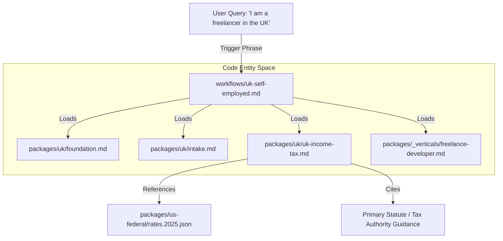
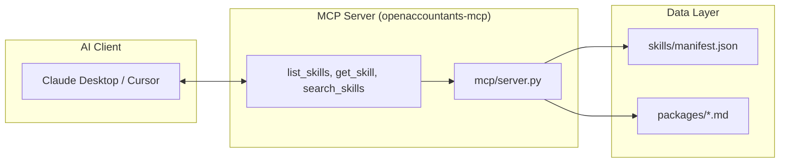

<!-- source: DeepWiki mcp.deepwiki.com · repo openaccountants/openaccountants · page 1 OpenAccountants Overview · fetched 2026-10-27 -->

# OpenAccountants Overview

Relevant source files

The following files were used as context for generating this wiki page:

- [CHANGELOG.md](CHANGELOG.md)
- [CLAUDE.md](CLAUDE.md)
- [README.md](README.md)
- [START-HERE.md](START-HERE.md)
- [docs/INTELLIGENCE-ROADMAP.md](docs/INTELLIGENCE-ROADMAP.md)
- [docs/PROMOTION-PLAYBOOK.md](docs/PROMOTION-PLAYBOOK.md)
- [docs/QUALITY-TIERS.md](docs/QUALITY-TIERS.md)
- [docs/USER-JOURNEY-ANALYSIS.md](docs/USER-JOURNEY-ANALYSIS.md)
- [docs/growth-drafts.md](docs/growth-drafts.md)
- [glama.json](glama.json)
- [llms.txt](llms.txt)
- [packages/indonesia/README.md](packages/indonesia/README.md)
- [packages/nepal/README.md](packages/nepal/README.md)
- [packages/portugal/README.md](packages/portugal/README.md)
- [packages/saudi-arabia/README.md](packages/saudi-arabia/README.md)

OpenAccountants is the open-source tax and accounting layer for AI agents. It provides a library of over 1,000 "skills"—standardized markdown files containing tax rules, computation logic, and filing workflows—covering 190+ jurisdictions [README.md:3-7](). 

The system is designed to transform raw financial data, such as bank statements or bookkeeping exports, into structured accounting working papers that are ready for professional review [START-HERE.md:11-13]().

## System Concept: Natural Language to Code
OpenAccountants bridges the gap between a user's natural language tax questions and the specific tax statutes and computation logic required to answer them.

### Mapping User Intent to Code Entities
The following diagram illustrates how a user's natural language request is routed through the system's core entities.

**Diagram: Intent-to-Skill Mapping**

**Sources:** [README.md:17-50](), [llms.txt:75-103](), [CLAUDE.md:42-43]()

## Core Components

### 1. Skills and Packages
The repository is organized into two primary layers:
*   **`skills/`**: The source layer containing modular building blocks for workflows, domain logic, and patterns [CLAUDE.md:7-10]().
*   **`packages/`**: The distribution layer where skills are compiled into self-contained, jurisdiction-specific folders (e.g., `packages/malta/`, `packages/uk/`) [README.md:81-94](). These are generated via `scripts/build-packages.py` [README.md:98-99]().

### 2. Quality Tiers
OpenAccountants operates on a two-tier quality system to ensure reliability:
*   **Tier 1: Accountant-verified**: Reviewed and signed off by a named, licensed practitioner (CPA/CA/EA). These are served via the MCP server and official website [llms.txt:15-16]().
*   **Tier 2: Research-verified**: Drafted from primary legislation and authoritative sources. These live in the public repository as high-quality drafts awaiting sign-off [docs/QUALITY-TIERS.md:9-14]().

For details on the promotion process, see [Quality Tiers and Verification Lifecycle](#1.2).

### 3. MCP Server
The `openaccountants-mcp` package (located in `mcp/`) allows AI clients like Claude Desktop, Cursor, and Windsurf to dynamically search and load skills without manual file uploads [README.md:65-72]().

**Diagram: MCP Architecture**

**Sources:** [README.md:65-72](), [llms.txt:54-55](), [CLAUDE.md:8-10]()

## Access Patterns

| Access Method | Mechanism | Target Audience |
| :--- | :--- | :--- |
| **MCP Connector** | `pip install openaccountants-mcp` | Power users, developers, and agents (Claude, Cursor) |
| **Bundle API** | `GET /api/bundle/<CODE>` | Programmatic access for web integrations |
| **Manual Upload** | Drag & drop `.md` files | One-off users of Claude.ai or ChatGPT |

For setup instructions, see [Getting Started](#1.1).

## Jurisdiction and Domain Coverage
OpenAccountants provides broad coverage across multiple tax regimes:
*   **International**: 134+ countries with varying levels of depth [README.md:7]().
*   **US/Canada**: Full federal coverage plus 51 US state packages and 13 Canadian provincial packages [README.md:88-93]().
*   **Cross-Border**: Specialized skills for residency, EU VAT, and Pillar Two minimum tax [CHANGELOG.md:9-20]().
*   **Verticals**: Industry-specific logic for e-commerce, SaaS, real estate, and more [START-HERE.md:21-40]().

## Repository Structure

| Directory | Purpose |
| :--- | :--- |
| `packages/` | Compiled jurisdiction-specific skill bundles [CLAUDE.md:7]() |
| `skills/` | Source skills, foundation bases, and shared patterns [llms.txt:68]() |
| `workflows/` | Definitions for the 6-phase advisor lifecycle [llms.txt:69]() |
| `mcp/` | Python source for the Model Context Protocol server [CLAUDE.md:8]() |
| `scripts/` | Build tools and maintenance utilities [CLAUDE.md:10]() |
| `docs/` | Quality standards and contributor guides [CLAUDE.md:9]() |

**Sources:** [README.md:81-94](), [llms.txt:58-71](), [CLAUDE.md:5-14]()

---
*Next Steps:*
*   To begin using the skills, see [Getting Started](#1.1).
*   To understand the verification process, see [Quality Tiers and Verification Lifecycle](#1.2).
*   For legal and licensing information, see [Licensing and Legal](#1.3).

---

