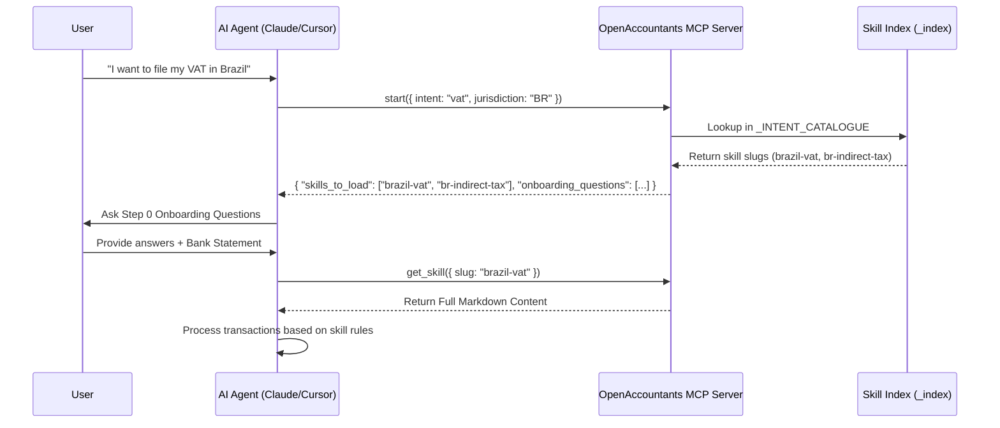
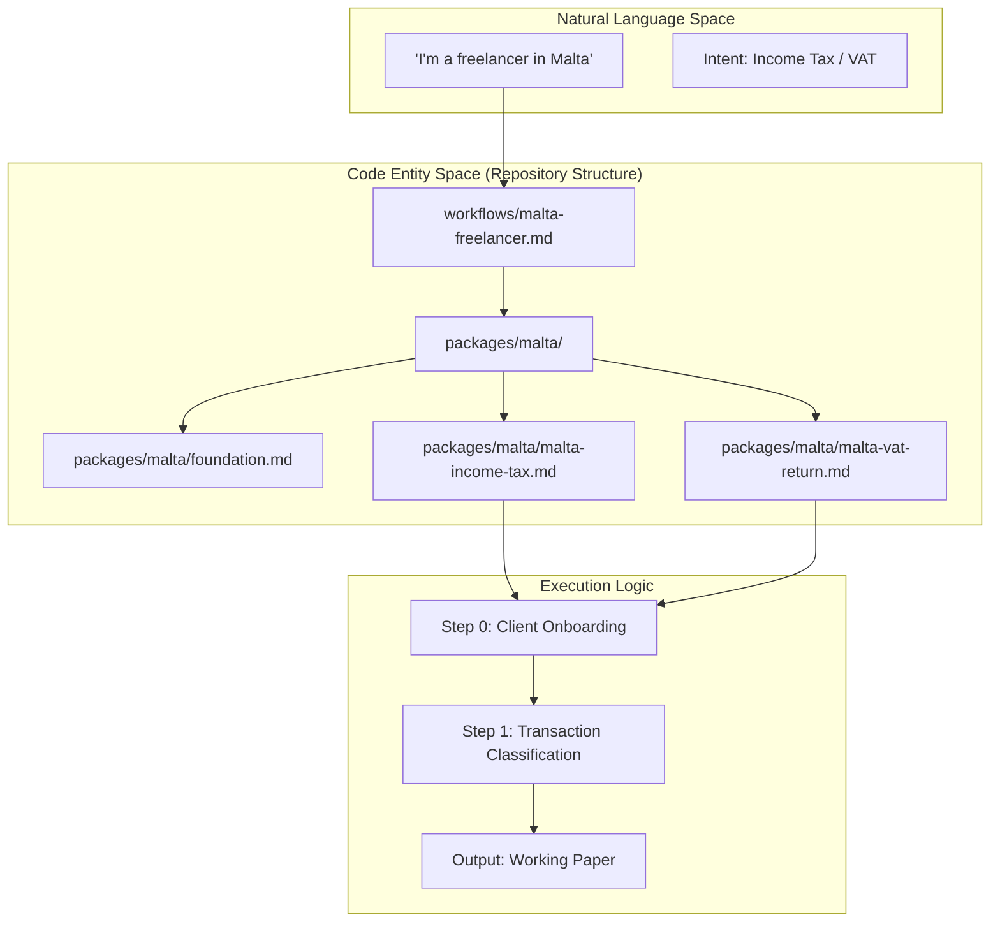

<!-- source: DeepWiki mcp.deepwiki.com · repo openaccountants/openaccountants · page 1.1 Getting Started · fetched 2026-10-27 -->

# Getting Started

<details>
<summary>Relevant source files</summary>

The following files were used as context for generating this wiki page:

- [.claude-plugin/marketplace.json](.claude-plugin/marketplace.json)
- [CHANGELOG.md](CHANGELOG.md)
- [README.md](README.md)
- [START-HERE.md](START-HERE.md)
- [docs/INTELLIGENCE-ROADMAP.md](docs/INTELLIGENCE-ROADMAP.md)
- [docs/PROMOTION-PLAYBOOK.md](docs/PROMOTION-PLAYBOOK.md)
- [docs/QUALITY-TIERS.md](docs/QUALITY-TIERS.md)
- [docs/USER-JOURNEY-ANALYSIS.md](docs/USER-JOURNEY-ANALYSIS.md)
- [docs/growth-drafts.md](docs/growth-drafts.md)
- [llms.txt](llms.txt)
- [packages/indonesia/README.md](packages/indonesia/README.md)
- [packages/nepal/README.md](packages/nepal/README.md)
- [packages/portugal/README.md](packages/portugal/README.md)
- [packages/saudi-arabia/README.md](packages/saudi-arabia/README.md)
- [plugins/openaccountants/.claude-plugin/plugin.json](plugins/openaccountants/.claude-plugin/plugin.json)
- [plugins/openaccountants/commands/openaccountants.md](plugins/openaccountants/commands/openaccountants.md)

</details>


OpenAccountants provides a library of research-verified and accountant-verified tax computation skills for AI agents. This page covers the primary methods for accessing these skills, from manual file uploads to automated MCP integration.

## Purpose and Scope

OpenAccountants bridges the gap between raw financial data and professional tax preparation. It is designed to produce a **Working Paper** that a qualified professional can review and sign off on, rather than providing direct tax advice [START-HERE.md:9-13](). 

The system operates across two primary access patterns:
1.  **The MCP Path (Canonical):** Real-time, tool-based access to the latest accountant-verified (Tier 1) skills [README.md:72]().
2.  **The Manual Path:** Direct interaction with markdown files for auditing, local development, or one-off LLM sessions [README.md:69]().

---

## Access Pattern 1: MCP Server (Recommended)

The Model Context Protocol (MCP) server is the primary way to use OpenAccountants. It provides structured tools that allow an LLM (like Claude Desktop, Cursor, or ChatGPT Business) to discover and fetch skills dynamically [README.md:65-72]().

### 1. Installation
The MCP server is available via PyPI and can be installed using the following command:
```bash
pip install openaccountants-mcp
```
[docs/growth-drafts.md:21]()

### 2. Connection
The server can be connected to any MCP-aware client using the following endpoint:
`https://www.openaccountants.com/api/mcp`
[llms.txt:54]()

### 3. Tool Interaction Flow
When a user asks a tax question, the AI follows a specific sequence of tool calls to ensure compliance with the OpenAccountants framework:

Title: MCP Skill Retrieval Flow

Sources: [plugins/openaccountants/commands/openaccountants.md:6-11](), [llms.txt:54](), [README.md:17-27]()

---

## Access Pattern 2: Manual File Upload

For users who prefer not to use MCP, or for developers auditing the research-verified (Tier 2) drafts, the repository provides pre-compiled **Packages**.

### 1. Locating Packages
Packages are self-contained folders located in `packages/`. Each folder contains everything an LLM needs to handle a specific jurisdiction [README.md:78-94]():
*   `foundation.md`: Core logic, conservative defaults, and output specifications [README.md:147]().
*   `intake.md`: Step 0 onboarding questions and refusal logic [README.md:148]().
*   `[jurisdiction]-*.md`: Specific domain skills (VAT, Income Tax, etc.) [README.md:149-152]().

### 2. Execution Steps
1.  **Identify Scenario:** Match your situation to a scenario in [START-HERE.md:21-40]().
2.  **Upload:** Drag all `.md` files from the relevant `packages/<jurisdiction>/` folder into your LLM's knowledge base (e.g., Claude Projects or Custom GPTs) [README.md:100-104]().
3.  **Prompt:** Initiate the session with a specific trigger phrase like: *"Help me with my 2025 taxes. Here is my bank statement."* [START-HERE.md:23]()

---

## The Bundle API

For developers building custom integrations without a full MCP client, OpenAccountants provides a **Bundle API**. This allows fetching all relevant markdown skills for a jurisdiction in a single GET request [llms.txt:40-43]().

| Jurisdiction | ISO Code | API Endpoint Example |
| :--- | :--- | :--- |
| United Kingdom | `GB` | `https://www.openaccountants.com/api/bundle/GB` |
| United States (California) | `US-CA` | `https://www.openaccountants.com/api/bundle/US-CA` |
| South Africa | `ZA` | `https://www.openaccountants.com/api/bundle/ZA` |
| Ontario (Canada) | `CA-ON` | `https://www.openaccountants.com/api/bundle/CA-ON` |

Sources: [llms.txt:41-50]()

---

## Data Flow: From Natural Language to Code Entities

The following diagram illustrates how a natural language request is mapped to the internal file structure and code-based "skills" within the repository.

Title: Natural Language to Code Entity Mapping

Sources: [llms.txt:58-71](), [START-HERE.md:46-53](), [docs/QUALITY-TIERS.md:41-61]()

---

## Quick Start Summary

| Task | Action | Reference |
| :--- | :--- | :--- |
| **Use via Claude** | Connect the Claude Plugin or MCP server. | [README.md:54](), [.claude-plugin/marketplace.json:7-14]() |
| **Manual Use** | Download a folder from `packages/` and upload to LLM. | [README.md:78-94]() |
| **Verify Accuracy** | Check the `verified_by` field in the file frontmatter. | [docs/QUALITY-TIERS.md:94]() |
| **Build Packages** | Run `python3 scripts/build-packages.py` for latest bundles. | [README.md:98]() |

Sources: [README.md:54-104](), [docs/QUALITY-TIERS.md:94](), [START-HERE.md:21-40]()

---

