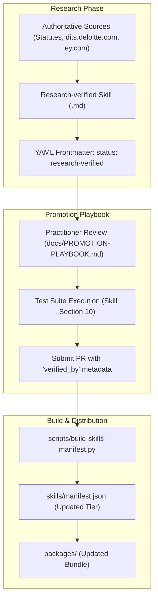
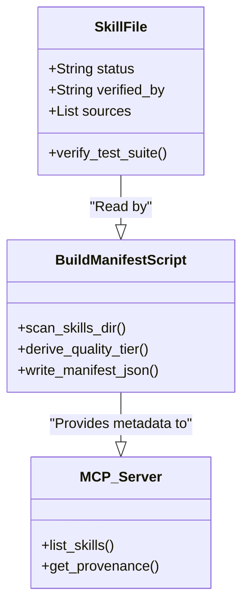

<!-- source: DeepWiki mcp.deepwiki.com · repo openaccountants/openaccountants · page 1.2 Quality Tiers and Verification Lifecycle · fetched 2026-10-27 -->

# Quality Tiers and Verification Lifecycle

Relevant source files

The following files were used as context for generating this wiki page:

- [.github/FUNDING.yml](.github/FUNDING.yml)
- [.github/ISSUE_TEMPLATE/bug-report.md](.github/ISSUE_TEMPLATE/bug-report.md)
- [.github/ISSUE_TEMPLATE/new-country.md](.github/ISSUE_TEMPLATE/new-country.md)
- [.github/ISSUE_TEMPLATE/rate-correction.md](.github/ISSUE_TEMPLATE/rate-correction.md)
- [.github/ISSUE_TEMPLATE/vendor-pattern.md](.github/ISSUE_TEMPLATE/vendor-pattern.md)
- [.github/PULL_REQUEST_TEMPLATE.md](.github/PULL_REQUEST_TEMPLATE.md)
- [CHANGELOG.md](CHANGELOG.md)
- [CLA.md](CLA.md)
- [COMMERCIAL_LICENSE.md](COMMERCIAL_LICENSE.md)
- [CONTRIBUTING.md](CONTRIBUTING.md)
- [LICENSE](LICENSE)
- [START-HERE.md](START-HERE.md)
- [docs/ARCHITECTURE-OPTIONS.md](docs/ARCHITECTURE-OPTIONS.md)
- [docs/INTELLIGENCE-ROADMAP.md](docs/INTELLIGENCE-ROADMAP.md)
- [docs/PROMOTION-PLAYBOOK.md](docs/PROMOTION-PLAYBOOK.md)
- [docs/QUALITY-TIERS.md](docs/QUALITY-TIERS.md)
- [docs/USER-JOURNEY-ANALYSIS.md](docs/USER-JOURNEY-ANALYSIS.md)
- [docs/growth-drafts.md](docs/growth-drafts.md)
- [docs/skill-template.md](docs/skill-template.md)
- [skills/foundation/workflow-base.md](skills/foundation/workflow-base.md)

OpenAccountants employs a rigorous two-tier quality system to manage the reliability of AI-driven tax and accounting workflows. Because tax law is a high-stakes domain, the system prioritizes radical transparency over perceived completeness. Every skill in the repository is explicitly labeled as either **Research-verified** or **Accountant-verified** [docs/QUALITY-TIERS.md:5-16]().

## The Two-Tier System

The quality tier is defined in the YAML frontmatter of every skill file and determines the level of trust a user or practitioner can place in the output [docs/QUALITY-TIERS.md:11-15]().

| Tier | Definition | Guarantees |
| :--- | :--- | :--- |
| **Accountant-verified** | Reviewed and signed off by a licensed practitioner (CPA, EA, CA, etc.) [docs/QUALITY-TIERS.md:13](). | Tested against real client data; current with latest tax-year rates; carries reviewer's name and license [docs/QUALITY-TIERS.md:22-28](). |
| **Research-verified** | Drafted from authoritative statutes and tax authority publications [docs/QUALITY-TIERS.md:14](). | Follows standard `workflow-base.md` structure; every figure carries a primary-source citation [docs/QUALITY-TIERS.md:29-35](). |

### Verification Lifecycle Data Flow

The following diagram illustrates how a skill moves from initial research to practitioner sign-off, involving specific scripts and metadata fields.

**Verification Promotion Logic**

**Sources:** [docs/QUALITY-TIERS.md:127-134](), [docs/PROMOTION-PLAYBOOK.md](), [scripts/build-skills-manifest.py:35-36]()

---

## Implementation Detail: The Verification Contract

All skills, regardless of tier, must implement the **Conservative Defaults Principle** defined in the `workflow-base.md` [skills/foundation/workflow-base.md:28-30](). This ensures that even "Research-verified" skills fail safely by assuming more tax liability rather than less when data is ambiguous.

### Data States in Verification
Every transaction processed by a skill must be assigned one of three outcomes based on document evidence [skills/foundation/workflow-base.md:32-44]():

1.  **Classified:** Facts are clear; rule applied with citation.
2.  **Assumed:** Facts missing; **Conservative Default** applied (e.g., standard rate assumed for unknown supply) [skills/foundation/workflow-base.md:52-59]().
3.  **Needs Input:** Cannot proceed; requires user or reviewer intervention.

### Verification Metadata (YAML)
The build pipeline uses specific YAML fields to categorize skills.
*   `status`: `research-verified` or `accountant-verified`.
*   `verified_by`: Name and license number of the practitioner.
*   `last_updated`: Date of the last legislative check.
*   `sources`: List of primary statutes or tax authority URLs [docs/QUALITY-TIERS.md:118-120]().

**Sources:** [skills/foundation/workflow-base.md:28-59](), [docs/QUALITY-TIERS.md:94-98]()

---

## The Promotion Playbook

The process of moving a skill from "Research-verified" to "Accountant-verified" is governed by the `docs/PROMOTION-PLAYBOOK.md`. This involves a three-step verification of the "Code Entity Space" (the Markdown rules) against "Natural Language Space" (the actual law).

### 1. Statutory Cross-Check
The practitioner verifies every rate, threshold, and deadline in the skill against current law (e.g., IRC for US, VAT Act for Malta) [docs/QUALITY-TIERS.md:130]().

### 2. Representative Data Testing
The skill must be run against representative or anonymized real client data to ensure the `Box/Line Assignment` (Step 2) and `Derived Calculations` (Step 5) produce correct tax returns [docs/QUALITY-TIERS.md:131](), [docs/QUALITY-TIERS.md:48-51]().

### 3. Manifest Update
The `scripts/build-skills-manifest.py` script crawls the `skills/` directory and updates the central `manifest.json`. This manifest is used by the MCP server and the website to display the quality badge [docs/QUALITY-TIERS.md:94]().

**Code-to-Quality Mapping**

**Sources:** [docs/QUALITY-TIERS.md:127-134](), [scripts/build-skills-manifest.py:35-36](), [docs/QUALITY-TIERS.md:94]()

---

## Current Inventory and Verification Status

As of the current release, the following jurisdictions have achieved **Accountant-verified** status for their core modules:

| Jurisdiction | Verified Skills | Reviewer |
| :--- | :--- | :--- |
| **Malta** | VAT, Income Tax, SSC, Optimization [docs/QUALITY-TIERS.md:80-84]() | Michael Cutajar, CPA |
| **South Africa** | VAT, Income Tax, Provisional Tax [docs/QUALITY-TIERS.md:86-89]() | Michael Cutajar, CPA |
| **US Federal** | Sole Prop Bookkeeping, Schedule C [docs/QUALITY-TIERS.md:90-91]() | Practitioner Registry Pending |
| **Germany** | VAT Return [docs/QUALITY-TIERS.md:85]() | Practitioner Registry Pending |

All other 700+ skills (including 51 US States and 134+ countries) remain in the **Research-verified** tier [docs/QUALITY-TIERS.md:97-98]().

**Sources:** [docs/QUALITY-TIERS.md:76-98](), [CHANGELOG.md:82-85]()

---

