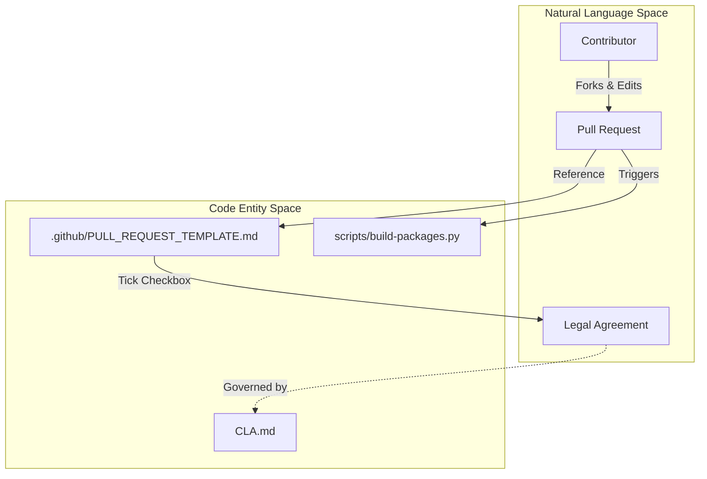
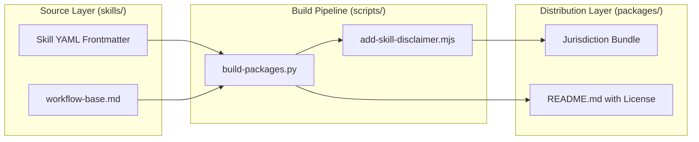

<!-- source: DeepWiki mcp.deepwiki.com · repo openaccountants/openaccountants · page 1.3 Licensing and Legal · fetched 2026-10-27 -->

# Licensing and Legal

Relevant source files

The following files were used as context for generating this wiki page:

- [CLA.md](CLA.md)
- [COMMERCIAL_LICENSE.md](COMMERCIAL_LICENSE.md)
- [CONTRIBUTING.md](CONTRIBUTING.md)
- [LICENSE](LICENSE)
- [LICENSE-ADDITIONAL.md](LICENSE-ADDITIONAL.md)
- [skills/foundation/workflow-base.md](skills/foundation/workflow-base.md)

OpenAccountants operates under a dual-license model designed to balance the needs of the open-source community with the requirements of commercial software vendors. This page details the legal framework governing the use, modification, and contribution of skills within the repository.

## Dual-License Model

The codebase is primarily licensed under the **GNU Affero General Public License v3.0 (AGPL-3.0)** [LICENSE:1-2](). To accommodate users who cannot comply with the "copyleft" requirements of the AGPL, a **Commercial License** option is provided by Glimpse Ltd [LICENSE-ADDITIONAL.md:13-15]().

### 1. Open Source: AGPL-3.0
The AGPL-3.0 is a strong copyleft license specifically designed for network server software [LICENSE:10-12](). 

*   **Key Requirement:** If you run a modified version of OpenAccountants on a server and let the public access it, you must make the Corresponding Source code of that modified version available to those users [LICENSE:42-48]().
*   **Scope:** This applies to any "covered work," which includes unmodified versions of the program or works based on the program [LICENSE:77-79]().

### 2. Commercial License
The commercial license is intended for businesses and products that incorporate OpenAccountants skills but do not wish to release their proprietary source code under the AGPL-3.0 [COMMERCIAL_LICENSE.md:9-14]().

| Use Case | License Required |
| :--- | :--- |
| Personal tax preparation in an LLM | **AGPL-3.0** (No fee) |
| Accountants using skills as a reference tool | **AGPL-3.0** (No fee) |
| Open-source projects (AGPL-compatible) | **AGPL-3.0** (No fee) |
| **Proprietary SaaS / API products** | **Commercial** |
| **Proprietary LLM agents/chatbots** | **Commercial** |

**Sources:** [LICENSE:1-50](), [COMMERCIAL_LICENSE.md:18-39](), [LICENSE-ADDITIONAL.md:1-16]()

---

## Attribution and Additional Terms

Under Section 7 of the AGPL-3.0, OpenAccountants exercises the right to require specific attribution [LICENSE-ADDITIONAL.md:5-7]().

*   **Requirement:** Users must retain all copyright notices, the "Open Accountants" name, and links to `openaccountants.com` [LICENSE-ADDITIONAL.md:9-11]().
*   **Visibility:** This attribution must be present in any modified versions, derivative works, and user-facing output that references the skills [LICENSE-ADDITIONAL.md:11-12]().

### Legal Entity
All licensing (both commercial and the CLA) is managed by:
**Glimpse Ltd**
Malta
Contact: `info@openaccountants.com`

**Sources:** [LICENSE-ADDITIONAL.md:1-16](), [COMMERCIAL_LICENSE.md:72-79](), [CLA.md:60-67]()

---

## Contributor License Agreement (CLA)

To maintain the dual-license model, all contributors must agree to the OpenAccountants CLA. This ensures that Glimpse Ltd has the legal authority to distribute contributions under both the AGPL and commercial tracks [CLA.md:7-9]().

### Rights and Permissions
*   **Ownership:** The contributor retains full copyright ownership of their work [CLA.md:11-12]().
*   **Grant:** The contributor grants Glimpse Ltd a perpetual, worldwide, non-exclusive, royalty-free, irrevocable license to use, modify, and sublicense the contribution under any license [CLA.md:19-22]().
*   **Patents:** The contributor grants a patent license for any claims necessarily infringed by their contribution [CLA.md:23-26]().

### Implementation: The "Checkbox" Flow
The CLA is integrated into the GitHub contribution workflow via the pull request template.

**Natural Language to Code Entity: Contribution Flow**

**Sources:** [CLA.md:1-46](), [CONTRIBUTING.md:18-25]()

---

## Technical Enforcement of Disclaimers

The licensing model is reinforced by automated scripts that inject legal disclaimers and metadata into the generated packages.

### Automated Disclaimer Injection
The build pipeline uses scripts to ensure that every skill carries the necessary legal protections before it is distributed.

1.  **Workflow Base Requirement:** Every skill must be loaded with `workflow-base.md`, which contains the "Reviewer Assumption" and "Conservative Defaults" legal frameworks [skills/foundation/workflow-base.md:2-23]().
2.  **Disclaimer Suffix:** Skills are appended with a mandatory disclaimer stating they are "not tax advice" [CONTRIBUTING.md:50-50]().
3.  **Build Pipeline Integration:** The `scripts/build-packages.py` script aggregates source skills into the `packages/` directory, ensuring the `foundation.md` (which includes legal warnings) is bundled automatically [CONTRIBUTING.md:23-26](), [CONTRIBUTING.md:79-89]().

**Data Flow: Legal Metadata Injection**

**Sources:** [CONTRIBUTING.md:23-26](), [CONTRIBUTING.md:79-89](), [skills/foundation/workflow-base.md:1-23]()

---

