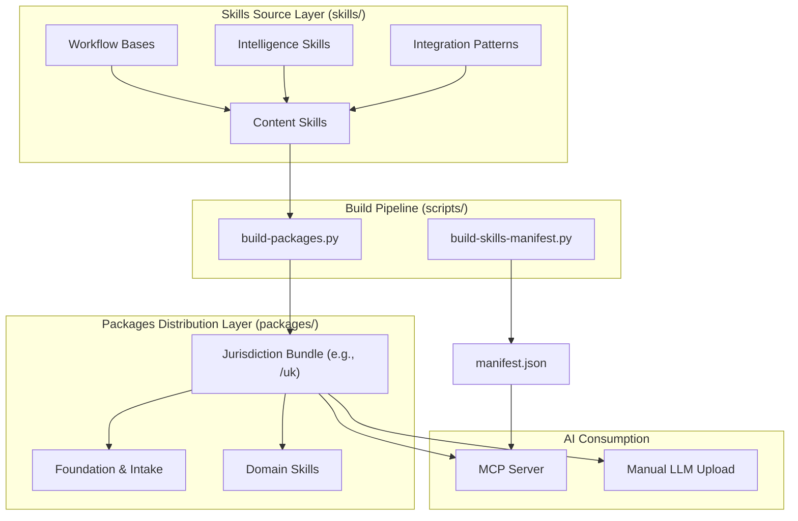
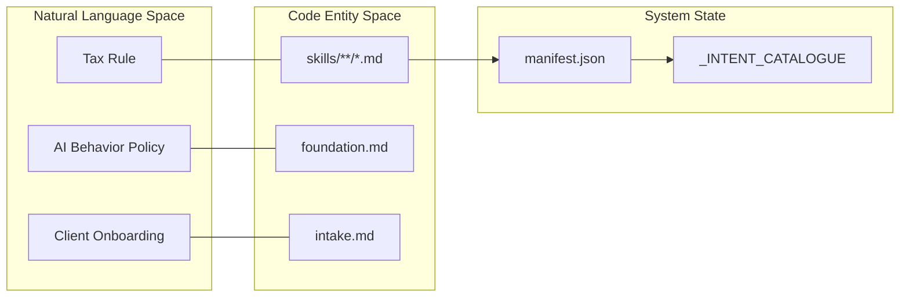

<!-- source: DeepWiki mcp.deepwiki.com · repo openaccountants/openaccountants · page 2 Core Architecture · fetched 2026-10-27 -->

# Core Architecture

Relevant source files

The following files were used as context for generating this wiki page:

- [CHANGELOG.md](CHANGELOG.md)
- [README.md](README.md)
- [START-HERE.md](START-HERE.md)
- [docs/INTELLIGENCE-ROADMAP.md](docs/INTELLIGENCE-ROADMAP.md)
- [docs/PROMOTION-PLAYBOOK.md](docs/PROMOTION-PLAYBOOK.md)
- [docs/QUALITY-TIERS.md](docs/QUALITY-TIERS.md)
- [docs/USER-JOURNEY-ANALYSIS.md](docs/USER-JOURNEY-ANALYSIS.md)
- [docs/growth-drafts.md](docs/growth-drafts.md)
- [llms.txt](llms.txt)
- [packages/indonesia/README.md](packages/indonesia/README.md)
- [packages/nepal/README.md](packages/nepal/README.md)
- [packages/portugal/README.md](packages/portugal/README.md)
- [packages/saudi-arabia/README.md](packages/saudi-arabia/README.md)
- [skills/financial-reporting/business-combinations/ifrs3-business-combinations.md](skills/financial-reporting/business-combinations/ifrs3-business-combinations.md)
- [skills/financial-reporting/business-combinations/us-gaap-asc805-business-combinations.md](skills/financial-reporting/business-combinations/us-gaap-asc805-business-combinations.md)
- [skills/financial-reporting/debt-vs-equity/ias32-debt-vs-equity.md](skills/financial-reporting/debt-vs-equity/ias32-debt-vs-equity.md)
- [skills/financial-reporting/debt-vs-equity/us-gaap-debt-vs-equity.md](skills/financial-reporting/debt-vs-equity/us-gaap-debt-vs-equity.md)
- [skills/financial-reporting/financial-reporting-workflow-base.md](skills/financial-reporting/financial-reporting-workflow-base.md)
- [skills/financial-reporting/leases/ifrs16-leases.md](skills/financial-reporting/leases/ifrs16-leases.md)
- [skills/financial-reporting/leases/us-gaap-asc842-leases.md](skills/financial-reporting/leases/us-gaap-asc842-leases.md)
- [skills/financial-reporting/revenue-recognition/ifrs15-revenue.md](skills/financial-reporting/revenue-recognition/ifrs15-revenue.md)
- [skills/financial-reporting/revenue-recognition/us-gaap-asc606-revenue.md](skills/financial-reporting/revenue-recognition/us-gaap-asc606-revenue.md)
- [skills/international/kazakhstan/kz-simplified-regime.md](skills/international/kazakhstan/kz-simplified-regime.md)
- [skills/manifest.json](skills/manifest.json)

The OpenAccountants system is built on a decoupled, two-layer architecture designed to separate the **authoritative source of truth** (the skills layer) from the **consumable delivery format** (the packages layer). This structure ensures that tax rules remain modular and maintainable while providing AI agents with self-contained, context-rich bundles for specific jurisdictions.

### High-Level System Overview

The following diagram illustrates how raw skills are transformed into jurisdiction-specific packages and ultimately consumed by AI clients via the MCP server or manual upload.

**System Data Flow**

**Sources:** [README.md:15-27](), [README.md:76-94](), [llms.txt:56-71]()

---

### 1. Skills Source Layer
The `skills/` directory is the "source code" of the repository. It contains granular, atomic markdown files that define tax treatments, calculation logic, and reporting thresholds. These files are categorized by domain (e.g., `international/`, `us-states/`, `federal/`) and are designed to be composed together.

*   **Workflow Bases:** Provide the "contract" for how an AI should behave (e.g., `financial-reporting-workflow-base.md`).
*   **Content Skills:** The specific rules for a tax obligation (e.g., `ifrs15-revenue.md`).
*   **Intelligence & Patterns:** Reusable logic for deadlines, thresholds, and vendor-specific transaction classification.

For a deep dive into how skills are structured and the YAML frontmatter standard, see [Skills Source Layer](#2.1).

**Sources:** [llms.txt:68-69](), [skills/financial-reporting/revenue-recognition/ifrs15-revenue.md:29-32](), [docs/QUALITY-TIERS.md:39-61]()

---

### 2. Packages Distribution Layer
The `packages/` directory contains the "compiled" output of the system. Each folder in this directory represents a complete, self-contained environment for an AI agent to handle a specific jurisdiction (e.g., `packages/malta/`, `packages/ca-on/`).

*   **Self-Contained:** Every package includes its own `foundation.md` and `intake.md` to ensure the AI follows the correct onboarding and conservative default protocols.
*   **Domain Specific:** Packages aggregate all relevant skills for that region, including income tax, VAT, and local social contributions.
*   **Immutable:** Files in `packages/` should never be edited directly; they are overwritten during the build process.

For details on the structure of a jurisdiction bundle, see [Packages Distribution Layer](#2.2).

**Sources:** [README.md:80-94](), [README.md:143-154](), [llms.txt:59-64]()

---

### 3. Build Pipeline and Manifest
The bridge between the source skills and the distributed packages is the `scripts/` directory. This pipeline automates the assembly of bundles and the generation of system metadata.

*   **`build-packages.py`**: The primary compiler that maps source skills into the `packages/` folder structure.
*   **`build-skills-manifest.py`**: Generates `skills/manifest.json`, which acts as the index for the MCP server and the website. It tracks versioning, quality tiers, and jurisdiction coverage.
*   **Quality Enforcement**: The pipeline ensures that every skill is tagged as either `accountant-verified` or `research-verified` before distribution.

For documentation on the build scripts and the manifest schema, see [Build Pipeline and Scripts](#2.3).

**Sources:** [README.md:98-99](), [skills/manifest.json:1-8](), [docs/QUALITY-TIERS.md:93-95]()

---

### Architectural Mapping: Code to Logic
The following diagram maps high-level system concepts to specific file entities within the repository.

**Code Entity Mapping**

**Sources:** [llms.txt:7-11](), [docs/QUALITY-TIERS.md:41-61](), [skills/manifest.json:47-58]()

---

### Key Design Principles

| Principle | Implementation in Code |
| :--- | :--- |
| **Conservative Defaults** | `foundation.md` instructs the AI to assume more tax, never less, when uncertain. |
| **Atomic Skills** | Each `.md` file in `skills/` focuses on one specific obligation (e.g., `nepal-vat.md`). |
| **Deterministic Output** | Rules use lookup tables and classification matrices instead of narrative text. |
| **Transparency** | The `quality` field in `manifest.json` and file frontmatter explicitly states the verification tier. |

**Sources:** [START-HERE.md:54-55](), [docs/QUALITY-TIERS.md:65-70](), [packages/nepal/README.md:13-17]()

---

