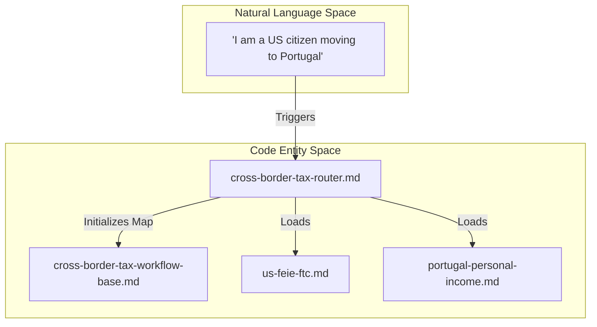
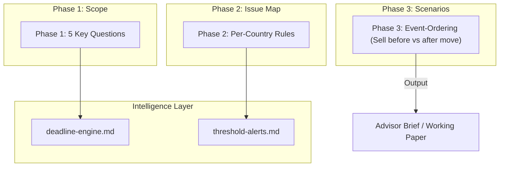

<!-- source: DeepWiki mcp.deepwiki.com · repo openaccountants/openaccountants · page 5 Cross-Border and International Tax · fetched 2026-10-27 -->

# Cross-Border and International Tax

Relevant source files

The following files were used as context for generating this wiki page:

- [skills/cross-border/cross-border-tax-router.md](skills/cross-border/cross-border-tax-router.md)
- [skills/cross-border/cross-border-tax-workflow-base.md](skills/cross-border/cross-border-tax-workflow-base.md)
- [skills/cross-border/eu-oss-digital.md](skills/cross-border/eu-oss-digital.md)
- [skills/cross-border/eu-reverse-charge.md](skills/cross-border/eu-reverse-charge.md)
- [skills/cross-border/non-eu-export-services.md](skills/cross-border/non-eu-export-services.md)
- [skills/cross-border/permanent-establishment-risk.md](skills/cross-border/permanent-establishment-risk.md)
- [skills/cross-border/us-expat/us-cfc-gilti.md](skills/cross-border/us-expat/us-cfc-gilti.md)
- [skills/cross-border/us-expat/us-expatriation-exit-tax.md](skills/cross-border/us-expat/us-expatriation-exit-tax.md)
- [skills/cross-border/us-expat/us-fbar-fatca-reporting.md](skills/cross-border/us-expat/us-fbar-fatca-reporting.md)
- [skills/cross-border/us-expat/us-feie-ftc.md](skills/cross-border/us-expat/us-feie-ftc.md)
- [skills/cross-border/us-expat/us-foreign-trust-reporting.md](skills/cross-border/us-expat/us-foreign-trust-reporting.md)
- [skills/cross-border/withholding-tax-matrix.md](skills/cross-border/withholding-tax-matrix.md)
- [skills/intelligence/deadline-engine.md](skills/intelligence/deadline-engine.md)
- [skills/intelligence/optimisation-advisor.md](skills/intelligence/optimisation-advisor.md)
- [skills/intelligence/threshold-alerts.md](skills/intelligence/threshold-alerts.md)
- [skills/patterns/global-home-office.md](skills/patterns/global-home-office.md)
- [skills/patterns/global-payment-processors.md](skills/patterns/global-payment-processors.md)
- [skills/patterns/global-saas-vendors.md](skills/patterns/global-saas-vendors.md)
- [workflows/cross-border-intake.md](workflows/cross-border-intake.md)

This section documents the cross-border and international tax layer of OpenAccountants. This layer acts as a specialized orchestrator for scenarios where a taxpayer's facts engage more than one jurisdiction—such as US expats, digital nomads, or EU businesses selling across borders.

The cross-border system is designed to prevent "single-country tunnel vision" by forcing the AI to map residency, citizenship, and domicile before applying domestic tax logic.

## The Cross-Border Router

The entry point for all multi-jurisdiction scenarios is the `cross-border-tax-router`. This skill does not compute tax; instead, it performs residency mapping, corridor identification, and sequencing [skills/cross-border/cross-border-tax-router.md:9-16]().

### Natural Language to Code Entity Mapping: Routing
The following diagram shows how the system moves from a user's natural language input to the specific code entities that handle international tax logic.

**Sources:** [skills/cross-border/cross-border-tax-router.md:1-22](), [workflows/cross-border-intake.md:1-15]()

## Core Principles and Workflow

The international layer operates under a specific "sequenced-plan" contract. Unlike domestic skills, a cross-border response must be an ordered set of steps because the sequence of events (e.g., selling an asset before vs. after a move) changes the tax outcome [skills/cross-border/cross-border-tax-workflow-base.md:48-52]().

*   **Conservative Default Principle:** When facts are incomplete, the system assumes the broader taxing right and the reporting obligation (e.g., filing an FBAR or Form 3520) rather than assuming an exemption [skills/cross-border/cross-border-tax-workflow-base.md:126-137]().
*   **The Treaty Bridge:** Every cross-border output must explicitly identify which country has the primary taxing right and which provides relief (via credit, exemption, or re-sourcing) [skills/cross-border/cross-border-tax-workflow-base.md:83-98]().
*   **Audit Flash Points:** High-risk positions, such as treaty-residence tie-breakers or grantor trust characterization, are marked with `⚑ AUDIT FLASH POINT` for human reviewer attention [skills/cross-border/cross-border-tax-workflow-base.md:106-116]().

**Sources:** [skills/cross-border/cross-border-tax-workflow-base.md:1-147]()

## International Scenarios

The cross-border layer is divided into two primary sub-domains: US Outbound/Expat reporting and EU Cross-Border VAT.

### US Expat and International Reporting
This sub-domain covers the complex reporting requirements for "US Persons" (citizens and residents) living abroad or holding foreign assets.

| Topic | Code Entity / Skill | Key Provisions Covered |
| :--- | :--- | :--- |
| **Expat Relief** | `us-feie-ftc` | IRC §911 (Exclusion), §901/§904 (Credits) |
| **Account Reporting** | `us-fbar-fatca-reporting` | FinCEN 114 (FBAR), Form 8938 (FATCA) |
| **Foreign Corps** | `us-cfc-gilti` | IRC §957 (CFC), §951A (GILTI), §962 Election |
| **Foreign Trusts** | `us-foreign-trust-reporting` | IRC §679 (Grantor), §665-668 (Throwback) |
| **Exit Tax** | `us-expatriation-exit-tax` | IRC §877A (Mark-to-Market), Form 8854 |

For details, see [US Expat and International Reporting](#5.2).

**Sources:** [skills/cross-border/us-expat/us-feie-ftc.md:1-10](), [skills/cross-border/us-expat/us-fbar-fatca-reporting.md:1-17](), [skills/cross-border/us-expat/us-cfc-gilti.md:1-16](), [skills/cross-border/us-expat/us-foreign-trust-reporting.md:1-16](), [skills/cross-border/us-expat/us-expatriation-exit-tax.md:1-17]()

### EU VAT and Cross-Border Services
This sub-domain handles the movement of goods and services within the EU and between the EU and non-EU countries. It manages the complexity of the "place of supply" rules.

*   **EU OSS (One Stop Shop):** Managing the €10,000 threshold for digital B2C sales [skills/intelligence/threshold-alerts.md:107-118]().
*   **Reverse Charge:** Handling B2B service supplies where the recipient accounts for VAT.
*   **Withholding Tax:** Managing cross-border payments of dividends, interest, and royalties.

For details, see [EU VAT Cross-Border Rules](#5.3).

**Sources:** [skills/intelligence/threshold-alerts.md:107-118]()

## Cross-Border Intake Workflow

The system uses a 6-phase structure to handle multi-country intakes, ensuring that the critical path (hard deadlines like departure dates) is identified immediately.

### Workflow Logic: Phase-to-Skill Mapping

**Sources:** [workflows/cross-border-intake.md:36-61](), [skills/intelligence/deadline-engine.md:1-16](), [skills/intelligence/threshold-alerts.md:1-17]()

## Child Pages
- [Cross-Border Tax Router and Workflow Base](#5.1) — Detailed mechanics of the `cross-border-tax-router.md` and the foundational `cross-border-tax-workflow-base.md`.
- [US Expat and International Reporting](#5.2) — Deep dive into US-specific international skills (FEIE, FBAR, CFC, Trusts, Exit Tax).
- [EU VAT Cross-Border Rules](#5.3) — Technical coverage of EU-specific cross-border VAT, OSS, and reverse charge mechanisms.

---

